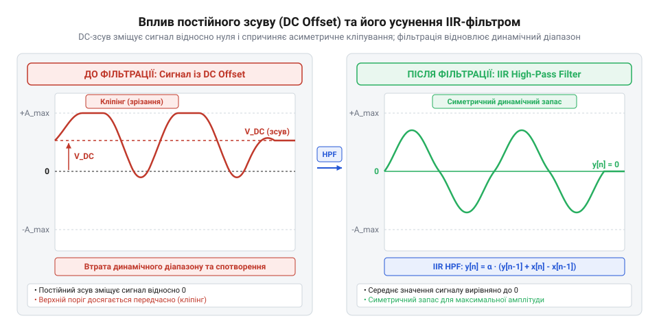
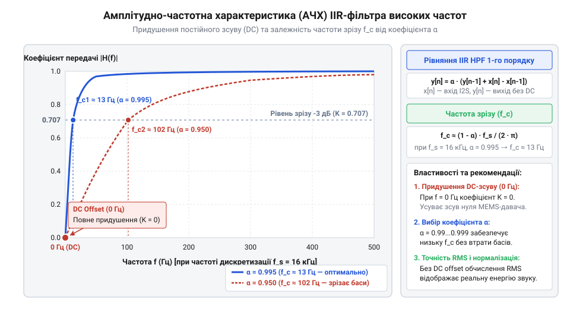
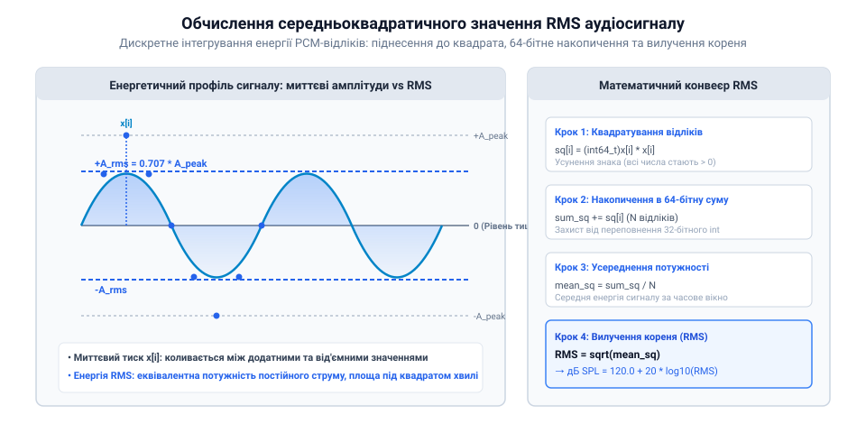
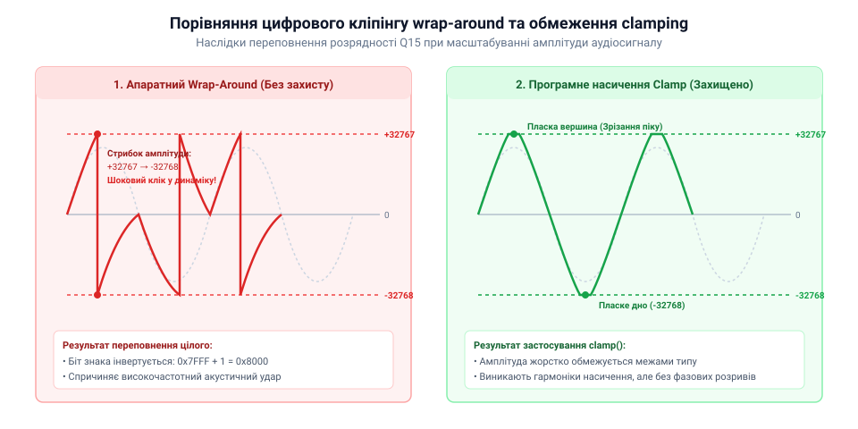

# Математика цифрової фільтрації постійної складової та нормалізації аудіопотоку

<preknowlist>
- [KY-038 — мікрофонний давач звуку](root:cat-hw-sensors/ky-038-mic) — фізичну природу появи постійної напруги зміщення на аналогово-цифрових трактах мікрофонних підсилювачів
- [Звуковий давач з мікрофоном (LM393)](root:cat-hw-sensors/sound-lm393) — принципи вимірювання амплітуди звукових коливань та відмінності аналогового компаратора від цифрової обробки PCM
</preknowlist>

## Зміщення постійної складової в PCM

При підключенні цифрового MEMS-мікрофона через інтерфейс I2S розробник очікує отримати симетричний цифровий аудіопотік, у якому за відсутності акустичних коливань кожен амплітудний відлік `x[n]` дорівнює нулю. Однак на практиці в режимі повної тиші зчитувана послідовність відліків містить стабільне невід'ємне або від'ємне значення — наприклад, `+820` або `-1450` одиниць @@en|LSB@@ (від англ. @@en|Least Significant Bit@@ — найменший значущий розряд). Це явище називають зміщенням постійної складової (англ. @@en|DC offset@@, де @@en|DC@@ походить від @@en|Direct Current@@ — постійний струм).

Постійний зсув виникає через мікроскопічну асиметрію фізичних пластин MEMS-капсуля, технологічні допуски інтегрованого аналогово-цифрового перетворювача та напругу зміщення внутрішнього підсилювача. На відміну від аналогових модулів, таких як [мікрофонний давач KY-038](root:cat-hw-sensors/ky-038-mic) або [звуковий давач LM393](root:cat-hw-sensors/sound-lm393), де напруга зміщення регулюється підстроювальним резистором, у цифрових MEMS-мікрофонах ця величина зафіксована у структурі кристала силікону і передається безпосередньо в цифровий потік @@en|PCM@@ (англ. @@en|Pulse-Code Modulation@@ — імпульсно-кодова модуляція). Для детального вивчення принципів кодування, дискретизації та форматів представлення аудіовідліків перегляньте матеріал про [цифровий аудіопотік PCM](root:cat-hw-sensors/i2s-mems-microphone/math-pcm-dc-filter-gain.md).

Людське вухо сприймає лише зміну акустичного тиску і не чує нерухомого постійного зсуву, але наявність @@en|DC offset@@ руйнує подальшу цифрову обробку аудіопотоку з кількох причин:

1. **Звуження динамічного діапазону та асиметричний кліпінг.** У 16-бітовій арифметиці зі знаком діапазон PCM-відліків обмежений значеннями від `-32768` до `+32767`. Якщо рівень тиші зміщений на `+5000` LSB, то центр акустичних коливань зміщується догори. Позитивна напівхвиля звукового сигналу зможе зростати лише до `32767 - 5000 = 27767` LSB, після чого виникає апаратне переповнення розрядної сітки — @@en|clipping@@ (зрізання верхівок хвилі). Водночас від'ємна напівхвиля отримуватиме невикористаний запас у `37767` LSB. Сигнал спотворюється ще до досягнення своєї максимальної амплітуди.

2. **Клацання та стрибки рівня при зміні підсилення.** Якщо аудіосигнал `x[n]` масштабується коефіцієнтом підсилення `G` для нормалізації гучності, то при наявності постійної складової `D` (тобто `x[n] = s[n] + D`, де `s[n]` — корисний акустичний сигнал) після підсилення маємо:
`y[n] = G × x[n] = G × s[n] + G × D`
Якщо коефіцієнт `G` динамічно змінюється алгоритмом автоматичного регулювання рівня (англ. @@en|AGC@@ — @@en|Automatic Gain Control@@), добуток `G × D` миттєво змінюється. Цей стрибок сприймається динаміком як неприємне низькочастотне клацання або стукіт, який здатен пошкодити акустичну систему.

3. **Викривлення енергетичних показників та RMS.** Для оцінки гучності або наявності голосу використовують середньоквадратичне значення (англ. @@en|RMS@@ — @@en|Root Mean Square@@). Постійне зміщення додає власну стаціонарну енергію до розрахунку. Оскільки при усередненні середня величина подвійного добутку прямує до нуля, квадрат зміщення `D²` лишається у виразі:
`RMS_total = √(RMS_sound² + D²)`
Через це детектор звуку фіксує високий рівень сигналу навіть у повній акустичній тиші.

*Графік часової області аудіосигналу з постійним зсувом та його вирівнювання відносно нульового рівня після видалення складової нульової частоти.*

З точки зору спектрального аналізу постійне зміщення являє собою складову з частотою `f = 0` Гц. Щоб відновити симетрію динамічного діапазону та забезпечити коректне математичне підсилення, цю складову необхідно вилучити на початку обробки аудіопотоку.

## Рекурсивний фільтр високих частот

Для видалення постійного зсуву (`f = 0` Гц) при збереженні чутних акустичних частот (`f > 20` Гц) застосовують фільтр високих частот (англ. @@en|High-Pass Filter@@, HPF). У цифровій обробці сигналів збереження великих масивів відліків для обчислення ковзного середнього є неприйнятним через обмеження оперативної пам'яті мікроконтролера та затримку обробки. Замість цього застосовують рекурсивний @@en|IIR Filter@@ (від англ. @@en|Infinite Impulse Response@@ — нескінченна імпульсна характеристика) першого порядку, в якому поточний вихідний відлік `y[n]` залежить від поточного та попереднього вхідних відліків `x[n]`, `x[n-1]` і попереднього вихідного відліку `y[n-1]`. Для поглибленого ознайомлення з теорією цифрових фільтрів із нескінченною імпульсною характеристикою та структурними схемами зворотного зв'язку читайте статтю про [основи дискретних IIR-фільтрів](root:com-signal/iir-filter).

Виведемо дискретне різницеве рівняння (англ. @@en|difference equation@@) фільтра з неперервної схемотехнічної аналогії. Неперервний аналоговий RC-фільтр високих частот описується диференціальним рівнянням:
`v_out(t) + RC × (d v_out(t) ÷ dt) = RC × (d v_in(t) ÷ dt)`

Для переходу до дискретного часу `t = n × T_s` (де `T_s` — період дискретизації, `T_s = 1 ÷ f_s`) застосуємо метод зворотної різниці (англ. @@en|backward difference method@@):
`d v(t) ÷ dt ≈ (v[n] - v[n-1]) ÷ T_s`

Підставивши дискретні похідні та позначивши вхідний сигнал як `x[n]`, а вихідний як `y[n]`, отримуємо покрокове перетворення:

        y[n] + RC × (y[n] - y[n-1]) ÷ T_s = RC × (x[n] - x[n-1]) ÷ T_s
        y[n] × T_s + RC × (y[n] - y[n-1]) = RC × (x[n] - x[n-1])                 [помноження обох частин на T_s]
        y[n] × T_s + RC × y[n] - RC × y[n-1] = RC × (x[n] - x[n-1])             [розкриття дужок]
        y[n] × (RC + T_s) = RC × y[n-1] + RC × (x[n] - x[n-1])                   [групування доданків з y[n]]
        y[n] = (RC ÷ (RC + T_s)) × y[n-1] + (RC ÷ (RC + T_s)) × (x[n] - x[n-1])  [ділення обох частин на (RC + T_s)]

Позначивши співвідношення постійної часу до сумарного інтервалу як коефіцієнт згладжування `α = RC ÷ (RC + T_s)`, дістаємо різницеве рівняння цифрового IIR-фільтра:

        y[n] = α × y[n-1] + α × (x[n] - x[n-1])                                  [підстановка α = RC ÷ (RC + T_s)]
        y[n] = α × (y[n-1] + x[n] - x[n-1])                                      [винесення α за дужки]

Математичний механізм роботи цього рівняння розкривається на двох крайніх режимах сигналу:

1. **Режим постійного зсуву.** За наявності постійної складової `x[n] = D` різниця сусідніх вхідних відліків `x[n] - x[n-1]` дорівнює нулю (`D - D = 0`). Рівняння спрощується до рекурсивного згасання:
`y[n] = α × y[n-1]`
Оскільки коефіцієнт `α` лежить у діапазоні `0 < α < 1` (наприклад, `α ≈ 0.995`), вихідний сигнал згасає за показниковістю:
`y[n] = αⁿ × y[0]`
При `n → ∞` величина `αⁿ` прямує до нуля, тому постійне зміщення повністю відфільтровується з аудіопотоку.

2. **Режим змінних акустичних коливань.** При швидкій зміні звукового сигналу різниця `x[n] - x[n-1]` визначає миттєву швидкість коливань. Завдяки значенням `α`, близьким до одиниці, вихідні відліки `y[n]` відтворюють вхідний акустичний сигнал без зсуву осі.

*Амплітудно-частотна характеристика цифрового IIR-фільтра першого порядку, що демонструє пригнічення частоти 0 Гц та пропускання корисного акустичного діапазону.*

Для обчислення одного відліку фільтр потребує збереження лише двох змінних стану: попереднього вхідного значення `x[n-1]` та попереднього відфільтрованого значення `y[n-1]`.

## Частота зрізу та коефіцієнт згладжування

Параметр `α` у різницевому рівнянні визначається постійною часу `RC` та періодом дискретизації `T_s`. На практиці розробник виходить із заданої частоти дискретизації `f_s` (англ. @@en|sampling rate@@) та бажаної частоти зрізу `f_c` (англ. @@en|cutoff frequency@@).

Частота зрізу `f_c` визначає межу, на якій коефіцієнт передачі фільтра зменшується на `3` децибели (-3 dB), що відповідає падінню амплітуди в `√2 ≈ 1.414` раза.

У неперервному RC-фільтрі частота зрізу пов'язана з постійною часу виразом:
`f_c = 1 ÷ (2 × π × RC)`

Виразивши постійну часу `RC = 1 ÷ (2 × π × f_c)` та врахувавши `T_s = 1 ÷ f_s`, підставимо їх у формулу коефіцієнта `α`:

        α = RC ÷ (RC + T_s)
        α = (1 ÷ (2 × π × f_c)) ÷ ((1 ÷ (2 × π × f_c)) + (1 ÷ f_s))              [підстановка RC та T_s]
        α = 1 ÷ (1 + (2 × π × f_c ÷ f_s))                                        [помноження чисельника та знаменника на 2 × π × f_c]

Звідси отримуємо математичну формулу розрахунку коефіцієнта згладжування:
`α = 1 ÷ (1 + 2 × π × f_c ÷ f_s)`

Обчислимо параметр `α` для двох типових режимів роботи аудіотракту.

**Обчислення для голосового аудіопотоку (`f_s = 16000` Гц, `f_c = 20` Гц):**
Розрахуємо коефіцієнт для зрізання постійного зсуву на межі чутності:

        2 × π × f_c ÷ f_s = 2 × 3.14159265 × 20 ÷ 16000
        = 125.6637 ÷ 16000
        = 0.007854
        α = 1 ÷ (1 + 0.007854)                                                 [знаменник 1 + 0.007854 = 1.007854]
        = 1 ÷ 1.007854
        = 0.992207

**Обчислення для високоякісного аудіо (`f_s = 44100` Гц, `f_c = 10` Гц):**

        2 × π × f_c ÷ f_s = 2 × 3.14159265 × 10 ÷ 44100
        = 62.83185 ÷ 44100
        = 0.00142476
        α = 1 ÷ (1 + 0.00142476)
        = 1 ÷ 1.00142476
        = 0.998577

Вибір частоти зрізу `f_c` визначається системним компромісом:

1. **Збереження басового спектра.** При виборі занадто високої частоти зрізу (наприклад, `f_c = 150` Гц) значення `α` зменшується до `0.94`. Фільтр починає послаблювати низькі частоти голосу та музичних інструментів і вносить фазові спотворення.

2. **Тривалість перехідного процесу.** При виборі занадто малої частоти зрізу (наприклад, `f_c = 1` Гц) коефіцієнт `α` наближається до одиниці (`0.9996`). При запуску мікрофона фільтр довго виходить на стаціонарний режим. Час встановлення до рівня `5%` оцінюється виразом:
`t_settle ≈ 3 ÷ (2 × π × f_c)`
Для `f_c = 1` Гц час встановлення становить `t_settle ≈ 0.477` секунди, тоді як для `f_c = 20` Гц перехідний процес завершується за `0.024` секунди.

Таким чином, вибір `f_c` у межах від `5` до `20` Гц гарантує швидке згасання перехідного DC-зсуву без спотворення корисного звукового діапазону.

## Оцінка енергії сигналу через RMS

Після видалення постійного зсуву за допомогою цифрового фільтра високих частот аудіопотік @@en|PCM@@ відновлює симетрію відносно нульового рівня. Однак для практичних задач — таких як автоматичне регулювання рівня, визначення мовної активності чи оцінка гучності у цифрових аудіосистемах — необхідно обчислити реальну енергію звукового буфера (англ. @@en|audio buffer@@).

Спроба знайти звичайне арифметичне середнє значень відліків `y[n]` у буфері з `N` елементів дає результат, близький до нуля. Оскільки звукова хвиля осцилює відносно нуля, позитивні та від'ємні напівхвилі акустичних коливань майже повністю взаємно компенсаційно сумуються.

На відміну від простих рішень, де прості [аналогові мікрофонні давачі](root:cat-hw-sensors/ky-038-mic) або [звуковий давач LM393](root:cat-hw-sensors/sound-lm393) оперують лише пороговими значеннями напруги, у цифровому потоці оцінка амплітуди вимагає обробки всього масиву відліків. Використання пікового значення (англ. @@en|Peak Value@@ — пікове значення, від англ. @@en|peak@@ — вершина, та @@en|value@@ — значення) — тобто максимальної абсолютної величини `max(|y[n]|)` — також не дає об'єктивної картини енергії. Поодинокий короткий сплеск шуму чи клацання створює високий пік, хоча середня акустична потужність сигналу лишається низькою. Натомість тривалий гучний звук із нижчим піком може випромінювати значно більшу енергію.

Для точного вимірювання фізичної потужності та сприйманої гучності цифрового аудіосигналу застосовують середньоквадратичне значення (англ. @@en|RMS@@ — @@en|Root Mean Square@@, де @@en|square@@ означає квадрат, @@en|mean@@ — середнє значення, а @@en|root@@ — квадратний корінь).

Математичний зміст @@en|RMS@@ полягає у знаходженні такої величини постійного сигналу, яка виділяє на резистивному навантаженні таку ж теплову потужність, як і досліджуваний змінний аудіосигнал.

Для масиву з `N` відліків @@en|PCM@@ `y[0], y[1], ..., y[N-1]` обчислення @@en|RMS@@ розбивається на три послідовні математичні кроки:

1. **Піднесення кожного відліку до квадрата (`y[i]²`).** Це позбавляє вираз від'ємних знаків (квадрат будь-якого дійсного числа є невід'ємним) та надає більшої ваги амплітудним пікам. 2. **Обчислення середнього значення квадратів.** Сума квадратів ділиться на кількість відліків `N`, що визначає середню потужність сигналу у буфері. 3. **Вилучення квадратного кореня.** Отриманий результат повертається до початкової розмірності амплітуди відліків у дискретних одиницях @@en|LSB@@.

Формула розрахунку @@en|RMS@@ у дискретній формі має вигляд:

        S_sq = ∑ (y[i])²              [для i від 0 до N-1, накопичення суми квадратів]
        P_mean = S_sq ÷ N             [обчислення середньої потужності буфера]
        RMS = √(P_mean)               [добування квадратного кореня для отримання амплітуди RMS]

Розглянемо покрокове обчислення @@en|RMS@@ на прикладі короткого звукового буфера з `N = 4` відліків: `y = [-4000, 6000, 4000, -6000]`.

        (y[0])² = (-4000)² = 16000000
        (y[1])² = (6000)²  = 36000000
        (y[2])² = (4000)²  = 16000000
        (y[3])² = (-6000)² = 36000000
        S_sq = 16000000 + 36000000 + 16000000 + 36000000
        = 104000000                    [сума квадратів чотирьох відліків]
        P_mean = 104000000 ÷ 4
        = 26000000                     [середній квадрат амплітуди]
        RMS = √(26000000)
        ≈ 5099.02 LSB                  [значення RMS у 16-бітових одиницях LSB]

Зверніть увагу: пікове значення цього буфера дорівнює `6000` @@en|LSB@@, але його середньоквадратична енергія відповідає рівню `5099` @@en|LSB@@.

При реалізації обчислення @@en|RMS@@ на мікроконтролерах із 16-бітовими відліками `int16_t` виникає пастка цілочисельного переповнення (англ. @@en|integer overflow@@). Квадрат одного максимального відліку `(32768)²` дорівнює `1073741824` (~`2³⁰`). При підсумовуванні `N = 512` або `N = 1024` відліків звукового буфера сума `S_sq` сягає `1.1 × 10¹²` (~`2⁴⁰`). Це значення перевищує межу 32-бітного цілого числа зі знаком (`int32_t`, максимум `2.14 × 10⁹`). Тому змінна накопичення суми квадратів `S_sq` обов'язково повинна мати 64-бітну розрядність (`uint64_t`).

Переведення значення @@en|RMS@@ у логарифмічну шкалу децибелів відносно повної шкали (англ. @@en|dBFS@@ — @@en|Decibels relative to Full Scale@@, де @@en|decibel@@ — децибел, а @@en|full scale@@ — повна шкала) виконується за формулою:
`RMS_dBFS = 20 × lg(RMS ÷ 32767)` Детальніше про вимірювання фізичної потужності, пікових амплітуд та оцінку акустичної гучності звукових сигналів читайте у матеріалі про [оцінку гучності та енергії аудіосигналів](root:com-signal/rms).

*Схема піднесення відліків PCM до квадрата, усереднення потужності та вилучення квадратного кореня для визначення RMS-рівня.*

Для розрахунку @@en|RMS@@ аудіобуфера в реальному часі застосовують обхід масиву з накопиченням у 64-бітному регістрі:

:::tabs
@tab C
:::code math-pcm-dc-filter-gain/c/calculate-buffer-rms.c
@tab C++
:::code math-pcm-dc-filter-gain/cpp/audioenergyestimator.cpp
:::

## Нормалізація та цілочисельна арифметика

Після визначення енергії сигналу через @@en|RMS@@ постає задача нормалізації амплітуди — підсилення тихого аудіосигналу до цільового рівня гучності. Наприклад, якщо мікрофон зафіксував тихе мовлення з рівнем @@en|RMS@@ лише `2000` @@en|LSB@@, а цільовий рівень для обробки становить `16000` @@en|LSB@@, амплітуду відліків необхідно помножити на коефіцієнт підсилення.

Застосування обчислень із плаваючою комою `float` для множення кожного відліку на дробовий коефіцієнт підсилення (англ. @@en|gain factor@@) `G = RMS_target ÷ RMS_current` створює значне навантаження на обчислювальне ядро мікроконтролерів без апаратного модуля @@en|FPU@@ (англ. @@en|Floating-Point Unit@@ — блок обробки чисел із плаваючою комою). Крім того, неконтрольоване підсилення призводить до цифрового кліпінгу (англ. @@en|clipping@@) — коли вихідні відліки перевищують межі 16-бітного динамічного діапазону (`-32768...+32767`). Навіть якщо [давач звуку KY-037](root:cat-hw-sensors/ky-037-mic) забезпечує достатній аналоговий рівень, цифровий тракт вимагає точного цілочисельного контролю межі.

Щоб уникнути повільної арифметики з плаваючою комою, застосовують арифметику з фіксованою комою (англ. @@en|fixed-point arithmetic@@, від англ. @@en|fixed-point@@ — фіксована кома, та @@en|arithmetic@@ — арифметика) у форматі Q (англ. @@en|Q format@@, зокрема @@en|Q15@@ або @@en|Q16.16@@). Для поглибленого вивчення форматів Q15 і Q31 та математичних методів масштабування у мікроконтролерній аудіообробці перегляньте статтю про [арифметику з фіксованою комою в аудіообробці](root:cat-hw-sensors/i2s-mems-microphone/math-pcm-dc-filter-gain.md).

У форматі @@en|Q15@@ 16-бітне ціле число представлене 1 знаком та 15 дробовими бітами. Масштабувальний множник для @@en|Q15@@ дорівнює `2¹⁵ = 32768`. Це означає, що одиничний коефіцієнт `1.0` відповідає цілочисельному значенню `32768`.

Дійсний коефіцієнт підсилення `G` переводиться у цілочисельне значення `G_fixed` у форматі @@en|Q15@@ за формулою:
`G_fixed = round(G × 32768)`

При множенні 16-бітного відліку @@en|PCM@@ `y[n]` на 32-бітне ціле число `G_fixed` результат обчислюється у 32-бітному регістрі `int32_t`. Для повернення до початкового масштабу виконують бітовий зсув вправо на 15 розрядів (`>> 15`):

        y_scaled[n] = (y[n] × G_fixed) ÷ 32768      [масштабування у дробовій арифметиці]
        = (y[n] × G_fixed) >> 15                    [заміна ділення на швидкий бітовий зсув]

Особливу небезпеку при підсиленні становить циклічне переповнення цілого числа (англ. @@en|wrap-around overflow@@). Якщо в результаті підсилення відлік дорівнює `32769`, у стандартній 16-бітній арифметиці зі знаком це значення перетворюється на `-32767`. Замість позитивного піку виникає глибокий від'ємний провал, що створює тріск та гучне клацання.

Щоб усунути спотворення, застосовують арифметику насичення (англ. @@en|saturation arithmetic@@, від англ. @@en|saturation@@ — насичення) з обмеженням (англ. @@en|clamping@@). Якщо обчислений відлік перевищує `+32767`, йому примусово присвоюють значення `32767`; якщо він менший за `-32768`, його обрізають до `-32768`. Невеликий запас безпеки щодо верхньої межі називають зазором (англ. @@en|headroom@@ — запас за амплітудою, від англ. @@en|head@@ — голова, та @@en|room@@ — простір).

Розрахунок безпечного коефіцієнта підсилення `G` враховує як рівень @@en|RMS@@, так і пікову амплітуду буфера `Y_max = max(|y[n]|)`:

        G_rms = RMS_target ÷ RMS_current           [коефіцієнт за рівнем RMS]
        G_max = MAX_ALLOWED ÷ Y_max                [граничний коефіцієнт за піковим рівнем]
        G = min(G_rms, G_max)                      [вибір безпечного коефіцієнта підсилення]

Розглянемо приклад масштабування відліків у форматі @@en|Q15@@ для коефіцієнта `G = 2.5`.

1. Обчислення цілочисельного коефіцієнта у форматі @@en|Q15@@:
   `G_fixed = round(2.5 × 32768) = 81920`

2. Масштабування нормального відліку `y[n] = 10000`:

        Product = 10000 × 81920 = 819200000        [32-бітне множення]
        y_scaled = 819200000 >> 15 = 25000         [зсув вправо на 15 біт]

3. Масштабування відліку `y[n] = 15000` із застосуванням обмеження @@en|clamping@@:

        Product = 15000 × 81920 = 1228800000       [32-бітне множення]
        y_scaled = 1228800000 >> 15 = 37500        [перевищення розрядної сітки 32767]
        y_clamped = 32767                          [примусове обмеження насичення]

*Порівняння спотворення аудіосигналу при циклічному переповненні wrap-around та збереження форми хвилі за допомогою арифметики насичення clamping.*

Для виконання цілочисельної нормалізації в реальному часі на мікроконтролері використовують функцію підсилення з перевіркою меж:

:::tabs
@tab C
:::code math-pcm-dc-filter-gain/c/normalize-pcm-buffer.c
@tab C++
:::code math-pcm-dc-filter-gain/cpp/audionormalizer.cpp
:::