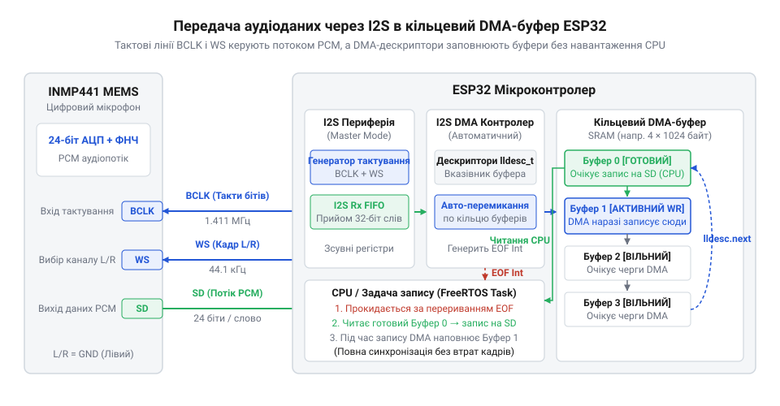
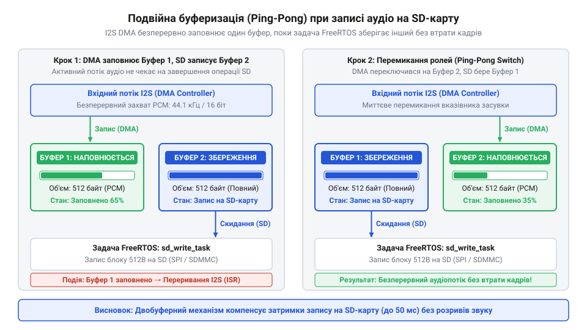

# Автономний диктофон на ESP32 із записом I2S PCM-потоку на SD-карту у форматі WAV

<preknowlist>
- [Звуковий давач з мікрофоном (LM393)](root:cat-hw-sensors/sound-lm393) — принципи перетворення акустичних коливань в аналоговий електричний сигнал електретним капсулем
- [KY-038 — мікрофонний давач звуку](root:cat-hw-sensors/ky-038-mic) — обмеження схем дискретного компарування звукового сигналу порівняно з безперервним цифровим оцифруванням
</preknowlist>

## Проблема безперервного запису звукових даних

Коли мікроконтролер записує звук, він має фіксувати коливання повітря через суворо рівні проміжки часу. Якщо під'єднати звичайний аналоговий капсуль, як у [звукового давача з компаратором](root:cat-hw-sensors/sound-lm393) чи [давача звуку з мікрофоном](root:cat-hw-sensors/ky-038-mic), сигнал потребує безперервного оцифрування через вбудований @@uk|АЦП@@ (аналогово-цифровий перетворювач, лат. @@la|convertere@@ — перетворювати). Для якісного мовлення чи звукозапису потрібна стандартизована частота вибірки — наприклад, рівень компакт-диска @@en|CD@@ у 44.1 кГц.

Частота оцифрування `f_s` визначає кількість вимірів амплітуди за одну секунду. Період дискретизації `T_s` (лат. @@la|discretus@@ — розділений) позначає часовий інтервал між сусідніми точками вимірювання:

    T_s
    = 1 ÷ f_s                                [визначення періоду вибірки через частоту]
    = 1 ÷ 44100                              [підстановка частоти 44.1 кГц]
    ≈ 22.67 × 10⁻⁶ с                         [ділення]
    ≈ 22.7 мкс                               [переведення в мікросекунди]

Кожні 22.7 мікросекунди процесор зобов'язаний зафіксувати чергове значення сигналу. Якщо ядро запізниться бодай на кілька мікросекунд, відлік буде знято у хибний момент часу. Нестабільність часової сітки породжує @@en|джиттер@@ (англ. @@en|jitter@@ — тремтіння) — фазове коливання інтервалів, що спотворює високі частоти та перетворює чистий звук на зашумлений сигнал. Якщо ж затримка перевищить сам період `T_s`, черговий відлік втрачається взагалі.

Справжня проблема виникає тоді, коли оцифрований звук у форматі @@en|PCM@@ (англ. @@en|Pulse-Code Modulation@@, імпульсно-кодова модуляція, від лат. @@la|modulari@@ — розміряти) треба одночасно зберігати на зовнішній носій — @@en|SD-картку@@ (англ. @@en|Secure Digital card@@). Флеш-пам'ять носія записує дані не поодинокими байтами, а секторами по 512 байтів або кластерами по кілька кілобайтів. Операція збереження сектора не має фіксованого часу виконання: внутрішній контролер картки періодично стирає зношені сторінки та перерозподіляє блоки. Через це виклик запису блоку на картку затримує виконання програми на 10–50 мілісекунд.

Якщо центральний процесор опитує датчик і записує дані на носій в одному синхронному циклі, під час затримки блокування пам'яті `t_block` тривалістю 20 мс потік оцифрування зупиняється. Кількість безповоротно втрачених відліків `N_lost` сягає сотень семплів:

    N_lost
    = t_block ÷ T_s                          [кількість пропущених відліків за час очікування носія]
    = 0.02 ÷ (22.67 × 10⁻⁶)                  [підстановка тривалості 20 мс та періоду вибірки]
    ≈ 882                                    [результат обчислення]

У записаному аудіофайлі виникає дірка у 882 відліки. Коли програвач натрапляє на такий розрив неперервної синусоїди, миттєвий стрибок амплітуди спричиняє гучне клацання та тріск — дефект спустошення потоку, відомий як @@en|buffer underrun@@ (англ. @@en|underrun@@ — вичерпання буфера).

Навіть використання таймерних переривань для зчитування @@uk|АЦП@@ не рятує ситуацію. Виклик обробника переривань 44100 разів на секунду перевантажує процесор постійним збереженням контексту регістрів, а критичні секції драйвера файлової системи тимчасово вимикають переривання, знову спричиняючи @@en|джиттер@@. Звичайне програмне опитування не здатне узгодити жорсткий мікросекундний ритм звуку з повільними мілісекундними затримками флеш-пам'яті. Щоб усунути втрату даних, збір звуку необхідно повністю відібрати у процесора й передати спеціалізованому апаратному інтерфейсу з механізмом [прямого доступу до пам'яті](root:hw-arch/dma-direct-memory-access), який накопичуватиме аудіопотік у проміжний @@en|буфер@@ (старофранц. @@fro|buffe@@ — пом'якшувач поштовху) самостійно.

## Апаратна конфігурація I2S та DMA

Оцифрування звуку безпосередньо в точці вимірювання вирішує цифровий @@en|MEMS-мікрофон@@ (англ. @@en|Micro-Electro-Mechanical Systems@@, мікроелектромеханічні системи, грец. @@grc|μικρός@@ — малий, @@grc|ἤλεκτρον@@ — бурштин, @@grc|μηχανή@@ — пристрій) @@en|INMP441@@. Усередині одного мініатюрного корпусу об'єднано акустичну мембрану, попередній підсилювач і 24-бітний дельта-сигма перетворювач. Мікрофон видає готовий числовий потік через виділений [інтерфейс I2S](root:cat-hw-sensors/i2s-protocol) (англ. @@en|Inter-IC Sound@@, інтерфейс звуку між мікросхемами, від лат. @@la|sonus@@ — звук).

Шина @@en|I2S@@ складається з трьох ліній: тактування бітів @@en|BCLK@@ (англ. @@en|Bit Clock@@), вибору слова й каналу @@en|WS@@ (англ. @@en|Word Select@@, або @@en|LRCLK@@) та послідовних даних @@en|SD@@ (англ. @@en|Serial Data@@). Мікроконтролер @@en|ESP32@@ виступає в ролі ведучого (@@en|Master RX@@): його апаратний периферійний модуль синтезує тактові імпульси, задаючи точний темп вичитування даних із пасивного мікрофона.

Сигнал @@en|WS@@ перемикається з частотою дискретизації `f_s` і визначає початок кожного аудіокадру: низький рівень відповідає лівому аудіоканалу, а високий — правому. Оскільки монофонічний мікрофон @@en|INMP441@@ налаштовують на передачу в лівому каналі підтяжкою виводу L/R до землі, кожен кадр шини містить два 32-бітні часові слоти — один для лівого каналу з корисними даними, а другий порожній. Тактова частота лінії бітів `f_BCLK` обчислюється через частоту дискретизації `f_s` та сумарну кількість бітів в обох каналах `N_bits` = 64:

    f_BCLK
    = f_s × N_bits                           [визначення частоти бітового тактування]
    = 44100 × 64                             [підстановка параметрів кадру для двох 32-бітних слів]
    = 2822400 Гц                             [множення]
    ≈ 2.8224 МГц                             [переведення в мегагерци]

Сенсор @@en|INMP441@@ передає 24-бітний знаковий відлік старшим бітом уперед (@@en|MSB@@). Перший біт з'являється на лінії @@en|SD@@ з відставанням на один такт @@en|BCLK@@ після зміни сигналу @@en|WS@@ — це стандартний протокол Philips I2S. У 32-бітному слоті мікроконтролера 24 біти звуку розташовуються у старших розрядах (від 31 до 8), а молодші 8 бітів заповнюються нулями. Для збереження звуку у стандартному 16-бітному форматі отримане 32-бітне ціле число зсувають праворуч на 14 бітів (`>> 14`). Такий зсув відкидає шум у молодших розрядах і масштабує 24-бітний діапазон під 16-бітну шкалу з динамічним запасом, захищаючи від спотворення амплітуди — @@en|кліпінгу@@ (англ. @@en|clipping@@ — зрізання верхівок хвилі).

Перенесення відліків від приймача I2S до оперативної пам'яті @@en|DRAM@@ виконує апаратний контролер @@en|DMA@@ (англ. @@en|Direct Memory Access@@). Він використовує кільцевий список описників пам'яті — @@en|дескрипторів@@ (лат. @@la|descriptor@@ — описувач, від @@la|describere@@ — окреслювати). Кожен дескриптор вказує на лінійний блок пам'яті заданого розміру в байтах і містить покажчик на наступний дескриптор. Останній дескриптор ланцюжка замкнений на перший.

*Апаратний конвеєр захоплення звуку: блок I2S контролера ESP32 генерує тактові сигнали BCLK і WS для мікрофона INMP441, а контролер DMA самостійно заповнює зв'язаний кільцевий список буферів пам'яті в DRAM без зупинки процесорних ядер.*

Поки мікрофон передає біти, контролер @@en|DMA@@ безперервно укладає слова в оперативну пам'ять за шинною топологією. Ядра процесора взагалі не беруть участі у записі байтів. Лише після того, як черговий буфер дескриптора повністю наповниться, контролер @@en|DMA@@ генерує апаратне переривання, сигналізуючи драйверу про наявність готового блоку відліків.

Для запуску цього механізму в середовищі @@en|ESP-IDF@@ викликають функції конфігурації порту `i2s_driver_install` та призначають фізичні виводи через `i2s_set_pin`:

:::tabs
@tab C (ESP-IDF)
:::code proj-esp32-i2s-wav-recorder/c/main/i2s_mic.c 25-59
@tab C++ (ESP-IDF)
:::code proj-esp32-i2s-wav-recorder/cpp/src/i2s_mic_recorder.cpp 109-140
:::

У налаштуваннях драйвера режим `I2S_MODE_MASTER | I2S_MODE_RX` переводить мікроконтролер у режим прийому з генерацією тактування, а параметр `dma_buf_count` разом із `dma_buf_len` визначає кількість і глибину описників @@en|DMA@@. Налаштована в такий спосіб апаратна периферія накопичує звук із жорстким кроком оцифрування без жодного втраченого такту.

## Двобуферна синхронізація з SD-картою

Навіть за наявності апаратного @@en|DMA@@ проблема повільного накопичувача залишається актуальною: кільцевий буфер має скінченний розмір. Потік аудіоданих від мікрофона є безперервним постачальником (@@en|producer@@), який неможливо зупинити чи поставити на паузу. Натомість збереження на @@en|SD-картку@@ через [інтерфейс накопичувача SPI](root:sf-data/sd-card-spi-interface) діє як споживач (@@en|consumer@@) із непередбачуваним часом реакції. Коли внутрішній контролер картки натрапляє на межу блоку пам'яті @@en|NAND@@, запис блокується на час стирання сторінок — затримка може зростати до 50–100 мілісекунд. Якщо кільцевий буфер переповниться, апаратний блок перезапише ще не збережені семпли, і звуковий потік буде безповоротно зіпсовано.

Щоб розділити безперервний збір і нерегулярний запис, застосовують подвійну буферизацію (англ. @@en|double-buffering@@, або @@en|ping-pong buffer@@). В оперативній пам'яті виділяють два однакові незалежні масиви — Буфер 0 і Буфер 1. Робота будується за принципом чергування ролей: поки один буфер заповнюється апаратним зчитувачем, другий записується на носій файловою задачею.

*Розділення часових потоків: поки апаратне ядро I2S DMA накопичує порцію PCM-відліків у буфері прийому, фонова задача операційної системи скидає збережений попередній буфер у файл на SD-картці через шину SPI.*

Щойно активний буфер наповнюється, індекси миттєво перемикаються. Буфер, який щойно приймав дані, стає джерелом для збереження на диск, а звільнений буфер починає приймати новий аудіопотік.

Мінімальну місткість пінг-понг буфера обирають так, щоб час його заповнення гарантовано перевищував найдовшу затримку запису на картку `t_flush`. Швидкість надходження 16-бітного монофонічного звуку `R_byte` при частоті `f_s` становить добуток частоти на розмір одного відліку у 2 байти:

    R_byte
    = f_s × 1 × (16 ÷ 8)                     [добуток частоти на байти одного моносемплу]
    = 44100 × 2                              [підстановка параметрів]
    = 88200 байт/с                           [множення]
    ≈ 86.13 КБ/с                             [переведення в кілобайти за секунду]

Якщо максимальна затримка флеш-пам'яті `t_flush` становить 100 мс (0.1 с), обсяг даних `S_buf`, який надходить за цей час, обчислюється множенням швидкості на тривалість паузи:

    S_buf
    = R_byte × t_flush                       [обсяг байтів за час затримки флеш-пам'яті]
    = 88200 × 0.1                            [підстановка значень швидкості й часу]
    = 8820 байтів                            [результат обчислення]

Сумарного буферного простору близько 8–16 кілобайтів (по 4–8 КБ на кожен буфер пари) вистачає для повної амортизації затримок флеш-пам'яті без ризику переповнення.

Керування процесом чергування спирається на планувальник операційної системи @@en|FreeRTOS@@. Зчитування даних з @@en|DMA@@ у поточний буфер виконується функцією `i2s_read`, яка переводить задачу в стан блокованого очікування, звільняючи процесорні ресурси для інших завдань:

:::tabs
@tab C (ESP-IDF)
:::code proj-esp32-i2s-wav-recorder/c/main/i2s_mic.c 119-138
@tab C++ (ESP-IDF)
:::code proj-esp32-i2s-wav-recorder/cpp/src/i2s_mic_recorder.cpp 256-292
:::

Для безпечного перемикання індексів `read_index` і `write_index` використовується @@en|м'ютекс@@ (англ. @@en|mutex@@, від @@en|mutual exclusion@@ — взаємне виключення, лат. @@la|mutuus@@ — взаємний та @@la|excludere@@ — виключати). Коли `i2s_read` повертає заповнену порцію даних, індекси змінюються під захистом блокування, і заповнений масив передається на запис у файл. Одночасно @@en|семафор@@ (грец. @@grc|σῆμα@@ — знак, сигнал та @@grc|φορός@@ — носій) повідомляє задачу збереження про готовність чергового блоку. Така подвійна буферизація надійно розв'язує конфлікт швидкостей між стабільним аудіопотоком та інертною пам'яттю картки.

## Формування RIFF WAV заголовка

Сирі PCM-відліки у пам'яті самі по собі не несуть жодної службової інформації про те, з якою частотою дискретизації вони були зібрані, скільки каналів використовувалося та яка розрядність оцифрування застосовувалася. Через це звичайні медіаплеєри чи аудіоредактори не можуть відтворити такий потік даних, сприймаючи його як випадковий шум. Щоб аудіофайли успішно розпізнавалися будь-якими програмами, використовується загальноприйнятий контейнер `@@en|RIFF@@` WAV, який починається зі стандартизованого 44-байтного заголовка. Заголовок чітко описує структуру аудіоданих, задаючи параметри через унікальні теги та поля розмірів.

Формування заголовка базується на структурі `wav_header_t`, яка містить сигнатуру контейнера `@@en|RIFF@@`, розмір файлу без урахування перших восьми байтів, маркер формату `@@en|WAVE@@`, а також підблок `@@en|fmt @@` із параметрами потоку. У цьому підблоці вказується код аудіоформату (де `1` означає нестиснений лінійний `@@en|PCM@@`), кількість каналів (моно або стерео), частота дискретизації, розрахункова швидкість байтів за секунду, вирівнювання блоку та глибина оцифрування (наприклад, 16 біт). Завершується заголовок підблоком `@@en|data@@`, який містить маркер початку аудіопотоку та загальний обсяг сирих PCM-даних у байтах. На початку запису ці поля розмірів заповнюються нулями або початковими константами, а після завершення сесії запису заголовок оновлюється актуальною кількістю записаних байтів за допомогою файлових операцій `fseek` та `fwrite`.

:::tabs
@tab C (wav_writer.c)
:::code proj-esp32-i2s-wav-recorder/c/main/wav_writer.c 27-52
@tab C++ (wav_header.hpp)
:::code proj-esp32-i2s-wav-recorder/cpp/include/wav_header.hpp 15-38
:::

## Збирання та налагодження автономного диктофона

Поєднання високошвидкісного зчитування аудіоданих через шину I2S, подвійної буферизації та збереження потоку у файл через файлову систему `@@en|FATFS@@` на SD-картці перетворює мікроконтролер на повноцінний автономний пристрій запису звуку. Для стабільної роботи диктофона критично важливо правильно підключити апаратні лінії: `@@en|SCK@@` (Serial Clock), `@@en|WS@@` (Word Select) та `@@en|SD@@` (Serial Data) мікрофона INMP441 до відповідних ніжок ESP32, а також забезпечити стабільне живлення без просідань напруги, які викликають клацання та шуми в аудіопотоці. Програмна реалізація координує роботу завдань у `@@en|FreeRTOS@@`, які паралельно читають дані з DMA-буферів і скидають їх на накопичувач.

Під час польових випробувань змонтованого пристрою розробник стикається з необхідністю контролювати вільний простір на картці пам'яті та коректно завершувати сесію запису натисканням кнопки чи за таймером. Головна програма ініціалізує шину SPI, монтує `@@en|FATFS@@` у віртуальну файлову систему `@@en|VFS@@`, відкриває файл для запису, запускає `@@en|I2S@@`-захоплення та у циклі переносить конвертовані 16-бітні PCM-семпли у файл. Після зупинки запису заголовок файлу фіналізується, гарантуючи, що записаний `@@en|WAV@@`-файл буде повністю валідним і готовим до відтворення на будь-якому комп'ютері чи медіаплеєрі.

:::tabs
@tab C (main.c)
:::code proj-esp32-i2s-wav-recorder/c/main/main.c
@tab C++ (main.cpp)
:::code proj-esp32-i2s-wav-recorder/cpp/src/main.cpp
:::