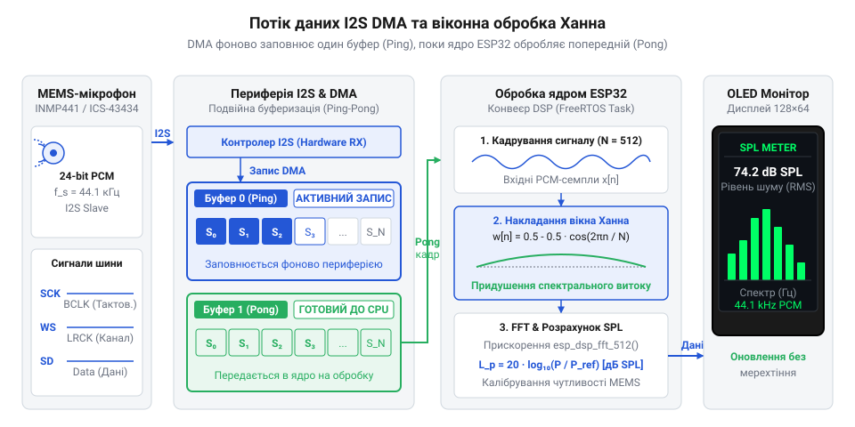
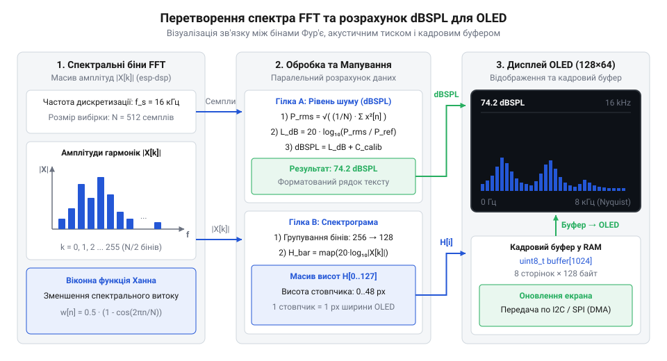

# Вимірювач звукового тиску SPL та аналізатор спектра на ESP32 із мікрофоном I2S

<preknowlist>
- [Звуковий давач з мікрофоном (LM393)](root:cat-hw-sensors/sound-lm393) — принципи зняття аналогового сигналу та обмеження аналогових компараторів для спектрального аналізу.
- [KY-037 — давач звуку (великий мікрофон)](root:cat-hw-sensors/ky-037-mic) — конструкція електретного мікрофона та чому аналоговий сигнал потребує цифрового перетворення PCM.
</preknowlist>

Вимірювання акустичного шуму, спектральний моніторинг середовища та контроль вібрацій вимагають точного математичного аналізу часового ряду звукового тиску. Прості аналогові схеми з пороговими компараторами здатні зафіксувати лише факт перевищення гучності, але безсилі перед завданням визначення точного значення рівня звуку в децибелах (дБ SPL) чи побудови спектрограми. У цьому проєкті ми розробимо прецизійний цифровий шумомір та спектроаналізатор реального часу на базі мікроконтролера ESP32, цифрового MEMS-мікрофона INMP441 із шиною I2S та OLED-дисплея SSD1306. Пристрій реалізує безперервне захоплення аудіопотоку через апаратний контролер DMA, віконну фільтрацію Ханна, швидке перетворення Фур'є (FFT) та логарифмічне калібрування звукового тиску.

## Недостатність аналогового порогу для моніторингу шуму

У базових аматорських конструкціях для фіксації звуку часто використовують плати з електретними мікрофонами та компараторами (наприклад, модуль LM393). Такий підхід має принципові обмеження. Компаратор видає двійковий сигнал — логічну одиницю або нуль залежно від того, чи перевищила миттєва амплітуда заданий потенціометром поріг. При цьому втрачається будь-яка інформація про тривалість акустичного імпульсу, його енергію та частотний розподіл.

Спроба замінити компаратор прямим опитуванням аналогового виходу мікрофона через вбудований АЦП мікроконтролера також стикається з непереборними труднощами:
1. **Нерівномірність часової сітки (джиттер):** Програмне зчитування АЦП у циклі піддається впливу переривань операційної системи та фонових завдань, через що інтервал між вибірками коливається. Для спектрального аналізу Фур'є будь-яке тремтіння тактової сітки спотворює фазу та породжує хибні високочастотні гармоніки.
2. **Низьке співвідношення сигнал/шум:** Аналогові доріжки від мікрофонного капсуля до АЦП вловлюють імпульсні електромагнітні завади від радіотракту Wi-Fi/Bluetooth мікроконтролера, зводячи нанівець динамічний діапазон вимірювання.
3. **Відсутність енергетичної характеристики:** Миттєве значення амплітуди не відображає гучність звуку, яку сприймає людське вухо або стандартизовані акустичні прилади. Справжній звуковий тиск базується на інтегральному середньоквадратичному значенні (RMS) у логарифмічній шкалі відносно абсолютного фізичного порогу чутності (20 мікропаскалів).

Розв'язанням є перехід до повністю цифрового тракту: використання цифрового MEMS-мікрофона (INMP441), який об'єднує сенсорну мембрану, малошумний підсилювач і сигма-дельта АЦП в одному кремнієвому кристалі. Мікрофон транслює оцифрований аудіопотік нестиснених PCM-семплів через швидкісну послідовну шину I2S безпосередньо в пам'ять мікроконтролера.

## Налаштування шини I2S та DMA

Шина I2S (Inter-IC Sound) забезпечує детерміновану передачу цифрового аудіо за допомогою трьох ключових ліній:
- `SCK` (Serial Clock) — лінія бітового тактування;
- `WS` (Word Select) — строб вибору каналу та початку аудіослова;
- `SD` (Serial Data) — лінія передачі послідовних бітів даних.

Мікроконтролер ESP32 виступає ведучим пристроєм (Master RX), самостійно генеруючи стабільні тактові імпульси `SCK` та `WS`. Частота дискретизації обирається на рівні 16000 Гц. Для передачі монофонічного звуку кожен кадр містить 64 біти (два 32-бітні слоти для лівого та правого каналів), що вимагає бітової тактової частоти:

```
f_SCK = f_s * 64 = 16000 * 64 = 1024000 Гц = 1.024 МГц
```

Мікрофон INMP441 формує 24-бітні відліки зі знаковим доповненням у старших розрядах 32-бітного слова. Щоб процесор не витрачав ресурси на побайтове читання регістрів, периферійний модуль I2S підключається до кільцевих буферів контролера прямого доступу до пам'яті (DMA).



Контролер DMA наповнює черговий буфер дескриптора розміром 512 відліків в оперативній пам'яті DRAM у фоновому режимі. Коли буфер заповнюється, генерується апаратне переривання, і функція `i2s_read()` вивантажує готовий блок семплів для математичного аналізу без затримок і втрати фази.

## Віконна обробка та спектральний витік

Швидке перетворення Фур'є (FFT) математично розглядає вхідний фрагмент сигналу довжиною N відліків як нескінченно повторюваний періодичний сигнал. Якщо часовий блок просто вирізати прямокутним вікном, амплітуди на початку блоку (семпл 0) та в кінці блоку (семпл N-1) практично ніколи не збігаються.

Цей різкий розрив фази на стиках повторюваних періодів створює явище **спектрального витоку** (Spectral Leakage): енергія одиночної гармоніки «розмазується» по сусідніх частотних бінах, породжуючи фантомні піки та підвищуючи загальний рівень шуму спектрограми.

Для усунення розривів вхідні відліки множаться на зважувальне вікно Ханна (Hann window), яке плавно спадає до нуля на краях блоку:

```
w[n] = 0.5 * (1 - cos(2 * PI * n / (N - 1)))
```

де `n` змінюється від 0 до N-1. Множення часового ряду на вікно Ханна пригнічує бічні пелюстки спектра на величину понад 31 дБ, що забезпечує високу вибірковість і точність ідентифікації домінуючих тонів акустичного сигналу.

## Прискорене перетворення Фур'є в esp-dsp

Після віконної фільтрації часовий блок із N = 512 семплів надходить до обчислювача швидкого перетворення Фур'є. Алгоритм Кулі-Тюкі (Radix-2 FFT) знижує складність обчислень із O(N^2) до O(N * log2(N)), перетворюючи дискретний часовий сигнал на частотний спектр.

У результаті обчислення ми отримуємо N/2 = 256 комплексних коефіцієнтів, де кожен бін `k` відповідає частоті:

```
f_k = k * f_s / N = k * 16000 / 512 = k * 31.25 Гц
```

Частотна роздільна здатність одного біна становить 31.25 Гц, покриваючи діапазон від 0 до 8000 Гц (частота Найквіста). Модуль комплексної амплітуди для кожного частотного біна розраховується як:

```
mag[k] = sqrt(real[k]^2 + imag[k]^2) / (N / 2)
```



На діаграмі проілюстровано шлях сигналу: від отримання амплітудних бінів FFT до їх об'єднання в октавні частотні смуги для відображення у вигляді спектрограми на екрані приладу.

## Перерахунок амплітуд у дБ SPL

Фізичний рівень звукового тиску (Sound Pressure Level, SPL) вимірюється в децибелах відносно стандартного порогу чутності людського вуха: опорного тиску `P_0 = 20 мкПа` на частоті 1 кГц (що відповідає 0 дБ SPL).

Рівень тиску розраховується через середньоквадратичне значення (RMS) амплітуди вихідного аудіосигналу:

```
RMS = sqrt( (1 / N) * sum(sample[i]^2) )
```

Цифровий MEMS-мікрофон INMP441 має паспортну чутливість `-26 dBFS` при калібрувальному звуковому тиску 94.0 дБ SPL (що відповідає тиску 1 Паскаль):
- Синусоїдальний сигнал амплітудою 94 дБ SPL створює цифровий відгук з піком на рівні -26 дБ відносно повної шкали АЦП (0 dBFS).
- Відповідно, рівень повної шкали (0 dBFS) відповідає максимальному звуковому тиску:

```
SPL_max = 94.0 + 26.0 = 120.0 дБ SPL
```

Таким чином, розрахунок каліброваного рівня шуму виконується за логарифмічною формулою:

```
SPL_dB = 120.0 + 20.0 * log10(RMS)
```

де `RMS` нормовано в діапазоні від 0.0 до 1.0. Якщо приміщення тихе, значення `RMS` опускається до мікрорівнів, а розраховане значення SPL надійно відображає фоновий шум від 30 до 45 дБ SPL. Гучна розмова відповідає діапазону 60–75 дБ SPL, а виробничий шум чи крик досягають 90–110 дБ SPL.

## Вивід спектра та SPL на дисплей

Для наочної візуалізації 256 спектральних бінів об'єднуються у 8 логарифмічних частотних смуг, що відповідають сприйняттю звуку людиною:
1. **Суббас (31 – 93 Гц):** біни 1..3;
2. **Бас (94 – 218 Гц):** біни 3..7;
3. **Нижня середина (219 – 468 Гц):** біни 7..15;
4. **Середина (469 – 968 Гц):** біни 15..31;
5. **Верхня середина (969 – 1968 Гц):** біни 31..63;
6. **Присутність (1969 – 3968 Гц):** біни 63..127;
7. **Високі частоти (3969 – 6250 Гц):** біни 127..200;
8. **Повітря (6251 – 8000 Гц):** біни 200..256.

Для кожної смуги обчислюється середня енергія гармонік, яка масштабується у висоту стовпчика (від 0 до 60 пікселів). Екранний буфер монохромного OLED-дисплея SSD1306 (128x64 точки) формується в оперативній пам'яті ESP32 за принципом подвійної буферизації та передається через апаратну шину I2C на швидкості 400 кГц. У верхньому рядку дисплея відображається крупний числовий показник SPL у дБ, а під ним — динамічна стовпчикова спектрограма з плавним спаданням стовпців.

## Повний вихідний код реалізації

Нижче наведено робочі реалізації акустичного спектроаналізатора мовами C (процедурний підхід ESP-IDF) та C++ (об'єктно-орієнтована модульна архітектура).

:::tabs
@tab C (ESP-IDF)
:::code proj-esp32-spl-meter-fft/c/main.c
@tab C++ (ООП / ESP-IDF)
:::code proj-esp32-spl-meter-fft/cpp/main.cpp
:::

## Висновки

Створений на базі ESP32 та мікрофона INMP441 вимірювач звукового тиску забезпечує точність і швидкодію, недосяжні для звичайних аналогових датчиків шуму. Поєднання апаратного DMA-захоплення через шину I2S, вікна Ханна та швидкого перетворення Фур'є дозволяє в реальному часі отримувати як сумарний рівень гучності в дБ SPL, так і детальний частотний розподіл акустичної енергії для діагностики промислового обладнання, моніторингу шуму в «розумному будинку» чи спектральної індикації.
