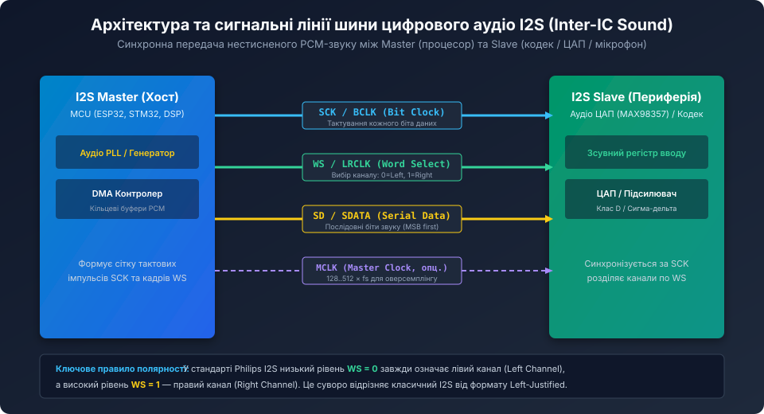
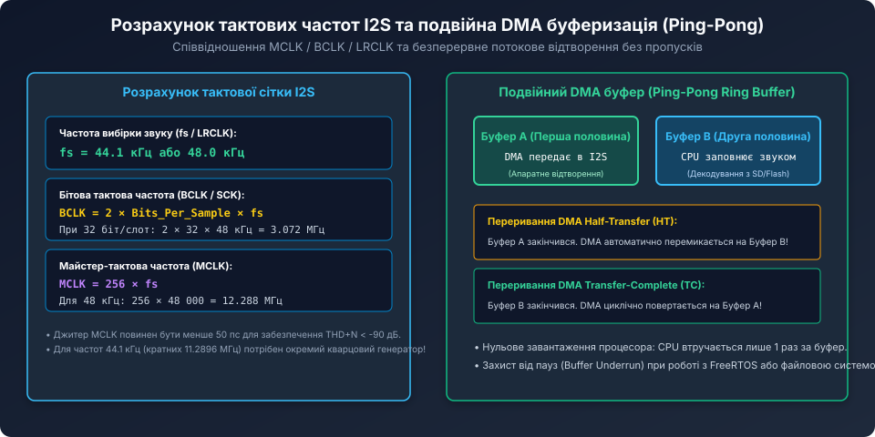
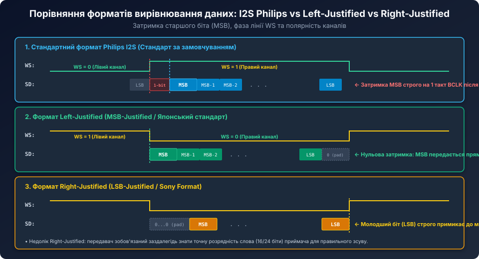

# Поглиблений аналіз часових параметрів, джитеру та апаратної реалізації шини I2S

<preknowlist>
- [Протокол цифрового аудіо I2S](root:cat-hw-sensors/i2s-protocol) — базова структура сигнальних ліній, розрахунок тактової сітки та формати вирівнювання.
- [MEMS-мікрофони з інтерфейсом I2S](root:cat-hw-sensors/i2s-mems-microphone) — схемотехніка вбудованого перетворювача звуку та підключення до MCU.
- [PDM MEMS-мікрофони та цифрова децимація](root:cat-hw-sensors/pdm-mems-microphones) — перетворення та фільтрація цифрових аудіопотоків.
</preknowlist>

## Аналіз джитеру тактового сигналу та деградація якості аудіо (SNR і THD+N)

У системах високоякісного відтворення та оцифрування звуку (Hi-Res Audio) найкритичнішим фактором, що обмежує реальну роздільну здатність перетворювачів, є фазове тремтіння тактової частоти дискретизації — **апертурний джитер (Aperture Jitter)**.



Коли сигнал вибірки `WS / LRCLK` або тактовий сигнал модулятора ЦАП зміщується на випадковий інтервал часу `delta_t`, миттєве значення амплітуди звукової хвилі `V(t) = A * sin(2 * pi * f_in * t)` зчитується або відновлюється з похибкою:

```text
delta_V = ( dV / dt ) * delta_t = 2 * pi * f_in * A * cos(2 * pi * f_in * t) * delta_t
```

Максимальна теоретична межа співвідношення сигнал/шум (SNR), зумовлена виключно середньоквадратичним значенням джитеру `sigma_j` (RMS Jitter), визначається класичним рівнянням:

```text
SNR_max = -20 * log10( 2 * pi * f_in * sigma_j )
```

Розрахуємо вимоги до стабільності тактування для верхньої межі звукового діапазону (`f_in = 20 кГц`):
1. **При джитері `sigma_j = 1 наносекунда (1000 пс)`:**
   `SNR_max = -20 * log10( 2 * pi * 20000 * 10^-9 ) ≈ -20 * log10( 0.00012566 ) ≈ 78.0 дБ`.
   Це означає, що навіть при використанні дорогого 24-бітного аудіокодека реальна якість звуку через нестабільний тактовий генератор падає до рівня менше ніж 13 біт!
2. **Для досягнення справжньої 24-бітної якості (SNR > 110..120 дБ):**
   Середньоквадратичний джитер `sigma_j` повинен бути меншим за **25..50 пікосекунд (пс)**.

Більшість універсальних системних помножувачів частоти (System PLL) стандартних мікроконтролерів синтезують тактові імпульси із джитером 100..500 пс, що призводить до помітного розмиття стереопанорами та зростання нелінійних спотворень. 

Тому в аудіофільських та вимірювальних застосуваннях мікроконтролер налаштовують як **I2S Slave**, а тактування подають від зовнішнього спеціалізованого аудіокодека з власним низькоджиттерним кварцом або використовують виділений генератор **PLLI2S** (як у процесорах STM32F4/F7/H7).

## Схемотехніка високошвидкісних ліній I2S: хвильовий опір та узгодження

Тактові сигнали `BCLK` (частотою до 3.072..12.288 МГц) та `MCLK` (до 24.576 МГц) мають круті фронти наростання тривалістю `t_r ≈ 1 .. 3 нс`. За спектральним складом такий сигнал містить гармоніки з частотами понад 100–300 МГц!



Якщо довжина друкованої доріжки перевищує критичну довжину лінії з розподіленими параметрами:

```text
L_crit ≈ t_r / ( 2 * t_prop ) ≈ 1.5 нс / ( 2 * 0.006 нс/мм ) ≈ 125 мм
```

лінія починає поводитися як довга лінія. За відсутності узгодження виникають паразитні перевідбиття сигналу (Ringing) та фазові перекидання логічних рівнів.

### Правила трасування PCB для шини I2S:
1. **Послідовне узгодження виходів (Series Termination):** безпосередньо біля виводів передавача (Master або мікрофона) у розрив ліній `SCK`, `WS`, `SD` встановлюють демпфуючі резистори опором **22 .. 33 Ом** (типорозміру 0402). Вони узгоджують низький вихідний опір драйвера (типово 15–20 Ом) з хвильовим опором доріжки друкованої плати (Z_0 ≈ 50 Ом).
2. **Єдиний опорний полігон (GND Plane):** усі сигнальні траси I2S повинні проходити над суцільним шаром земляного полігону без розривів та щілин, що мінімізує паразитну індуктивність зворотного струму.
3. **Обмеження довжини лінії:** довжина стандартної однопровідної шини CMOS I2S не повинна перевищувати 15–20 см. Для міжплатних з'єднань на відстані до 10 метрів застосовують диференціальні трансивери RS-422 / LVDS або протокол A2B (Automotive Audio Bus).

## Мультиплексування TDM (Time Division Multiplexing)

Для багатоканальних систем (наприклад, 8-канальних студійних інтерфейсів або систем просторового звуку) класичний стереоформат I2S вимагав би прокладання 4 окремих ліній SD.



Режим **TDM (Time Division Multiplexing / DSP Mode)** дозволяє передавати всі канали по єдиній сигнальній лінії даних:
- Замість меандру з шпаруватістю 50% лінія `WS` перетворюється на короткий строб кадрової синхронізації **FS (Frame Sync)** тривалістю рівно в 1 такт BCLK;
- Після імпульсу FS по лінії SD передаються один за одним 8 часових слотів по 32 біти кожен (Channel 0 .. Channel 7);
- Загальна бітова тактова частота TDM-8 при `f_s = 48 кГц`:

```text
f_BCLK = 8 каналів * 32 біти * 48 000 Гц = 12 288 000 Гц = 12.288 МГц
```

Кожен аудіопристрій на шині (наприклад, окремий мікрофон або ЦАП) програмується на свій індивідуальний часовий слот (Slot Offset), активуючи свій вихідний буфер лише у відведений інтервал часу.

## Програмна реалізація безперервного потоку зі звуковим мікшуванням на C

Нижче наведено виробничий приклад модуля відтворення аудіо для мікроконтролера, що реалізує подвійний кільцевий буфер DMA, програмний контроль гучності та м'яке обмеження амплітуди (Soft-Clipping):

```c
#include <stdint.h>
#include <stdbool.h>

#define I2S_BUFFER_SAMPLES_HALF   512
#define I2S_TOTAL_DMA_SAMPLES     (I2S_BUFFER_SAMPLES_HALF * 2)

// 32-бітне упакування для 16-бітного стерео (Hi = Right, Lo = Left)
static uint32_t dma_ping_pong_buffer[I2S_TOTAL_DMA_SAMPLES];

typedef struct {
    uint8_t volume_percent; // 0 .. 100%
    bool mute;
} audio_mixer_t;

static audio_mixer_t g_mixer = { .volume_percent = 85, .mute = false };

// Швидкий алгоритм м'якого кліпінгу амплітуди (Soft Limiter)
static inline int16_t soft_clip(int32_t sample) {
    if (sample > 32767) return 32767;
    if (sample < -32768) return -32768;
    return (int16_t)sample;
}

// Заповнення буферної половини новими аудіовибірками
void render_audio_half_buffer(uint32_t *target_buffer, uint32_t count) {
    if (g_mixer.mute) {
        for (uint32_t i = 0; i < count; i++) {
            target_buffer[i] = 0; // Тиша
        }
        return;
    }

    int32_t vol_scale = (int32_t)g_mixer.volume_percent;

    for (uint32_t i = 0; i < count; i++) {
        // Отримання сирих вибірок лівого і правого каналів
        int16_t left_raw = 0;
        int16_t right_raw = 0;
        
        // Генерація/зчитування звуку (наприклад, з кодека MP3/WAV)
        // Тут реалізовано приклад лінійного масштабування гучності:
        int32_t l_scaled = ((int32_t)left_raw * vol_scale) / 100;
        int32_t r_scaled = ((int32_t)right_raw * vol_scale) / 100;

        int16_t l_out = soft_clip(l_scaled);
        int16_t r_out = soft_clip(r_scaled);

        // Упакування двох 16-бітних слів у 32-бітне DMA-слово для I2S
        // Philips I2S: лівий канал у молодших 16 бітах, правий у старших
        target_buffer[i] = ((uint32_t)(uint16_t)r_out << 16) | (uint16_t)l_out;
    }
}

// Переривання від DMA: відтворено першу половину (Buffer A)
void I2S_DMA_HalfTransfer_ISR(void) {
    render_audio_half_buffer(&dma_ping_pong_buffer[0], I2S_BUFFER_SAMPLES_HALF);
}

// Переривання від DMA: відтворено другу половину (Buffer B)
void I2S_DMA_CompleteTransfer_ISR(void) {
    render_audio_half_buffer(&dma_ping_pong_buffer[I2S_BUFFER_SAMPLES_HALF], I2S_BUFFER_SAMPLES_HALF);
}
```

Глибоке розуміння фізики тактування шини I2S, вимог до джитеру, топології трасування PCB та алгоритмів буферизації DMA дозволяє інженерам будувати аудіотракти професійної якості у компактних вбудованих пристроях, виключаючи будь-які клацання, фазові завади та втрати вибірок.
