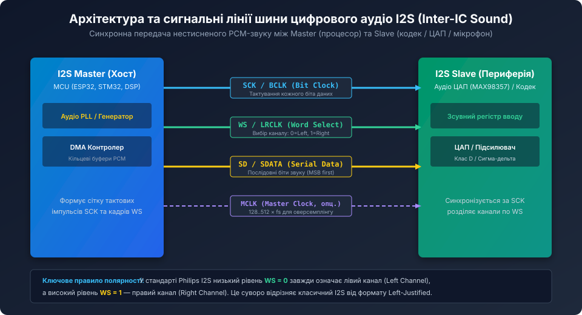
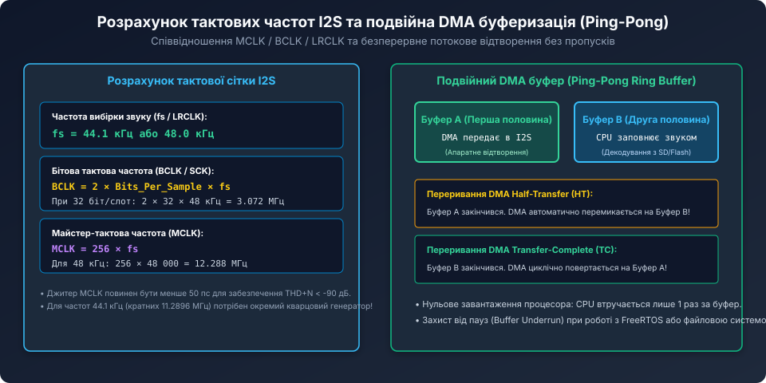
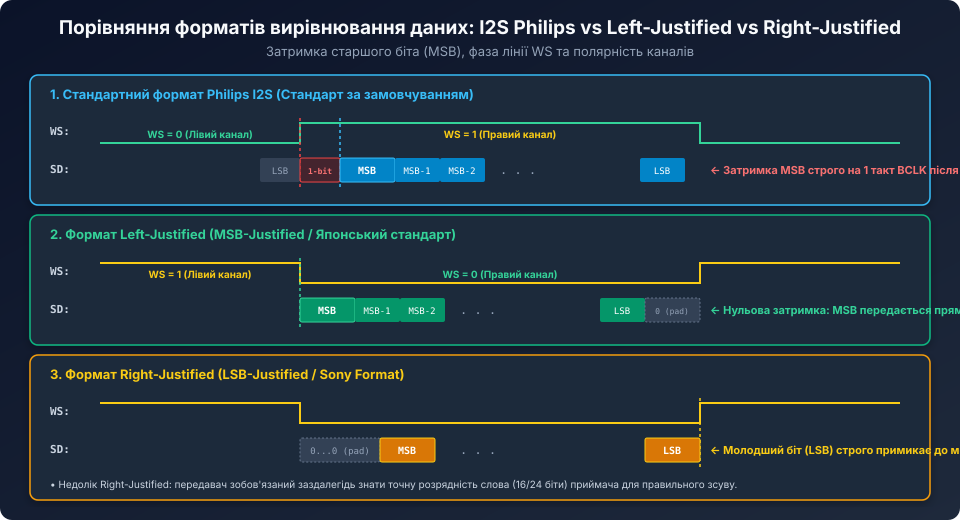

# Протокол цифрового аудіо I2S

<preknowlist>
- [MEMS-мікрофони з інтерфейсом I2S](root:cat-hw-sensors/i2s-mems-microphone) — будова прецизійного цифрового мікрофона зі вбудованим аудіоінтерфейсом.
- [PDM MEMS-мікрофони та цифрова децимація](root:cat-hw-sensors/pdm-mems-microphones) — перетворення 1-бітного імпульсно-щільнісного потоку на лінійні PCM-вибірки.
- [Аналогові модулі мікрофонів з компаратором LM393](root:cat-hw-sensors/sound-lm393) — базові принципи перетворення акустичних коливань в електричні сигнали.
</preknowlist>

## Призначення та сигнальні лінії протоколу I2S

Протокол **I2S (Inter-IC Sound)** був розроблений компанією Philips Semiconductor (сьогодні NXP) у 1986 році спеціально для передачі нестисненого стереофонічного цифрового звуку у форматі PCM (Pulse Code Modulation) між інтегральними схемами на друкованій платі: мікроконтролерами, сигнальними процесорами (DSP), аудіокодеками, цифро-аналоговими (ЦАП) та аналого-цифровими (АЦП) перетворювачами.

Головною проблемою традиційних послідовних інтерфейсів (SPI, UART) при передачі звуку була відсутність жорсткої апаратної синхронізації тактової сітки з частотою дискретизації, що призводило до фазового тремтіння фронтів — **джитеру (Jitter)**, який безпосередньо погіршував коефіцієнт нелінійних спотворень звуку (THD+N).

Стандарт I2S вирішує цю проблему за рахунок розділення тактування даних та вибору каналів на окремі фізичні лінії:



Шина I2S складається з трьох обов'язкових ліній зв'язку та однієї додаткової:
1. **SCK / BCLK (Serial Clock / Bit Clock):** бітовий тактовий сигнал. Кожен такт BCLK відповідає передачі одного біта даних по лінії SD.
2. **WS / LRCLK (Word Select / Left-Right Clock):** сигнал вибору аудіоканалу (визначає межу аудіослова). Частота сигналу WS точно дорівнює частоті дискретизації звуку `f_s` (наприклад, 44.1 кГц або 48 кГц).
3. **SD / SDATA (Serial Data):** лінія послідовних даних. Біти кожного відліку передаються послідовно, починаючи зі старшого розряду (MSB First).
4. **MCLK (Master Clock, опціонально):** системна тактова частота (зазвичай 128, 256 або 512 помножена на `f_s`), необхідна для внутрішньої роботи дельта-сигма модуляторів кодеків і ЦАП.

## Часова сітка, розрахунок тактових частот та фазова синхронізація

Для забезпечення безперервного потоку аудіо без клацань та пауз усі тактові частоти шини повинні бути строго синхронними і перебувати у фіксованому цілочисельному співвідношенні.



Базові математичні зв'язки шини I2S:

```text
f_WS = f_s (частота дискретизації, наприклад 48 000 Гц)
f_BCLK = 2 * N_bits * f_s
```

де:
- `N_bits` — розрядність одного часового слота (Subframe / Slot Width). У сучасних 32-бітних процесорах слот майже завжди встановлюють рівним **32 бітам** на канал (навіть якщо корисний звук є 16- або 24-бітним; молодші біти доповнюються нулями).
- Множник `2` обумовлений наявністю двох каналів (лівий і правий) за один період кадру WS.

### Числовий розрахунок для студійної якості (48 кГц / 32 біти на слот):
1. Частота кадрової синхронізації: `f_WS = 48 000 Гц = 48 кГц`.
2. Бітова тактова частота: `f_BCLK = 2 * 32 * 48 000 = 3 072 000 Гц = 3.072 МГц`.
3. Майстер-тактова частота (при дільнику 256): `f_MCLK = 256 * 48 000 = 12 288 000 Гц = 12.288 МГц`.

Якщо джерело звуку має частоту 44.1 кГц (стандарт Audio CD), бітова сітка становить:
`f_BCLK = 2 * 32 * 44 100 = 2.8224 МГц`, а `f_MCLK = 256 * 44 100 = 11.2896 МГц`. Оскільки частоти 48 кГц та 44.1 кГц не є кратними, професійні звукові карти та мікроконтролери використовують окремі високоточні кварцові генератори на 12.288 МГц та 11.2896 МГц.

## Стандарти вирівнювання даних: Philips I2S, Left-Justified, Right-Justified та TDM

Залежно від виробника мікросхеми та конфігурації регістрів послідовні біти звуку можуть синхронізуватися з фронтами лінії WS у різний спосіб.



### 1. Стандартний формат Philips I2S (I2S Standard)
- **Головна особливість:** старший біт звукового слова (MSB) передається **із затримкою на один такт BCLK** після зміни стану лінії WS.
- **Полярність вибору каналів:** низький рівень `WS = 0` позначає **лівий канал (Left Channel)**, а високий рівень `WS = 1` — **правий канал (Right Channel)**.
- Ця 1-бітна затримка була введена творцями стандарту для того, щоб передавач і приймач встигали зафіксувати номер каналу до початку прийому даних.

### 2. Формат Left-Justified (MSB-Justified)
- **Головна особливість:** нульова затримка. Старший біт (MSB) з'являється строго синхронно з фронтом перемикання лінії WS.
- **Полярність каналів інвертована:** високий рівень `WS = 1` позначає лівий канал, а низький рівень `WS = 0` — правий канал.
- Застосовується в багатьох азійських ЦАП і мікросхемах DSP для спрощення схемотехніки логічних автоматів.

### 3. Формат Right-Justified (LSB-Justified / Sony Format)
- **Головна особливість:** біти даних вирівнюються за спадним фронтом слота — молодший біт (LSB) передається безпосередньо в останньому такті BCLK перед зміною лінії WS.
- Якщо розрядність звуку (наприклад, 16 біт) менша за ширину слота (32 такти), початкові 16 тактів передаються як нулі (Padding).

### 4. Режим часового мультиплексування (TDM — Time Division Multiplexing / DSP Mode)
Коли системі потрібно передавати більше ніж 2 канали (наприклад, 8 каналів з мікрофонної решітки або вихід на систему об'ємного звуку 7.1), лінія WS перетворюється на короткий імпульс синхронізації кадру тривалістю в 1 такт BCLK, а лінія SD ділиться на 4, 8 або 16 послідовних 32-бітних слотів.

## Апаратні ролі Master/Slave та конфігурація інтерфейсу

У будь-якому підключенні I2S один пристрій обов'язково повинен бути **I2S Master**, а інший — **I2S Slave**:
- **I2S Master:** генерує тактові сигнали BCLK та WS.
- **I2S Slave:** приймає BCLK та WS і використовує їх для стробування вхідних або вихідних даних по лінії SD.

За напрямком потоку аудіо розрізняють:
- **Передавач (Transmitter / TX):** формує вихідний сигнал SD (наприклад, цифровий мікрофон або MCU при відтворенні звуку).
- **Приймач (Receiver / RX):** зчитує дані з лінії SD (наприклад, аудіопідсилювач, ЦАП або MCU при записі звуку).

Приклад класичної топології: мікроконтролер ESP32 або STM32 налаштовується як **Master TX**, а мікросхема цифрового підсилювача класу D (наприклад, MAX98357A) виступає як **Slave RX**. Мікроконтролер синтезує тактові імпульси BCLK/WS та безперервно виштовхує аудіопотік через DMA.

## Потокова передача звуку через подвійну DMA-буферизацію (Ping-Pong)

Передача якісного аудіо (48 кГц / 16 біт / стерео) генерує потік даних `48 000 * 2 канали * 2 байти = 192 000 байт/с`. Якщо передавати кожен байт програмно через переривання процесора, обчислювальне ядро буде зайняте лише обслуговуванням шини.

Для 100% апаратного розвантаження процесора застосовується **DMA (Direct Memory Access)** у конфігурації кільцевого подвійного буфера **Ping-Pong**:

```c
#include <stdint.h>
#include <stdbool.h>

#define AUDIO_SAMPLE_RATE       48000
#define BUFFER_SAMPLES_HALF     256
#define TOTAL_BUFFER_SAMPLES    (BUFFER_SAMPLES_HALF * 2)

// Кільцевий подвійний буфер: перша половина (A) та друга половина (B)
static int16_t dma_ping_pong_buffer[TOTAL_BUFFER_SAMPLES * 2]; // * 2 для Стерео L+R

extern void i2s_dma_start_circular(void *buffer, uint32_t length_bytes);
extern void generate_audio_samples(int16_t *dest, uint32_t count);

// Обробник переривання DMA: завершено відтворення першої половини (Buffer A)
void DMA_HalfTransfer_Callback(void) {
    // Поки DMA апаратно передає Буфер B (другу половину),
    // процесор швидко заповнює Буфер A новими даними без конфлікту доступу!
    int16_t *buffer_a = &dma_ping_pong_buffer[0];
    generate_audio_samples(buffer_a, BUFFER_SAMPLES_HALF * 2);
}

// Обробник переривання DMA: завершено відтворення другої половини (Buffer B)
void DMA_TransferComplete_Callback(void) {
    // Поки DMA автоматично перейшов на відтворення Буфера A,
    // процесор спокійно оновлює Буфер B
    int16_t *buffer_b = &dma_ping_pong_buffer[BUFFER_SAMPLES_HALF * 2];
    generate_audio_samples(buffer_b, BUFFER_SAMPLES_HALF * 2);
}

void audio_subsystem_init(void) {
    // Початкове попереднє заповнення обох половин буфера
    generate_audio_samples(&dma_ping_pong_buffer[0], TOTAL_BUFFER_SAMPLES * 2);

    // Запуск апаратного циклічного потоку DMA -> I2S
    i2s_dma_start_circular(dma_ping_pong_buffer, sizeof(dma_ping_pong_buffer));
}
```

Така архітектура гарантує плавне відтворення аудіосигналу без жодних затримок і пропусків, забезпечуючи професійну якість звуку в компактних вбудованих пристроях.
