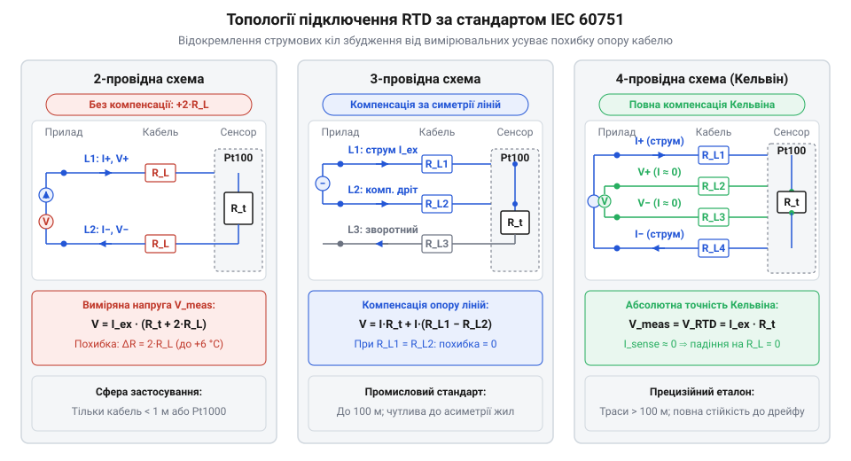
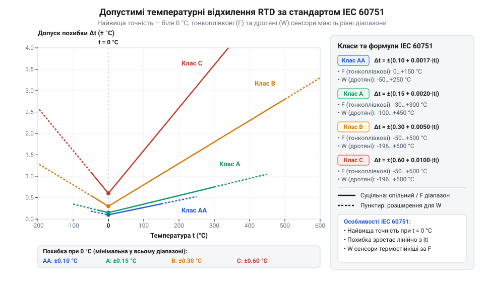

# Апаратна довідка: схеми з'єднання (2-, 3-, 4-провідні), кольорове маркування та класи допуску IEC 60751

<preknowlist>
- [Огляд родини резистивних перетворювачів температури RTD](root:cat-hw-sensors/rtd-resistance-temperature-detectors-family-overview) — фізичні принципи резистивного перетворення температури та базові залежності опору платини
- [PT100 — платиновий термоопір](root:cat-hw-sensors/pt100-rtd) — базові характеристики та конструкція платинового термоопору з номіналом 100 Ом
</preknowlist>

## Похибка вимірювальних ліній у RTD

Резистивний перетворювач температури (англ. @@en|Resistance Temperature Detector@@, RTD, від @@en|resistance@@ — опір), такий як [платиновий термоопір](root:cat-hw-sensors/pt100-rtd) @@en|Pt100@@, визначає температуру через зміну власного електричного опору. При підвищенні температури чутливого елемента на 1 °C опір платинових провідників зростає приблизно на 0.385 Ом (при базовому коефіцієнті α = 0.003851 °C⁻¹). Якщо сенсор розташований поруч із вимірювальним контролером, опір зчитується практично без викривлень. Проте в реальних промислових системах автоматизації давач віддалений від аналогово-цифрового перетворювача на десятки або сотні метрів.

При звичайному прокладанні кабельної траси струм від вимірювача протікає тими ж мідними дрітами, до яких під'єднано чутливий елемент. Електричний опір мідного провідника (англ. @@en|lead resistance@@, від @@en|lead@@ — провідник) підключення виникає послідовно із опором платинової спіралі або плівки.

Для двох жил кабелю перерізом 0.2 мм² (AWG 24) опір одного метра становить близько 0.08 Ом. Якщо відстань від давача до контролера становить 15 метрів, загальна довжина обох провідників у колі досягає 30 метрів, а їхній сумарний опір обчислюється наступним чином:

```
R_line = 2 · R_L
       = 2 · (15 м · 0.08 Ом/м)    [розрахунок опору двох жил кабелю]
       = 2.4 Ом                    [сумарний паразитний опір ліній]
```

Оскільки вимірювальний модуль фіксує падіння напруги на всьому колі, ця додаткова величина сприймається ним як підвищення опору самого терморезистора:

```
ΔT_err = R_line / S_sensor
       = 2.4 Ом / 0.385 Ом/°C     [ділення опору ліній на чутливість Pt100]
       = 6.23 °C                  [систематична похибка температури]
```

Систематична похибка понад 6 °C є неприпустимою для технологічних процесів. Ситуація ускладнюється тим, що опір мідних провідників залежить від температури довкілля вздовж траси (температурний коефіцієнт міді становить близько 0.00393 °C⁻¹). Якщо температура в приміщенні чи на вулиці змінюється протягом доби на 20 °C, опір 30-метрового кабелю зміщується на 0.19 Ом, що створює плаваючу похибку вимірювання приблизно в 0.5 °C. Таке викривлення неможливо усунути одноразовим програмним зсувом (англ. @@en|offset@@, від @@en|offset@@ — зсув) у налаштуваннях контролера.

Щоб усунути вплив опору під'єднувальних провідників і його температурного дрейфу, необхідно відокремити коло проходження вимірювального струму від кола знімання напруги. На цьому фізичному принципі базуються схемотехнічні топології підключення стандарту @@en|IEC 60751@@.

## Топології підключення та компенсація ліній

Для підключення платинових сенсорів застосовують три основні схемотехнічні топології: дводротову (англ. @@en|2-wire sensing@@), тридротову (англ. @@en|3-wire sensing@@) та чотиридротову (англ. @@en|4-wire sensing@@). Усі вони регламентовані міжнародним стандартом @@en|IEC 60751@@.


*Порівняння 2-, 3- та 4-провідних схем підключення RTD: від прямого знімання напруги з паразитного опору ліній до повної компенсації Кельвіна.*

У дводротовій схемі чутливий елемент під'єднується до вимірювального модуля двома провідниками. Струм збудження протікає тими ж провідниками, з яких знімається падіння напруги. Схема не містить засобів компенсації, тому опір дротів безпосередньо додається до опору сенсора. Дводротове підключення застосовують лише тоді, коли відстань до сенсора не перевищує 0.5–1 метра, або при використанні високоомних елементів @@en|Pt1000@@ (де опір ліній 2.4 Ом викликає похибку лише 0.62 °C замість 6.23 °C).

Тридротова схема є найпоширенішою в промисловості. До одного з виводів терморезистора підключається один провідник (L3), а до другого — два провідники (L1 та L2). Механізм компенсації працює за умови рівності опорів усіх жил кабелю (`R_L1 = R_L2 = R_L3 = R_L`).

У мостовій схемі або при використанні двох однаковісіньких джерел струму `I_ex` падіння напруги на провіднику L1 вираховується з падіння напруги на вимірювальному плечі:

```
V_meas = (I_ex · R_t + I_ex · R_L1) - I_ex · R_L2
       = I_ex · R_t + I_ex · (R_L1 - R_L2)     [групування за умови симетрії ліній]
       = I_ex · R_t                            [компенсоване значення напруги]
```

Головна межа тридротової схеми — вимога до повної симетрії ліній. Якщо жила L1 має опір 1.2 Ом, а жила L2 через окиснений контакт має опір 1.4 Ом, дисбаланс 0.2 Ом призведе до некомпенсованої похибки близько 0.52 °C для @@en|Pt100@@.

Чотиридротова схема забезпечує абсолютну компенсацію опору під'єднувальних ліній за рахунок розділення струмових та потенційних провідників (схема Кельвіна, англ. @@en|Kelvin connection@@). Дві жили пропускають струм збудження `I_ex` через чутливий елемент, а дві інші підключаються до високовхідного аналогово-цифрового перетворювача. Оскільки вхідний опір сучасного АЦП становить сотні мегаом, струм через вимірювальні провідники наближається до нуля (`I_sense ≈ 0`):

```
V_sense = I_sense · R_L
        = 0 A · R_L              [струм потенційних ліній наближається до нуля]
        = 0 В                    [падіння напруги на провідниках відсутнє]
```

Падіння напруги на потенційних виводах дорівнює точно `V_RTD = I_ex · R_t`, незалежно від опору струмових дротів, їхньої довжини та температурного дрейфу. Ця схема є обов'язковою для прецизійних вимірювань та узгодження зі [спеціалізованих перетворювачів MAX31865](root:cat-hw-sensors/max31865-rtd-converter). Детальний аналіз фізичних принципів та схемотехніки для повного усунення похибки ліній подано у статті про [чотирипровідну схему вимірювання Кельвіна](root:hw-sensing/kelvin-connection).

| Характеристика | 2-провідна | 3-провідна | 4-провідна |
| :--- | :--- | :--- | :--- |
| **Компенсація опору ліній** | Відсутня | Часткова (потребує симетрії) | Повна (абсолютна) |
| **Вплив асиметрії жил** | Критичний | Високий | Відсутній |
| **Складність монтажу** | Мінімальна | Середня | Максимальна |
| **Рекомендована довжина траси** | До 1 м (або @@en|Pt1000@@) | До 100 м | Понад 100 м |
| **Типові класи допуску RTD** | Class C, Class B | Class B, Class A | Class A, Class AA |

## Кольорове маркування виводів терморезисторів

При монтажі термоперетворювачів опору необхідно безпомилково ідентифікувати виводи кабелю за їхнім функціональним призначенням. Стандарт @@en|IEC 60751@@ нормує колірне маркування ізоляції вивідних провідників.

Базовим правилом кодування за @@en|IEC 60751@@ є поділ виводів на два колірні поля — **червоне** (англ. @@en|Red@@) та **біле** (англ. @@en|White@@). Провідники одного кольору підключаються до однієї і тієї ж сторони чутливого елемента:

- **2-провідний сенсор**: один червоний провідник (вивід A) та один білий провідник (вивід B). - **3-провідний сенсор**: два червоних провідники (виводи A та A') і один білий провідник (вивід B). Два червоних провідники виводять одну сторону терморезистора для компенсації. - **4-провідний сенсор**: два червоних провідники (струмовий `I+` та потенційний `U+`, виводи A та A') і два білих провідники (струмовий `I-` та потенційний `U-`, виводи B та B').

Якщо в гільзі встановлено здвоєний чутливий елемент для резервування, стандарт передбачає додавання додаткових кольорів (наприклад, чорного та жовтого) для другого каналу.

Визначити топологію та згрупувати виводи сенсора без паспорта можна мультиметром у режимі вимірювання опору при кімнатній температурі (~20 °C):

1. Виміряйте опір між усіма парами вивідних жил. 2. Пара жил із опором близьким до нуля (0.1–1.5 Ом) з'єднана з однією точкою чутливого елемента (два червоних провідники). 3. Пара жил із номінальним опором сенсора (~108 Ом для @@en|Pt100@@ або ~1078 Ом для @@en|Pt1000@@ при 20 °C) належить до протилежних кінців платинового резистора (червоний і білий провідники). 4. Наявність двох пар із нульовим опором між собою і номінальним опором між парами свідчить про 4-провідний сенсор.

Під час підключення 4-провідного сенсора до аналогових модулів вводу (зокрема при розведенні кіл [родини RTD-перетворювачів](root:cat-hw-sensors/rtd-resistance-temperature-detectors-family-overview)) струмові виводи (Force) з'єднують із джерелом збудження, а потенційні (Sense) — з диференціальним входом підсилювача.

## Класи допуску та конструктивні виконання

Стандарт @@en|IEC 60751@@ визначає вимоги до взаємозамінності терморезисторів шляхом нормування класів допуску (англ. @@en|tolerance class@@, від @@en|tolerance@@ — допуск). Клас допуску задає гранично допустиму похибку вимірювання температури `Δt` у градусах Цельсія залежно від значення вимірюваної температури `t`.

Конструктивно чутливі елементи RTD поділяють на два типи:

1. **Тонкоплівкові (англ. @@en|thin-film@@, від @@en|thin@@ — тонкий, @@en|film@@ — плівка)**: платиновий шар товщиною близько 1 мкм напилюється на керамічну підкладку. Вони компактні, дешеві, мають малу теплову інерцію та високу вібростійкість. Робочий діапазон обмежений (-50...+500 °C). 2. **Дротяні (англ. @@en|wire-wound@@, від @@en|wire@@ — дріт, @@en|wound@@ — намотаний)**: тонкий платиновий дріт намотується на керамічний каркас. Забезпечують найвищу стабільність у широкому діапазоні (-196...+850 °C), але більш чутливі до вібрацій.

Стандарт ділить термоперетворювачі на чотири класи точності: AA, A, B та C. Допустиме відхилення `Δt` (у °C) розраховується через модуль температури `|t|`:

- **Class AA**: `Δt = ±(0.10 + 0.0017 · |t|)` (для тонкоплівкових: 0...+150 °C; для дротяних: -50...+250 °C). - **Class A**: `Δt = ±(0.15 + 0.0020 · |t|)` (для тонкоплівкових: -30...+300 °C; для дротяних: -100...+450 °C). - **Class B**: `Δt = ±(0.30 + 0.0050 · |t|)` (для тонкоплівкових: -50...+500 °C; для дротяних: -196...+600 °C). - **Class C**: `Δt = ±(0.60 + 0.0100 · |t|)` (для тонкоплівкових: -50...+600 °C; для дротяних: -196...+600 °C).


*Залежність гранично допустимої похибки вимірювання від температури для класів точності AA, A, B та C згідно зі стандартом IEC 60751.*

Обчислимо граничну похибку для сенсора класу A при температурі `t = 100 °C`:

```
Δt = ±(0.15 + 0.0020 · |100|)    [підстановка t = 100 °C для класу A]
   = ±(0.15 + 0.20)              [модуль та множення]
   = ±0.35 °C                    [гранично допустиме відхилення]
```

Для порівняння, при 100 °C сенсор класу B має допуск `±0.80 °C`, а класу AA — лише `±0.27 °C`. Для загальнопромислових систем HVAC достатньо класу B, тоді як для фармацевтичних реакторів і теплового обліку використовують клас A або AA з 4-провідним підключенням. Для точного розрахунку залежності опору платини від температури у широкому діапазоні використовують [рівняння Каллендара-Ван Дюзена](root:hw-sensing/rtd-callendar-van-dusen-equation).

## Самонагрів, струм збудження та ізоляція

На відміну від активних датчиків, таких як [цифровий давач DS18B20](root:cat-hw-sensors/ds18b20) чи [аналоговий сенсор LM35DZ](root:cat-hw-sensors/lm35), терморезистор є пасивним елементом. Для вимірювання опору через нього пропускають струм збудження `I_ex`. Проте проходження струму викликає виділення електричної потужності, що спричиняє самонагрів (англ. @@en|self-heating@@, від @@en|self@@ — сам, @@en|heating@@ — нагрів) сенсора.

Потужність, що розсіюється на терморезисторі опором `R_t`, розраховується за законом Джоуля-Ленца:

```
P_diss = I_ex² · R_t
       = (1 · 10⁻³ A)² · 100 Ом    [струм 1 мА на опорі Pt100 при 0 °C]
       = 0.1 мВт                   [розсіювана електрична потужність]
```

Ця потужність підвищує температуру елемента відносно середовища. Додатковий температурний зсув визначається через коефіцієнт самонагріву (англ. @@en|self-heating coefficient@@ або @@en|dissipation factor@@, від @@en|dissipation@@ — розсіювання, позначення `E_th` у K/мВт):

```
ΔT_self = P_diss · E_th
        = 0.1 мВт · 0.2 K/мВт      [множення потужності на коефіцієнт самонагріву]
        = 0.02 °C                  [похибка самонагріву в повітрі]
```

У нерухомому повітрі самонагрів виражений найсильніше (`E_th ≈ 0.1...0.4 K/мВт`), а в рідині з інтенсивним рухом теплопередача краща (`E_th ≈ 0.01...0.05 K/мВт`).

Щоб похибка від самонагріву не перевищувала допуск обраного класу точності, струм збудження обмежують:

- Для **@@en|Pt100@@**: вимірювальний струм зазвичай обирають від 0.1 мА до 1.0 мА. Завищення струму до 5 мА призведе до потужності 2.5 мВт і похибки в повітрі до `0.5 °C`, що повністю скасує точність класу A. - Для **@@en|Pt1000@@**: опір у 10 разів більший, тому струм збудження обмежують значенням 0.1–0.3 мА.

Другим важливим параметром за @@en|IEC 60751@@ є опір ізоляції (англ. @@en|insulation resistance@@, від @@en|insulation@@ — ізоляція) між чутливим елементом та зовнішньою металевою захисною гільзою. Паразитний опір ізоляції `R_ins` підключається паралельно до вимірювального опору `R_t`.

За стандартом @@en|IEC 60751@@ опір ізоляції при 100 В DC і кімнатній температурі (+15...+35 °C) має становити не менше **100 Мегаом** (`R_ins ≥ 100 МОм`). При максимальних робочих температурах (+500 °C) опір кераміки знижується, але має бути не меншим ніж **10 Мегаом** (при 10 В DC).

Якщо через вологу чи забруднення опір ізоляції падає до 10 кОм, виникає паралельний шунт:

```
R_eq = (R_t · R_ins) / (R_t + R_ins)
     = (100 Ом · 10000 Ом) / (100 Ом + 10000 Ом)    [паралельне з'єднання при R_ins = 10 кОм]
     = 99.01 Ом                                     [еквівалентний опір зашунтованого сенсора]
```

Паразитний шунт знижує еквівалентний опір кола на 0.99 Ом, що викликає хибне заниження виміряної температури контролером приблизно на 2.57 °C і може спричинити аварійний перегрів установки.