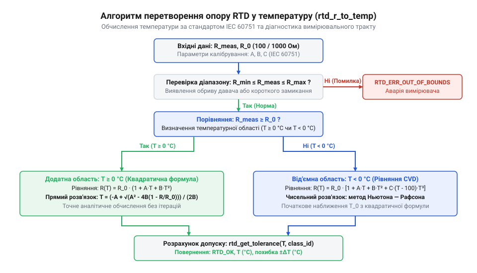
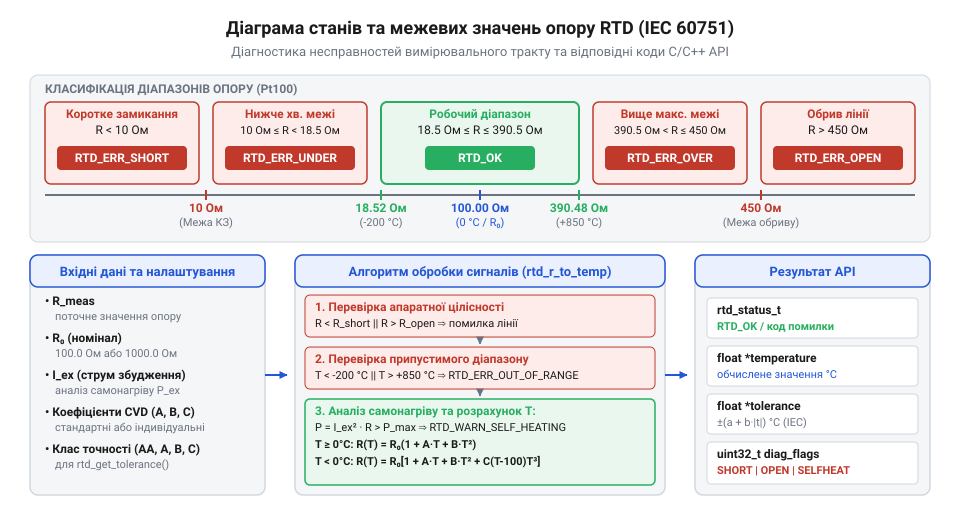

# Програмний інтерфейс (API) для лінеаризації, розрахунку допусків та калібрування Pt100/Pt1000

<preknowlist>
- [Огляд родини резистивних перетворювачів температури RTD](root:cat-hw-sensors/rtd-resistance-temperature-detectors-family-overview) — Фізичний принцип залежності опору платини від температури та базові поняття RTD.
- [PT100 — платиновий термоопір](root:cat-hw-sensors/pt100-rtd) — Основні параметри давача Pt100, номінальний опір 100 Ом та стандартні класи точності за IEC 60751.
- [MAX31865 — перетворювач опору платинових датчиків PT100/PT1000](root:cat-hw-sensors/max31865-rtd-converter) — Спосіб отримання цифрового коду опору RTD через specialised АЦП для його наступної програмної обробки.
</preknowlist>

## Чому терморезистори Pt100 потребують спеціалізованого API

Вимірювання температури за допомогою @@en|платинових резистивних давачів@@ (англ. @@en|Resistance Temperature Detector@@, @@en|RTD@@) — таких як [промислові сенсори Pt100](root:cat-hw-sensors/pt100-rtd) або @@en|Pt1000@@ — вважається еталоном точності у промисловості. Однак за удаваною простою залежністю опору від температури ховається математична й фізична складність: залежність платини є виражено нелінійною. Фізична природа цієї нелінійності полягає у квантових ефектах розсіювання електронів провідності на теплових коливаннях кристалічної ґратки — @@en|фононах@@ (від грец. *φωνή* — звук, що позначає квант коливального руху кристала). Зі зростанням температури інтенсивність розсіювання змінюється недопропорційно, через що температурний коефіцієнт опору поступово зменшується. Якщо спростити розрахунки й припустити, що опір змінюється лінійно зі сталим коефіцієнтом α = 0.003851 °C⁻¹, похибка вимірювання на межах робочого діапазону від -200 °C до +850 °C досягатиме понад 100 °C. Окрім внутрішньої нелінійності самого матеріалу, виміряний вхідний опір, який фіксує @@en|аналогово-цифровий перетворювач@@ (@@en|АЦП@@), викривляється паразитичним опором з'єднувальних провідників. У двопровідній схемі підключення опір лінії підсумовується з опором давача, де додаткові 0.385 Ом додають цілий 1 °C зсуву, тоді як трипровідна та чотирипровідна схеми компенсують цей опір шляхом розділення струмового кола й вимірювання напруги на високоімпедансних входах АЦП. У відповідальних технологічних процесах — від стерилізації у фармацевтиці до контролю реакторів — ігнорування нелінійності платини та впливу лінії призводить до браку продукції або аварійних зупинок.

Окрім фізичної нелінійності, реальний вимірювальний тракт мікроконтролера стикається з апаратними відмовами. Сигнальна лінія давача може обірватися або закоротити на землю чи живлення. Якщо виміряне значення цифрового коду з АЦП — наприклад, отримане через [перетворювач опору MAX31865](root:cat-hw-sensors/max31865-rtd-converter) — передати у звичайну формулу без попередньої перевірки, обчислення дадуть некоректне значення, що виведе з ладу регулятор регулювання. Також проста формула не враховує ефект @@en|самонагріву@@ чи відхилення конкретного сенсора від номіналу через технологічний розкид.

Спроби обробляти ці крайові випадки фрагментарно прямо у коді застосунку ведуть до дублювання алгоритмів, появи важкоінспектованих помилок та ускладнення підтримки програмного забезпечення. Для розв'язання цієї проблеми створюють спеціалізований програмний інтерфейс (англ. @@en|Application Programming Interface@@, @@en|API@@). Такий модуль виступає ізолюючим шаром між первинними даними АЦП та логікою верхнього рівня: він бере на себе точну лінеаризацію за міжнародним стандартом @@en|IEC 60751@@, оцінку допустимої похибки, застосування коефіцієнтів індивідуального калібрування та миттєву діагностику апаратних аварій. Загальний огляд властивостей терморезистивних елементів містить [огляд родини RTD-давачів](root:cat-hw-sensors/rtd-resistance-temperature-detectors-family-overview).

## Структура даних та конфігурація інтерфейсу

Щоб @@en|API@@ міг універсально працювати як з елементами @@en|Pt100@@ (із базовим опором R₀ = 100 Ом при 0 °C), так і з @@en|Pt1000@@ (R₀ = 1000 Ом), архітектура модуля будується на основі чітко визначених структур даних. Конфігурація відокремлює фізичні параметри сенсора від математичних коефіцієнтів лінеаризації.

Основою конфігураційного об'єкта є структура `rtd_config_t`. Вона зберігає номінальний опір R₀, стандартний клас точності (AA, A, B або C) згідно з @@en|IEC 60751@@, а також набір коефіцієнтів @@en|Каллендара — Ван Дюзена@@ (англ. @@en|Callendar – Van Dusen@@). Стандартні коефіцієнти для чистої платини становлять: A = 3.9083 × 10⁻³ °C⁻¹, B = -5.775 × 10⁻⁷ °C⁻², C = -4.183 × 10⁻¹² °C⁻⁴. Кожне поле цієї структури виконує чітко визначену роль: `type` вказує тип давача (`RTD_TYPE_PT100` або `RTD_TYPE_PT1000`), що задає номінальний опір `r0` (100.0 Ом або 1000.0 Ом при 0 °C); `accuracy_class` визначає нормативний клас допуску; підструктура `coeff` містить коефіцієнти `A`, `B`, `C` для математичних рівнянь; `r_min` та `r_max` задають граничні межі опору для фіксації аварійних режимів; а `max_current_a` визначає гранично припустимий струм для контролю @@en|самонагріву@@. Ініціалізація конфігурації виконується функцією `rtd_config_init()`, яка спершу перевіряє передані аргументи на коректність (повертаючи `RTD_ERR_INVALID_PARAM`, якщо вказівник порожній або тип некоректний), далі призначає `r0` відповідно до обраного [платинового термоопору Pt100](root:cat-hw-sensors/pt100-rtd) чи @@en|Pt1000@@, заповнює `coeff` дефолтними коефіцієнтами стандарту, обчислює границі `r_min` і `r_max` для робочого температурного діапазону та повертає статус `RTD_OK`.

Для забезпечення діагностики до структури конфігурації додаються граничні значення опору `r_min` та `r_max`, а також максимальний припустимий вимірювальний струм для контролю @@en|самонагріву@@. Перелік статусів виконання функцій визначається переліком `rtd_status_t`, який дозволяє викликаючій програмі однозначно ідентифікувати як успішне обчислення (`RTD_OK`), так і типи виявлених помилок (`RTD_ERR_OPEN_CIRCUIT`, `RTD_ERR_SHORT_CIRCUIT`, `RTD_ERR_OUT_OF_RANGE`).

:::tabs
:::code api-iec60751-software-conversion-api/c/snippet-1.c
:::code api-iec60751-software-conversion-api/cpp/rtdtype.cpp
:::

## Пряме та обернене перетворення опору

Стандарт @@en|IEC 60751@@ визначає залежність опору платинового термоопору R(t) від температури t у двох окремих температурних зонах. Розділення зумовлене тим, що при від'ємних температурах (t < 0 °C) квантово-механічні ефекти коливань кристалічної ґратки платини вимагають додавання додаткового члена четвертого ступеня.

Для додатної області (t ≥ 0 °C) використовується квадратичне рівняння @@en|Каллендара — Ван Дюзена@@:
```
R(t) = R₀ × (1 + A × t + B × t²)
```
де R₀ — базовий опір при 0 °C, а A та B — стандартні або індивідуальні коефіцієнти. Щоб знайти температуру за виміряним опором R, квадратне рівняння розв'язують відносно t через дискримінант:
```
B × t² + A × t + (1 - R / R₀) = 0
t = (-A + √(A² - 4 × B × (1 - R / R₀))) / (2 × B)
```

Для від'ємної області (t < 0 °C) точне рівняння має поліноміальний вигляд четвертого ступеня:
```
R(t) = R₀ × (1 + A × t + B × t² + C × (t - 100) × t³)
```
Оскільки прямого аналітичного розв'язку четвертого ступеня у зручній обчислювальній формі немає, функція `rtd_r_to_temp()` застосовує чисельний метод @@en|Ньютона — Рафсона@@ (англ. @@en|Newton – Raphson method@@). Початковим наближенням t₀ слугує значення, обчислене за квадратичною формулою, після чого виконується 2–3 ітерації уточнення:
```
f(t) = R₀ × (1 + A × t + B × t² + C × (t - 100) × t³) - R_meas
f'(t) = R₀ × (A + 2 × B × t + C × (4 × t³ - 300 × t²))
t_{k+1} = t_k - f(t_k) / f'(t_k)
```

Обернене перетворення `rtd_temp_to_r()` є значно простішим, оскільки пряме обчислення R(t) за відомою температурою t розраховується підставленням t у відповідну формулу залежно від її знаку.


*Блок-схема алгоритму перетворення виміряного опору RTD у температуру з розгалуженням на від'ємну та додатну області рівняння Каллендара — Ван Дюзена.*

:::tabs
:::code api-iec60751-software-conversion-api/c/rtd-r-to-temp.c
:::code api-iec60751-software-conversion-api/cpp/rtdrtotemp.cpp
:::

## Розрахунок допусків та індивідуальне калібрування

Стандарт @@en|IEC 60751@@ класифікує платинові терморезистори за чотирма основними класами точності (AA, A, B, C). Для кожного класу визначено нормативну гранично припустиму похибку Δt у залежності від модуля виміряної температури |t|.

Розрахунок допустимого відхилення здійснюється за функціональними залежностями:
```
Клас AA:  Δt = ±(0.10 + 0.0017 × |t|) °C
Клас A:   Δt = ±(0.15 + 0.0020 × |t|) °C
Клас B:   Δt = ±(0.30 + 0.0050 × |t|) °C
Клас C:   Δt = ±(0.60 + 0.0100 × |t|) °C
```

Функція `rtd_get_tolerance()` обчислює цю похибку як у температурних одиницях (°C), так і у відповідному еквіваленті опору (Ом). Останнє досягається множенням Δt на локальну похідну dR/dt при даній температурі.

Коли вимірювальна система вимагає точності, вищої за стандартний клас AA, застосовують @@en|індивідуальне калібрування@@. Під час калібрування у метрологічній лабораторії вимірюють опір конкретного давача при декількох реперних температурах і обчислюють його персональні коефіцієнти Каллендара — Ван Дюзена (A, B, C) або константи α, δ, β. Зв'язок між цими формами запису виражається співвідношеннями:
```
A = α × (1 + δ / 100)
B = -α × δ / 10000
C = -α × β / 100000000    [для t < 0 °C]
```

Внесення цих індивідуальних коефіцієнтів у структуру `rtd_config_t` компенсує технологічний розкид конкретного екземпляра платинової спіралі або напиленого плівкового шару, зменшуючи похибку вимірювального тракту до рівня підрівня сотих часток градуса.

:::tabs
:::code api-iec60751-software-conversion-api/c/rtd-get-tolerance.c
:::code api-iec60751-software-conversion-api/cpp/gettolerance.cpp
:::

## Обробка помилок та діагностика вимірювань

Промисловий @@en|API@@ для RTD не може обмежуватися лише математичним обчисленням температури. Його важливим завданням є програмна діагностика стану вимірювальної лінії та запобігання хибним спрацюванням систем автоматики.

Основними аварійними режимами вимірювального тракту є:
1. **Обрив лінії (англ. @@en|Open Circuit@@)**: опір вимірювального кола прямує до нескінченності. Для @@en|Pt100@@ порогом обриву зазвичай приймають значення R > 390.48 Ом (що відповідає температурі вище +850 °C). 2. **Коротке замикання (англ. @@en|Short Circuit@@)**: опір кола прямує до нуля. Порогом короткого замикання вважається R < 18.52 Ом (температура нижче -200 °C). 3. **Вихід за межі робочого діапазону (англ. @@en|Out of Range@@)**: виміряна температура лежить за межами нормованого діапазону від -200 °C до +850 °C. 4. **Перевищення самонагріву (англ. @@en|Self-Heating Error@@)**: струм вимірювання I, який протікає через платиновий елемент, виділяє теплову потужність P = I² × R. Якщо ця потужність перевищує коефіцієнт розсіювання давача у середовищі, давач починає нагрівати сам себе, викривляючи показання на десяті частки градуса. @@en|API@@ перевіряє, щоб вимірювальний струм для Pt100 не перевищував 1 мА (і відповідно 0.1 мА для Pt1000).


*Діаграма станів та межевих значень опору RTD для виявлення обриву лінії, короткого замикання та нормального робочого діапазону.*

Функція `rtd_process_measurement()` об'єднує етапи діагностики та обчислення: вона перевіряє вхідне значення опору за вікном допустимих меж, перевіряє параметри струму, розраховує температуру та повертає відповідний статус системи.

:::tabs
:::code api-iec60751-software-conversion-api/c/rtd-process-measurement.c
:::code api-iec60751-software-conversion-api/cpp/processmeasurement.cpp
:::