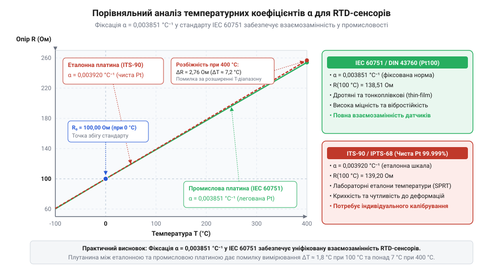
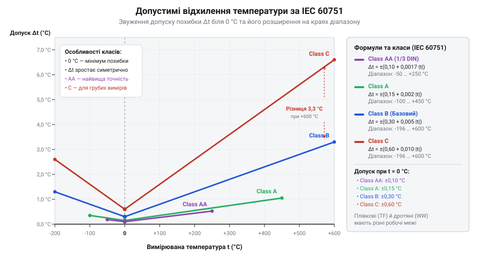

# Історія стандартизації платинових термометрів опору та виникнення стандарту IEC 60751

<preknowlist>
- [Огляд родини резистивних перетворювачів температури RTD](root:cat-hw-sensors/rtd-resistance-temperature-detectors-family-overview) — фізичний принцип вимірювання температури через зміну електричного опору провідників та загальну класифікацію терморезисторів.
- [PT100 — платиновий термоопір](root:cat-hw-sensors/pt100-rtd) — базове уявлення про конструкцію та номінальні параметри датчика Pt100 (100 Ом при 0 °C).
</preknowlist>

## Перші кроки платинової термометрії

У першій половині XIX століття швидкий розвиток металургії та парових машин зіштовхнувся з фундаментальним бар'єром — відсутністю приладів для точного вимірювання високих температур. Наявні рідкісні термометри зі скляними капілярами ламалися при нагріванні понад 300 °C або виходили з ладу через кипіння ртуті. Газові термометри хоч і витримували більший нагрів, вимагали громіздких балонів і складних розрахунків розширення газу, що робило їх непридатними для реального виробництва.

У 1821 році англійський хімік і фізик Гемфрі Деві (Humphry Davy) виявив явище, яке лягло в основу нового класу вимірювачів: електричний опір металів зростає зі збільшенням температури. Проте знадобилося пів століття, щоб перетворити це лабораторне спостереження на вимірювальний інструмент. У 1871 році німецький та британський інженер Вільям Сіменс (William Siemens) розробив перший промисловий платиновий `@@el|пірометр@@` (грец. *πῦρ* — вогонь + *μέτρον* — вимір). Обрана ним `@@es|платина@@` (ісп. *platina* — зменшувальне від *plata*, срібло) мала високу температуру плавлення та інертність до окиснення.

Конструкція Сіменса містила тонку платинову дріт, намотану на вогнетривкий керамічний циліндр із глини, і вміщену в захисний залізний чохол. Зміна опору платини давала змогу оцінювати температуру всередині доменних печей. Тим не менше, перша спроба впровадження `@@en|RTD@@` (англ. *Resistance Temperature Detector* — резистивний давач температури) зазнала невдачі на практиці. Прилад Сіменса втрачав точність уже після кількох циклів нагрівання.

Головних причин невдачі було дві:
1. За високих температур понад 800 °C кремній із керамічного каркаса відновлювався та вступав у хімічну реакцію з платиновим дротом, утворюючи крихкі силіциди платини. Це викривляло базовий опір елемента та руйнувало структуру металу. 2. Конструктор припустив просту лінійну залежність опору від температури, ігноруючи реальне викривлення характеристичної кривої металу.

Досвід перших випробувань довів інженерам, що створення надійного [резистивного перетворювача температури](root:cat-hw-sensors/rtd-resistance-temperature-detectors-family-overview) потребує хімічного захисту чутливого дроту від матеріалу каркаса та побудови математичної моделі, яка враховує нелінійність платини.

## Рівняння Каллендара — Ван Дюзена

Прорив у математичному описі платинового опору відбувся 1887 року, коли британський фізик Г'ю Каллендар (Hugh Longbourne Callendar) запропонував нову конструкцію датчика та відповідне рівняння. Каллендар відмовився від кераміки на користь слюдяного хрестоподібного каркаса, що виключило забруднення платини кремнієм. Провівши серію вимірювань чистої платини від 0 °C до 660 °C, він довів, що залежність опору від температури описується параболічною функцією.

Для додатних температур Каллендар сформулював рівняння, де опір залежить від двох коефіцієнтів `A` та `B`:

```text
R(t) = R₀ × (1 + A × t + B × t²)
```

Тут `R₀` — опір платини при 0 °C, `t` — температура в градусах Цельсія, а параметри `A` та `B` розраховуються через температурний коефіцієнт `α` та параметри нелінійності платиновій нитки.

Математична модель Каллендара чудово працювала у додатній області, проте при охолодженні датчика нижче 0 °C розраховані значення починали відхилятися від физичного опору. У 1925 році американський фізик Мілтон Ван Дюзен (Milton S. Van Dusen) з Національного бюро стандартів США дослідив поведінку платини при кріогенних температурах аж до -200 °C. Ван Дюзен з'ясував, що у від'ємному діапазоні параболи недостатньо, і додав кубічний член, що включає коефіцієнт `C`:

```text
R(t) = R₀ × (1 + A × t + B × t² + C × (t - 100) × t³)
```

У цій формулі коефіцієнт `C` дорівнює нулю для будь-яких температур `t ≥ 0 °C`, що робить вираз універсальним для всього температурного діапазону від -200 °C до +850 °C.

Основою математичного опису стала величина температурного коефіцієнта опору `α`, що визначає відносну зміну опору між точкою танення льоду (0 °C) та точкою кипіння води (100 °C):

```text
α = (R₁₀₀ - R₀) / (100 × R₀)
```

Для надчистої еталонної платини чистотою 99.999% цей коефіцієнт становить `α = 0.003925 °C⁻¹` (у практичних вимірюваннях округлюється до `0.00392 °C⁻¹`). Завдяки високій відтворюваності, чиста платина разом із рівнянням Каллендара — Ван Дюзена стала основою для побудови еталонів у міжнародних температурних шкалах `@@en|IPTS-68@@` та сучасній `@@en|ITS-90@@` (International Temperature Scale of 1990). Докладніше про використання платинових термометрів для лабораторних еталонів та принципи побудови цієї практичної шкали читайте у статті про [міжнародну температурну шкалу ITS-90](root:cat-hw-sensors/its-90-temperature-scale).

Формули Каллендара — Ван Дюзена дали змогу обчислювати точну температуру за виміряним опором, що відкрило шлях до створення точного [платинового термоопору Pt100](root:cat-hw-sensors/pt100-rtd) для наукових лабораторій.

## Від DIN 43760 до промислового легування

Створення лабораторного еталона на основі надчистої платини з `α = 0.00392 °C⁻¹` вирішило завдання точної термометрії в ідеальних умовах. Проте при спробі перенести такі сенсори на хімічні заводи, у котельні та металургійні цехи виник гострий інженерний конфлікт. М'який дріт з надчистої платини виявився надто чутливим до механічних чинників: сильна вібрація обладнання накреслювала дріт, викликаючи наклеп металу, а висока температура призводила до рекристалізації та росту зерен. Крім того, навіть мікроскопічні сліди технологічних газів у промисловому повітрі дифундували в платину, необоротно змінюючи її коефіцієнт `α` та базовий опір `R₀`.

Через ці зміни кожен промисловий сенсор із надчистої платини вимагав індивідуального калібрування й регулярної перевірки, що робило масову взаємозамінність датчиків неможливою. Поширене й сьогодні уявлення про те, ніби надчиста платина краще підходить для промисловості, є небезпечним міфом: чистий метал у жорсткому середовищі швидше втрачає стабільність, ніж спеціально підготовлений сплав.

У середині XX століття німецькі інженери в стандарті `@@de|DIN 43760@@` (нім. *Deutsches Institut für Normung* — Німецький інститут зі стандартизації) знайшли елегантний розв'язок. Вони запропонували свідомо легувати платиновий дріт контрольованими домішками благородних металів (зокрема родію та іридію). Таке контрольоване мікролегування зафіксувало кристалічну ґратку, зробивши дріт стійким до вібрацій та дифузії зовнішніх домішок.


*Порівняння температурної залежності опору еталонної платини та промислового сплаву DIN 43760.*

Додавання легуючих елементів трохи знизило температурний коефіцієнт опору платини з `0.00392 °C⁻¹` до фіксованого значення `α = 0.00385055 °C⁻¹` (стандартизованого як `0.003851 °C⁻¹`). Хоча легована платина має трохи меншу чутливість до зміни температури, її метрологічна стабільність у часі зросла в рази.

Стандарт `@@de|DIN 43760@@` закріпив уніфіковану залежність опору від температури для промислових датчиків `@@en|Pt100@@` (з опором 100 Ом при 0 °C) та `@@en|Pt1000@@`. Саме коефіцієнт `α = 0.003851 °C⁻¹` став основою для масового виготовлення взаємозамінних чутливих елементів, які можна підключати до будь-яких промислових контролерів або [спеціалізованих перетворювачів опору](root:cat-hw-sensors/max31865-rtd-converter) без індивідуального підлаштування кожної вимірювальної лінії. Згодом саме це рішення лягло в основу міжнародного стандарту `@@en|IEC 60751@@`.

## Стандарт IEC 60751 та плівкові сенсори

У другій половині XX століття швидка автоматизація хімічних комбінатів, харчових ліній та енергетичних блоків вимагала масового випуску платинових датчиків. Попри успіх німецького стандарту `@@de|DIN 43760@@`, у різних країнах продовжували застосовувати власні регіональні специфікації. Це створювало плутанину при імпорті обладнання та збірці вимірювальних систем. У 1983 році Міжнародна електротехнічна комісія випустила стандарт `@@en|IEC 60751@@`, який остаточно уніфікував вимоги до промислових `@@en|RTD@@` (англ. *Resistance Temperature Detector*) на основі платини з коефіцієнтом `α = 0.003851 °C⁻¹` для датчиків `@@en|Pt100@@` та `@@en|Pt1000@@`.

Проте наприкінці XX століття промисловість зіштовхнулася з новою технологічною зміною. Класичні дротяні чутливі елементи `@@en|wire-wound@@` — у яких тонка платинова нитка спірально вкладається в керамічну трубку або намотується на скляне осердя — володіли відмінною стабільністю, але залишалися дорогими у виробництві, порівняно великими та вразливими до сильних ударних навантажень.

Альтернативою стали тонкоплівкові сенсори `@@en|thin-film@@`. Для їх створення застосували метод вакуумного напилення `@@en|sputtering@@` та технологію `@@en|photolithography@@` (грец. *φῶς* — світло + *λίθος* — камінь + *γράφω* — пишу): на плоску керамічну підкладку з оксиду алюмінію напилюють шар платини завтовшки близько 1 мкм, лазером підганяють опір у вигляді меандру та покривають захисним шаром скла. Тонкоплівкові елементи виявилися значно дешевшими, компактними, стійкими до вібрацій та швидкореагуючими на зміну температури.

Поява плівкової технології викрила фізичну різницю у відгуку двох типів конструкцій. У дротяному елементі платинова нитка розширюється практично вільно всередині керамічного порошку. У тонкоплівковому сенсорі шар платини жорстко зчеплений із керамічною підкладкою. Через різницю коефіцієнтів термічного розширення платини й кераміки під час нагрівання в металевій плівці виникає механічне напруження, яке зміщує опір. Крім того, за високих температур (понад 300…500 °C) у мікроскопічно тонкій плівці прискорюються процеси дифузії та окиснення через мікродефекти захисного скла.

Ця фізична відмінність зробила неможливим застосування єдиних вимог до обох конструкцій. У редакції стандарту `@@en|IEC 60751@@` 2008 року (і збереженій у версії 2022 року) стандартизатори вперше офіційно розділили чутливі елементи на `@@en|wire-wound@@` та `@@en|thin-film@@`. Стандарт закріпив для дротяних сенсорів ширший діапазон застосування (від -200 °C до +850 °C), тоді як для тонкоплівкових обмежив стандартний робочий діапазон (зазвичай від -50 °C до +300 °C або +500 °C залежно від класу). Таке розділення дало змогу зберігати точність вимірювання [резистивних перетворювачів температури](root:cat-hw-sensors/rtd-resistance-temperature-detectors-family-overview) без ризику незворотного дрейфу опору.

## Класи точності та взаємозамінність

Головним здобутком стандарту `@@en|IEC 60751@@` стало впровадження нормованих класів точності, які гарантують повну взаємозамінність датчиків. На промисловому підприємстві заміна вийшовшого з ладу елемента `@@en|Pt100@@` або `@@en|Pt1000@@` не повинна вимагати перекалібрування всієї вимірювальної лінії чи перепрограмування контролера.

Стандарт установлює чотири основні класи точності — `@@en|Class AA@@`, `@@en|Class A@@`, `@@en|Class B@@` та `@@en|Class C@@`. Для кожного класу визначено математичну залежність гранично припустимого відхилення температури `Δt` (у градусах Цельсія) від вимірюваної температури `t`:

```text
Δt = ±(0.10 + 0.0017 × |t|)    [Клас AA]
Δt = ±(0.15 + 0.0020 × |t|)    [Клас A]
Δt = ±(0.30 + 0.0050 × |t|)    [Клас B]
Δt = ±(0.60 + 0.0100 × |t|)    [Клас C]
```


*Залежність допустимого відхилення температури Δt від вимірюваної температури t для різних класів точності за IEC 60751.*

Існування цих стандартизованих допусків спростовує поширене хибне уявлення про те, ніби кожен промисловий терморезистор потребує індивідуальної градуювальної таблиці. Завдяки прецизійному підгананню опору при виготовленні (лазерній підгонці значення `R₀` до 100.00 Ом при 0 °C), будь-який датчик `@@en|Class A@@` гарантовано вкладається у визначену смугу похибки. Індивідуальне калібрування з визначенням власних коефіцієнтів Каллендара — Ван Дюзена потрібне лише для прецизійних лабораторних вимірювань, де потрібна похибка менша за 0.01 °C.

На практиці вибір вимірювального елемента визначається умовами експлуатації та вимогами до точності:
- У системах із підвищеною вібрацією (наприклад, у двигунах чи насосах) та в діапазоні від -50 °C до +300 °C оптимальним є застосування тонкоплівкового сенсора `@@en|thin-film@@` `@@en|Pt1000@@` класу `@@en|Class B@@` або `@@en|Class A@@`. Вищий базовий опір 1000 Ом нівелює вплив опору підвідних дротів. - У високотемпературних печах чи кріогенних установках (від -200 °C до +600 °C) обирають дротяний сенсор `@@en|wire-wound@@` класу `@@en|Class A@@` або `@@en|Class AA@@`. Для збереження метрологічних характеристик такі сенсори підключають за 3- або 4-провідною схемою до контролерів або спеціалізованих [перетворювачів опору платинових датчиків](root:cat-hw-sensors/max31865-rtd-converter).