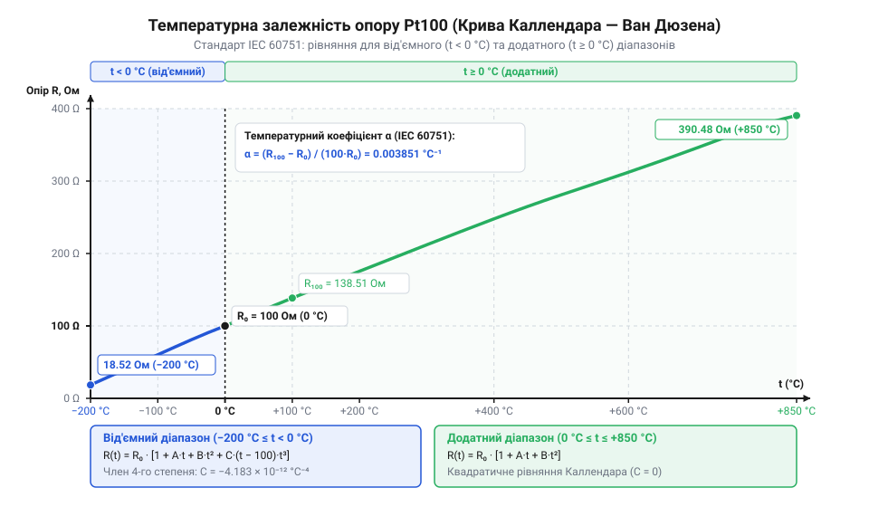
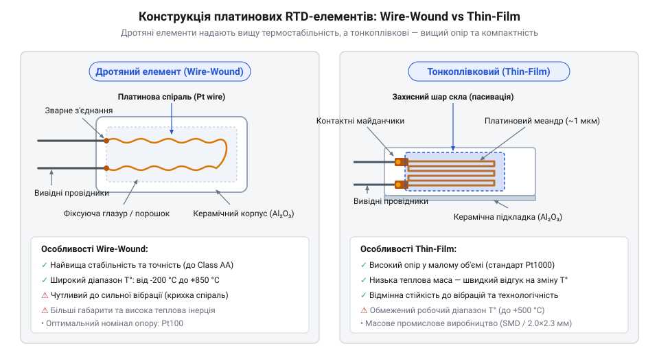
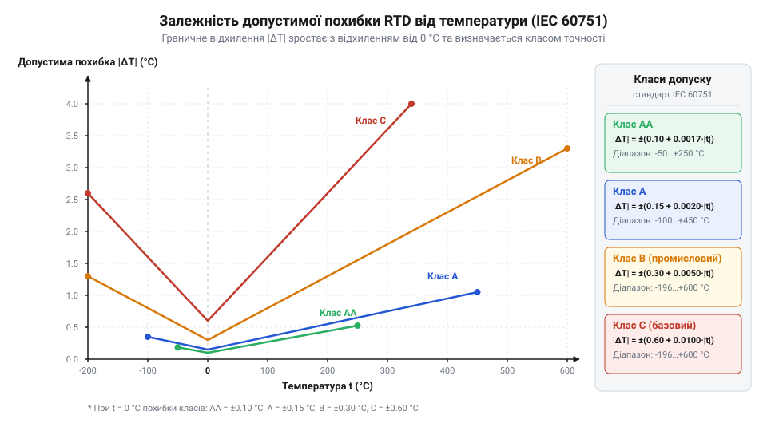
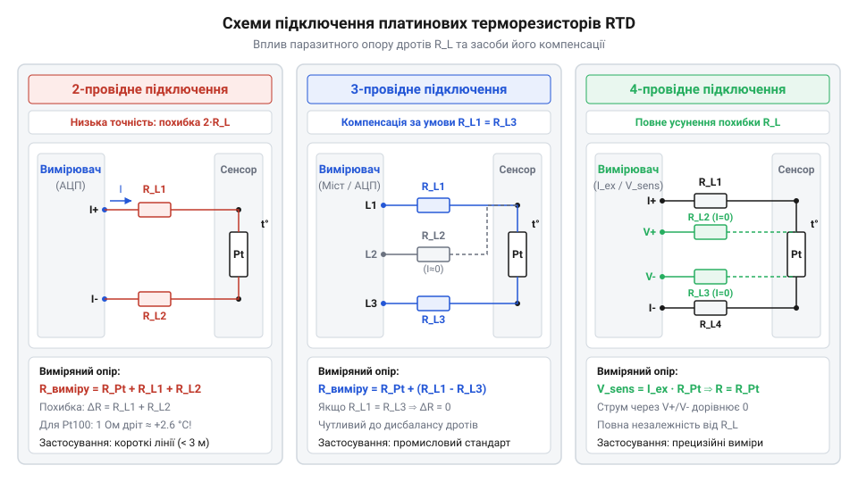
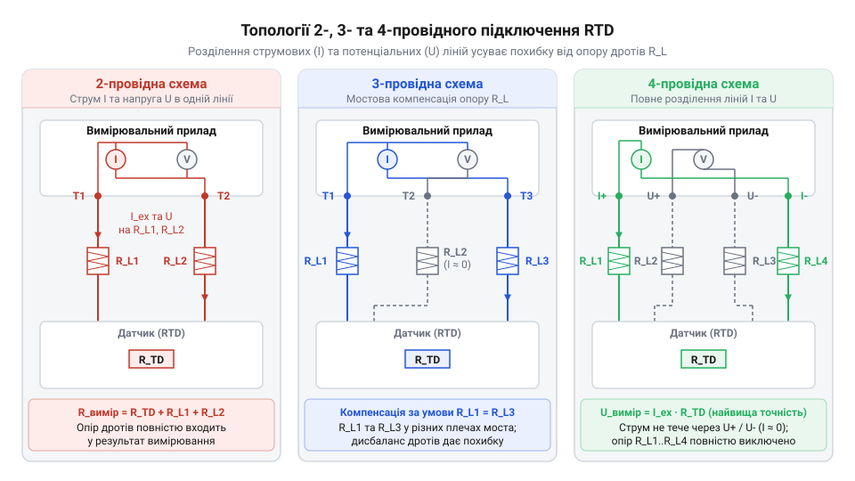

# Стандарт IEC 60751 для платинових термоопорів

<preknowlist>
- [Огляд родини резистивних перетворювачів температури RTD](root:cat-hw-sensors/rtd-resistance-temperature-detectors-family-overview) — Фізичні принципи зміни опору провідників від температури та базове поняття RTD.
- [PT100 — платиновий термоопір](root:cat-hw-sensors/pt100-rtd) — Поняття номінального опору 100 Ом при 0 °C та базові параметри платинового сенсора.
</preknowlist>

## Проблема взаємозамінності точних вимірювачів температури

Уявіть промислову автоматизовану лінію хімічного синтезу або систему контролю пастеризації молочної продукції, де вийшов із ладу первинний сенсор температури. Якщо у звичайних побутових приладах заміна несправного компонента є простим завданням, то у прецизійних промислових вимірювачах виникає гостра проблема. Прості [аналогові резистивні термістори](root:cat-hw-sensors/ky-013-thermistor) або [напівпровідникові аналогові давачі](root:cat-hw-sensors/lm35) мають значний технологічний розкид параметрів між окремими екземплярами й партіями. Якщо замінити один @@en|NTC@@ термістор (від англ. @@en|Negative Temperature Coefficient@@, де @@en|negative@@ — від'ємний, @@en|temperature@@ — температура, @@en|coefficient@@ — коефіцієнт) на інший без повної перекалібрування аналогового тракту та перерахунку цифрових коефіцієнтів мікроконтролера, показники температури можуть зміститися на кілька градусів Цельсія. У критичних технологічних процессах така похибка спричиняє брак продукції або навіть аварійну ситуацію.

Для забезпечення безперебійної експлуатації вимірювальних систем необхідна повна взаємозамінність (@@en|interchangeability@@) сенсорів. Взаємозамінність означає можливість вилучення будь-якого давача з ланцюга та встановлення нового екземпляра від іншого виробника без додаткового налаштування чи калібрування вимірювального приладу. Більшість металів і напівпровідників не здатні забезпечити таку властивість: їхній електричний опір залежить від мікроскопічних домішок у кристалічній ґратці, внутрішніх механічних напружень та нелінійних термодинамічних ефектів, які різняться від заводської партії до партії. Загальні фізичні принципи зміни опору матеріалів описує [родина резистивних давачів](root:cat-hw-sensors/rtd-resistance-temperature-detectors-family-overview) температури.

Розв'язанням проблеми взаємозамінності стало застосування високочистої платини (@@en|platinum@@, Pt). Платина володіє унікальним поєднанням фізико-хімічних властивостей: вона хімічно інертна, не окиснюється на повітрі у широкому діапазоні температур від -200 °C до +850 °C, має високу температуру плавлення (1768 °C) і надзвичайно стабільну кристалічну структуру. Головне — платина високого ступеня очищення (99.999%) показує строго відтворювану залежність електричного опору від температури. Фізичний давач на основі платини називають платиновим @@en|RTD@@ (від англ. @@en|Resistance Temperature Detector@@, де @@en|resistance@@ — опір, @@en|temperature@@ — температура, @@en|detector@@ — виявник). На відміну від напівпровідникових аналогів, платиновий опір не схильний до часового дрейфу й деградації кристалу при циклічному нагріванні.

Історичний шлях створення стабільного платинового термометра опору розпочався у 1821 році, коли сер @@en|Humphry Davy@@ (від англ. @@en|Humphry Davy@@) уперше дослідив залежність електричної провідності металів від температури. У 1871 році сер @@en|William Siemens@@ (від англ. @@en|William Siemens@@) розробив перший практичний платиновий термометр опору, намотавши платиновий дріт на вогнетривкий керамічний циліндр. Початкові конструкції мали недолік: платина вступала в реакцію з діоксидом кремнію керамічного каркаса при високих температурах, що спричиняло дрейф опору й втрату точності. Лише вдосконалення методів глибокої очистки платини, відпалу металу та створення керамічних захисних оболонок у XX столітті дало змогу сформувати єдиний міжнародний стандарт. Деталізована [історія виникнення стандарту](root:cat-hw-sensors/iec-60751-standard-for-rtd/hist-iec-60751-standardization-history.md) відображає еволюцію від лабораторних дослідів до створення єдиної вимірювальної шкали.

Міжнародний стандарт @@en|IEC 60751@@ нормує залежність опору платини від температури й визначає єдиний нормований температурний коефіцієнт опору `α` (альфа). Величина `α` визначається як середня відносна зміна опору між 0 °C та 100 °C за формулою: Для розуміння відмінностей між технічним стандартом IEC 60751 та лабораторними реперними точками ознайомтеся з матеріалом про [міжнародну температурну шкалу ITS-90 та еталонну термометрію опору](root:hw-sensing/its-90).

```
α = (R₁₀₀ - R₀) / (100 × R₀)
```

де `R₀` — опір сенсора при 0 °C, а `R₁₀₀` — опір при 100 °C. Стандарт @@en|IEC 60751@@ фіксує значення `α = 0.003851 °C⁻¹` (або `3.851 × 10⁻³ °C⁻¹`). Це означає, що для найбільш поширеного давача @@en|Pt100@@ (із номінальним опором `R₀ = 100 Ом` при 0 °C) опір при 100 °C точно дорівнює 138.51 Ом. Аналогічно для давача @@en|Pt1000@@ (з `R₀ = 1000 Ом` при 0 °C) опір при 100 °C становить 1385.1 Ом. Завдяки нормуванню `α` будь-який давач @@en|Pt100@@ або @@en|Pt1000@@ стандарту @@en|IEC 60751@@ від будь-якого світового виробника є строго взаємозамінним у вимірювальній системі. Базовий [опис давача Pt100](root:cat-hw-sensors/pt100-rtd) демонструє первинні конструктивні варіанти цього сенсора.

## Рівняння Каллендара — Ван Дюзена

Знання єдиного коефіцієнта `α` описує лише середній нахил прямої між 0 °C та 100 °C. Проте реальна залежність опору платини від температури у широкому діапазоні від -200 °C до +850 °C не є строго лінійною. Зростання температури збільшує амплітуду коливань атомів кристалічної ґратки платини, що змінює середній вільний пробіг електронів провідності. Для точного обчислення опору за довільної температури стандарт @@en|IEC 60751@@ описує математичну модель — @@en|Callendar-Van Dusen equation@@ (від англ. @@en|Callendar-Van Dusen equation@@, де @@en|equation@@ — рівняння).

У 1887 році британський фізик @@en|Hugh Longbourne Callendar@@ (від англ. @@en|Hugh Longbourne Callendar@@) запропонував квадратний поліном для опису опору платини при додатних температурах. Пізніше, у 1925 році, американський дослідник @@en|M. S. Van Dusen@@ (від англ. @@en|M. S. Van Dusen@@) виявив, що при від'ємних температурах (нижче 0 °C) квадратний поліном дає зростаючу похибку, і додав додатковий член четвертого степеня. Відповідно до @@en|IEC 60751@@, рівняння Каллендара — Ван Дюзена розбивається на два температурні діапазони:

1. **Додатний температурний діапазон (`t ≥ 0 °C`, аж до +850 °C):**

```
R(t) = R₀ × (1 + A × t + B × t²)
```

2. **Від'ємний температурний діапазон (`t < 0 °C`, від -200 °C до 0 °C):**

```
R(t) = R₀ × (1 + A × t + B × t² + C × (t - 100) × t³)
```

де `t` — температура у градусах Цельсія (°C), `R₀` — номінальний опір при 0 °C (100 Ом для @@en|Pt100@@ або 1000 Ом для @@en|Pt1000@@), а `A`, `B`, `C` — нормовані константи стандарту @@en|IEC 60751@@:

- `A = 3.9083 × 10⁻³ °C⁻¹`
- `B = -5.775 × 10⁻⁷ °C⁻²`
- `C = -4.183 × 10⁻¹² °C⁻⁴`

Зверніть увагу на знаки коефіцієнтів. Коефіцієнт `A` є додатним і визначає основний лінійний приріст опору (близько 0.385 Ом/°C для @@en|Pt100@@). Коефіцієнт `B` є від'ємним. Це означає, що зі зростанням температури вище 0 °C крива `R(t)` поступово відхиляється донизу від прямої лінії — опір зростає дещо повільніше, ніж за лінійного наближення. Фізично це пояснюється насиченням фононної системи розсіювання електронів при високих температурах. У від'ємній області з'являється додатковий доданок `C × (t - 100) × t³`. Оскільки при `t < 0 °C` величина `(t - 100)` завжди від'ємна, а `t³` також від'ємне, їхній добуток `(t - 100) × t³` є додатним. Помноживши його на від'ємний коефіцієнт `C`, отримуємо від'ємний внесок, який додатково знижує опір платини при кріогенних температурах.


*Характеристика R(t) платинового термоопору Pt100 за рівнянням Каллендара — Ван Дюзена: у додатній області працює квадратний поліном, а у від'ємній додається кубічна нелінійність.*

Чому не можна спростити розрахунки й використовувати звичайну лінійну формулу `R(t) ≈ R₀ × (1 + α × t)`? Порівняємо результати для температури +200 °C на давачі @@en|Pt100@@ (`R₀ = 100 Ом`):

- **Лінійна модель:** `R(200) = 100 × (1 + 0.003851 × 200) = 177.020 Ом`. - **Точна модель Каллендара — Ван Дюзена:** `R(200) = 100 × (1 + 3.9083 × 10⁻³ × 200 + (-5.775 × 10⁻⁷) × 40000) = 100 × (1 + 0.78166 - 0.02310) = 175.856 Ом`.

Різниця між лінійною моделлю та реальним опором становить `177.020 - 175.856 = 1.164 Ом`. Для давача @@en|Pt100@@ зміна опору на 1 Ом відповідає приблизно 2.6 °C. Отже, спрощене лінійне наближення при 200 °C дає величезну похибку вимірювання близько `+3 °C`! Саме тому лінійну модель можна застосовувати лише у вузьких діапазонах (наприклад, 0...50 °C), а для точних вимірювачів обов'язково використовують точне рівняння Каллендара — Ван Дюзена або таблиці лінеаризації.

Розглянемо практичні приклади обчислення опору за рівнянням Каллендара — Ван Дюзена для двох температурних точок.

**Обчислення опору Pt100 при температурі +150 °C**
```
R(150) = 100 × (1 + 3.9083 × 10⁻³ × 150 + (-5.775 × 10⁻⁷) × 150²)
       = 100 × (1 + 0.586245 - 5.775 × 10⁻⁷ × 22500)                    [підстановка значень A та B]
       = 100 × (1 + 0.586245 - 0.01299375)                              [обчислення квадратного доданка]
       = 100 × 1.57325125                                               [сумування в дужках]
       = 157.325 Ом                                                     [підсумковий опір]
```
При температурі +150 °C опір платинового давача @@en|Pt100@@ становить точно 157.325 Ом.

**Обчислення опору Pt100 при від'ємній температурі -50 °C**
```
R(-50) = 100 × (1 + 3.9083 × 10⁻³ × (-50) + (-5.775 × 10⁻⁷) × (-50)² + (-4.183 × 10⁻¹²) × (-50 - 100) × (-50)³)
       = 100 × (1 - 0.195415 - 0.00144375 + (-4.183 × 10⁻¹²) × (-150) × (-125000)) [підстановка t = -50 °C]
       = 100 × (1 - 0.195415 - 0.00144375 - 0.00007843125)            [обчислення від'ємного терма C × (t-100) × t³]
       = 100 × 0.80306281875                                           [сумування всіх членів полінома]
       = 80.306 Ом                                                     [підсумковий опір]
```
При -50 °C опір давача @@en|Pt100@@ становить 80.306 Ом. Внесок кубічного доданку становить -0.0078 Ом, що еквівалентно зміні температури на 0.02 °C — у прецизійній термометрії ця величина є суттєвою.

У мікроконтролерних системах обчислення опору `R(t)` виконується програмно. Нижче наведено ідіоматичні реалізації прямих обчислень за рівнянням Каллендара — Ван Дюзена мовами C та C++. Повне [математичне обернення функцій](root:cat-hw-sensors/iec-60751-standard-for-rtd/math-callendar-van-dusen-equation-and-inversion.md) для знаходження температури `t` за виміряним опором `R` детально описане в спеціалізованій вставці.

:::tabs
:::code iec-60751-standard-for-rtd-d/c/iec60751-calc-resistance.c
:::code iec-60751-standard-for-rtd-d/cpp/platinumrtd.cpp
:::

Практичний [програмний інтерфейс лінеаризації](root:cat-hw-sensors/iec-60751-standard-for-rtd/api-iec60751-software-conversion-api.md) описує додаткові функції зворотного перетворення опору в температуру `t(R)` та оптимізований пошук за таблицями. Якщо обробка проводиться вимірювальним мікроконтролером, аналоговий тракт нерідко [покривається спеціальним АЦП](root:cat-hw-sensors/max31865-rtd-converter) з апаратною підтримкою вимірювання платинових опорів.

## Конструктивні типи платинових сенсорів RTD

Будь-який термометр опору перетворює зміну температури на зміну електричного опору провідника. Проте чиста платина при нагріванні розширюється, а її кристал напружується від найменшого зовнішнього механічного стискання чи згинання. Якщо п'єзорезистивний ефект зміщує атоми в кристалічній ґратці, опір платини змінюється не лише від температури, а й від механічного напруження. Це руйнує стабільність початкового опору `R₀` та змінює температурний коефіцієнт `α`. Щоб ізолювати металевий провідник від деформацій термоконтейнера чи захисної гільзи, інженери розробили два принципово різних конструктивних типи платинових сенсорів: дротяний (англ. @@en|wire-wound RTD@@) та тонкоплівковий (англ. @@en|thin-film RTD@@).

Дротяний платиновий сенсор будується на основі мікроскопічної платинової спіралі або дроту діаметром від 10 до 50 мікрометрів. У спіральних конструкціях дріт вільно розташовують у поздовжніх каналах високочистого керамічного циліндра з оксиду алюмінію (англ. @@en|alumina@@, `Al₂O₃`). Внутрішній простір каналів заповнюють тонкодисперсним керамічним порошком, який зафіксовано скляними заглушками по краях. Таке висідання платини гарантує механічну незалежність: під час розширення керамічної гільзи платинова спіраль вільно подовжується всередині порошку, не зазнаючи механічних напружень. Саме це забезпечує найвищу метрологічну стабільність (дрейф менше 0.01 °C на рік) та дозволяє вимірювати температури в діапазоні від -200 °C до +660 °C (а в спеціальних виконаннях до +850 °C).

Недоліком дротяного елемента є висока трудомісткість виготовлення та чутливість до сильних вібрацій. При тривалих вібраційних навантаженнях витки вільної спіралі можуть торкатися один одного або перетиратися об керамічні стінки, що викликає стрибки опору або коротке замикання. Крім того, більша маса керамічного блоку уповільнює [теплопередачу в захисних гільзах](root:ph-thermodynamics/thermowell-heat-transfer-and-response-time), збільшуючи теплову інерцію сенсора.


*Конструктивні відмінності між дротяним елементом із вільною спіраллю в кераміці та тонкоплівковим елементом із підганянням опору лазером.*

Тонкоплівкові сенсори створюються за напівпровідниковою технологією. На тонку керамічну підкладку в глибокому вакуумі напилюють (англ. @@en|sputtering@@) шар чистої платини товщиною близько 1 мікрометра. За допомогою фотолітографії (англ. @@en|photolithography@@) з платинової плівки формують меандровий струмопровідний доріжковий рисунок. Для досягнення точного номіналу `R₀ = 100 Ом` або `R₀ = 1000 Ом` опір підганяють лазерним випалюванням (англ. @@en|laser trimming@@) частини доріжок. Зверху плівку покривають захисним шаром з оксидного скла для ізоляції від вологи та хімічно агресивних газів.

Тонкоплівкова технологія кардинально знизила вартість та розміри давачів, зробивши їх жорсткими суцільнотілими монолітами. Вони витримують вібрації до 30 g і швидко реагують на зміну температури завдяки малій масі. Проте оскільки платинова плівка міцно зчеплена з керамічною підкладкою, різниця коефіцієнтів теплового розширення платини та оксиду алюмінію створює механічне напруження при екстремальних температурах. Це обмежує робочий діапазон тонкоплівкових елементів (зазвичай від -50 °C до +400 °C) та спричиняє більший температурний гістерезис порівняно з дротяними давачами.

Компактні розміри тонкоплівкових елементів дозволили легко виготовляти номінал @@en|Pt1000@@. Створення дротяного @@en|Pt1000@@ вимагає вдесятеро довшого дроту, що робить елемент громіздким і дорогим. У той же час тонкоплівковий @@en|Pt1000@@ створюється збільшенням кількості витків меандру без зміни габаритів підкладки. Повний [вибір між Pt100 та Pt1000](root:cat-hw-sensors/pt100-vs-pt1000-sensor-selection-guide) спирається саме на зіставлення опору з'єднувальних дротів із базовим номіналом давача.

З огляду на [історію стандартизації платинових давачів](root:cat-hw-sensors/iec-60751-standard-for-rtd/hist-iec-60751-standardization-history.md) стандарт @@en|IEC 60751@@ враховує обмеження обох конструкцій і нормує для них різні межі точності в температурному діапазоні. При розрахунку параметрів систем за допомогою [математичної моделі Каллендара — Ван Дюзена](root:cat-hw-sensors/iec-60751-standard-for-rtd/math-callendar-van-dusen-equation-and-inversion.md) важливо звертати увагу не лише на номінальний опір, а й на технологію виготовлення первинного перетворювача.

## Класи допуску та температурні похибки

Точність платинових термометрів опору виражається не у відсотках від виміряної величини, а у фізичних одиницях температури за допомогою класів допуску (англ. @@en|tolerance class@@). Стандарт @@en|IEC 60751@@ визначає чотири основні класи точності для промислових платинових давачів: AA, A, B та C. Для кожного класу норматив встановлює гранично допустиме відхилення температури `dt` в градусах Цельсія залежно від модуля вимірюваної температури `|t|`.

Формули для розрахунку граничного температурного допуску `dt` виглядають так:

Класи допуску @@en|IEC 60751@@:
- Клас AA: `dt = ±(0.10 + 0.0017 · |t|)` °C
- Клас A: `dt = ±(0.15 + 0.002 · |t|)` °C
- Клас B: `dt = ±(0.30 + 0.005 · |t|)` °C
- Клас C: `dt = ±(0.60 + 0.010 · |t|)` °C

Норматив також встановлює робочі температурні межі, у яких гарантується відповідність даному класу допуску. Для тонкоплівкових елементів ці межі вужчі через деформаційні напруження плівки. Наприклад, клас A для тонкоплівкового елемента діє в інтервалі від -30 °C до +300 °C, тоді як для дротяного елемента — від -100 °C до +450 °C.

Щоб визначити абсолютний допуск опору `dR` в Омах, температурне відхилення `dt` множать на локальну чутливість платини `dR/dt`. Поблизу 0 °C чутливість елемента @@en|Pt100@@ становить близько 0.3851 Ом/°C, а для @@en|Pt1000@@ — 3.851 Ом/°C.

Розрахуємо граничну похибку опору для сенсора @@en|Pt100@@ класу A при температурі `t = +100 °C`:

**Значення похибки опору Pt100 класу A при 100 °C**
```
dt = ±(0.15 + 0.002 × |t|)
= ±(0.15 + 0.002 × 100)       [підстановка вимірюваної температури t = 100 °C]
= ±(0.15 + 0.20)              [множення температурного коефіцієнта]
= ±0.35 °C                    [граничне відхилення температури]

dR = dt × (dR/dt)
= ±0.35 × 0.3851              [множення на чутливість Pt100 біля 0 °C]
= ±0.1348 Ом                  [граничний допуск опору сенсора]
```

При 100 °C сенсор @@en|Pt100@@ класу A має опір `138.51 Ом` із допустимим відхиленням `±0.1348 Ом`, що відповідає температурній невизначеності `±0.35 °C`.


*Залежність граничної температурної похибки від вимірюваної температури: клас AA забезпечує найвищу точність у вузькому діапазоні, тоді як класи B та C покривають ширші інтервали з більшим допуском.*

Окрім власного допуску виготовлення сенсора, під час вимірювання виникають три фундаментальні фізичні похибки: опір підключення, самонагрів елемента та теплова інерція.

Паразитичний опір з'єднувальних дротів (англ. @@en|lead wire resistance@@) додається безпосередньо до опору платинового елемента. Мідний дріт перерізом 0.5 мм² має опір близько 0.035 Ом на метр. Якщо сенсор підключено двопровідною лінією довжиною 10 метрів (сумарно 20 метрів провідника), опір лінії складає приблизно 0.7 Ом. Для @@en|Pt100@@ з чутливістю 0.3851 Ом/°C такий опір дасть постійну позитивну похибку вимірювання:

```
dt_line = R_lead ÷ (dR/dt)
= 0.7 ÷ 0.3851                [ділення опору дротів на чутливість Pt100]
= +1.82 °C                    [систематичний зсув температури]
```

Зсув у +1.82 °C повністю перевищує допуск будь-якого класу точності. Для усунення цього ефекту використовують трипровідні та чотирипровідні схеми підключення.


*Топології з'єднання RTD: чотирипровідна схема повністю виключає вплив опору ліній, а трипровідна вимагає ідентичності опору трьох дротів.*

У двопровідній схемі опір ліній повністю входить у вимірювальне коло. У трипровідній схемі два струмові провідники створюють падіння напруги на давачі, а третій провідник підключено до високоомного вимірювального входу. Якщо опори всіх трьох дротів однакові, місткова схема або дифсигма-АЦП компенсує спад напруги на лініях. Найбільш прецизійною є чотирипровідна схема (англ. @@en|4-wire sensing@@ або з'єднання Кельвіна, англ. @@en|Kelvin connection@@): через окрему пару дротів подається струм збудження, а через другу пару вимірюється напруга безпосередньо на виводах сенсора. Оскільки вхідний опір вольтметра становить мегаоми, струм у вимірювальних дротах прямує до нуля, і паразитичний опір ліній повністю виключається з результату. Докладний аналіз схемотехніки наведено в матеріалі про [схемотехніку компенсації опору дротів](root:cat-hw-sensors/rtd-resistance-temperature-detectors-family-overview/math-rtd-self-heating-and-wire-resistance-error.md), а монтажні специфікації — у розділі [апаратну довідку підключення](root:cat-hw-sensors/iec-60751-standard-for-rtd/api-iec60751-hardware-wiring-and-tolerances.md).

Другим джерелом похибки є самонагрів (англ. @@en|self-heating@@). Вимірювальний струм `I_meas`, проходячи через опір `R(t)`, виділяє теплову потужність `P = I_meas² · R(t)`. Ця потужність піднімає температуру платиновій плівці або дроту вище температури середовища. Величина перегріву визначається коефіцієнтом самонагріву `E_sh` (англ. @@en|self-heating coefficient@@), який показує підвищення температури на кожен міліват виділеної потужності (°C/мВт).

Розрахуємо самонагрів для @@en|Pt100@@ при струмах 1 мА та 5 мА при коефіцієнті `E_sh = 0.2 °C/мВт` в нерухомому повітрі:

**Розрахунок самонагріву Pt100 при струмі 1 мА**
```
P = I_meas² × R
= (0.001)² × 100               [струм 1 мА, опір 100 Ом]
= 0.0001 Вт                    [разом 0.1 мВт]

dt_sh = P × E_sh
= 0.1 × 0.2                   [множення потужності на коефіцієнт самонагріву]
= +0.02 °C                    [похибка від самонагріву]
```

При струмі 5 мА виділювана потужність зростає в 25 разів: `P = (0.005)² · 100 = 2.5 мВт`, що дає перегрів `dt_sh = 2.5 · 0.2 = +0.5 °C`. Допустимий вимірювальний струм для @@en|Pt100@@ зазвичай обмежують значенням від 0.1 мА до 1 мА, а для @@en|Pt1000@@ — від 0.1 мА до 0.5 мА. Процес вибору струму збудження та узгодження з аналоговим трактом висвітлено в [проєкті розрахунку аналогового тракту](root:cat-hw-sensors/iec-60751-standard-for-rtd/proj-rtd-measuring-circuit-design-and-excitation.md), а використання спеціалізованих мікросхем — у статті про [перетворювач MAX31865](root:cat-hw-sensors/max31865-rtd-converter).

Третім чинником є теплова інерція. При різкій зміні температури середовища покази сенсора змінюються за експоненційним законом із постійною часу `τ₀.₅` (час досягнення 50% відклику) та `τ₀.₉` (90% відклику). Оцінка динамічних процесів та теплопередачі описана в статті про [теплопередачу в захисних гільзах](root:ph-thermodynamics/thermowell-heat-transfer-and-response-time).

Для розрахунку сумарного метрологічного бюджету похибки окремі незалежні складові геометрично сумують за методом середньоквадратичного відхилення:

```
dt_total = √(dt_tol² + dt_sh² + dt_line² + dt_ADC²)
```

Глибокі [математичні моделі джерел похибок](root:cat-hw-sensors/iec-60751-standard-for-rtd/math-iec-60751-tolerances-and-error-sources.md) дозволяють автоматизувати ці обчислення. Для практичної розробки софту створення [бібліотеки розрахунку класів допуску](root:cat-hw-sensors/iec-60751-standard-for-rtd/proj-rtd-iec60751-conversion-library.md) супроводжується специфікаціями, які описує [програмний API](root:cat-hw-sensors/iec-60751-standard-for-rtd/api-iec60751-software-conversion-api.md).

Нижче наведено приклад обчислення граничного допуску `dt` та перевірки належності давача до класу точності мовами C та C++:

:::tabs
@tab C
:::code iec-60751-standard-for-rtd-d/c/iec60751-get-tolerance-deg-c.c
@tab C++
:::code iec-60751-standard-for-rtd-d/cpp/iectoleranceclass.cpp
:::

## Джерела похибок та самонагрів сенсора

Кожен резистивний перетворювач температури (англ. @@en|Resistance Temperature Detector@@, @@en|RTD@@) вимагає пропускання електричного струму через платиновий чутливий елемент для вимірювання його електричного опору. Однак проходження струму `I` через опір `R` неминуче виділяє теплову потужність за законом Джоуля — Ленца: `P = I² · R`. Ця виділена енергія розсіюється в навколишнє середовище, але через обмежену теплопровідність матеріалів температура самого платинового елемента стає вищою за справжню температуру вимірюваного середовища. Виникає похибка самонагріву (англ. @@en|self-heating error@@), яка спотворює результат вимірювання ще до того, як сигнал потрапить до аналогового тракту.

Здатність платинового сенсора віддавати виділене тепло в довкілля описується коефіцієнтом розсіювання (англ. @@en|dissipation constant@@), який позначають `E_h` або `E_k` і вимірюють у міліватах на градус Цельсія (`мВт/°C`). Фізичний зміст цього параметра показує, яка потужність виділення спричиняє перегрів сенсора на `1 °C`. Стаціонарне температурне зміщення внаслідок самонагріву обчислюють за формулою:

```
ΔT_self = P / E_h
        = (I² · R) / E_h      [вираження потужності через струм збудження та опір]
```

Величина коефіцієнта розсіювання `E_h` не є константою самого сенсора: вона критично залежить від фізичних властивостей та швидкості руху середовища, у якому перебуває термоопір. У нерухомому повітрі (англ. @@en|still air@@) теплообмін вкрай слабкий, тому `E_h` становить лише `1.0 ... 3.0 мВт/°C`. У повітряному потоці зі швидкістю `3 м/с` відведення тепла зростає, і `E_h` підвищується до `5.0 ... 10.0 мВт/°C`. У рідкому теплоносії (англ. @@en|stirred liquid@@) теплообмін досягає максимальної ефективності: `E_h` зростає до `30.0 ... 80.0 мВт/°C`.

Для порівняння впливу самонагріву між номіналами @@en|Pt100@@ та @@en|Pt1000@@ розглянемо вимірювання в нерухомому повітрі при коефіцієнті розсіювання `E_h = 2.0 мВт/°C` та стандартному вимірювальному струмі `I = 1.0 мА` при температурі `0 °C`:

Обчислення для @@en|Pt100@@ (`R = 100 Ом`):

```
P = I² · R
  = (0.001 А)² · 100 Ом
  = 0.0001 Вт = 0.1 мВт       [визначення виділеної потужності]

ΔT_self = P / E_h
        = 0.1 мВт / (2.0 мВт/°C)
        = 0.05 °C                   [похибка самонагріву Pt100 при струмі 1 мА]
```

Обчислення для @@en|Pt1000@@ (`R = 1000 Ом`):

```
P = I² · R
  = (0.001 А)² · 1000 Ом
  = 0.001 Вт = 1.0 мВт        [визначення виділеної потужності]

ΔT_self = P / E_h
        = 1.0 мВт / (2.0 мВт/°C)
        = 0.5 °C                    [похибка самонагріву Pt1000 при струмі 1 мА]
```

Результат обчислення демонструє критичну пастку: струм `1 мА`, який є безпечним для @@en|Pt100@@, створює для @@en|Pt1000@@ температурну похибку `0.5 °C`. Для класу допуску `A` за стандартом IEC 60751 нормована гранична похибка при `0 °C` становить лише `±0.15 °C`. Отже, лише через самонагрів сенсор @@en|Pt1000@@ при струмі `1 мА` перевищує весь допустимий бюджет похибок у три рази. Щоб зберегти точність @@en|Pt1000@@, струм збудження обмежують до `100 ... 200 мкА`, що знижує виділювану потужність у `25 ... 100` разів. Детальний [аналіз вибору номіналів](root:cat-hw-sensors/pt100-vs-pt1000-sensor-selection-guide) розкриває практичні нюанси вибору між @@en|Pt100@@ та @@en|Pt1000@@.

Другим фундаментальним джерелом похибок є паразитичний опір з'єднувальних дротів (англ. @@en|lead wire resistance@@), який позначають `R_L`. Мідні провідники ліній зв'язку мають власний електричний опір. Оскільки вимірювальний прилад визначає загальний опір кола, опір дротів додається до опору платинового резистора.

Чутливість платинового сенсора до зміни температури описується температурним коефіцієнтом чутливості `S_t = dR/dt`. Для @@en|Pt100@@ чутливість становить `S_t ≈ 0.3851 Ом/°C`, а для @@en|Pt1000@@ — `S_t ≈ 3.851 Ом/°C`. Зміна опору лінії `R_line = 2 · R_L` перераховується в температурне зміщення за формулою:

```
ΔT_line = (2 · R_L) / S_t
```

Обчислимо похибку від кабелю завдовжки `10 м` (загальна довжина двох дротів `20 м`) із перерізом `0.22 мм²`, який має опір `R_line = 1.6 Ом`:

Для @@en|Pt100@@:

```
ΔT_line = 1.6 Ом / (0.3851 Ом/°C)
        ≈ 4.155 °C                  [температурна похибка для Pt100]
```

Для @@en|Pt1000@@:

```
ΔT_line = 1.6 Ом / (3.851 Ом/°C)
        ≈ 0.4155 °C                 [температурна похибка для Pt1000]
```

Це обчислення показує двояку природу вибору номіналу: @@en|Pt1000@@ у 10 разів стійкіший до опору підвідних ліній, ніж @@en|Pt100@@, але вимагає значно меншого вимірювального струму через високий @@en|self-heating error@@.

Третім джерелом вимірювальних відхилень є теплова інерція сенсора, яка визначає динамічну похибку при швидких змінах температури середовища. Теплова стала часу (англ. @@en|thermal time constant@@), що позначається `τ_0.5` або `τ_0.9`, показує час, необхідний для зміни показань сенсора на `50%` чи `90%` від величини температурного стрибка. Передача тепла від вимірюваного середовища до платинової спіралі або плівки гальмується масою захисного чохла (англ. @@en|thermowell@@, захисна гільза) та теплоізоляційним прошарком з порошку оксиду магнію (`MgO`). Процеси теплопередачі та розрахунок динамічного відгуку детально пояснюють [теплопередачу в захисних гільзах](root:ph-thermodynamics/thermowell-heat-transfer-and-response-time).

Загальний бюджет метрологічної похибки вимірювального тракту обчислюють шляхом геометричного сумування незалежних складових похибок:

```
ΔT_total = √(ΔT_tol² + ΔT_self² + ΔT_line² + ΔT_dynamic²)
```

де `ΔT_tol` — нормативний допуск класу сенсора за IEC 60751, `ΔT_self` — похибка самонагріву, `ΔT_line` — незакомпненсований залишок опору дротів, а `ΔT_dynamic` — динамічне відхилення. Як зазначають [математичні моделі похибок](root:cat-hw-sensors/iec-60751-standard-for-rtd/math-iec-60751-tolerances-and-error-sources.md), мінімізація сумарної похибки вимагає узгодження струму збудження та топології підключення.

Нижче наведено програмні функції мовами C та C++ для автоматичного розрахунку максимального допустимого струму збудження, який гарантує, що похибка самонагріву не перевищить задану межу.

:::tabs
@tab C
:::code iec-60751-standard-for-rtd-d/c/rtd-calculate-max-excitation-current.c
@tab C++
:::code iec-60751-standard-for-rtd-d/cpp/rtdexcitationoptimizer.cpp
:::

## Схеми підключення платинових термоопорів RTD

Паразитичний опір дротів `R_L` усувають або компенсують за допомогою вибору відповідної топології підключення чутливого елемента до вимірювального приладу. Стандарт IEC 60751 визначає три основні схеми з'єднання: двопровідну (англ. @@en|two-wire connection@@), трипровідну (англ. @@en|three-wire connection@@) та чотирипровідну (англ. @@en|four-wire connection@@).


*Принципові схеми дво-, три- та чотирипровідних топологій підключення платинових термоопорів з позначенням струмових і потенціальних ліній.*

Двопровідне підключення є найпростішим: два провідники з'єднують вимірювальний прилад безпосередньо з виводами термоопору. Загальний опір вимірювального кола обчислюють за формулою:

```
R_meas = R_t + 2 · R_L
```

Головний недолік двопровідної схеми полягає у відсутності компенсації опору ліній. Опір дротів `2 · R_L` безпосередньо додається до опору платинового елемента `R_t`, створюючи постійне позитивне температурне зміщення. До того ж, при зміні температури навколишнього середовища опір мідних дротів `R_L` змінюється із температурним коефіцієнтом міді `α_Cu ≈ 0.00393 °C⁻¹`, що робить похибку плаваючою та непередбачуваною. Двопровідне з'єднання припускають лише при використанні високоомних сенсорів @@en|Pt1000@@ на коротких відстанях (менше `1 м`), або в системах із низькими вимогами до точності (наприклад, у побутовій вентиляції).

Трипровідне підключення використовують для компенсації опору дротів в промислових вимірювальних системах. До одного з виводів платинового термоопору під'єднують один дріт ліній живлення (`Line 1`), а до другого виводу — два дріти (`Line 2` та `Line 3`).

Математичний принцип компенсації реалізують двома основними схемотехнічними способами: через симетричний мостовий вимірювач (англ. @@en|Wheatstone bridge@@, міст Уітстона) або за допомогою двох тотожних джерел струму. У мостовій схемі дріт `Line 1` вмикають у пліч моста з вимірювальним резистором, а дріт `Line 2` — у суміжне порівняльне пліч. Дріт `Line 3` слугує потенційною лінією знімання сигналу і не проводить вимірювального струму.

У схемі з двома тотожними джерелами струму `I_1 = I_2 = I` струм `I_1` тече через `Line 1` та сенсор `R_t`, а струм `I_2` тече через `Line 2`. Диференційний підсилювач вимірює різницю напруг між лініями:

```
V_meas = V_1 - V_2
       = I · (R_t + R_L1) - I · R_L2       [різниця падінь напруг у двох гілках]
       = I · R_t + I · (R_L1 - R_L2)       [групування доданків за опорами ліній]
       = I · R_t                           [скасування похибки за умови R_L1 = R_L2]
```

Рівняння доводить: якщо опір першого провідника дорівнює опору другого провідника (`R_L1 = R_L2`), паразитичний опір дротів повністю скасовується. Проте трипровідна схема має фізичне обмеження: вона критично чутлива до асиметрії ліній. Якщо опір дротів різниться на `ΔR_L = R_L1 - R_L2`, виникає некомпенсований залишок `ΔR_L`, який для @@en|Pt100@@ викликає похибку `ΔR_L / 0.3851 °C`. Як описується у статті про [схемотехніку компенсації опору](root:cat-hw-sensors/rtd-resistance-temperature-detectors-family-overview/math-rtd-self-heating-and-wire-resistance-error.md), побудова симетричних ліній є важливою умовою проектування.

Чотирипровідне підключення (англ. @@en|four-wire connection@@, також відоме як з'єднання Кельвіна, @@en|Kelvin connection@@) надає метрологічно досконалий спосіб вимірювання опору, повністю незалежний від довжини, опору та асиметрії підвідних дротів.

У чотирипровідній топології струмове коло та потенційне коло вимірювання повністю розділені:
- Через дріт `Current+` (`I+`) та дріт `Current-` (`I-`) від генератора струму протікає робочий струм збудження `I_exc`. - Через дріт `Sense+` (`S+`) та дріт `Sense-` (`S-`) аналого-цифровий перетворювач (АЦП) вимірює падіння напруги безпосередньо на виводах платинового елемента.

Оскільки входи підсилювача або АЦП мають високий вхідний опір (`R_in > 10⁸ Ом`), струм у потенційній лінії `I_sense` прямує до нуля (`I_sense ≈ 0 А`). Падіння напруги на вимірювальних виводах обчислюють за формулою:

```
V_sense = I_exc · R_t + 2 · I_sense · R_L
        = I_exc · R_t + 2 · 0 А · R_L       [струм вимірювальної гілки I_sense = 0 А]
        = I_exc · R_t                       [абсолютне скасування впливу R_L]
```

Завдяки відсутності струму у вимірювальних провідниках падіння напруги на опорах дротів `R_L` дорівнює нулю. Це забезпечує абсолютну точність вимірювання навіть при використанні кабелів завдовжки сотні метрів та значній температурній нестабільності кабельної траси. Таку схему використовують у прецизійних лабораторних вимірювачах, при калібруванні сенсорів класів `AA` та `A`, а також у спеціалізованих АЦП, таких як [перетворювач MAX31865](root:cat-hw-sensors/max31865-rtd-converter).

Стандарт IEC 60751 визначає уніфіковане кольорове маркування з'єднувальних провідників для уникнення помилок при монтажі. Суміжні струмові та потенційні лінії одного боку резистора мають однаковий колір (зазвичай червоний), а лінії протилежного боку — інший колір (білий або синій). Детальні електросхеми та специфікації підключення наводить [апаратна довідка з'єднань](root:cat-hw-sensors/iec-60751-standard-for-rtd/api-iec60751-hardware-wiring-and-tolerances.md).

Порівняльні критерії вибору топології підключення зведені у таблиці нижче:

| Топологія підключення | Компенсація опору `R_L` | Чутливість до асиметрії `R_L` | Рекомендована відстань | Рекомендований сенсор і клас |
| :--- | :--- | :--- | :--- | :--- |
| **2-провідна** | Відсутня | Висока (додається `2 · R_L`) | До `1 м` | @@en|Pt1000@@, клас `C` / `B` |
| **3-провідна** | Часткова (за умови `R_L1 = R_L2`) | Висока до різниці `ΔR_L` | До `100 м` | @@en|Pt100@@ / @@en|Pt1000@@, клас `B` / `A` |
| **4-провідна** | Повна (незалежна від `R_L`) | Відсутня (`I_sense ≈ 0`) | Понад `100 м` | @@en|Pt100@@ / @@en|Pt1000@@, клас `AA` / `A` |

Практичне проєктування сигнального тракту та вибір параметрів збудження для цих схем висвітлює [розрахунок аналогового тракту](root:cat-hw-sensors/iec-60751-standard-for-rtd/proj-rtd-measuring-circuit-design-and-excitation.md).