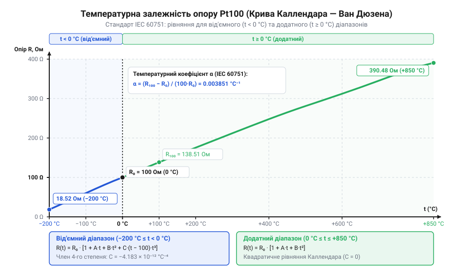
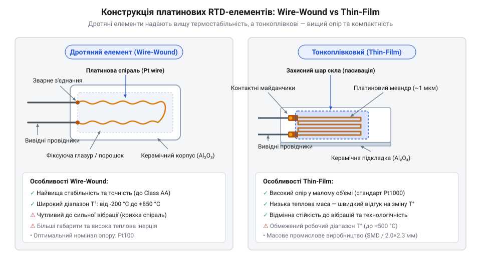
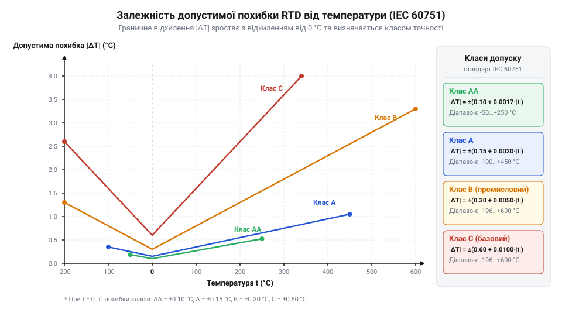
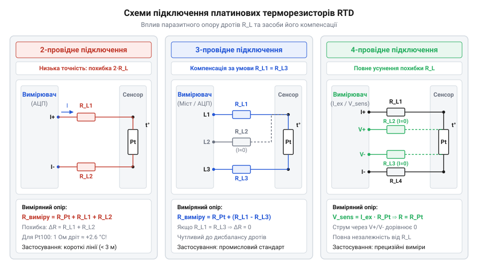

# Стандарт IEC 60751 для платинових термоопорів

<preknowlist>
- [Огляд родини резистивних перетворювачів температури RTD](root:cat-hw-sensors/rtd-resistance-temperature-detectors-family-overview) — Фізичний принцип зміни електричного опору металевих провідників при зміні температури.
- [PT100 — платиновий термоопір](root:cat-hw-sensors/pt100-rtd) — Поняття номінального опору 100 Ом при 0 °C та базове призначення платинового сенсора.
</preknowlist>

## Проблема взаємозамінності вимірювачів температури

Заміна давача температури без перекалібрування тракту вимагає ідентичної характеристики опору. Довільний металевий провідник дає похибки через відмінності чистоти й розмірів. Для усунення цієї проблеми створено стандарт @@en|IEC 60751@@, який регламентує вимоги до платинових @@en|RTD@@ (від англ. *Resistance Temperature Detector* — резистивний перетворювач температури).

Платина чистотою 99.999% гарантує стабільність кристалічної ґратки. Головним параметром стандарту є температурний коефіцієнт опору `α` (альфа), визначений приростом між опором `R₀` при 0 °C та `R₁₀₀` при 100 °C:

```
α = (R₁₀₀ - R₀) ÷ (100 × R₀)                                  [нормований коефіцієнт стандарту]
  = (138.51 - 100) ÷ (100 × 100)                              [підстановка для Pt100]
  = 0.003851 °C⁻¹                                             [еталонне значення IEC 60751]
```

Фіксоване `α = 0.003851 °C⁻¹` забезпечує взаємозамінність сенсорів. Стандарт нормує номінальні опори при 0 °C: [платиновий термоопір Pt100](root:cat-hw-sensors/pt100-rtd) із `R₀ = 100 Ом` та @@en|Pt1000@@ із `R₀ = 1000 Ом` (дивіться [огляд родини резистивних датчиків](root:cat-hw-sensors/rtd-resistance-temperature-detectors-family-overview)).

## Рівняння Каллендара — Ван Дюзена

Спрощена лінійна модель `R(t) = R₀ × (1 + α × t)` прийнятна лише біля 0 °C. Поза цим діапазоном нелінійність опору платини спричиняє похибки у кілька градусів на межах вимірювань.

Для точного опису залежності від -200 °C до +850 °C стандарт @@en|IEC 60751@@ застосовує рівняння @@en|Callendar – Van Dusen@@:

```
R(t) = R₀ × (1 + A × t + B × t²)                               [для t ≥ 0 °C]
R(t) = R₀ × (1 + A × t + B × t² + C × (t - 100) × t³)          [для t < 0 °C]
```

Для платини з `α = 0.003851 °C⁻¹` нормовано коефіцієнти: `A = 3.9083 × 10⁻³ °C⁻¹`, `B = -5.775 × 10⁻⁷ °C⁻²`, а при `t < 0 °C` додається `C = -4.183 × 10⁻¹² °C⁻⁴`. Від'ємні знаки `B` і `C` описують загин кривої опору донизу відносно прямої.


*Крива залежності опору платинового елемента від температури та її відхилення від лінійної апроксимації.*

## Конструктивні типи платинових елементів RTD

Деформація платини змінює концентрацію дефектів кристалічної ґратки, викликаючи незворотний дрейф початкового опору `R₀`. Залежно від умов експлуатації застосовують два конструктивні типи елементів @@en|RTD@@.

Дротяні елементи (англ. *wire-wound*) виготовляють намотуванням платинового дроту на керамічний каркас із відпалом для зняття напружень. Вони забезпечують найвищу стабільність у широкому діапазоні (від -200 °C до +850 °C), але крихкі, чутливі до вібрацій, мають високу теплову інерцію та вартість.

Тонкоплівкові елементи (англ. *thin-film*) створюють вакуумним осадженням платини на кераміку з лазерним підганянням опору (англ. *laser trimming*). Вони вібростійкі, компактні, дешеві й мають мінімальну теплову інерцію, проте обмежені діапазоном від -50 °C до +500 °C та чутливі до деформацій підкладки.


*Будова дротяного та тонкоплівкового елементів RTD, що визначає їхню вібростійкість та теплову інерцію.*

## Класи допуску та граничні похибки

Стандарт @@en|IEC 60751@@ поділяє платинові термоопори на чотири класи точності: @@en|Class AA@@, @@en|Class A@@, @@en|Class B@@ та @@en|Class C@@. Допуск визначає максимально припустиме відхилення виміряної температури `Δt` від істинного значення.

Розрахунок граничної температурної похибки `Δt` для кожного класу проводиться за нормативними формулами залежно від модуля температури `|t|`:

```
Δt_AA = ±(0.10 + 0.0017 × |t|) °C                             [клас AA]
Δt_A  = ±(0.15 + 0.0020 × |t|) °C                             [клас A]
Δt_B  = ±(0.30 + 0.0050 × |t|) °C                             [клас B]
Δt_C  = ±(0.60 + 0.0100 × |t|) °C                             [клас C]
```


*Зони допустимих похибок вимірювання температури для різних класів точності за стандартом IEC 60751.*

Для обчислення допустимого відхилення електричного опору `ΔR` температурний допуск помножують на чутливість сенсора `dR/dt ≈ α × R₀`:

**Розрахунок допустимої похибки опору для класу A при 100 °C:**
```
Δt = ±(0.15 + 0.0020 × 100)                                   [формула допуску класу A]
   = ±0.35 °C                                                 [гранична температурна похибка]

ΔR ≈ Δt × α × R₀                                              [перерахунок похибки в Ом]
   = 0.35 × 0.003851 × 100                                    [підстановка параметрів Pt100]
   ≈ ±0.135 Ом                                                [граничний допуск опору]
```

## Паразитичні похибки та схеми підключення

Під час точних вимірювань виникають два головні джерела паразитичних похибок: опір з'єднувальних дротів `R_line` та самонагрів чутливого елемента вимірювальним струмом `I_m`. Для сенсора @@en|Pt100@@ чутливість становить лише ~0.385 Ом/°C. Якщо підключити його довгим мідним кабелем із опором дротів 1 Ом, це додасть хибне зміщення вимірювання приблизно на +2.6 °C.

Ефект самонагріву виникає через виділення теплової потужності `P = I_m² × R(t)` на резисторі. Це тепло підвищує температуру елемента відносно вимірюваного середовища. Щоб уникнути цього, струм збудження обмежують: для @@en|Pt100@@ обирають струм до 1 мА, а для @@en|Pt1000@@ — не більше 0.1 мА.

Для компенсації паразитичного опору ліній використовують три топології підключення: Для детального аналізу аналогової схемотехніки вимірювання опору за допомогою моста Уітстона та джерел стабільного струму дивіться матеріал про [вимірювальні мости та джерела струму для RTD](root:hw-sensing/rtd-bridge-and-current-source-measurement).

1. Двопровідна — опір дротів додається безпосередньо до опору сенсора. Застосовується лише при коротких лініях або високомних датчиках @@en|Pt1000@@. 2. Трипровідна — використовує вимірювальний міст або диференційне зчитування, де опір третього провідника віднімається від сумарного. Вимагає суворої симетрії ліній. 3. Чотирипровідна (підключення Кельвіна) — струм збудження подається через зовнішню пару дротів, а високоомний АЦП зчитує спад напруги через внутрішню пару. Опір ліній повністю виключається з результату вимірювання.


*Топології з'єднання датчика з вимірювальним трактом для компенсації паразитичного опору ліній.*

У практичних схемах узгодження сигналів для оцифрування таких топологій використовують прецизійні перетворювачі, такі як [спеціалізована мікросхема MAX31865](root:cat-hw-sensors/max31865-rtd-converter).