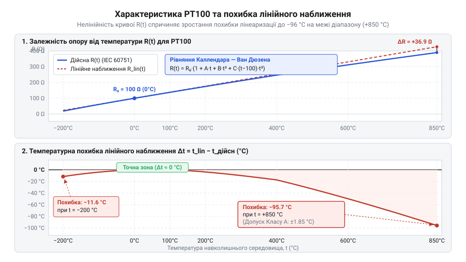
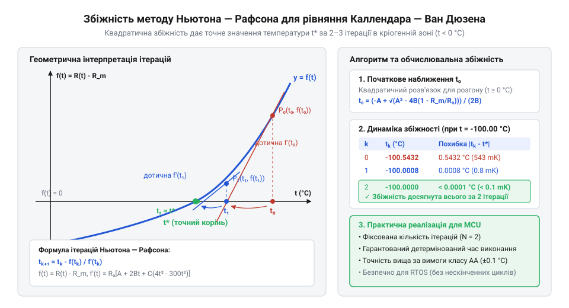

# Математичне рівняння Каллендара — Ван Дюзена та алгоритми обернення функцій t(R) і R(t)

<preknowlist>
- [Огляд родини резистивних перетворювачів температури RTD](root:cat-hw-sensors/rtd-resistance-temperature-detectors-family-overview) — Фізичний принцип зміни опору металів під дією температури та призначення резистивних давачів RTD.
- [PT100 — платиновий термоопір](root:cat-hw-sensors/pt100-rtd) — Поняття номінального опору R0 = 100 Ом при 0 °C та специфіка використання платинових чутливих елементів.
</preknowlist>

## Нелінійність платини та похибка лінійного наближення

У точних промислових вимірюваннях температури платина вважається поверхово майже ідеальним матеріалом. Вона стійка до окислення, має високу хімічну інертність і демонструє стабільний опір. На перший погляд здається, що електричний опір металу має зростати строго пропорційно температурі. Коли кристал нагрівається, атоми решітки коливаються дужче, перешкоджаючи руху вільних електронів. Якщо припустити, що ця протидія зростає рівномірно, залежність опору від температури описується простим лінійним співвідношенням.

Однак при спробі застосувати це спрощення в широкому діапазоні температур інженер стикається з відчутною розбіжністю між розрахованим і реальним значенням. Причиною є складніша квантово-механічна природа розсіювання електронів на фононах (квантах коливань кристалічної ґратки). При високих температурах проявляються ефекти вищих порядків і теплове розширення самої ґратки, через що графік зростання опору почергово втрачає крутизну та поступово відхиляється від прямої лінії.

Для оцінки цього відхилення у вимірювальній техніці використовують @@en|лінеаризацію@@ (від лат. *linearis* — лінійний). Лінійне наближення опору розраховують за базовою формулою, де використовується нормований @@en|температурний коефіцієнт опору@@ (позначається грецькою літерою `α`).

Перед тим як обчислити опір, визначимо всі параметри у формулі. Позначимо `R_lin(t)` як розрахований опір за лінійною моделлю в омах (Ом), `R₀` — як номінальний опір сенсора при температурі `0 °C` в омах, `t` — як поточну температуру в градусах Цельсія (`°C`), а `α` — як температурний коефіцієнт опору в градусах Цельсія у мінус першому степені (`°C⁻¹`). За @@en|стандартом IEC 60751@@ для чистої вимірювальної платини коефіцієнт `α` строго зафіксований і дорівнює `0.003851 °C⁻¹`. Цей коефіцієнт визначають як середній відносний приріст опору між точками `0 °C` та `100 °C`.

Залежність опору від температури в лінійній моделі описується таким рівнянням:

```
R_lin(t) = R₀ × (1 + α × t)
```

Для популярного давача [платинових сенсорах PT100](root:cat-hw-sensors/pt100-rtd) номінальний опір `R₀ = 100 Ом`. За цією формулою при температурі `100 °C` опір становить `R_lin(100) = 100 × (1 + 0.003851 × 100) = 138.51 Ом`. Оскільки коефіцієнт `α` підібрано саме за цими двома точками (`0 °C` та `100 °C`), у них лінійна модель дає абсолютний збіг із реальністю. Проте поза цією вузькою зоною похибка починає швидко накопичуватися.

Обчислимо похибку лінеаризації при високій температурі `+500 °C`. За реальною фізичною характеристикою платинового сенсора його опір становить `280.98 Ом`. Обчислимо значення, яке дає лінійна формула:

```
R_lin(500) = 100 × (1 + 0.003851 × 500)
          = 100 × (1 + 1.9255)                  [множення коефіцієнта α на температуру]
          = 292.55 Ом                            [лінійний розрахунок опору]
```

З виразу видно, що лінійна модель передбачає опір `292.55 Ом`, що на `11.57 Ом` перевищує фактичний опір платини `280.98 Ом`. Якщо мікроконтролер перераховуватиме цей опір назад у температуру за лінійним коефіцієнтом `α`, розрахована похибка вимірювання становитиме:

```
Δt = (R_lin - R_real) ÷ (R₀ × α)
   = (292.55 - 280.98) ÷ (100 × 0.003851)      [абсолютна різниця опорів]
   = 11.57 ÷ 0.3851                             [ділення на крутизну]
   = 30.04 °C                                   [підсумкова температурна похибка]
```

Похибка у понад `30 °C` робить просте лінійне наближення непридатним для промислового контролю технологічних процесів. На від'ємних температурах лінійна модель також збоїть: при `-200 °C` реальний опір PT100 становить `18.52 Ом`, тоді як лінійна формула дає `22.98 Ом`, що спричиняє похибку вимірювання близько `11.58 °C`.


*Залежність опору платинового давача PT100 від температури та похибка лінійного наближення в діапазоні від -200 °C до +850 °C.*

Як видно з графіка, крива реального опору підгинається донизу відносно прямої лінії на додатних температурах і вигинається вгору на від'ємних. У порівнянні з [аналоговими термодатчиками](root:cat-hw-sensors/lm35) або [цифровими датчиками](root:cat-hw-sensors/ds18b20), які вимірюють температуру з готовною лінійною характеристикою у вузькому діапазоні, платина закриває колосальний інтервал від `-200 °C` до `+850 °C`. Загальний огляд цієї родини вимірювачів подано в описі [резистивних перетворювачів температури](root:cat-hw-sensors/rtd-resistance-temperature-detectors-family-overview).

Для компенсації цієї кривини потрібна точна математична модель, яка описує вигин кривої на всьому робочому діапазоні.

## Математична модель Каллендара — Ван Дюзена

У 1887 році британський фізик Г'ю Лонгборн Каллендар (англ. @@en|Hugh Longbourne Callendar@@) запропонував описувати вигин залежності опору платини від температури квадратичним поліномом для додатного діапазону. Згодом, у 1925 році, американський фізик Мілтон С. Ван Дюзен (англ. @@en|Milton S. Van Dusen@@). Van Dusen@@) виявив, що при охолодженні нижче `0 °C` опір платини падає швидше, ніж передбачає квадратична модель, і додав поліноміальний член четвертого степеня. Поєднана модель отримала назву @@en|рівняння Каллендара — Ван Дюзена@@ і була зафіксована міжнародним @@en|стандартом IEC 60751@@.

Математична структура рівняння чітко розділена на два температурні діапазони: для додатних температур (`t ≥ 0 °C`) та для кріогенного діапазону (`t < 0 °C`).

Перед використанням формули опишемо кожну її змінну та коефіцієнт. Величина `R(t)` позначає розрахований електричний опір у омах (Ом) при температурі `t` в градусах Цельсія (`°C`), `R₀` — номінальний опір сенсора при `0 °C` (наприклад, `100 Ом` для PT100 або `1000 Ом` для PT1000). Коефіцієнти `A`, `B` та `C` є емпіричними константами нормованої платини за шкалою @@en|ITS-90@@: Докладніше про реперні точки та принципи побудови цієї шкали читайте у матеріалі про [міжнародну температурну шкалу ITS-90](root:hw-sensing/its-90).

```
A = 3.9083 × 10⁻³ °C⁻¹
B = -5.775 × 10⁻⁷ °C⁻²
C = -4.183 × 10⁻¹² °C⁻⁴
```

Для додатного діапазону температур від `0 °C` до `+850 °C` коефіцієнт `C` дорівнює нулю, і рівняння Каллендара — Ван Дюзена приймає квадратичну форму:

```
R(t) = R₀ × (1 + A × t + B × t²)
```

Від'ємний знак коефіцієнта `B` пояснює фізику процесу: квадратний член `-5.775 × 10⁻⁷ × t²` поступово «віднімає» опір зі зростанням температури. Це саме той механізм, який компенсує завищення лінійної моделі на високих температурах і притискає розраховану криву до реальних фізичних даних.

Для від'ємного діапазону температур від `-200 °C` до `0 °C` стає активним коефіцієнт `C`, і рівняння набуває повного вигляду:

```
R(t) = R₀ × [1 + A × t + B × t² + C × (t - 100) × t³]
```

Додатковий член `C × (t - 100) × t³` працює лише при `t < 0 °C`. Множник `(t - 100)` гарантує, що при `t = 0 °C` та `t = 100 °C` цей додаток перетворюється на нуль, забезпечуючи гладкий безнеперервний перехід між формулами без стрибків опору чи першої похідної.

Розглянемо покрокове обчислення опору для давача PT100 (`R₀ = 100 Ом`) при температурі `+200 °C`.

Обчислимо опір `R(200)` за квадратичним рівнянням:

```
R(200) = R₀ × (1 + A × t + B × t²)
       = 100 × [1 + 3.9083 × 10⁻³ × 200 + (-5.775 × 10⁻⁷) × 200²]    [підстановка значень A, B та t]
       = 100 × (1 + 0.78166 - 0.0231)                                [обчислення квадратного та лінійного членів]
       = 100 × 1.75856                                               [додавання компонентів]
       = 175.856 Ом                                                  [підсумковий опір PT100]
```

Тепер обчислимо опір для від'ємної температури `-50 °C`, де діють усі три коефіцієнти `A`, `B` та `C`.

Обчислимо опір `R(-50)` за повним рівнянням:

```
R(-50) = R₀ × [1 + A × t + B × t² + C × (t - 100) × t³]
       = 100 × [1 + 3.9083 × 10⁻³ × (-50) + (-5.775 × 10⁻⁷) × 2500 + (-4.183 × 10⁻¹²) × (-150) × (-125000)]    [підстановка t = -50]
       = 100 × (1 - 0.195415 - 0.00144375 - 0.00007843125)                                              [обчислення добутків]
       = 100 × 0.8030628                                                                                [сумування в дужках]
       = 80.306 Ом                                                                                      [підсумковий опір]
```

У класичних фундаментальних працях рівняння Каллендара — Ван Дюзена іноді записують через альфа-константи `α`, `δ` та `β`. Зв'язок між параметрами виражається формулами: `A = α × (1 + δ / 100)`, `B = -α × δ / 100²` та `C = -α × β / 100⁴`. Однак у сучасній вимірювальній техніці та мікроконтролерній прошивці використовують саме поліноміальну форму IEC 60751 з коефіцієнтами `A`, `B`, `C`, оскільки вона вимагає менше арифметичних операцій множення та ділення під час обчислень.

Зчитування опору з платинового сенсора в апаратних системах здійснюється за допомогою спеціалізованих мікросхем, таких як [апаратними перетворювачами MAX31865](root:cat-hw-sensors/max31865-rtd-converter). Вони відцифровують опір із високою точністю, вимагаючи від процесора зворотного обчислення: визначення температури `t` за отриманим значенням опору `R`.

## Точне обернення залежності для додатних температур

На практиці вимірювальна система отримує від аналогово-цифрового перетворювача значення опору `R` і повинна розрахувати фактичну температуру `t`. Пряма формула Каллендара — Ван Дюзена задає функцію `R(t)`, тому для вирішення вимірювального завдання її необхідно обернути в аналітичну функцію `t(R)`.

Для додатного температурного діапазону (`t ≥ 0 °C`) коефіцієнт `C` дорівнює нулю. Це перетворює рівняння Каллендара — Ван Дюзена на канонічне @@en|квадратне рівняння@@ відносно температури `t`.

Виведемо аналітичний розв'язок кроками. Спершу розділимо обидві частини рівняння на номінальний опір `R₀`:

```
R / R₀ = 1 + A × t + B × t²
```

Перенесемо відношення `R / R₀` у праву частину та впорядкуємо доданки за спаданням степенів `t`:

```
B × t² + A × t + (1 - R / R₀) = 0
```

Отримане рівняння має вигляд `a × t² + b × t + c = 0`, де коефіцієнти квадратного тричлена дорівнюють `a = B`, `b = A`, `c = 1 - R / R₀`.

Обчислимо @@en|дискримінант@@ (від лат. *discriminans* — той, що розділяє) даного квадратного рівняння:

```
D = b² - 4 × a × c
  = A² - 4 × B × (1 - R / R₀)
```

За стандартною формулою коренів квадратного рівняння маємо два можливі вирази для `t`:

```
t = (-A ± √D) ÷ (2 × B)
```

Оскільки коефіцієнт `B` має від'ємне значення (`B = -5.775 × 10⁻⁷ °C⁻²`), знаменник `2 × B` є від'ємним числом. Значення `A` є додатним (`3.9083 × 10⁻³`), а дискримінант `√D` при `R ≥ R₀` є меншим за `A`. Щоб отримати додатне значення температури `t`, чисельник також повинен бути від'ємним. Для цього обираємо знак «плюс» перед квадратним коренем в офіційній формулі:

```
t = (-A + √(A² - 4 × B × (1 - R / R₀))) ÷ (2 × B)
```

Щоб уникнути ділення від'ємних чисел у обчисленнях прошивки мікроконтролера, помножимо чисельник і знаменник на `-1` та перегрупуємо вираз під знаком кореня, використавши додатне значення `-B`:

```
t = (√(A² + 4 × (-B) × (R / R₀ - 1)) - A) ÷ (2 × (-B))
```

Позначимо `|B| = 5.775 × 10⁻⁷ °C⁻²`. Тоді підсумкова математична формула для обчислення температури за виміряним опором `R` приймає такий остаточний вигляд:

```
t(R) = (A - √(A² - 4 × |B| × (R / R₀ - 1))) ÷ (2 × |B|)
```

Перевіримо точність виведеної формули на конкретному прикладі. Припустимо, вимірювальний модуль підключений до датчика PT100 (`R₀ = 100 Ом`) і зафіксував опір `R = 138.51 Ом`.

Обчислимо температуру `t` за аналітичною формулою:

```
t = (√(A² + 4 × |B| × (R / R₀ - 1)) - A) ÷ (2 × |B|)
  = (√((3.9083 × 10⁻³)² + 4 × 5.775 × 10⁻⁷ × (138.51 / 100 - 1)) - 3.9083 × 10⁻³) ÷ (2 × 5.775 × 10⁻⁷)    [підстановка значень R, R₀, A, |B|]
  = (√(1.52748 × 10⁻⁵ + 2.31 × 10⁻⁶ × 0.3851) - 3.9083 × 10⁻³) ÷ (1.155 × 10⁻⁶)                         [обчислення підкореневого виразу]
  = (√(1.52748 × 10⁻⁵ + 8.89581 × 10⁻⁷) - 3.9083 × 10⁻³) ÷ (1.155 × 10⁻⁶)                               [додавання під коренем]
  = (√(1.616438 × 10⁻⁵) - 3.9083 × 10⁻³) ÷ (1.155 × 10⁻⁶)                                              [добування квадратного кореня]
  = (4.0205 × 10⁻³ - 3.9083 × 10⁻³) ÷ (1.155 × 10⁻⁶)                                                  [віднімання в чисельнику]
  = 1.122 × 10⁻⁴ ÷ 1.155 × 10⁻⁶                                                               me        [ділення]
  = 100.0 °C                                                                                           [підсумкова температура]
```

Аналітичний розв'язок дає точне значення `100.0 °C` без використання ітераційних чисельних методів чи наближених таблиць.

При реалізації цієї формули у прошивках мікроконтролерів слід враховувати обчислювальні ресурси. Сучасні 32-бітні процесори з апаратним блоком плаваючої коми (FPU) обчислюють функцію `sqrtf()` за кілька десятків тактів.

Нижче наведено приклад реалізації точного аналітичного розв'язку для додатних температур на мовах C та C++:

:::tabs
:::code math-callendar-van-dusen-equation-and-inversion/c/pt100-calculate-temp-positive.c
:::code math-callendar-van-dusen-equation-and-inversion/cpp/platinumrtd.cpp
:::

Даний аналітичний метод працює виключно для температур від `0 °C` до `+850 °C`. Для кріогенної зони від `-200 °C` до `0 °C` через наявність полінома четвертого степеня `C × (t - 100) × t³` рівняння Каллендара — Ван Дюзена не має простого аналітичного обернення у радикалах, тому там застосовують чисельні ітераційні методи та зворотні поліноми.

## Чисельне обернення у кріогенній зоні

У кріогенному температурному діапазоні від -200 °C до 0 °C обчислення температури за виміряним опором платинового термоопору неможливо виконати через прямий розв'язок квадратного рівняння. За стандартом IEC 60751 рівняння Каллендара — Ван Дюзена для від'ємних температур містить додатковий додаток із коефіцієнтом C = -4.183 × 10⁻¹² °C⁻⁴:

R(t) = R₀ · (1 + A·t + B·t² + C·(t - 100)·t³)

Якщо розкрити дужки у виразі C · (t - 100) · t³ = C · t⁴ - 100 · C · t³, залежність опору від температури перетворюється на поліном четвертого степеня:

R(t) = R₀ + R₀·A·t + R₀·B·t² - 100·R₀·C·t³ + R₀·C·t⁴

Аналітичне обернення такої функції вимагає розв'язання алгебраїчного рівняння четвертого степеня (метод Феррарі). Хоча точна алгебраїчна формула існує, вона містить громіздкі комбінації кубічних та квадратних коренів з комплексними проміжними величинами. На практиці у прошивках, які керують [платиновими термоопорами PT100](root:cat-hw-sensors/pt100-rtd) або вимірювальними мостами, аналітичний розв'язок алгебраїчного рівняння четвертого степеня не застосовують через колосальні втрати обчислювальних ресурсів @@en|мікроконтролера@@ (від англ. @@en|microcontroller@@ — мікроконтролер) та високу чутливість до похибок заокруглення чисел із плаваючою комою.

Тому для відшукання температури t за виміряним опором R застосовують @@la|чисельні методи@@ (від лат. @@la|numerus@@ — число). Найбільш ефективним підходом є @@en|метод Ньютона — Рафсона@@ (від англ. @@en|Newton-Raphson method@@), який полягає в ітераційному уточненні кореня нелінійного рівняння.

Сформулюємо задачу як пошук нуля функції f(t):

f(t) = R₀ · (1 + A·t + B·t² + C·(t - 100)·t³) - R = 0

Для реалізації алгоритму обчислимо першу похідну f'(t) за температурою, яка описує локальну чутливість терморезистора dR/dt:

f'(t) = dR/dt
      = R₀ · d/dt (1 + A·t + B·t² + C·t⁴ - 100·C·t³)      [диференціювання полінома]
      = R₀ · (A + 2·B·t - 300·C·t² + 4·C·t³)             [обчислення похідної кожного доданка]

На кожному кроці алгоритму нове наближення температури tₖ₊₁ обчислюється через перетин дотичної до кривої f(t) із віссю абсцис:

tₖ₊₁ = tₖ - f(tₖ) / f'(tₖ)                                [ітераційна формула Ньютона — Рафсона]


*Графічне зображення ітерацій методу Ньютона — Рафсона: проведення дотичних до кривої опору R(t) забезпечує швидку збіжність до точної температури за 2–3 кроки.*

Головною перевагою @@en|методу Ньютона — Рафсона@@ є квадратична швидкість збіжності в околі шуканого кореня. Якщо як початкове наближення t₀ використати розв'язок квадратного рівняння для додатних температур, похибка стартової точки не перевищує 0.45 °C у найвіддаленішій точці -200 °C. Завдяки настільки точній початковій точці вже друга @@la|ітерація@@ (від лат. @@la|iteratio@@ — повторення) забезпечує похибку менше 0.001 °C, що повністю задовольняє вимоги найвищих класів точності вимірювання.

Окрім ітераційних алгоритмів, застосовують також @@en|зворотний поліном@@ (від англ. @@en|inverse polynomial@@). У цьому випадку залежність t(R) апроксимують прямим поліномом 4-го або 5-го степеня від нормованого відхилення опору r = (R / R₀) - 1:

t(r) = D₁·r + D₂·r² + D₃·r³ + D₄·r⁴ + D₅·r⁵

Де коефіцієнти D₁ ... D₅ розраховані методом найменших квадратів для діапазону від -200 °C до 0 °C. @@la|Поліноміальна апроксимація@@ (від грец. @@el|polys@@ — багато, та лат. @@la|approximo@@ — наближаю) виконується за фіксовану кількість арифметичних операцій без циклів, проте вимагає обчислення високих степенів величини r.

## Реалізація алгоритмів у прошивці мікроконтролерів

Під час практичної розробки вбудованих систем на базі [резистивних перетворювачів температури](root:cat-hw-sensors/rtd-resistance-temperature-detectors-family-overview) або [апаратних перетворювачів MAX31865](root:cat-hw-sensors/max31865-rtd-converter), інженер має обрати оптимізовану стратегію обчислення t(R) залежно від обчислювальних ресурсів процесора.

Основне обмеження пов'язане з обробкою @@en|чисел з плаваючою комою@@ (англ. @@en|floating-point numbers@@). Апаратні сопроцесори FPU у більшості 32-бітних мікроконтролерів (Cortex-M4F, ESP32) підтримують лише одиничну точність (тип `float`, 32 біти, 24 біти мантиси). Використання подвійної точності (`double`, 64 біти) на мікроконтролерах без 64-бітного FPU призводить до програмної емуляції, що суттєво уповільнює виконання та збільшує розмір прошивки. Проте обчислення рівняння Каллендара — Ван Дюзена з типом `float` через малі значення коефіцієнтів B та C може давати похибку до 0.03 °C через втрату значущих розрядів. Для підвищення швидкодії обчислень на 8-бітних мікроконтролерах без FPU дізнайтеся більше про [математику з фіксованою комою у прошивках сенсорів](root:sf-devices/integer-scaling-fixed-point).

У практичному програмуванні застосовують три основні методи:

1. **Прямий розрахунок (квадратне рівняння + Ньютон — Рафсон):**
   Забезпечує максимальну точність (менше 0.001 °C) при мінімальному обсязі пам'яті Flash. Для опору R ≥ R₀ використовується розв'язок квадратного рівняння, а для R < R₀ запускається рівно 2 ітерації @@en|методу Ньютона — Рафсона@@. Цей метод підходить для систем з FPU або низькою частотою опитування датчика.

2. **Таблиця пошуку з лінійною інтерполяцією (Lookup Table / LUT):**
   У енергоефективних або 8-бітних мікроконтролерах використовують @@en|таблицю пошуку@@ (англ. @@en|lookup table@@, або @@en|LUT@@). У Flash-пам'яті зберігається масив опорів для фіксованого кроку температури (наприклад, 10 °C). Для діапазону від -200 °C до +850 °C потрібно 106 значень типа `float` (424 байти).

   Знаходиться відповідний інтервал [Rᵢ, Rᵢ₊₁], після чого застосовується @@la|лінійна інтерполяція@@ (від лат. @@la|interpolatio@@ — переробка, оновлення):

t ≈ tᵢ + (tᵢ₊₁ - tᵢ) · (R - Rᵢ) / (Rᵢ₊₁ - Rᵢ)

   При кроці 10 °C максимальна похибка лінійної інтерполяції становить менше 0.015 °C, що є достатнім для переважної більшості промислових застосувань.

3. **Кусково-поліноміальна апроксимація:**
   Діапазон вимірювання розбивається на кілька сегментів, для кожного з яких зберігаються коефіцієнти полінома 2-го чи 3-го степеня, що позбавляє потреби зберігати великі таблиці й обчислювати квадратні корені.

Нижче наведено практичну реалізацію комбінованого точного алгоритму розрахунку t(R) для платинових датчиків PT100/PT1000 мовами C та C++.

:::tabs
== C (ESP-IDF / Generic C)
:::code math-callendar-van-dusen-equation-and-inversion/c/esp-idf/rtd-convert-r-to-t.c
== C++ (Arduino / Embedded C++)
:::code math-callendar-van-dusen-equation-and-inversion/cpp/arduino/rtdconverter.cpp
:::

Завдяки розумному компромісу між чисельним оберненням та табличною інтерполяцією розробник вимірювальних приладів може забезпечити потрібну точність термометрії на будь-якій апаратній платформі.