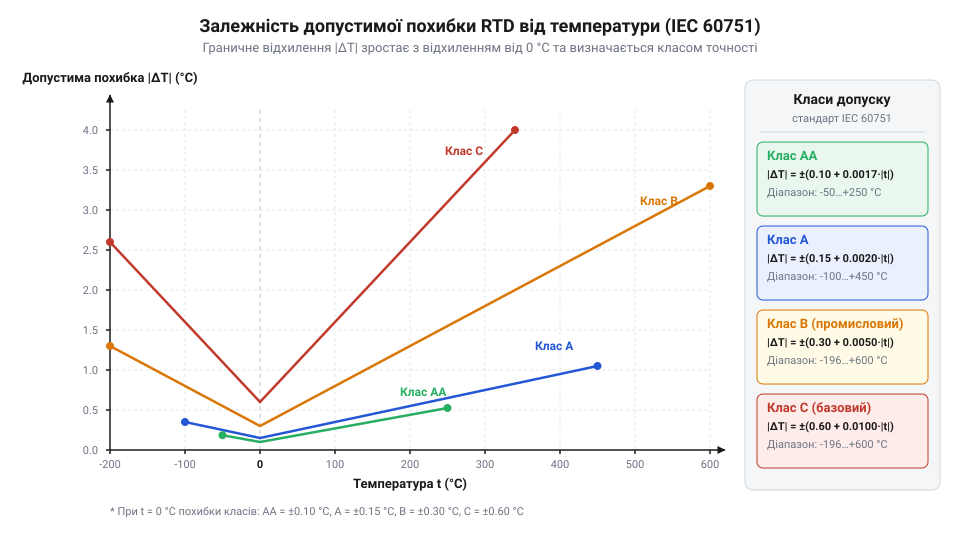
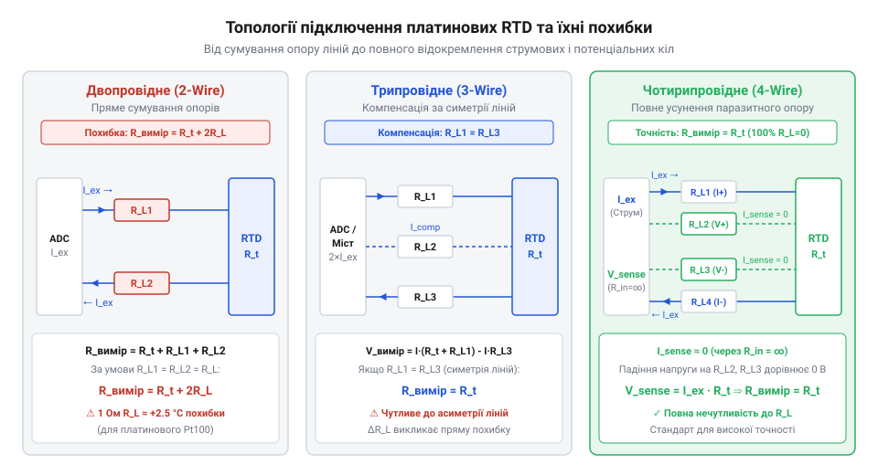
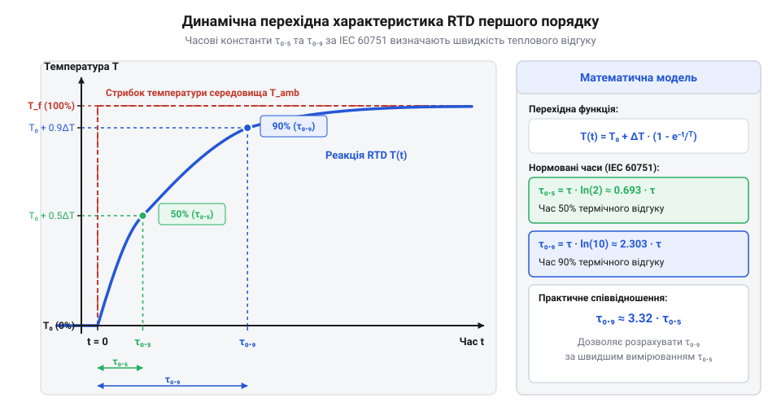

# Математичні моделі класів допуску IEC 60751, самонагріву та вимірювальних похибок

<preknowlist>
- [PT100 — платиновий термоопір](root:cat-hw-sensors/pt100-rtd) — Фізичні основи вимірювання температури за допомогою платинового опору та базове співвідношення опору і температури.
- [Огляд родини резистивних перетворювачів температури RTD](root:cat-hw-sensors/rtd-resistance-temperature-detectors-family-overview) — Конструктивні відмінності тонкоплівкових та дротяних сенсорів і сфера їх застосування.
- [MAX31865 — перетворювач опору платинових датчиків PT100/PT1000](root:cat-hw-sensors/max31865-rtd-converter) — Базові схеми вимірювання опору резистивних давачів за допомогою вимірювальних мостів та вимірювального струму.
</preknowlist>

## Чому точний сенсор показує хибну температуру

Ви підключаєте відкалібрований @@en|платиновий термоопір@@ (від англ. @@en|Resistance Temperature Detector@@, @@en|resist-@@ — чинити опір; далі — @@en|RTD@@), такий як [сенсор PT100](root:cat-hw-sensors/pt100-rtd) із паспортною точністю ±0.1 °C, але вимірювальна система демонструє відхилення в +3.5 °C. Причина полягає не в поломці первинного перетворювача, а в неврахованих фізичних процесах у реальному вимірювальному тракті.

Канонічна модель вважає сенсор ідеальним пасивним елементом у тепловій рівновазі із середовищем. У реальності вимірювання додає чотири джерела викривлення:

1. **Технологічне розсіювання параметрів.** Неминуче відхилення геометрії та чистоти платини при виготовленні нормується через @@en|клас допуску@@ (від лат. @@en|tolerare@@ — терпіти, допускати). 2. **Тепловий самонагрів.** Для зчитування опору через сенсор пропускають @@en|струм збудження@@ (від лат. @@en|excitare@@ — викликати). Потужність Джоуля-Ленца `P = I²·R` нагріває платиновий елемент вище температури середовища. 3. **Паразитний опір дротів.** Мідні провідники лінії мають власний @@en|паразитний опір@@ (від грец. @@grc|паразитос@@ — нахлібник), що додається послідовно й викривляє покази. 4. **Теплова часова інерція.** Скінченна маса та теплоємність корпусу і гільзи спричиняють часове запізнення при зміні температури.

Сукупний температурний зсув формується як сума статичних і динамічних чинників:

```
ΔT_sum = ΔT_tol + ΔT_self + ΔT_wire + ΔT_dyn
```

Де:
- `ΔT_tol` — відхилення технологічного допуску виготовлення;
- `ΔT_self` — зсув від самонагріву вимірювальним струмом;
- `ΔT_wire` — похибка від паразитного опору кабельної лінії;
- `ΔT_dyn` — динамічний зсув від теплової інерції.

Оцінка кожного чинника дозволяє розрахувати повний бюджет похибки та обрати оптимальну схему [для вимірювання опору RTD](root:cat-hw-sensors/rtd-resistance-temperature-detectors-family-overview).

## Математичні моделі класів допуску IEC 60751

Конструктивні й технологічні відхилення при виготовленні платинових сенсорів нормуються міжнародним @@en|стандартом IEC 60751@@ (від англ. @@en|International Electrotechnical Commission@@). Стандарт описує гранично припустиму абсолютну похибку вимірювання температури `Δt` через уніфіковане лінійне рівняння залежності від модуля температури:

```
Δt = ±(a + b · |t|)
```

Де `a` — стала похибка при 0 °C (°C), `b` — безрозмірний коефіцієнт зростання поля допуску, а `|t|` — модуль вимірюваної температури (°C).

Стандарт розрізняє чотири @@en|класи допуску@@: AA, A, B та C. Межі їхнього застосування залежать від виконання — @@en|тонкоплівкового сенсора@@ (англ. @@en|thin-film sensor@@) або @@en|дротяного сенсора@@ (англ. @@en|wire-wound sensor@@).


*Залежність граничної температурної похибки Δt від температури t для класів AA, A, B та C.*

Для тонкоплівкових виконань, де платиновий шар напилюється на керамічну підкладку, рівняння та діапазони становлять:

- **Клас AA**: `Δt = ±(0.10 + 0.0017 · |t|)` °C, від 0 °C до +150 °C;
- **Клас A**: `Δt = ±(0.15 + 0.002 · |t|)` °C, від -30 °C до +300 °C;
- **Клас B**: `Δt = ±(0.30 + 0.005 · |t|)` °C, від -50 °C до +500 °C;
- **Клас C**: `Δt = ±(0.60 + 0.01 · |t|)` °C, від -50 °C до +600 °C.

Для дротяних виконань, де дріт вільно розміщено в керамічному ізоляторі без механічних напружень від різниці температурного розширення, ті ж рівняння діють у ширших діапазонах:

- **Клас AA**: від -50 °C до +250 °C;
- **Клас A**: від -100 °C до +450 °C;
- **Клас B**: від -196 °C до +600 °C;
- **Клас C**: від -196 °C до +600 °C.

При -50 °C тонка плівка зазнає сильного стиснення від підкладки, що змінює її питомий опір і порушує лінійність. Дротяний елемент витримує охолодження до -196 °C.

Щоб обчислити допуск опору `ΔR`, температурну похибку `Δt` множать на чутливість `dR/dt = R₀ · α`. Для PT100 (`R₀ = 100 Ом`, `α = 0.003851 °C⁻¹`) чутливість дорівнює `0.3851 Ом/°C`, звідки:

```
ΔR = Δt · 0.3851 Ω/°C
```

**Розрахунок допуску PT100 Класу A при температурі t = +200 °C**
```
a = 0.15 °C
b = 0.002
|t| = 200 °C

Δt = ±(0.15 + 0.002 · 200) [застосування формули IEC 60751 Класу A]
= ±(0.15 + 0.40)           [множення коефіцієнта b на |t|]
= ±0.55 °C                 [підсумовування сталої та динамічної частин]

ΔR = ±0.55 °C · 0.3851 Ω/°C [переведення температурного допуску в опір]
= ±0.2118 Ω                [підсумковий допуск опору сенсора]
```

Отримане значення `Δt = ±0.55 °C` (`ΔR = ±0.2118 Ом`) визначає технологічну похибку самого платинового елемента, до якої додаються похибки вимірювального тракту.

## Тепловий самонагрів та вибір струму збудження

Вимірювальна схема спотворює температуру резистивного елемента під час зчитування його опору. Щоб виміряти опір RTD, підсилювач або АЦП пропускає через нього @@en|струм збудження@@ `I`. Виділена електрична потужність `P = I² · R` нагріває сенсор вище за температуру вимірюваного середовища.

Здатність датчика віддавати тепло описує @@en|коефіцієнт теплового розсіювання@@ (від лат. @@en|dissipare@@ — розсіювати; далі — `E_d`) — потужність для нагрівання сенсора на 1 °C відносно довкілля (`мВт/°C`). Температурний зсув `ΔT_self` від самонагріву обчислюють через виділену потужність `P` та @@en|коефіцієнт теплового розсіювання@@ `E_d`:

```
ΔT_self = P / E_d
        = (I² · R) / E_d      [підстановка потужності Джоуля-Ленца]
```

Отриманий вираз показує: при сталому електричному опорі сенсора `R` додатковий температурний зсув `ΔT_self` зростає квадратично від @@en|струму збудження@@ `I` та зворотно залежить від `E_d`. Фізичне значення `E_d` залежить від теплопровідності та швидкості руху середовища:

- **Нерухоме повітря**: `E_d ≈ 1.5 ... 4.0 мВт/°C` (погане тепловідведення);
- **Рухоме повітря (1 м/с)**: `E_d ≈ 10 ... 20 мВт/°C`;
- **Нерухома рідина**: `E_d ≈ 30 ... 50 мВт/°C`;
- **Інтенсивно перемішувана рідина**: `E_d ≈ 100 ... 250 мВт/°C`.

Тут виникає схемотехнічний компроміс. З одного боку, для отримання більшої вихідної напруги `V = I · R` і кращого співвідношення сигнал/шум АЦП вигідно збільшувати @@en|струм збудження@@ `I`. З іншого боку, потужність самонагріву зростає квадратично від струму.

Порівняємо температурний зсув для одного й того ж сенсора PT100 (`R ≈ 100 Ом`) у нерухомому повітрі (`E_d = 2.0 мВт/°C`) при струмах збудження 1 мА та 5 мА.

**Порівняльний розрахунок самонагріву PT100 при струмах 1 мА та 5 мА**
```
[Варіант 1: I = 1 мА = 0.001 А, R = 100 Ω, E_d = 2.0 мВт/°C]
P_1 = (0.001 А)² · 100 Ω
    = 0.0001 Вт = 0.1 мВт       [розрахунок потужності Джоуля-Ленца]

ΔT_self1 = 0.1 мВт / 2.0 мВт/°C
         = 0.05 °C              [обчислення температурного зсуву при 1 мА]

[Варіант 2: I = 5 мА = 0.005 А, R = 100 Ω, E_d = 2.0 мВт/°C]
P_2 = (0.005 А)² · 100 Ω
    = 0.0025 Вт = 2.5 мВт       [розрахунок потужності для збільшеного струму]

ΔT_self2 = 2.5 мВт / 2.0 мВт/°C
         = 1.25 °C              [обчислення температурного зсуву при 5 мА]
```

Результат розрахунку показує: при струмі 5 мА самонагрів створює хибний зсув у +1.25 °C, що повністю перекреслює точність не лише Класу A (±0.15 °C), а й Класу C!

Для вибору гранично припустимого @@en|струму збудження@@ `I_max` при заданому допустимому бюджеті самонагріву `ΔT_max` використовують виведене з рівняння співвідношення:

```
I_max = √( (ΔT_max · E_d) / R )
```

Вираз визначає максимально дозволений струм вимірювального кола. У практичній схемотехніці для вимірювання PT100 @@en|струм збудження@@ вибирають у межах від 100 мкА до 1 мА (для PT1000 — від 10 мкА до 100 мкА). Наприклад, спеціалізований [перетворювач MAX31865](root:cat-hw-sensors/max31865-rtd-converter) задає вимірювальний струм близько 400 мкА та застосовує імпульсне збудження тільки під час квантування сигналу, зменшуючи середню потужність розсіювання практично до нуля.

## Паразитний опір та алгоритми його компенсації

Електричний кабель, що з'єднує сенсор із вимірювальним приладом, має власний паразитний опір жил `R_L`, який залежить від їхньої довжини, перерізу та температури. Спосіб підключення @@en|платинового терморезистора@@ (англ. @@en|Resistance Temperature Detector@@, RTD — від @@latin|resistere@@ «чинити опір», @@latin|temperatura@@ «належне змішування», @@latin|detegere@@ «виявляти») прямо визначає алгебраїчне рівняння вимірювання та ступінь компенсації опору ліній.


*Схеми двопровідного, трипровідного та чотирипровідного підключення RTD із позначенням паразитного опору дротів R_L.*

### Двопровідне підключення (@@en|2-wire topology@@)

У двопровідній схемі струм живлення та вимірювання напруги проходять через одні й ті самі два провідники з паразитними опорами `R_L1` та `R_L2`. Загальний опір, який зчитує прилад, і відповідна температурна похибка становлять:

```
R_meas = R_sensor + R_L1 + R_L2
       = R_sensor + 2 · R_L      [за умови симетрії ліній R_L1 = R_L2 = R_L]

ΔT_wire = (2 · R_L) / (dR / dt)
        = (2 · R_L) / 0.3851 Ω/°C
```

Якщо кабель довжиною 10 метрів має опір жил `R_L = 0.5 Ом` кожна (сумарно `2 · R_L = 1.0 Ом`), додаткова температурна похибка дорівнює:

```
ΔT_wire = 1.0 Ω / 0.3851 Ω/°C
        ≈ +2.60 °C
```

Такий зсув є неприпустимим для точних вимірювань. Більш того, при зміні температури довкілля вздовж кабелю опір міді змінюється з коефіцієнтом `+0.393%/°C`, роблячи похибку плаваючою та нестабільною.

### Трипровідне підключення (@@en|3-wire topology@@) та компенсація

У трипровідній топології до сенсора підводяться три жили `R_L1`, `R_L2` та `R_L3`. Розглянемо два алгоритми компенсації.

**1. @@en|Місткова схема Вітстона@@ (англ. @@en|Wheatstone bridge@@).**
Дріт 1 увімкнено послідовно з `R_sensor` у перше плече моста, дріт 2 — з опорним резистором `R_ref` у суміжне плече, а дріт 3 слугує потенційним знімачем без струму. Різниця потенціалів між плечима моста становить:

```
V_diff ∝ (R_sensor + R_L1) - (R_ref + R_L2)
       = (R_sensor + R_L) - (R_ref + R_L)      [за умови симетрії R_L1 = R_L2 = R_L]
       = R_sensor - R_ref
```

Паразитний опір `R_L` повністю віднімається з вимірювального рівняння. Однак якщо лінії мають асиметрію `ΔR_L = R_L1 - R_L2` (наприклад, `0.05 Ом` через недотиснутий клемник), залишева похибка дорівнюватиме:

```
ΔT_asym = (R_L1 - R_L2) / 0.3851 Ω/°C
        = 0.05 Ω / 0.3851 Ω/°C
        ≈ +0.13 °C
```

**2. @@en|Дводжерельне струмове збудження@@ (англ. @@en|Dual Current Source@@).**
Два узгоджені джерела однакового струму `I₁ = I₂ = I` подають струми: `I₁` через дріт 1 та `R_sensor` до спільної шини через дріт 3, а `I₂` — через дріт 2 безпосередньо до спільної шини через дріт 3.

Потенціали у вузлах вимірювання та диференціальна різниця `V_diff = V₁ - V₂` становлять:

```
V₁ = I₁ · (R_sensor + R_L1) + (I₁ + I₂) · R_L3
V₂ = I₂ · R_L2 + (I₁ + I₂) · R_L3

V_diff = I₁ · R_sensor + I₁ · R_L1 + (I₁ + I₂) · R_L3 - [I₂ · R_L2 + (I₁ + I₂) · R_L3]
       = I₁ · R_sensor + I₁ · R_L1 - I₂ · R_L2      [скорочення спаду на спільному R_L3]
       = I · R_sensor + I · (R_L1 - R_L2)           [при I₁ = I₂ = I]
       = I · R_sensor                                [при симетрії R_L1 = R_L2]
```

Вплив спільного провідника `R_L3` та симетричних опорів дротів `R_L` усувається повністю.

### Чотирипровідна схема Кельвіна (@@en|4-wire Kelvin topology@@)

Фізичне відокремлення струмового кола від потенційного реалізує @@en|чотирипровідну схему Кельвіна@@ (англ. @@en|4-wire Kelvin connection@@), де коло живлення та вимірювання напруги розділені на чотири провідники:

- Струмові провідники `Force+` та `Force-` пропускають струм збудження `I_exc`;
- Потенційні провідники `Sense+` та `Sense-` підключені до високоїмпедансного входу диференціального підсилювача чи АЦП (`R_in > 10⁸ Ом`).

Оскільки вхідний опір вимірювача сягає гігаомів, струм у потенційних провідниках прямує до нуля (`I_sense ≈ 0 А`). Спад напруги на потенційних дротах `R_L_sense`, виміряна напруга `V_sense` та опір сенсора становлять:

```
V_drop_wire = I_sense · R_L_sense
            = 0 А · R_L_sense
            = 0 В

V_sense = I_exc · R_sensor

R_sensor = V_sense / I_exc
```

Математичний вираз взагалі **не містить** параметрів `R_L`. Конфігурація Кельвіна повністю ліквідує похибку ліній підключення незалежно від довжини кабелю, перерізу жил, асиметрії чи температурних коливань опору дротів.

## Динамічна похибка в нестаціонарних теплових режимах

У реальних технологічних процесах температура середовища постійно змінюється, а показання вимірювального приладу не реагують миттєво через теплову масу й опір матеріалів сенсора та захисної арматури. Виникає @@en|динамічна похибка@@ (від грец. @@grc|динамікос@@ — силовий, рухомий; далі — `ΔT_dyn`) — тимчасове відхилення виміряної температури від фактичної під час перехідного процесу.

З теплофізичного погляду платиновий сенсор описується апериодичною ланкою першого порядку. Здатність сенсора сприймати тепло визначають теплоємність чутливого елемента й корпусу `C_th` (Дж/°C) та тепловий опір до середовища `R_th` (°C/Вт). Добуток цих величин задає параметр — @@en|теплова часова константа@@ (від англ. @@en|thermal time constant@@, від лат. @@lat|constans@@ — сталий; далі — `τ`):

```
τ = R_th · C_th
```

При стрибкоподібній зміні температури середовища від `T₀` до `T_env` розв'язок диференціального рівняння теплового балансу визначає показання сенсора `T(t)` та @@en|динамічна похибка@@ `ΔT_dyn(t)` у момент часу `t`:

```
T(t) = T_env - (T_env - T₀) · e⁻ᵗᐟᵀ
ΔT_dyn(t) = T_env - T(t)
= (T_env - T₀) · e⁻ᵗᐟᵀ
```

Де:
- `T_env` — нова фактична температура вимірюваного середовища (°C);
- `T₀` — початкова температура сенсора до моменту стрибка (°C);
- `t` — час від моменту стрибка температури (секунди);
- `τ` — @@en|теплова часова константа@@ вимірювальної системи (секунди).


*Перехідна характеристика сенсора RTD при стрибкоподібній зміні температури.*

У @@en|стандарті IEC 60751@@ інерційність датчиків описують нормованими показниками: @@en|час реакції@@ `τ₀.₅` (зміна показань на 50% від стрибка) та `τ₀.₉` (на 90%). Зв'язок між фундаментальною константою `τ` та нормованими значеннями виводиться з рівняння @@en|перехідна характеристика@@ (від лат. @@lat|transitio@@ — перехід):

```
1 - e⁻⁽ᵗᐟᵀ⁾ = 0.5   ⇒   t = τ · ln(2) ≈ 0.6931 · τ   [визначення τ₀.₅]
1 - e⁻⁽ᵗᐟᵀ⁾ = 0.9   ⇒   t = τ · ln(10) ≈ 2.3026 · τ  [визначення τ₀.₉]
```

Звідси час досягнення 90% рівноваги у `ln(10) / ln(2) ≈ 3.32` раза перевищує `τ₀.₅`, а базова константа `τ = τ₀.₅ / ln(2) ≈ τ₀.₅ / 0.6931`.

Теплова інерційність залежить від конструкції датчика та умов тепловіддачі. Для відкритого тонкоплівкового [платинового термоопору PT100](root:cat-hw-sensors/pt100-rtd) значення `τ₀.₅` у рухомій воді становить 0.05...0.2 секунди. У металевій захисній трубці з керамічним заповнювачем [давачі температури RTD](root:cat-hw-sensors/rtd-resistance-temperature-detectors-family-overview) збільшують `τ₀.₅` до 1.5...3.0 секунд, а в товстостінній @@en|захисна гільза@@ (від англ. @@en|thermowell@@) — до 10...30 секунд. У нерухомому повітрі через низьку конвекцію `R_th` та @@en|часова константа@@ збільшуються в 10–20 разів порівняно із рідиною. Докладніше про розрахунок перехідних режимів для датчиків у захисних гільзах розповідає стаття про [теплову часову константу та динамічну похибку RTD](root:hw-sensing/rtd-thermal-time-constants).

Розглянемо покроковий розрахунок @@en|динамічна похибка@@ для датчика з відомими паспортними параметрами.

**Обчислення динамічного зсуву температури при стрибкоподібній зміні на 20 °C**
```
ΔT_step = T_env - T₀ = 20.0 °C
τ₀.₅ = 2.0 с
t = 4.0 с

τ = 2.0 с / 0.6931          [обчислення базової часової константи τ]
= 2.8856 с

ΔT_dyn(4 с) = 20.0 °C · e⁻⁽⁴ˑ⁰ / ²ˑ⁸⁸⁵⁶⁾ [застосування експоненційної моделі]
= 20.0 °C · e⁻¹ˑ³58
= 20.0 °C · 0.2501           [значення згасаючої експоненти]
= 5.00 °C                    [залишева динамічна похибка через 4 секунди]
```

Отриманий результат показує: через 4 секунди після стрибка (подвійний `τ₀.₅`) сенсор усе ще помиляється на 5.00 °C. Щоб @@en|динамічна похибка@@ зменшилася до рівня статичного допуску Класу A (0.15 °C), необхідно витримати інтервал часу:

```
t_wait = -τ · ln( ΔT_target / ΔT_step )
= -2.8856 с · ln( 0.15 / 20.0 )
= -2.8856 с · ln( 0.0075 )
= -2.8856 с · (-4.8929) ≈ 14.12 с
```

Тільки після 14.12 секунд (понад 7 значень `τ₀.₅` або 2.1 значень `τ₀.₉`) динамічна складова перестає домінувати над статичними похибками вимірювального тракту.

## Обчислення повного бюджету похибок вимірювання

Для оцінки підсумкової точності вимірювального тракту технологічний @@en|клас допуску@@ сенсора `ΔT_tol`, тепловий самонагрів `ΔT_self`, паразитний опір ліній `ΔT_wire` та теплову інерцію `ΔT_dyn` зводять у єдиний @@en|бюджет похибки@@ (від англ. @@en|error budget@@). У вимірювальних системах застосовують два принципові алгоритми розрахунку.

1. **Метод найгіршого випадку (@@en|найгірший випадок@@, англ. @@en|worst-case scenario@@).** Припускає, що всі джерела похибки прямо корельовані й одночасно діють у найнесприятливішому напрямку. Сумарний зсув `ΔT_worst` обчислюють як суму їхніх модулів:

```
ΔT_worst = |ΔT_tol| + |ΔT_self| + |ΔT_wire| + |ΔT_dyn|
```

Цей метод дає консервативну верхню межу для критичних систем аварійного захисту та метрологічної атестації.

2. **Метод середньоквадратичного сумування (@@en|середньоквадратичне сумування@@, англ. @@en|Root-Sum-Square@@, далі — @@en|RSS@@).** Якщо систематичні зсуви компенсовані в контролері, залишкові похибки вважають незалежними випадковими величинами з нормальним розподілом. Сукупна невизначеність `ΔT_rss` є геометричною сумою квадратів:

```
ΔT_rss = √( ΔT_tol² + ΔT_self² + ΔT_wire² + ΔT_dyn² )
```

Метод @@en|RSS@@ дає реалістичну статистичну оцінку точності вимірювального тракту при довірчій ймовірності 95% (`2σ`).

**Комплексний розрахунок бюджету похибки вимірювального тракту RTD**

Умови вимірювання:
- Сенсор: тонкоплівковий PT100 Класу A (`a = 0.15 °C`, `b = 0.002`) при робочій температурі `t = +100 °C`. - Струм збудження: `I = 1.0 мА` (`0.001 А`) у нерухомій рідині (`E_d = 30 мВт/°C`). - Топологія: 3-провідна схема з асиметрією кабельних жил `ΔR_L = R_L1 - R_L2 = 0.03 Ом`. - Динаміка: вимірювання через `t = 3.0 с` після стрибка температури на `10 °C` (часова константа `τ₀.₅ = 1.0 с`).

Крок 1. Розрахунок технологічного допуску сенсора Класу A при 100 °C:

```
ΔT_tol = ±(0.15 + 0.002 · 100)
       = ±(0.15 + 0.20)         [підстановка робочої температури t = 100 °C]
       = ±0.35 °C                [паспортний допуск сенсора]
```

Крок 2. Розрахунок похибки самонагріву (при `R ≈ 138.5 Ом`):

```
P = (0.001 А)² · 138.5 Ω
  = 0.0001385 Вт = 0.1385 мВт  [розсіювана теплова потужність]

ΔT_self = 0.1385 мВт / 30 мВт/°C
        ≈ +0.0046 °C           [температурний зсув від струму]
```

Крок 3. Розрахунок похибки від асиметрії 3-провідної лінії (при чутливості `0.3851 Ом/°C`):

```
ΔT_wire = 0.03 Ω / 0.3851 Ω/°C
        ≈ +0.0779 °C           [зсув від нескомпенсованого опору]
```

Крок 4. Розрахунок динамічної похибки для константи `τ = 1.0 с / 0.6931 = 1.4427 с`:

```
ΔT_dyn = 10.0 °C · e⁻⁽³ˑ⁰ / ¹ˑ⁴⁴²⁷⁾
       = 10.0 °C · 0.1250       [експоненційне згасання через t = 3.0 с]
       = 1.250 °C               [залишкова динамічна похибка]
```

Крок 5. Обчислення підсумкових бюджетів:

```
[Метод найгіршого випадку ΔT_worst]
ΔT_worst = 0.35 °C + 0.0046 °C + 0.0779 °C + 1.250 °C
         = 1.6825 °C ≈ ±1.68 °C

[Метод RSS ΔT_rss]
ΔT_rss = √ ( (0.35)² + (0.0046)² + (0.0779)² + (1.250)² )
       = √ ( 0.1225 + 0.000021 + 0.006068 + 1.5625 )
       = √ ( 1.691089 ) ≈ ±1.30 °C
```

Розрахунок демонструє ключове правило: підсумкову похибку визначає не паспортний допуск сенсора (`±0.35 °C`), а динамічний зсув (`1.25 °C`) та асиметрія ліній підключення.

Щоб зменшити похибку до рівня паспортного допуску `ΔT_tol`:
1. Застосовують [чотирипровідну схему Кельвіна](root:cat-hw-sensors/max31865-rtd-converter), яка повністю зводить `ΔT_wire` до `0 Ом`. 2. Обмежують вимірювальний струм `I ≤ 500 мкА`, що зменшує самонагрів `ΔT_self` до нехтовної величини. 3. Витримують час вимірювання `t ≥ 4 · τ₀.₅` (або застосовують цифровий предиктивний фільтр), щоб динамічний зсув `ΔT_dyn` упав нижче `0.05 °C`.

Після виконання цих трьох умов підсумкова похибка тракту згортається до чистого технологічного допуску `ΔT_tol`, забезпечуючи максимальну точність за стандартом IEC 60751.