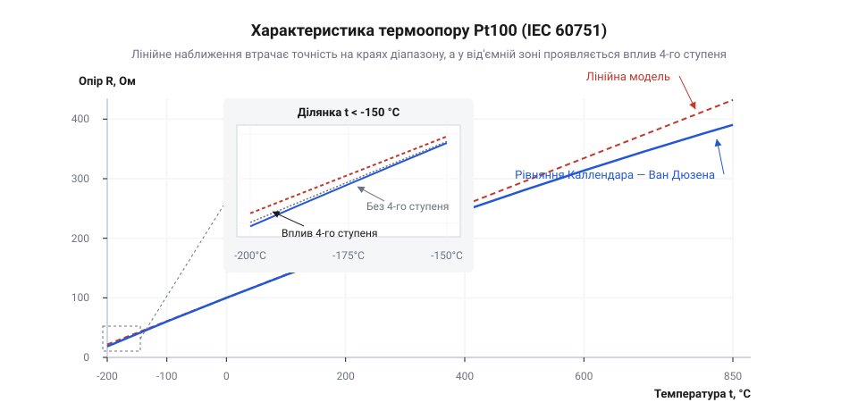
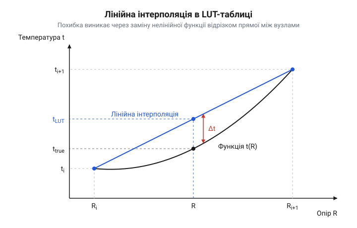

# Програмна бібліотека на C++/Python для конвертації Pt100/Pt1000 за рівняннями Каллендара — Ван Дюзена та розрахунку класів допуску

<preknowlist>
- [PT100 — платиновий термоопір](root:cat-hw-sensors/pt100-rtd) — будову платинового решітчастого елемента, його номінальний опір 100 Ом при 0°C та базову схемотехніку вимірювання.
- [Огляд родини резистивних перетворювачів температури RTD](root:cat-hw-sensors/rtd-resistance-temperature-detectors-family-overview) — класифікацію резистивних давачів температури та фізичні принципи зміни опору від температури.
</preknowlist>

## Нелінійність платинового термоопору та помилки конвертації

Прилади вимірювання температури вимагають визначення теплового стану середовища з точністю до десятих або сотих часток градуса. Коли чутливий елемент [платинового термоопору](root:cat-hw-sensors/pt100-rtd) підключають до електронного перетворювача, першим інженерним наближенням стає припущення про лінійну залежність між його електричним опором і температурою. Таке спрощення спирається на базове калібрування: номінальний опір сенсора @@en|Pt100@@ при температурі 0 °C становить 100 Ом, а при 100 °C досягає 138.51 Ом. Якщо розділити відносний приріст опору на інтервал у сто градусів, одержують усереднений @@en|температурний коефіцієнт опору@@ (англ. @@en|temperature coefficient of resistance@@, TCR, де лат. resistere — протистояти) `α = 0.00385 °C⁻¹`.

Спрощена лінійна модель оцінює електричний опір `R` за температурою `t`, виходячи з базового номінального значення `R₀`. Значення електричного опору `R` у лінійному наближенні дістають множенням номінального опору `R₀` на температурний коефіцієнт:
```
R(t) = R₀ · (1 + α · t)
```
Рівняння передбачає незмінну чутливість перетворювача `dR/dt = R₀ · α` на всьому діапазоні вимірювання, перетворюючи графік характеристики на пряму лінію.

Реальна кристалічна ґратка платини працює інакше. Під час нагрівання амплітуда теплових коливань іонів у вузлах металевої ґратки невпинно зростає, через що носії заряду зазнають дедалі сильнішого розсіювання на фононах. У міру підвищення температури питомий приріст опору платини на кожен наступний градус зменшується, тобто похідна `dR/dt` монотонно спадає. Реальна крива залежності опору від температури має помітну опуклість догори щодо прямої лінії.

Якщо виміряний опір перетворити назад у температуру за допомогою зворотного лінійного перетворення, виникає систематична похибка апроксимації. Оцінку температури `t_lin` дістають діленням приросту виміряного опору на чутливість давача:
```
t_lin = (R - R₀) / (R₀ · α)
```
Вираз розраховує температуру за припущення сталої крутизни перетворення сенсора.

**Обчислення методичної похибки лінійної інтерполяції для датчика Pt100 при температурі 200 °C:**
```
R_meas = 175.86 Ом                         [дійсний опір Pt100 при 200 °C за стандартом]
t_lin  = (175.86 - 100.0) / (100.0 · 0.00385)  [підстановка виміряного опору]
       = 75.86 / 0.385                    [приріст опору відносно чутливості]
       = 197.04 °C                         [обчислена лінійна температура]
Δt     = t_lin - t_true                    [абсолютна похибка конвертації]
       = 197.04 - 200.0                   [відхилення лінійної оцінки від істини]
       = -2.96 °C                          [значення методичної похибки]
```
Лінійна модель занижує температуру майже на 3 °C при 200 °C, а при температурі 400 °C, де дійсний опір платини становить 247.09 Ом, лінійний розрахунок видає 382.05 °C із неприпустимою похибкою -17.95 °C. У кріогенній зоні біля -100 °C, де опір дорівнює 60.26 Ом, лінійна оцінка становить -103.22 °C, відхиляючись на +3.22 °C у протилежний бік.


*Залежність електричного опору сенсора Pt100 від температури наочно показує нелінійне відхилення фізичної кривої від прямолінійної моделі, що зумовлює похибку до кількох градусів на широкому інтервалі.*

Щоб подолати таку неточність під час обробки сигналів [резистивних перетворювачів температури](root:cat-hw-sensors/rtd-resistance-temperature-detectors-family-overview), метрологічні вимоги [температурної шкали ITS-90](root:cat-hw-sensors/its-90-temperature-scale) закріпили у міжнародному стандарті @@en|IEC 60751@@ використання нелінійних співвідношень. Цей стандарт описує функцію опору сенсорів @@en|Pt100@@ та [високоомних сенсорів Pt1000](root:cat-hw-sensors/pt1000-rtd-sensor) за допомогою поліномів вищих порядків, відомих як @@en|рівняння Каллендара — Ван Дюзена@@.

## Пряме та обернене перетворення за стандартами

Програмна бібліотека перетворення будується на розв'язанні двох задач: прямій конвертації температури в електричний опір `R(t)` та зворотній оцінці температури за виміряним опором `t(R)`. Стандарт @@en|IEC 60751@@ визначає термометричну залежність через @@en|рівняння Каллендара — Ван Дюзена@@ (англ. @@en|Callendar–Van Dusen equation@@, назване на честь фізиків Г'ю Каллендара та Мілтона Ван Дюзена), розділяючи діапазон від -200 °C до +850 °C на дві температурні ділянки.

Для додатних температур (`t ≥ 0 °C`) функція опору описується параболічним поліномом другого степеня. Значення опору `R` для температури `t ≥ 0 °C` дістають додаванням до одиниці лінійного та квадратичного членів із коефіцієнтами `A` та `B`:
```
R(t) = R₀ · (1 + A · t + B · t²)
```
Формула задає спадний темп приросту опору завдяки від'ємному знаку коефіцієнта `B`. Стандарт нормує константи `A = 3.9083 × 10⁻³ °C⁻¹` та `B = -5.775 × 10⁻⁷ °C⁻²`, тоді як номінальний опір `R₀` дорівнює 100.0 Ом для @@en|Pt100@@ або 1000.0 Ом для датчиків @@en|Pt1000@@.

Для від'ємних температур (`-200 °C ≤ t < 0 °C`) квадратична парабола втрачає точність через кріогенні зміни зонної структури платини. До полінома додають член четвертого степеня. Значення опору `R` для діапазону `t < 0 °C` дістають доповненням виразу кубічною поправкою з коефіцієнтом `C`:
```
R(t) = R₀ · (1 + A · t + B · t² + C · (t - 100) · t³)
```
Поправковий доданок містить добуток `(t - 100) · t³`, помножений на коефіцієнт `C = -4.183 × 10⁻¹² °C⁻⁴`. При температурі 0 °C цей доданок обнуляється, гарантуючи збіг значень опору та гладке зшивання похідних на межі двох зон.

Під час зчитування сигналу мікроконтролер вимірює опір `R` і повинен розрахувати температуру `t`. Алгоритм вибирає метод обчислення за величиною опору відносно номіналу `R₀`.

Коли виміряний опір перевищує або дорівнює номіналу (`R ≥ R₀`), температура перебуває в додатній зоні. У цьому випадку @@en|рівняння Каллендара — Ван Дюзена@@ зводиться до звичайного квадратного рівняння відносно невідомої температури `t`. Канонічну форму квадратного рівняння дістають перенесенням виміряного опору `R` у ліву частину рівності:
```
B · t² + A · t + (1 - R / R₀) = 0
```
Рівняння містить від'ємний старший коефіцієнт `B` і два математичні корені, з яких фізичній поведінці металу відповідає корінь зі спадною гілкою. Аналітичне значення температури `t` для `R ≥ R₀` дістають за формулою розв'язку квадратного рівняння через дискримінант:
```
t = (-A + √(A² - 4 · B · (1 - R / R₀))) / (2 · B)
```
Отриманий вираз обчислює точну температуру за фіксований час без використання ітераційних наближень, вимагаючи всього одного обчислення квадратного кореня.

**Обчислення температури за квадратичною формулою для опору R = 138.51 Ом сенсора Pt100:**
```
R / R₀     = 138.51 / 100.0                   [відношення опору до номіналу]
           = 1.38510                          [відносне значення]
1 - R / R₀ = 1.0 - 1.38510                    [вільний член квадратного рівняння]
           = -0.38510                         [числовий результат]
D          = A² - 4 · B · (1 - R / R₀)        [дискримінант рівняння]
           = (3.9083 × 10⁻³)² - 4 · (-5.775 × 10⁻⁷) · (-0.38510)  [підстановка констант]
           = 1.52748 × 10⁻⁵ - 8.89581 × 10⁻⁷  [проміжні доданки]
           = 1.43852 × 10⁻⁵                   [величина дискримінанта]
√D         = 3.79278 × 10⁻³                   [корінь із дискримінанта]
t          = (-3.9083 × 10⁻³ + 3.79278 × 10⁻³) / (2 · (-5.775 × 10⁻⁷))  [обчислення кореня]
           = -1.15520 × 10⁻⁴ / (-1.15500 × 10⁻⁶)  [ділення чисельника на знаменник]
           = 100.017 °C                       [обчислена температура]
```
Квадратична формула повертає точне значення температури з похибкою менше двох сотих градуса за один аналітичний крок.

Коли виміряний опір менший за номінал (`R < R₀`), температура лежить у від'ємній зоні, де діє поліном четвертого степеня:
```
R₀ · (1 + A · t + B · t² + C · t⁴ - 100 · C · t³) - R = 0
```
Аналітичні формули для поліномів четвертого степеня є математично громіздкими та провокують катастрофічну втрату точності при обчисленнях із рухомою комою. Для знаходження кореня застосовують чисельний @@en|метод Ньютона — Рафсона@@ (англ. @@en|Newton–Raphson method@@, за іменами вчених Ісаака Ньютона та Джозефа Рафсона). Глибше зрозуміти принципи оптимізації дозволяє стаття [чисельний метод Ньютона — Рафсона для мікроконтролерів](root:cat-hw-sensors/newton-raphson-method-embedded).

Алгоритм будує цільову функцію нев'язки `f(t)` та її точну аналітичну похідну `f'(t)`. Функцію нев'язки `f(t)` дістають як різницю між теоретичним опором за поліномом та виміряним опором `R`:
```
f(t) = R₀ · (1 + A · t + B · t² + C · (t - 100) · t³) - R
```
Корінь цієї функції дає шукане значення температури. Похідну функції нев'язки `f'(t)` дістають диференціюванням за температурою:
```
f'(t) = R₀ · (A + 2 · B · t + 4 · C · t³ - 300 · C · t²)
```
Похідна задає кут нахилу дотичної лінії до кривої калібрування. Нове наближення температури `t_{k+1}` дістають зміщенням від поточної точки вздовж знайденої дотичної:
```
t_{k+1} = t_k - f(t_k) / f'(t_k)
```
За початкове значення беруть лінійне наближення `t₀ = (R / R₀ - 1) / A`. Завдяки строгій монотонності залежності опору від температури @@en|метод Ньютона — Рафсона@@ сходиться квадратично, зменшуючи похибку нижче `10⁻⁶ °C` лише за три або чотири кроки.

:::tabs
@tab C
:::code proj-rtd-iec60751-conversion-library/c/src/rtd_iec60751.c 36-47
:::code proj-rtd-iec60751-conversion-library/c/src/rtd_iec60751.c 69-105
@tab C++
:::code proj-rtd-iec60751-conversion-library/py/cpp/iec60751.cpp 7-27
@tab Python
:::code proj-rtd-iec60751-conversion-library/py/iec60751.py 11-46
:::

## Класифікація допусків та обчислення похибок

Бездоганний розрахунковий алгоритм не усуває апаратного розкиду характеристик фізичного сенсора. Кожен платиновий чутливий елемент має технологічні допуски за чистотою металу, геометрією резистивного шару та механічними напруженнями після монтажу. Стандарт @@en|IEC 60751@@ класифікує платинові сенсори за чотирма основними @@en|класами допуску@@ (англ. @@en|tolerance class@@, де лат. tolerare — витримувати): AA, A, B та C.

Кожен @@en|клас допуску@@ нормує максимально дозволене відхилення температури `Δt` як лінійну функцію від абсолютного значення вимірюваної температури `|t|`:
- Клас AA: `Δt = ±(0.10 + 0.0017 · |t|) °C` (робочий діапазон від 0 °C до +150 °C);
- Клас A: `Δt = ±(0.15 + 0.0020 · |t|) °C` (робочий діапазон від -30 °C до +300 °C);
- Клас B: `Δt = ±(0.30 + 0.0050 · |t|) °C` (робочий діапазон від -196 °C до +600 °C);
- Клас C: `Δt = ±(0.60 + 0.0100 · |t|) °C` (робочий діапазон від -196 °C до +600 °C).

Допустима похибка зростає з температурою через прискорення дифузії домішок у платину, релаксацію механічних напружень захисної трубки та дрейф температурного коефіцієнта `A`.

Програмна бібліотека виконує автоматичну валідацію сенсора. Знаючи виміряний опір `R` та еталонну температуру калібрування `t_ref`, функція обчислює температуру `t_calc` через @@en|рівняння Каллендара — Ван Дюзена@@, знаходить модуль відхилення `|t_calc - t_ref|` та порівнює його з допуском `Δt`. Якщо модуль відхилення перевищує нормативне значення обраного класу, програма фіксує невідповідність датчика заявленій точності.

У складі реального вимірювального пристрою похибка чутливого елемента становить лише частину загальної невизначеності. Повний метрологічний @@en|бюджет похибок@@ (англ. @@en|error budget@@) формується сукупністю незалежних фізичних факторів:
1. Допуск сенсора `Δt_sensor` — визначається нормативом його класу за @@en|IEC 60751@@;
2. Похибка вимірювального тракту `Δt_adc` — спричиняється шумом квантування, інтегральною нелінійністю та дрейфом опорного резистора [перетворювача MAX31865](root:cat-hw-sensors/max31865-rtd-converter);
3. Похибка кабельної лінії `Δt_wire` — зумовлюється паразитним опором дротів, що вимагає врахування схеми з'єднання під час [вибору між Pt100 та Pt1000](root:cat-hw-sensors/pt100-vs-pt1000-sensor-selection-guide);
4. Похибка від @@en|саморозігріву@@ (англ. @@en|self-heating@@) `Δt_self` — викликається джоулевим теплом `P = I² · R`, яке виділяє струм опитування `I` безпосередньо в тілі чутливого елемента. Детально ознайомитися з методологією та математичним апаратом можна в матеріалі [бюджет похибок вимірювальних систем](root:cat-hw-sensors/error-budget-measurement-systems).

Оскільки всі перелічені джерела є взаємно незалежними випадковими процесами, результуюча похибка розраховується за правилом геометричного додавання дисперсій. Граничну комбіновану похибку каналу `Δt_total` дістають обчисленням квадратного кореня із суми квадратів окремих складових:
```
Δt_total = √(Δt_sensor² + Δt_adc² + Δt_wire² + Δt_self²)
```
Геометричне сумування усуває надмірний песимізм прямого арифметичного додавання, даючи коректну оцінку довірчого інтервалу системи.

**Обчислення комбінованої похибки вимірювального каналу з сенсором Pt100 класу A при температурі 100 °C:**
```
Δt_sensor = 0.15 + 0.0020 · 100.0 = 0.35 °C        [допуск сенсора класу A]
Δt_adc    = 0.05 °C                                 [похибка аналогово-цифрового перетворювача]
Δt_wire   = 0.02 °C                                 [залишкова похибка 3-провідної лінії]
Δt_self   = 0.01 °C                                 [саморозігрів вимірювальним струмом 1 мА]
Δt_total  = √(0.35² + 0.05² + 0.02² + 0.01²)         [геометрична сума складових]
          = √(0.1225 + 0.0025 + 0.0004 + 0.0001)     [сума квадратів похибок]
          = √0.1255                                 [підкореневий вираз]
          = 0.354 °C                                [комбінована похибка каналу]
```
Допуск самого датчика класу A (0.35 °C) є головним чинником у сумарному бюджеті, тоді як якісний перетворювач та скомпенсована кабельна лінія додають до підсумкової невизначеності каналу лише 0.004 °C.

:::tabs
@tab C
:::code proj-rtd-iec60751-conversion-library/c/src/rtd_iec60751.c 119-143
:::code proj-rtd-iec60751-conversion-library/c/src/rtd_iec60751.c 145-172
@tab C++
:::code proj-rtd-iec60751-conversion-library/cpp/iec60751.hpp 26-53
:::

## Оптимізація конвертації для малопотужних контролерів

Обчислення температури за аналітичними формулами вимагає значних обчислювальних ресурсів процесора. Більшість промислових мікроконтролерів класів ARM Cortex-M0+, PIC чи AVR не мають апаратного @@en|блока плаваючої коми@@ (англ. @@en|floating-point unit@@, @@en|FPU@@). Коли такий кристал обчислює квадратний корінь або виконує ітерації, які накладає чисельний @@en|метод Ньютона — Рафсона@@, ядро викликає бібліотечні підпрограми програмної емуляції чисел подвійної точності. Виконання одного ділення чи добування кореня потребує сотень або тисяч тактів процесора, що перевантажує шину під час швидкого опитування кількох каналів через [перетворювач MAX31865](root:cat-hw-sensors/max31865-rtd-converter) та збільшує споживання енергії від батареї.

Щоб розвантажити процесор, складні математичні залежності замінюють попередньо розрахованими масивами даних у пам'яті. Метод @@en|таблиці пошуку@@ (англ. @@en|lookup table@@, @@en|LUT@@) заздалегідь обчислює значення опору для фіксованої сітки температур із постійним кроком. Під час вимірювання мікроконтролер не розв'язує рівняння, а шукає відповідний інтервал у таблиці та застосовує простий розрахунок на короткому відрізку.

Між двома сусідніми табличними вузлами нелінійна крива опору апроксимується прямою лінією.


*Лінійна апроксимація на відрізку між опорними точками замінює нелінійну криву січною прямою, що дозволяє обчислювати температуру за пропорцією різниць опорів суто цілочисельними операціями.*

Для виміряного опору `R_meas`, що потрапив між табличними вузлами `R_low` та `R_high` із відповідними температурами `T_low` та `T_high`, використовують метод @@la|лінійної інтерполяції@@ (лат. interpolare — підновлювати, вставляти проміжне). Температуру `T` у проміжній точці між вузлами дістають додаванням до нижньої температури приросту, пропорційного зміщенню виміряного опору:
```
T = T_low + (R_meas - R_low) · (T_high - T_low) / (R_high - R_low)
```
Отриманий вираз замінює криволінійну залежність січною прямою, перетворюючи розрахунок температури на одне множення та одне ділення.

Щоб повністю усунути операції з рухомою комою, [арифметика з фіксованою комою](root:cat-hw-sensors/fixed-point-arithmetic-mcu) (англ. @@en|fixed-point arithmetic@@) масштабує фізичні величини у цілі числа. Опір сенсора переводять у міліоми множенням на 1000, а температуру зберігають у міліградусах Цельсія. Цілочисельну оцінку температури `T_mc` у міліградусах Цельсія за виміряним у міліомах опором `R_mohm` дістають масштабуванням різниці опорів на крок сітки `ΔT_step_mc` з додаванням половини знаменника `ΔR_mohm / 2` для симетричного округлення:
```
T_mc = T_low_mc + ((R_mohm - R_low_mohm) · ΔT_step_mc + ΔR_mohm / 2) / ΔR_mohm
```
Додавання до чисельника половини ширини сегмента `ΔR_mohm / 2` усуває систематичне заниження результату від цілочисельного ділення з відкиданням залишку. Добуток різниці опорів на крок температури обчислюється у 64-бітному типі `int64_t`, що унеможливлює арифметичне переповнення.

Швидкий пошук потрібного інтервалу в монотонно зростаючому масиві опорів забезпечує алгоритм @@en|двійкового пошуку@@ (англ. @@en|binary search@@). Оскільки опір платини строго монотонно зростає з температурою, масив гарантовано впорядкований. Алгоритм ділить робочий діапазон навпіл на кожному кроці, знаходячи граничні індекси `low` та `high` за логарифмічний час `O(log₂ N)`. Для таблиці зі 106 елементів алгоритм знаходить потрібний сегмент щонайбільше за сім порівнянь.

**Цілочисельне обчислення температури сенсора Pt100 за таблицею з кроком 10 °C при опорі 109.733 Ом:**
```
R_meas_mohm = 109733 мОм                                   [виміряний опір у міліомах]
R_low_mohm  = 107794 мОм                                   [опір вузла при 20 °C]
R_high_mohm = 111673 мОм                                   [опір вузла при 30 °C]
ΔR_mohm     = 111673 - 107794 = 3879 мОм                   [ширина сегмента опору]
ΔR_meas     = 109733 - 107794 = 1939 мОм                   [приріст виміряного опору від нижнього вузла]
ΔT_step_mc  = 10000 м°C                                    [крок таблиці в міліградусах Цельсія]
T_low_mc    = 20000 м°C                                    [температура нижнього вузла 20 °C]
num         = 1939 · 10000 + 3879 / 2                      [чисельник з округленням]
            = 19390000 + 1939                              [проміжне сумування]
            = 19391939                                     [значення 64-бітного чисельника]
interp_mc   = 19391939 / 3879                              [цілочисельне ділення]
            = 4999 м°C                                     [інтерпольований приріст температури]
T_mc        = 20000 + 4999                                 [підсумкова температура]
            = 24999 м°C                                    [обчислена температура: 24.999 °C]
```
Цілочисельний розрахунок повертає 24.999 °C при істинній температурі 25.000 °C, даючи методичну похибку лише 0.001 °C без жодної операції з рухомою комою.

Точність апроксимації визначається обраним кроком таблиці. Оскільки @@en|рівняння Каллендара — Ван Дюзена@@ має квадратичну кривизну, січна лінія відхиляється від параболи щонайбільше посередині відрізка. Для сітки з кроком 10 °C максимальна методична похибка @@la|лінійної інтерполяції@@ становить 0.013 °C у плюсовій зоні, що на порядок перевершує вимоги найжорсткішого @@en|класу допуску@@ AA (0.10 °C). Для [високоомних сенсорів Pt1000](root:cat-hw-sensors/pt1000-rtd-sensor) чутливість становить приблизно 3.85 Ом/°C замість 0.385 Ом/°C у @@en|Pt100@@, тому одиниця міліома відповідає 0.00026 °C, що забезпечує ще вищу роздільну здатність цілочисельного перетворення.

:::tabs
@tab C
:::code proj-rtd-iec60751-conversion-library/c/include/rtd_lut.h 23-29
:::code proj-rtd-iec60751-conversion-library/c/src/rtd_lut.c 36-79
@tab C++
:::code proj-rtd-iec60751-conversion-library/cpp/iec60751.hpp 56-116
@tab Python
:::code proj-rtd-iec60751-conversion-library/py/iec60751.py 48-55
:::

## Побудова та тестування кросплатформеної бібліотеки

Практичне використання розроблених алгоритмів вимагає зручного інтерфейсу, узгодженого з вимогами цільового середовища виконання. Убудовані прошивки на базі мікроконтролерів, високорівневе системне програмне забезпечення та аналітичні середовища обробки даних мають відмінні вимоги до керування пам'яттю, швидкодії та типів даних. Побудова чистого @@en|програмного інтерфейсу@@ (англ. @@en|application programming interface@@, @@en|API@@) дозволяє відокремити математичне ядро перетворення від деталей системної інтеграції.

У процедурній реалізації на мові Си всі функції оперують явними конфігураційними структурами `rtd_config_t` та `rtd_lut_t`, приймаючи покажчики на вхідні й вихідні змінні. Функції не виділяють динамічної пам'яті через купу, повертаючи строгий код статусу переліку `rtd_status_t`. Відсутність глобального змінюваного стану забезпечує реентерабельність функцій, фіксований розмір стека та безпеку застосування в операційних системах реального часу.

У мові @@en|C++@@ бібліотека будується навколо шаблонованого класу `IEC60751Convert`, параметризованого номінальним опором, діапазоном і кроком сітки. Генерація таблиць розрахунку перенесена на етап компіляції за допомогою специфікатора @@en|constexpr@@ (англ. @@en|constant expression@@ — сталий вираз). Створений масив таблиці розміщується безпосередньо в енергонезалежній Flash-пам'яті мікроконтролера як константний сегмент, не витрачаючи оперативної пам'яті під час запуску програми. Строга типізація через перелік `ToleranceClass` усуває помилки передачі некоректних параметрів під час обчислення [бюджету похибок](root:cat-hw-sensors/pt100-vs-pt1000-sensor-selection-guide).

Модуль на мові @@en|Python@@ орієнтований на пакетну обробку експериментальних масивів вимірювань і калібрування. Завдяки механізму @@la|векторизації@@ (від лат. vector — той, що несе) у бібліотеці @@en|NumPy@@ функції конвертації обробляють одновимірні та багатовимірні масиви без повільних інтерпретованих циклів. Для від'ємних температур функція формує логічні бітові маски та паралельно наближає розв'язок за методом Ньютона — Рафсона для тисяч точок вимірювань одночасно.

Для перевірки всієї [родини резистивних перетворювачів RTD](root:cat-hw-sensors/rtd-resistance-temperature-detectors-family-overview) на відповідність вимогам [температурної шкали ITS-90](root:cat-hw-sensors/its-90-temperature-scale) та стандарту @@en|IEC 60751@@ бібліотека розгортає набір @@en|модульних тестів@@ (англ. @@en|unit test@@, де unit — одиничний складовий вузол). Тестування перевіряє пряме перетворення `t → R(t)` та зворотне обчислення `R → t` у контрольних точках від -150 °C до +750 °C. Критерієм збігу для аналітичного розв'язку та методу Ньютона — Рафсона є похибка не більше `10⁻⁶ °C`, а для цілочисельної таблиці @@en|LUT@@ — не більше `0.05 °C`. Клас `ErrorAnalyzer` виконує сканування робочого інтервалу зі щільним кроком для [оптимізації таблиць пошуку](root:cat-hw-sensors/lookup-table-optimization), визначаючи максимальну та середню методичну похибку інтерполяції.

:::tabs
@tab C
:::code proj-rtd-iec60751-conversion-library/c/src/main.c 33-61
:::code proj-rtd-iec60751-conversion-library/c/src/main.c 98-128
@tab C++
:::code proj-rtd-iec60751-conversion-library/cpp/main.cpp 7-44
@tab Python
:::code proj-rtd-iec60751-conversion-library/py/error_analysis.py 3-18
:::code proj-rtd-iec60751-conversion-library/py/example.py 5-24
:::