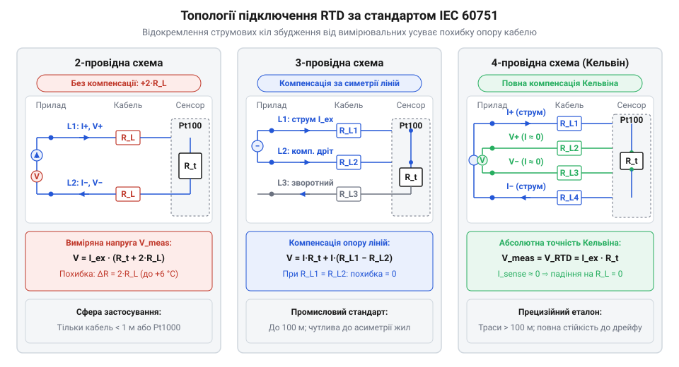
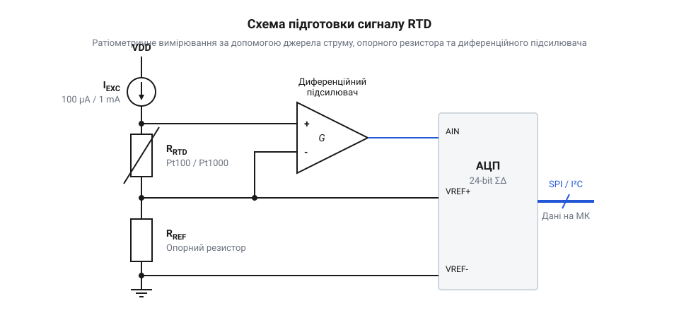

# Проєкт розрахунку й налаштування аналогового тракту RTD з оптимізацією струму збудження та схемою підключення

<preknowlist>
- [PT100 — платиновий термоопір](root:cat-hw-sensors/pt100-rtd) — знати базові параметри платинових сенсорів, номінальний опір при 0 °C та температурний коефіцієнт платини alpha = 0.00385 1/°C
- [Огляд родини резистивних перетворювачів температури RTD](root:cat-hw-sensors/rtd-resistance-temperature-detectors-family-overview) — знати загальні принципи роботи RTD-сенсорів та принципові відмінності між Pt100 та Pt1000
- [MAX31865 — перетворювач опору платинових датчиків PT100/PT1000](root:cat-hw-sensors/max31865-rtd-converter) — розуміти функціонал готових мікросхем оцифрування RTD для порівняння дискретного аналогового тракту з інтегрованими рішеннями
</preknowlist>

## Джерела похибок вимірювання платинового термоопору

Вимірювання температури в промислових установках починається з просторового рознесення: сенсор занурюють углиб агрегату, а вимірювальний модуль розташовують у щиті керування за десятки метрів. Платиновий термоопір (англ. @@en|RTD@@, @@en|resistance temperature detector@@, від англ. *resistance* — опір, *temperature* — температура, та *detector* — виявлювач) змінює опір залежно від температури за передбачуваним законом. Чутливість визначає температурний коефіцієнт опору (англ. @@en|TCR@@, від англ. *temperature coefficient of resistance*), який для платини становить `α ≈ 0.00385 °C⁻¹`. Для базового сенсора Pt100 зі [специфікації сенсора Pt100](root:cat-hw-sensors/pt100-rtd) з опором `R_0 = 100 Ω` при `0 °C` кожен градус нагріву додає лише `ΔR ≈ 0.385 Ω`.

Головною завадою прямому вимірюванню є опір кабелю зв'язку (англ. @@en|lead wire resistance@@, від англ. *lead* — підвід, та *wire* — дріт). Мідний кабель перерізом `0.5 mm²` має опір близько `0.036 Ω/м`. На відстані `50 м` прямий та зворотний провідники утворюють лінію завдовжки `100 м` з опором `3.6 Ω`.

Загальний опір кола `R_meas` у найпростішому двопровідному з'єднанні складається з опору термоопору `R_rtd` та подвійного опору лінії `R_L`:

```
R_meas
= R_rtd + 2 · R_L                   [послідовне з'єднання дротів і навантаження]
```

Вираз показує, що вимірювач фіксує суму величин і не відокремлює опір сенсора від паразитного опору кабелю.

**Похибка від опору кабелю для сенсора Pt100:**
Опір лінії `2 · R_L = 3.6 Ω`, чутливість `S = 0.385 Ω/°C`.

```
ΔT_wire
= (2 · R_L) ÷ S                     [перерахунок паразитного опору через чутливість]
= 3.6 ÷ 0.385                       [підстановка значень опору та чутливості]
≈ 9.35 °C                           [кінцева температурна похибка]
```

Опір лінії дає похибку майже в десять градусів. Ситуацію погіршує температурний коефіцієнт міді `α_Cu ≈ 0.00393 °C⁻¹`: добові коливання температури в цеху безперервно змінюють опір дротів, породжуючи дрейф нульової точки.

Другим джерелом похибки є самонагрів (англ. @@en|self-heating@@, від англ. *self* — сам, та *heat* — нагрівати). Щоб виміряти опір пасивного терморезистора, крізь нього пропускають струм збудження (англ. @@en|excitation current@@, від лат. *excitare* — збуджувати). Струм розсіює потужність, яка нагріває кристал за законом Джоуля-Ленца.

Відведення тепла в довкілля визначає коефіцієнт розсіювання потужності (англ. @@en|dissipation constant@@, від лат. *dissipare* — розсіювати), позначуваний `δ_th` у міліватах на градус Цельсія.

Перегрів сенсора `ΔT_self` над температурою середовища знаходять із теплового балансу виділеної потужності `P_d` та тепловідведення `δ_th`:

```
ΔT_self
= P_d ÷ δ_th                        [рівновага теплового потоку]
= (I_exc² · R_rtd) ÷ δ_th           [закон Джоуля-Ленца для розсіюваної потужності]
```

Вираз показує, що перегрів зростає квадратично від струму та різко посилюється за поганого тепловідведення.

У нерухомому повітрі або всередині [монтажу в захисну термогільзу](root:cat-hw-sensors/thermowell-and-industrial-rtd-protection) тепловідведення низьке: `δ_th ≈ 1 ... 2 mW/°C`. Струм `5 mA` крізь Pt100 при `200 °C` (`R_rtd ≈ 175.86 Ω`) розсіює `P_d ≈ 4.4 mW`. За `δ_th = 2 mW/°C` перегрів досягає `ΔT_self = 4.4 ÷ 2 = 2.2 °C`: сенсор вимірює власне тепло замість середовища. Додатково паразитні термо-ЕРС Зеєбека (англ. @@en|thermoelectric EMF@@, @@en|Seebeck effect@@, за ім'ям Томаса Зеєбека) на стиках міді з платиною та контактні опори клемників накладають постійні зміщення напруги.

Виникає суперечність: великий струм збільшує сигнал, полегшуючи фільтрацію завад, але порушує [вимоги шкали ITS-90](root:cat-hw-sensors/its-90-temperature-scale) щодо обмеження самонагріву до `< 0.01 °C`. Це вимагає точного розрахунку струму та спеціальних схем підключення.

## Вибір датчика та розрахунок струму збудження

У діапазоні від `-50 °C` до `+200 °C` обирають між сенсорами Pt100 та Pt1000 із [огляду родини термоопорів](root:cat-hw-sensors/rtd-resistance-temperature-detectors-family-overview). За температури `-50 °C` опір Pt100 становить `80.31 Ω`, а Pt1000 — `803.1 Ω`. При `+200 °C` опір зростає до `175.86 Ω` для Pt100 та `1758.6 Ω` для Pt1000. Крутизна Pt100 дорівнює `0.385 Ω/°C`, а Pt1000 — `3.85 Ω/°C`, що дає вдесятеро більший відгук.

Як показує аналіз у [порівнянні сенсорів Pt100 та Pt1000](root:cat-hw-sensors/pt100-vs-pt1000-sensor-selection-guide), номінал обирають під умови середовища. Дротяний сенсор Pt100 (англ. @@en|wire-wound RTD@@, від англ. *wire* — дріт, та *wound* — намотаний) витримує вібрації, а малий опір захищає канал від витоків крізь вологу ізоляцію. Тонкоплівковий сенсор Pt1000 (англ. @@en|thin-film RTD@@, від англ. *thin* — тонкий, та *film* — плівка) з напиленням платини на кераміку, описаний у статті про [конструкцію терморезисторів Pt1000](root:cat-hw-sensors/pt1000-rtd-sensor), зменшує відносну похибку від опору лінії та енергоспоживання вузла.

Для метрологічної точності похибку самонагріву обмежують до `ΔT_self_max < 0.01 °C`. Розрахунок ведуть для найгірших умов: опору при `+200 °C` та слабкого тепловідведення в стоячому повітрі з `δ_th = 2 mW/°C = 2000 μW/°C`.

Граничну потужність `P_d_max` знаходять із допустимого перегріву `ΔT_self_max` та тепловідведення `δ_th`:

```
P_d_max
= ΔT_self_max · δ_th                [допустимий тепловий потік]
= 0.01 · 2.0                        [підстановка обмежень]
= 0.02 mW = 20 μW                   [максимальна розсіювана потужність]
```

Потужність на кристалі не повинна перевищувати `20 μW`.

Граничний струм збудження `I_exc_max` виражають через потужність `P_d_max` та найбільший опір `R_max`:

```
I_exc_max
= √(P_d_max ÷ R_max)                [закон Джоуля-Ленца для струму]
```

Вираз визначає верхню межу струму генератора, за якої перегрів лишається в межах допуску.

**Розрахунок струму для Pt100:**
Опір `R_max = 175.86 Ω` (при `+200 °C`), потужність `P_d_max = 20 × 10⁻⁶ W`.

```
I_exc_max
= √(P_d_max ÷ R_max)                [закон Джоуля-Ленца для струму]
= √(20 × 10⁻⁶ ÷ 175.86)             [підстановка параметрів Pt100]
= √(1.137 × 10⁻⁷)                   [проміжне ділення величин]
≈ 0.337 × 10⁻³ A = 337 μA           [добування квадратного кореня]
```

У нерухомому газі струм Pt100 лімітують до `337 μA`. У промислових потоках рідин тепловідведення вище (`δ_th ≥ 20 ... 50 mW/°C`), тому там застосовують стандартний струм `I_exc = 1 mA`, який створює перегрів `< 0.009 °C`.

**Розрахунок струму для Pt1000:**
Опір `R_max = 1758.6 Ω` (при `+200 °C`), потужність `P_d_max = 20 × 10⁻⁶ W`.

```
I_exc_max
= √(P_d_max ÷ R_max)                [закон Джоуля-Ленца для струму]
= √(20 × 10⁻⁶ ÷ 1758.6)            [підстановка параметрів Pt1000]
= √(1.137 × 10⁻⁸)                   [проміжне ділення величин]
≈ 0.1066 × 10⁻³ A ≈ 106.6 μA        [добування квадратного кореня]
```

Отриманий поріг диктує стандартний вибір: `I_exc = 100 μA`. При `100 μA` потужність дорівнює `P_d = (100 × 10⁻⁶ A)² · 1758.6 Ω ≈ 17.59 μW`, а перегрів становить `ΔT_self = 17.59 μW ÷ 2000 μW/°C ≈ 0.0088 °C`, що відповідає межі `< 0.01 °C` навіть у повітрі.

Для Pt1000 зі струмом `100 μA` вихідна напруга зростає від `80.31 mV` (при `-50 °C`) до `175.86 mV` (при `+200 °C`), утворюючи розмах `ΔV = 95.55 mV`. Для Pt100 зі струмом `1 mA` напруга змінюється в тих самих межах від `80.31 mV` до `175.86 mV` із чутливістю `0.382 mV/°C`. Обидва сенсори формують однаковий сигнал, але Pt1000 споживає вдесятеро менше струму, тоді як Pt100 менш чутливий до завад на довгій лінії.

## Схеми двох-, трьох- та чотирьохпровідного підключення

Доставка струму збудження та зняття вимірюваного потенціалу без спотворень від кабелю здійснюється трьома основними топологіями.

Двопровідне підключення (англ. @@en|two-wire configuration@@) подає струм і знімає напругу через спільну пару провідників. Напруга на вимірювачі становить `V_meas = I_exc · (R_rtd + 2 · R_L)`. Падіння напруги на опорі жил `2 · I_exc · R_L` додається безпосередньо до сигналу сенсора. Початковий опір калібрують програмно, проте температурний дрейф кабелю компенсувати неможливо: зміна опору дротів на `0.385 Ω` дає похибку `1.0 °C` для Pt100 і лише `0.1 °C` для Pt1000. Через це двопровідне коло використовують виключно для Pt1000 за довжини траси до кількох метрів у системах із допуском `±0.5 ... 1.0 °C`.


*Топології з'єднання платинового термоопору: двопровідна схема сумує опір лінії з давачем, трипровідна врівноважує симетричні жили у мостовому або двострумовому колі, а чотирипровідна схема Кельвіна повністю розв'язує струмове навантаження та високоомне вимірювання потенціалу.*

Трипровідне підключення (англ. @@en|three-wire configuration@@) — головний промисловий стандарт. Кабель містить три однакові жили в спільній оболонці, що забезпечує рівність опорів: `R_L1 ≈ R_L2 ≈ R_L3 = R_L`.

Компенсацію реалізують мостом Вітстона (англ. @@en|Wheatstone bridge@@, за ім'ям Чарльза Вітстона) або парою узгоджених джерел струму (англ. @@en|dual matched current sources@@). У схемі з двома джерелами струм `I_exc1 = I_exc` тече через лінію `R_L1`, термоопір `R_rtd` і зворотну лінію `R_L3`. Друге джерело `I_exc2 = I_exc` спрямовує струм через компенсаційну лінію `R_L2` у ту саму лінію `R_L3`.

Потенціал першої клеми дорівнює `V_1 = I_exc · R_L1 + I_exc · R_rtd + 2 · I_exc · R_L3`, а другої — `V_2 = I_exc · R_L2 + 2 · I_exc · R_L3`.

Диференційну напругу `V_diff` визначають як різницю потенціалів двох жил:

```
V_diff
= V_1 - V_2                         [різниця потенціалів вимірювальних вузлів]
= I_exc · R_rtd + I_exc · (R_L1 - R_L2) [взаємне віднімання синфазних падінь напруги]
```

За рівності опорів жил `R_L1 = R_L2` синфазні спади напруги взаємно компенсуються: `V_diff = I_exc · R_rtd`. Якщо ж через неоднорідність або перехідний опір клем симетрія порушується на `ΔR_L = 0.1 Ω`, залишковий розбаланс створює для Pt100 похибку `0.26 °C`.

Чотирипровідне підключення Кельвіна (англ. @@en|four-wire Kelvin sensing@@, за ім'ям Вільяма Томсона, лорда Кельвіна) цілком відокремлює струмове коло від потенційного. Струмова пара (англ. @@en|force lines@@) живить сенсор струмом `I_exc`, а падіння напруги на лініях компенсує джерело струму. Потенційна пара (англ. @@en|sense lines@@) веде безпосередньо від контактів платини до високоомного входу підсилювача чи АЦП.

Падіння напруги `V_drop_sense` на потенційних дротах `R_L_sense` визначають за законом Ома через вхідний струм `I_sense`:

```
V_drop_sense
= I_sense · (2 · R_L_sense)         [закон Ома для потенційного кола]
= (V_rtd ÷ R_in) · (2 · R_L_sense)  [вираз струму через вхідний опір вимірювача]
```

Оскільки вхідний опір `R_in > 10 GΩ`, струм `I_sense` становить пікоампери, а спад напруги на дротах вимірювання дорівнює часткам нановольта. Чотирипровідна схема усуває вплив довжини ліній, корозії клем та асиметрії жил. Вона є обов'язковою для Pt100 у прецизійних вимірюваннях.

Оцифрування сигналів здійснюють або за допомогою [спеціалізованих мікросхем оцифрування](root:cat-hw-sensors/max31865-rtd-converter), або дискретними аналоговими колами. Диференційний сигнал термоопору не перевищує десятків мілівольтів на фоні синфазного потенціалу (англ. @@en|common-mode voltage@@). Його узгодження вимагає підсилювача з високим коефіцієнтом придушення синфазного сигналу (англ. @@en|CMRR@@, від англ. *common-mode rejection ratio*) та прецизійного опорного резистора.

## Розрахунок опорного резистора та підсилювального тракту

Падіння напруги на платиновому термоопорі у робочому діапазоні від `-50 °C` до `+200 °C` змінюється від `80.31 mV` до `175.86 mV` для сенсора Pt100 зі струмом збудження `I_exc = 1 mA`, а також для Pt1000 зі струмом `100 μA`. Корисний розмах сигналу становить лише `ΔV = 95.55 mV`. Якщо подати такий сигнал безпосередньо на вхід аналого-цифрового перетворювача (англ. @@en|ADC@@, @@en|analog-to-digital converter@@, від грец. *ana* — вгору, *logos* — відношення, та лат. *digitus* — палець) мікроконтролера зі стандартною шкалою `3.3 V`, вимірювання задіє менше трьох відсотків розрядності, що знецінить точність платини. Крім того, будь-який дрейф генератора струму збудження безпосередньо спотворює вихідний потенціал.

Цю проблему усуває логометричне вимірювання (англ. @@en|ratiometric measurement@@, від лат. *ratio* — відношення, та *metiri* — вимірювати). Струм збудження пропускають послідовно крізь сенсор та високостабільний опорний резистор (англ. @@en|reference resistor@@, від лат. *referre* — співвідносити) `R_ref`. Падіння напруги на опорному резисторі формує зовнішній опорний потенціал перетворювача `V_ref_adc = I_exc · R_ref`. Якщо сигнал із сенсора підсилити каскадом із коефіцієнтом передачі `G`, вихідний цифровий код АЦП `D` визначається співвідношенням напруг:

```
D
= 2ⁿ · (V_in ÷ V_ref_adc)               [ідеальна характеристика перетворення АЦП]
= 2ⁿ · (G · I_exc · R_rtd) ÷ (I_exc · R_ref) [підстановка вимірюваного та опорного сигналів]
= 2ⁿ · G · (R_rtd ÷ R_ref)              [скорочення струму збудження]
```

Вираз показує, що струм збудження повністю випадає з кінцевої формули: повільний дрейф джерела струму або низькочастотні пульсації живлення однаково змінюють обидва сигнали й взаємно знищуються. Точність і температурна стабільність вузла переходять виключно на опорний резистор `R_ref` та резистори зворотного зв'язку підсилювача.

Для струму збудження `I_exc = 1 mA` та типової опорної напруги перетворювача `V_ref_adc = 2.5 V` опорний опір `R_ref` знаходять за законом Ома:

```
R_ref
= V_ref_adc ÷ I_exc                     [закон Ома для опорної гілки]
= 2.5 ÷ 0.001                           [підстановка напруги та струму]
= 2500 Ω = 2.5 kΩ                       [розрахунковий номінал опорного резистора]
```

Отриманий опір `2.5 kΩ` формує опорну напругу `2.5 V`. Щоб температурний дрейф (англ. @@en|temperature drift@@, від нід. *drijven* — плавати) не перевищував похибки сенсора, застосовують металофольговий або тонкоплівковий резистор із допуском `0.05%` та температурним коефіцієнтом не гірше `5 ppm/°C` (англ. @@en|parts per million@@).

Напругу із сенсора знімають інструментальним підсилювачем (англ. @@en|instrumentation amplifier@@, від лат. *instrumentum* — знаряддя). Його вхідні каскади мають власний опір понад `10 GΩ`, що усуває навантаження на потенційні лінії вимірювання, а коефіцієнт придушення синфазного сигналу перевищує `100 dB`. Подібно до класичних рішень у [підсиленні сигналів на операційних підсилювачах](root:cat-hw-sensors/lm35-operational-amplifier-circuits), схема виділяє малу різницю потенціалів на тлі зміщення.

Коефіцієнт підсилення `G` (англ. @@en|gain@@, від фр. *gaaignier* — здобувати) обирають так, щоб узгодити максимальний сигнал термоопору `V_rtd_max = 175.86 mV` з діапазоном перетворювача `2.5 V`. Щоб запобігти насиченню вихідного каскаду біля верхньої межі живлення, верхній рівень шкали обмежують напругою `V_out_max = 2.286 V`:

```
G
= V_out_max ÷ V_rtd_max                 [масштабування динамічного діапазону]
= 2.286 ÷ 0.17586                       [підстановка граничних значень]
= 13.0                                  [коефіцієнт підсилення тракту]
```

Підсилення в тринадцять разів масштабує діапазон від `-50 °C` до `+200 °C` у вихідні напруги від `1.044 V` до `2.286 V`. Нижня напруга `1.044 V` гарантує, що операційний підсилювач (англ. @@en|operational amplifier@@, @@en|op-amp@@, від лат. *operari* — діяти, та *amplificare* — розширювати) працює в лінійному режимі без наближення до потенціалу землі.

У трипідсилювальній топології коефіцієнт підсилення задають резистором `R_G`:

```
R_G
= 100 000 ÷ (G - 1)                     [передатна функція інструментального каскаду]
= 100 000 ÷ (13.0 - 1)                  [підстановка розрахованого підсилення]
= 100 000 ÷ 12.0                        [ділення значень]
≈ 8333.3 Ω ≈ 8.33 kΩ                    [номінал резистора підсилення]
```

Для опору `R_G` використовують прецизійний резистор `8.33 kΩ` класу точності `0.1%` із низьким температурним коефіцієнтом.


*Принципова схема аналогового тракту: струм збудження проходить через чотирипровідний сенсор та опорний резистор R_ref для логометричного узгодження, а диференційний каскад масштабує корисний сигнал у діапазон АЦП.*

## Калібрування та практичні випробування аналогового тракту

Зібраний аналоговий тракт не підключають одразу до технологічного процесу: нерівномірність нагріву термостата та похибки еталонного термометра не дають змоги відокремити похибку електронної схеми від властивостей сенсора. Спершу електронний блок випробовують окремо, замінюючи платиновий сенсор магазином опорів (англ. @@en|decade resistance box@@, від грец. *dekas* — десяток) або еталонними безіндуктивними резисторами з допуском `0.01%`.

Елементи схеми мають виробничі відхилення: опір `R_ref` коливається в межах свого допуску, резистори зворотного зв'язку мають похибку номіналу, а операційний підсилювач вносить вхідну напругу зміщення (англ. @@en|input offset voltage@@). Це призводить до появи двох лінійних похибок: зсуву початкового рівня (англ. @@en|offset error@@, від англ. *offset* — відхилення) та зміни крутизни характеристики (англ. @@en|gain error@@). Їх усуває калібрування за двома точками (англ. @@en|two-point calibration@@, від лат. *calibrare* — вимірювати калібр).

Для калібрування на вхід тракту подають опори, що відповідають краям робочого діапазону: `R_1 = 80.31 Ω` (температура `-50 °C`) та `R_2 = 175.86 Ω` (температура `+200 °C`).

**Параметри випробувань та калібрування:**
Виміряні вихідні напруги становлять `V_out1 = 1.047 V` у нижній точці та `V_out2 = 2.281 V` у верхній точці.

Фактичну крутизну вимірювального тракту `K_gain` знаходять як відношення зміни вихідної напруги до зміни вхідного опору:

```
K_gain
= (V_out2 - V_out1) ÷ (R_2 - R_1)       [визначення крутизни прямої за двома точками]
= (2.281 - 1.047) ÷ (175.86 - 80.31)    [підстановка виміряних значень]
= 1.234 ÷ 95.55                         [проміжне ділення приростів]
≈ 0.012915 V/Ω                          [фактична крутизна перетворення тракту]
```

Отриманий коефіцієнт `0.012915 V/Ω` відрізняється від теоретичного `13.0 · 0.001 A = 0.013000 V/Ω` через сумарну дію допусків резисторів підсилювача.

Напругу зміщення нуля тракту `V_offset` знаходять екстраполяцією прямої до нульового опору:

```
V_offset
= V_out1 - (K_gain · R_1)               [знаходження точки перетину лінійної характеристики]
= 1.047 - (0.012915 · 80.31)            [підстановка параметрів нижньої точки]
= 1.047 - 1.0372                        [обчислення добутку напруги]
= 0.0098 V = 9.8 mV                     [результуюча напруга зміщення схеми]
```

Зміщення `9.8 mV` відображає дію вхідного зсуву операційного підсилювача та асиметрії струмового кола.

Маючи константи `K_gain` та `V_offset`, поточний опір сенсора `R_meas` обчислюють за будь-якої напруги `V_out`:

```
R_meas
= (V_out - V_offset) ÷ K_gain           [розв'язання лінійного рівняння калібрування]
```

Ця корекція повністю усуває початкові похибки компонентів тракту в усьому діапазоні вимірювання.

Після калібрування електроніки підключають термоопір та перевіряють роботу в реальних умовах. Рівень самонагріву оцінюють у нерухомому повітрі: подають струм збудження і записують показання щохвилини протягом п'ятнадцяти хвилин. Якщо струм обмежено розрахунковим значенням `1 mA` для Pt100, приріст напруги не перевищує `ΔV = 0.05 mV`, що відповідає межі перегріву менше `0.01 °C`. Далі перевіряють стійкість до опору лінії зв'язку: послідовно у вимірювальні провідники додають резистори номіналом `10 Ω`. У чотирипровідній схемі Кельвіна вихідний сигнал змінюється менше ніж на `0.02 mV`, підтверджуючи придушення впливу кабелю.

Для перерахунку опору `R_meas` у фізичну температуру враховують відхилення характеристики платини від прямої лінії. Наближений лінійний перерахунок дає похибку до `0.5 °C` біля країв діапазону, тому точні обчислення спираються на [рівняння Каллендара-Ван Дюзена](root:cat-hw-sensors/max31865-rtd-converter/math-callendar-van-dusen-equations.md), яке усуває похибку нелінійності поліномом другого ступеня.

Готовий аналоговий сигнал передають у мікроконтролер для подальшого [програмного зчитування АЦП](root:cat-hw-sensors/lm35-software-adc-reading) та математичної фільтрації. Там, де потрібна максимальна компактність без дискретних операційних підсилювачів, аналогічний логометричний тракт реалізують спеціалізовані [мікросхеми перетворювачів RTD](root:cat-hw-sensors/max31865-rtd-converter), які поєднують генератор струму, мультиплексор та сигма-дельта АЦП на одному кристалі.

Створений аналоговий тракт забезпечує вимірювання опору з похибкою менше `0.02 Ω`, що гарантує підсумкову температурну точність `±0.05 °C` у всьому робочому діапазоні.