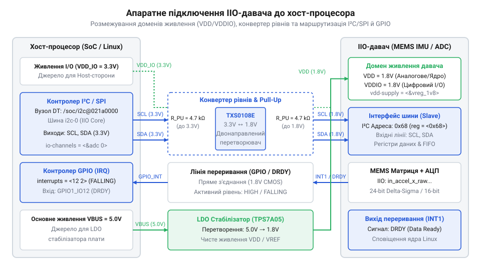
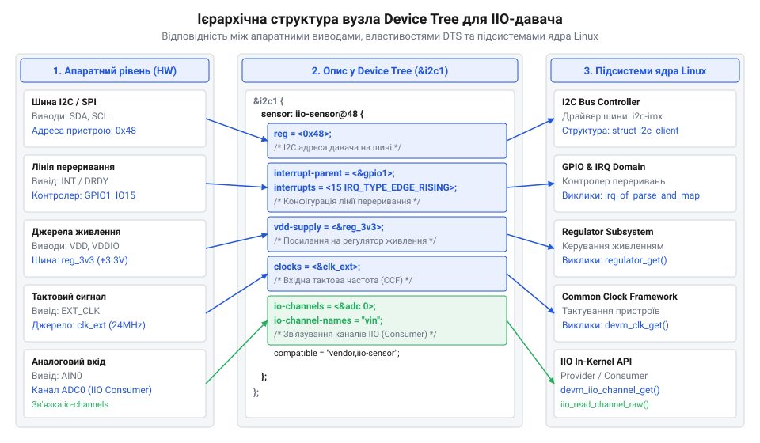

# Залізний інтерфейс та описи Device Tree для приєднань IIO-давачів

<preknowlist>
- [ADXL345 — 3-осьовий цифровий акселерометр](root:cat-hw-sensors/adxl345) — Принципи функціонування цифрового акселерометра з підтримкою двоконтурних шин SPI/I2C та ліній переривань INT1/INT2.
- [GY-521 / MPU-6050 — 6-осьовий IMU (акселерометр+гіроскоп)](root:cat-hw-sensors/mpu6050) — Особливості шинної адресації I2C-давачів та конфігурації допоміжних шин AUX_I2C.
</preknowlist>

## Проблеми невірно підключеного IIO-давача

Під час розробки вбудованих систем на базі @@en|Linux@@ розробники часто стикаються із ситуацією, коли приєднаний цифровий давач не виявляється підсистемою @@en|Industrial I/O@@ (англ. *industrial* — промисловий, *input/output* — ввід-вивід, @@en|IIO@@). У системному журналі @@en|dmesg@@ з'являються повідомлення про помилки зв'язку на шині, як-от `i2c i2c-1: controller timed out` або `adxl345 0-0001: probe of spi0.0 failed with error -22`. Під час виконання процедури @@en|probe@@ (англ. *probe* — зондування, випробування) драйвер ядра намагається вичитати з пристрою регістр ідентифікації чи конфігураційні байти. У разі успішного збігу з описом у таблиці `of_device_id` ядро створює екземпляр `struct iio_dev`. Якщо ж фізичний обмін не відповідає протоколу, драйвер завершує роботу з кодом помилки, а відповідний вузол у файловій системі @@en|sysfs@@ у директорії `/sys/bus/iio/devices/` просто не створюється. Докладний аналіз внутрішньої організації struct iio_dev та механізмів буферизування викладено у статті про [архітектуру підсистеми IIO в ядрі Linux](root:sys-unix/iio-industrial-io-subsystem).

У складніших ситуаціях драйвер ядра ініціалізується успішно, однак пристрій у системі не оновлює показники або взагалі не генерує сповіщень. Застосунок у просторі користувача, який очікує нових даних через потоковий буфер, заблоковується на операції читання. Причина таких несправностей полягає у розриві між фізичною схемотехнікою з'єднання та її формальним описом. З боку заліза давач вимагає точного дотримання електричних рівнів живлення, належного вибору підтягувальних резисторів та коректної конфігурації виходів переривань. З боку ядра @@en|Linux@@ підсистема @@en|IIO@@ потребує точно узгодженої структури @@en|Device Tree@@ (англ. *device* — пристрій, *tree* — дерево). Помилка в описі адреси на шині, некоректний номер лінії @@en|GPIO@@ (англ. *general-purpose input/output* — ввід-вивід загального призначення) або невідповідність полярності активного рівня переривання роблять апаратно працюючий давач повністю недоступним для системи.

## Електричні кола живлення та шин

Сучасні цифрові давачі, такі як [3-осьовий акселерометр ADXL345](root:cat-hw-sensors/adxl345) або [багатокомпонентний модуль MPU-6050](root:cat-hw-sensors/mpu6050), будуються на базі @@en|MEMS@@-структур (англ. *micro-electromechanical systems* — мікроелектромеханічні системи). У таких пристроях застосовуються виокремлені кола живлення: лінія `V_DD` постачає енергію для аналогових вимірювальних схем, а лінія `V_DDIO` живить цифрові буфери шинного інтерфейсу. Розділення доменів живлення дає змогу узгоджувати давач із хост-контролерами, що мають різні напруги цифрової логіки. Подача напруги `V_DDIO = 3.3 В` при прямому підключенні до процесора із логікою `1.8 В` спричиняє протікання паразитного струму через вбудовані захисні діоди виводів, викривлення логічних рівнів і можливе термічне пошкодження портів процесора. При підключенні чутливих сенсорів, де розглядаються [принципи ємнісного вимірювання](root:cat-hw-sensors/mems-capacitive-sensing-principles), додатково вимагається підключення фільтрованої опорної напруги `V_REF` та встановлення блокувальних керамічних конденсаторів ємністю 100 нФ у паралель із керамічними чи танталовими конденсаторами 10 мкФ у безпосередній близькості до виводів живлення давача.

Сигнальні лінії @@en|SDA@@ та @@en|SCL@@ шини @@en|I2C@@ працюють за схемою з @@en|open-drain@@ (англ. *open* — відкритий, *drain* — стік) виходом. Для формування логічної одиниці вони вимагають зовнішніх підтягувальних резисторів @@en|pull-up@@ (англ. *pull* — тягти, *up* — вгору) до шини `V_DDIO`. Величина опору `R_pull` визначає баланс між швидкістю наростання фронту сигналу та енергоспоживанням. Значення `R_pull(min)` обмежене максимально допустимим струмом розряду `I_OL`, а `R_pull(max)` — паразитною ємністю лінії `C_b` та максимальним часом наростання фронту `t_r` для вибраної частоти шини.

**Розрахунок опору підтягувальних резисторів для шини I2C у режимі Fast Mode (400 кГц):**
Умови: напруга `V_DDIO = 3.3 В`, допустимий вихідний рівень `V_OL = 0.4 В`, максимальний струм розряду `I_OL = 3 мА`, допустимий час наростання фронту `t_r = 300 нс`, сумарна паразитна ємність шини `C_b = 150 пФ`.

Обчислення мінімального опору `R_pull(min)`:

R_pull(min) = (V_DDIO - V_OL) / I_OL
            = (3.3 - 0.4) / 0.003       [підстановка електричних параметрів]
            = 2.9 / 0.003
            = 966.67                     [результат у Омах (≈ 967 Ом)]

Обчислення максимального опору `R_pull(max)`:

R_pull(max) = t_r / (0.8473 · C_b)
            = (300 · 10⁻⁹) / (0.8473 · 150 · 10⁻¹²)   [підстановка часу та ємності]
            = (300 · 10⁻⁹) / (127.095 · 10⁻¹²)
            = 2360.44                                 [результат у Омах (≈ 2.36 кОм)]

Обираємо стандартний номінал резистора `R_pull = 2.2 кОм`, який задовольняє нерівність `967 Ом ≤ R_pull ≤ 2.36 кОм`, забезпечуючи чіткі прямокутні імпульси на шині.

Якщо логічні рівні процесора та давача не збігаються, у коло шини встановлюють двонапрямлений конвертер рівнів (@@en|level shifter@@, англ. *level* — рівень, *shifter* — зсувач). На відміну від @@en|I2C@@, шина @@en|SPI@@ використовує двотактні буфери @@en|push-pull@@ (англ. *push* — штовхати, *pull* — тягти) для ліній `SCLK`, `MOSI`, `MISO` та `CS`. Перетворення рівнів для @@en|SPI@@ вимагає застосування активних високошвидкісних мікросхем-перетворювачів, здатних працювати без викривлення фронтів на частотах до 10–20 МГц.


*Принципова схема підключення IIO-давача до системного контролера, яка ілюструє розмежування ліній VDD і VDDIO, розміщення резисторів підтяжки на шині I2C та бінаправлених конвертерів логічних рівнів.*

## Переривання GPIO та тактові сигнали

Регулярне зчитування вимірювань шляхом опитування (@@en|polling@@, англ. *polling* — опитування) регістрів давача через повільну шину створює надмірне навантаження на процесор. Щоб цього уникнути, цифрові давачі оснащуються апаратними виходами переривань, які позначаються як @@en|DRDY@@ (англ. *data ready* — дані готові) або `INT`. Після завершення внутрішнього циклу перетворення давач генерує електричний сигнал на цьому виводі, сповіщаючи хост-контролер про наявність свіжої вибірки в буфері.

Апаратна конфігурація виводу переривання може бути реалізована у двох варіантах:
1. @@en|push-pull@@ активного високого чи низького рівня, де давач активним током перемикає потенціал між `V_DDIO` та `GND`. 2. @@en|open-drain@@ активного низького рівня, що дозволяє об'єднувати лінії переривань від кількох пристроїв (наприклад, коли підключається [компас HMC5883L](root:cat-hw-sensors/hmc5883l) або [інерційні модулі Pololu](root:cat-hw-sensors/pololu-imu)) на один вивід @@en|GPIO@@ із спільним підтягувальним резистором.

Узгодження типу спрацьовування між давачем та драйвером ядра є критичним. Зчитування за імпульсним фронтом (@@en|edge-triggered@@) може пропустити факт готовності даних, якщо тривалість імпульсу менша за період опитування вхідного порту @@en|GPIO@@. При конфігурації за рівнем (@@en|level-triggered@@) драйвер ядра повинен реалізувати обробник, який перед зняттям маски переривання виконує читання стану давача через шину зв'язку для скидання апаратного прапорця `INT`. Якщо цього не зробити, активний рівень на лінії утримуватиметься давачем далі, викликаючи безперервний шторм переривань і блокуючи процесорне ядро. У структурі @@en|Device Tree@@ вивід переривання зв'язується через атрибути `interrupt-parent` та `interrupts`, де вказується номер фізичного виводу та режим тригера.

Для забезпечення високої точності часових позначок (@@en|timestamps@@) та синхронізації вибірок внутрішній генератор давача може замінюватися зовнішнім тактовим сигналом. Вбудовані RC-генератори мають температурний дрейф частоти до ±5%, що неприпустимо для алгоритмів орієнтації та навігації. Подача стабільного тактового сигналу на вхід `CLKIN` від системного генератора або кварцового резонатора дозволяє фіксувати інтервали дискретизації з мікросекундною точністю. Інформація про джерело тактування передається драйверу ядра через специфікатор `clocks` у структурі @@en|Device Tree@@.

## Опис IIO-пристрою в Device Tree

Драйвери підсистеми @@en|IIO@@ в ядрі @@en|Linux@@ не виконують ручного сканування шин; замість цього ініціалізація екземпляра пристрою відбувається на основі декларативного опису в @@en|Device Tree@@. Специфікація @@en|Device Tree Bindings@@ визначає набір стандартних та специфічних властивостей, які описують фізичне підключення компонента. Правила складання апаратних специфікацій YAML та dts-файлів детально описано у статті про [синтаксис специфікацій Device Tree Bindings](root:sys-unix/device-tree).

До обов'язкових властивостей вузла @@en|IIO@@-давача належать:
- `compatible`: текстовий ідентифікатор обладнання, який драйвер використовує для пошуку відповідного табличного запису `of_device_id` (наприклад, `"adi,adxl345"` або `"invensense,mpu6050"`). - `reg`: адреса пристрою на шині @@en|I2C@@ (наприклад, `0x53` або `0x68`) або номер лінії вибору чипа `CS` для шини @@en|SPI@@. - `interrupt-parent`: дескриптор @@en|phandle@@ (англ. *pointer handle* — вказівний дескриптор), який вказує на вузол контролера переривань, що обробляє сигнальну лінію. - `interrupts`: специфікатор переривання, який містить номер виводу @@en|GPIO@@ та константу режиму генерації (наприклад, `IRQ_TYPE_LEVEL_HIGH` або `IRQ_TYPE_EDGE_RISING`). - `vdd-supply` та `vddio-supply`: посилання @@en|phandle@@ на вузли підсистеми @@en|regulator@@, які забезпечують подачу живлення на аналоговий та цифровий домени. - `clocks` та `clock-names`: посилання на постачальника тактового сигналу та його функціональну назву у драйвері. - `spi-max-frequency`: гранична частота тактування шини (наприклад, `10000000` для 10 МГц), якщо давач підключається через @@en|SPI@@.


*Структурна схема вузла Device Tree IIO-давача, що демонструє граф зв'язків між властивостями reg, interrupts, vdd-supply, clocks та відповідними контролерами ядра Linux.*

Нижче наведено приклад опису вузла цифрового акселерометра в файлі структури дерева пристроїв (`.dts`):

```dts
&i2c1 {
    status = "okay";
    clock-frequency = <400000>;

    accelerometer@53 {
        compatible = "adi,adxl345";
        reg = <0x53>;

        interrupt-parent = <&gpio2>;
        interrupts = <12 IRQ_TYPE_LEVEL_HIGH>;

        vdd-supply = <&reg_3v3>;
        vddio-supply = <&reg_1v8>;

        clocks = <&ext_osc>;
        clock-names = "clkin";
    };
};
```

Під час процедури завантаження ядро звертається до підсистеми регуляторів живлення для увімкнення ліній `reg_3v3` та `reg_1v8`, запитує конфігурацію відповідного виводу в контролері @@en|GPIO@@, налаштовує переривання та викликає функцію ініціалізації @@en|probe@@ відповідного IIO-драйвера.

## Механізм io-channels та діагностика підключення

Окрім прямого експорту вимірювальних каналів у простір користувача через атрибути `sysfs`, підсистема @@en|IIO@@ забезпечує міждрайверний механізм обміну даними через специфікацію @@en|io-channels@@. Це дає змогу іншим компонентам ядра (наприклад, драйверам теплового моніторингу, регуляторам живлення або підсистемі керування батареєю) отримувати дані від IIO-давачів без прямого звернення до шин зв'язку.

Вузол давача (провайдер даних) оголошує властивість `#io-channel-cells = <1>;`, вказуючи кількість операндів для адресації конкретного аналогового чи цифрового каналу. Вузол-споживач посилається на провайдера за допомогою властивості `io-channels`:

```dts
&i2c1 {
    adc_sensor: sensor@48 {
        compatible = "ti,ads1015";
        reg = <0x48>;
        #io-channel-cells = <1>;
    };
};

thermal_management {
    compatible = "custom,thermal-monitor";
    io-channels = <&adc_sensor 0>, <&adc_sensor 1>;
    io-channel-names = "cpu_temp", "ambient_temp";
};
```

При виявленні збоїв ініціалізації чи відсутності даних від IIO-пристрою діагностику здійснюють за послідовним алгоритмом:

1. **Аналіз логів ядра:** Команда `dmesg | grep -i iio` дає змогу виявити помилки `EPROBE_DEFER` (очікування готовності регуляторів живлення чи тактування) або повідомлення про невдалу зчитку ідентифікатора пристрою (`WHO_AM_I`). 2. **Апаратна перевірка шини:** Для шини @@en|I2C@@ виконують сканування за допомогою утиліти `i2cdetect -y -r <bus_number>`. Якщо пристрій не відповідає за адресою `reg`, необхідно перевірити наявність напруг `V_DD` і `V_DDIO` мультиметром, а також стан підтягувальних резисторів та лінії скидання `RESET`. 3. **Інспекція структури sysfs:** У разі успішної реєстрації у директорії `/sys/bus/iio/devices/iio:deviceX/` з'являються файли вимірювань (наприклад, `in_accel_x_raw`, `scale`). Зчитавши значення командою `cat in_accel_x_raw` та помноживши на `in_accel_x_scale`, переконуються у коректності роботи перетворювача. 4. **Перевірка тракту переривань:** Перегляд вмісту `/proc/interrupts` дає змогу відстежувати лічильник подій на відповідній лінії @@en|GPIO@@. Якщо при фізичному зміщенні давача лічильник не зростає, причина полягає у некоректному налаштуванні полярності переривання у @@en|Device Tree@@ або у помилковій конфігурації мультиплексування виводів (@@en|pinmux@@, англ. *pin multiplexing* — мультиплексування виводів) процесора.