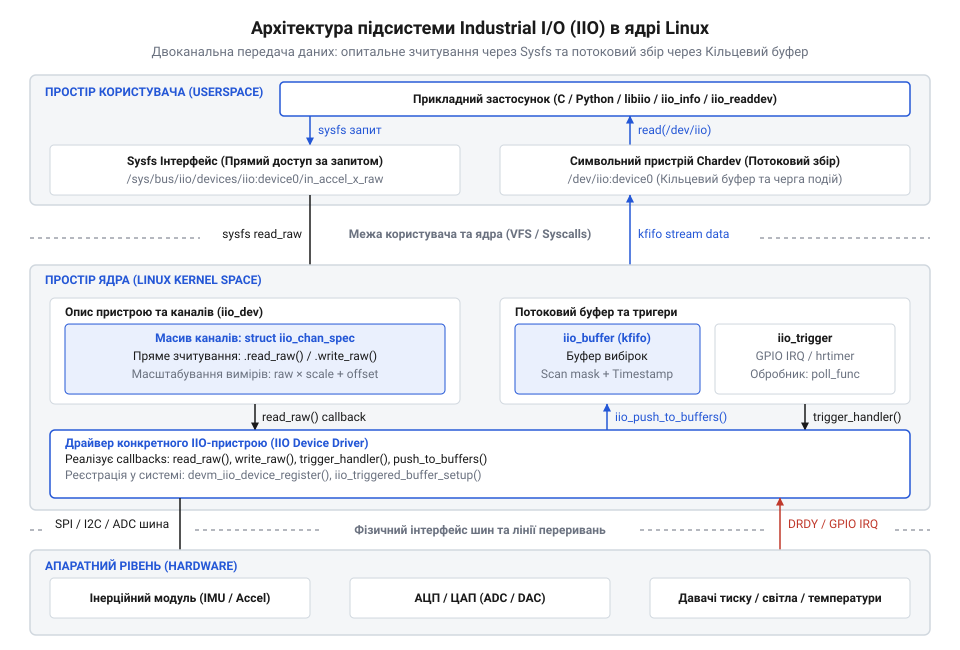
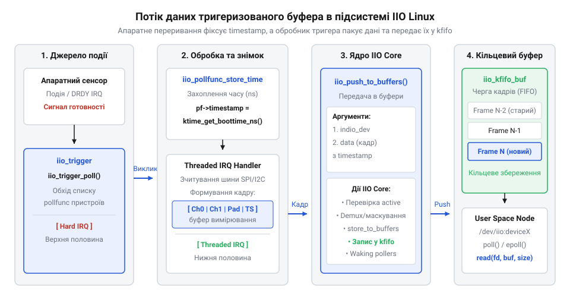

# C API підсистеми IIO в ядрі Linux для розробників драйверів

<preknowlist>
- [GY-521 / MPU-6050 — 6-осьовий IMU (акселерометр+гіроскоп)](root:cat-hw-sensors/mpu6050) — розуміння регістрової карти та структури даних багатоосьового MEMS-сенсора з апаратною буферизацією
- [ADXL345 — 3-осьовий цифровий акселерометр](root:cat-hw-sensors/adxl345) — принципи роботи цифрових інтерфейсів вимірювання, конфігурації діапазонів та генерації переривань
</preknowlist>

## Хаос прямого розбору та архітектура IIO

Розробка драйвера для сучасного сенсора — наприклад, [багатоосьового MEMS-сенсора MPU-6050](root:cat-hw-sensors/mpu6050) — без єдиного системного каркаса неминуче призводить до архітектурного хаосу. Якщо кожен розробник власноруч створює довільні файли у системній файловій системі sysfs (від англ. @@en|system file system@@ — системна файлова система) або вигадує власні символьні пристрої, користувацький простір позбавляється уніфікованого інтерфейсу. Один драйвер віддає прискорення у мілі-g, інший — у raw-відліках аналогово-цифрового перетворювача (від англ. @@en|ADC@@ — analog-to-digital converter), а третій узагалі вимагає специфічних ioctl-викликів. Крім того, при прямому опитуванні регістрів без централізованої синхронізації виникають небезпечні стани гонитви (від англ. @@en|race condition@@), коли декілька процесів користувацького простору паралельно зчитують і змінюють налаштування шини.

Для вирішення цих проблем у ядрі Linux було створено спеціалізовану підсистему IIO (від англ. @@en|Industrial Input/Output@@ — промисловий ввід-вивід). Підсистема @@en|IIO@@ надає чітку абстракцію для давачів прискорення, кутових швидкостей, магнітного поля, температури, тиску та освітленості. Центральним елементом цієї абстракції є структура @@en|iio_dev@@ (`struct iio_dev`), яка уособлює фізичний або віртуальний вимірювальний пристрій у ядрі. Вона об'єднує опис каналів, таблицю зворотних викликів, прив'язку до шини, а також внутрішні механізми буферизації та генерації подій.


*Архітектура підсистеми IIO зв'язує файловий інтерфейс користувацького простору з драйвером пристрою через єдину структуру iio_dev.*

Для створення структури @@en|iio_dev@@ та виділення пам'яті під приватний контекст драйвера використовується керована функція `devm_iio_device_alloc()`. Вона інтегрована в механізм devres (від англ. @@en|device resource management@@ — керування ресурсами пристрою), що гарантує автоматичне звільнення пам'яті при відвантаженні драйвера або виникненні помилок ініціалізації:

:::code api-iio-kernel-driver-interface/c/my-sensor-state.c

Виклик `iio_priv(indio_dev)` повертає вказівник на область пам'яті приватного стану `struct my_sensor_state`, яка розміщується безпосередньо за структурою @@en|iio_dev@@ у єдиному неперервному блоці пам'яті. Це виключає додаткові виклики аллокатора та запобігає фрагментації пам'яті ядра. Поряд із виділенням пам'яті драйвер обов'язково налаштовує бітову маску `indio_dev->modes`, що вказує підсистемі @@en|IIO@@ на підтримувані режими роботи пристрою. Режим `INDIO_DIRECT_MODE` дозволяє пряме опитування через системну файлову систему, коли кожен запит користувацького простору ініціює поодиноке зчитування регістрів давача. Для безперервної передачі даних використовується `INDIO_BUFFER_TRIGGERED`, де наповнення кільцевого буфера відбувається за сигналом апаратного або програмного тригера. Альтернативний режим `INDIO_BUFFER_SOFTWARE` відповідає за програмне заповнення буфера без залучення зовнішнього тригерного механізму. Перевірка маски `indio_dev->modes` під час системних викликів дозволяє підсистемі ядра блокувати непідтримувані операції й запобігати спробам запуску буферизації на пристроях без відповідної реалізації.

## Опис каналів вимірювання через iio_chan_spec

Після виділення структури пристрою драйвер має повідомити ядру про фізичні характеристики наявних сенсорних каналів. Для цього використовується масив структур @@en|iio_chan_spec@@ (`struct iio_chan_spec`). Кожен елемент масиву описує окремий канал вимірювання — наприклад, ось прискорення, кутову швидкість або температуру.

Головними полями структури @@en|iio_chan_spec@@ є:
- `type`: тип вимірювання з переліку `enum iio_chan_type` (наприклад, `IIO_ACCEL`, `IIO_ANGL_VEL`, `IIO_MAGN`, `IIO_TEMP`). - `modified`: прапор, що вказує на наявність модифікатора осі або напрямку (`1` для багатоосьових каналів). - `channel2`: модифікатор осі з переліку `enum iio_modifier` (`IIO_MOD_X`, `IIO_MOD_Y`, `IIO_MOD_Z`). - `address`: адреса регістру чи внутрішній індекс, який використовується драйвером при зчитуванні. - `scan_index`: порядковий номер каналу в кадрі буферизованого зчитування (-1, якщо канал не підтримує буферизацію). - `scan_type`: структура опису розрядності та пакування бітів для буфера (знаковість `sign`, реальна розрядність `realbits`, обсяг зберігання `storagebits`, зсув `shift` та порядок байтів `endianness`).

Для автоматичного формування атрибутів файлової системи @@en|sysfs@@ підсистема @@en|IIO@@ використовує бітові маски:
- `info_mask_separate`: створює атрибути, унікальні для конкретного каналу (наприклад, `BIT(IIO_CHAN_INFO_RAW)` генерує файли `in_accel_x_raw`, `in_accel_y_raw`, `in_accel_z_raw`). - `info_mask_shared_by_type`: створює атрибути, спільні для всіх каналів одного типу (наприклад, `BIT(IIO_CHAN_INFO_SCALE)` генерує єдиний файл `in_accel_scale` для всіх осей прискорення). - `info_mask_shared_by_all`: створює атрибути, спільні для всіх каналів пристрою незалежно від типу (наприклад, частота дискретизації `in_sampling_frequency`).

Водночас для буферизованого потокового читання текстових масок @@en|sysfs@@ недостатньо: підсистема ядра має знати точну бінарну структуру кадру в пам'яті. Для цього поля структури `scan_type` визначають фізичне пакування вимірювань: `realbits` вказує на розрядність АЦП сенсора, `storagebits` визначає розмір осередку в пам'яті (8, 16, 32 або 64 біти), а `shift` задає зсув значущих бітів усередині осередку. Якщо розрядність АЦП менша за розмір осередку, правильно обрані `storagebits` та `shift` забезпечують вирівнювання в пам'яті (англ. *alignment*, від *line* — лінія). Помилка в цих параметрах призводить до зсуву байтового потоку під час роботи [з цифровими акселерометрами](root:cat-hw-sensors/adxl345) або до критичних помилок невирівняного доступу на ARM-процесорах. Для фіксації точного часу вимірювань використовується макрос `IIO_CHAN_SOFT_TIMESTAMP(scan_index)`, який додає в кінець кадру канал часової позначки — таймштампа (англ. *timestamp*, від *time* — час і *stamp* — відбиток) `IIO_TIMESTAMP`. Цей макрос автоматично задає `realbits` і `storagebits` рівними 64 бітам, що гарантує суворе 8-байтове вирівнювання 64-бітного значення системного часу в буфері без псування даних сусідніх каналів.

Використання @@en|iio_chan_spec@@ при розробці драйверів для [цифрового акселерометра ADXL345](root:cat-hw-sensors/adxl345) або [цифрового компаса HMC5883L](root:cat-hw-sensors/hmc5883l) повністю усуває потребу ручного виклику `sysfs_create_group()` та ручного парсингу текстових файлів. Для докладного ознайомлення з іменуванням та форматом створених системних файлів перегляньте [ABI підсистеми IIO у просторі користувача](root:cat-hw-sensors/iio-subsystem-linux-kernel/api-iio-userspace-libiio-abi.md).

Нижче наведено приклад декларації масиву каналів для 3-осьового акселерометра та термометра:

:::code api-iio-kernel-driver-interface/c/iio-chan-spec.c

## Методи зворотного виклику структури iio_info

Автоматично сформовані атрибути @@en|sysfs@@ потребують відповідних функцій-обробників для виконання операцій зчитування та запису. Зв'язуючим прошарком між системними викликами та кодом драйвера є структура @@en|iio_info@@ (`struct iio_info`), яка містить вказівники на зворотні виклики (від англ. @@en|callback@@ — зворотний виклик).

Основними методами структури @@en|iio_info@@ є:
- `read_raw`: викликається при зчитуванні атрибутів (raw-значень, масштабу, зсуву). - `write_raw`: викликається при зміні атрибутів з користувацького простору (наприклад, конфігурації діапазону вимірювання).

Для передачі дробових та фіксованих чисел без використання обчислень із плаваючою крапкою в ядрі метод `read_raw` повертає два цілих значення `*val` та `*val2`, а тип поверненого значення визначає математичний формат їх інтерпретації:
- `IIO_VAL_INT`: результатом є `*val`. - `IIO_VAL_INT_PLUS_MICRO`: результатом є `*val + *val2 / 1000000`. - `IIO_VAL_FRACTIONAL`: результатом є `*val / *val2`. - `IIO_VAL_FRACTIONAL_LOG2`: результатом є `*val / (2^val2)`.

Для переведення сирих даних сенсора у фізичні одиниці системи SI використовується уніфікована формула підсистеми @@en|IIO@@:

```
val_physical = (val_raw + offset) × scale
```

Згідно зі стандартом @@en|IIO@@, прискорення вимірюється у м/с², кутова швидкість — у рад/с, а температура — у міліградусах Цельсія.

При реалізації методів `read_raw` та `write_raw` критично важливо забезпечити синхронізацію доступу до апаратних регістрів чипів на шині I2C або SPI. Для цього у приватному контексті драйвера використовується м'ютекс (від англ. @@en|mutual exclusion@@ — взаємне виключення).

:::code api-iio-kernel-driver-interface/c/iio-chan-spec-2.c

## Тригери та кільцеві буфери IIO

Поодиноке опитування (від англ. @@en|polling@@ — періодичне опитування) через файли @@en|sysfs@@ не здатне забезпечити високу частоту та детермінованість часових позначок для динамічних сенсорних даних. Для задач орієнтації та навігації потрібен високочастотний потік даних із точним прив'язуванням до часу.

Підсистема @@en|IIO@@ вирішує це завдання за допомогою тригерів та кільцевих буферів (від англ. @@en|ring buffer@@ — кільцевий буфер). Тригер (від англ. @@en|trigger@@ — пусковий механізм) — це джерело подій (апаратне переривання DRDY або системний таймер), яке ініціює захоплення кадру вимірювань.


*Потік даних тригеризованого буфера забезпечує точну фіксацію моментів вимірювання та передачу пакетів із мінімальними накладними витратами ядра.*

Для налаштування буферизованого вводу-виводу використовується керована функція `devm_iio_triggered_buffer_setup()`. Вона реєструє обробник переривання, який формує кадр вимірювань, додає монотонну часову позначку високої точності за допомогою `ktime_get_boottime_ns()` або `iio_get_time_ns()` та відправляє кадр у буфер викликом `iio_push_to_buffers()`:

:::code api-iio-kernel-driver-interface/c/iio-poll-func.c

Дані з кільцевого буфера вичитуються користувацьким простором як бінарний потік через відповідний символьний пристрій `/dev/iio:device0`, що забезпечує мінімальні накладні витрати ядра на перемикання контексту.

## Життєвий цикл та реєстрація пристрою

Конфігурація каналів, обробників @@en|iio_info@@ та тригеризованих буферів завершується зв'язуванням драйвера з шиною та реєстрацією в підсистемі @@en|IIO@@. Усі кроки ініціалізації виконуються у функції `probe()` шинного драйвера (наприклад, I2C або SPI).

Використання керованого виклику `devm_iio_device_register()` гарантує, що пристрій буде зареєстровано в системі та зроблено доступним для користувацьких процесів лише після завершення налаштування всіх внутрішніх ресурсів:

:::code api-iio-kernel-driver-interface/c/iio-dev.c

Завдяки механізму @@en|devres@@ скасування реєстрації та вивільнення ресурсів при видаленні пристрою відбуваються в зворотному порядку автоматично. Це запобігає витокам пам'яті, спробам подвійного звільнення та стану гонитви при вивантаженні модуля ядра.