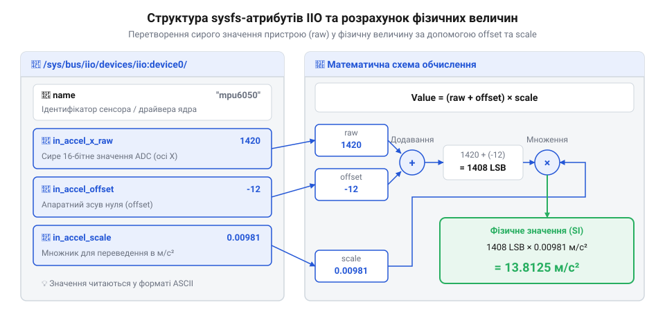
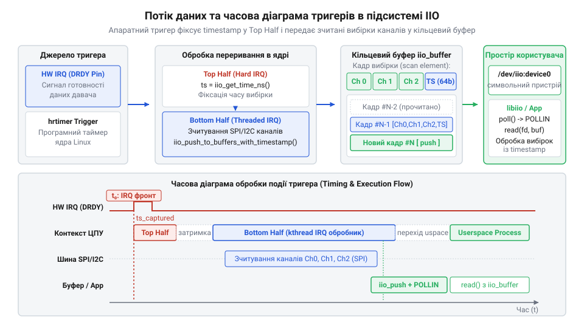

# Інтерфейс простору користувача: sysfs, /dev/iio:deviceX та C-бібліотека libiio

<preknowlist>
- [GY-521 / MPU-6050 — 6-осьовий IMU (акселерометр+гіроскоп)](root:cat-hw-sensors/mpu6050) — розуміння фізичних вимірювальних каналів та потреби синхронізованої зйомки багатовісьових даних
- [ADXL345 — 3-осьовий цифровий акселерометр](root:cat-hw-sensors/adxl345) — принципи конфігурації вихідної частоти дискретизації та апаратних діапазонів вимірювання
</preknowlist>

## Обмеження прямих викликів і вихід

Спроба зчитувати дані інерційних давачів у користувацькому просторі операційної системи Linux шляхом прямого опитування вимірювальних регістрів через пристрої `/dev/i2c-X` або `/dev/spidevX.Y` швидко наражається на непереборні архітектурні обмеження. Кожна операція обміну вимагає переключення контексту між простором користувача та ядром через системні виклики `@@en|ioctl@@` або `@@en|read@@`. Коли прикладний додаток опитує багатовісьовий модуль, такий як [шестиосьовий модуль MPU-6050](root:cat-hw-sensors/mpu6050) або [цифровий акселерометр ADXL345](root:cat-hw-sensors/adxl345), зі значеннями частоти дискретизації у сотні або тисячі герц, накладні витрати на обробку окремих системних викликів виснажують обчислювальні ресурси процесора.

Окрім високого навантаження на процесор, пряме точкове опитування через інтерфейси вихідних шин спричиняє часове тремтіння (англ. *@@en|jitter@@* — десинхронізація моментів вимірювання). Операційна система загального призначення не гарантує суворих часових меж виконання користувацьких потоків. Затримки планувальника завдань призводять до того, що вибірки акселерометра та гіроскопа зчитуються з нерівномірними інтервалами, що спотворює результати подальшого цифрового фільтрування та інтегрування орієнтації в просторі. Більше того, зчитування окремих осей вимірювань послідовними командами позбавляє пакет атомарності: перша вісь може відповідати одному моменту часу, а остання — вже наступній вибірці апаратного давача.

Другою фундаментальною проблемою є відсутність уніфікованого формату даних. Кожен виробник мікросхем використовує власну розрядність, порядок байтів (англ. *@@en|endianness@@* — порядок розміщення байтів у пам'яті), додатковий код для від'ємних чисел та унікальні множники перетворення сирих двійкових значень у фізичні одиниці (м/с², рад/с, Паскалі). Без єдиного системного шару абстракції кожна програма змушена містити низькорівневий драйвер для кожного конкретного чипа.

Для розв'язання цих проблем у ядрі Linux було створено підсистему @@en|Industrial I/O@@ (@@en|IIO@@). Вона надає єдину архітектуру @@en|Application Binary Interface@@ (від англ. *@@en|interface@@* — межа взаємодії, далі @@en|ABI@@) для аналого-цифрових перетворювачів, інерційних модулів, датчиків тиску, магнетометрів та світла. Архітектурно підсистема @@en|IIO@@ створює шар абстракції між драйверами обладнання та простором користувача: драйвер ядра бере на себе низькорівневу взаємодію з шинами @@en|I2C@@ або @@en|SPI@@, транзакції обміну регістровими даними та обробку апаратних переривань. Під час ініціалізації чипа ядро зв'язує цей драйвер із системними інтерфейсами, автоматично створюючи дві уніфіковані моделі доступу для прикладного софту:
1. Точковий доступ через файлову систему `@@en|sysfs@@` (від англ. *@@en|system file system@@* — системна файлова система), де в каталозі `/sys/bus/iio/devices/iio:deviceX/` генеруються текстові атрибути для зчитування статичних налаштувань, коефіцієнтів та поодиноких вимірювань. 2. Потокова передача через спеціалізований символьний пристрій `@@en|character device@@` у файловій системі пристроїв `@@en|devtmpfs@@` (від англ. *@@en|device temporary file system@@* — тимчасова файлова система пристроїв, що транслюється сервісом `@@en|udev@@` у вузол `/dev/iio:deviceX`) із підтримкою кільцевих буферів ядра та часових міток апаратних або програмних тригерів.

## Точковий доступ через файли sysfs

У підсистемі @@en|IIO@@ кожен фізичний давач або вимірювальний канал представляється окремим каталогом у віртуальній файловій системі за шляхом `/sys/bus/iio/devices/iio:deviceX/`, де `X` — порядковий номер екземпляра пристрою в системі. За цим шляхом ядро експортує текстові атрибути, які описують поточний стан апаратури, доступні діапазони та сирі виміряні значення.

Назви атрибутів відповідають суворому стандарту найменування: `in_[тип]_[вісь]_[атрибут]`. Наприклад, для триосьового акселерометра атрибут `in_accel_x_raw` містить поточне сире ціле значення вимірювання вздовж осі X, а атрибут `in_anglvel_z_raw` описує кутову швидкість навколо осі Z для гіроскопа. Окрім сирих даних `raw`, ядро експортує коефіцієнти математичного перетворення — `scale` (масштаб) та `offset` (зсув).

Переведення сирого двійкового коду з регістру давача у фізичну величину стандартними одиницями SI виконується за єдиною математичною формулою:

```
value_phys = (value_raw + offset) × scale
```

Тут `value_raw` — ціле число, зчитане з атрибута `raw`; `offset` — значення зсуву нульової точки, яке додається до сирого показника до множення; `scale` — дробовий коефіцієнт масштабування. Результат `value_phys` отримується безпосередньо у стандартних одиницях: метри за секунду в квадраті (м/с²) для прискорення, радіани за секунду (рад/с) для кутової швидкості або Міліцельсії/Кельвіни для температури.


*Ієрархічна структура файлів атрибутів у sysfs та послідовність застосування зсуву й масштабування.*

Для читання параметрів через `@@en|sysfs@@` прикладний додаток відкриває відповідні файли як звичайні текстові джерела та зчитує з них строки.

:::tabs
@tab C
:::code api-iio-userspace-libiio-abi/c/read-sysfs-double.c
@tab C++
:::code api-iio-userspace-libiio-abi/cpp/read-sysfs-value.cpp
:::

Хоча `@@en|sysfs@@` надає просту та прозору методику інспектування параметрів давача, точкове зчитування текстових атрибутів має суттєві вади. Перетворення числових даних у текстовий формат ASCII у ядрі та зворотний парсинг `@@en|strtod@@` у програмі створює марнотратні накладні витрати CPU. Крім того, читання кожного файла через окремі виклики `open()` та `read()` позбавлене синхронності: між читанням осі X та осі Y давач може оновити свій внутрішній регістр, що неприпустимо для алгоритмів обробки інерційної інформації.

## Потокова передача через символьний пристрій

Для передачі масивів вимірювань з високою частотою підсистема @@en|IIO@@ використовує потоковий режим через файли символьних пристроїв `/dev/iio:deviceX`. Цей механізм базується на кільцевому буфері ядра (англ. *@@en|ring buffer@@* — циклічна структура даних у пам'яті ядра) та концепції тригерів (англ. *@@en|trigger@@* — подія, що ініціює захоплення вибірки).


*Потік вибірок від апаратного переривання давача через тригер і кільцевий буфер ядра до користувацького символьного пристрою.*

Джерелом тригера може слугувати апаратна лінія переривання давача (наприклад, сигнал готовності даних `DRDY` від [акселерометра ADXL345](root:cat-hw-sensors/adxl345)), системний таймер високої точності `@@en|hrtimer@@` або програмний запис у файли `@@en|sysfs-trig@@`. При спрацюванні тригера ядро атомарно зчитує вибрані канали давача, формує бінарний пакет вибірки (англ. *@@en|scan element@@*) і вміщує його в кільцевий буфер.

Конфігурація потоку здійснюється в каталозі `scan_elements/`:
1. Увімкнення необхідних каналів записом `1` у файли `in_accel_x_en`, `in_accel_y_en`, `in_accel_z_en` та `in_timestamp_en`. 2. Перевірка формату упакування каналу через файли `in_accel_x_type`. Формат передається строкою вигляду `le:s16/32>>0`, що означає: `le` — `@@en|little-endian@@` (молодшим байтом вперед), `s16` — знакова 16-бітна величина, `32` — канал займає 32 біти у вибірці (з вирівнюванням та заповненням), `>>0` — зсув бітів. 3. Налаштування розміру кільцевого буфера через `/sys/bus/iio/devices/iio:deviceX/buffer/length` (наприклад, 1024 вибірки). 4. Активація буфера записом `1` у `/sys/bus/iio/devices/iio:deviceX/buffer/enable`.

Після активації буфера користувацька програма відкриває файл символьного пристрою `/dev/iio:deviceX` системним викликом `open()` та здійснює бінарне читання викликом `@@en|read@@`. Кожен прочитаний блок містить упаковану структуру вибірки, де після вимірювальних каналів розташовується 64-бітний часовий штамп `timestamp` в наносекундах (`@@en|s64@@`).

:::tabs
@tab C
:::code api-iio-userspace-libiio-abi/c/--attribute--.c
@tab C++
:::code api-iio-userspace-libiio-abi/cpp/alignas.cpp
:::

## Робота з абстракціями бібліотеки libiio

Ручне конфігурування `@@en|sysfs@@` та розбір вирівнювання байтів у символьному пристрої є трудомістким завданням. Для спрощення розробки розроблено офіційну C-бібліотеку `@@en|libiio@@` (від англ. *@@en|library@@* — бібліотека та *@@en|Industrial I/O@@*). Бібліотека повністю приховує низькорівневі системні виклики `open()`, `read()`, `@@en|ioctl@@` та ручне розбирання текстових атрибутів, пропонуючи зручний програмний інтерфейс.

Основою `@@en|libiio@@` є концепція контексту (англ. *@@en|context@@* — об'єкт, що описує сесію зв'язку з IIO-підсистемою, від лат. *@@en|contextus@@* — сплетіння, зв'язок). Бібліотека дозволяє працювати не лише з локальними давачами ядра (`iio_create_default_context()`), але й віддалено мережею через демона `@@en|iiod@@` (`iio_create_network_context("192.168.1.50")`) або через USB-інтерфейс.

Основні кроки роботи з `@@en|libiio@@`:
1. Створення контексту та пошук цільового пристрою за допомогою `iio_context_find_device()`. 2. Отримання вказівників на вимірювальні канали через `iio_device_find_channel()`. 3. Активація потрібних каналів функцією `iio_channel_enable()`. 4. Створення потокового буфера пам'яті викликом `iio_device_create_buffer()`. 5. Поповнення буфера новими порціями пакетів через `iio_buffer_refill()`. 6. Витягування даних з буфера функціями `iio_channel_read()` або через прямий доступ до вказівника вибірки `iio_buffer_start()`.

:::tabs
@tab C
:::code api-iio-userspace-libiio-abi/c/iio-context.c
@tab C++
:::code api-iio-userspace-libiio-abi/cpp/iiocontextwrapper.cpp
:::

## Обробка помилок та синхронізація потоків

При розробці високонадійних програм реального часу необхідно враховувати можливість апаратних збоїв та переповнення кільцевих буферів ядра.

У блокуючому режимі системний виклик `@@en|read@@` або функція `iio_buffer_refill()` зупиняють виконання потоку розробника до появи запитаної кількості вибірок. Для запобігання зависанню основного потоку додатка символьний пристрій відкривають із прапором `O_NONBLOCK` або налаштовують неблокуючий режим у `@@en|libiio@@` за допомогою `iio_buffer_set_blocking(buf, false)`.

При роботі в режимі `@@en|non-blocking I/O@@` необхідно коректно обробляти наступні системні коди помилок:
- `EAGAIN` або `EWOULDBLOCK`: у буфері ядра наразі немає нових готових вибірок. Потік повинен перейти до перевірки готовності файла через системні виклики `select()` або `poll()`. - `EINTR`: переривання системного виклику сигналом. Виклик необхідно повторити. - `ENOSPC` або подія переповнення (англ. *@@en|overflow@@* / *@@en|overrun@@*): швидкість зчитування додатка нижча за частоту генерації вибірок давачем. Буфер ядра заповнився, і нові вибірки втрачено.

Для виявлення фактів втрати вибірок прикладний код повинен аналізувати часові штампи послідовних пакетів даних. Якщо різниця між штампами суттєво перевищує номінальний період дискретизації, це свідчить про пропущені пакети внаслідок системної затримки або переповнення буфера.

:::tabs
@tab C
:::code api-iio-userspace-libiio-abi/c/sample-packet.c
@tab C++
:::code api-iio-userspace-libiio-abi/cpp/sampledata.cpp
:::

Для підтримки високої частоти дискретизації рекомендується відокремлювати потік зчитування даних із буфера `@@en|IIO@@` від потоків цифрової обробки, фільтрації Калмана чи візуалізації. Зчитувальний потік підтримує найвищий пріоритет реального часу `@@en|SCHED_FIFO@@` та вміщує вибірки в безблокуючу кільцеву чергу (англ. *@@en|lockless ring buffer@@*), з якої робітники обробки споживають дані без блокування символьного пристрою ядра.