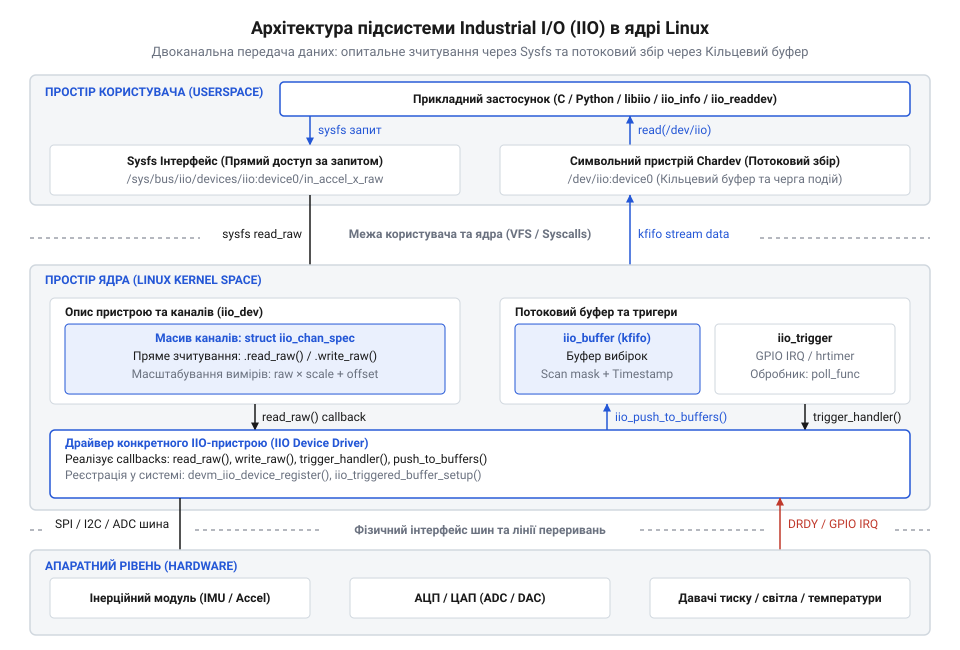
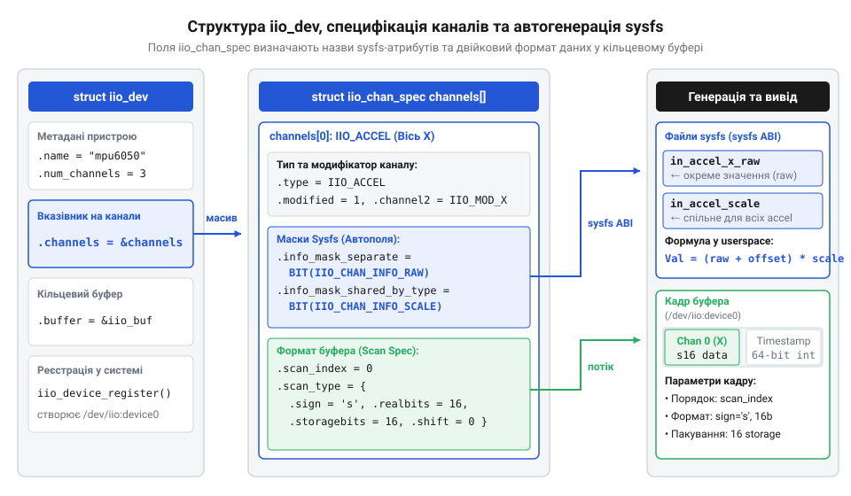
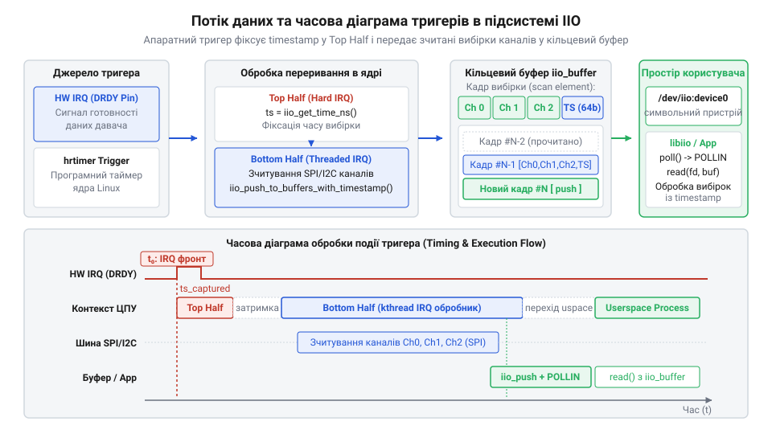
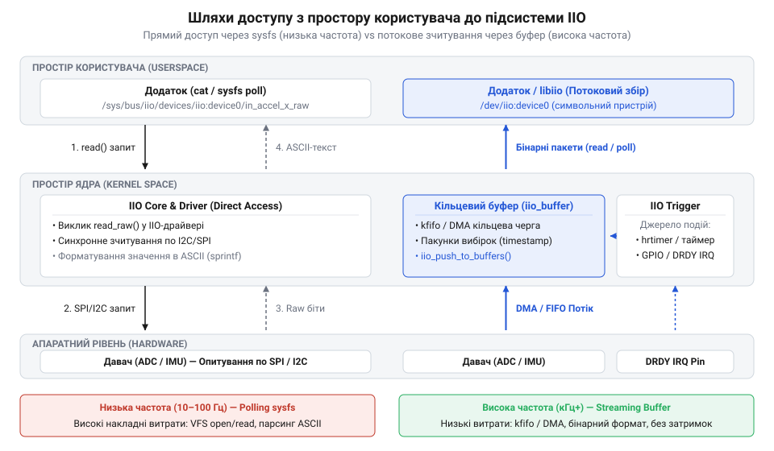
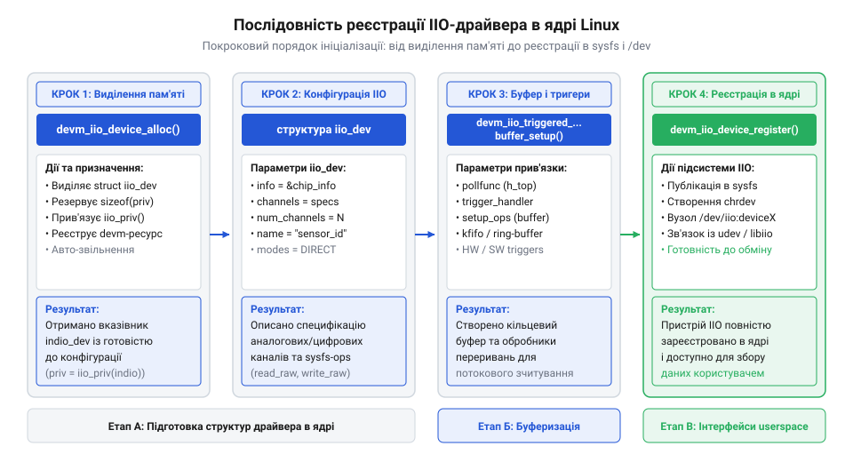

# Підсистема Industrial I/O (IIO) в ядрі Linux

<preknowlist>
- [GY-521 / MPU-6050 — 6-осьовий IMU (акселерометр+гіроскоп)](root:cat-hw-sensors/mpu6050) — апаратна структура MEMS-давачів, регістри вимірів та зчитування даних через шину I2C.
- [ADXL345 — 3-осьовий цифровий акселерометр](root:cat-hw-sensors/adxl345) — використання розрізнення каналів, конфігурація діапазонів та апаратні переривання давача.
</preknowlist>

## Проблема фрагментації давачів та поява IIO

Стрімкий розвиток вбудованих систем, робототехніки та мобільних пристроїв висунув жорсткі вимоги до збору даних з різноманітних первинних перетворювачів: акселерометрів, гіроскопів, магнетометрів, давачів тиску, температури, а також аналогово-цифрових (@@en|ADC@@) та цифро-аналогових (@@en|DAC@@) перетворювачів. Однак в операційній системі @@en|Linux@@ довготривалий час узагалі не існувало єдиної підсистеми для роботи з подібним обладнанням. У результаті кожен виробник мікросхем створював власні кустарні драйвери ядра, вигадуючи власні інтерфейси зв'язку з прикладною програмою через нестандартні системні виклики @@en|ioctl@@ (від англ. *input/output control* — керування введенням-виведенням) або силоміць пристосовуючи наявні інфраструктури ядра, що розроблялися для зовсім інших завдань.

Основними притулками для драйверів давачів до появи уніфікованого фреймворку ставали [підсистема hwmon](root:sys-unix/hwmon) (від англ. *hardware monitoring* — моніторинг апаратного забезпечення) та [підсистема Input](root:sys-unix/input-subsystem-event-model) (від англ. *input subsystem* — підсистема введення). Проте спроба використати їх для високочастотних або багатоканальних фізичних вимірів уперлася в фундаментальні архітектурні обмеження. Підсистема @@en|hwmon@@ створювалася виключно для повільної телеметрії материнських плат — моніторингу швидкості обертання вентиляторів, напруги живлення процесора та системних температур. Вона надає лише синхронний доступ до текстових атрибутів через системну файлову систему @@en|sysfs@@ (від англ. *system file system*). У @@en|hwmon@@ повністю відсутні механізми апаратних тригерів, точного прив'язування вибірок до часу, синхронного зчитування кількох осей та кільцеві буфери даних.

З іншого боку, @@en|input subsystem@@ створювалася для пристроїв взаємодії з людиною: клавіатур, мишей, джойстиків та сенсорних екранів. Намагання передати потокові дані з 6-осьового інерційного давача чи аналогового перетворювача через підсистему введення вимагало упаковки кожного окремого числа у вагомі структури подій `struct input_event`. Це призводило до колосальних накладних витрат процесорного часу, породжувало зайві системні переривання та не дозволяло гарантувати точну частоту дискретизації. Для високошвидкісних застосунків збір даних через @@en|input subsystem@@ означав постійну втрату вибірок та часове тремтіння (@@en|jitter@@).

Шукаючи вихід із ситуації фрагментації, розробники драйверів складових частин, таких як [цифровий акселерометр ADXL345](root:cat-hw-sensors/adxl345) чи [модуль MPU-6050](root:cat-hw-sensors/mpu6050), часто створювали власні символьні пристрої @@en|chardev@@ (від англ. *character device*). Це змушувало розробників прикладного ПЗ писати унікальний код під кожен конкретний чіп. Спроба ж опитувати високочастотні давачі (наприклад, @@en|ADC@@ на частоті 50 кГц) через текстові атрибути @@en|sysfs@@ призводила до того, що система витрачала понад 90% ресурсів процесора лише на переключення контексту між простором ядра та простором користувача і форматування чисел у текстові рядки.

Історично підсистема @@en|Industrial I/O@@ (від англ. *industrial input/output* — промислове введення-виведення, скорочено @@en|IIO@@) виникла у 2009 році завдяки розробнику Джонатану Кемерону (@@en|Jonathan Cameron@@) як відповідь на некеровану фрагментацію драйверів у ядрі @@en|Linux@@. Почавши свій шлях у гілці експериментальних модулів @@en|staging@@, підсистема поступово трансформувалася в повноцінну частину основного ядра. Бурхливе зростання ринку мобільних пристроїв, безпілотників та промислової автоматики вимагало уніфікованого фреймворку, здатного одночасно обслуговувати багатоосьові інерційні модулі, аналогово-цифрові перетворювачі (@@en|ADC@@) та давачі навколишнього середовища. В ході еволюції @@en|IIO@@ пройшла шлях від простих текстових атрибутів @@en|sysfs@@ до високопродуктивних кільцевих буферів з підтримкою прямих каналів пам'яті (@@en|DMA@@) та уніфікованого прикладного інтерфейсу в просторі користувача.

Щоб розв'язати проблему фрагментації та забезпечити як низькочастотну конфігурацію, так і високошвидкісне потокове зчитування, підсистема @@en|IIO@@ була побудована на трирівневій архітектурі:

1. **Пряме опитування (@@en|polling@@)**: Забезпечує синхронний доступ до окремих вимірів через текстові атрибути в @@en|sysfs@@. Цей шлях ідеально підходить для налаштування параметрів давача (вибір діапазону вимірювання, частоти фільтра) або зчитування повільних величин (наприклад, температури довкілля раз на секунду). 2. **Буферизований потоковий збір (@@en|ring buffer@@)**: Дозволяє накопичувати вибірки з багатьох активних каналів у безперервний двійковий потік, який зчитується простором користувача через символьний пристрій `/dev/iio:deviceX`. Для мінімізації затримок та накладних витрат процесора буфери ядра можуть інтегруватися з [фреймворком DMA Engine](root:sys-unix/dma-engine-linux-kernel). 3. **Система тригерів (@@en|triggers@@)**: Абстрактний механізм синхронізації, який ініціює одночасне зняття даних з усіх увімкнених каналів за подібністю до осцилографа. Тригером може слугувати як апаратне переривання від давача (сигнал @@en|data ready@@), так і системний таймер високої точності (@@en|hrtimer@@).


*Схема загальної архітектури підсистеми IIO: драйвер ядра з'єднує фізичний давач із ядром IIO, яке надає атрибути sysfs для конфігурації та символьний пристрій chardev із кільцевим буфером для потокового збору даних.*

Завдяки такій архітектурі підсистема @@en|IIO@@ надає уніфіковане бінарне середовище @@en|ABI@@ (від англ. *application binary interface* — бінарний інтерфейс застосунків). Програміст простору користувача отримує можливість працювати з будь-яким давачем через стандартизований прикладний інтерфейс, детальніше розкритий у [довіднику з sysfs ABI та бібліотеки libiio](root:cat-hw-sensors/iio-subsystem-linux-kernel/api-iio-userspace-libiio-abi.md).

## Структури iio_dev та специфікація каналів

Для представлення фізичного давача всередині ядра операційної системи підсистема @@en|IIO@@ використовує центральну структуру даних `@@en|struct iio_dev@@` (від англ. *device* — пристрій). Пам'ять для неї виділяється спеціальним ядерним helper-викликом (наприклад, `devm_iio_device_alloc`), який прив'язує життєвий цикл структури до конкретного пристрою в системному дереві. Структура `@@en|iio_dev@@` об'єднує в собі інформацію про фізичні канали вимірювання, доступні режими роботи, покажчики на обробники запитів та зв'язок із моделлю пристроїв @@en|Linux@@.

Головні поля структури `@@en|struct iio_dev@@` визначають, як саме ядро @@en|IIO core@@ оброблятиме звернення з простору користувача:

* `@@en|name@@`: Текстова назва моделі давача (наприклад, `"adxl345"` або `"mpu6050"`), яка експортується у відповідний атрибут @@en|sysfs@@. * `@@en|num_channels@@`: Загальна кількість каналів вимірювання, описаних у масиві специфікацій. * `@@en|channels@@`: Покажчик на масив структур `@@en|struct iio_chan_spec@@`, де кожен елемент детально описує параметри окремого фізичного або логічного каналу. * `@@en|modes@@`: Бітова маска режимів роботи пристрою. Основні режими включають `@@en|INDIO_DIRECT_MODE@@` (пряме опитування через @@en|sysfs@@) та `@@en|INDIO_BUFFER_TRIGGERED@@` (потокова робота через кільцевий буфер з тригером). * `@@en|info@@`: Покажчик на константну структуру `@@en|struct iio_info@@`, яка містить таблицю функцій-колбеків драйвера (зокрема `@@en|read_raw@@` для зчитування даних та `@@en|write_raw@@` для запису налаштувань). * `@@en|dev@@`: Вбудована структура `struct device`, що забезпечує ієрархічну прив'язку до системної шини (@@en|I2C@@ або @@en|SPI@@).

Опис фізичних можливостей давача виконується за допомогою специфікаторів каналів `@@en|struct iio_chan_spec@@` (від англ. *channel specification* — специфікація каналу). Оскільки сучасні інерційні модулі містять декілька осей вимірювання, масив специфікацій визначає тип кожної величини, її модифікатори та атрибути доступу.

Основні поля структури `@@en|struct iio_chan_spec@@` включають:

* `@@en|type@@`: Тип вимірюваної фізичної величини, заданий переліком ядра. Наприклад, `@@en|IIO_ACCEL@@` відповідає прискоренню (м/с²), `@@en|IIO_ANGL_VEL@@` — кутовій швидкості (рад/с), `@@en|IIO_VOLTAGE@@` — напрузі (Вольт), `@@en|IIO_TEMP@@` — температурі (Градуси Цельсія). * `@@en|modified@@`: Прапор, що вказує на наявність модифікатора напрямку або спектра. Якщо прапор встановлено в `1`, значення поля `@@en|channel2@@` визначає вісь вимірювання (наприклад, `@@en|IIO_MOD_X@@`, `@@en|IIO_MOD_Y@@`, `@@en|IIO_MOD_Z@@`). * `@@en|info_mask_separate@@`: Бітова маска атрибутів @@en|sysfs@@, які є унікальними для даного конкретного каналу (наприклад, атрибут `@@en|raw@@` для зчитування сирого значення саме цієї осі). * `@@en|info_mask_shared_by_type@@`: Маска атрибутів, спільних для всіх каналів одного типу (наприклад, коефіціент масштабування `@@en|scale@@`, спільний для всіх трьох осей акселерометра при виборі діапазону ±2g). * `@@en|info_mask_shared_by_all@@`: Маска атрибутів, спільних для всього пристрою (наприклад, частота дискретизації давача `@@en|sampling_frequency@@`). * `@@en|scan_index@@` та `@@en|scan_type@@`: Описують розміщення та бінарний формат даних каналу всередині кільцевого буфера при потоковому зборі (знаковість `sign`, кількість реальних біт `realbits`, повний розмір у пам'яті `storagebits` та порядок байтів `endianness`).


*Схема зв'язку ядерних структур IIO: масив специфікацій iio_chan_spec автоматично генерує відповідні файли атрибутів raw, scale та offset у директорії sysfs пристрою.*

Приклад опису масиву каналів та ініціалізації пристрою в коді драйвера ядра наведено нижче:

:::code iio-subsystem-linux-kernel-d/c/iio-chan-spec.c

Фундаментальним принципом архітектури ядра @@en|Linux@@ є сувора заборона обчислень з плаваючою точкою (@@en|floating-point@@) у просторі ядра. Використання арифметики з плаваючою точкою вимагало б збереження та відновлення регістрів сопроцесора @@en|FPU@@ під час кожного переривання чи переключення контексту, що суттєво знизило б швидкодію системи. З іншого боку, апаратні давачі повертають значення у вигляді цілочисельних двійкових кодів з регістрів @@en|ADC@@, тоді як прикладні програми вимагають фізичних величин у системах одиниць СІ (м/с², рад/с, °C).

Для розв'язання цієї проблеми підсистема @@en|IIO@@ впроваджує уніфіковану математичну модель масштабування вимірів. Перетворення сирого цілочисельного значення `@@en|raw@@` у фізичну величину `v` описується лінійним рівнянням:

```
v = (raw + offset) × scale
```

У цій формулі:
* `@@en|raw@@`: Сире цілочисельне значення, зчитане безпосередньо з регістру давача (наприклад, 16-бітне число зі знаком). * `@@en|offset@@`: Цілочисельний зсув нульової позначки, необхідний для калібрування зміщення нуля або переведення шкали. * `@@en|scale@@`: Масштабний коефіцієнт, який визначає фізичне значення одного молодшого розряду (@@en|LSB@@) у стандартних одиницях СІ.

У середовищі @@en|sysfs ABI@@ коефіцієнт `@@en|scale@@` експортується драйвером ядра у вигляді пари цілих чисел через механізм `@@en|IIO_VAL_INT_PLUS_MICRO@@` або `@@en|IIO_VAL_INT_PLUS_NANO@@`.

**Приклад обчислення фізичного прискорення з сирого значення акселерометра:**

```
v = (raw + offset) × scale
= (2048 + 0) × 0.009582      [підстановка raw=2048, offset=0, scale=0.009582 m/s²]
= 2048 × 0.009582            [додавання зсуву offset]
= 19.623936                  [множення на масштабний коефіцієнт]
```

У наведеному обчисленні сире значення `2048` з регістру акселерометра перетворюється на фізичне прискорення `19.62` м/с² (що відповідає приблизно 2g). Усе остаточне перетворення з плаваючою точкою виконується у просторі користувача, а математичні деталі таких перетворень висвітлено у [вставці про масштабування вимірів у IIO](root:cat-hw-sensors/iio-subsystem-linux-kernel/math-iio-value-scaling-and-transforms.md).

Зв'язок фізичних параметрів давача з конфігурацією апаратного забезпечення у системному дереві реалізується за допомогою [описів у Device Tree](root:sys-unix/device-tree), а процедури реєстрації описано у [довіднику C API для розробників драйверів IIO](root:cat-hw-sensors/iio-subsystem-linux-kernel/api-iio-kernel-driver-interface.md).

## Потокові буфери та механізми тригерів

Коли прикладний код намагається зчитувати дані з високочастотного давача — наприклад, з акселерометра чи гіроскопа з частотою дискретизації 1000 Гц — через текстові файли системної інформації @@en|sysfs@@, системний процесор швидко стає вузьким місцем. Кожен виклик зчитування поодинокого атрибута вимагає перемикання контексту між простором користувача @@en|userspace@@ та ядром, перетворення сирого числа в ASCII-рядок у ядрі та зворотного розбору рядка в число у прикладній програмі. При 1000 вибірках на секунду для трьох осей це означає 3000 перемикань контексту й парсингу щосекунди, що спричиняє пропуски кадрів та колосальні системні накладні витрати. Щоб передавати суцільний потік вимірів у реальному часі без блокування процесора, в підсистемі IIO створено механізм кільцевих буферів та синхронізувальних тригерів.

Серцем потокового збору є ядерна структура @@c|iio_buffer@@, яка реалізує @@en|ring buffer@@ (англ. *ring* — кільце, *buffer* — буфер, проміжне сховище) у пам'яті ядра. Замість формування текстових рядків буфер накопичує упаковані бінарні кадри одинакового розміру. Кожен кадр складається із сирих вимірів лише тих каналів, які користувач увімкнув у масці сканування @@en|scan mask@@ (англ. *scan* — сканування, *mask* — маска, бітова маска вибраних каналів). Канали розміщуються у строго визначеному порядку, який задається полем @@c|scan_index@@ у специфікації каналу, а їхній розмір і вирівнювання відповідають специфікації @@c|scan_type@@. Наприкінці кожного кадру фреймворк атомарно додає 64-бітну часову мітку @@en|timestamp@@ (англ. *time* — час, *stamp* — відбиток, часова мітка), зняту за допомогою системного таймера @@c|ktime_get_boottime_ns@@. Це дає змогу прив'язати кожен вимір до точного моменту часу навіть тоді, коли планувальник операційної системи затримує обробку буфера в просторі користувача.

Щоб кільцевий буфер наповнювався синхронно й регулярно, підсистемі потрібне джерело подій дискретизації — @@en|trigger@@ (англ. *trigger* — спусковий гачок, пусковий механізм). У ядрі тригер представлений структурою @@c|iio_trigger@@ і працює як абстрактний генератор подій готовності даних. Підсистема IIO підтримує три основні типи тригерів:
1. Апаратний тригер на основі переривання (@@c|iio-trig-interrupt@@): виникає при зміні сигналу на фізичному виводі готовності даних (`DRDY`) давача, такого як [6-осьовий модуль MPU-6050](root:cat-hw-sensors/mpu6050) або [цифровий акселерометр ADXL345](root:cat-hw-sensors/adxl345). Це забезпечує найвищу точність дискретизації з мінімальним джиттером. 2. Програмний системний таймер (@@c|iio-trig-hrtimer@@): використовує високоточні таймери ядра Linux для періодичного опитування давачів, які не мають власного виводу переривання. 3. Тригер користувача (@@c|iio-trig-sysfs@@): дає змогу генерувати вибірки вручну записом у файловий атрибут для налагодження та калібрування.


*Схема передачі даних з апаратного тригера в кільцевий буфер ядра з атомарним додаванням часової мітки.*

При настанні події тригера ядро виконує двоетапний обробник. Перший етап — верхня половина обробника @@en|top-half@@ (англ. *top* — верхній, *half* — половина), реалізована функцією @@c|iio_pollfunc_store_time@@, — миттєво фіксує поточний час @@c|ktime_get_boottime_ns@@ у контексті апаратного переривання для збереження точності часової мітки. Після цього вона запускає нижню половину @@en|bottom-half@@ (англ. *bottom* — нижній, *half* — половина), що виконується як окремий потік ядра. Нижня половина викликає callback-функцію драйвера @@c|iio_trigger_handler@@, яка зчитує пачку вимірів із регістрів давача через шину I2C або SPI в локальний буфер ядра. Сформований кадр передається у фреймворк через виклик @@c|iio_push_to_buffers_with_timestamp@@, де він копіюється у кільцевий буфер і розсилається усім активним споживачам. У високопродуктивних системах для мінімізації навантаження на процесор зчитування може виноситися у [фреймворк DMA Engine](root:sys-unix/dma-engine-linux-kernel), що дозволяє передавати блоки вимірів з апаратного контролера прямо в буфер RAM без участі ядра на кожному байті.

Для активації буферизації драйвер описує функції-обробники та реєструє буфер під час ініціалізації. Детальні функції створення та конфігурації проілюстровано в довіднику [C API підсистеми IIO](root:cat-hw-sensors/iio-subsystem-linux-kernel/api-iio-kernel-driver-interface.md), а малювання й масштабування бінарних значений описує [масштабування та квантування вимірів](root:cat-hw-sensors/iio-subsystem-linux-kernel/math-iio-value-scaling-and-transforms.md). Нижче наведено базовий приклад реалізації обробника тригера та налаштування буфера у ядрі:

:::code iio-subsystem-linux-kernel-d/c/iio-poll-func.c

## Інтерфейси простору користувача та libiio

Отримання вимірів давачів у просторі користувача @@en|userspace@@ вимагає вибору правильного прикладного інтерфейсу. Залежно від вимог до швидкості та складності розробки, ядро Linux надає два принципово різних шляхи доступу до IIO-пристроїв: повільне точкове опитування через файли системної інформації @@en|sysfs@@ та високопродуктивне зчитування блоків вимірів через символьні пристрої @@en|character device@@ (англ. *character* — символ, *device* — пристрій).

Перший шлях — опитування через псевдофайлову систему @@en|sysfs@@ (за шляхом `/sys/bus/iio/devices/iio:deviceX/`). Для кожного каналу ядро експортує атрибути на зразок `in_accel_x_raw`, `in_accel_scale` та `in_accel_offset`. Зчитування файлу `in_accel_x_raw` викликає колбек-функцію @@c|read_raw@@ у драйвері ядра, яка виконує один поодинокий вимір на давачі й повертає його значення у формі текстового ASCII-рядка. Цей підхід ідеально підходить для початкової перевірки заліза, зчитування повільних параметрів (температура довкілля, рівень заряду акумулятора) або зчитування коефіцієнтів калібрування. Проте для високочастотного потокового збору даних опитування через @@en|sysfs@@ непридатне через занадто високу затримку та системне навантаження.

Другий шлях — високошвидкісне зчитування через символьний пристрій `/dev/iio:deviceX`. Цей інтерфейс працює у зв'язці з кільцевим буфером ядра. Для початку потокового збору застосунок або скрипт конфігурує пристрій у @@en|sysfs@@: вмикає потрібні канали в теці `scan_elements/`, задає розмір буфера в `buffer/length`, вибирає активний @@en|trigger@@ у `trigger/current_trigger` і записує `1` у `buffer/enable`. Після цього прикладний процес відкриває файл `/dev/iio:deviceX` через системний виклик @@c|open@@ і зчитує готові пачки бінарних кадрів за допомогою @@c|read@@ або налаштовує неблокувальний режим очікування через @@c|poll@@ чи @@c|epoll@@. Порівняно з порівняльними механізмами, такими як [підсистема Input та обробка подій](root:sys-unix/input-subsystem-event-model) або [підсистема hwmon у ядрі](root:sys-unix/hwmon), бінарний символьний пристрій IIO забезпечує суттєво вищу пропускну здатність без зайвих перетворень форматів.


*Порівняння низькочастотного доступу через sysfs атрибути та високоефективного потокового зчитування через символьний пристрій або бібліотеку libiio.*

Пряма робота з @@en|sysfs@@ та `/dev/iio:deviceX` через системні виклики @@c|ioctl@@ та @@c|read@@ потребує написання великої кількості шаблонного коду для парсингу бінарних структур і налаштування каналів. Для спрощення розробки була створена офіційна кросплатформна бібліотека @@c|libiio@@. Вона надає високорівневий абстрактний інтерфейс для мов C, C++, Python та MATLAB. Головна перевага @@c|libiio@@ полягає в її модульній архітектурі бекендів @@en|backend@@ (англ. *back* — задній, *end* — край, системний модуль доступу):
- `local`: працює безпосередньо з локальними IIO-пристроями ядра Linux через @@en|sysfs@@ та `/dev/iio:deviceX`. - `network`: взаємодіє через мережевий сокет TCP з фоновою службою @@c|iiod@@ (@@en|daemon@@, англ. *daemon* — фонова системна служба), яка запущена на цільовій вбудованій платі. Це дозволяє розробнику написати програму аналізу вимірів на робочому ПК і зчитувати дані з давача, підключеного до контролера по мережі, без зміни коду обробки вибірок.

Вибір ABI залежить від задачі: для простих утиліт моніторингу достатньо @@en|sysfs@@; для вбудованих C/C++ контролерів реального часу використовують напряму `/dev/iio:deviceX` або @@c|libiio@@ з локальним бекендом; а для кросплатформних клієнтів та візуалізаторів на Python застосовують @@c|libiio@@. Повний опис системних файлів і функцій бібліотеки наведено в довідниках [C-бібліотека libiio](root:cat-hw-sensors/iio-subsystem-linux-kernel/api-iio-userspace-libiio-abi.md) та [прив'язки в Device Tree](root:sys-unix/device-tree). Практичну реалізацію клієнта зчитування показано в статті про [створення збору даних](root:cat-hw-sensors/iio-subsystem-linux-kernel/proj-iio-userspace-data-logger.md), а інтеграцію зі сторони ядра можна переглянути в розборі про [проектування віртуального IIO-драйвера](root:cat-hw-sensors/iio-subsystem-linux-kernel/proj-iio-virtual-sensor-driver.md).

Нижче наведено порівняльний приклад зчитування потокових вимірів з `/dev/iio:device0` мовами C та C++ з використанням бібліотеки @@c|libiio@@:

:::tabs
:::code iio-subsystem-linux-kernel-d/c/iio-context.c
:::code iio-subsystem-linux-kernel-d/cpp/iioreader.cpp
:::

## Проектування та реєстрація IIO-драйвера ядра

Коли на новій платі з'являється цифровий акселерометр на кшталт [модуля ADXL345](root:cat-hw-sensors/adxl345) чи [давача MPU-6050](root:cat-hw-sensors/mpu6050), спроба опитувати його регістри безпосередньо з простору користувача швидко наражається на технічні обмеження. Застосунку потрібні монопольний доступ до шини, уніфікований інтерфейс конвертації значень та можливість зчитувати вибірки за перериванням тригера. Щоб перетворити хаотичні регістри чипу на прозорий системний пристрій, в ядрі Linux розробляють спеціалізований @@en|driver@@ (від англ. *driver* — те, що керує пристроєм) підсистеми @@en|IIO@@ (Industrial I/O). Його завдання — зв'язати фізичний контролер шини I2C чи SPI з уніфікованими атрибутами @@en|sysfs@@ та потоковими кільцевими буферами ядра.

Життєвий цикл будь-якого драйвера ядра починається з прив'язки до опису обладнання. Коли підсистема виявляє відповідний вузол, викликається функція @@en|probe@@ (від англ. *probe* — досліджувати, зондувати). Першим кроком розробник повинен виділити пам'ять під головну структуру пристрою `struct iio_dev` та приватну структуру даних драйвера (`private data`). Ручне виділення пам'яті через `iio_device_alloc` вимагає обов'язкового виклику `iio_device_free` при знятті модуля або в разі виникнення помилки на будь-якому з наступних кроків ініціалізації. Будь-яка випущена гілка повернення помилки у коді створює небезпечний витік пам'яті у просторі ядра.

Для розв'язання цієї проблеми використовують ресурсний менеджер ядра `devm` (від англ. *device managed* — керований пристроєм). Функція `devm_iio_device_alloc` приймає вказівник на `struct device` та розмір приватної структури. Вона автоматично прив'язує виділену пам'ять до життєвого циклу фізичного пристрою. Якщо функція probe повертає помилку або пристрій відключено, ядро самостійно звільняє пам'ять без ризику витоків.

Після виділення пристрою розробник описує фізичні можливості сенсора за допомогою масиву структур `struct iio_chan_spec`. Кожен елемент масиву визначає окремий канал вимірювання — наприклад, прискорення по осі X, Y, Z чи внутрішню температуру. У цій структурі вказують тип виміру (`IIO_ACCEL`, `IIO_TEMP`), індекс каналу та модифікатори напрямку (`IIO_MOD_X`, `IIO_MOD_Y`).

Особливу увагу приділяють бітовим маскам атрибутів. Прапорці `info_mask_separate` визначають атрибути, унікальні для конкретного каналу — наприклад, сиру вибірку `raw`. Прапорці `info_mask_shared_by_type` задають атрибути, спільні для всіх каналів одного типу — наприклад, коефіцієнт масштабування `scale`, який визначає чутливість давача для всіх осей. Порядок пакування даних у потоковий буфер визначається полями `scan_index` та `scan_type`. Поле `scan_type` описує кількість бітів у вибірці, зсув, вирівнювання та реальне число корисних бітів (наприклад, 12-бітове значення, розширене до 16 бітів).

Взаємодія фреймворку з драйвером відбувається через структуру колбеків `struct iio_info`. Головними елементами цієї структури є функції `read_raw` та `write_raw`. Коли простір користувача звертається до файлу `in_accel_x_raw` у @@en|sysfs@@, підсистема IIO передає запит у функцію `read_raw` драйвера. Функція `write_raw` використовується для зміни конфігурації давача, наприклад, встановлення частоти дискретизації чи діапазону вимірювання.

Оскільки в ядрі Linux заборонено обчислення з плаваючою крапкою, повернення сирих значень та коефіцієнтів перетворення відбувається за допомогою двох цілочисельних змінних `val` та `val2`. Залежно від того, як мапуються [математичні моделі масштабування](root:cat-hw-sensors/iio-subsystem-linux-kernel/math-iio-value-scaling-and-transforms.md) у фізичні одиниці СІ, функція повертає прапор типу значення. Наприклад, повернення прапорця `IIO_VAL_INT_PLUS_MICRO` означає, що підсумкова величина обчислюється як `val + val2 / 1000000`.

Давачі не існують ізольовано — вони підключаються до фізичних шин процесора. Для ідентифікації давача ядро зіставляє сумісні рядки з опису в дереві пристроїв. Конфігурація ліній переривань, частоти шини та напруги живлення передається у драйвер через [специфікації Device Tree](root:sys-unix/device-tree) для периферійних пристроїв. Для глибшого занурення у структури опису апаратури дивіться [структуру апаратного інтерфейсу](root:cat-hw-sensors/iio-subsystem-linux-kernel/api-iio-hardware-device-tree-binding.md) приєднів.

Для підтримки високошвидкісного потокового збору даних драйвер налаштовує кільцевий буфер за допомогою функції `devm_iio_triggered_buffer_setup`. При налаштуванні драйвер передає дві ключові функції:
1. @@en|top-half@@ (перша половина обробника): функція, яка виконується в контексті апаратного переривання (наприклад, `iio_pollfunc_store_time`), що фіксує точний час приходу вибірки. 2. @@en|bottom-half@@ (друга половина обробника): функція потоку ядра, яка зчитує блок даних із давача через шину I2C чи SPI та відправляє їх у буфер за допомогою `iio_push_to_buffers_with_timestamp`.

Після завершення конфігурації каналів, колбеків та тригерного буфера драйвер реєструє пристрій у ядрі викликом `devm_iio_device_register`. З цього моменту в системі з'являється вузол `/sys/bus/iio/devices/iio:deviceX` та символьний пристрій у `/dev`. Послідовність цих ініціалізаційних викликів наведено нижче.


*Послідовність викликів функцій ядра при ініціалізації драйвера: від devm_iio_device_alloc, налаштування колбеків iio_info, прив'язки iio_triggered_buffer_setup до devm_iio_device_register.*

Приклад реалізації функції ініціалізації модуля ядра для акселерометра наведено нижче:

:::code iio-subsystem-linux-kernel-d/c/my-sensor-state.c

Для вивчення повного переліку функцій та структур ядра скористайтеся [довідником C API](root:cat-hw-sensors/iio-subsystem-linux-kernel/api-iio-kernel-driver-interface.md) підсистеми ядра. Практичну збірку та тестування реального модуля ядра продемонстровано у [проєкті віртуального драйвера](root:cat-hw-sensors/iio-subsystem-linux-kernel/proj-iio-virtual-sensor-driver.md) з покроковим розбором.

## Діагностика переповнень та оптимізація продуктивності

Розроблений та зареєстрований драйвер бездоганно працює в режимі поодиноких запитів через sysfs. Проте під час спроби запустити високочастотний потоковий збір даних — наприклад, на частоті 1 кГц для моніторингу вібрацій чи динамічної навігації — система раптово починає губити вибірки. Символьний пристрій `/dev/iio:deviceX` повертає помилки, часові інтервали між вибірками коливаються, а навантаження на процесор зростає до межі. Джерелом цих проблем є системні накладні витрати на обробку кожного окремого переривання та несвоєчасна вибірка даних із кільцевого буфера.

Генерування апаратного переривання при кожному вимірі давача створює катастрофічне навантаження на процесор. Кожен сигнал переривання змушує центральний процесор зупинити поточне виконання, зберегти регістри, виконати @@en|top-half@@ обробник, здійснити перемикання контексту (@@en|context switch@@) на потік обробки переривання (@@en|bottom-half@@) та запустити транзакцію шини. При частоті дискретизації 2000 Гц це означає 2000 переривань та перемикань контексту щосекунди тільки для одного давача.

Негарантована затримка планувальника операційної системи під навантаженням викликає @@en|jitter@@ (від англ. *jitter* — тремтіння, часове коливання). Джитер виражається у непостійності часових інтервалів між фактичним фізичним вимірюванням та моментом збереження вибірки. Якщо застосунок простору користувача не встигає зчитувати дані з символьного пристрою, кільцевий буфер швидко заповнюється і виникає @@en|overflow@@ (від англ. *overflow* — переповнення буфера), що призводить до незворотної втрати вибірок.

Найефективнішим способом зменшення навантаження на процесор є використання внутрішньої апаратної черги давача — @@en|FIFO@@ (від англ. *First-In, First-Out* — першим увійшов, першим вийшов). Популярні інерційні давачі, такі як [акселерометр ADXL345](root:cat-hw-sensors/adxl345) чи [модуль MPU-6050](root:cat-hw-sensors/mpu6050), мають вбудований FIFO-буфер на 32 або більше вибірок.

Замість того, щоб ґенерувати переривання при кожному вимірі, драйвер налаштовує порогову позначку — @@en|watermark@@ (від англ. *water mark* — пороговий рівень). Давач накопичує, наприклад, 16 вибірок у своему апаратному буфері, і лише після цього активує лінію переривання. Драйвер ядра реалізує пакетне зчитування (@@en|burst read@@): за одну тривалу транзакцію SPI або I2C зчитуються одразу 16 кадрів. Це зменшує кількість переривань процесора у 16 разів (наприклад, з 1000 переривань/с до лише 62.5 переривань/с), повністю усуваючи деградацію продуктивності системи та мінімізуючи протокольні накладні витрати шини.

На стороні ядра розмір кільцевого буфера IIO налаштовується через атрибут `buffer/length` у sysfs. За замовчуванням він може бути занадто малим (наприклад, 2-16 вибірок), що не залишає запасу часу для користувацького застосунку при сплесках системного навантаження. Збільшення розміру буфера до 256 або 1024 вибірок компенсує затримки виконання користувацьких потоків.

У просторі користувача категорично заборонено зчитувати дані по одному кадру поодинокими системними викликами `read()`. Застосунок повинен зчитувати дані блоками, розмір яких кратний розміру кадру `scan_bytes`. Зручним високорівневим інструментом для цього є бібліотека @@en|libiio@@. Ознайомитися з реалізацією зчитування можна у [практичному зборі даних](root:cat-hw-sensors/iio-subsystem-linux-kernel/proj-iio-userspace-data-logger.md) через консольний клієнт. Інтерфейсні нюанси та низькорівневі виклики висвітлено у [описах прикладного ABI](root:cat-hw-sensors/iio-subsystem-linux-kernel/api-iio-userspace-libiio-abi.md) підсистеми.

Для критичних до часу застосунків потік збору даних у просторі користувача має запускатися з пріоритетом реального часу @@en|SCHED_FIFO@@. Це гарантує, що операційна система виділить процесорний час клієнту збору даних одразу після виходу пристрою з очікування. Для надвисоких частот дискретизації шинні транзакції SPI чи I2C перекладаються на [апаратний фреймворк DMA](root:sys-unix/dma-engine-linux-kernel) у ядрі Linux, який передає блоки вибірок із периферійного контролера напряму в оперативну пам'ять без участі процесора.