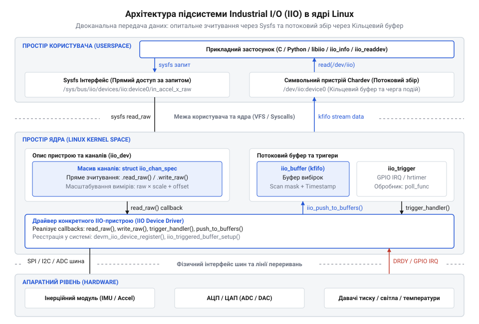
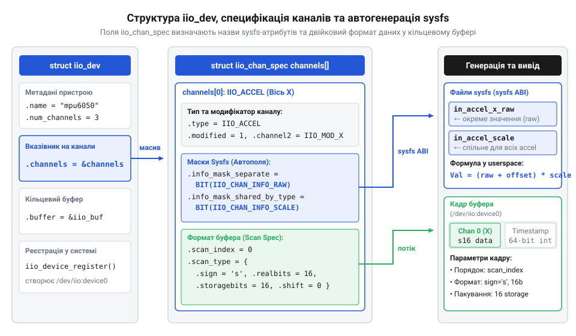
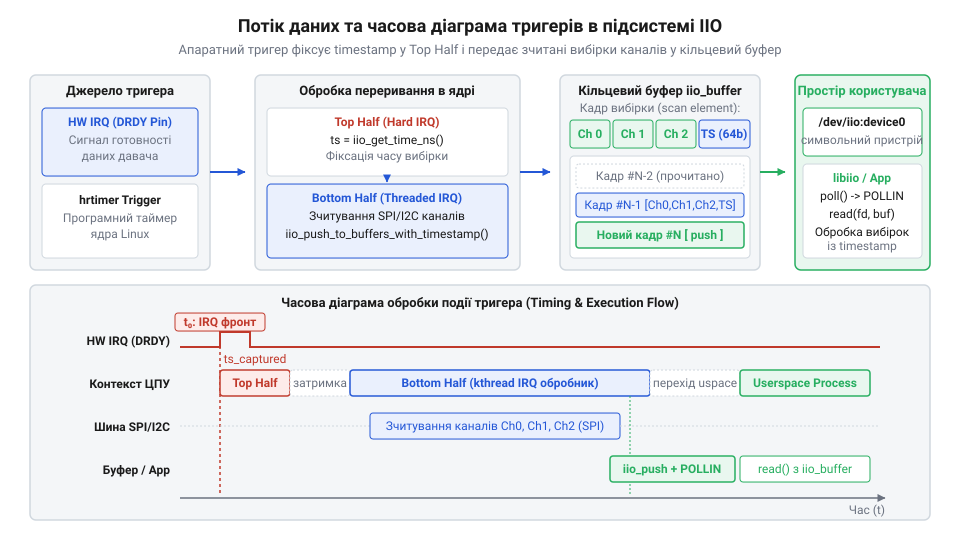
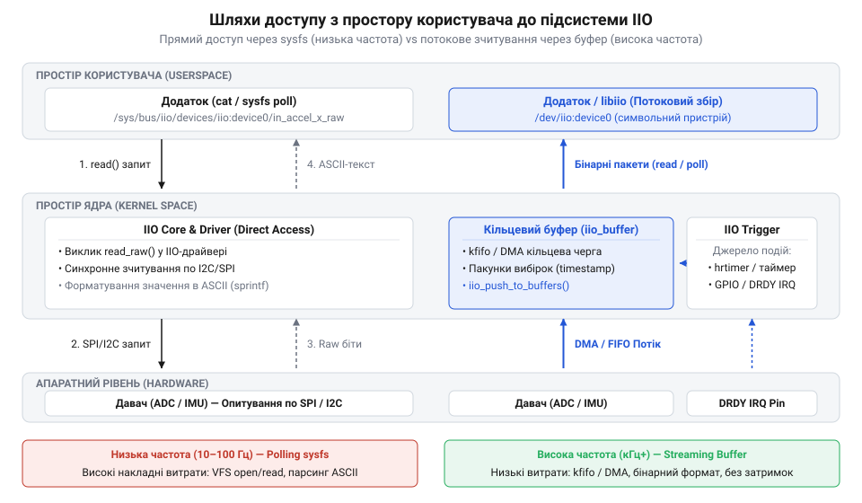
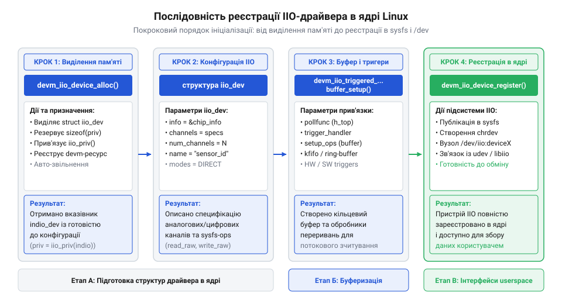

# Підсистема Industrial I/O (IIO) в ядрі Linux

<preknowlist>
- [GY-521 / MPU-6050 — 6-осьовий IMU (акселерометр+гіроскоп)](root:cat-hw-sensors/mpu6050) — апаратна структура MEMS-давачів, регістри вимірів та зчитування даних через шину I2C
- [ADXL345 — 3-осьовий цифровий акселерометр](root:cat-hw-sensors/adxl345) — використання розрізнення каналів, конфігурація діапазонів та апаратні переривання давача
</preknowlist>

## Проблема фрагментації та поява IIO

Ранні драйвери давачів у ядрі Linux обирали між `@@en|hwmon@@` (Hardware Monitoring) та `@@en|input@@`. `@@en|hwmon@@` розроблялася для повільного моніторингу через текстові файли `@@en|sysfs@@`, де парсинг рядків на високій частоті спричиняв витрати процесора й втрату вибірок. `@@en|input@@` орієнтувалася на події пристроїв введення з фіксованими кодами, що не підходило для багатоканальних перетворювачів. Кустарні рішення призводили до фрагментації `@@en|ABI@@` (англ. *application binary interface* — двійковий інтерфейс прикладних програм).

Для розв'язання цієї проблеми створили підсистему `@@en|Industrial I/O@@ (англ. *industrial* — промисловий, *input/output* — вхід/вихід)` (`@@en|IIO@@`), яка об'єднала перетворювачі й сенсори в уніфікований фреймворк. Архітектура `@@en|IIO@@` спирається на три рівні: опитування стану через `@@en|sysfs@@`, бінарний збір даних через кільцеві буфери та синхронізацію апаратними чи програмними тригерами.


*Архітектура підсистеми IIO поєднує опитування sysfs, потокові буфери та механізми тригерів для уніфікованого доступу до давачів.*

## Структури iio_dev та специфікація каналів

Центральним ядерним представленням фізичного сенсора є структура `iio_dev`. Вона описує параметри пристрою, прив'язку до шини та масив специфікацій каналів `iio_chan_spec`. Кожен канал описує фізичну величину, вісь вимірювання та маску атрибутів `@@en|sysfs@@` — як у джерелах [акселерометра ADXL345](root:cat-hw-sensors/adxl345) чи [модуля MPU-6050](root:cat-hw-sensors/mpu6050).

Через заборону `@@en|floating-point@@` арифметики в ядрі Linux драйвер повертає лише цілочисельні дані. Перетворення у фізичні одиниці `@@en|SI@@` виконується у просторі користувача за лінійною моделлю:

```
v = (raw + offset) × scale
```

де `raw` — сирий код, `offset` — зсув нульового рівня, `scale` — множник масштабу.


*Структура iio_dev та специфікація каналів iio_chan_spec автоматично формують відповідні файли атрибутів у файловій системі sysfs.*

## Потокові буфери та механізми тригерів

Зчитування через `@@en|sysfs@@` надто повільне для високих частот через постійне перемикання контексту. Для безперервного потоку даних підсистема використовує кільцевий буфер `iio_buffer`, що зберігає двійкові вибірки фіксованого розміру.

Подію дискретизації генерує джерело тригера `iio_trigger` — апаратне переривання від давача (як-от у [ємнісних MEMS-сенсорах](root:cat-hw-sensors/mems-capacitive-sensing-principles)) або системний таймер. Обробка поділяється на два етапи: у верхній половині (`@@en|hard IRQ@@`) фіксується точна часова мітка, що усуває часове тремтіння (`@@en|jitter@@`), а в нижній — драйвер зчитує вибірку через `@@en|I2C@@` чи `@@en|SPI@@` і відправляє її з міткою в `iio_buffer`.


*Механізм тригерів забезпечує фіксацію часових міток і передачу двійкових вибірок у буфер без часового тремтіння.*

## Інтерфейси простору користувача та libiio

Простір користувача взаємодіє з `@@en|IIO@@` двома шляхами: текстові атрибути `@@en|sysfs@@` (`/sys/bus/iio/devices/iio:deviceX`) призначені для поодиноких вимірів і налаштування, а символьний пристрій `/dev/iio:deviceX` — для потокового бінарного збору.

Офіційна бібліотека `@@en|libiio@@` надає уніфікований C-інтерфейс керування пристроєм. Вона підтримує локальний бекенд для роботи на системі та мережевий через демон `@@en|iiod@@` для віддаленого зчитування даних по `@@en|TCP/IP@@`. Детальніше про мережеву архітектуру та передачу вимірювань по TCP/IP читайте у матеріалі про [демон iiod для мережевого IIO-доступу](root:sys-unix/iiod-daemon).


*Бібліотека libiio абстрагує низькорівневий доступ через sysfs та /dev/iio:deviceX для місцевої та мережевої роботи.*

## Проектування та реєстрація IIO-драйвера ядра

Ініціалізація драйвера починається у функції `@@en|probe@@`. Пам'ять під `@@en|iio_dev@@` виділяють через `@@en|devm_iio_device_alloc@@` із прив'язкою до `@@en|struct device@@` для автоматичного звільнення.

Далі визначають канали `@@en|iio_chan_spec@@` і колбеки `@@en|iio_info@@`: `@@en|read_raw@@` дає сирі значення й масштаби для `@@en|sysfs@@`, а `@@en|write_raw@@` змінює налаштування. Пристрій реєструють через `@@en|devm_iio_device_register@@`. Тригерні буфери налаштовують через `@@en|iio_triggered_buffer_setup@@`, а апаратуру описують у `@@en|Device Tree@@`.


*Реєстрація через devm-функції гарантує автоматичне звільнення ресурсів ядра.*

## Діагностика переповнень та оптимізація продуктивності

Високочастотний збір даних створює ризик переповнення кільцевого буфера (`@@en|buffer overflow@@`) та втрати вибірок, якщо простір користувача не встигає їх зчитувати через часті переривання шин.

Для зменшення накладних витрат застосовують апаратний буфер `@@en|FIFO@@` (англ. *first in, first out*) сенсора для пакетного зчитування. У ядрі збільшують розмір `iio_buffer`, а в просторі користувача зчитують дані великими блоками. Для критичних систем використовують планувальник реального часу `@@en|SCHED_FIFO@@` та прямий доступ до пам'яті `@@en|DMA@@` (англ. *direct memory access*), що усуває затримки процесора.