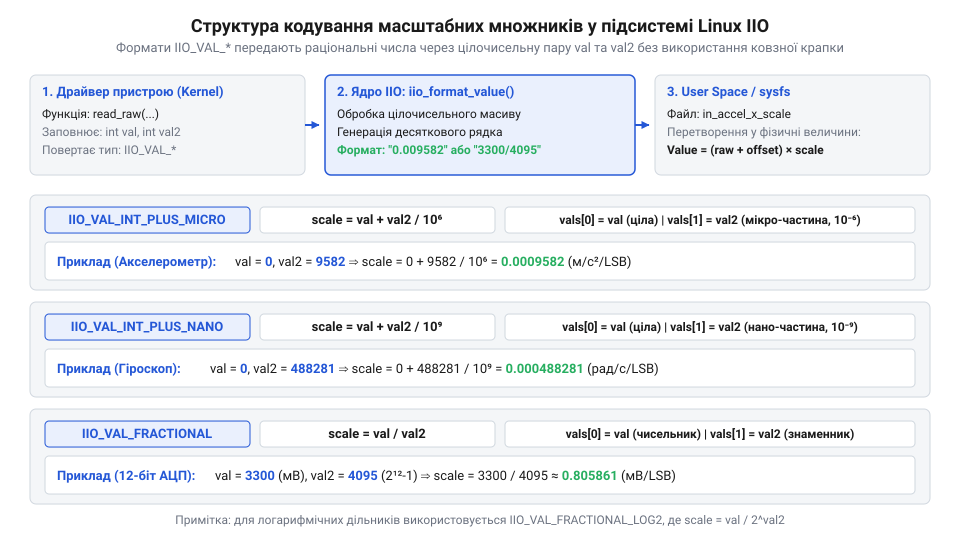
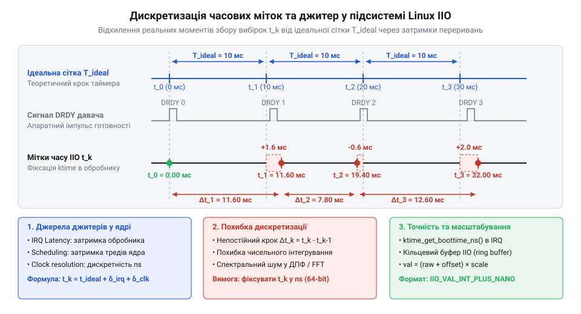

# Математичні перетворення, масштабування та квантування вимірів у IIO

<preknowlist>
- [GY-521 / MPU-6050 — 6-осьовий IMU (акселерометр+гіроскоп)](root:cat-hw-sensors/mpu6050) — розрядність АЦП, вихідні регістри даних та конфігурації діапазонів вимірювання гіроскопа й акселерометра
- [ADXL345 — 3-осьовий цифровий акселерометр](root:cat-hw-sensors/adxl345) — формат доповняльного коду 16-бітних вимірів, налаштування роздільної здатності та чутливості LSB/g
- [Принципи ємнісного вимірювання в MEMS-структурах](root:cat-hw-sensors/mems-capacitive-sensing-principles) — фізична природа виникнення ємнісного аналогового сигналу при зміщенні інерційної маси та його перетворення на цифровий код
</preknowlist>

## Проблема прямого використання сирих показників

Апаратні давачі первинно вимірюють фізичні величини через зміну електричних параметрів — ємності, опору або напруги. Наприклад, у MEMS-пристроях механічне зміщення інерційної маси викликає зміну ємності між мікроскопічними електродами, що описується [принципами ємнісного вимірювання](root:cat-hw-sensors/mems-capacitive-sensing-principles). Вбудований аналогово-цифровий перетворювач (від грецьк. *analogos* — «аналогічний», *digitus* — «палець/цифра» та *conversio* — «перетворення», @@en|Analog-to-Digital Converter@@, або @@en|ADC@@) виконує квантування (від лат. *quantus* — «скільки», @@en|quantization@@) аналогового сигналу і записує дискретне значення у внутрішні регістри пристрою.

Ці записані значення є сирими цілочисельними кодами. Вони представлені у форматах зі знаком у доповняльному коді або без знака з різною розрядністю — від 10 до 24 бітів. Кожен тип давача оперує власними фізичними характеристиками:
- Цифровий @@en|accelerometer@@ [акселерометр ADXL345](root:cat-hw-sensors/adxl345) повертає значення у розрахунку на одиницю прискорення вільного падіння `LSB/g` (від англ. *least significant bit*, @@en|Least Significant Bit@@, або @@en|LSB@@). - Багатоосьовий інерційний модуль на базі [компонента MPU-6050](root:cat-hw-sensors/mpu6050) вимірює кутову швидкість у кутових градусах за секунду `LSB/(°/s)`. - Первинний аналоговий @@en|accelerometer@@ [класу ADXL335](root:cat-hw-sensors/adxl335) дає аналогову напругу, яку зовнішній @@en|ADC@@ зчитує у відліках розрядності квантування.

Якби прикладні програми у просторі користувача (від англ. *user space*, @@en|user space@@) зчитували ці дані напряму з регістрів пристроїв, кожна утиліта мусила б містити унікальну таблицю калібрувальних коефіцієнтів та індивідуальні формули перетворення для кожного окремого чипа. Це унеможливило б існування універсальних бібліотек обробки сигналів чи навігаційних алгоритмів.

Для розв'язання цієї проблеми у ядрі Linux створили підсистему @@en|Industrial I/O@@ (@@en|IIO@@). Вона впроваджує єдиний математичний стандарт: усі фізичні величини мають подаватися у стандартних міжнародних одиницях СІ. Для прискорення це метри за секунду у квадраті `m/s²`, для кутової швидкості — радіани за секунду `rad/s`, для напруги — мілівольти `mV`, для температури — міліградуси Цельсія `m°C`.

Для перетворення сирого коду у фізичну величину СІ підсистема @@en|IIO@@ використовує лінійну математичну модель з трьох параметрів: сирого значення `raw`, нульового зміщення `offset` та масштабного множника `scale` (від англ. *scale factor*, @@en|scale@@).

    v = (raw + offset) × scale

Тут позначення мають такий зміст:
- `raw` — цілочисельний код, вилучений напряму з регістра даних давача або каналу @@en|ADC@@. - `offset` — цілочисельне значення зміщення нуля (від англ. *offset*, @@en|offset@@), яке додається до `raw` для компенсації системного зсуву нульового рівня пристрою у тиках @@en|LSB@@. - `scale` — дробовий масштабний множник, який переводить скориговане ціле число `(raw + offset)` безпосередньо у фізичну одиницю вимірювання СІ.

Порядок операцій у цій формулі принциповий. Зсув `offset` додається до `raw` до множення на `scale`. Це дає змогу виконувати калібрування нуля в дискретних одиницях `LSB` самого давача без втрати розрядності й без виконання дробових додавань.

Обчислення цієї формули безпосередньо в просторі ядра (від англ. *kernel space*, @@en|kernel space@@) стикається з жорстким архітектурним обмеженням: у ядрі Linux заборонено використовувати арифметику з ковзною крапкою (від англ. *floating-point*, @@en|floating-point@@). Використання регістрів сопроцесора `FPU` у ядрі вимагає збереження та відновлення контексту процесора при кожному системному виклику, що створює неприпустимі затримки для операційної системи реального часу. Отже, масштабний множник `scale` повинен передаватися та оброблятися виключно через арифметику з фіксованою крапкою (від англ. *fixed-point*, @@en|fixed-point@@) за допомогою цілочисельних пар.

## Репрезентація дробових множників у ядрі

Щоб передати дробовий масштабний множник `scale` через системну файлову систему (від англ. *system filesystem*, @@en|sysfs@@) та внутрішні виклики ядра без застосування @@en|floating-point@@, підсистема @@en|IIO@@ кодує дійсні числа за допомогою двох 32-бітних цілих чисел: `val` (ціла частина або чисельник) та `val2` (дробова частина або знаменник). Поведінка та математичний зміст цієї пари визначаються специфічним типом форматування, який повертає драйвер.

Основними математичними форматами кодування масштабних множників у підсистемі @@en|IIO@@ є такі варіанти:

1. `IIO_VAL_INT`:
Масштабний множник є чистим цілим числом.

    scale = val

2. `IIO_VAL_INT_PLUS_MICRO`:
Масштабний множник подається у вигляді цілої частини `val` та дробової частини `val2`, вираженої у мікро-одиницях (мільйонних частках, `10⁻⁶`).

    scale = val + (val2 ÷ 1000000)

Якщо числовий множник від'ємний і лежить у межах від `-1` до `0`, ціла частина `val` дорівнює `0`. Оскільки число `0` не може нести знак мінус у цілочисельній арифметиці, знак від'ємності передається у дробову частину: `val2` записується зі знаком мінус.

3. `IIO_VAL_INT_PLUS_NANO`:
Аналогічно до мікро-формату, але дробова частина `val2` виражається у нано-одиницях (мільярдних частках, `10⁻⁹`). Це необхідно для високоточних давачів, де масштабний множник має дуже малу величину.

    scale = val + (val2 ÷ 1000000000)

4. `IIO_VAL_FRACTIONAL`:
Масштабний множник подається як звичайний дріб, де `val` — чисельник, а `val2` — знаменник.

    scale = val ÷ val2

5. `IIO_VAL_FRACTIONAL_LOG2`:
Масштабний множник подається як раціональний дріб, знаменник якого є ступенем двійки `2^val2`.

    scale = val ÷ 2^val2


*Структура форматування масштабних множників підсистеми IIO із розділенням на ціле число та дріб.*

Розглянемо покроковий процес розкладання дійсного значення `scale = 0.00980665` (типовий масштаб перетворення `g` у `m/s²`) у формат `IIO_VAL_INT_PLUS_NANO`.

**Умова:** Задано дійсне значення `scale = 0.00980665`. Необхідно виділити цілочисельні параметри `val` та `val2` для ядра.

    val = floor(0.00980665)
    = 0                                 [обчислення цілої частини]

    val2 = round((0.00980665 - 0) × 10⁹)
    = round(0.00980665 × 10⁹)           [віднімання цілої частини]
    = 9806650                           [масштабування до нано-одиниць]

Драйвер ядра повертає ціле значення `val = 0`, дробове `val2 = 9806650` та тип `IIO_VAL_INT_PLUS_NANO`. При канонічному зчитуванні атрибута `in_accel_x_scale` із підсистеми @@en|sysfs@@ псевдофайлова система скомпонує ці значення у текстовий рядок `0.009806650`. Докладніше про структуру та номенклатуру атрибутів in_type_raw, in_type_scale та in_type_offset читайте у матеріалі про [організацію системного інтерфейсу sysfs підсистеми IIO](root:cat-hw-sensors/iio-subsystem-linux-kernel/api-iio-userspace-libiio-abi.md).

У разі використання формату `IIO_VAL_INT_PLUS_MICRO` для того самого числа відбувається втрата точності через округлення:

    val2_micro = round(0.00980665 × 10⁶)
    = round(9806.65)                    [масштабування до мікро-одиниць]
    = 9807                              [округлення до найближчого цілого]

Тут дробова частина зменшується до `9807`, що дає відновлене значення `scale = 0.009807`. Втрата точності становить `0.035%`, що у чутливих інерційних системах призводить до накопичення похибки інтегрування. Тому для точних вимірювань перевага надається форматам `IIO_VAL_INT_PLUS_NANO` або `IIO_VAL_FRACTIONAL`.

## Масштабування для акселерометрів гіроскопів АЦП

Розрахунок масштабного множника `scale` залежить від фізичної природи вимірювань та паспортних даних кристала давача (від англ. *datasheet*). Розглянемо розрахунок коефіцієнтів для трьох основних класів пристроїв: акселерометрів, гіроскопів та аналогово-цифрових перетворювачів.

### Акселерометри

У документації на @@en|accelerometer@@ чутливість (від англ. *sensitivity*, @@en|sensitivity@@) зазвичай вказується у тиках на одиницю прискорення вільного падіння `LSB/g` або в мілі-g на тик `mg/LSB`.

Стандартна одиниця СІ для прискорення у підсистемі @@en|IIO@@ — метр за секунду у квадраті `m/s²`. Фізична константа прискорення вільного падіння прийнята рівною `g = 9.80665 m/s²`.

Якщо чутливість давача $S_g$ задана у `LSB/g`, то один тик `1 LSB` відповідає прискоренню `1 / S_g` g. Для переведення в `m/s²` формула набуває вигляду:

    scale = g ÷ S_g
    = 9.80665 ÷ S_g

**Приклад розрахунку:** Цифровий [акселерометр ADXL345](root:cat-hw-sensors/adxl345) налаштовано на діапазон вимірювання `±2g` у режимі повної роздільної здатності. Згідно з документацією, його чутливість становить `S_g = 256 LSB/g`.

    scale = 9.80665 ÷ 256
    = 0.0383072265625                   [значення масштабного множника в m/s²/LSB]

Для подання цього значення у форматі `IIO_VAL_INT_PLUS_NANO`:

    val = 0                             [ціла частина]
    val2 = round(0.0383072265625 × 10⁹)
    = 38307227                          [дробова частина в нано-одиницях]

### Гіроскопи

@@en|Gyroscope@@ (від грецьк. *gyros* — «коло», «обертання» та *skopeo* — «дивлюся», @@en|gyroscope@@). *gyros* — «коло», «обертання» та *skopeo* — «дивлюся», @@en|gyroscope@@) вимірює кутову швидкість. Паспортна чутливість `S_dps` вказується у тиках на градус за секунду `LSB/(°/s)` або `LSB/dps` (від англ. *degrees per second*).

Одиниця СІ підсистеми @@en|IIO@@ для кутової швидкості — радіан за секунду `rad/s`. Співвідношення між кутовим градусом та радіаном визначається як `1° = π / 180 rad`. Отже, розрахункова формула масштабного множника:

    scale = π ÷ (180 × S_dps)

**Приклад розрахунку:** Для [інерційного модуля MPU-6050](root:cat-hw-sensors/mpu6050) у діапазоні `±250 °/s` паспортна чутливість дорівнює `S_dps = 131 LSB/(°/s)`.

    scale = 3.141592653589793 ÷ (180 × 131)
    = 3.141592653589793 ÷ 23580          [множення знаменника]
    = 0.0001332312421369                [масштабний множник у rad/s/LSB]

У форматі `IIO_VAL_INT_PLUS_NANO` отримуємо `val = 0`, `val2 = 133231`.

Подібний розрахунок застосовується й для інших інерційних блоків, таких як [модулі Pololu IMU](root:cat-hw-sensors/pololu-imu) чи [магнетометри HMC5883L](root:cat-hw-sensors/hmc5883l), де магнітне поле переводиться у Гауси або Тесли за аналогічним відношенням одиниць СІ.

### Аналогово-цифрові перетворювачі (АЦП)

Для чипів @@en|ADC@@ вихідний код залежить від опорної напруги `V_ref` та N-бітної розрядності квантування. Базовою одиницею напруги в @@en|IIO@@ є мілівольт `mV`.

Для однополярного @@en|ADC@@ з вихідним діапазоном від `0` до `V_ref` (вираженої у мілівольтах), кожен тик `LSB` має вагу:

    scale = V_ref ÷ 2ⁿ

Або при вирівнюванні за повною шкалою квантування:

    scale = V_ref ÷ 2ⁿ

**Приклад розрахунку:** 12-бітний @@en|ADC@@ з опорною напругою `V_ref = 3.3 V = 3300 mV`. Число рівнів квантування `2¹² = 4096`.

    scale = 3300 ÷ 4096
    = 825 ÷ 1024                        [скорочення на спільний дільник 4]
    = 0.8056640625                      [значення в mV/LSB]

Цей множник ідеально виражається у форматі `IIO_VAL_FRACTIONAL` без жодних втрат чи округлень: `val = 825`, `val2 = 1024`.

### Запобігання переповненню при обчисленнях у просторі користувача

При зчитуванні системних атрибутів у @@en|user space@@ програма отримує цілочисельні `raw`, `offset` та пару `(val, val2)`. Пряме множення 32-бітного сирого значення на нано-компоненту `val2` може спричинити переповнення стандартного 32-бітного цілого числа зі знаком (максимум `2³¹ - 1 = 2 147 483 647`).

Наприклад, при `raw = 20000` та `val2 = 38307227`:

    20000 × 38307227 = 766 144 540 000

Цей результат значно перевищує межу 32-бітного регістра. Щоб запобігти викривленню даних, обчислення у просторі користувача без використання @@en|floating-point@@ необхідно проводити з явним зведенням до 64-бітних типів `int64_t`:

    v_micro = ((int64_t)(raw + offset) × val2) ÷ 1000

Використання 64-бітної цілочисельної проміжної змінної гарантує збереження повної точності до дев'яти значущих цифр без ризику арифметичного переповнення чи втрати старших розрядів.

## Математика часових міток і джитер

Під час обробки вимірів інерційних давачів у підсистемі IIO знання фізичної величини окремого відліку є недостатнім. Обчислення орієнтації об'єкта, його швидкості чи пройденого шляху вимагає чисельного інтегрування вибірок у часі. Якщо припустити, що вибірки надходять через суворо одинаковий інтервал, найменше часове відхилення в зчитуванні спотворить розраховану траєкторію. Потрібно розуміти, як формується дискретизація (від лат. *discretus* — розділений, переривчастий) сигналів у часі та чому виникають відхилення часових міток.

У підсистемі IIO для кожного пакета даних у буфері може формуватися 64-бітна @@en|часова мітка@@ `tₖ` у наносекундах. В ідеальній системі дискретизатор фіксує стан давача через рівні проміжки часу `T = 1 ÷ fₛ`, де `fₛ` — частота вибірок. Реальний процес збору даних описується математичною моделлю:

```
tₖ = t₀ + k · T + δₖ
```

тут `t₀` — початковий момент запуску вибірки, `k` — порядковий номер виміру в буфер @@en|IIO@@ (від англ. *buffer* — проміжний накопичувач), `T` — номінальний період дискретизації, а `δₖ` — випадкова часова похибка, яку викликає джитер (від англ. *jitter* — тремтіти).


*Часова діаграма дискретизації ілюструє відхилення моментів фіксації вибірок від ідеальної сітки через затримки обробки переривань та тригерів.*

Причини виникнення часового джитера залежать від того, який джерельний механізм ініціює фіксацію вибірки в ядрі:

1. апаратний тригер (від англ. *trigger* — курок, пусковий гачок): сигнал готовності даних Data Ready (DRDY) генерує сам давач, наприклад [шестиосьовий модуль MPU-6050](root:cat-hw-sensors/mpu6050). Джерелом джитера тут є нестабільність внутрішнього RC-генератора давача та затримка обробки переривання (@@en|interrupt latency@@) процесором. 2. @@en|програмний тригер@@: вибірка ініціюється таймером ядра (`hrtimer`). Джитер визначається затримками планувальника операційної системи, заблокованими секціями переривань та змінним часом передачі даних по шині I2C або SPI для [акселерометра ADXL345](root:cat-hw-sensors/adxl345).

Вплив джитера на математичні операції з вибірками критично різниться для диференціювання та інтегрування.

Для чисельного диференціювання (обчислення ривка або прискорення з позиції) похідна на кроці `k` визначається виразом:

```
aₖ = (vₖ - vₖ₋₁) ÷ Δtₖ
= (vₖ - vₖ₋₁) ÷ (T + δₖ - δₖ₋₁)      [підстановка реального інтервалу Δtₖ = tₖ - tₖ₋₁]
```

Якщо алгоритм хибно вважає інтервал `Δtₖ` константою `T`, різниця `δₖ - δₖ₋₁` створює високочастотні викиди шумів у розрахованій похідній.

Для чисельного інтегрування кутової швидкості методом трапецій оновлення кута `θₖ` становить:

```
θₖ = θₖ₋₁ + (ωₖ + ωₖ₋₁) ÷ 2 · Δtₖ
= θₖ₋₁ + (ωₖ + ωₖ₋₁) ÷ 2 · (T + δₖ - δₖ₋₁)      [заміна часового крок на реальну різницю міток]
```

При використанні фіксованого значення `T` замість різниці реальних міток `Δtₖ = tₖ - tₖ₋₁` накопичена помилка кута після `N` вибірок обчислюється як:

```
E_total = ∑ (ωₖ + ωₖ₋₁) ÷ 2 · (δₖ - δₖ₋₁)      [сумування похибок джитера від k=1 до N]
```

Ця похибка призводить до швидкого дрейфу інтегрованої величини. Тому під час обробки буферизованих даних IIO необхідно розраховувати локальний часовий крок `Δtₖ` між сусідніми мітками вибірок, а не покладатися на задану частоту тригера.

## Запобігання переповненням і втраті точності

Після отримання сирих значень та часових міток постає завдання розрахунку підсумкової фізичної величини за формулою `y = (raw + offset) · scale`. У середовищі ядра Linux математика з ковзною крапкою повністю заборонена, а у просторі користувача на мікроконтролерах без апаратного блоку FPU обчислення `double` вимагають суттєвих ресурсів. Спроба виконати масштабування в цілочисельній арифметиці без урахування розрядності призводить до втрати дробової частини або до руйнівного переповнення (від англ. *overflow* — виливання через край).

Підсистема IIO передає атрибут `scale` у вигляді двох 32-бітних цілих чисел `val` та `val2`. Для поширеного формату `IIO_VAL_INT_PLUS_MICRO` підсумковий масштаб визначається як `scale = val + val2 ÷ 1000000`. При прямому обчисленні значення [триосьового акселерометра ADXL335](root:cat-hw-sensors/adxl335) або систем з [принципами ємнісного вимірювання MEMS](root:cat-hw-sensors/mems-capacitive-sensing-principles) цілочисельне ділення `val2 ÷ 1000000` дає нуль. Якщо ж перегрупувати множення та ділення:

```
y = ((raw + offset) · val2) ÷ 1000000
```

виникає загроза переповнення 32-бітного знакового типу `int32_t`.

Розглянемо приклад, коли 16-бітний вимір давача `raw + offset = 30000`, а дробова частина масштабу `val2 = 120000`:

```
P = (raw + offset) · val2
= 30000 × 120000      [перемноження 32-бітних цілих чисел]
= 3600000000          [переповнення типу int32_t зі зміною знаку]
```

Значення `3 600 000 000` перевищує максимальну межу `2 147 483 647` для `int32_t`, що призводить до від'ємного значення `-694 967 296` та повного спотворення обчислень.

Для усунення цієї проблеми розрахунок виконується з розширенням розрядності до 64 бітів (`int64_t`) та застосуванням симетричного округлення до найближчого цілого.

Математичний алгоритм безпечного цілочисельного масштабування виводиться послідовно:

```
S = raw + offset
P = S × (val · 1000000 + val2)       [розширення S у 64-бітне ціле s64 і обчислення повного масштабу]
R = P + (P ≥ 0 ? 500000 : -500000)   [додавання половини дільника для симетричного округлення]
y = R ÷ 1000000                      [ділення на знаменник мікроодиниці]
```

Якщо результати необхідно зберегти з додатковою точністю (наприклад, у міліодиницях фізичної величини), використовують обчислення у фіксованій крапці (від англ. *fixed-point* — фіксована позиція комі) з масштабуванням на `10ₖ`.

Практична реалізація безпечного перетворення сирих показників IIO у просторі користувача подана нижче для мов C та C++.

:::tabs
@tab C
```c
#include <stdint.h>
#include <stdbool.h>

/* Безпечне перетворення сирого значення IIO у мікроодиниці СІ */
int64_t iio_convert_raw_to_micro(int32_t raw, int32_t offset, int32_t val, int32_t val2)
{
    int64_t s = (int64_t)raw + offset;
    int64_t total_scale_micro = (int64_t)val * 1000000LL + val2;
    
    int64_t product = s * total_scale_micro;
    int64_t half_denom = (product >= 0) ? 500000LL : -500000LL;
    
    return (product + half_denom) / 1000000LL;
}
```
@tab C++
```cpp
#include <cstdint>

// Безпечне перетворення сирого значення IIO у мікроодиниці СІ
int64_t iio_convert_raw_to_micro(int32_t raw, int32_t offset, int32_t val, int32_t val2)
{
    const int64_t s = static_cast<int64_t>(raw) + offset;
    const int64_t total_scale_micro = static_cast<int64_t>(val) * 1'000'000LL + val2;
    
    const int64_t product = s * total_scale_micro;
    const int64_t half_denom = (product >= 0) ? 500'000LL : -500'000LL;
    
    return (product + half_denom) / 1000000LL;
}
```
:::

Використання 64-бітного розширення проміжних добутків та додавання половини знаменника перед діленням повністю запобігає переповненням і забезпечує точність розрахунків до останнього розряду без залучення арифметики з ковзною крапкою.