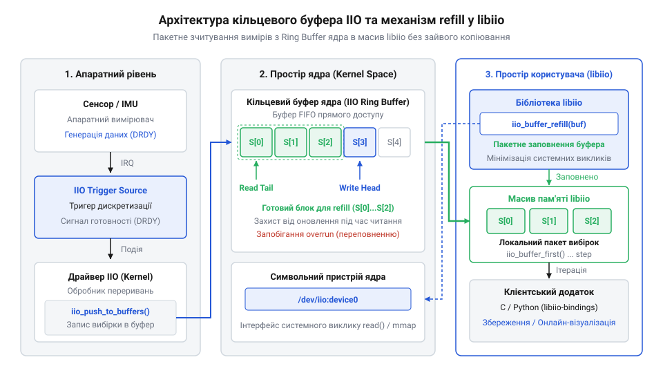
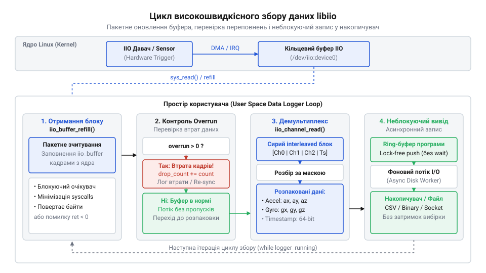

<preknowlist>
- [GY-521 / MPU-6050 — 6-осьовий IMU (акселерометр+гіроскоп)](root:cat-hw-sensors/mpu6050) — Структура вимірювальних осей акселерометра та гіроскопа, поняття дискретизації інерційних даних та базові фізичні одиниці виміру.
- [ADXL345 — 3-осьовий цифровий акселерометр](root:cat-hw-sensors/adxl345) — Принцип використання апаратних FIFO-буферів та генерації сигналів тригерів переривань для збору даних.
</preknowlist>

# Обмеження прямих опитувань sysfs

При роботі з інерційними давачами, такими як GY-521 (MPU-6050) або ADXL345, розробники часто починають зі зчитування файлів у файловій системі sysfs. Це найпростіший підхід: кожен вимірювальний канал акселерометра чи гіроскопа представлений окремим текстовим файлом (наприклад, in_accel_x_raw), і щоб отримати значення, достатньо прочитати цей файл. 

Однак, цей метод має критичні обмеження при побудові високошвидкісних клієнтів збору даних. При зчитуванні показувань інерційних давачів на високих частотах через файлову систему sysfs виникають втрати відліків та суттєві затримки через постійне відкриття файлів і системні виклики. Розглянемо ситуацію, коли опитування давача в просторі користувача не встигає за темпом генерації даних hardware-тригером. На фізичному рівні hardware-тригер регулярно формує переривання (наприклад, сигнал Data Ready), яке сповіщає про готовність нової порції вимірів, що поміщуються в обмежений апаратний FIFO-буфер самого чипа або драйвера. Якщо програма користувача не зчитує ці дані достатньо швидко, нові відліки невблаганно надходять і починають перезаписувати старі, ще не забрані значення. У такому разі виникає так зване переповнення (buffer overrun) — фізичне затирання даних, і частина безцінних вимірів безповоротно втрачається, руйнуючи цілісність часового ряду. Виникає нагальна потреба в апаратних ring-буферах ядра Linux та абстракції libiio, які дозволяють драйверу миттєво реагувати на переривання та зберігати потокові виміри у великий буфер оперативної пам'яті без втрати пакетів.

# Виявлення пристроїв та налаштування каналів

Маючи розуміння потреби у підсистемі IIO, розробник опановує створення контексту libiio та динамічний пошук потрібного інерційного модуля в системі. Замість жорсткого кодування шляхів або припущень про номери пристроїв, програма програмно перераховує наявні аналогові й цифрові канали. Вона вибирає осі акселерометра (X, Y, Z) та гіроскопа (X, Y, Z) і вмикає їх для вибірки. 

Наступним кроком є конфігурування параметрів дискретизації та прив'язування апаратного або програмного тригера для синхронізації вимірів. Це дозволяє здійснювати зняття показувань з усіх каналів абсолютно синхронно, керуючись єдиним сигналом.

Нижче представлено ООП-обгортку поверх libiio для автокерування ресурсами буфера (RAII), потокової обробки вимірів та запису у CSV з оцінкою частоти кадрів мовою C++:

:::code proj-iio-userspace-data-logger/cpp/CMakeLists.txt
:::code proj-iio-userspace-data-logger/cpp/iio_device.hpp
:::code proj-iio-userspace-data-logger/cpp/iio_device.cpp
:::code proj-iio-userspace-data-logger/cpp/main.cpp

Також доступний клієнт збору даних на базі pylibiio із застосуванням NumPy для перетворення сирих відліків у фізичні величини та візуалізацією потоку у реальному часі на Python:

:::code proj-iio-userspace-data-logger/py/data_processor.py
:::code proj-iio-userspace-data-logger/py/iio_client.py
:::code proj-iio-userspace-data-logger/py/visualizer.py
:::code proj-iio-userspace-data-logger/py/main.py

# Організація кільцевого буфера libiio

Отримавши налаштований пристрій із тригером, читач переходить до виділення пам'яті під ring-буфер ядра та обгортку libiio. Використання кільцевого буфера дозволяє ефективно збирати дані без необхідності постійного опитування (polling).

Пакетування вимірів влаштовано так, що кожен кадр містить дані з усіх увімкнених каналів. Оскільки ці дані можуть мати різні типи і розміри, вирівнювання байтів у блоці (demux) виконується автоматично завдяки libiio. Особливо важливим є механізм zero-copy під час передачі даних між ядром і застосунком, що мінімізує навантаження на процесор. 

Завдяки правильному підходу, створюється буфер оптимального розміру. Цикл вибірки використовує функцію refill для оновлення вмісту пам'яті. Якщо буфер порожній, виклик блокується доти, поки ядро не заповнить його новими даними, або повертається одразу в неблокуючому режимі. 

Такий підхід дозволяє обробляти вибірки без пропуску кадрів та формує основу для побудови надійного програмного забезпечення простору користувача, здатного працювати з високочастотними потоками даних із будь-яких IIO-сумісних сенсорів.

## Побудова високопродуктивного циклу збору

Зчитування файлів у файловій системі sysfs зручне для налаштування, проте воно непридатне для високочастотного збору даних через високі накладні витрати на кожне звернення. Щоб отримувати безперервний потік вимірів із мінімальними затримками, підсистема IIO надає механізм кільцевих буферів (@@en|ring buffers@@). Цей підхід дозволяє ядру Linux автоматично накопичувати відліки у фоновому режимі, а простору користувача — забирати їх великими блоками без втрат.

Основою високопродуктивного клієнта є цикл, який періодично опитує буфер і витягує з нього накопичені кадри. Кожен кадр містить сирі бінарні дані з усіх увімкнених каналів (наприклад, трьох осей акселерометра, трьох осей гіроскопа та мітки часу). У мові C++ для управління буфером та безперервного зчитування зручно застосувати RAII-обгортки. 

Нижче наведено приклад такої реалізації:

:::code proj-iio-userspace-data-logger/cpp/iio_device.hpp
:::code proj-iio-userspace-data-logger/cpp/iio_device.cpp 152-201

Метод `refill()` блокується доти, поки ядро не наповнить буфер даними, або повертається одразу, якщо дані вже є. Якщо цикл зчитування працює повільніше за частоту дискретизації давача, стається переповнення (@@en|overrun@@), і найстаріші дані втрачаються. Щоб цього уникнути, розмір буфера має бути достатнім для покриття можливих затримок у просторі користувача. Далі сирі байти конвертуються у цілочисельні значення відповідно до формату кожного каналу, і зберігається системна мітка часу.

У Python подібний цикл можна побудувати з використанням бібліотеки pylibiio. На відміну від C++, де ми ітеруємось по буферу вказівниками, тут ми отримуємо одразу весь бінарний блок, який найефективніше декодувати за допомогою векторних операцій NumPy:

:::code proj-iio-userspace-data-logger/py/iio_client.py 206-223
:::code proj-iio-userspace-data-logger/py/data_processor.py 50-72

Таким чином, незалежно від мови, цикл збору зводиться до двох етапів: поповнення буфера системним викликом і швидкого розпакування бінарних даних у пам'яті.

## Запис даних та візуалізація потоку

Маючи надійний цикл вибірки, наступним кроком є обробка отриманих даних — їх збереження для подальшого аналізу та відображення у реальному часі. Головна проблема на цьому етапі полягає в тому, що запис на диск або візуалізація є повільними операціями. Якщо виконувати їх у тому самому потоці, що й зчитування буфера, виникають затримки, які призводять до втрати кадрів (переповнення буфера IIO).

Щоб запобігти цьому, потоковий запис і візуалізацію слід оптимізувати або розділяти на окремі потоки. У простому консольному клієнті C++ збереження у форматі CSV можна виконувати безпосередньо у головному циклі, якщо розмір буфера достатньо великий, а запис відбувається порціями:

:::code proj-iio-userspace-data-logger/cpp/main.cpp 55-82

Тут також реалізовано підрахунок і виведення поточної частоти кадрів (FPS), що є важливим індикатором здоров'я циклу. Якщо реальна частота падає нижче очікуваної частоти дискретизації давача, це свідчить про втрату даних.

У клієнті на Python, де додатково реалізована динамічна візуалізація, розділення процесів є критичним. Бібліотека Matplotlib інтегрує цикл анімації, який викликає функцію оновлення даних. Щоб не блокувати графічний інтерфейс, зчитування з буфера IIO та векторне перетворення відбуваються як частина зворотного виклику анімаційного циклу (через `FuncAnimation`):

:::code proj-iio-userspace-data-logger/py/main.py 45-59
:::code proj-iio-userspace-data-logger/py/visualizer.py 9-24
:::code proj-iio-userspace-data-logger/py/visualizer.py 86-105

Така архітектура гарантує, що клієнт не лише безперервно збирає та перетворює відліки інерційного модуля у фізичні величини, але й зберігає плавність відображення, будуючи надійний міст між апаратним давачем та простором користувача.