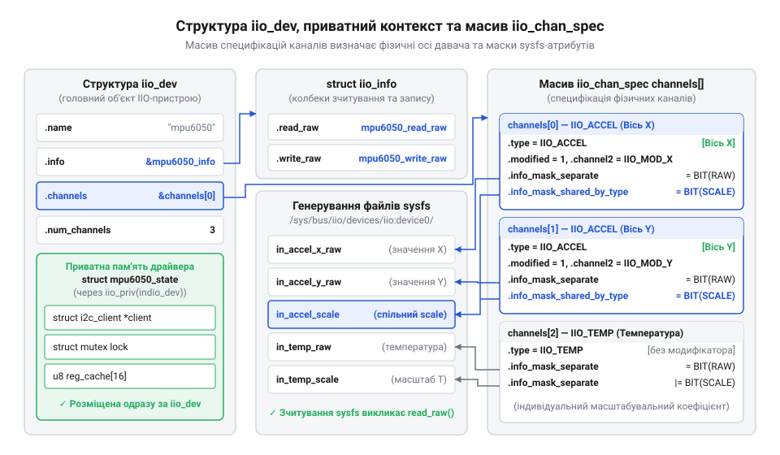
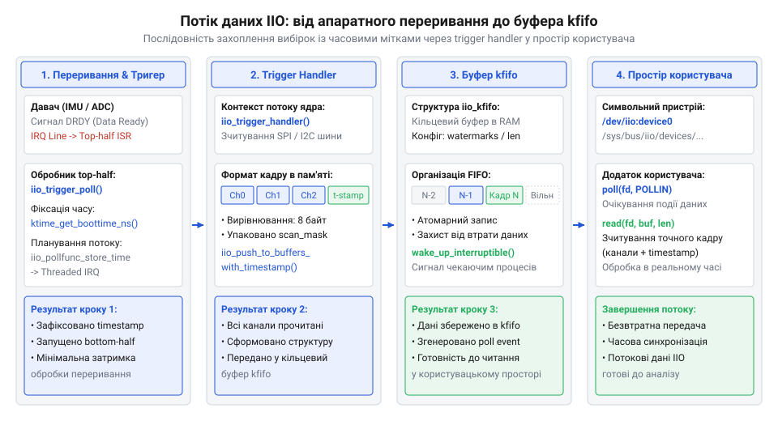

# Розробка та реалізація драйвера IIO-давача для ядра Linux

<preknowlist>
- [GY-521 / MPU-6050 — 6-осьовий IMU (акселерометр+гіроскоп)](root:cat-hw-sensors/mpu6050) — організація регістрів акселерометра та гіроскопа, поняття осей вимірювання та масштабування вибірок
- [ADXL345 — 3-осьовий цифровий акселерометр](root:cat-hw-sensors/adxl345) — принципи зчитування цифрових даних через шинні інтерфейси I2C/SPI та конфігурація переривань
</preknowlist>

## Проблема розрізнених інтерфейсів керування давачами

Уяви ситуацію: ти розробляєш систему, яка збирає дані з гіроскопа, цифрового термометра та аналого-цифрового перетворювача (АЦП). Якщо кожен драйвер давача реалізує власний довільний інтерфейс, тобі доведеться писати окремий прикладний код для кожного чіпа. Один драйвер створює файл `temperature` у sysfs і віддає значення в міліградусах, інший — вузол пристрою `/dev/gyro0`, з якого треба читати бінарні дані нетипової структури за допомогою `ioctl`, а третій взагалі експортує сирі байти без вказівки на масштаб. Без єдиного стандарту прикладний софт стає жорстко прив'язаним до конкретного заліза, а інтеграція нового сенсора вимагає переписування частини програми.

Щоб уникнути цього хаосу, в ядрі Linux створили підсистему @@en|Industrial I/O@@, або коротко — IIO. Її головне завдання — надати уніфікований шар абстракції між залізом і простором користувача для будь-яких аналогових та інерційних давачів. Замість того, щоб кожен драйвер винаходив власні файли та `ioctl`, IIO визначає жорсткий стандарт: як давач має експортувати свої канали, як описувати фізичні величини (прискорення, напругу, магнітне поле) та їхнє масштабування, і як саме простір користувача отримуватиме ці дані.

Завдяки IIO усі давачі виглядають для прикладного софту однаково. Незалежно від того, підключено чіп через I2C чи SPI, він експортує свої вимірювання через стандартні атрибути у sysfs (наприклад, `in_accel_x_raw` для сирих показань по осі X та `in_accel_scale` для коефіцієнта перерахунку у фізичні одиниці). Для потокового зчитування на високих частотах IIO надає єдиний механізм символьного пристрою з кільцевим буфером, до якого можна звертатися через звичайні системні виклики `read`. Таким чином драйвер концентрується виключно на роботі зі своїм обладнанням, а підсистема бере на себе всю рутину взаємодії з користувачем.

## Структура пристрою та описувачі каналів

Основою будь-якого драйвера IIO є структура `iio_dev`. Вона зберігає всю інформацію про екземпляр давача: його ім'я, режими роботи, вказівник на операції та список каналів вимірювання. Щоб створити пристрій, драйвер викликає `devm_iio_device_alloc`, передаючи розмір своєї приватної структури даних. Цей виклик не лише виділяє пам'ять під сам `iio_dev`, але й створює всередині місце для приватного контексту драйвера, куди ти можеш покласти мутекси, збережені значення чи масштабні коефіцієнти. Префікс `devm_` означає, що пам'ять автоматично звільниться, коли пристрій відключать, що рятує від витоків пам'яті. Доступ до приватного контексту здійснюється через допоміжну функцію `iio_priv`.

*Структура iio_dev містить базові атрибути та вказівник на масив каналів, а також виділену єдиним блоком пам'ять для приватного контексту драйвера, доступ до якого надає iio_priv.*

Щоб підсистема знала, які саме фізичні величини вимірює пристрій, драйвер заповнює масив описувачів `iio_chan_spec`. Кожен елемент цього масиву визначає один канал: його тип (наприклад, `IIO_ACCEL` для прискорення), чи він модифікований вказівником осі (`IIO_MOD_X`), та які атрибути він відкриває у sysfs. Наприклад, бітова маска `info_mask_separate` вказує на атрибути, що існують окремо для цього каналу (як-от `IIO_CHAN_INFO_RAW` — сире значення), а `info_mask_shared_by_type` позначає атрибути, спільні для всіх каналів цього типу (як-от `IIO_CHAN_INFO_SCALE` — спільний масштаб для всіх осей акселерометра).

Для роботи з кільцевим буфером описувач також містить поле `scan_type`. У ньому драйвер описує формат даних, які лягатимуть у буфер: знак, реальну розрядність (наприклад, 12 біт корисних даних), розмір сховища (наприклад, 16 біт) та порядок байтів (@@en|endianness@@). Якщо корисні дані не притиснуті до правого краю сховища, драйвер додатково вказує зсув через параметр `shift`: наприклад, для 12-бітного значення, вирівняного по лівому краю 16-бітного регістра, зсув дорівнюватиме чотирьом. Завдяки цьому прикладний софт може розібрати потік байтів, просто прочитавши опис формату із sysfs, і правильно зсунути сирі вибірки для отримання справжнього значення. Коли масив сформовано, драйвер вказує його у полі `channels` структури `iio_dev` і реєструє пристрій викликом `devm_iio_device_register`.

:::code proj-iio-virtual-sensor-driver/c/include/iio_virtual_sensor.h 12-44
:::code proj-iio-virtual-sensor-driver/c/src/iio_virtual_sensor.c 12-42

## Реалізація операцій read_raw та write_raw

Пристрої у просторі користувача бачать давач як набір файлів у теці `sysfs`. Читання з такого файлу викликає системну функцію `read_raw`, а запис — `write_raw`. Головне завдання цих функцій — бути мостом між текстовим інтерфейсом ядра та сирими регістрами обладнання. Вони отримують вказівник на структуру `iio_dev`, специфікацію каналу та маску операції. Маска `mask` вказує драйверу, чого саме хоче користувач: сирої вибірки з осі (`IIO_CHAN_INFO_RAW`), коефіцієнта масштабування (`IIO_CHAN_INFO_SCALE`) або зсуву нуля.

Ядро не оперує числами з рухомою комою. Щоб передати дробове число, підсистема IIO використовує два цілочисельні аргументи: `val` для цілої частини та `val2` для дробової. Те, як ядро склеїть ці дві змінні у текстовий рядок, залежить від коду повернення драйвера. Коли застосунок читає сире значення з осі, драйвер зчитує ціле число, кладе його у `val` і повертає `IIO_VAL_INT`. Якщо застосунок читає масштаб і він дорівнює 0.001000, драйвер записує 0 у `val`, 1000 у `val2` і повертає `IIO_VAL_INT_PLUS_MICRO`. Якщо драйвер не знає запитаної маски або не підтримує канал, він завжди повертає `-EINVAL`. Це нормальна поведінка, яка сигналізує підсистемі IIO, що такого параметра тут немає. Без цього захисту непідтримуваний запит міг би повернути випадкове сміття.

Зміна налаштувань іде через функцію `write_raw`. Ядро передає драйверу нові значення `val` і `val2`. Драйвер перевіряє їх на допустимість, перш ніж застосовувати. Наприклад, якщо давач підтримує лише два фіксовані масштаби, спроба записати інше значення відхиляється поверненням `-EINVAL`. У разі збігу драйвер оновлює тіньові змінні у приватному контексті або відправляє команду конфігурації в залізо шиною I2C чи SPI, після чого повертає 0 як ознаку успіху.

Доступ до атрибутів `sysfs` не є синхронізованим на рівні файлової системи. Кілька процесів можуть одночасно читати різні осі або намагатися змінити масштаб. Якщо драйвер почне паралельно читати два різні регістри з одного I2C-адресата, відповіді шини перемішаються, а внутрішній стан кешу зруйнується. Тому операції `read_raw` і `write_raw` мусять бути потокобезпечними. У приватному контексті драйвера створюють мутекс `lock`. Функція захоплює його на самому початку, звертається до апаратних чи тіньових регістрів, записує результат у вказівники і лише потім звільняє блокування. Увесь інтерфейс поодиноких вибірок (@@en|direct mode@@) спирається на безпечне виконання цих двох функцій.

:::code proj-iio-virtual-sensor-driver/c/src/iio_virtual_sensor.c 54-146

Розділ пояснює принцип реалізації зворотних викликів `read_raw` і `write_raw` для обробки запитів із `sysfs`, розкриває механізм передачі дробових значень через `val` і `val2` із кодами форматування (`IIO_VAL_INT`, `IIO_VAL_INT_PLUS_MICRO`) та обґрунтовує повернення `-EINVAL` для непідтримуваних параметрів і блокування мутекса. Введено термін: direct mode.

## Обробка тригерів та буферизація kfifo

Звичайне опитування через інтерфейс sysfs працює добре для повільних процесів, але стає вузьким місцем під час високочастотного збирання даних з інерційних давачів. Кожен запит з простору користувача викликає перемикання контексту, що створює значні накладні витрати та не дозволяє досягти стабільної частоти дискретизації. Щоб розв'язати цю проблему, використовують потокову передачу вибірок через кільцевий буфер @@en|kfifo@@ та обробник тригерів @@en|trigger handler@@.

*Показано шлях даних від апаратного переривання через тригер у буфер ядра та до простору користувача; видно, що дані проходять без безперервного втручання застосунку.*

Обробник тригера — це функція, яка викликається у відповідь на подію (апаратне переривання давача, програмний таймер тощо) та збирає дані з усіх увімкнених каналів в один вирівняний кадр. Кадр також включає точну часову мітку ядра.

:::code proj-iio-virtual-sensor-driver/c/include/iio_virtual_sensor.h

У наведеній вище структурі `iio_virtual_scan_data` бачимо, як формується кадр. Поле `ts` вирівняне на 8 байтів, що є вимогою підсистеми @@en|DMA@@ та буфера kfifo для забезпечення швидкодії та цілісності даних під час копіювання.

Після визначення формату кадру потрібно реалізувати власне функцію-обробник та зареєструвати буфер у пристрої.

:::code proj-iio-virtual-sensor-driver/c/src/iio_trigger_buffer.c

Функція `iio_virtual_trigger_handler` дістає поточні значення з приватного контексту (або читає їх через шину в реальному драйвері), записує їх у підготовлений кадр та викликає `iio_push_to_buffers_with_timestamp` для відправки кадру в kfifo. Виклик `iio_trigger_notify_done` сигналізує підсистемі тригерів, що поточну обробку завершено і можна чекати наступного переривання. Завдяки цьому простір користувача може зчитувати потокові дані безпосередньо з пристрою `/dev/iio:deviceX`.

## Збирання, інтеграція та відлагодження драйвера

Маючи повну програмну реалізацію з підтримкою опитування та буферизації, драйвер потрібно інтегрувати в ядро. Життєвий цикл модуля починається з функції ініціалізації `__init`, яка створює екземпляр пристрою та реєструє його в системі, і завершується у функції вивантаження `__exit`, яка звільняє ресурси. 

Оскільки наш давач віртуальний, замість прив'язки до реального вузла @@en|Device Tree@@ ми реєструємо його як програмний пристрій за допомогою `platform_device_register_simple`.

:::code proj-iio-virtual-sensor-driver/c/src/iio_virtual_sensor.c

У цій точці входу всі складові поєднуються: виділяється структура `iio_dev`, заповнюються описувачі каналів `iio_virtual_channels`, вказуються методи читання та запису `iio_virtual_info`, а також налаштовується створений у попередньому розділі тригерний буфер `iio_virtual_buffer_setup`. Використання інтерфейсу `devm_` (наприклад, `devm_iio_device_alloc`) гарантує, що при вивантаженні модуля підсистема ядра автоматично звільнить пам'ять, що виключає витоки ресурсів.

Для компіляції цього модуля як частини ядра або як окремого файла збірки (`.ko`) потрібно підготувати відповідний @@en|Makefile@@.

:::code proj-iio-virtual-sensor-driver/c/Makefile

Файл повідомляє системі збирання ядра @@en|Kbuild@@, що підсумковий модуль `iio_virtual_driver.o` складається з двох об'єктних файлів. Виконавши команду `make`, ви отримаєте файл `iio_virtual_driver.ko`, який можна завантажити в ядро утилітою `insmod`. Після цього пристрій з'явиться в `/sys/bus/iio/devices/iio:device0`, де можна буде переглянути сирі значення та конфігурувати тригери, а також відлагодити драйвер, використовуючи стандартні утиліти, такі як `iio_info`.