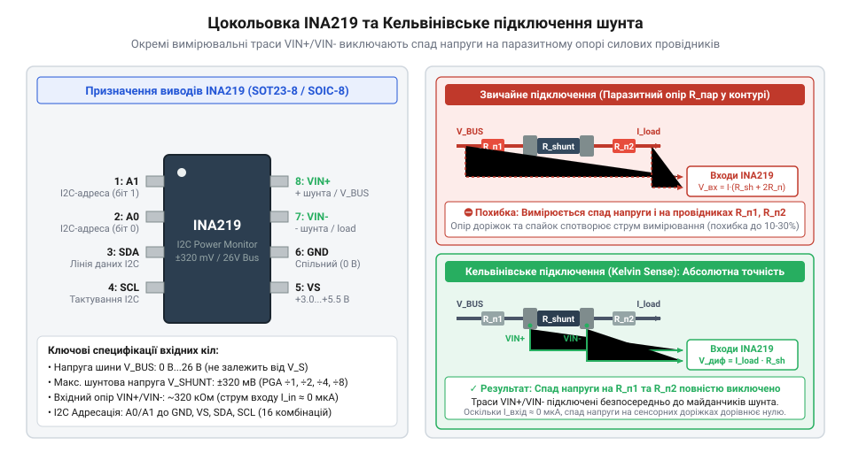
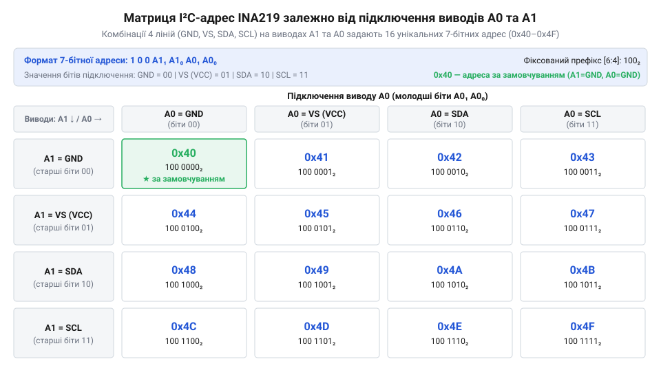

# Апаратний інтерфейс INA219: цокольовка, Кельвінівське підключення, I2C-адресація та карта регістрів

## Помилки вимірювання струму в колах живлення

Пряме вимірювання струму живлення в електронних схемах часто стає джерелом прихованих та важкодіагностованих похибок. Початківець розробник, намагаючись зняти значення струму за допомогою вбудованого аналого-цифрового перетворювача (@@en|ADC@@, від англ. *Analog-to-Digital Converter* — аналого-цифровий перетворювач) мікроконтролера, зазвичай встановлює низькоомний резистор-шунт у розрив мінусового провідника живлення (@@en|Low-Side Sensing@@). Такий підхід здається простим, оскільки спад напруги вимірюється відносно спільної землі схеми. Проте проходження великого струму через шунт створює динамічний зсув потенціалу землі навантаження відносно землі контролера — так званий плаваючий рівень землі (@@en|Ground Bounce@@). Це спотворює цифровий обмін по послідовних інтерфейсах та викликає хибні спрацьовування логічних входів.

Спроба перенести вимірювальний шунт у верхнє плече живлення (@@en|High-Side Sensing@@), тобто між джерелом живлення та навантаженням, усуває проблему зсуву землі, але викликає іншу перешкоду — обмеження загального режиму вхідної напруги. Якщо напруга шини живлення становить `+12 В` або `+24 В`, а мікроконтролер живиться від `+3.3 В`, пряме підключення вхідного піна АЦП до позитивної шини миттєво виведе мікросхему з ладу через перевищення допустимих електричних меж. Ззвичайний аналоговий підсилювач АЦП не здатний працювати з напругою сигналів, що виходить за межі його власної напруги живлення.

Додатковим фактором руйнування точності вимірювання є власний опір друкованих доріжок плати (@@en|PCB Trace Resistance@@). Мідні провідники товщиною 35 мкм та шириною 0.25 мм мають опір близько `20 мОм` на кожен сантиметр довжини. Якщо вимірювальний шунт має номінал `10 мОм`, то падіння напруги на паразитному опорі підвідних доріжок виявляється вдвічі більшим за корисний сигнал на самому шунті:

```
V_measured = I_load × (R_shunt + R_trace1 + R_trace2)
           = I_load × (10 мОм + 20 мОм + 20 мОм)      [сумарний вхідний опір контуру]
           = I_load × 50 мОм                           [похибка становить 400%]
```

Крім того, малий спад напруги на шунті (наприклад, `10 мВ` при струмі `1 А`) при прямому зчитуванні 12-бітним АЦП контролера з опорною напругою `3.3 В` відповідає лише 12 дискретам з 4096 можливих (`3.3 В ÷ 4096 = 0.8 мВ` на один відлік). Це дає велетенську похибку квантування та робить вимірювання непридатним для практичного використання.

Для вирішення цього комплексу проблем необхідний спеціалізований цифровий монітор живлення, який поєднує високовольтний диференціальний вхідний підсилювач із високим придушенням синфазного сигналу, прецизійний АЦП та цифровий інтерфейс зв'язку. Саме таким пристроєм є [Цифровий монітор живлення INA226](root:cat-hw-sensors/ina226-power-monitor) та його попередник @@en|INA219@@. Мікросхема @@en|INA219@@ здатна вимірювати падіння напруги на шунті при синфазній напрузі шини до `+26 В` незалежно від власної напруги живлення, передаючи готові цифрові дані по двопровідній шині @@en|I2C@@.

## Цокольовка та Кельвінівське підключення шунта

Апаратна архітектура @@en|INA219@@ розроблена для забезпечення високої точності вимірювання струму та напруги в компактних корпусах @@en|SOT23-8@@ (позначення пакета DCN) та @@en|SOIC-8@@ (позначення пакета D). Незважаючи на відмінності в нумерації виводів між цими типами корпусів, пристрій має вісім функціональних сигнальних ліній:

1. **`VIN+`**: позитивний диференціальний вхід вимірювання напруги шунта та точка зчитування напруги шини живлення. 2. **`VIN-`**: негативний диференціальний вхід вимірювання напруги шунта (підключається до сторони навантаження). 3. **`GND`**: спільний провідник апаратної землі для внутрішніх цифрових і аналогових вузлів. 5. **`VS`**: вивід живлення внутрішньої логіки та АЦП (припускає напругу від `+3.0 В` до `+5.5 В`). 5. **`SCL`**: вхідна лінія тактування послідовної шини @@en|I2C@@. 6. **`SDA`**: двонапрямлена лінія даних послідовної шини @@en|I2C@@. 7. **`A0`**: вивід вибору апаратної I2C-адреси молодшого розряду. 8. **`A1`**: вивід вибору апаратної I2C-адреси старшого розряду.


*Підпис: Схема цокольовки INA219 у корпусах SOT23-8 та SOIC-8 з чотирипровідним Кельвінівським підключенням диференціальних входів до вимірювального шунта.*

Головним схемотехнічним правилом підключення диференціальних входів `VIN+` та `VIN-` є застосування чотирипровідного вимірювального з'єднання Кельвіна (@@en|Kelvin Connection@@, від прізвища лорда Кельвіна — чотирипровідне вимірювальне підключення). У цій схемі силовий струм навантаження `I_load` протікає через зовнішні масивні контактні майданчики вимірювального шунта `R_shunt`. Вимірювальні траси `VIN+` та `VIN-` виконуються у вигляді окремих тонких симетричних доріжок, які підключаються безпосередньо до внутрішніх країв металізації контактів резистора.

Оскільки внутрішній вхідний опір диференціального підсилювача @@en|INA219@@ становить `320 кОм`, струм, що протікає через вимірювальні лінії `VIN+` та `VIN-`, практично дорівнює нулю (`I_sense ≈ 0`). Відповідно до закону Ома, спад напруги на власному опорі вимірювальних трас відсутній:

```
V_drop_sense = I_sense × R_trace_sense
             = 0 А × R_trace_sense      [струм вхідного підсилювача прямує до нуля]
             = 0 В                      [паразитний спад напруги відсутній]
```

Завдяки цьому падіння напруги на силових доріжках плати `I_load × R_trace` повністю виключається з вимірювального контуру. Диференціальний вхід @@en|INA219@@ сприймає виключно чисту напругу `V_shunt = VIN+ - VIN-`, яка падає на каліброваному тілі резистора. При цьому входи `VIN+` і `VIN-` витримують синфазну напругу шини від `0 В` до `+26 В` відносно заземлення `GND`, навіть якщо напруга живлення мікросхеми `VS` становить усього `+3.3 В`.

## Апаратна I2C-адресація та шинні лінії

Для організації систем багатоканального моніторингу живлення (наприклад, у багаторайкових джерелах живлення чи складних робототехнічних комплексах) виникає потреба розміщення кількох вимірювальних мікросхем на єдиній двопровідній шині. Мікросхема @@en|INA219@@ вирішує це завдання за допомогою гнучкого механізму апаратної адресації, який використовує чотирирівневий логічний дешифратор на адресних виводах `A0` та `A1`.

Кожен із виводів `A0` та `A1` під час розведення друкованої плати можна фізично з'єднати з однією із чотирьох сигнальних ліній: `GND` (земля), `VS` (живлення), `SDA` (лінія даних) або `SCL` (лінія тактування). Комбінація чотирьох можливих станів для двох виводів забезпечує `4 × 4 = 16` унікальних 7-бітних I2C-адрес у діапазоні від `0x40` до `0x4F` (в двійковому форматі від `1000000b` до `1001111b`).


*Підпис: Матриця схемних комбінацій підключення адресних виводів A0 та A1 для формування 16 унікальних I2C-адрес на спільній шині.*

Розпізнавання адреси відбувається апаратно під час внутрішньої процедури скидання при включенні живлення (@@en|Power-On Reset@@, @@en|POR@@). Внутрішня схема адресації подає короткі імпульси струму на виводи `A0` та `A1`, вимірюючи імпеданс та логічні рівні, що дозволяє відрізнити статичне підключення до `GND`/`VS` від динамічних ліній шини `SDA`/`SCL` без спотворення обміну даними. Значення за замовчуванням при підключенні обох виводів до землі (`A1 = GND`, `A0 = GND`) відповідає адресі `0x40`.

Для стабільної передачі сигналів по шині @@en|I2C@@ виводи `SDA` та `SCL` вимагають обов'язкового встановлення зовнішніх підтягувальних резисторів (@@en|Pull-up Resistor@@, від англ. *pull-up resistor* — підтягувальний резистор) до напруги живлення логіки `VS`. Номінал підтягувальних резисторів `R_pu` розраховується на основі ємності шини `C_bus` та вимог до часу наростання фронту сигналу `t_r`:

```
R_pu_min = (VS - 0.4 В) ÷ 3 мА         [обмеження максимального струму вихідного транзистора]
R_pu_max = t_r ÷ (0.8473 × C_bus)       [обмеження часу наростання фронту I2C]
```

Для стандартного режиму (@@en|Standard Mode@@, 100 кГц) та швидкого режиму (@@en|Fast Mode@@, 400 кГц) при сумарній ємності шини до 100 пФ оптимальні номінали `R_pu` становлять від `2.2 кОм` до `4.7 кОм`. Пристрій також підтримує високошвидкісний режим (@@en|High-Speed Mode@@) із частотою тактування до `2.56 МГц`.

## Карта 16-бітних регістрів та налаштування АЦП

Усі функції конфігурування, вимірювання та обчислення телеметрії в @@en|INA219@@ реалізовані через карту 16-бітних регістрів прямого доступу. Кожен регістр має ширину 2 байти та передається по шині @@en|I2C@@ старшим байтом вперед (@@en|Big-Endian@@):

1. **`Configuration Register` (`00h`)**: конфігураційний регістр керування режимами скидання, підсилення, АЦП та робочих станів. 2. **`Shunt Voltage Register` (`01h`)**: регістр падіння напруги на шунті. Зберігає 16-бітне знакове ціле число в доповняльному коді зі значенням молодшого значущого розряду (@@en|LSB@@, від англ. *Least Significant Bit* — найменший значущий розряд) `10 мкВ` (`0.01 мВ`). 3. **`Bus Voltage Register` (`02h`)**: регістр напруги шини. Містить 13-бітне беззнакове значення напруги шини в бітах `[15:3]` із розрядністю `LSB = 4 мВ`, а також статусні прапорці `CNVR` (біт 1) та `OVF` (біт 0). 4. **`Power Register` (`03h`)**: регістр розрахованої потужності. Зберігає 16-бітне беззнакове ціле число, обчислене апаратним множником пристрою. 5. **`Current Register` (`04h`)**: регістр розрахованого струму. Містить 16-бітне знакове ціле число в доповняльному коді. 6. **`Calibration Register` (`05h`)**: регістр калібрування. Встановлює коефіцієнт масштабування для апаратного обчислення струму та потужності.

Ключову роль у керуванні пристроєм відіграє конфігураційний регістр `00h`. Розшифровка його бітових полів дозволяє гнучко налаштувати вимірювальний тракт:

- **`RST` (біт 15)**: системне скидання. Запис `1` скидає всі регістри до початкових значень за замовчуванням (`0x399F`). - **`BRNG` (біт 13)**: діапазон напруги шини (@@en|Bus Voltage Range@@). `0` = шкала `16 В` (повна шкала @@en|FSR@@, від англ. *Full Scale Range* — шкала повного діапазону), `1` = шкала `32 В` (значення за замовчуванням). - **`PG1..PG0` (біти 12..11)**: вибір коефіцієнта підсилення вхідного підсилювача @@en|PGA@@ (від англ. *Programmable Gain Amplifier* — підсилювач із програмованим коефіцієнтом підсилення):
  - `00` = Gain /1 (вхідний діапазон `±40 мВ`);
  - `01` = Gain /2 (вхідний діапазон `±80 мВ`);
  - `10` = Gain /4 (вхідний діапазон `±160 мВ`);
  - `11` = Gain /8 (вхідний діапазон `±320 мВ`, за замовчуванням). - **`BADC3..BADC0` (біти 10..7)** та **`SADC3..SADC0` (біти 6..3)**: конфігурація АЦП відповідно для каналу напруги шини та каналу напруги шунта. Якщо старший біт дорівнює `0`, вибирається роздільна здатність АЦП від 9 до 12 бітів (час перетворення від `84 мкс` до `532 мкс`). Якщо старший біт дорівнює `1`, вмикається режим апаратного усереднення (передискретизації) по 2, 4, 8, 16, 32, 64 або 128 вибірках. - **`MODE3..MODE1` (біти 2..0)**: режим роботи (000 = знижене споживання @@en|Power-Down@@, 001..011 = поодинокі вимірювання за запуском @@en|Triggered Mode@@, 100 = АЦП вимкнено, 101..111 = безперервні вимірювання @@en|Continuous Mode@@).

Значення регістру калібрування `Cal` (`05h`) обчислюється розробником на основі обраного номіналу шунта `R_shunt` та очікуваного максимального струму `I_max`:

```
Current_LSB = I_max ÷ 32768                             [цільова дискретність струму]
Cal = trunc(0.04096 ÷ (Current_LSB × R_shunt))          [коефіцієнт для регістру 05h]
```

Порівнюючи гнучкість налаштувань, можна відзначити, як [Конфігурація та усереднення вимірювань INA226](root:cat-hw-sensors/ina226-config-and-averaging) розширює ці можливості завдяки незалежній установці часу конверсії для кожного каналу.

## Зчитування телеметрії та обробка прапорців OVF

Для забезпечення високої достовірності даних прошивка хост-контролера повинна дотримуватися чіткого алгоритму синхронізації зчитування регістрів та обробки системних статусних подій @@en|INA219@@.

У регістрі напруги шини `Bus Voltage Register` (`02h`) вбудовано два критично важливих прапорці стану:

1. **`CNVR` (біт 1, `Conversion Ready`)**: прапорець готовності перетворення (@@en|CNVR@@, від англ. *Conversion Ready* — прапорець готовності перетворення). Встановлюється в `1` апаратним модулем АЦП одразу після завершення нового циклу вимірювання та оновлення даних у регістрах. Зчитування вмісту регістра `02h` автоматично скидає біт `CNVR` у `0`. У режимі поодиноких вимірювань `Triggered Mode` контролер опитує цей біт для визначення моменту завершення конверсії. 2. **`OVF` (біт 0, `Math Overflow`)**: прапорець математичного переповнення (@@en|OVF@@, від англ. *Math Overflow* — прапорець математичного переповнення). Встановлюється в `1`, якщо спад напруги на шунті перевищив обраний діапазон @@en|PGA@@ або під час внутрішнього множення напруги на коефіцієнт калібрування відбулося арифметичне переповнення 16-бітної сітки регістрів струму `04h` або потужності `03h`. У разі встановлення `OVF = 1` дані в регістрах `03h` та `04h` вважаються недостовірними.

Алгоритм обробки телеметрії в прошивці складається з таких послідовних кроків:

```
[Початок циклу] → [Зчитування Bus Voltage Reg (02h)]
                 ↓
      [Перевірка біта CNVR == 1?] ──(Ні)──> [Затримка / Очікування]
                 ↓ (Так)
      [Перевірка біта OVF == 1?]  ──(Так)─> [Фіксація помилки переповнення / Скидання]
                 ↓ (Ні)
[Обчислення V_bus = (Reg02 >> 3) × 4 мВ]
                 ↓
[Зчитування Current Reg (04h)] ──> [I_actual = Reg04 × Current_LSB]
                 ↓
[Зчитування Power Reg (03h)]   ──> [P_actual = Reg03 × 20 × Current_LSB]
```

Приклад програмної реалізації налаштування та обробки телеметрії @@en|INA219@@ мовами C та C++:

:::tabs

:::code api-ina219-hardware-interface/c/esp-idf/ina219-read-telemetry.c

:::code api-ina219-hardware-interface/cpp/arduino/ina219telemetry.cpp

:::

Дотримання викладених схемотехнічних та програмних принципів гарантує надійне функціонування монітора @@en|INA219@@ та виключення хибних показань при змінах навантаження в реальних пристроях.