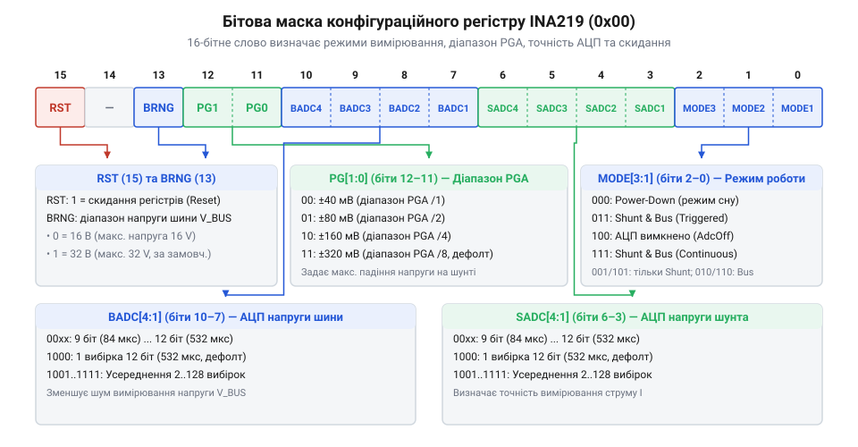
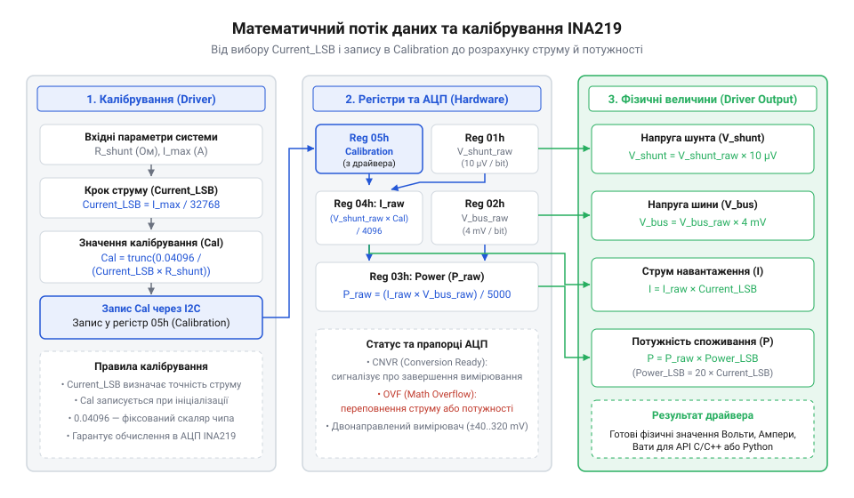

# Програмний інтерфейс драйвера INA219: бітові маски налаштувань, зчитування вибірок та обробка помилок

## Проблеми прямого зчитування сирих регістрів

Підключення цифрового вимірювача потужності @@en|INA219@@ до мікроконтролера через послідовну шину @@en|Inter-Integrated Circuit@@ (від англ. *Inter-Integrated Circuit*, @@en|I2C@@ — міжмікросхемна шина) на перший погляд здається простим завданням. Розробник очікує, що після виконання стандартної процедури зчитування регістрів пристрою він одразу отримає точні фізичні значення напруги шини у вольтах та струму споживання в амперах. Проте при першій спробі прямого зчитування 16-бітних регістрів без використання спеціалізованого [принципу драйверної архітектури](root:sf-devices/driver-pattern) розробник стикається з трьома фундаментальними проблемами: спотворенням порядку байтів, відсутністю калібрування та апаратними зависаннями шини.

Перша пастка полягає у відмінності форматів представлення даних у пам'яті. Апаратна логіка чипа @@en|INA219@@ зберігає значення 16-бітних регістрів у форматі @@en|Big-Endian@@ (від англ. *big-endian* — порядок байтів «старшим байтом вперед»), де першим по шині @@en|I2C@@ передається старший байт — @@en|Most Significant Byte@@ (від англ. *Most Significant Byte*, @@en|MSB@@ — старший байт), а другим — молодший байт @@en|Least Significant Byte@@ (від англ. *Least Significant Byte*, @@en|LSB@@ — молодший байт). Водночас більшість сучасних мікроконтролерів (зокрема систем на архітектурах ARM Cortex-M та ESP32) використовують порядок байтів @@en|Little-Endian@@ (від англ. *little-endian* — порядок байтів «молодшим байтом вперед»). Якщо розробник зчитує два байти послідовно в 16-бітне ціле число без явного байт-реверсу, старший і молодший байти міняються місцями. Наприклад, сире значення напруги `0x0100` (256 у десятковій системі) перетворюється на `0x0001` (1 у десятковій системі), що призводить до колосальних помилок у розрахунках.

Друга критична проблема — це функціонування чипа за замовчуванням після скидання живлення. При початковому включенні внутрішній калібрувальний регістр чипа містить значення `0x0000`. Оскільки вбудований апаратний множник використовує це значення для розрахунку струму й потужності, спроба зчитати **регістр струму** (`04h`) або **регістр потужності** (`03h`) повертає виключно нуль, незалежно від реального навантаження у колі. Водночас сирі дані з **регістра напруги шунта** (`01h`) представлені у доповняльному коді — @@en|Two's Complement@@ (від англ. *two's complement* — доповняльний код) із дискретністю 10 мкВ, а **регістр напруги шини** (`02h`) містить 13-бітне значення напруги, зсунуте на 3 біти вліво, поруч із системними прапорцями. Пряме інтерпретування цих чисел без виділення бітових масок та розрахунку фізичних коефіцієнтів унеможливлює правильний моніторинг живлення.

Третя загроза стосується стійкості всієї вбудованої системи. Під час роботи у реальних умовах на лінії @@en|I2C@@ можуть виникати електричні завади, імпульсні перехідні процеси або тимчасові просідання живлення. Ознайомившись із загальною [специфікацією та арбітражем шини I2C](root:com-devices/i2c-bus), можна переконатися, що припускання бездефектного обміну є неприпустимим. Якщо виклики зчитування регістрів реалізовані без налаштування таймаутів або без перевірки кодів повернення низькорівневого шинного трансивера, найменший збій під час передачі біта підтвердження викликає блокування шини — @@en|Bus Lockup@@ (від англ. *bus lockup* — зависання шини). В результаті мікроконтролер входить у нескінченний цикл очікування відповіді від slave-пристрою, повністю зупиняючи виконання основної програми.

Для вирішення цих проблем необхідна побудова структурованого @@en|Application Programming Interface@@ (від англ. *Application Programming Interface*, @@en|API@@ — програмний інтерфейс прикладної програми) драйвера. Такий драйвер бере на себе коректне відновлення порядку байтів, програмне формування бітових маск конфігурації, математичне обчислення калібрувальних коефіцієнтів та стійку обробку апаратних збоїв шини. Базові принципи [апаратного інтерфейсу INA219](root:cat-hw-sensors/ina219-power-monitor/api-ina219-hardware-interface.md) забезпечують фізичне підключення, на основі якого будується програмний шар.

## Бітові маски налаштувань регістру конфігурації

Управління режимним трактом вимірювача @@en|INA219@@ здійснюється через 16-бітний конфігураційний регістр — @@en|Configuration Register@@ (адреса `00h`). Цей регістр визначає діапазон вимірюваної напруги шини, коефіцієнт підсилення вхідного підсилювача, роздільну здатність аналогово-цифрового перетворювача — @@en|Analog-to-Digital Converter@@ (від англ. *Analog-to-Digital Converter*, @@en|ADC@@ — аналогово-цифровий перетворювач, @@en|АЦП@@), кількість усереднюваних вибірок та операційний режим живлення пристрою.


*Підпис: Розподіл бітових полів у 16-бітному регістрі конфігурації INA219 для вибору діапазонів напруги, підсилення PGA, режимів АЦП та режимів живлення.*

Розглянемо детально призначення кожного бітового поля в 16-бітному слові конфігурації:
1. **`RST` (`Reset`, біт 15)**: біт програмного скидання. Запис `1` у цей біт примусово відновлює всі регістри чипа до значень за замовчуванням (еквівалентно вимкненню та повторному ввімкненню живлення). 2. **`BRNG` (`Bus Voltage Range`, біт 13)**: вибір повної шкали вимірювання напруги шини — @@en|Full Scale Range@@ (від англ. *Full Scale Range*, @@en|FSR@@ — повна шкала). Значення `0` відповідає діапазону 16 В, а `1` — діапазону 32 В (при цьому максимальна робоча напруга обмежена специфікацією до 26 В). 3. **`PG1..PG0` (`PGA Gain`, біти 12..11)**: налаштування коефіцієнта підсилення вбудованого програмованого підсилювача — @@en|Programmable Gain Amplifier@@ (від англ. *Programmable Gain Amplifier*, @@en|PGA@@ — програмований диференціальний підсилювач). Визначає максимальну диференціальну напругу падіння на шунті: `00` = ±40 мВ (Gain /1), `01` = ±80 мВ (Gain /2), `10` = ±160 мВ (Gain /4), `11` = ±320 мВ (Gain /8). 4. **`BADC3..BADC0` (`Bus ADC Config`, біти 10..7)**: конфігурація АЦП напруги шини. Визначає роздільну здатність (9, 10, 11 або 12 бітів) або кількість усереднюваних вибірок (від 2 до 128). 5. **`SADC3..SADC0` (`Shunt ADC Config`, біти 6..3)**: конфігурація АЦП напруги шунта. Використовує те саме кодування, що й `BADC`. 6. **`MODE2..MODE0` (`Operating Mode`, біти 2..0)**: режим роботи пристрою. Вибирає між станом зниженого енергоспоживання — @@en|Power-Down Mode@@ (від англ. *power-down mode* — режим зниженого енергоспоживання; `000`), одноразовим вимірюванням за запитом — @@en|Triggered Mode@@ (від англ. *triggered mode* — режим вимірювання за запитом; `001`...`011`) та безперервним вимірюванням — @@en|Continuous Mode@@ (від англ. *continuous mode* — режим безперервного вимірювання; `101`...`111`).

Налаштування АЦП дозволяє гнучко балансувати між точністю та швидкодією. При виборі 9-бітного режиму час одного перетворення становить лише 84 мкс, що ідеально підходить для фіксації швидких імпульсних кидків струму. При виборі 12-бітного режиму з усередненням по 128 вибірках — @@en|Oversampling Ratio@@ (від англ. *Oversampling Ratio*, @@en|OSR@@ — коефіцієнт передискретизації) — час вимірювання збільшується до 68.10 мс, проте це забезпечує повне придушення високочастотних мережевих завад. Порівнюючи ці параметри з [конфігурацією та усередненням вимірювань INA226](root:cat-hw-sensors/ina226-config-and-averaging), можна побачити розширення діапазонів фільтрації у новіших моніторах.

Для формування значення регістра конфігурації у програмному коді застосовують бітові операції зсуву та маскування.

:::tabs

:::code api-ina219-software-driver-api/c/esp-idf/ina219-make-config.c

:::code api-ina219-software-driver-api/cpp/arduino/ina219configbuilder.cpp

```python
# Формування маски конфігурації INA219 мовою Python
class INA219Config:
    BRNG_32V  = 1 << 13
    GAIN_80MV = 1 << 11
    BADC_128X = 0x0F << 7
    SADC_128X = 0x0F << 3
    MODE_CONT = 0x07

    @classmethod
    def build_config(cls) -> int:
        return (cls.BRNG_32V | cls.GAIN_80MV |
                cls.BADC_128X | cls.SADC_128X |
                cls.MODE_CONT)
```

:::

## Математика калібрування та перетворення вибірок

Серцем автоматичного розрахунку струму й потужності всередині чипа @@en|INA219@@ є вбудований 16-бітний апаратний цифровий множник — @@en|Hardware Multiplier@@ (від англ. *hardware multiplier* — апаратний цифровий множник). Щоб активувати цей обчислювальний конвеєр, програміст повинен розрахувати та записати у калібрувальний регістр — @@en|Calibration Register@@ (адреса `05h`, скорочено `Cal`) — 16-бітний коефіцієнт.


*Підпис: Потік обробки даних у драйвері INA219: від розрахунку регістру калібрування до апаратного та програмного перетворення вибірок у фізичні одиниці.*

Процес розрахунку калібрування складається з кількох послідовних кроків. Спочатку визначається мінімально припустиме значення дискретності струму `Minimum_Current_LSB` на основі максимально очікуваного струму навантаження `Max_Expected_I`:

```
Minimum_Current_LSB = Max_Expected_I ÷ 32768
```

Отримане значення `Minimum_Current_LSB` округлюють у більший бік до найближчого зручного круглого числа `Current_LSB` (наприклад, 100 мкА/дискрету або 50 мкА/дискрету). Потім обчислюється 16-бітне ціле значення для запису в регістр `Cal` за допомогою фіксованого внутрішнього масштабуючого коефіцієнта чипа `0.04096`:

```
Cal = trunc(0.04096 ÷ (Current_LSB × R_shunt))
```

де операція `trunc` означає відсікання дробової частини — @@en|Truncation@@ (від лат. *truncatio* — відсікання дробової частини), `Current_LSB` задано в амперах на дискрету, а опір шунта `R_shunt` — в омах.

Після збереження значення `Cal` у регістрі `05h` мікросхема починає автоматично розраховувати вміст **регістра струму** (`04h`, **`Current Register`**) та **регістра потужності** (`03h`, **`Power Register`**) за формулами:

```
Current = (Shunt_Voltage × Cal) ÷ 4096
Power = (Current × Bus_Voltage) ÷ 5000
Power_LSB = 20 × Current_LSB
```

Розглянемо покроковий розрахунок калібрувального коефіцієнта на конкретному практичному прикладі.

**Розрахунок калібрування INA219 для струму до 2.0 А при шунті 0.1 Ом:**

```
R_shunt = 0.1 Ом
Max_Expected_I = 2.0 А

Minimum_Current_LSB = 2.0 ÷ 32768
                    = 0.000061035 А/дискрету  [обчислення мінімального LSB]

Current_LSB = 0.0001 А/дискрету (100 мкА/дискрету)  [вибір зручного круглого LSB]

Cal = trunc(0.04096 ÷ (0.0001 × 0.1))
    = trunc(0.04096 ÷ 0.00001)        [множення LSB на R_shunt]
    = trunc(4096)                       [ділення константи]
    = 4096 (0x1000 у hex)              [підсумкове значення Cal]
```

Зіставивши цей алгоритм із більш сучасним [цифровим монітором живлення INA226](root:cat-hw-sensors/ina226-power-monitor), де застосовано інший внутрішній множник константи (0.00512), чип @@en|INA219@@ вимагає суворого дотримання масштабування `0.04096`.

Нижче наведено програмну реалізацію розрахунку калібрування та зчитування фізичних величин.

:::tabs

:::code api-ina219-software-driver-api/c/esp-idf/ina219-calculate-calib.c

:::code api-ina219-software-driver-api/cpp/arduino/ina219math.cpp

:::code api-ina219-software-driver-api/py/ina219math.py

:::

## Контроль готовності даних та переповнення

Надійність моніторингу в реальному часі залежить від вміння драйвера відрізняти актуальні нові вибірки від застарілих даних та вчасно фіксувати нештатні стани вимірювального тракту. Для цього у **регістрі напруги шини** (`02h`) передбачено два спеціальних системних прапорці:

1. **`CNVR` (`Conversion Ready`, біт 1)**: прапорець готовності вибірки — @@en|Conversion Ready@@ (від англ. *Conversion Ready*, @@en|CNVR@@ — прапорець готовності вибірки). Внутрішня логіка чипа встановлює біт `CNVR` у `1` кожного разу, коли АЦП завершує новий цикл вимірювання та оновлює вміст внутрішніх регістрів. Будь-яке зчитування регістра напруги шини (`02h`) автоматично скидає біт `CNVR` у `0`. У режимі вимірювання за запитом `Triggered Mode` драйвер опитує цей біт у циклі — @@en|Polling Loop@@ (від англ. *polling loop* — цикл опитування стану) — чекаючи моменту, коли дані стануть доступними для зчитування. 2. **`OVF` (`Math Overflow`, біт 0)**: прапорець математичного переповнення — @@en|Math Overflow@@ (від англ. *Math Overflow*, @@en|OVF@@ — прапорець математичного переповнення). Встановлюється у `1`, якщо падіння напруги на шунті перевищило обраний діапазон @@en|PGA@@ або під час обчислень в апаратному множнику відбулося математичне переповнення 16-бітного регістра. Якщо біт `OVF` дорівнює `1`, зчитані значення з регістрів струму та потужності є недостовірними, і драйвер має повернути помилку виходу за межі діапазону.

Правильний алгоритм опитування пристрою передбачає первинне зчитування регістра `02h`, аналіз прапорців `CNVR` та `OVF`, і лише після цього — зчитування регістрів струму й потужності.

:::tabs

:::code api-ina219-software-driver-api/c/esp-idf/ina219-check-bus-status.c

:::code api-ina219-software-driver-api/cpp/arduino/ina219status.cpp

```python
# Перевірка прапорців CNVR та OVF мовою Python
def parse_bus_register(raw_bus_reg: int):
    is_ready = bool(raw_bus_reg & 0x0002)
    is_overflow = bool(raw_bus_reg & 0x0001)
    voltage = (raw_bus_reg >> 3) * 0.004
    return is_ready, is_overflow, voltage
```

:::

## Побудова стійкого інтерфейсу обробки помилок

У промислових та автономних системах реального часу програмний драйвер вимірювача живлення повинен володіти високим рівнем відмовостійкості — @@en|Fault Tolerance@@ (від англ. *fault tolerance* — відмовостійкість). Апаратні збої послідовної шини, такі як відсутність підтвердження — @@en|Negative Acknowledge@@ (від англ. *Negative Acknowledge*, @@en|NACK@@ — сигнал відсутності підтвердження), короткочасні втрати живлення чипа або електромагнітні завади, не повинні призводити до зависання мікроконтролера.

Для забезпечення стійкості драйвер @@en|INA219@@ повинен реалізовувати чотири захисні механізми:
1. **Повторні спроби передачі з відстрочкою (Backoff)**: при отриманні помилки `I2C_NACK` драйвер виконує до $N$ повторних спроб обміну з експоненційною затримкою — @@en|Exponential Backoff@@ (від англ. *exponential backoff* — експоненційна затримка повторних спроб). 2. **Автоматична повторна ініціалізація**: якщо чип зазнав тимчасового просідання живлення, його конфігураційний та калібрувальний регістри скидаються в нуль. Драйвер повинен контролювати цілісність регістра `Cal` і при виявленні нуля виконувати повторний запис параметрів. 3. **Відновлення шини (Bus Recovery)**: при зависанні лінії даних у низькому стані драйвер генерує до 9 тактових імпульсів на лінії `SCL` — @@en|Bus Recovery@@ (від англ. *bus recovery* — відновлення працездатності шини) — для звільнення трансивера slave-пристрою. 4. **Типізовані коди помилок**: всі функції драйвера повертають статусні коди, що дозволяє верхньому рівню ПЗ реагувати на нештатні ситуації без аварійного завершення.

Нижче наведено приклад побудови стійкого інтерфейсу зчитування даних.

:::tabs

:::code api-ina219-software-driver-api/c/esp-idf/ina219-read-power-data.c

:::code api-ina219-software-driver-api/cpp/arduino/ina219status-2.cpp

:::code api-ina219-software-driver-api/py/ina219drivererror.py

:::