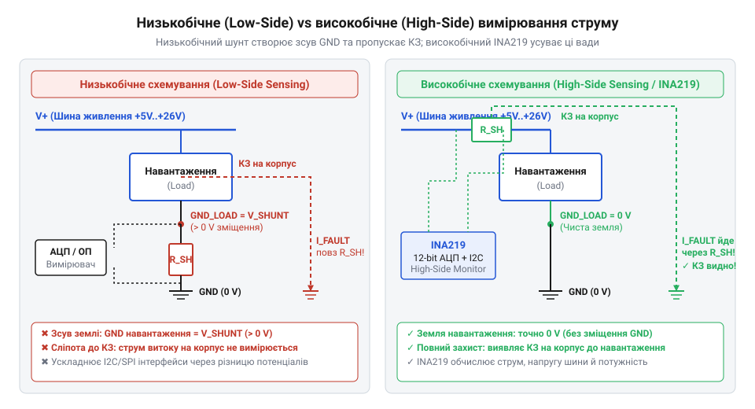
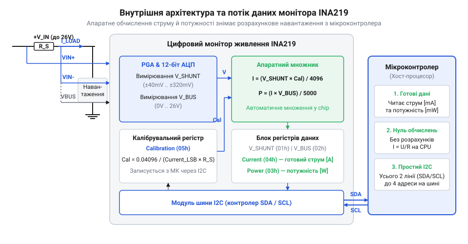

# Еволюція High-Side вимірювання струму: від низькобічних шунтів і аналогових підсилювачів до цифрових моніторів INA219

## Низькобічне вимірювання та зміщення землі

У колах живлення радіоелектронних пристроїв контроль струму є фундаментальною задачею для захисту компонентів від перевантаження, керування зарядом акумуляторів та моніторингу енергоспоживання. Найпростішим схемотехнічним способом перетворення струму на вимірювальний електричний сигнал є його проходження через прецизійний резистор з малим опором — @@en|шунт@@ (від англійського @@en|shunt@@ — відхилення, розгалуження). Згідно із законом Ома, струм, що протікає через опір, створює пропорційний спад напруги, який можна виміряти.

Історично першим і найпростішим підходом стало низькобічне вимірювання — @@en|Low-Side@@ (від англійського @@en|low@@ — низький, та @@en|side@@ — сторона). У такій топології @@en|шунт@@ вмикають у розрив негативного провідника живлення, тобто між мінусовим виводом навантаження та спільною землею схеми @@en|GND@@ (від англійського @@en|ground@@ — земля).

Вхідна напруга вимірювача струму визначається пропорційно струму навантаження та опору шунта за законом Ома:

    V_shunt = I_load · R_shunt           [закон Ома для вимірювального шунта]

Тут `V_shunt` означає спад напруги на вимірювальному шунті, `I_load` — струм у колі навантаження, а `R_shunt` — опір шунта.

Схема @@en|Low-Side@@ приваблює простотою: обидва виводи вимірюваного спаду напруги `V_shunt` прив'язані до потенціалу спільної землі @@en|GND@@, що дозволяє подавати сигнал безпосередньо на аналоговий вхід мікроконтролера або стандартного підсилювача без складних схем узгодження рівнів.

Проте розміщення шунта у провіднику землі створює дві критичні системні проблеми. Перша проблема — зміщення потенціалу землі навантаження. Коли через @@en|шунт@@ протікає струм, потенціал мінусового виводу живлення навантаження піднімається відносно істинної землі @@en|GND@@ на величину `V_shunt`. Якщо навантаження є цифровим модулем або мікроконтролером, який обмінюється даними з головним процесором через дротові інтерфейси, такі як @@en|UART@@ (від англійського @@en|Universal Asynchronous Receiver-Transmitter@@) чи @@en|SPI@@ (від англійського @@en|Serial Peripheral Interface@@), логічний нуль навантаження стає вищим за логічний нуль контролера. Під час стрибків струму спад напруги `V_shunt` досягає сотень мілівольт, через що приймач контролера перестає розпізнавати низький рівень сигналу, виникають збої синхронізації та спотворення даних.

Друга проблема — неможливість виявлення короткого замикання на корпус чи землю. У приладах із металевим шасі або в автомобільній електроніці корпус пристрою з'єднаний зі спільною землею @@en|GND@@. Якщо позитивний провідник живлення після джерела, але до навантаження, випадково замикається на металевий корпус, аварійний струм протікає напряму в землю через місце замикання, повністю оминаючи @@en|Low-Side@@ @@en|шунт@@.

*Принципова схемотехнічна діаграма низькобічного (Low-Side) та високобічного (High-Side) вимірювання струму в колі живлення.*

Як видно з діаграми, при короткому замиканні на корпус вимірювач @@en|Low-Side@@ фіксує нульовий струм, оскільки опір шунта виключений із аварійного контуру. Система захисту залишається «сліпою» до аварії, що призводить до оплавлення проводки або виходу з ладу джерела живлення. Для усунення цих обмежень виникла потреба перенести вимірювальний опір безпосередньо у позитивну шину живлення — до топології @@en|High-Side@@ (від англійського @@en|high@@ — високий, та @@en|side@@ — сторона).

## Спроби вимірювання на позитивній шині

Перенесення вимірювального шунта у позитивну шину живлення повністю розв'язує фундаментальні проблеми низькобічного підключення. У схемах @@en|High-Side@@ @@en|шунт@@ встановлюється між позитивним виводом джерела живлення та навантаженням. За такої конфігурації земля навантаження з'єднується зі спільною землею @@en|GND@@ напряму без проміжних опорів, що зберігає єдиний потенціал для інтерфейсів зв'язку. Крім того, будь-яке коротке замикання після шунта на корпус викликає протікання струму через @@en|шунт@@, дозволяючи сенсору миттєво зафіксувати аварійний стрибок.

Однак вимірювання у позитивній шині стикається з серйозною схемотехнічною перешкодою — високою синфазною напругою. На відміну від низькобічного підключення, де один із кінців шунта з'єднаний із землею, у топології @@en|High-Side@@ обидва виводи вимірювального резистора перебувають під потенціалом, близьким до повної напруги живлення шини. Корисний сигнал є малим диференційним спадом `V_shunt` (зазвичай від 10 до 100 мілівольт), який «плаває» на тлі високої постійної напруги шини.

Синфазна вхідна напруга вимірювальних виводів визначається як півсума потенціалів обох кінців шунта відносно спільної землі:

    V_CM = (V_IN+ + V_IN-) ÷ 2            [визначення синфазної вхідної напруги]

Тут `V_CM` позначає синфазну напругу, `V_IN+` — потенціал позитивного виводу шунта з боку джерела, а `V_IN-` — потенціал виводу з боку навантаження.

Поширеним інженерним міфом є уявлення про те, що @@en|High-Side@@ вимірювання можна безпечно реалізувати на звичайному універсальному операційному підсилювачі, такому як @@en|LM358@@ чи @@en|TL072@@, увімкненому за схемою класичного диференційного підсилювача.

Схемотехнічний бар'єр полягає в тому, що стандартний @@en|операційний підсилювач@@ (від латинського @@la|operatio@@ — дія) має жорстко обмежений діапазон вхідної синфазної напруги, який не може виходити за межі шин його власного живлення. Якщо підсилювач живиться від напруги +5 вольт мікроконтролера, а вимірювання здійснюється у шині +12 чи +24 вольти, значення `V_CM` значно перевищує напругу живлення підсилювача. Це призводить до насичення вхідних каскадів, відкривання захисних діодів від електростатичного розряду та неминучого виходу чипа з ладу.

Навіть якщо @@en|операційний підсилювач@@ заживити від тієї ж високовольтної шини, виникає друга проблема — вимога до прецизійного збалансування резисторів диференційного моста. Щоб виділити корисний диференційний сигнал величиною 10 мілівольт на тлі синфазної напруги 24 вольти, потрібен надзвичайно високий [коефіцієнт пригнічення синфазного сигналу](root:hw-analog/cmrr) — @@en|CMRR@@ (від англійського @@en|Common-Mode Rejection Ratio@@).

Відхилення опору дискретних резисторів диференційного обв'язування всього на 0.1% знижує реальний @@en|CMRR@@ до рівня близько 60 децибел. При синфазній напрузі 24 вольти це створює похибку вимірювання близько 24 мілівольт, що перевищує весь корисний сигнал шунта. Таким чином, застосування стандартних операційних підсилювачів для @@en|High-Side@@ вимірювання є небезпечним і недоцільним, що зумовило потребу у розробці спеціалізованих інтегральних підсилювачів.

## Спеціалізовані аналогові підсилювачі серії INA

Потреба у надійній та точній роботі при високій синфазній напрузі привела до створення спеціалізованих аналогових підсилювачів струму високої сторони. Наприкінці 1990-х років компанія @@en|Burr-Brown@@ (згодом увійшла до складу @@en|Texas Instruments@@) розробила принципово нову схемотехнічну архітектуру, втілену у мікросхемах @@en|INA138@@ та @@en|INA168@@.

Ключова новація цих пристроїв полягала у відмові від прямого підсилення напруги на високому потенціалі. Замість цього внутрішній високоточний каскад перетворює диференційну напругу шунта у пропорційний вихідний струм відносно спільної землі @@en|GND@@ — така топологія називається @@en|транскондактансною@@ (від латинського @@la|trans@@ — через, та англійського @@en|conductance@@ — провідність).

Внутрішній підсилювач через вбудований високовольтний @@en|MOSFET@@ (від англійського @@en|Metal-Oxide-Semiconductor Field-Effect Transistor@@) транзистор прикладає диференційну напругу шунта `V_shunt` до внутрішнього прецизійного резистора `R_G` номіналом 5 кілоом.

Вихідний струм внутрішнього підсилювача формується пропорційно диференційній напрузі на шунті та обернено пропорційно внутрішньому опору резистора гальванічного перетворення:

    I_OUT = V_SHUNT ÷ R_G                 [перетворення диференційної напруги в струм]

Тут `I_OUT` означає вихідний струм підсилювача, `V_SHUNT` — спад напруги на вимірювальному шунті, а `R_G` — внутрішній резистор номіналом 5 кілоом.

Згенерований струм `I_OUT` витікає з високовольтного каскаду і прямує до спільної землі @@en|GND@@ через зовнішній резистор навантаження `R_L`, підключений до виходу мікросхеми.

Підсумкова вихідна аналогова напруга відносно спільної землі обчислюється на зовнішньому резисторі навантаження:

    V_OUT = I_OUT · R_L                  [закон Ома для вихідного резистора]
    = (V_SHUNT ÷ R_G) · R_L              [підстановка виразу вихідного струму]
    = V_SHUNT · (R_L ÷ R_G)              [перегрупування коефіцієнта підсилення]

Тут `V_OUT` позначає вихідну аналогову напругу відносно землі, а `R_L` — опір зовнішнього резистора навантаження.

Оскільки внутрішній транзистор витримує високу напругу, мікросхема @@en|INA138@@ здатна працювати при синфазній напрузі шини до +36 вольт, а @@en|INA168@@ — до +60 вольт, навіть якщо саме джерело живлення мікросхеми становить лише +5 вольт. Коефіцієнт підсилення напруги `A_V = R_L ÷ R_G` задається вибором єдиного зовнішнього резистора `R_L`, що усуває потребу в підборі узгоджених резистивних мостів.

Попри значний технологічний прорив, аналогові підсилювачі серії @@en|INA138@@ / @@en|INA168@@ мають вагомі системні обмеження:

1. Необхідність зовнішньої аналогової обв'язки — точність вимірювання напряму залежить від температурної стабільності та допуску зовнішніх резисторів `R_L` та `R_shunt`. 2. Потреба у зовнішньому аналогово-цифровому перетворювачі — вихідний сигнал є аналоговою напругою `V_OUT`, тому для обробки даними потрібен зовнішній @@uk|АЦП@@ (від українського @@uk|аналого-цифровий перетворювач@@) або модуль @@en|ADC@@ (від англійського @@en|Analog-to-Digital Converter@@) у складі мікроконтролера. 3. Обчислювальне навантаження на хост-процесор — мікроконтролер змушений постійно виконувати опитання АЦП, розраховувати струм за формулою та множити струм на напругу шини для обчислення потужності, що витрачає ресурси процесора та переривання.

Про подальший розвиток схемотехніки свідчить поява цифрових моніторів, таких як [цифровий монітор живлення INA226](root:cat-hw-sensors/ina226-power-monitor), які об'єднали High-Side підсилювач, високоточний АЦП та апаратний обчислювач в одному корпусі.

## Цифровий монітор живлення INA219

У той час як аналогові підсилювачі високої сторони спростили роботу з високою синфазною напругою, вони залишили на хост-контролері значне аналогове та обчислювальне навантаження. Потреба у повній автоматизації процесу моніторингу елементів живлення привела компанію @@en|Texas Instruments@@ до створення цифрового монітора живлення @@en|INA219@@. Ключовою схемотехнічною ідеєю цього чипа є об'єднання в єдиному корпусі високоточного підсилювача @@en|High-Side@@, аналогово-цифрового перетворювача, апаратного арифметичного обчислювача та цифрового інтерфейсу @@en|I2C@@ (від англійського @@en|Inter-Integrated Circuit@@).

Внутрішня архітектура @@en|INA219@@ побудована навколо 12-бітного @@en|сигма-дельта@@ АЦП (від англійського @@en|Analog-to-Digital Converter@@, або @@en|ADC@@) та програмованого вхідного підсилювача @@en|PGA@@ (від англійського @@en|Programmable Gain Amplifier@@). Схема виконує подвійне вимірювання вхідних величин: вимірює малий диференційний спад напруги `V_shunt` між виводами `VIN+` та `VIN-`, а також абсолютну напругу шини `V_bus` на виводі `VIN-` відносно спільної землі @@en|GND@@. Вбудований @@en|PGA@@ дозволяє обирати максимальний діапазон напруги шунта (±40, ±80, ±160 або ±320 мілівольт), розширюючи динамічний діапазон вимірювання струму без зміни фізичного резистора.

Головною інновацією @@en|INA219@@ стала наявність програмованого калібрувального регістра `Calibration` (адреса `05h`) та апаратного множника потужності. Замість того щоб передавати сирі значення спаду напруги на мікроконтролер для подальших обчислень, розробник один раз записує у регістр калібрування розрахований коефіцієнт, який пов'язує опір шунта з потрібною дискретністю струму `Current_LSB` (від англійського @@en|Least Significant Bit@@).

Апаратний множник чипа автоматично й безперервно перераховує диференційну напругу у фізичний струм, а струм — у потужність за вбудованими формулами:

    Current = (Shunt_Voltage × Calibration) ÷ 4096      [апаратне обчислення струму]
    Power = (Current × Bus_Voltage) ÷ 5000              [апаратне обчислення потужності]

Тут `Current` позначає вміст регістра струму (адреса `04h`), `Shunt_Voltage` — виміряний спад напруги на шунті (адреса `01h`), `Calibration` — записане значення калібрувального регістра, `Power` — вміст регістра потужності (адреса `03h`), а `Bus_Voltage` — напругу шини (адреса `02h`).

*Блок-схема внутрішньої архітектури цифрового монітора живлення INA219 та потоку даних.*

Завдяки апаратному обчисленню мікроконтролер звільняється від постійного опитання аналогових входів, множення чисел із плаваючою комою та розрахунку потужності. Процесор у будь-який момент може зчитати по шині @@en|I2C@@ готові значення струму в міліамперах або потужності у міліватах безпосередньо з відповідних регістрів. Для складніших систем із вищою точністю та додатковими режимами фільтрації застосовується розвиненіший [цифровий монітор живлення INA226](root:cat-hw-sensors/ina226-power-monitor), де детальніше розглядають [конфігурацію та усереднення вимірювань INA226](root:cat-hw-sensors/ina226-config-and-averaging).

## Спростування міфів та вибір архітектури

Із поширенням цифрових моніторів у середовищі розробників виник схемотехнічний міф про те, що цифрові сенсори живлення через затримку послідовної шини @@en|I2C@@ створюють неприпустимо повільну реакцію для систем аварійного захисту. Скептики стверджують, що пропитування регістрів по цифровому інтерфейсу не здатне вчасно зупинити коротке замикання або перевантаження.

Детальний аналіз часових характеристик спростовує це уявлення. Час конверсії вбудованого АЦП мікросхеми @@en|INA219@@ гнучко налаштовується від 84 мікросекунд (при 9-бітній роздільності) до 532 мікросекунд (при 12-бітній роздільності). На високошвидкісній шині @@en|I2C@@ у режимі @@en|Fast-Mode@@ (400 кілогерц) транзакція читання двобайтового регістра триває близько 120 мікросекунд. Для більшості систем програмно-апаратного захисту акумуляторів, серверних блоків живлення та робототехніки сумарна затримка у декілька сотень мікросекунд є цілком прийнятною. Більше того, у сучасних цифрових моніторах передбачено виділений аварійний вивід @@en|ALERT@@, який апаратно формує сигнал переривання при перевищенні порогу без потреби постійного опитання шини.

Проте кожен із трьох розглянутих методів вимірювання струму володіє власними компромісами щодо швидкодії, точності, ціни та обчислювальної ресурсомісткості:

1. Низькобічне вимірювання (@@en|Low-Side@@) — найдешевше схемотехнічне рішення на одному резисторі та звичайному АЦП. Застосовується в простих пристроях, де відсутній вимогливий дротовий зв'язок і немає ризику короткого замикання на корпус. 2. Аналоговий High-Side (на приладах серії @@en|INA138@@ / @@en|INA168@@) — забезпечує миттєвий аналоговий відгук із смугою пропускання до 800 кілогерц, що робить його ідеальним для надшвидкісних аналогових схем відсічки струму й аналогових контурів зворотного зв'язку. Однак вимагає зовнішнього АЦП, прецизійної обв'язки й навантажує мікроконтролер розрахунками. 3. Цифровий High-Side (на @@en|INA219@@) — пропонує максимальну інтеграцію, високу завадостійкість цифрової шини при передачі даних на відстань, нульове навантаження на процесор та готові значення струму й потужності.

Таким чином, вибір архітектури визначається пріоритетом проєкту: коли потрібен аналоговий відгук за частки мікросекунди — обирають аналогові підсилювачі @@en|INA138@@; коли ж необхідний системний моніторинг енергоспоживання з мінімальною обв'язкою та збереженням ресурсів процесора — оптимальним вибором стає цифровий монітор @@en|INA219@@.