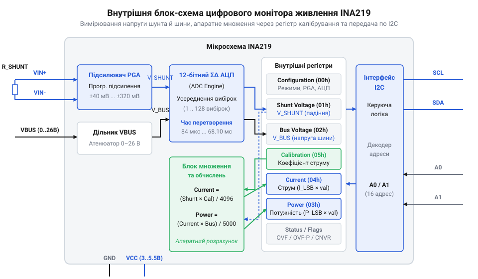
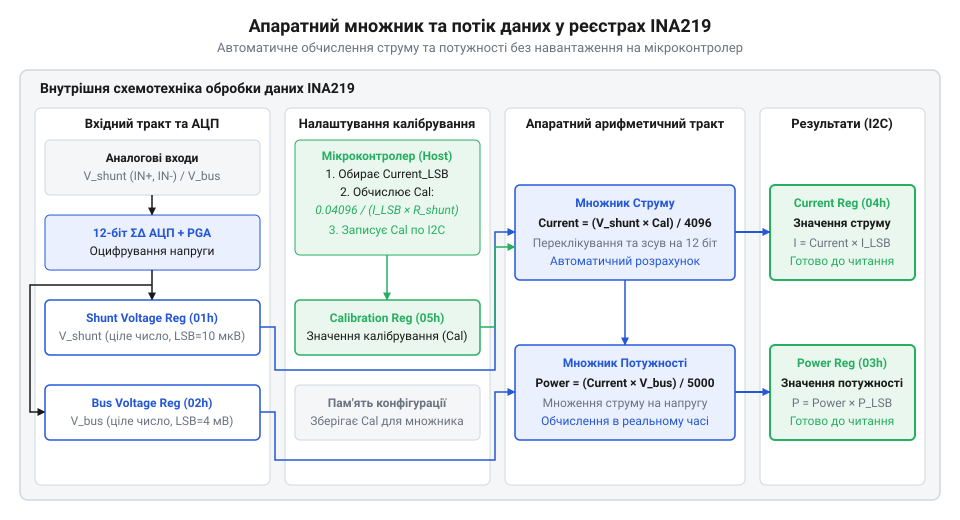
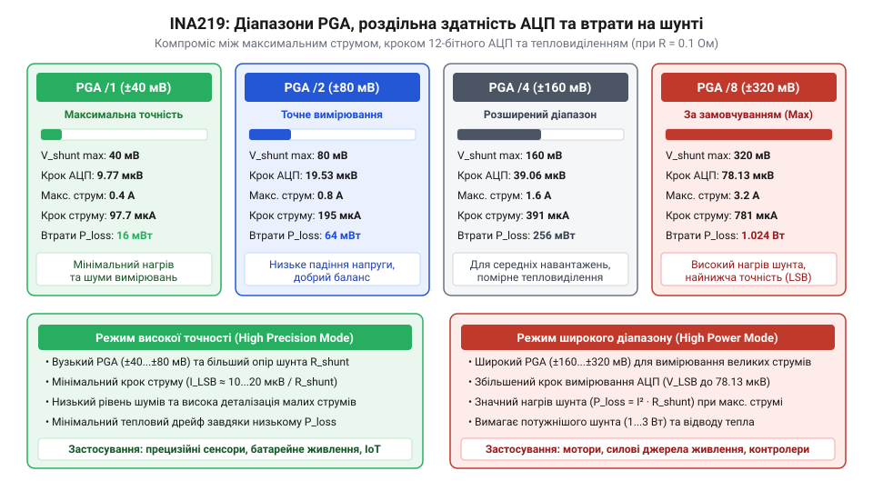
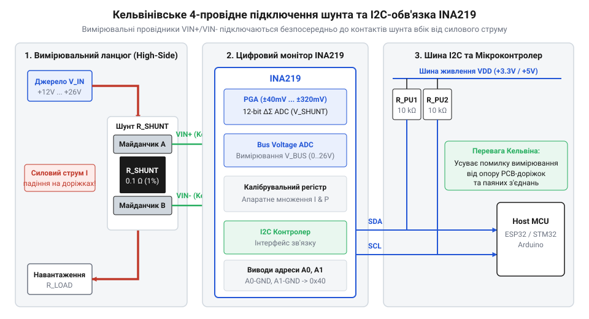

# INA219 — монітор струму й напруги (I2C)

## Проблема вимірювання струму в колах живлення

Будь-яка електронна система — від автономного бездротового датчика до промислового контролера — потребує постійного контролю споживання електричної енергії. Вимірювання струму дозволяє оцінювати стан розряджання акумуляторних батарей, виявляти аномальні режими роботи обладнання, захищати силові кола від перевантажень та розраховувати підсумковий енергетичний баланс. На відміну від напруги, яку можна легко виміряти паралельним підключенням аналогово-цифрового перетворювача, вимірювання струму вимагає його проходження безпосередньо через вимірювальний елемент. Фундаментальним та найпоширенішим способом такого контролю виступає використання первинного вимірювального перетворювача — прецизійного резистора низького опору. Згідно з @@en|Ohm's Law@@ (від нім. *Ohm* — закон Ома), проходження струму через [вимірювальний шунтовий резистор](root:hw-components/shunt-resistor) викликає на ньому пропорційне падіння напруги. Проте ключ до побудови точного та безпечного вимірювального тракту полягає не лише у виборі опору шунта, а й у місці його схемотехнічного включення в коло живлення.

Щоб мінімізувати втрати потужності на нагрів, опір шунта обирають дуже малим — зазвичай від 10 мОм до 100 мОм. Це означає, що падіння напруги на шунті становить лише одиниці або сотні мілівольтів. Щоб перетворити цей мікровольтний сигнал у корисну інформацію, необхідно правильно визначити відлікову точку вимірювання відносно системної землі — @@en|Ground@@ (від англ. *ground*, @@en|GND@@ — спільна земля системи).

Історично найпростішим підходом вважається схема низькобічного вимірювання — @@en|Low-Side@@ (від англ. *low-side* — низькобічне вимірювання). У такій конфігурації шунтовий резистор включається в розрив мінусового провідника живлення, тобто між виводом мінуса навантаження та спільною землею системи @@en|GND@@. Головною перевагою даного методу є схемотехнічна простота: один кінець шунта жорстко підключений до відлікового потенціалу землі 0 В, тому синфазна напруга на вимірювальних входах підсилювача практично дорівнює нулю. Це дозволяє використовувати звичайні операційні підсилювачі — @@en|Operational Amplifier@@ (від англ. *operational amplifier*, @@en|Op-Amp@@ — операційний підсилювач) із низьковольтним однополярним живленням. Однак низькобічне вимірювання створює дві фундаментальні проблеми, які роблять його непридатним для більшості відповідальних систем живлення.

Перша критична проблема @@en|Low-Side@@ підключення — це неминучий зсув потенціалу землі навантаження. Оскільки струм навантаження протікає через шунт, потенціал мінусового виводу навантаження піднімається відносно системної землі @@en|GND@@ на величину падіння напруги на шунті. У результаті навантаження втрачає прямий контакт із системним нулем, що викликає помилки передачі даних при спробі з'єднати цей вузол з іншими компонентами системи через цифрові інтерфейси. Наприклад, якщо зсув землі досягає 300 мВ, логічні рівні на шинах даних можуть вийти за межі допустимих порогів спрацьовування. Друга пастка @@en|Low-Side@@ шунтування — повна нездатність виявити коротке замикання на корпус. Якщо провідник позитивної шини живлення випадково замкне на заземлений металевий корпус або спільну землю до навантаження, надмірний струм пройде в обхід шунта. Вимірювач зафіксує відсутність споживання струму, а джерело живлення або провідники зазнають аварійного руйнування від перегріву.


*Підпис: Порівняння схем низькобічного та високобічного вимірювання струму з ілюстрацією зсуву потенціалу землі й шляхів короткого замикання.*

Вирішенням названих проблем виступає високобічне вимірювання — @@en|High-Side@@ (від англ. *high-side* — високобічне вимірювання). При @@en|High-Side@@ підключенні шунтовий резистор встановлюється в розрив позитивної лінії живлення — між джерелом живлення та позитивним виводом навантаження. Така схема повністю зберігає цілісність системної землі @@en|GND@@, усуває зсув потенціалів на цифрових лініях зв'язку та гарантує виявлення будь-яких коротких замикань навантаження на корпус, оскільки аварійний струм обов'язково протікає через шунт. Детально аналізуючи [еволюцію методів вимірювання струму](root:cat-hw-sensors/ina219-power-monitor/hist-high-side-current-sensing-evolution.md), можна переконатися, що саме високобічна топологія стала стандартом для сучасних систем керування живленням.

Проте традиційна аналогова реалізація @@en|High-Side@@ вимірювання висуває вкрай суворі вимоги до схемотехніки. Обидва виводи шунтового резистора перебувають під високим потенціалом шини живлення — @@en|Common-Mode Voltage@@ (від англ. *common-mode voltage*, @@en|V_CM@@ — синфазна напруга), яка може сягати десятків вольтів. Водночас корисний диференціальний сигнал падіння напруги на шунті становить лише одиниці чи десятки мілівольтів. Щоб підсилити цей мікровольтний сигнал на тлі високої синфазної напруги, звичайний [підсилювач вимірювання струму](root:hw-analog/current-sense-amplifiers-high-side) повинен мати надзвичайно високий коефіцієнт придушення синфазного сигналу — @@en|Common-Mode Rejection Ratio@@ (від англ. *Common-Mode Rejection Ratio*, @@en|CMRR@@ — коефіцієнт придушення синфазного сигналу). Наприклад, якщо синфазна напруга становить 24 В, а диференційний сигнал шунта — всього 10 мВ, найменша розбіжність опорів у дискретній обв'язці диференціального підсилювача призводить до того, що синфазний сигнал перетворюється на хибне значення струму, повністю спотворюючи результати вимірювання.

Саме для подолання цих аналогових обмежень було розроблено спеціалізований цифровий монітор живлення @@en|INA219@@. Ця інтегральна мікросхема поєднує в собі високобічний аналоговий вхідний тракт, здатний працювати з синфазними напругами шини до +26 В незалежно від власної напруги живлення чипа (+3.0 В ... +5.5 В), прецизійний аналогово-цифровий перетворювач та цифрову шину @@en|Inter-Integrated Circuit@@ (від англ. *Inter-Integrated Circuit*, @@en|I2C@@ — міжмікросхемна шина), передаючи готові цифрові значення струму та напруги безпосередньо управляючому контролеру.

## Внутрішня архітектура та аналоговий тракт INA219

Апаратна структура цифрового монітора живлення @@en|INA219@@ побудована навколо двоканального вимірювального аналогового тракту — @@en|Analog Front-End@@ (від англ. *Analog Front-End*, @@en|AFE@@ — аналоговий вхідний тракт), який забезпечує одночасне зчитування малого диференціального сигналу на шунті та високої синфазної напруги живленої шини. Для підключення шунтового резистора мікросхема має прецизійні диференціальні входи `VIN+` та `VIN-`. Вхідний сигнал падіння напруги `V_shunt` визначається як різниця потенціалів між цими виводами та надходить на програмований диференціальний підсилювач — @@en|Programmable Gain Amplifier@@ (від англ. *Programmable Gain Amplifier*, @@en|PGA@@ — програмований диференціальний підсилювач).

Головне завдання вбудованого підсилювача @@en|PGA@@ полягає у масштабуванні диференціальної напруги під динамічний діапазон внутрішнього аналогово-цифрового перетворювача. Розробник може програмно обирати один із чотирьох коефіцієнтів підсилення/ділення вхідного діапазону за допомогою розрядів `PG1` та `PG0` у конфігураційному регістрі — @@en|Configuration Register@@ (від англ. *Configuration Register* — конфігураційний регістр):
1. Діапазон `/1` (Gain = 1): максимальна диференціальна напруга ±40 мВ. 2. Діапазон `/2` (Gain = 1/2): максимальна диференціальна напруга ±80 мВ. 3. Діапазон `/4` (Gain = 1/4): максимальна диференціальна напруга ±160 мВ. 4. Діапазон `/8` (Gain = 1/8): максимальна диференціальна напруга ±320 мВ (режим за замовчуванням).

Можливість звуження вхідного діапазону до ±40 мВ дозволяє використовувати шунтові резистори з наднизьким опором для мінімізації теплових втрат, зберігаючи при цьому високу роздільну здатність вимірювання при малих струмах.


*Підпис: Структурна блок-схема внутрішньої архітектури INA219 із висвітленням аналогового тракту, АЦП та цифрових регістрів.*

Після масштабування в підсилювачі @@en|PGA@@ аналоговий сигнал подається на вбудований 12-бітний аналогово-цифровий перетворювач. У мікросхемі @@en|INA219@@ застосовано архітектуру сигма-дельта перетворення — @@en|Sigma-Delta ADC@@ (від грец. *sigma-delta* — сигма-дельта аналогово-цифровий перетворювач, @@en|ΣΔ ADC@@). Вивчення базових принципів [архітектури сигма-дельта АЦП](root:hw-analog/sigma-delta-adc) дає змогу зрозуміти, що такий перетворювач використовує високий коефіціент передискретизації — @@en|Oversampling Ratio@@ (від англ. *Oversampling Ratio*, @@en|OSR@@ — коефіцієнт передискретизації) — та цифровий децимаційний фільтр — @@en|Decimation Filter@@ (від лат. *decimatio* — децимаційний фільтр). Це забезпечує ефективне перерозподілення шуму квантування у область високих частот із подальшою цифровою фільтрацією.

Внутрішній мультиплексор @@en|INA219@@ почергово комутує на вхід АЦП диференціальний сигнал із виходу @@en|PGA@@ (для вимірювання напруги шунта) та однополярний сигнал між виводом `VIN-` і землею @@en|GND@@ (для вимірювання напруги шини живлення). Цифровий тракт АЦП підтримує гнучке програмне налаштування роздільної здатності та усереднення вибірок. Користувач може обрати точність перетворення 9, 10, 11 або 12 бітів (із часом перетворення від 84 мкс до 532 мкс відповідно) або увімкнути цифрове усереднення по 2, 4, 8, 16, 32, 64 або 128 вибірках. Наприклад, у режимі усереднення 128 вибірок час одного вимірювання збільшується до 68.10 мс, проте це дозволяє повністю згладити низькочастотні пульсації струму та придушити мережеві завади 50 Гц / 60 Гц. Порівнюючи цей тракт із [розширеними можливостями усереднення INA226](root:cat-hw-sensors/ina226-config-and-averaging), можна відзначити, що вже в @@en|INA219@@ цифрова фільтрація дозволяє зняти завдання обробки завад із центрального процесора.

Оцифровані дані аналогового тракту автоматично записуються у первинні внутрішні регістри пристрою:
- **Регістр напруги шунта** (`Shunt Voltage Register`, адреса `01h`): 16-розрядний регістр із доповняльним кодом для збереження знаку. Найменший значущий розряд — @@en|Least Significant Bit@@ (від англ. *Least Significant Bit*, @@en|LSB@@ — найменший значущий розряд) — жорстко зафіксований на рівні 10 мкВ (0.01 мВ). При максимальному діапазоні @@en|PGA@@ `/8` (±320 мВ) вміст регістра змінюється від -32000 до +32000 дискрет. Наявність знаку дозволяє вимірювати як прямий, так і зворотний струм (наприклад, під час заряджання або розряджання акумулятора). - **Регістр напруги шини** (`Bus Voltage Register`, адреса `02h`): 16-розрядний регістр, у якому старші 13 бітів (біти 15..3) містять значення напруги шини живлення з фіксованим розрядом @@en|LSB@@ дорівнює 4 мВ. Повна шкала вимірювання — @@en|Full Scale Range@@ (від англ. *Full Scale Range*, @@en|FSR@@ — повна шкала) — становить 32 В, проте максимальна допустима робоча напруга обмежена специфікацією до +26 В. Молодші біти регістра містять важливі системні прапорці: біт 0 відповідає за прапорець математичного переповнення — @@en|Math Overflow@@ (від англ. *Math Overflow*, @@en|OVF@@ — прапорець математичного переповнення), а біт 1 сигналізує про готовність вибірки — @@en|Conversion Ready@@ (від англ. *Conversion Ready*, @@en|CNVR@@ — прапорець готовності вибірки).

Ознайомившись із повним [апаратним інтерфейсом INA219](root:cat-hw-sensors/ina219-power-monitor/api-ina219-hardware-interface.md), розробник бачить, що на даному етапі мікросхема має первинні цифрові значення двох напруг (`V_shunt` та `V_bus`), однак для отримання фізичного струму в амперах та потужності у ватах вимагається наступний крок — апаратне калібрування.

## Апаратне калібрування та обчислення потужності

Наявність у вимірювальному пристрої лише сирих значень напруги шунта вимагала б від хост-мікроконтролера постійного виконання арифметичних операцій ділення на опір шунта та множення на напругу шини для кожного виміряного кадру. У складних багатоклієнтських системах або на мікроконтролерах без апаратного блоку обчислень із плаваючою крапкою — @@en|Floating-Point Unit@@ (від англ. *Floating-Point Unit*, @@en|FPU@@ — блок математики з плаваючою крапкою) — це створює невиправдане обчислювальне навантаження на процесорне ядро — @@en|Microcontroller Unit@@ (від англ. *Microcontroller Unit*, @@en|MCU@@ — мікроконтролер). Головною архітектурною перевагою @@en|INA219@@ є наявність вбудованого 16-бітного цифрового апаратного множника — @@en|Hardware Multiplier@@ (від англ. *hardware multiplier* — апаратний цифровий множник), який виконує всі розрахунки струму й потужності автономно всередині чипа.

Серцем апаратної системи обчислень виступає програмований калібрувальний регістр — @@en|Calibration Register@@ (адреса `05h`, скорочено `Cal`). При подачі живлення цей регістр містить нуль, тому регістри струму та потужності залишаються порожніми. Щоб активувати апаратний розрахунок, управляючий мікроконтролер повинен один раз при ініціалізації розрахувати та записати в регістр `Cal` спеціальний коефіцієнт калібрування.

Математичний алгоритм калібрування починається з вибору цільової дискретності струму `Current_LSB` — фізичного значення струму в амперах, що відповідає одиниці молодшого розряду регістра струму. Мінімально припустиме значення `Current_LSB` розраховується на основі максимально очікуваного струму навантаження `Max_Expected_I`:

```
Minimum_Current_LSB = Max_Expected_I ÷ 32768
```

На практиці обране значення `Current_LSB` округлюють у більший бік до найближчого зручного круглого числа (наприклад, 100 мкА/дискрету або 50 мкА/дискрету), щоб спростити подальшу інтерпретацію даних. Знайшовши `Current_LSB`, розробник розраховує 16-бітне значення для записи в калібрувальний регістр `Cal` за формулою:

```
Cal = trunc(0.04096 ÷ (Current_LSB × R_shunt))
```

де константа `0.04096` — це внутрішній фіксований масштабуючий коефіцієнт мікросхеми (отриманий як `0.00512 × 8`), `Current_LSB` виражено в амперах на дискрету, а опір шунта `R_shunt` — в омах. Операція `trunc` означає відсікання дробової частини — @@en|Truncation@@ (від лат. *truncatio* — відсікання дробової частини).

Після запису розрахованого числа в регістр `Cal` вбудований апаратний множник @@en|INA219@@ починає в кожному циклі АЦП автоматично обчислювати вміст **регістра струму** (`Current Register`, адреса `04h`) за внутрішньою формулою:

```
Current = (Shunt_Voltage × Cal) ÷ 4096
```

де `Shunt_Voltage` — вміст регістра `01h` (у дискретах по 10 мкВ). Отримане значення в регістрі `Current` є готовим 16-розрядним цілим числом у доповняльному коді. Щоб дізнатися реальний струм у амперах, хост-мікроконтролеру достатньо просто помножити зчитане з регістра `04h` значення на раніше обрану дискретність `Current_LSB`.


*Підпис: Логічна схема потоку даних та апаратного множення у внутрішніх реєстрах INA219.*

На наступному кроці апаратний конвеєр обчислює споживану потужність навантаження. Вміст **регістра потужності** (`Power Register`, адреса `03h`) формується шляхом повторного множення обчисленого струму на напругу шини:

```
Power = (Current × Bus_Voltage) ÷ 5000
```

де `Bus_Voltage` — 13-бітне значення напруги шини з регістра `02h`. При цьому дискретність вимірювання потужності `Power_LSB` жорстко прив'язана до обраної дискретності струму співвідношенням:

```
Power_LSB = 20 × Current_LSB
```

Якщо під час математичних обчислень внутрішній результат переповнює розрядність 16-бітного регістра (наприклад, якщо коефіцієнт `Cal` обрано неправильно або струм перевищив допустиму межу), мікросхема встановлює прапорець @@en|Math Overflow@@ `OVF` у регістрі `02h`, що дозволяє драйверу своєчасно зафіксувати помилку обчислень.

Для закріплення розуміння розглянемо практичний приклад обчислення калібрування.

**Розрахунок калібрування INA219 для струму до 2.0 А при шунті 0.1 Ом**

```
R_shunt = 0.1 Ом
Max_Expected_I = 2.0 А

Minimum_Current_LSB = 2.0 ÷ 32768
                    = 0.000061035 А/дискрету  [обчислення мінімального LSB]

Current_LSB = 0.0001 А/дискрету (100 мкА/дискрету)  [вибір зручного круглого LSB]

Cal = trunc(0.04096 ÷ (0.0001 × 0.1))
    = trunc(0.04096 ÷ 0.00001)        [множення LSB на R_shunt]
    = trunc(4096)                       [ділення константи]
    = 4096 (0x1000 у hex)              [підсумкове значення Cal]
```

Якщо при реальному вимірюванні струм навантаження становить `1.5 А`, а напруга шини дорівнює `12.0 В`:
1. Падіння напруги на шунті: `V_shunt = 1.5 А × 0.1 Ом = 0.15 В = 150 мВ`. 2. Вміст регістра напруги шунта: `Shunt_Voltage = 150 мВ ÷ 10 мкВ = 15000`. 3. Апаратне множення струму чипом: `Current = (15000 × 4096) ÷ 4096 = 15000`. 4. Зчитаний струм контролером: `I = 15000 × 0.0001 А = 1.5 А`. 5. Вміст регістра напруги шини: `Bus_Voltage = 12.0 В ÷ 4 мВ = 3000`. 6. Апаратне множення потужності чипом: `Power = (15000 × 3000) ÷ 5000 = 9000`. 7. Дискретність потужності: `Power_LSB = 20 × 0.0001 А = 0.002 Вт/дискрету (2 мВт)`. 8. Зчитана потужність контролером: `P = 9000 × 0.002 Вт = 18.0 Вт`.

Розглядаючи [математичну модель калібрування](root:cat-hw-sensors/ina219-power-monitor/math-ina219-calibration-and-lsb-math.md), можна помітити, що правильний вибір `Cal` гарантує максимальне використання динамічного діапазону 16-бітних регістрів. Водночас ураховуючи [розрахунок шунтового резистора](root:cat-hw-sensors/ina219-power-monitor/math-ina219-shunt-selection-and-power-loss) та мінімізацію теплових втрат, інженер має збалансувати опір `R_shunt`, щоб уникнути апаратного переповнення множника `Math Overflow` (`OVF`) при пікових струмах. Надалі отримані дані обробляються через [програмний драйвер INA219](root:cat-hw-sensors/ina219-power-monitor/api-ina219-software-driver-api.md) на мікроконтролері.

## Розрахунок шунта та вибір коефіцієнтів PGA

Побудова точного вимірювального тракту починається з розрахунку опору шунтового резистора. У цифровому моніторі живлення @@en|INA219@@ опір шунта `R_shunt` безпосередньо пов'язує максимальний струм навантаження з вхідним динамічним діапазоном підсилювача @@en|PGA@@. Прагнення обрати шунт більшого опору пояснюється бажанням отримати більший диференціальний сигнал `V_shunt` і, відповідно, вищу відносну точність вимірювання при малих струмах. Проте зі збільшенням опору шунта падіння напруги при максимальному струмі може перевищити допустиму межу підсилювача, що викликає насичення АЦП — ситуацію, коли показання обрізаються на верхній межі діапазону. Крім того, розсіювання потужності (@@en|Power Dissipation@@, від англ. *power dissipation* — розсіювання потужності) на нагрів резистора зростає пропорційно квадрату струму. Тому вибір шунта є компромісом між динамічним діапазоном, розрядністю АЦП і тепловідведенням. Добираючи [прецизійний вимірювальний шунт](root:hw-components/shunt-resistor) із низьким температурним коефіцієнтом, розробник повинен чітко розрахувати максимальні електричні й теплові режими.

Вхідний підсилювач @@en|PGA@@ монітора @@en|INA219@@ пропонує чотири програмно керовані діапазони підсилення, які визначаються бітами `PG1` та `PG0` у конфігураційному регістрі. Кожен діапазон задає максимально припустиме падіння напруги на шунті `V_shunt_max`:
1. Діапазон `/1` (`Gain = 1`, `PG = 00`): `V_shunt_max = ±40 мВ`. 2. Діапазон `/2` (`Gain = 1/2`, `PG = 01`): `V_shunt_max = ±80 мВ`. 3. Діапазон `/4` (`Gain = 1/4`, `PG = 10`): `V_shunt_max = ±160 мВ`. 4. Діапазон `/8` (`Gain = 1/8`, `PG = 11`): `V_shunt_max = ±320 мВ` (режим за замовчуванням).

Внутрішній 12-бітний АЦП пристрою має розрядність 4096 відліків для повної шкали (від -2048 до +2047 дискрет у доповняльному коді). Це означає, що при виборі діапазону `/1` (`±40 мВ`) найменший значущий розряд АЦП відповідає дискретності напруги `ΔV = 40 мВ ÷ 4000 = 10 мкВ`. Якщо ж обрати діапазон `/8` (`±320 мВ`), дискретність напруги становить `320 мВ ÷ 4000 = 80 мкВ`. Таким чином, звуження вхідного діапазону @@en|PGA@@ дозволяє підвищити роздільну здатність АЦП по напрузі в 8 разів при тому самому опорі шунта.


*Підпис: Графік залежності вхідного діапазону PGA та дискретності вимірювання 12-бітного АЦП від обраного коефіцієнта підсилення.*

Математична залежність між максимальним струмом навантаження `I_max`, опором шунта `R_shunt` та вхідною напругою @@en|PGA@@ описується співвідношенням:

```
V_shunt_max = I_max × R_shunt
```

Звідси гранично припустимий опір шунта визначається як:

```
R_shunt_max = V_shunt_max ÷ I_max
```

Другим критичним обмеженням виступає теплова потужність `P_shunt`, яка розсіюється на шунтовому резисторі під час проходження максимального струму. Вона обчислюється за формулою:

```
P_shunt = I_max² × R_shunt
        = (V_shunt_max)² ÷ R_shunt
```

Для забезпечення довговічності та стабільності опору номінальна потужність резистора `P_rated` повинна мати коефіцієнт запасу (дерайтинг) не менше 2–2.5 рази відносно розрахованого значення `P_shunt`. Перевищення робочої температури резистора викликає відхилення опору через температурний коефіцієнт @@en|TCR@@, що призводить до додаткової систематичної похибки вимірювання. Використовуючи [математичний розрахунок шунта](root:cat-hw-sensors/ina219-power-monitor/math-ina219-shunt-selection-and-power-loss.md), розробник обчислює оптимальний компроміс між тепловими втратами та дискретністю вимірювання.

Навіть правильно розрахований шунт не забезпечить високої точності, якщо знехтувати апаратною схемотехнікою його підключення. Опір друкованих доріжок плати та паяних з'єднань зазвичай становить від 1 мОм до 10 мОм. При проходженні великого струму (наприклад, 5 А або 10 А) падіння напруги на паразитному опорі доріжок порівнянне з корисним сигналом на шунті. Щоб усунути цей вплив, вимірювальні входи `VIN+` та `VIN-` мікросхеми @@en|INA219@@ підключаються за чотирипровідною схемою Кельвіна (@@en|Kelvin Connection@@, від прізвища лорда Кельвіна — чотирипровідне вимірювальне підключення; також @@en|Four-Wire Sensing@@). У такій схемі силовий струм навантаження тече через зовнішні масивні контактні майданчики шунта, а вимірювальні диференціальні лінії `VIN+` та `VIN-` підводяться тонкими окремими доріжками безпосередньо до внутрішніх країв контактів резистора. Оскільки вхідний імпеданс @@en|PGA@@ високий, струм через вимірювальні доріжки практично дорівнює нулю, і падіння напруги на їхньому власному опорі не спотворює результат.


*Підпис: Принципова схема Кельвінівського підключення шунта та обв'язки шини I2C із налаштуванням адреси INA219.*

Усі подробиці конструкції описує [апаратний інтерфейс пристрою](root:cat-hw-sensors/ina219-power-monitor/api-ina219-hardware-interface.md), а також розроблено рекомендації про те, як правильно розводити [Кельвінівське розведення плат](root:hw-pcb/kelvin-connection-pcb-layout) для запобігання наведенню імпульсних завад.

Розглянемо практичний приклад розрахунку вимірювального тракту для силового контролера електродвигуна з максимально очікуваним струмом `5.0 А`.

**Розрахунок шунта та параметрів PGA для струму 5.0 А**

```
I_max = 5.0 А
PGA_range = ±80 мВ (Gain = /2, PG1=0, PG0=1)

R_shunt_max = 0.080 ÷ 5.0
            = 0.016 Ом (16 мОм)       [граничний опір шунта]

R_shunt = 0.015 Ом (15 мОм)            [вибір стандартного номіналу]

V_shunt_peak = 5.0 × 0.015
             = 0.075 В                 [максимальна напруга шунта]
             = 75 мВ                   [75 мВ ≤ 80 мВ, відсутнє насичення АЦП]

P_shunt = (5.0)² × 0.015
        = 25 × 0.015                [квадрат струму на опір]
        = 0.375 Вт                  [розсіювана теплова потужність]

P_rated = 0.375 × 2.67
        = 1.0 Вт                    [вибір потужності SMD-резистора 2512]
```

При обраному шунті `15 мОм` та діапазоні @@en|PGA@@ `±80 мВ` (із дискретністю АЦП по напрузі `20 мкВ`) фізична дискретність вимірювання струму АЦП становить `20 мкВ ÷ 0.015 Ом = 1.333 мА` на один відлік. Теплові втрати `0.375 Вт` є цілком прийнятними для SMD-корпусу 2512 потужністю `1 Вт`, що гарантує високу точність вимірювання без перегріву вимірювального вузла.

## Організація регістрів та режимів вимірювання

Після визначення фізичних параметрів шунта та вибору коефіцієнтів підсилення необхідно налаштувати внутрішню логіку роботи @@en|INA219@@. Мікросхема керується через карту 16-бітних регістрів, доступних по шині @@en|I2C@@. Ключовим вузлом керування виступає **конфігураційний регістр** (`Configuration Register`, адреса `00h`). Цей регістр визначає режим системного скидання, діапазон напруги шини, підсилення @@en|PGA@@, точність і швидкість усереднення АЦП для двох каналів, а також робочий режим вимірювального тракту.

Розрядність та призначення бітів конфігураційного регістра `00h`:
- **Біт 15 (`RST`)**: біт системного скидання (@@en|System Reset@@). Запис `1` скидає всі регістри до значень за замовчуванням (`0x399F`). - **Біт 13 (`BRNG`)**: діапазон напруги шини (@@en|Bus Voltage Range@@, `BRNG`). `0` = 16 В (шкала 16 В), `1` = 32 В (шкала 32 В, значення за замовчуванням). - **Біти 12..11 (`PG1..PG0`)**: вибір коефіцієнта підсилення @@en|PGA@@ (00 = /1 ±40 мВ, 01 = /2 ±80 мВ, 10 = /4 ±160 мВ, 11 = /8 ±320 мВ). - **Біти 10..7 (`BADC3..BADC0`)**: налаштування АЦП каналу напруги шини (розрядність або усереднення). - **Біти 6..3 (`SADC3..SADC0`)**: налаштування АЦП каналу напруги шунта (розрядність або усереднення). - **Біти 2..0 (`MODE3..MODE1`)**: вибір режиму роботи монітора.

Біти `MODE3..MODE1` визначають тактовку вимірювального конвеєра та дозволяють гнучко адаптувати пристрій під вимоги енергоефективності конкретної системи:
- **`Power-Down` (`000`)**: режим зниженого споживання (@@en|Power-Down Mode@@, від англ. *power-down mode* — режим зниженого споживання). У цьому режимі внутрішні аналогові кола та АЦП вимикаються, а струм споживання мікросхеми падає до величини менше 6 мкА. Пристрій продовжує відповідати на шині @@en|I2C@@, зберігаючи вміст регістрів. - **`Triggered` (`001`, `010`, `011`)**: режим поодиноких вимірювань за запуском (@@en|Triggered Mode@@, від англ. *triggered mode* — режим поодиноких вимірювань за запуском). Запис одного з цих кодів ініціює однократний цикл перетворення (напруги шунта, напруги шини або обох параметрів послідовно), після чого АЦП автоматично переходить у стан очікування. Це ідеально підходить для пристроїв із батарейним живленням. - **`ADC Off` (`100`)**: режим вимкненого АЦП. - **`Continuous` (`101`, `110`, `111`)**: режим безперервного вимірювання (@@en|Continuous Mode@@, від англ. *continuous mode* — режим безперервного вимірювання). АЦП постійно та безперервно оновлює вміст регістрів напруги шунта та шини. Режим `111` (почергове вимірювання шунта й шини) є режимом за замовчуванням.

Конфігураційні поля `SADC` та `BADC` дозволяють вибирати між точністю вимірювання та швидкістю оновлення даних. Якщо старший біт поля дорівнює `0`, поле задає розрядність АЦП: 9 бітів (84 мкс), 10 бітів (148 мкс), 11 бітів (276 мкс) або 12 бітів (532 мкс). Якщо ж старший біт дорівнює `1`, вмикається цифрове усереднення по кількох вибірках (@@en|Oversampling Ratio@@, @@en|OSR@@): 2, 4, 8, 16, 32, 64 або 128 вибірок.

Наприклад, у режимі 128 вибірок (`SADC = 1111b`) внутрішній сигма-дельта АЦП виконує 128 послідовних вимірювань і видає усереднений результат. Час одного перетворення збільшується з 532 мкс до `128 × 532 мкс = 68.10 мс`. Проте це дозволяє ефективно подавити високочастотні шуми, імпульсні завади та мережеві пульсації 50 Гц / 60 Гц від джерел живлення без залучення обчислювальних ресурсів хост-процесора. Розглядаючи це рішення, можна помітити, як [розширена конфігурація INA226](root:cat-hw-sensors/ina226-config-and-averaging) надає окремі таймінги для кожного каналу, тоді як [старший цифровий монітор INA226](root:cat-hw-sensors/ina226-power-monitor) пропонує ще вищу розрядність АЦП.

Отримання достовірних даних вимагає від програмного драйвера контролю стану вимірювального тракту. У регістрі напруги шини (`Bus Voltage Register`, `02h`) передбачено два життєво важливі прапорці:
1. **`CNVR` (`Conversion Ready`, біт 1)**: прапорець готовності вибірки. Встановлюється в `1`, коли АЦП завершує новий цикл перетворення та оновлює вимірювальні регістри. Зчитування регістра `02h` автоматично скидає цей прапорець у `0`. У режимі `Triggered` драйвер опитує біт `CNVR`, щоб дізнатися про завершення вимірювання. 2. **`OVF` (`Math Overflow`, біт 0)**: прапорець математичного переповнення. Встановлюється в `1`, якщо вхідна напруга шунта перевищила обраний діапазон @@en|PGA@@ або під час обчислень в апаратному множнику відбулося арифметичне переповнення 16-бітного регістра струму чи потужності.

Фізичне підключення мікросхеми здійснюється за допомогою шини @@en|I2C@@. Згідно з [вимогами шини I2C](root:com-devices/i2c-bus), виводи @@en|SDA@@ та @@en|SCL@@ вимагають зовнішніх підтягувальних резисторів (@@en|Pull-up Resistor@@, від англ. *pull-up resistor* — підтягувальний резистор; зазвичай 2.2 кОм ... 10 кОм до напруги @@en|VS@@). Виводи адресації `A0` та `A1` дозволяють встановити одну з 16 унікальних I2C-адрес (від `0x40` до `0x4F`), підключаючи їх до @@en|GND@@, @@en|VS@@, @@en|SDA@@ або @@en|SCL@@. Це дозволяє використовувати до 16 моніторів на єдиній шині живлення.

Для ілюстрації практичного налаштування регістрів наведено приклади коду мовами C та C++ для конфігурації @@en|INA219@@ у режимі безперервного вимірювання з усередненням 128 вибірок.

:::tabs

:::code ina219-power-monitor-d/c/esp-idf/build-ina219-config-value.c

:::code ina219-power-monitor-d/cpp/arduino/getina219configvalue.cpp

:::

Повнофункціональне [програмне керування драйвером](root:cat-hw-sensors/ina219-power-monitor/api-ina219-software-driver-api.md) обробляє прапорці помилок та дозволяє змінювати режими "на льоту". Готова практична реалізація для [моніторингу живлення STM32](root:cat-hw-sensors/ina219-power-monitor/proj-ina219-power-monitor-stm32-baremetal.md) демонструє енергоефективне опитування пристрою у перериваннях, а побудований [автономний логер ESP32](root:cat-hw-sensors/ina219-power-monitor/proj-ina219-battery-logger-esp32.md) активно використовує режим `Triggered` для мінімізації струму розряджання акумулятора під час тривалих вимірювальних циклів.

## Апаратне інтегрування та схемотехніка підключення

Практична реалізація вимірювального тракту на базі цифрового монітора живлення @@en|INA219@@ вимагає суворого дотримання правил схемотехніки та розведення друкованої плати. Навіть найточніший внутрішній 12-бітний АЦП та ретельно розрахований коефіцієнт калібрування не забезпечать високої точності, якщо знехтувати паразитними параметрами провідників. Мідні доріжки друкованої плати зі стандартною товщиною фольги 35 мкм (1 oz) та паяні з'єднання володіють власним активним опором, який зазвичай становить від 1 мОм до 10 мОм на кожен сантиметр довжини. При проходженні силового струму в кілька амперів падіння напруги на цьому паразитному опорі мідних доріжок стає порівнянним або навіть перевищує корисний диференціальний сигнал `V_shunt` на вимірювальному шунті. Якщо диференціальні лінії підключити до довільних точок силового провідника, вимірювальний тракт зафіксує сумарне падіння напруги на шунті та паразитному опорі міді, що призведе до значної систематичної похибки вимірювання, яка може сягати від 10% до 50%.

Для усунення цього негативного впливу вхідні лінії `VIN+` та `VIN-` мікросхеми @@en|INA219@@ підключаються за допомогою чотирипровідної схеми Кельвіна (@@en|Kelvin Connection@@, від прізвища лорда Кельвіна — чотирипровідне вимірювальне підключення; також @@en|Four-Wire Sensing@@). Фізична суть Кельвінівського підключення полягає у чіткому розділенні силового та вимірювального шляхів проходження струму. Силовий струм навантаження підводиться до зовнішніх крайніх поверхонь контактних майданчиків SMD-шунта через широкі мідні полігони, розраховані на високу щільність струму. Водночас вимірювальні лінії `VIN+` та `VIN-` розводяться у вигляді окремої диференціальної пари тонкими доріжками, які підключаються безпосередньо до внутрішніх країв контактних майданчиків прямо під тілом резистора. Оскільки вхідний опір диференціального підсилювача @@en|PGA@@ мікросхеми @@en|INA219@@ є надзвичайно високим, струм через вимірювальні доріжки практично дорівнює нулю. Завдяки цьому падіння напруги на власному опорі вимірювальних провідників відсутнє, і на вхід АЦП надходить виключно падіння напруги на самому вимірювальному елементі.

При проектуванні топології друкованої плати диференціальні лінії `VIN+` та `VIN-` повинні прокладатися паралельно одна одній з однаковою довжиною та мінімальною площею утвореного контуру. Це мінімізує наведення електромагнітних завад (@@en|EMI@@, від англ. *electromagnetic interference* — електромагнітні завади) від високочастотних імпульсних перетворювачів живлення та силових ШІМ-ключів. Крім того, безпосередньо під тілом шунтового резистора рекомендується вирізати вікно в шарі землі, щоб запобігти ємкісному зв'язку імпульсних завад із чутливими вхідними лініями. Докладно розглянуті [правила розведення Кельвінівських ліній](root:hw-pcb/kelvin-connection-pcb-layout) показують, що несиметричне підключення створює додаткові індуктивні петлі. Також критично важливим є розв'язування кола живлення мікросхеми: керамічний блокувальний конденсатор (@@en|Decoupling Capacitor@@, від англ. *decoupling capacitor* — блокувальний конденсатор) ємністю 0.1 мкФ необхідно встановлювати у безпосередній близькості до виводів `VS` та `GND` @@en|INA219@@ для фільтрації високочастотних завад по шині живлення. Повний опис з'єднань надає [апаратний інтерфейс мікросхеми INA219](root:cat-hw-sensors/ina219-power-monitor/api-ina219-hardware-interface.md), де враховано [параметри вимірювальних шунтів](root:hw-components/shunt-resistor) із низьким температурним коефіцієнтом.

Цифровий обмін даними та конфігурування @@en|INA219@@ здійснюються через послідовну шину @@en|I2C@@. Відповідно до того, що визначає [специфікація шини I2C](root:com-devices/i2c-bus), лінії даних @@en|SDA@@ та тактування @@en|SCL@@ вимагають зовнішніх підтягувальних резисторів (@@en|Pull-up Resistor@@, від англ. *pull-up resistor* — підтягувальний резистор; зазвичай 2.2 кОм ... 10 кОм до напруги живлення `VS`). Значення опору підтяжки обирається як компроміс між швидкістю наростання фронту сигналу, що визначається ємністю шини, та споживанням струму під час низького логічного рівня.

Апаратна адресація пристрою на шині задається станом виводів `A0` та `A1`. Мікросхема @@en|INA219@@ використовує інтелектуальне декодування рівнів на виводах адресації під час подачі живлення. Кожен із двох виводів може бути фізично підключений до одного з чотирьох потенціалів: `GND`, `VS`, `SDA` або `SCL`. Це забезпечує комбінаторну можливість вибору однієї з 16 унікальних 7-бітних I2C-адрес у діапазоні від `0x40` до `0x4F`:

1. `A1 = GND, A0 = GND`: адреса `0x40` (64 в десятковій системі, режим за замовчуванням). 2. `A1 = GND, A0 = VS`: адреса `0x41` (65 в десятковій системі). 3. `A1 = GND, A0 = SDA`: адреса `0x42` (66 в десятковій системі). 4. `A1 = GND, A0 = SCL`: адреса `0x43` (67 в десятковій системі). 5. `A1 = VS, A0 = GND`: адреса `0x44` (68 в десятковій системі). 6. `A1 = VS, A0 = VS`: адреса `0x45` (69 в десятковій системі). 7. `A1 = VS, A0 = SDA`: адреса `0x46` (70 в десятковій системі). 8. `A1 = VS, A0 = SCL`: адреса `0x47` (71 в десятковій системі). 9. `A1 = SDA, A0 = GND` ... `A1 = SCL, A0 = SCL`: адреси від `0x48` до `0x4F`.

Можливість встановлення 16 унікальних адрес дозволяє об'єднувати до 16 моніторів @@en|INA219@@ на єдиній шині @@en|I2C@@ для побудови складних багатоканальних систем контролю споживання живлення в серверних стійках або робототехнічних комплексах.

Нижче наведено приклад коду ініціалізації I2C-інтерфейсу та перевірки наявності пристрою @@en|INA219@@ за обраною апаратною адресою `0x40`.

:::tabs

:::code ina219-power-monitor-d/c/esp-idf/ina219-ping-device.c

```cpp|arduino
// Ініціалізація I2C та перевірка зв'язку з INA219 за адресою 0x40
#include <Arduino.h>
#include <Wire.h>

constexpr uint8_t INA219_ADDR_GND_GND = 0x40;
constexpr uint8_t INA219_REG_CONFIG    = 0x00;

bool checkIna219Connection(uint8_t devAddr) {
    Wire.beginTransmission(devAddr);
    Wire.write(INA219_REG_CONFIG);
    uint8_t error = Wire.endTransmission();
    return (error == 0); // Повертає true якщо пристрій відповідає на шині I2C
}
```

:::

## Обробка граничних режимів та помилок вимірювання

Завершальним етапом побудови надійного вимірювального тракту є розробка алгоритмів обробки нештатних ситуацій та граничних режимів роботи. У реальних системах живлення струми навантаження та напруги шини можуть виходити за рамки розрахованих діапазонів через короткі замикання, пускові кидки струму, просідання живлення або помилки програмування регістрів. Стійкий програмний драйвер повинен не просто зчитувати регістри, а й виявляти аномалії вимірювання, виключаючи використання недостовірних даних в алгоритмах керування.

Першою потенційною пасткою вимірювального тракту є насичення АЦП напруги шунта. Якщо реальний струм навантаження перевищує максимально розраховане значення, падіння напруги `V_shunt` виходить за межі обраного вхідного діапазону підсилювача @@en|PGA@@ (наприклад, перевищує `±40 мВ` у режимі `/1` або `±320 мВ` у режимі `/8`). У цьому випадку внутрішній 16-розрядний регістр досягає верхньої межі своєї розрядності (`+32767` відліків у доповняльному коді або `0x7FFF`). У стані насичення вимірювач втрачає чутливість до подальшого зростання струму ("кліпінг"), а зчитане з регістра напруги шунта значення залишається фіксованим на верхньому рівні шкали. При цьому драйвер повинен інтерпретувати максимальне значення АЦП як можливу перепону та сигналізувати про перевантаження по струму.

Другою критичною аномалією є математичне переповнення вбудованого апаратного множника. Для сигналізації про цей стан у регістрі напруги шини (`Bus Voltage Register`, `02h`) передбачено прапорець математичного переповнення (@@en|Math Overflow@@, біт 0, прапорець @@en|OVF@@). Прапорець @@en|OVF@@ встановлюється в `1` вбудованою арифметичною логікою @@en|INA219@@ у двох основних випадках:
1. При обчисленні значення в регістрі струму (`Current Register`, `04h`) або потужності (`Power Register`, `03h`) результат переповнив 16-розрядну сітку регістра (перевищив `32767`). 2. Вміст калібрувального регістра `Cal` (`05h`) обрано некоректно (занадто велике значення через помилку розрахунку `Current_LSB`), що призводить до арифметичного переповнення множника навіть при помірних струмах навантаження.

Коли прапорець @@en|OVF@@ дорівнює `1`, вміст регістрів струму та потужності стає недостовірним і не може використовуватися для прийняття рішень у керуючій програмі. Прапорець @@en|OVF@@ автоматично скидається в `0` після зчитування регістра `02h` або при виконанні наступного вимірювального циклу, в якому переповнення відсутнє.

Другим важливим бітом регістра `02h` є прапорець готовності перетворення (@@en|Conversion Ready@@, біт 1, прапорець @@en|CNVR@@). У режимі поодиноких вимірювань за запуском (@@en|Triggered Mode@@) прапорець @@en|CNVR@@ встановлюється в `1`, коли АЦП завершує оцифрування вибірок і оновлює вимірювальні регістри. Драйвер опитує цей біт у циклі очікування; зчитування регістра `02h` скидає біт @@en|CNVR@@ у `0`. Порівнюючи цей механізм із тим, як працюють [прапорці та усереднення INA226](root:cat-hw-sensors/ina226-config-and-averaging), можна бачити послідовний розвиток архітектури сигналізації готовності даних. Для порівняння, [старший цифровий монітор INA226](root:cat-hw-sensors/ina226-power-monitor) має виділений апаратний вивід переривання, тоді як @@en|INA219@@ реалізує сигналізацію програмним прапорцем.

Окрім арифметичних помилок, у реальних пристроях можливі збої живлення та шини @@en|I2C@@. Якщо напруга живлення `VS` мікросхеми короткочасно просідає нижче мінімального порогу 2.7 В, мікросхема виконає спонтанний внутрішній скид (Power-On Reset), у результаті якого вміст регістра `Cal` скинеться до нульового значення `0x0000`. Після цього АЦП продовжуватиме вимірювати напругу шунта та шини, проте регістри струму й потужності повертатимуть нуль. Надійний алгоритм опитування повинен періодично контролювати вміст регістра `Cal` або виконувати повторний запис конфігурації при виявленні нульового струму при наявній напрузі шини.

При виникненні апаратного зависання шини @@en|I2C@@ (коли мікросхема утримує лінію @@en|SDA@@ у низькому стані через збій у момент обміну) управляючий мікроконтролер повинен виконувати процедуру відновлення шини (@@en|Bus Recovery@@). Вона полягає у генеруванні 9 тактових імпульсів на лінії @@en|SCL@@ у режимі @@en|GPIO@@ для звільнення лінії @@en|SDA@@ з наступним формуванням STOP-умови та записом біта скидання `RST` (@@en|System Reset@@) у конфігураційний регістр `00h`.

Комплексний розбір програмних питань містить [програмне керування драйвером](root:cat-hw-sensors/ina219-power-monitor/api-ina219-software-driver-api.md). Практичні підходи демонструють [драйвер для моніторингу STM32](root:cat-hw-sensors/ina219-power-monitor/proj-ina219-power-monitor-stm32-baremetal.md) та [автономний логер ESP32](root:cat-hw-sensors/ina219-power-monitor/proj-ina219-battery-logger-esp32.md).

Нижче наведено приклад C/C++ коду для зчитування даних із перевіркою прапорців @@en|CNVR@@ та @@en|OVF@@.

:::tabs

:::code ina219-power-monitor-d/c/esp-idf/ina219-read-bus-status.c

:::code ina219-power-monitor-d/cpp/arduino/ina219busstatus.cpp

:::