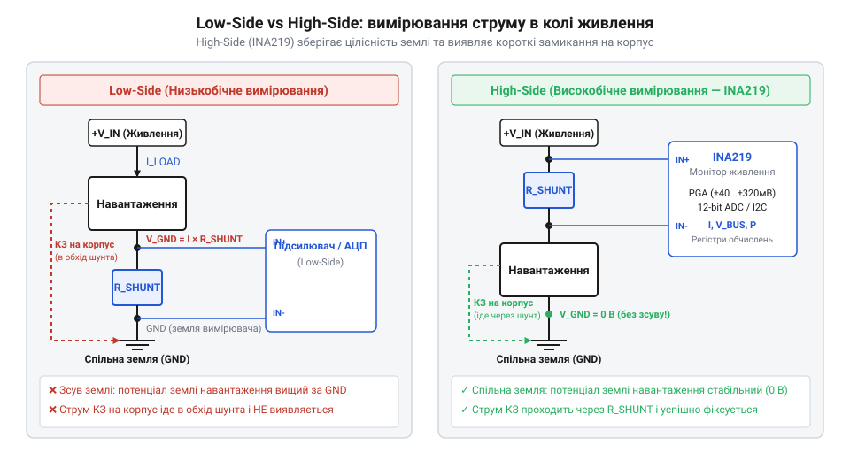
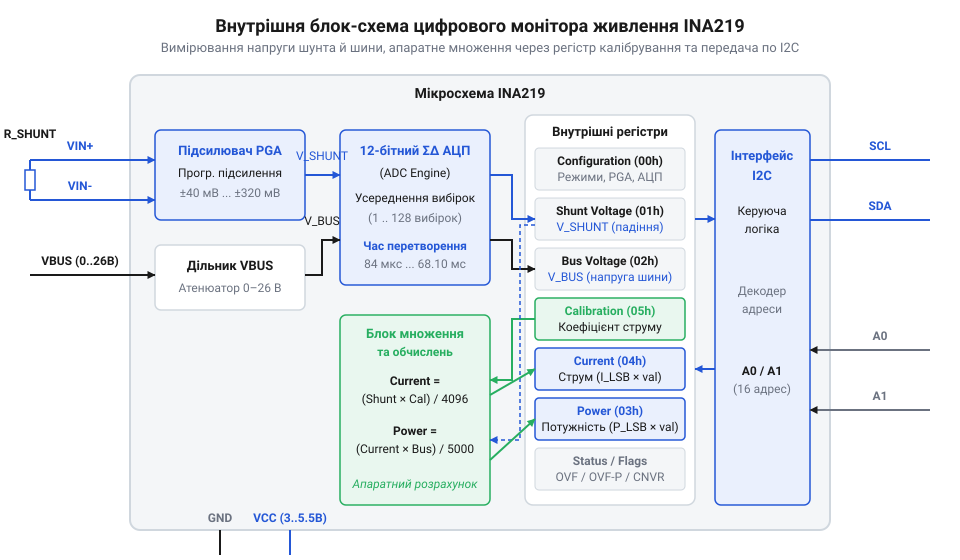
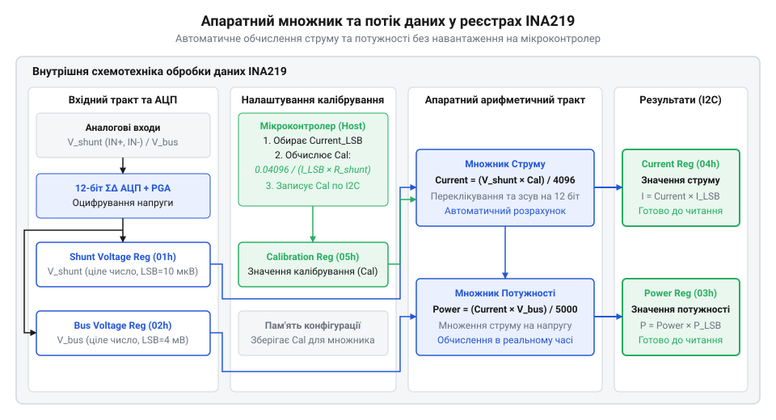
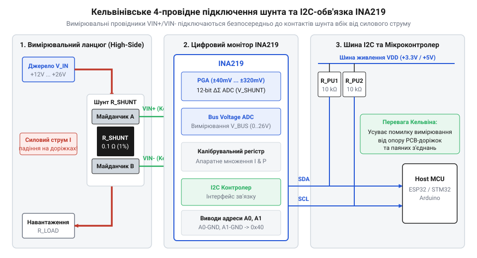

# INA219 — монітор струму й напруги (I2C)

## Проблема вимірювання струму в колах

Вимірювання постійного струму вимагає послідовного ввімкнення резистора (шунта), спад напруги на якому пропорційний струму. При низькобічному (з англ. *low* — низький, *side* — бік) підключенні @@en|Low-Side@@ шунт ставлять між мінусовим виводом навантаження та спільною землею. Це збільшує потенціал землі навантаження на величину спаду напруги, що спотворює цифрові інтерфейси зв'язку. До того ж струм короткого замикання на корпус тече в обхід низькобічного @@en|Low-Side@@ шунта, роблячи вимірювання «сліпим» до аварії.

*Порівняння низькобічного й високобічного вимірювання струму: @@en|High-Side@@ підключення зберігає спільну землю та виявляє замикання на корпус.*

Високобічне (з англ. *high* — високий, *side* — бік) підключення @@en|High-Side@@ розв'язує ці проблеми: шунт ставлять у позитивній лінії живлення між джерелом і навантаженням. Земля залишається спільною, а струм короткого замикання проходить через шунт і фіксується. Проте вимірювання спаду в мілівольти на лінії до +26 В вимагає диференційного підсилювача з високим пригніченням синфазної напруги. Для цього створено цифровий монітор живлення @@en|INA219@@ з шиною @@en|I2C@@ (з англ. *Inter-Integrated Circuit*: *inter* — між, *integrated* — інтегрований, *circuit* — схема).

## Внутрішня архітектура та аналоговий тракт

Монітор @@en|INA219@@ вимірює напругу шунта через `VIN+` та `VIN-` і напругу шини. Вхідний сигнал масштабує підсилювач @@en|PGA@@ (програмований підсилювач із англ. *programmable gain amplifier*: *program* — програма, *gain* — підсилення, *amplifier* — підсилювач) у діапазоні до ±320 мВ для адаптації під струм.

*Структурна схема @@en|INA219@@: диференціальний підсилювач @@en|PGA@@ і @@en|ADC@@ перетворюють напруги шунта та шини у цифрові регістри.*

Далі 12-бітний сигма-дельта АЦП @@en|ADC@@ (з англ. *analog-to-digital converter*: *analog* — аналоговий, *digital* — цифровий, *converter* — перетворювач) оцифровує напруги шунта й шини `VBUS` (до +26 В відносно землі). Дані зберігаються у 16-бітних реєстрах напруги шунта (розряд 10 мкВ) та шини (4 мВ). Цифрове усереднення фільтрує шуми без зовнішніх фільтрів.

## Апаратне калібрування та обчислення потужності

Щоб розвантажити хост від обчислень, мікросхема @@en|INA219@@ має калібрувальний регістр `Calibration` та апаратний множник. Розробник обчислює найменший значущий розряд струму `Current_LSB` (з англ. *least significant bit*: *least* — найменший, *significant* — значущий, *bit* — біт) @@en|LSB@@ та записує коефіцієнт у `Calibration`.

*Потік даних апаратного множника @@en|INA219@@: регістр Calibration перераховує напругу шунта в струм і потужність.*

Дискретність `Current_LSB` задають за максимальним струмом `I_max`, а `Cal` — за опором шунта `R_shunt`:

Current_LSB = I_max ÷ 32768                       [мінімальна дискретність струму]
Cal = trunc(0.04096 ÷ (Current_LSB × R_shunt))    [коефіцієнт калібрування]

Записавши `Cal`, апаратний множник щовибірки обчислює струм `Current = (Shunt_Voltage × Cal) ÷ 4096` та потужність `Power = (Current × Bus_Voltage) ÷ 5000`.

**Обчислення для струму 2 А й шунта 0.1 Ом**
Current_LSB = 2.0 ÷ 32768 ≈ 0.0001 A                [округлення розряду до 100 мкА]
Cal = trunc(0.04096 ÷ (0.0001 × 0.1))               [підстановка у формулу]
Cal = 4096                                          [запис у регістр Calibration]

Тепер `Current` містить струм із дискретністю 100 мкА, а `Power` — потужність із розрядом 2 мВт. Для складніших завдань застосовують [потужніший цифровий монітор](root:cat-hw-sensors/ina226-power-monitor) живлення.

## Схемотехніка підключення та Кельвінівське розведення

Оскільки опір шунта становить частки Ома, опір доріжок друкованої плати вносить похибку. Для її усунення застосовують Кельвінівське підключення (з'єднання Кельвіна на честь фізика лорда Кельвіна, англ. *Kelvin*) @@en|Kelvin connection@@: вимірювальні провідники `VIN+` та `VIN-` розводять окремою диференціальною парою від контактів шунта без силового струму.

*Схемотехніка підключення @@en|INA219@@: чотирипровідне розведення Кельвіна усуває похибки доріжок, а виводи A0/A1 задають @@en|I2C@@-адресу.*

Виводи `A0` та `A1`, підключені до `GND`, `VS`, `SDA` або `SCL`, задають одну з 16 адрес пристрою на шині @@en|I2C@@. При перевантаженні за струмом напруга шунта виходить за межі @@en|PGA@@, що спричиняє насичення @@en|ADC@@, а перевищення `Current_LSB` викликає апаратне переповнення 16-бітного регістра. Для складніших систем регулюється [конфігурація та усереднення](root:cat-hw-sensors/ina226-config-and-averaging) вимірювань у старших моделях.