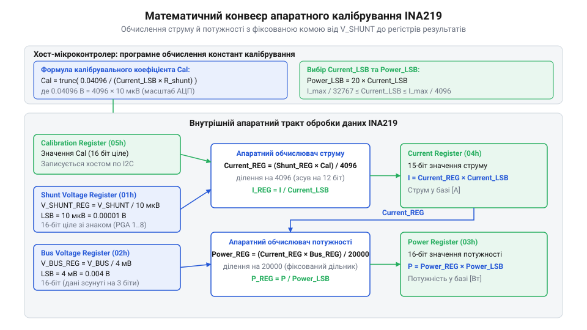

# Математична модель калібрування INA219: розрахунок Current_LSB, калібрувального регістра та дискретності потужності

<preknowlist>
- [Цифровий монітор живлення INA226](root:cat-hw-sensors/ina226-power-monitor) — Базові принципи функціонування моніторів живлення, вимірювання напруги на шунті та напруги шини.
</preknowlist>

## Проблема обчислення струму без калібрування

Коли мікроконтролер вимірює струм у колі за допомогою зовнішнього вимірювального резистора — @@en|шунта@@ (від англ. *shunt* — відхиляти), аналогово-цифровий перетворювач (@@en|АЦП@@, від грец. *analogos* та лат. *digitus*) зчитує не сам струм, а падіння напруги на цьому резисторі. У моніторі живлення INA219 внутрішній @@en|АЦП@@ має фіксовану @@la|дискретність@@ (від лат. *discretus* — розділений) вимірювання напруги шунта `10 мкВ` (`0.00001 В`) на один розряд @@en|LSB@@ (від англ. *Least Significant Bit* — найменший значущий розряд).

Якщо обчислювати струм класичним програмним шляхом за законом Ома, мікроконтролер мусить після кожного зчитування значення з @@la|регістра@@ (від пізньолат. *registrum* — списковий запис) напруги шунта виконувати арифметичне ділення на опір `R_shunt`. Оскільки значення опору шунта зазвичай є дробовим (наприклад, `0.1 Ом` або `0.01 Ом`), розрахунок у фізичних одиницях вимагає обчислень із @@en|плаваючою комою@@ (@@en|floating-point@@). На простих 8-бітних або 32-бітних мікроконтролерах без апаратного математичного співпроцесора FPU таке ділення виконується програмно, витрачаючи сотні тактів процесора на кожну вибірку.

Спроба замінити обчислення з @@en|плаваючою комою@@ на цілочисельну арифметику з @@en|фіксованою комою@@ (@@en|fixed-point@@) створює іншу проблему. Якщо помножити виміряне значення напруги на додатковий масштабний коефіцієнт для збереження точності перед діленням, проміжні результати обчислень у 16-бітних змінних швидко викликають @@en|переповнення@@ (@@en|overflow@@). Якщо ж спочатку виконати цілочисельне ділення, відкидання дробової частини на кожному кроці призводить до значної втрати точності та накопичення систематичної похибки вимірювання. Як показує досвід побудови систем, де використовується [базовий монітор живлення](root:cat-hw-sensors/ina226-power-monitor), постійне програмне масштабування створює надмірне обчислювальне навантаження на керовану систему.

Для розв'язання цієї проблеми в архітектуру INA219 закладено апаратний цифровий множник. Замість примусового обчислення струму на боці центрального процесора, розробник один раз записує у спеціальний калібрувальний @@la|регістр@@ `05h` розраховане числове значення — коефіцієнт @@fr|калібрування@@ (від араб. *qālib* — форма, через фр. *calibre*). Далі внутрішня цифрова логіка мікросхеми автоматично перемножує вміст @@la|регістра@@ напруги шунта на коефіцієнт @@fr|калібрування@@ та виконує апаратний зсув результату. У результаті мікроконтролер позбавляється потреби виконувати арифметичні операції й просто зчитує готове значення струму безпосередньо з @@la|регістра@@ струму `04h` у фізичних одиницях з обраною @@la|дискретністю@@ `Current_LSB`. Для детального ознайомлення з призначенням та структурою 16-бітних регістрів пристрою дивіться [карту регістрів та конфігурацію INA219](root:cat-hw-sensors/ina219-power-monitor/api-ina219-hardware-interface.md).

## Математичне виведення калібрувальної константи пристрою

Щоб зрозуміти, як апаратний множник INA219 перетворює падіння напруги на фізичний струм, виведемо базову математичну модель @@fr|калібрування@@. Внутрішній @@en|АЦП@@ пристрою записує виміряну напругу шунта у @@la|регістр@@ `01h` (`V_shunt_reg`). Оскільки @@la|дискретність@@ цього @@la|регістра@@ становить `10 мкВ` (`0.00001 В`), фізична напруга на @@de|шунті@@ дорівнює:

```
V_shunt = V_shunt_reg × 0.00001
```

За законом Ома реальний струм `I`, що протікає через @@de|шунт@@ з опором `R_shunt`, становить:

```
I = V_shunt / R_shunt
  = (V_shunt_reg × 0.00001) / R_shunt
```

Ми прагнемо, щоб результуючий @@la|регістр@@ струму `04h` (`Current_reg`) містив ціле число, яке відповідає струму `I`, вираженому в обраній @@la|дискретності@@ `Current_LSB` (ампер на один розряд @@en|LSB@@):

```
Current_reg = I / Current_LSB
            = (V_shunt_reg × 0.00001) / (R_shunt × Current_LSB)
```

Апаратна математика INA219 обчислює вміст @@la|регістра@@ струму за фіксованою внутрішньою формулою, у якій добуток напруги шунта та коефіцієнта `Cal` ділиться на константу `4096` (`2¹²`, що відповідає апаратному зсуву праворуч на 12 біт):

```
Current_reg = (V_shunt_reg × Cal) / 4096
```

Прирівняємо вирази для `Current_reg`, отримані з фізичної моделі та з апаратної формули пристрою:

```
Current_reg = (V_shunt_reg × 0.00001) / (R_shunt × Current_LSB)    [фізична модель струму]
(V_shunt_reg × Cal) / 4096 = (V_shunt_reg × 0.00001) / (R_shunt × Current_LSB)    [прирівнювання до апаратної формули INA219]
Cal / 4096 = 0.00001 / (R_shunt × Current_LSB)                      [скорочення V_shunt_reg з обох частин]
Cal = (4096 × 0.00001) / (R_shunt × Current_LSB)                    [множення обох частин на 4096]
Cal = 0.04096 / (Current_LSB × R_shunt)                             [перемноження констант 4096 × 0.00001]
Cal = trunc(0.04096 / (Current_LSB × R_shunt))                      [відкидання дробової частини для 16-бітного регістра]
```


*Схема потоку даних усередині INA219: регістр напруги шунта та калібрувальний регістр Cal живлять апаратний множник струму, а обчислене значення струму перемножується з напругою шини для розрахунку потужності.*

Фіксоване число `0.04096` у чисельнику є сполучною ланкою між фізичним опором @@en|шунта@@ та цифровим масштабом струму. Воно утворюється як точний добуток апаратного дільника `4096` на базову @@la|дискретність@@ @@en|АЦП@@ `10 мкВ` (`4096 × 0.00001 В = 0.04096 В·мкВ`). Оскільки калібрувальний @@la|регістр@@ `05h` є 16-бітним цілочисельним @@la|регістром@@, результат обчислення округлюється шляхом відкидання дробової частини функцією `trunc()`. Після запису цього значення в пристрій цілочисельне ділення на `4096` усередині INA219 повертає реальне значення струму в обраних одиницях `Current_LSB`.

## Вибір дискретності струму та обмеження

Для обчислення коефіцієнта @@fr|калібрування@@ `Cal` розробник мусить заздалегідь обрати значення @@la|дискретності@@ струму `Current_LSB`. Вибір цього параметра визначає @@en|роздільну здатність@@ (від англ. *resolution*) вимірювань та максимальний струм, який пристрій зможе виміряти без апаратного @@en|переповнення@@.

@@la|Регістр@@ струму `04h` INA219 є 16-бітним знаковим цілим числом (`int16_t`). Один біт відведено під знак струму (напрямок протікання), тому для збереження амплітуди залишається 15 бітів. Це задає верхній межу значень у @@la|регістрі@@:

```
Current_reg_max = 2¹⁵ - 1 = 32767
```

Щоб запобігти апаратному @@en|переповненню@@ @@la|регістра@@ струму при максимальному очікуваному струмі навантаження `I_max`, @@la|дискретність@@ `Current_LSB` мусить бути не меншою за математичний мінімум:

```
Current_LSB_min = I_max / 32767
```

З іншого боку, обирати `Current_LSB` надто великим недоцільно, оскільки це погіршує @@en|роздільну здатність@@ вимірювання малих струмів. На практиці розраховане значення `Current_LSB_min` округлюють у більший бік до найближчого зручного числового значення (наприклад, `50 мкА/LSB`, `100 мкА/LSB` або `1 мА/LSB`). Крім того, значення `Current_LSB` та `R_shunt` мусять забезпечувати, щоб обчислений коефіцієнт `Cal` вміщався у 16-бітний беззнаковий @@la|регістр@@ `05h` (діапазон від `0` до `65535`).

Проілюструємо обчислення на конкретному прикладі. Розглянемо вимірювальне коло з опором @@de|шунта@@ `R_shunt = 0.1 Ом` та максимальним очікуваним струмом `I_max = 2.0 А`.

Обчислимо мінімально припустиме значення `Current_LSB`:

```
Current_LSB_min = I_max / 32767
                = 2.0 / 32767            [підстановка значень]
                ≈ 0.000061035 А/LSB      [ділення]
```

Округлюємо значення `Current_LSB_min` у більший бік до зручного круглого значення `Current_LSB = 0.0001 А/LSB` (`100 мкА/LSB`):

```
Current_LSB = 0.0001 А/LSB
```

Розраховуємо коефіцієнт @@fr|калібрування@@ `Cal`:

```
Cal = trunc(0.04096 / (Current_LSB × R_shunt))
    = trunc(0.04096 / (0.0001 × 0.1))     [підстановка значень]
    = trunc(0.04096 / 0.00001)            [перемноження в знаменнику]
    = trunc(4096.0)                       [ділення]
    = 4096                                [відкидання дробової частини]
```

Отримане значення `Cal = 4096` ідеально вміщається в 16-бітний @@la|регістр@@ `05h` (`4096 ≤ 65535`). При вимірюванні максимального струму `2.0 А` значення в @@la|регістрі@@ струму становитиме `20000` одиниць (`2.0 / 0.0001 = 20000`), що гарантує відсутність @@en|переповнення@@ (`20000 ≤ 32767`).

## Математика апаратного розрахунку дискретності потужності

Після того як INA219 обчислив значення струму, внутрішній математичний тракт виконує розрахунок споживаної потужності. Потужність є добутком напруги шини живлення `V_bus` та виміряного струму `I`.

Напруга шини вимірюється окремим каналом @@en|АЦП@@ і зберігається в @@la|регістрі@@ `02h` (`Bus_reg`). Фіксована @@la|дискретність@@ вимірювання напруги шини в INA219 становить `4 мВ` (`0.004 В`) на один розряд @@en|LSB@@.

Внутрішній апаратний множник обчислює значення для @@la|регістра@@ потужності `03h` (`Power_reg`) за формулою з фіксованим дільником `5000`:

```
Power_reg = (Current_reg × Bus_reg) / 5000
```

Виведемо математичний зв'язок між @@la|дискретністю@@ струму `Current_LSB` та @@la|дискретністю@@ потужності `Power_LSB`. Фізична потужність `P` визначається як:

```
P = V_bus × I
  = (Bus_reg × 0.004) × (Current_reg × Current_LSB)
  = Bus_reg × Current_reg × 0.004 × Current_LSB
```

З іншого боку, фізична потужність виражається через вміст @@la|регістра@@ потужності та його @@la|дискретність@@ `Power_LSB`:

```
P = Power_reg × Power_LSB
  = [(Current_reg × Bus_reg) / 5000] × Power_LSB
```

Прирівняємо обидва вирази для фізичної потужності `P`:

```
[(Current_reg × Bus_reg) / 5000] × Power_LSB = Bus_reg × Current_reg × 0.004 × Current_LSB    [прирівнювання формул потужності]
Power_LSB / 5000 = 0.004 × Current_LSB                                                      [скорочення добутку (Current_reg × Bus_reg)]
Power_LSB = 5000 × 0.004 × Current_LSB                                                      [множення обох частин на 5000]
Power_LSB = 20 × Current_LSB                                                                [перемноження констант 5000 × 0.004]
```

Арифметичний множник `20` походить безпосередньо з добутку фіксованого апаратного дільника `5000` на базову @@la|дискретність@@ напруги шини `0.004 В` (`5000 × 0.004 В = 20 В`).

Продовжуючи попередній приклад із `Current_LSB = 0.0001 А/LSB` (`100 мкА/LSB`), обчислимо @@la|дискретність@@ потужності:

```
Power_LSB = 20 × Current_LSB
          = 20 × 0.0001 А/LSB            [підстановка значення]
          = 0.002 Вт/LSB                 [перемноження]
```

Отже, один розряд @@la|регістра@@ потужності дорівнює `2 мВт` (`0.002 Вт`). Якщо зчитати з @@la|регістра@@ `03h` ціле число `1500`, реальна споживана потужність кола становитиме `1500 × 0.002 Вт = 3.0 Вт` без необхідності виконання будь-яких додаткових обчислень з @@en|плаваючою комою@@ на мікроконтролері.

## Аналіз похибок цілочисельного відкидання дробу

Під час розрахунку калібрувального коефіцієнта `Cal` виконується операція відкидання дробової частини `trunc()`. Якщо точне математичне значення `Cal_exact` має дробову частину, цілочисельне значення `Cal_integer = trunc(Cal_exact)` відрізняється від нього на величину `ε` (`0 ≤ ε < 1`):

```
ε = Cal_exact - Cal_integer
```

Оскільки апаратний математичний тракт INA219 використовує записане в @@la|регістр@@ `05h` ціле число `Cal_integer`, це відкидання дробу вносить систематичну похибку масштабування у всі подальші вимірювання струму та потужності. Відносна похибка @@fr|калібрування@@ `δ_cal` визначається як:

```
δ_cal = (Cal_exact - Cal_integer) / Cal_exact
      = ε / Cal_exact
```

Аналіз цього співвідношення показує: що меншим є абсолютне значення `Cal_exact`, то більший відсоток точності втрачається при відкиданні дробу `ε`.

Проілюструємо це порівняльним розрахунком двох варіантів вибору `Current_LSB` для кола з `R_shunt = 0.1 Ом` та `I_max = 1.5 А`.

Мінімально необхідне значення `Current_LSB_min = 1.5 / 32767 ≈ 0.000045778 А/LSB`.

**Варіант А: Округлення до `Current_LSB = 0.00005 А/LSB` (`50 мкА/LSB`)**

Розраховуємо `Cal_exact`:

```
Cal_exact = 0.04096 / (0.00005 × 0.1)
          = 0.04096 / 0.000005
          = 8192.0
```

Оскільки `Cal_exact = 8192.0` є точним цілим числом, `Cal_integer = 8192`, а залишок `ε = 0`. Відносна похибка округлення становить `δ_cal = 0%`.

**Варіант Б: Невідомий вибір `Current_LSB = 0.00006 А/LSB` (`60 мкА/LSB`)**

Розраховуємо `Cal_exact`:

```
Cal_exact = 0.04096 / (0.00006 × 0.1)
          = 0.04096 / 0.000006
          = 6826.6667
```

Цілочисельне значення дорівнює `Cal_integer = trunc(6826.6667) = 6826`. Залишок відкидання `ε = 0.6667`.

Обчислимо відносну похибку відкидання дробу:

```
δ_cal = ε / Cal_exact
      = 0.6667 / 6826.6667
      ≈ 0.0000976                     [відносна похибка]
      ≈ 0.00976 %                     [у відсотках]
```

У цьому випадку систематична похибка становить близько `0.01%`, що є допустимим для більшості застосувань. Однак якщо опір @@de|шунта@@ або `Current_LSB` обрано так, що `Cal_exact` виходить малим (наприклад, `Cal_exact = 40.8`), відкидання дробу дасть `Cal_integer = 40`, а похибка сягне `0.8 / 40.8 ≈ 1.96%`, що істотно погіршить точність вимірювального пристрою.

Щоб мінімізувати похибку цілочисельного відкидання дробу, рекомендується дотримуватися двох правил:
1. За можливості добирати значення `Current_LSB` так, щоб вираз `0.04096 / (Current_LSB × R_shunt)` давав точне ціле число або число з мінімальною дробовою частиною. 2. Прагнути до того, щоб обчислений коефіцієнт `Cal` становив кілька тисяч одиниць, оскільки при великому значенні `Cal` вплив залишку `ε < 1` на підсумкову відносну похибку стає зневажливо малим. Щоб глибше опрацювати нюанси налаштування моніторів живлення, доцільно ознайомитися з тим, як виконується [конфігурація регістрів перетворення](root:cat-hw-sensors/ina226-config-and-averaging).