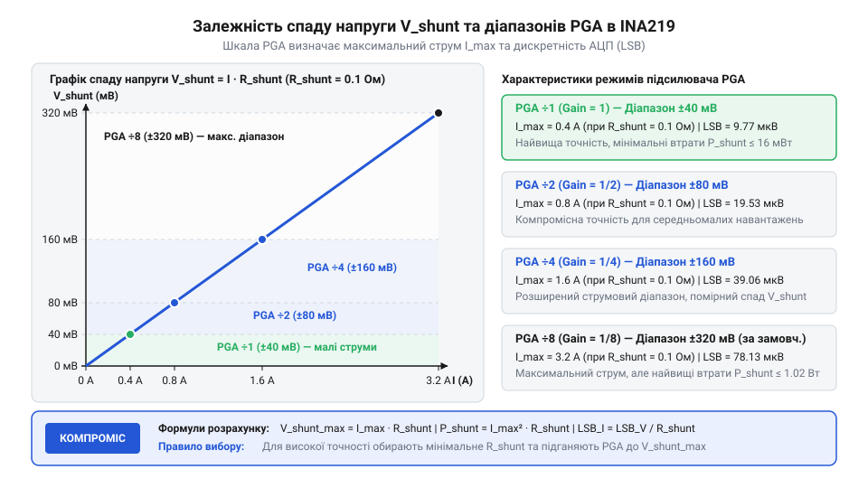
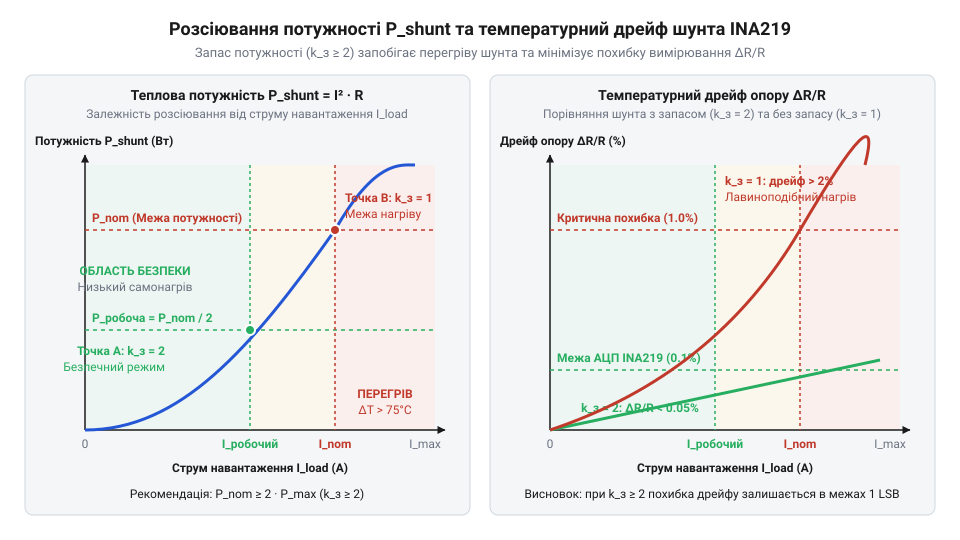

# Математичний розрахунок шунтового резистора: точність АЦП, коефіцієнти PGA та теплові втрати

## Проблема спаду напруги та точності вимірювання

Уявіть практичну задачу розробки електронного пристрою: вам необхідно організувати високоточний моніторинг споживання струму та напруги живлення для мікроконтролерного модуля, бездротового трансивера або автономної батарейної системи. Для цифрового вимірювання струму в сучасних схемах широко застосовують спеціалізовані мікросхеми — монітори живлення, яскравішим представником яких є @@en|INA219@@ (від англ. *Texas Instruments INA219 current/power monitor*). Принцип роботи такого вимірювача спирається на вимірювання спаду напруги, який виникає під час проходження струму через низькоомний вимірювальний елемент — шунтовий резистор @@en|shunt resistor@@ (від англ. *shunt* — відхиляти, відводити вбік).

У більшості систем живлення вимірювання здійснюється у верхньому плечі живлення @@en|high-side sensing@@ (від англ. *high-side current sensing* — вимірювання струму в позитивному провіднику живлення), тобто шунт підключається послідовно між джерелом живлення та навантаженням. Це дає змогу зберегти спільну шину заземлення @@en|GND@@ (від англ. *Ground* — спільний провідник заземлення) без розриву, проте створює суворе математичне протиріччя під час вибору опору `R_shunt`. Фізичний зв'язок між струмом навантаження `I_load` та спадом напруги на шунті `V_shunt` визначається базовим законом Ома:

```text
V_shunt = I_load × R_shunt
```

Падіння напруги на шунті `V_shunt` безпосередньо віднімається від напруги джерела живлення `V_bus`, зменшуючи реальну напругу `V_load`, яка надходить на чутливі електронні компоненти:

```text
V_load = V_bus - V_shunt
```

Тут розробник опиняється перед гострим інженерним компромісом, де занадто великий або занадто малий опір `R_shunt` одночасно руйнує працездатність системи.

Перша крайність полягає у виборі занадто великого опору `R_shunt`. Якщо для отримання високої амплітуди вимірювального сигналу обрати опір `R_shunt = 1.0 Ом`, то при робочому струмі навантаження `I_load = 0.5 А` спад напруги на шунті становитиме:

```text
V_shunt = I_load × R_shunt
        = 0.5 А × 1.0 Ом               [підстановка струму навантаження та опору]
        = 0.5 В                        [обчислення спаду напруги на шунті]
```

Якщо система живиться від стандартної шини `3.3 В`, навантаження отримає лише `3.3 В - 0.5 В = 2.8 В`. Таке просідання напруги живлення спричинить хибне апаратне скидання контролера @@en|brownout reset@@ (від англ. *Brown-Out Reset* — скидання мікроконтролера при зниженні напруги нижче критичного порогу) або призведе до збоїв у роботі радіопередавача. Крім того, на шунті виділятиметься значна теплова потужність `P_shunt = I_load² × R_shunt = 0.25 Вт`, що спричинить розігрів деталі та температурну деградацію опору.

Друга крайність — вибір надто малого опору `R_shunt`. Намагаючись мінімізувати втрати живлення, розробник може встановити шунт опором `R_shunt = 0.001 Ом` (`1 мОм`). У такому разі при малому струмі споживання навантаження в режимі сну `I_load = 10 мА` (`0.01 А`) спад напруги становитиме:

```text
V_shunt = I_load × R_shunt
        = 0.01 А × 0.001 Ом            [підстановка струму сну та малого опору]
        = 0.00001 В                    [обчислення корисного сигналу]
        = 10 мкВ                       [переведення значення у мікровольти]
```

Отриманий корисний сигнал `10 мкВ` виявляється порівнюваним із власною вхідною напругою зсуву @@en|offset voltage@@ `V_os` (від англ. *Input Offset Voltage* — власна вхідна напруга зсуву диференціального підсилювача). Для мікросхеми @@en|INA219@@ типова напруга зсуву становить `±10 мкВ`, а граничне значення при зміні температури може досягати `±100 мкВ`. У результаті відносна похибка вимірювання перевищуватиме 100%, корисний сигнал повністю потоне у власних шумах вимірювального тракту, а аналого-цифровий перетворювач @@en|ADC@@ (від англ. *Analog-to-Digital Converter* — пристрій перетворення аналогової напруги в цифровий код) працюватиме на рівні першого найменшого значущого розряду @@en|LSB@@ (від англ. *Least Significant Bit* — найменший значущий розряд АЦП).

Отже, вибір опору `R_shunt` не може бути довільним або «приблизним». Він являє собою системну математичну задачу оптимізації: опір має бути достатньо великим, щоб підняти сигнал `V_shunt` вище рівня шумів і зсуву підсилювача, але водночас достатньо малим, щоб не порушити стабільність живлення навантаження при максимальному струмі `I_max`. Щоб математично обґрунтувати це співвідношення, необхідно детально розібрати внутрішню структуру вимірювального тракту @@en|INA219@@, яка включає програмований підсилювач @@en|PGA@@ (від англ. *Programmable Gain Amplifier* — підсилювач із керованим коефіцієнтом підсилення) та 12-бітний сигма-дельта АЦП @@en|Sigma-Delta ADC@@ (від грец. *Σ-Δ* — архітектура аналого-цифрового перетворення з усередненням шуму квантування).

## Шкала PGA та роздільна здатність АЦП

Для забезпечення гнучкості при вимірюванні різних струмів без фізичної заміни резистора `R_shunt` на друкованій платі, архітектура @@en|INA219@@ містить програмований диференціальний підсилювач @@en|PGA@@, який стоїть між вхідними виводами `VIN+`/`VIN-` та ядром @@en|Sigma-Delta ADC@@. Підсилювач @@en|PGA@@ послаблює вхідний диференціальний сигнал `V_shunt` за допомогою апаратного дільника напруги, дозволяючи узгодити великі спади напруги з фіксованим вхідним діапазоном ядра АЦП (який становить `±40 мВ`).

Внутрішня конфігурація @@en|INA219@@ дає змогу розробникові програмно обрати один із чотирьох фіксованих коефіцієнтів ділення @@en|PGA@@ через конфігураційний регістр `Configuration Register` (біти `PG1`, `PG0`). Кожен режим визначає максимальний вимірюваний спад напруги повної шкали вимірювання @@en|full scale@@ `V_PGA_max`:

1. **Режим PGA /1** (`PG = 00`): коефіцієнт підсилення 1. Максимальний вхідний діапазон `V_PGA_max = ±40 мВ` (загальний розмах сигналу `80 мВ`). 2. **Режим PGA /2** (`PG = 01`): коефіцієнт підсилення 1/2. Максимальний вхідний діапазон `V_PGA_max = ±80 мВ` (загальний розмах сигналу `160 мВ`). 3. **Режим PGA /4** (`PG = 10`): коефіцієнт підсилення 1/4. Максимальний вхідний діапазон `V_PGA_max = ±160 мВ` (загальний розмах сигналу `320 мВ`). 4. **Режим PGA /8** (`PG = 11`, режим за замовчуванням): коефіцієнт підсилення 1/8. Максимальний вхідний діапазон `V_PGA_max = ±320 мВ` (загальний розмах сигналу `640 мВ`).

Математична модель квантування напруги спирається на розрядність ядра АЦП. У режимі за замовчуванням @@en|INA219@@ використовує 12-бітний знаковий АЦП. Загальна кількість рівнів квантування `N_adc` для 12-бітного знакового перетворення становить:

```text
N_adc = 2¹²
      = 4096 рівнів            [загальна кількість цифрових кодів від -2048 до +2047]
```

Оскільки вимірюваний струм може протікати у прямому та зворотному напрямках, діапазон АЦП ділиться симетрично. Для позитивного знаку напруги доступна рівно половина шкали — `2048` відліків (практично в регістрі спаду напруги `Shunt Voltage Register` максимальний код позитивної шкали занормовано до `4000` відліків для номінального значення `V_PGA_max = 40 мВ`).

Фізичний квант напруги `V_LSB` (величина напруги, яка відповідає зміні молодшого розряду АЦП на одиницю) у регістрі результату `Shunt Voltage Register` занормований до фіксованої величини:

```text
V_LSB = 10 мкВ = 0.01 мВ
```

Незалежно від обраного діапазону @@en|PGA@@, 12-бітний регістр результату зберігає значення спаду напруги з кроком `10 мкВ`. Проте максимальна кількість відліків `N_FS`, яку може накопичити регістр до настання насичення (переповнення шкали АЦП), прямо пропорційна обраному діапазону @@en|PGA@@:

Для режиму **PGA /1** (`±40 мВ`):
```text
N_FS = V_PGA_max ÷ V_LSB
     = 40 мВ ÷ 0.01 мВ                 [підстановка шкали 40 мВ та кванта 10 мкВ]
     = 4000 відліків                  [максимальне число відліків АЦП]
```

Для режиму **PGA /2** (`±80 мВ`):
```text
N_FS = 80 мВ ÷ 0.01 мВ
     = 8000 відліків                  [максимальне число відліків АЦП]
```

Для режиму **PGA /4** (`±160 мВ`):
```text
N_FS = 160 мВ ÷ 0.01 мВ
     = 16000 відліків                 [максимальне число відліків АЦП]
```

Для режиму **PGA /8** (`±320 мВ`):
```text
N_FS = 320 мВ ÷ 0.01 мВ
     = 32000 відліків                 [максимальне число відліків АЦП]
```

Знаючи квант напруги `V_LSB` та обраний опір шунта `R_shunt`, ми можемо вивести фундаментальну формулу для обчислення дискретності вимірювання струму `Current_LSB` (мінімальної зміни струму, яку здатний зафіксувати АЦП):

```text
Current_LSB = V_LSB ÷ R_shunt
```

Розглянемо покроковий математичний розрахунок для поширеного номіналу шунта `R_shunt = 0.1 Ом` (`100 мОм`). Дискретність струму `Current_LSB` становитиме:

```text
Current_LSB = 0.00001 В ÷ 0.1 Ом
            = 0.0001 А                 [обчислення дискретності вимірювання струму]
            = 100 мкА                  [переведення у мікроампери (0.1 мА)]
```

При цьому максимальний струм `I_max`, який можна виміряти без переповнення АЦП у режимі **PGA /8** (`±320 мВ`), дорівнює:

```text
I_max = V_PGA_max ÷ R_shunt
      = 0.320 В ÷ 0.1 Ом
      = 3.2 А                          [максимально вимірюваний струм]
```

Якщо ж для того самого шунта `0.1 Ом` переключити підсилювач у режим **PGA /1** (`±40 мВ`), максимальний вимірюваний струм зменшиться до:

```text
I_max = 0.040 В ÷ 0.1 Ом
      = 0.4 А                          [400 мА максимального струму]
```

Графічне співвідношення між опором шунта `R_shunt`, спадом напруги `V_shunt`, робочим струмом та діапазонами підсилювача @@en|PGA@@ зображено на діаграмі.


*Графік залежності спаду напруги на шунті від струму навантаження для різних значень опору R_shunt та їх співвідношення з фіксованими діапазонами PGA (±40 мВ, ±80 мВ, ±160 мВ, ±320 мВ).*

Аналіз графічних залежностей показує, що зміна коефіцієнта ділення @@en|PGA@@ переміщує верхню межу вимірюваного струму, не змінюючи фізичний опір резистора. Це створює математичний інструмент для знаходження оптимального узгодження між робочим струмом схеми та динамічним діапазоном вимірювача.

## Компроміс спаду напруги та сигналу

Опанувавши дискретність АЦП та шкали @@en|PGA@@, проаналізуємо математичну залежність між опором `R_shunt`, максимальним струмом схеми `I_max` та співвідношенням сигнал/шум @@en|SNR@@ (від англ. *Signal-to-Noise Ratio* — відношення потужності корисного сигналу до потужності шуму) вимірювального тракту.

Головним показником якості вимірювання при малих струмах є співвідношення сигнал/шум @@en|SNR@@, яке у децибелах виражається як:

```text
SNR = 20 × log10(V_shunt ÷ V_noise_eff)
```

де `V_noise_eff` — ефективна напруга еквівалентного шуму вхідного тракту, в якій домінує власна вхідна напруга зсуву підсилювача `V_os`. Відносна похибка вимірювання `ε_os`, спричинена напругою зсуву `V_os`, обчислюється за формулою:

```text
ε_os = (V_os ÷ V_shunt) × 100%
```

Якщо спад напруги на шунті `V_shunt` є занадто малим (наприклад, `1.0 мВ` або `1000 мкВ`), то при граничній напрузі зсуву `V_os = 100 мкВ` відносна похибка зсуву досягає:

```text
ε_os = (100 мкВ ÷ 1000 мкВ) × 100%
     = 10%                             [відносна похибка при малому сигналі]
```

Якщо ж підвищити спад напруги `V_shunt` до `100 мВ` (шляхом збільшення `R_shunt` або вимірювання більшого струму), відносна похибка зсуву стрімко зменшується:

```text
ε_os = (100 мкВ ÷ 100000 мкВ) × 100%
     = 0.1%                            [відносна похибка при великому сигналі]
```

Звідси випливає перше математичне правило: для максимізації @@en|SNR@@ та мінімізації похибки зсуву `ε_os` необхідно обирати опір `R_shunt` таким чином, щоб при максимальному робочому струмі навантаження `I_max` спад напруги `V_shunt` наближався до верхньої межі обраного діапазону @@en|PGA@@ (`V_PGA_max`).

Проте верхня межа обмежена максимально припустимим падінням напруги живлення навантаження `V_drop_max`. Це дає змогу сформулювати строгу систему математичних нерівностей для вибору опору `R_shunt`:

1. **Верхнє обмеження (критерій стабільності живлення навантаження):**
   ```text
   R_shunt ≤ V_drop_max ÷ I_max
   ```
   де `V_drop_max` — максимально припустимий спад напруги на шунті, який не порушує роботу навантаження (не перевищує обрану шкалу `V_PGA_max`, наприклад `320 мВ`, або заданий ліміт просідання живлення, наприклад `50 мВ`).

2. **Нижнє обмеження (критерій точності та SNR при мінімальному струмі I_min):**
   ```text
   R_shunt ≥ V_os ÷ (ε_max × I_min)
   ```
   де `ε_max` — максимально допустима відносна похибка (наприклад, `0.05` для 5%), `I_min` — мінімальний робочий струм, який підлягає вимірюванню.

Об'єднуючи обидві нерівності, отримуємо допустимий робочий інтервал опору шунта:

```text
V_os ÷ (ε_max × I_min) ≤ R_shunt ≤ V_PGA_max ÷ I_max
```

Проілюструємо застосування цієї системи нерівностей на практичному прикладі.

**Умова розрахунку:** Необхідно спроєктувати вимірювальний тракт для пристрою з робочим струмом від `I_min = 20 мА` (`0.02 А`) до `I_max = 2.0 А`. Максимальне припустиме просідання живлення становить `V_drop_max = 100 мВ` (`0.1 В`). Допустима похибка при мінімальному струмі не повинна перевищувати `ε_max = 5%` (`0.05`), а напруга зсуву `V_os = 50 мкВ` (`0.00005 В`).

1. Обчислюємо верхню межу опору `R_shunt`:
   ```text
   R_shunt_max = V_drop_max ÷ I_max
               = 0.1 В ÷ 2.0 А         [підстановка допустимого просідання та макс. струму]
               = 0.05 Ом               [50 мОм максимального опору]
   ```

2. Обчислюємо нижню межу опору `R_shunt`:
   ```text
   R_shunt_min = V_os ÷ (ε_max × I_min)
               = 0.00005 В ÷ (0.05 × 0.02 А) [підстановка зсуву, похибки та мін. струму]
               = 0.00005 В ÷ 0.001 А   [розрахунок знаменника]
               = 0.05 Ом               [50 мОм мінімального опору]
   ```

В даному випадку інтервал звужується до єдиного оптимального значення `R_shunt = 0.05 Ом` (`50 мОм`). При цьому спад напруги при максимальному струмі `I_max = 2.0 А` дорівнює `V_shunt = 2.0 А × 0.05 Ом = 100 мВ` (`0.1 В`). Для цього значення оптимально обрати режим підсилювача **PGA /4** (`V_PGA_max = ±160 мВ`), що забезпечить використання 62.5% повної шкали АЦП без ризику переповнення.

Коли пристрій має занадто широкий динамічний діапазон @@en|dynamic range@@ (від англ. *Dynamic Range* — відношення максимального вимірюваного струму до мінімального), наприклад від `1 мА` до `3 А` (співвідношення 3000:1), один фіксований режим @@en|PGA@@ не може забезпечити високу точність на обох краях діапазону. Щоб підвищити точність вимірювання в умовах низького рівня вимірювального сигналу, розробники застосовують цифрове усереднення відліків. Детальний аналіз того, як внутрішній цифровий фільтр накопичує вибірки АЦП для приглушення випадкового шуму, висвітлено в інструкції про [конфігурацію та усереднення вимірювань](root:cat-hw-sensors/ina226-config-and-averaging), що дозволяє істотно підвищити співвідношення сигнал/шум і розширити ефективну кількість розрядів @@en|ENOB@@ (від англ. *Effective Number of Bits* — реальна роздільна здатність АЦП з урахуванням шумів).

Коли ж вхідний діапазон сигналу вимагає вищої розрядності та меншої власної похибки зсуву, замість 12-бітної системи застосовують прецизійний [цифровий монітор живлення](root:cat-hw-sensors/ina226-power-monitor), який забезпечує 16-бітну роздільну здатність АЦП і фіксовану напругу зсуву 10 мікровольт. Це дозволяє використовувати шунти меншого опору без втрати точності на малих струмах.

Визначивши оптимальне значення опору `R_shunt` та діапазон @@en|PGA@@, необхідно оцінити теплові режими роботи резистора, оскільки виділення потужності `P_shunt = I_max² × R_shunt` спричиняє температурне самонагрівання вимірювального елемента та дрейф його опору.

## Теплові втрати та температурний дрейф

Проходження електричного струму `I_load` через шунтовий резистор `R_shunt` супроводжується неминучим перетворенням частини електричної енергії на теплову. За законом Джоуля-Ленца, миттєва теплова потужність `P_shunt`, яка виділяється в об'ємі вимірювального елемента, прямо пропорційна квадрату струму навантаження та опору шунта. При розрахунку вимірювального тракту мікросхеми @@en|INA219@@ оцінку теплових втрат виконують для максимального робочого струму `I_max`:

```text
P_shunt = I_max² × R_shunt
```

Якщо для схеми з максимальним струмом `I_max = 3.0 А` обрано опір шунта `R_shunt = 0.1 Ом` (`100 мОм`), розрахована теплова потужність становитиме:

```text
P_shunt = I_max² × R_shunt
        = (3.0 А)² × 0.1 Ом             [підстановка максимального струму та опору]
        = 9.0 А² × 0.1 Ом              [піднесення струму до квадрата]
        = 0.9 Вт                       [обчислення виділюваної теплової потужності]
```

Значення `0.9 Вт` здається відносно невеликим у масштабах всієї системи живлення, проте для компактного компонента поверхневого монтажу @@en|SMD@@ (від англ. *Surface Mount Device* — деталь поверхневого монтажу на друковану плату) така потужність спричиняє інтенсивний локальний розігрів. Перегрів вимірювального елемента визначається його тепловим опором @@en|thermal resistance@@ `R_th` (від англ. *thermal resistance* — здатність компонента й друкованої плати розсіювати тепло в довкілля, що вимірюється в °C/Вт). Перевищення температури резистора `ΔT` над температурою навколишнього середовища `T_amb` обчислюється за формулою:

```text
ΔT = P_shunt × R_th
```

Для стандартного корпусника типу SMD 1206 тепловий опір монтажу може досягати `100 °C/Вт`. При потужності `0.9 Вт` це спричинить перегрів вимірювального елемента на `ΔT = 0.9 Вт × 100 °C/Вт = 90 °C`. Якщо температура навколишнього середовища всередині корпусу пристрою становить `25 °C`, сам шунт розігріється до `115 °C`.

Головна небезпека такого нагріву полягає не лише в ризику фізичного руйнування деталі, а й у температурній зміні її опору. Фізична залежність опору від температури описується за допомогою температурного коефіцієнта опору @@en|TCR@@ (від англ. *Temperature Coefficient of Resistance* — коефіцієнт, що визначає відносну зміну опору матеріалу при зміні температури на один градус Цельсія). Значення @@en|TCR@@ зазвичай виражають у частинах на мільйон на градус Цельсія @@en|ppm/°C@@ (від англ. *Parts Per Million per degree Celsius*). Відносне відхилення опору `ΔR ÷ R_nominal` при зміні температури на `ΔT` виражається формулою:

```text
ΔR ÷ R_nominal = TCR × ΔT
```

Звичайні товстоплівкові резистори загального призначення мають @@en|TCR@@ на рівні `±200 ppm/°C` (`0.02%/°C`). Якщо такий резистор розігрівається на `ΔT = 90 °C`, додаткова температурна похибка опору становитиме:

```text
ΔR ÷ R_nominal = 200 ppm/°C × 90 °C
               = 18000 ppm              [обчислення відносного дрейфу в ppm]
               = 1.8%                   [переведення відносного дрейфу у відсотки]
```

Температурний дрейф у `1.8%` повністю нівелює високу 12-бітну точність АЦП мікросхеми @@en|INA219@@, оскільки дискретність квантування становить близько `0.025%` від шкали. Щоб уникнути цього дрейфу, застосовують спеціалізовані прецизійні металострічкові резистори @@en|metal strip resistor@@ (від англ. *metal strip resistor* — низькоомний вимірювальний резистор із суцільного металевого сплаву, наприклад манганіну або константану), які мають @@en|TCR@@ в межах `±15 ppm/°C` ... `±50 ppm/°C`.

Для гарантування стабільності вимірювального тракту та запобігання деградації контактних майданчиків застосовують інженерний коефіцієнт запасу потужності @@en|derating@@ (від англ. *derating factor* — нормативне зменшення робочого навантаження відносно граничного паспорта). Паспортна номінальна потужність обраного резистора `P_rated` повинна перевищувати розраховану потужність втрат `P_shunt` щонайменше у 2–4 рази:

```text
P_rated ≥ k_safety × P_shunt
```

де `k_safety = 2.0 ... 4.0` — коефіцієнт запасу потужності (робота у зоні 25%–50% від максимальної паспортної потужності). Залежність виділення теплової потужності та температурного дрейфу від струму навантаження зображено на графіку.


*Графік залежності виділення теплової потужності P_shunt та температурного дрейфу опору від струму навантаження з межами номінальної потужності та рекомендованим 50% запасом.*

Графічна залежність наочно ілюструє квадратичне зростання виділення тепла `P_shunt` при лінійному збільшенні струму `I_load`. Коли робоча потужність перевищує поріг запасу `50%` від `P_nom`, температурний дрейф опору починає лавиноподібно зростати, виходячи за припустимі межі точності вимірювального тракту.

## Інженерний алгоритм вибору шунтового резистора

Узагальнюючи виведені математичні співвідношення для програмованого підсилювача @@en|PGA@@, 12-бітного сигма-дельта АЦП @@en|ADC@@ та теплових втрат, можна сформувати цілісну систему нерівностей. Вибір опору `R_shunt` визначається трьома фундаментальними обмеженнями: нижньою межею за точністю на малих струмах, верхньою межею за допустимим спадом напруги живлення навантаження та верхньою межею за допустимим тепловим розсіюванням.

Об'єднуючи ці умови, отримуємо підсумкову систему математичних нерівностей для визначення допустимого інтервалу опору `R_shunt`:

```text
R_shunt_min ≤ R_shunt ≤ R_shunt_max
```

де значення границь розраховуються за формулами:

```text
R_shunt_min = V_os ÷ (ε_max × I_min)
R_shunt_max = min(V_drop_max ÷ I_max, V_PGA_max ÷ I_max, P_rated ÷ (k_safety × I_max²))
```

Тут `V_os` — власна вхідна напруга зсуву підсилювача @@en|INA219@@, `ε_max` — максимально припустима відносна похибка вимірювання при мінімальному струмі `I_min`, `V_drop_max` — гранично допустиме просідання напруги живлення навантаження, `V_PGA_max` — обрана шкала підсилювача @@en|PGA@@ (`40 мВ`, `80 мВ`, `160 мВ` або `320 мВ`), `P_rated` — паспортна потужність резистора, а `k_safety` — коефіцієнт запасу потужності.

На основі цієї системи нерівностей інженерний алгоритм розрахунку шунтового тракту зводиться до таких послідовних кроків:

1. **Фіксація вихідних вимог системи:** Визначення максимального струму `I_max`, мінімального вимірюваного струму `I_min`, робочої напруги шини `V_bus`, максимально припустимого просідання живлення `V_drop_max` та допустимої похибки `ε_max` при малій інтенсивності струму. 2. **Обчислення нижньої межі опору `R_shunt_min`:** Розрахунок мінімального опору, який забезпечує перевищення корисного сигналу над напругою зсуву `V_os` для виконання вимоги щодо похибки `ε_max`. 3. **Обчислення верхньої межі опору `R_shunt_max`:** Знаходження найменшого значення серед трикутника обмежень — допустимого спаду напруги `V_drop_max`, максимального вхідного діапазону підсилювача `V_PGA_max` (за замовчуванням `320 мВ`) та межі допустимого теплового розсіювання `P_rated ÷ k_safety`. 4. **Вибір стандартного номіналу `R_shunt`:** Знайдений проміжок `[R_shunt_min, R_shunt_max]` узгоджується із рядками стандартних номіналів прецизійних резисторів E24 або E96. 5. **Оптимізація діапазону PGA:** Для обраного номіналу `R_shunt` обчислюється максимальний спад напруги `V_shunt_max = I_max × R_shunt`. Серед доступних режимів підсилювача @@en|PGA@@ (`±40 мВ`, `±80 мВ`, `±160 мВ`, `±320 мВ`) обирається найменший діапазон `V_PGA_max`, який перевищує `V_shunt_max`. Це забезпечує максимальне використання шкали АЦП та найкраще співвідношення сигнал/шум @@en|SNR@@. 6. **Розрахунок дискретності струму `Current_LSB` та перевірка теплового режиму:** Обчислення дискретності вимірювання струму `Current_LSB = V_LSB ÷ R_shunt = 10 мкВ ÷ R_shunt` та перевірка розсіюваної потужності `P_shunt = I_max² × R_shunt` з огляду на обраний коефіцієнт запасу.

Проілюструємо повний інженерний алгоритм на практичному розрахунковому прикладі.

**Умова розрахунку:** Необхідно спроєктувати тракт вимірювання струму для системи з напругою живлення `V_bus = 5.0 В`. Робочий струм навантаження змінюється від `I_min = 50 мА` (`0.05 А`) до `I_max = 2.5 А`. Гранично припустиме просідання напруги на навантаженні становить `V_drop_max = 150 мВ` (`0.15 В`). Допустима похибка від напруги зсуву на мінімальному струмі не повинна перевищувати `ε_max = 2%` (`0.02`), а вхідна напруга зсуву @@en|INA219@@ дорівнює `V_os = 20 мкВ` (`0.00002 В`). Для монтажу обрано прецизійний резистор із паспортною потужністю `P_rated = 1.0 Вт` та необхідним коефіцієнтом запасу `k_safety = 2.0`.

Покрокове обчислення:

1. Обчислюємо нижню межу опору `R_shunt_min`:
   ```text
   R_shunt_min = V_os ÷ (ε_max × I_min)
               = 0.00002 В ÷ (0.02 × 0.05 А)   [підстановка зсуву, похибки та мін. струму]
               = 0.00002 В ÷ 0.001 А          [обчислення знаменника]
               = 0.02 Ом                      [20 мОм мінімального опору]
   ```

2. Обчислюємо верхню межу опору за допустимим спадом напруги:
   ```text
   R_shunt_max1 = V_drop_max ÷ I_max
                = 0.15 В ÷ 2.5 А                [підстановка допустимого просідання та макс. струму]
                = 0.06 Ом                      [60 мОм максимального опору]
   ```

3. Обчислюємо верхню межу опору за тепловим розсіюванням із запасом `k_safety = 2.0`:
   ```text
   R_shunt_max2 = (P_rated ÷ k_safety) ÷ I_max²
                = (1.0 Вт ÷ 2.0) ÷ (2.5 А)²     [підстановка потужності та макс. струму]
                = 0.5 Вт ÷ 6.25 А²             [обчислення припустимої потужності та квадрата струму]
                = 0.08 Ом                      [80 мОм обмеження за теплом]
   ```

Отже, припустимий діапазон опору шунта становить від `0.02 Ом` до `0.06 Ом` (`20 мОм` ... `60 мОм`). Обираємо стандартний прецизійний номінал `R_shunt = 0.05 Ом` (`50 мОм`).

При обраному опорі `R_shunt = 0.05 Ом` максимальний спад напруги при струмі `I_max = 2.5 А` дорівнюватиме:

```text
V_shunt_max = I_max × R_shunt
            = 2.5 А × 0.05 Ом
            = 0.125 В                  [125 мВ максимального спаду напруги]
```

Оскільки `V_shunt_max = 125 мВ` не перевищує шкалу `160 мВ`, для підсилювача @@en|PGA@@ обираємо оптимальний режим **PGA /4** (`V_PGA_max = ±160 мВ`). Це забезпечує використання `125 мВ ÷ 160 мВ × 100% = 78.1%` шкали АЦП без ризику насичення.

Дискретність вимірювання струму @@en|Current_LSB@@ для шунта `0.05 Ом` дорівнює:

```text
Current_LSB = V_LSB ÷ R_shunt
            = 0.00001 В ÷ 0.05 Ом      [підстановка кванта 10 мкВ та опору 50 мОм]
            = 0.0002 А                 [обчислення дискретності вимірювання струму]
            = 200 мкА                  [0.2 мА на один відлік АЦП]
```

Фактична розсіювана теплова потужність становить `P_shunt = (2.5 А)² × 0.05 Ом = 0.3125 Вт`. Для резистора з `P_rated = 1.0 Вт` реальний коефіцієнт запасу становить `1.0 Вт ÷ 0.3125 Вт = 3.2`, що повністю задовольняє критерію теплової надійності.

Якщо інженерні нерівності показують, що для заданого динамічного діапазону 12-бітна розрядність @@en|INA219@@ не дозволяє досягти потрібної точності на малих струмах, доцільно перейти на прецизійний [цифровий монітор живлення](root:cat-hw-sensors/ina226-power-monitor) з 16-бітним АЦП, або використати [конфігурацію та усереднення вимірювань](root:cat-hw-sensors/ina226-config-and-averaging) для зниження рівня цифрового шуму.

Побудована математична модель дозволяє інженерно обґрунтувати кожен параметр вимірювального тракту струму, забезпечуючи точне аналого-цифрове перетворення та високу надійність роботи системи живлення.