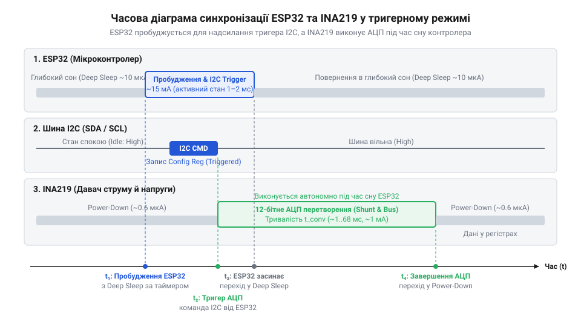
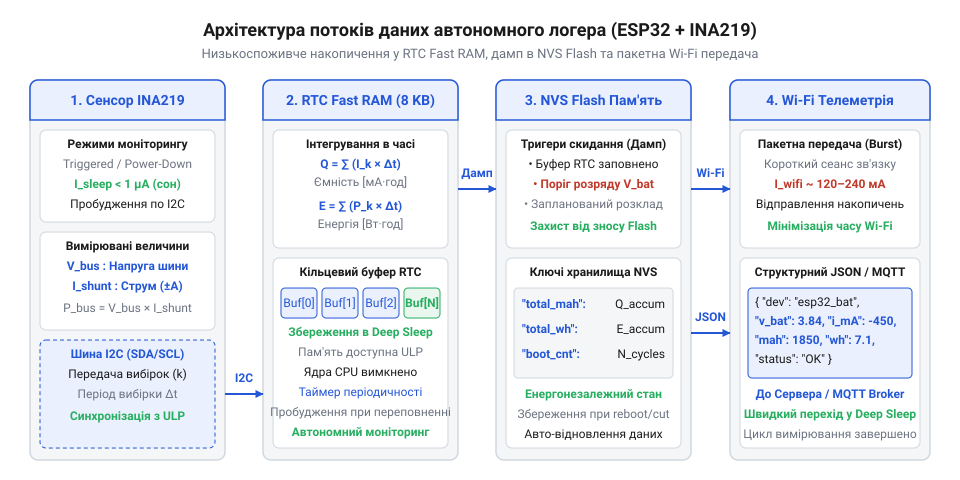

# Автономний I2C-логер споживання живлення та ємності акумулятора на ESP32

<preknowlist>
- [Цифровий монітор живлення INA226](root:cat-hw-sensors/ina226-power-monitor) — загальні принципи архітектури цифрових вимірювачів струму й напруги та принципи математичного розрахунку шунта.
- [Конфігурація та усереднення вимірювань INA226](root:cat-hw-sensors/ina226-config-and-averaging) — механізми налаштування апаратного усереднення вибірок АЦП і керування циклами перетворення.
</preknowlist>

## Проблема власного енергоспоживання автономних логерів

Спроба розробити автономний прилад для тривалого вимірювання ємності акумулятора (лат. @@la|accumulator@@, від @@la|accumulare@@ — накопичувати) або сонячної панелі часто розбивається об проблему власного енергетичного сліду вимірювальної системи. Якщо підключити мікроконтролер @@en|ESP32@@ до цифрового сенсора (лат. @@la|sensor@@, від @@la|sentire@@ — відчувати) струму й напруги @@en|INA219@@ через інтерфейсну шину @@en|I2C@@ і запустити звичайний безперервний цикл опитування в прошивці, вимірювач швидко перетворюється на основного споживача енергії в досліджуваному колі.

Активний мікроконтролер @@en|ESP32@@ із працюючим двоядерним процесором на тактовій частоті 240 МГц споживає струм близько 30–50 мА навіть із повністю вимкненим бездротовим модулем @@en|Wi-Fi@@. Якщо ж модуль @@en|Wi-Fi@@ активовано для постійної трансляції вибірок, піковий струм споживання зростає до 160–240 мА. При моніторингу низькоспоживаючого пристрою (наприклад, автономного датчика з середнім струмом 5–10 мА) або при вимірюванні розряду літієвого акумулятора ємністю 2200 мА·год протягом 24 годин, сам логер за добу безперервної роботи витратить понад 1200 мА·год. У результаті виміряне значення накопиченої ємності виявляється викривленим більше ніж удвічі, а батарея розряджається не корисним навантаженням, а приладом моніторингу.

Додатковим руйнівним чинником безперервної роботи є локальне тепловиділення на платі контролера та його лінійного стабілізатора (@@en|LDO@@). Додатковий струм викликає падіння напруги на регуляторі, виділяючи тепло, яке розігріває друковану плату. Виникаючий температурний дрейф змінює опір струмовимірювального шунта та призводить до зміщення нуля аналого-цифрового перетворювача (@@en|ADC@@). Сам вимірювальний модуль @@en|INA219@@ у режимі безперервного моніторингу додатково споживає близько 1 мА, постійно виконуючи внутрішні аналого-цифрові перетворення, більшість з яких є надлишковими при повільній динаміці розряду акумулятора.

Щоб вимірювальний прилад не спотворював експеримент, його власне середнє споживання має бути принаймні на три порядки меншим за струм досліджуваного кола (менше 0.1% від номінального навантаження). Для досягнення цієї мети необхідно кардинально змінити програмно-апаратну архітектуру пристрою. Замість постійного опитування в циклі слід перейти до синхронізованого тригерного моніторингу. Мікроконтролер більшу частину часу має перебувати в режимі глибокого сну (@@en|Deep Sleep@@) зі споживанням 10–15 мкА, застосовуючи [техніку глибокого сну](root:hw-arch/esp32-deep-sleep-rtc-architecture) для мінімізації власного споживання. Сенсор @@en|INA219@@ між вимірюваннями має переводитися в режим вимкнення живлення (@@en|Power-Down@@) зі споживанням менше 1 мкА. Лише така синхронізована робота забезпечує створення автономного логера з мінімальним енергетичним следом.

## Апаратна техніка вимірювання та режим Triggered Mode

Для побудови низькоспоживаючого вимірювального тракту застосовується цифровий монітор живлення @@en|INA219@@, який включено в розрив кола живлення між джерелом та навантаженням. Чип вимірює диференціальний спад напруги на зовнішньому токовимірювальному шунті (@@en|Shunt Resistor@@) та напругу шини (@@en|Bus Voltage@@) відносно землі за допомогою вбудованого 12-бітного АЦП. За загальною архітектурою вимірювального тракту він схожий на [цифровий вимірювач INA226](root:cat-hw-sensors/ina226-power-monitor), проте має свої особливості керування енергозбереженням.

Керування режимами роботи @@en|INA219@@ здійснюється через регістр (лат. @@la|registrum@@, від @@la|registrare@@ — записувати) конфігурації (@@en|Configuration Register@@, адреса `0x00`). За вибір режиму роботи відповідають три молодші біти `MODE3..MODE1` (біти 2..0):

* `000` — режим вимкнення (@@en|Power-Down@@): аналогові підсилювачі та АЦП вимкнені, інтерфейс @@en|I2C@@ залишається активним, власне споживання чипа становить менше 1 мкА;
* `001` — тригерний вимір напруги шунта (@@en|Shunt Voltage, Triggered@@);
* `010` — тригерний вимір напруги шини (@@en|Bus Voltage, Triggered@@);
* `011` — тригерний вимір напруги шунта та шини (@@en|Shunt and Bus, Triggered@@);
* `111` — безперервний вимір напруги шунта та шини (@@en|Shunt and Bus, Continuous@@) — стандартний стан після скидання живлення.

У тригерному (англ. @@en|trigger@@ — засувка, курок) режимі (@@en|Triggered Mode@@) чип виконує лише один цикл перетворення АЦП після запису значення `0x03` у біти `MODE` і одразу після закінчення вимірювання автоматично переходить у режим @@en|Power-Down@@. Тривалість одного 12-бітного перетворення становить лише 532 мкс (або більше при використанні [механізмів усереднення вибірок](root:cat-hw-sensors/ina226-config-and-averaging)).

Алгоритм тактування системи працює наступним чином. Мікроконтролер @@en|ESP32@@ прокидається з режиму @@en|Deep Sleep@@ за сигналом внутрішнього таймера @@en|RTC@@ через заданий інтервал `dt` (наприклад, кожні 10 секунд). Одразу після пробудження @@en|ESP32@@ надсилає по шині @@en|I2C@@ команду запису значення `0x03` у біти `MODE` регістра конфігурації @@en|INA219@@. Сенсор виконує одне швидке перетворення напруги й струму, зберігає результати в регістрах даних і самостійно повертається в режим @@en|Power-Down@@. Контролер @@en|ESP32@@ зчитує виміряні значення, оновлює накопичувальні регістри ємності в енергонезалежній оперативній пам'яті @@en|RTC Fast RAM@@ і знову засинає.


*Часова діаграма синхронізації режимів сну та вимірювання системи: послідовність тригерного опитування INA219 із мінімальним часом активності ESP32.*

Завдяки такій часовій діаграмі середня тривалість активності @@en|ESP32@@ становить менше 5 мс на один цикл опитування, а середнє споживання всієї системи зменшується з 50 мА до 15–20 мкА, забезпечуючи високу автономність логера.

## Математичне інтегрування струму та потужності в часі

Отримавши дискретні вибірки напруги шини `V_bus` (у вольтах) та струму `I` (у міліамперах) від @@en|INA219@@ через інтервали часу `dt`, необхідно виконати чисельне інтегрування (лат. @@la|integratio@@ — відновлення, об'єднання) для обчислення накопиченої ємності акумулятора та спожитої або переданої енергії.

Накопичений електричний заряд `Q` у міліампер-годинах (мА·год) та енергія `E` у ват-годинах (Вт·год) виражаються інтегралами миттєвого струму `I(t)` та потужності `P(t) = V(t) · I(t)` за часом:

```
dt_k = t_k - t_{k-1}      [обчислення інтервалу часу між пробудженнями в секундах]
```

Для дискретної обробки вибірок застосовується метод трапецій, який забезпечує вищу точність на кусково-лінійних інтервалах порівняно з простим методом Ейлера. Для кожного інтервалу між вибірками `k-1` та `k` обчислюються середній струм `I_avg` та середня потужність `P_avg`:

```
I_avg = (I_{k-1} + I_k) / 2      [середній струм інтервалу за методом трапецій в мА]
```

```
dQ_k = I_avg * (dt_k / 3600)      [приріст ємності за крок у мА·год]
```

```
Q_k = Q_{k-1} + dQ_k      [накопичена ємність у мА·год]
```

Аналогічно здійснюється чисельне інтегрування спожитої енергії:

```
P_avg = (P_{k-1} + P_k) / 2      [середня потужність інтервалу в мВт]
```

```
dE_k = P_avg * (dt_k / 3600 / 1000)      [приріст спожитої енергії у Вт·год]
```

```
E_k = E_{k-1} + dE_k      [накопичена енергія у Вт·год]
```

При моніторингу акумуляторів у системах із сонячними батареями струм є двонапрямленим: при розряджанні струм витікає з акумулятора (`I > 0`), а при заряджанні від сонячної панелі — тече в зворотному напрямку (`I < 0`). Програмний аналізатор відокремлює накопичену ємність розряду `Q_dis` від ємності заряду `Q_chg`, що дозволяє точно розраховувати поточний рівень заряду (State of Charge, @@en|SoC@@ у %):

```
SoC_k = SoC_0 - ((Q_dis_k - Q_chg_k) / Q_nominal) * 100      [оцінка рівня заряду кулонівським підрахунком у %]
```

У мові @@en|Python@@ математичну обробку телеметрії (грец. @@el|tele@@ — далеко, @@el|metron@@ — вимірювання) реалізовано за допомогою векторних операцій бібліотеки @@en|NumPy@@ у класі `BatteryPowerAnalyzer`:

:::code proj-ina219-battery-logger-esp32/py/power_analyzer.py 55-86

Функція `calculate_capacity_and_energy` приймає масив вибірок, обчислює інтервали `dt` через `np.diff` та розраховує накопичувальні суми за допомогою `np.cumsum`. Наступний метод розраховує підсумковий рівень заряду `SoC`:

:::code proj-ina219-battery-logger-esp32/py/power_analyzer.py 88-113

Такий математичний апарат забезпечує точний аналіз енергетичного балансу системи незалежно від коливань інтервалів опитування сенсора.

## Синхронізація глибокого сну та енергонезалежне збереження

При переході мікроконтролера @@en|ESP32@@ у режим глибокого сну (@@en|Deep Sleep@@) живлення більшої частини системних блоків, двоядерного процесора та основної оперативної пам'яті @@en|SRAM@@ повністю вимикається. Якщо результати поточних вимірювань струму, накопичену ємність акумулятора або спожиту енергію зберігати у звичайних глобальних змінних, при першому ж засинанні вони будуть безповоротно втрачені. Очищення пам'яті при кожному пробудженні скидатиме обчислені інтегральні значення до нуля, роблячи тривалий автономний моніторинг неможливим.

Для збереження стану пристрою між циклами вимірювань без підтримання активності всієї системи використовується спеціалізована енергонезалежна оперативна пам'ять @@en|RTC Fast RAM@@ обсягом 8 КБ, що функціонує в межах [архітектури режимів глибокого сну](root:hw-arch/esp32-deep-sleep-rtc-architecture). Цей модуль пам'яті живиться від внутрішнього низькоспоживаючого регулятора @@en|RTC@@ і зберігає вміст протягом усього часу перебування в @@en|Deep Sleep@@. У прошивці змінні, позначені спеціальним атрибутом `RTC_DATA_ATTR`, розміщуються саме в @@en|RTC Fast RAM@@ і не втрачають своїх значень при перезапуску процесорних ядер. Розміщення накопичувальних суматорів ємності в міліампер-годинах, енергії у ват-годинах та кільцевого буфера (англ. @@en|buffer@@, від старофранц. @@fro|bufe@@ — удар, поштовх) для проміжних вибірок у цій пам'яті дозволяє накопичувати дані телеметрії без пробудження енергоємних периферійних модулів.

Пряме збереження кожної вибірки в неенергонезалежну Flash-пам'ять мікроконтролера через систему [структуру неенергонезалежного сховища](root:sys-fw/nvs) @@en|NVS@@ або файлову систему @@en|LittleFS@@ є недоцільним з міркувань енергоефективності та ресурсу заліза. Запис у Flash-пам'ять вимагає активації внутрішнього генератора накачки напруги та споживає струм 30–50 мА протягом кількох мілісекунд, а ресурс перезапису секторів Flash обмежений (зазвичай близько 100 000 циклів). Ще більший енергетичний слід залишає бездротова трансляція по @@en|Wi-Fi@@: ініціалізація радіотракту, калібрування синтезатора частот (@@en|RF@@) та з'єднання з точкою доступу споживають від 160 до 240 мА протягом 1–3 секунд. Активація @@en|Wi-Fi@@ або Flash-пам'яті при кожному вимірюванні через 10 секунд нівелювала б усі переваги режиму @@en|Deep Sleep@@.

Оптимальна прошивка будується на принципі пакетної обробки накопичених даних за пороговим критерієм. Логер збирає масив із `N` вибірок (наприклад, 60 записів за 10 хвилин спостереження) всередині кільцевого буфера в @@en|RTC Fast RAM@@. Під час кожного короткого пробудження (тривалістю менше 5 мс) контролер @@en|ESP32@@ лише зчитує сенсор @@en|INA219@@ по шині @@en|I2C@@, оновлює інтегральні суматори в @@en|RTC Fast RAM@@, збільшує лічильник буфера та миттєво повертається в @@en|Deep Sleep@@. Лише після заповнення буфера до `N` записів (або при виявленні критичного зниження напруги акумулятора) система активує драйвер @@en|NVS@@ для дампа накопиченого масиву у Flash-пам'ять чи вмикає модуль @@en|Wi-Fi@@ для швидкої передачі пакета за протоколом @@en|UDP@@ або @@en|MQTT@@. Це зменшує відносний час активності радіотракту до менш ніж 0.3%.

Програмна машина станів прошивки аналізує причину пробудження за допомогою функції `esp_sleep_get_wakeup_cause()` і працює за наступним алгоритмом:

1. При початковому ввімкненні живлення (`ESP_SLEEP_WAKEUP_UNDEFINED`) виконується ініціалізація периферії, обнулення лічильників у @@en|RTC Fast RAM@@, первинне [налаштування апаратного усереднення](root:cat-hw-sensors/ina226-config-and-averaging) сенсора та розрахунок початкового рівня заряду. 2. При періодичному пробудженні від таймера (`ESP_SLEEP_WAKEUP_TIMER`) ініціалізується шина @@en|I2C@@, надсилається тригерна команда `MODE = 0x03` у конфігураційний регістр @@en|INA219@@, зчитуються регістри напруги шини `V_bus` та спаду напруги на шунті `V_shunt`, обчислюються трапецієподібні прирости ємності й енергії та оновлюється буфер у @@en|RTC Fast RAM@@. 3. Перевіряється умова дампа: якщо буфер заповнено, виконується пакетний запис у неенергонезалежну пам'ять @@en|NVS@@ або передача телеметрії по @@en|Wi-Fi@@, після чого покажчик буфера скидається. 4. Програмується таймер @@en|RTC@@ на наступний інтервал `dt` та викликається команда переходу в глибокий сон `esp_deep_sleep_start()`.


*Функціональна блок-схема потоків даних та організації пам'яті автономного логера живлення на ESP32.*

Така програмна структура забезпечує повну збереженість вимірювальних даних при мінімальному власному енергетичному балансі системи.

## Збирання логера, калібрування та аналіз автономності

Фізичне збирання автономного логера вимагає коректного з'єднання вимірювального модуля @@en|INA219@@ із контролером @@en|ESP32@@ та досліджуваним колом живлення. Струмовимірювальний шунт (@@en|Shunt Resistor@@) впаюється в розрив плюсового провідника між джерелом живлення (акумулятором чи сонячною панеллю) та навантаженням. Інтерфейсні лінії @@en|SDA@@ та @@en|SCL@@ шини @@en|I2C@@ підключаються до відповідних виводів @@en|GPIO@@ контролера @@en|ESP32@@ із обов'язковими підтягуючими резисторами (типово 4.7 кОм до лінії 3.3 В). Для запобігання похибкам від паразитного спаду напруги при проходженні високих струмів силові провідники від акумулятора до терміналів шунта мають бути максимально короткими й товстими, а сигнальне заземлення модуля та силовий мінус повинні з'єднуватися в одній точці за схемою «зірка».

Перед проведенням випробувань необхідно виконати калібрування (фр. @@fr|calibration@@, від араб. @@ar|qālib@@ — форма, матриця) вимірювального тракту. Номінальний опір шунта (наприклад, 0.1 Ом) має технологічні допуски виробництва (від 1% до 5%), а також додатковий опір контактних майданчиків друкованої плати, що викликає мультиплікативну похибку вимірювання струму. Для усунення цієї похибки через шунт пропускають стабільний еталонний струм від лабораторного джерела живлення та контролюють його значення за допомогою прецизійного цифрового мультиметра (@@en|DMM@@), що відповідає стандартам для [параметрів цифрового вимірювача](root:cat-hw-sensors/ina226-power-monitor). Далі розраховують калібрувальний коефіцієнт `K_cal`:

```
K_cal = I_ref / I_measured      [обчислення коефіцієнта калібрування струмового шунта]
```

Отриманий коефіцієнт `K_cal` записується в конфігурацію прошивку чи застосовується при пост-обробці телеметрії для лінійного коригування значений струму `current_ma` та потужності `power_mw`.

При проведенні експериментальних випробувань логера у складі системи з сонячною батареєю та літієвим акумулятором струм у колі змінює напрямок залежно від рівня освітленості. Удень, коли сонячна панель генерує потужність, що перевищує споживання навантаження, струм тече в акумулятор (`I < 0`, режим заряджання). Уночі або при піковому навантаженні струм витікає з акумулятора (`I > 0`, режим розряджання). Програмний аналізатор веде окремі лічильники накопиченої ємності заряду `Q_chg` та розряду `Q_dis`, що дозволяє розраховувати підсумковий енергетичний баланс `E_net`:

```
E_net = E_charge * eta_chg - E_discharge      [енергетичний баланс акумулятора з урахуванням ККД]
```

де `eta_chg` (порядок 0.92–0.95) враховує енергетичний ККД хімічного електроліту акумулятора.

На стороні приймача телеметрії (комп'ютера або сервера) отриманий по послідовному порту @@en|UART@@ або мережевому сокету потік вибірок обробляється Python-скриптом `telemetry_receiver.py`. Клас `TelemetryReceiver` здійснює потоковий розбір рядків @@en|JSON@@ або @@en|CSV@@, перевіряє фізичні межі вибірок та фільтрує аномальні сплески від завад:

:::code proj-ina219-battery-logger-esp32/py/telemetry_receiver.py 24-54

:::code proj-ina219-battery-logger-esp32/py/telemetry_receiver.py 152-174

:::code proj-ina219-battery-logger-esp32/py/telemetry_receiver.py 234-273

Збережений часовий ряд обробляється модулем `power_analyzer.py`, який виконує чисельне інтегрування, аналізує рівень заряду (State of Charge, @@en|SoC@@), оцінює внутрішній опір акумулятора під навантаженням та генерує підсумковий звіт енергетичного балансу:

:::code proj-ina219-battery-logger-esp32/py/power_analyzer.py 115-144

:::code proj-ina219-battery-logger-esp32/py/power_analyzer.py 145-180

Для візуалізації розрядних кривих, профілів споживання та динаміки рівня заряду використовується модуль `telemetry_plotter.py`, який будує багатопанельні графічні звіти у форматах @@en|PNG@@ та @@en|PDF@@ за допомогою бібліотек @@en|pandas@@ та @@en|matplotlib@@:

:::code proj-ina219-battery-logger-esp32/py/telemetry_plotter.py 30-100

Весь конвеєр обробки даних, генерації симульованого або реального потоку вибірок та формування графічних звітів запускається головним виконуваним скриптом `main.py`:

:::code proj-ina219-battery-logger-esp32/py/main.py 67-137

Розрахунок підсумкового енергетичного бюджету логера підтверджує його високу автономність. За інтервалу вимірювання `dt = 10` секунд середня витрата енергії становить:

```
q_active = 30 * (0.005 / 3600)      [витрата заряду за 5 мс активного стану 30 мА у мА·год]
= 0.0000417                         [мА·год]
```

```
q_sleep = 0.015 * (9.995 / 3600)    [витрата заряду за 9.995 с сну 15 мкА у мА·год]
= 0.0000416                         [мА·год]
```

Сумарне середнє споживання логера з урахуванням періодичного дампа по @@en|Wi-Fi@@ не перевищує 50 мкА (0.05 мА). Відтак від стандартного літієвого акумулятора ємністю 2200 мА·год сам логер здатний автономно працювати понад 44 000 годин (понад 5 років), додаючи похибку власного споживання менше ніж 0.01% від ємності батареї. На цьому процес проектування та верифікації повнофункціонального автономного I2C-логгера живлення на @@en|ESP32@@ завершено.