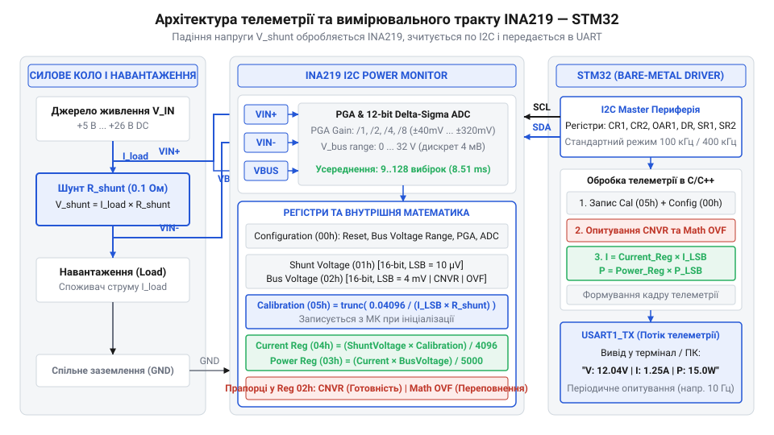
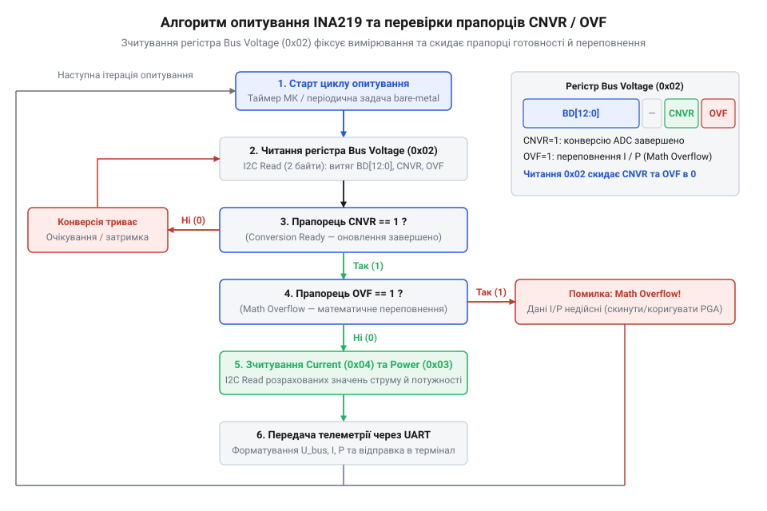

# Розробка драйвера INA219 та системи моніторингу живлення на мікроконтролері STM32 (C/C++)

<preknowlist>
- [Конфігурація та усереднення вимірювань INA226](root:cat-hw-sensors/ina226-config-and-averaging) — режими цифрового усереднення вибірок АЦП та вибір коефіцієнтів підсилення для зниження шумів вимірювання струму і напруги.
- [Цифровий монітор живлення INA226](root:cat-hw-sensors/ina226-power-monitor) — базові принципи вимірювання напруги на шунті та напруги шини, а також загальна структура вимірювальних регістрів сімейства моніторів живлення.
</preknowlist>

## Проблема точного моніторингу живлення в STM32

Під час проектирования відповідальних вбудованих систем на базі мікроконтролерів STM32 розробник стикається з потребою вимірювання миттєвого струму та напруги живлення. Контроль енергоспоживання є критичним для захисту силових каскадів та запобігання перевантаженням. Спроба розв'язати це завдання через вбудований аналогово-цифровий перетворювач @@en|ADC@@ (англ. *Analog-to-Digital Converter*, від грец. *analogos* — відповідний, лат. *digitus* — палець, цифра + лат. *convertere* — перетворювати) мікроконтролера швидко призводить до апаратних і програмних обмежень.

Головне апаратне обмеження модуля @@en|ADC@@ полягає в здатності вимірювати напругу виключно відносно спільної землі у діапазоні від 0 до 3.3 В. Вимірювання струму навантаження включенням низькоомного шунта в розрив мінусового провідника — у конфігурації @@en|Low-Side@@ (англ. *Low-Side*, від англ. *low* — низький + *side* — сторона) — створює зсув потенціалу сигнальної землі. Спад напруги викликає феномен @@en|Ground Bounce@@ (англ. *Ground Bounce*, від англ. *ground* — земля + *bounce* — відскок), який спотворює вимірювання та порушує роботу цифрових інтерфейсів.

Для збереження єдиного потенціалу землі струм вимірюють у верхньому плечі живлення — у конфігурації @@en|High-Side@@ (англ. *High-Side*, від англ. *high* — високий + *side* — сторона). Проте шина живлення навантаження часто має напругу 12 В, 24 В або 26 В, що перевищує допустимі параметри входів STM32 і знищує аналогові виводи. Крім того, вимірювання малого диференційного спаду на тлі високої синфазної напруги вимагає підсилювача з високим коефіцієнтом приглушення синфазного сигналу @@en|CMRR@@ (англ. *Common-Mode Rejection Ratio*, від англ. *common* — спільний, *mode* — режим, *rejection* — відхилення + лат. *ratio* — відношення), якого периферія STM32 не має.

Програмна частина проблеми полягає у блокуючих циклах високорівневих бібліотек @@en|HAL@@ (англ. *Hardware Abstraction Layer*, від англ. *hardware* — апаратне забезпечення + лат. *abstractio* — відокремлення + англ. *layer* — шар). Під час обміну через шину @@en|I2C@@ (англ. *Inter-Integrated Circuit*, від лат. *inter* — між + *integrare* — відновлювати, об'єднувати + *circuitus* — обхід, коло) процедури HAL_I2C_Master_Transmit та HAL_I2C_Master_Receive у разі завад застрягають у нескінченних перевірках статусних бітів, призводячи до повного зависання програми.

Розв'язанням цих бар'єрів є застосування цифрового монітора живлення INA219. Як і в [суміжних цифрових моніторах живлення](root:cat-hw-sensors/ina226-power-monitor), цей датчик поєднує підсилювач для синфазної напруги до 26 В, 12-бітний перетворювач та математичний сопроцесор. Щоб виключити ризик блокування процесора, керування сенсором слід реалізувати за допомогою легковажного @@en|bare-metal@@ (англ. *bare-metal*, від англ. *bare* — голий + *metal* — метал) C/C++ драйвера, який взаємодіє з реєстрами STM32 напряму.

## Математична модель та калібрування INA219

Цифровий монітор живлення INA219 вимірює падіння напруги на шунті `V_shunt` та напругу шини `V_bus`. Для адаптації динамічного діапазону вхідний сигнал із виводів VIN+ та VIN- надходить на програмований підсилювач @@en|PGA@@ (англ. *Programmable Gain Amplifier*, від грец. *programma* — розпорядок + англ. *gain* — підсилення + *amplifier* — підсилювач).


*Схема апаратної взаємодії STM32 з монітором живлення INA219 та навантаженням через шину I2C: двопровідне з'єднання SCL/SDA, вимірювальні входи VIN+/VIN- на шунті R_shunt та потік телеметрії до мікроконтролера.*

У регістрі Configuration Register (адреса 0x00) підсилювач @@en|PGA@@ задає чотири режими підсилення: /1 (±40 мВ), /2 (±80 мВ), /4 (±160 мВ) та /8 (±320 мВ). Значення в регістрі Shunt Voltage Register (адреса 0x01) подається як знакове 16-бітне число у коді з доповненням до двох із ціною молодшого розряду @@en|LSB@@ (англ. *Least Significant Bit*, від англ. *least* — найменший, *significant* — значущий + *bit* — двійковий розряд) у 10 мкВ.

Внутрішній математичний двигун INA219 самостійно обчислює струм та потужність. Для коректності розрахунків у регістр Calibration Register (адреса 0x05) записують калібрувальне значення `Cal`.

Цільову дискретність струму `Current_LSB` обчислюють із максимального очікуваного струму навантаження `I_max`:

Current_LSB = I_max / 32768

Ділення на 32768 зумовлене тим, що регістр струму є знаковим 16-бітним числом із максимальним значенням 32767.

Калібрувальний коефіцієнт `Cal` обчислюють із дискретності струму `Current_LSB` та опору шунта `R_shunt`:

Cal = trunc(0.04096 / (Current_LSB · R_shunt))

Системна константа 0.04096 є внутрішнім множником чипа, а результат маскують виразом `Cal & 0xFFFE`, оскільки молодший біт FS0 апаратно зафіксований у 0.

Дискретність вимірювання потужності `Power_LSB` отримують із дискретності струму `Current_LSB`:

Power_LSB = 20 · Current_LSB

Коефіцієнт 20 виникає через те, що внутрішня логіка сенсора множить струм на напругу шини з фіксованою дискретністю 4 мВ у регістрі Bus Voltage Register (адреса 0x02).

Проведемо покроковий розрахунок калібрувальних параметрів для шунта `R_shunt = 0.1` Ом та максимального струму `I_max = 2.0` А.

Обчислимо ціну розряду струму `Current_LSB`:

Current_LSB = 2.0 / 32768
            = 0.00006103515625 A/LSB  [ділення максимального струму 2.0 А на 32768]
            ≈ 61.035 μA/LSB           [переведення у мікроампери]

Обчислимо 16-бітне значення калібрувального регістра `Cal`:

Знаменник   = Current_LSB · R_shunt
            = 0.00006103515625 · 0.1
            = 0.000006103515625       [множення LSB струму на опір шунта в Омах]

Cal_float   = 0.04096 / 0.000006103515625
            = 6710.8864               [ділення константи 0.04096 на отриманий знаменник]

Cal         = trunc(6710.8864) & 0xFFFE
            = 6710 & 0xFFFE
            = 6710 (0x1A36)           [відкидання дробової частини та обнулення молодшого біта]

Обчислимо дискретність вимірювання потужності `Power_LSB`:

Power_LSB   = 20 · 0.00006103515625
            = 0.001220703125 W/LSB     [множення LSB струму на фіксований коефіцієнт 20]
            ≈ 1.221 mW/LSB             [переведення у мілівати]

При перевищенні струму `I_max` або виході напруги за межі діапазону @@en|PGA@@ сенсор встановлює біт 0 (прапорець Math Overflow `OVF`) у регістрі Bus Voltage Register, роблячи зчитані струм і потужність недійсними. Для придушення шуму застосовують [цифрове усереднення вибірок](root:cat-hw-sensors/ina226-config-and-averaging) у бітах SADC та BADC.

Практична реалізація розрахунку калібрування на C та C++:

:::tabs
```c|stm32
:::code proj-ina219-power-monitor-stm32-baremetal/c/src/ina219.c 35-58
```
```cpp|stm32
:::code proj-ina219-power-monitor-stm32-baremetal/cpp/src/ina219_driver.cpp 151-166
```
:::

## Реалізація bare-metal I2C драйвера STM32

Щоб відмовитися від потенційно небезпечних блокуючих функцій бібліотеки @@en|HAL@@, створимо власний низькорівневий транспорт для обміну з INA219 на базі прямого маніпулювання реєстрами I2C STM32.

Карта регістрів I2C STM32 містить контрольні регістри CR1 і CR2, регістр даних DR, статусні SR1 і SR2 та часові CCR й TRISE. Ініціалізація починається з вимкнення периферії (CR1_PE = 0), програмного скидання (CR1_SWRST = 1) та запису частоти APB1 у мегагерцах до CR2.

Розрахунок регістра CCR для стандартного режиму I2C (100 кГц) при тактуванні APB1 16 МГц:

CCR = f_pclk1 / (2 · f_i2c)
    = 16000000 / (2 · 100000)
    = 80                       [ділення частоти APB1 на подвійну частоту I2C]

Розрахунок часу підйому сигналу TRISE для APB1 16 МГц:

TRISE = f_pclk1_mhz + 1
      = 16 + 1
      = 17                     [додавання одиниці до частоти APB1 у МГц]

Всі внутрішні регістри INA219 мають розмірність 16 біт і передаються по шині у порядку @@en|Big-Endian@@ (англ. *Big-Endian*, від англ. *big* — великий + *end* — кінець) — старший байт MSB першим, молодший LSB другим.

Зчитування 16-бітного регістру INA219 виконується за апаратним протоколом STM32 для двобайтного прийому:
1. Формування START шляхом встановлення біта START у CR1 та очікування прапорця SB у SR1. 2. Передача адреси пристрою із бітом запису (DR = dev_addr << 1), очікування прапорця ADDR та його очищення зчитанням SR1 і SR2. 3. Запис адреси регістра INA219 у DR, очікування прапорців TXE та BTF. 4. Формування Repeated START та передача адреси пристрою у режимі читання (DR = (dev_addr << 1) | 1). 5. Встановлення бітів ACK та POS у CR1 для двобайтного прийому; після підтвердження адреси скидання ACK в 0 для автоматичного формування NACK після другого байта. 6. Очікування прапорця BTF про прийом двох байтів у зсувний регістр та буфер DR. 7. Формування STOP (CR1_STOP = 1) та послідовне зчитання MSB й LSB з DR.

Для захисту від зависання кожен цикл очікування прапорця wait_flag_set охоплено лічильником 	imeout_cycles. Якщо прапорець не встановлено або ведений пристрій не повертає підтвердження (прапорець AF у SR1), драйвер генерує STOP, скидає шину та повертає код помилки. У C++ драйвері цю логіку доповнює концепція @@en|RAII@@ (англ. *Resource Acquisition Is Initialization*, від англ. *resource* — ресурс, *acquisition* — отримання + лат. *initialis* — початковий) в об'єкті I2cBusGuard, який автоматично викликає процедуру відновлення шини 
ecoverBus при помилках.

Код C та C++ для виконання неблокуючих транзакцій зчитування та запису 16-бітних регістрів INA219:

:::tabs
`c|stm32
:::code proj-ina219-power-monitor-stm32-baremetal/c/src/i2c_driver.c 203-269
```
`cpp|stm32
:::code proj-ina219-power-monitor-stm32-baremetal/cpp/src/ina219_driver.cpp 76-97
```
:::

## Обробка прапорців готовності та переповнення

Періодичне опитування @@en|Polling@@ (англ. *Polling*, від англ. *poll* — опитування) цифрового монітора живлення INA219 вимагає узгодження часових інтервалів мікроконтролера з внутрішнім циклом аналогово-цифрового перетворення чипа. У режимі безперервного вимірювання @@en|ADC@@ перетворювач послідовно вимірює спад напруги на шунті `V_shunt` та напругу шини `V_bus`. Тривалість циклу становить від 84 мкс (9-бітний режим) до 68.10 мс (128 вибірок). Зчитавши регістри струму чи потужності до завершення перетворення, мікроконтролер отримає застарілі дані. Для запобігання цьому в регістрі Bus Voltage Register (0x02) передбачено апаратний прапорець готовності конверсії @@en|Conversion Ready@@ (англ. *Conversion Ready*, від лат. *conversio* — перетворення + англ. *ready* — готовий), або `CNVR` (біт 1).

Прапорець `CNVR` встановлюється в 1 при завершенні вимірювань `V_shunt` і `V_bus` та оновленні регістрів Current Register (0x03) і Power Register (0x04). Біт скидається в 0 при зчитанні Bus Voltage Register, записі в Configuration Register або запуску нової конверсії. Кожна ітерація опитування починається зі зчитування 16-бітного регістра Bus Voltage Register. Витягнення напруги шини та перевірка прапорця `CNVR` виконуються за бітовими масками:

```
raw_bus_reg = read_reg16(INA219_REG_BUS_VOLTAGE)
cnvr_flag   = (raw_bus_reg & 0x0002) ≠ 0    [перевірка біта 1 прапорця CNVR]
ovf_flag    = (raw_bus_reg & 0x0001) ≠ 0    [перевірка біта 0 прапорця OVF]
raw_voltage = (raw_bus_reg & 0xFFF8) >> 3   [витягнення бітів напруги [15:3]]
V_bus_volts = raw_voltage · 0.004           [масштабування напруги шини у Вольтах]
```

Біт 0 того ж регістра містить прапорець математичного переповнення @@en|Math Overflow@@ (англ. *Math Overflow*, від грец. *mathematikos* — математичний + англ. *overflow* — переповнення), позначуваний як `OVF`. Внутрішній модуль INA219 обчислює струм множенням спаду напруги на шунті на регістр калібрування `Cal`, а потужність — множенням струму на напругу шини. Якщо спад напруги перевищує межі обраного діапазону @@en|PGA@@ (наприклад, ±320 мВ при підсиленні /8), або результат обчислення перевищує межі 16-бітного знакового діапазону (понад 32767 @@en|LSB@@), чип встановлює `OVF = 1`.

При `OVF = 1` вміст регістрів струму й потужності є недовірчим. Зчитування регістрів 0x03 та 0x04 призупиняється, фіксується помилка струмового каналу, а для відновлення вимірювань зменшують коефіцієнт підсилення @@en|PGA@@ або перераховують `Current_LSB`. Якщо ж `CNVR = 1` та `OVF = 0`, мікроконтролер зчитує телеметрію через шину @@en|I2C@@. Для усунення завад використовують [цифрове усереднення вибірок](root:cat-hw-sensors/ina226-config-and-averaging) у конфігураційному регістрі датчика.


*Схема алгоритму опитування INA219 та обробки прапорців CNVR і OVF: послідовність зчитування регістру напруги шини, перевірка готовності даних та розгалуження при переповненні.*

Нижче наведено фрагменти коду для зчитування напруги шини з перевіркою прапорців `CNVR` та `OVF` на C та C++:

:::tabs
```c|stm32
:::code proj-ina219-power-monitor-stm32-baremetal/c/src/ina219.c 135-157
```
```cpp|stm32
:::code proj-ina219-power-monitor-stm32-baremetal/cpp/src/ina219_driver.cpp 250-271
```
:::

## Формування та передача телеметрії через UART

Передача оцифрованої телеметрії INA219 на хост-комп'ютер здійснюється через послідовний інтерфейс @@en|UART@@ (англ. *Universal Asynchronous Receiver-Transmitter*, від англ. *universal* — загальний + *asynchronous* — асинхронний). У системах реального часу форматування та відправку кадрів виконують без динамічного виділення пам'яті у купі, щоб уникнути фрагментації та часових затримок.

Перетворення сирих значень у фізичні величини спирається на дискретність коефіцієнтів сенсора. Спад напруги `V_shunt` зчитується з регістра 0x01 як знакове `int16_t` та масштабується з розрядом 0.01 мВ. Струм розраховується множенням регістра 0x03 на `Current_LSB`, а потужність — множенням беззнакового регістра 0x04 на `Power_LSB`:

```
V_shunt_mV = (float)((int16_t)raw_shunt) · 0.01
Current_mA = (float)((int16_t)raw_current) · Current_LSB · 1000.0
Power_mW   = (float)(raw_power) · Power_LSB · 1000.0
```

Текстові кадри у форматі @@en|ASCII@@ (англ. *American Standard Code for Information Interchange*, від англ. *standard* — стандарт + *code* — код) формують у локальному статичному буфері фіксованого розміру (наприклад, 128 байтів). Застосування функцій `snprintf` або `std::snprintf` запобігає переповненню буфера під час форматування чисел із плаваючою крапкою у розширений або компактний рядок.

Відправка даних через периферію @@en|UART@@ мікроконтролера STM32 має мінімізувати затримки обчислювального ядра. При виникненні статусу блокування `HAL_BUSY` драйвер виконує повторні спроби відправки або переходить на неблокуючий обмін з апаратними буферами, що забезпечує передачу телеметрії без затримки основних задач моніторингу.

Фрагменти коду для форматування та передачі телеметрії через @@en|UART@@ на мовах C та C++:

:::tabs
```c|stm32
:::code proj-ina219-power-monitor-stm32-baremetal/c/src/main.c 82-108
```
```cpp|stm32
:::code proj-ina219-power-monitor-stm32-baremetal/cpp/include/uart_telemetry.hpp 68-126
```
:::

## Законсервований модуль моніторингу живлення STM32

Об'єднання розглянутих компонентів завершується створенням автономного модуля. Він надає розробнику програмний інтерфейс @@en|API@@ (англ. *Application Programming Interface*, від лат. *applicatio* — прикладання + грец. *programma* — розпорядок + лат. *interfacies* — міжобличчя) для підключення монітора живлення до системного коду без занурення у регістрову специфіку чипа.

У мові C інкапсуляція стану драйвера @@en|Driver@@ (англ. *Driver*, від англ. *drive* — керувати) реалізується через структури даних. Структура `ina219_config_t` зберігає параметри адреси, шунта, струму, напруги, підсилення @@en|PGA@@ та усереднення АЦП. Дескриптор `ina219_t` містить вказівник на шину @@en|I2C@@, коефіцієнти `Current_LSB`, `Power_LSB` та регістр `Cal`. У C++ логіка інкапсулюється у класі `ina219::Ina219Driver`, а захист шини від блокувань реалізує обгортка @@en|RAII@@ `I2cBusGuard`, яка виконує перезапуск периферії при помилках.

Уніфікований процес ініціалізації виконується у виклик процедури `init()`. Усередині неї розраховується дискретність струму й потужності, формується калібрувальний регістр `Cal`, здійснюється скидання INA219 та запис конфігурації. Драйвер дозволяє динамічно перемикати режими чипа — від безперервного моніторингу до режимів зниженого енергоспоживання (Power-Down чи ADC Off), що критично для автономних пристроїв.

Завдяки відсутності залежностей від бібліотек @@en|HAL@@, модуль безбар'єрно інтегрується у @@en|bare-metal@@ прошивки STM32 та в операційні системи реального часу @@en|RTOS@@ (англ. *Real-Time Operating System*, від англ. *real* — дійсний, *time* — час + лат. *operari* — працювати + грец. *systema* — сполучення). Подібно до того, як влаштовано [цифрові монітори живлення](root:cat-hw-sensors/ina226-power-monitor), він забезпечує автономність вимірювального контуру.

Нижче наведено приклади повної ініціалізації та використання законсервованого модуля моніторингу живлення на мовах C та C++:

:::tabs
```c|stm32
:::code proj-ina219-power-monitor-stm32-baremetal/c/src/main.c 59-78
```
```cpp|stm32
:::code proj-ina219-power-monitor-stm32-baremetal/cpp/src/main.cpp 32-52
```
:::