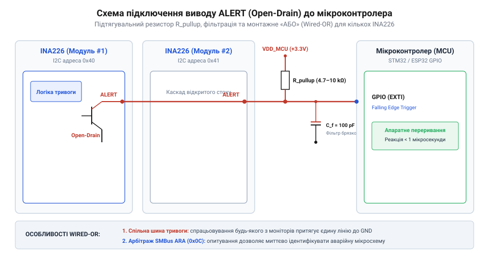
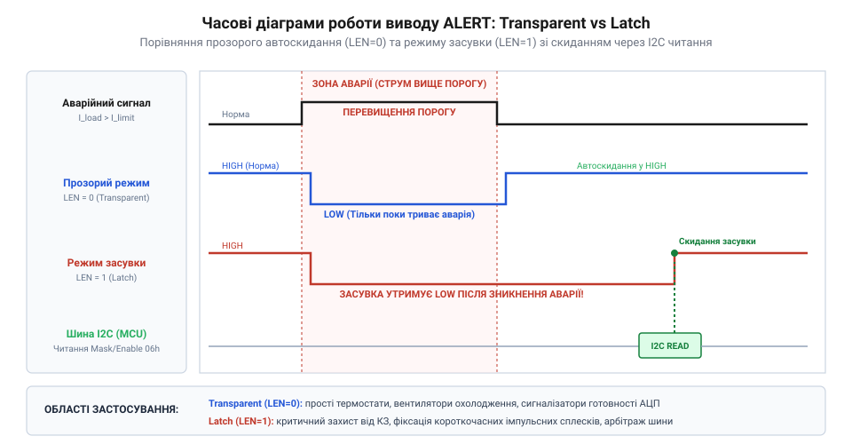

# Залізний інтерфейс виводу ALERT та регістрів тривоги INA226

<preknowlist>
- [Конфігурація та усереднення вимірювань INA226](root:cat-hw-sensors/ina226-config-and-averaging) — що вимірювання виконуються циклами і як налаштування часу перетворення та усереднення впливають на частоту оновлення результатів.
</preknowlist>

## Підключення відкритого стоку виводу ALERT

Коли напруга чи струм у системі виходять за безпечні межі, мікроконтролер має дізнатися про це миттєво, не чекаючи наступного циклу опитування датчика. У мікросхемі INA226 цю функцію виконує вивід `ALERT`. Він побудований за схемою відкритого стоку: мікросхема може лише притягнути лінію до землі (створити логічний нуль), але не може видати напругу високого рівня. Щоб на виводі з'явилася логічна одиниця, коли тривоги немає, лінію необхідно з'єднати з шиною живлення мікроконтролера через зовнішній підтягувальний резистор. 

Така конфігурація дозволяє безпечно узгоджувати INA226 з мікроконтролерами, що мають різні логічні рівні живлення (наприклад, 3.3 В або 5 В). Номінал резистора зазвичай становить від 10 кОм до 100 кОм. Менший опір забезпечує швидший фронт сигналу, що важливо для довгих ліній, але збільшує струм витоку під час активного стану тривоги. 

*Схема підключення виводу ALERT: використання підтягувального резистора та об'єднання кількох мікросхем за схемою монтажного АБО.*

Відкритий стік дає ще одну перевагу: кілька мікросхем INA226 можуть бути підключені до однієї лінії переривання мікроконтролера. Якщо хоч один датчик фіксує порушення меж, він притягує спільну лінію до землі. Ця конфігурація, відома як монтажне АБО, економить виводи мікроконтролера у системах із багатьма каналами вимірювання. Проте така схема має ціну: доки лінія тривоги притягнута до землі, через підтягувальний резистор постійно тече струм від шини живлення. Якщо стан тривоги не скидається і триває довго, цей струм витоку безперервно забирає енергію, що стає критичним для загального енергоспоживання пристроїв на батареях.

## Регістр маскування та умови тривоги

Коли мікросхема безперервно вимірює струм та напругу, мікроконтролеру немає сенсу постійно запитувати дані, якщо пристрій працює в штатному режимі. Натомість система має реагувати лише на критичні події: коли струм перевищив безпечну межу, напруга впала нижче норми, або коли зібрана нова порція вимірювань для журналу. Щоб вивід `ALERT` спрацював саме тоді, коли потрібно, INA226 має знати, за якою умовою стежити. Ця логіка налаштовується через регістр маскування та ввімкнення (@@en|Mask/Enable Register@@).

Мікросхема вміє відстежувати п'ять умов виходу за межі: перевищення напруги шунта (SOL) або шини (BOL), падіння напруги шунта (SUL) або шини (BUL), а також перевищення заданої потужності (POL). Усі ці умови спираються на єдиний регістр межі тривоги (@@en|Alert Limit Register@@). Оскільки апаратний регістр для порогу лише один, мікросхема фізично здатна порівнювати з ним лише один обраний параметр за раз.

Через це одночасно може бути активована лише одна з п'яти умов виходу за межі. Якщо програміст помилково або навмисно встановить в одиницю відразу кілька бітів меж у регістрі маскування, мікросхема не зависне, але застосує жорсткий апаратний пріоритет. Вищий біт перемагає за правилом: `SOL > SUL > BOL > BUL > POL`. Тобто, якщо ввімкнути одночасно перевищення струму на шунті (SOL) і падіння напруги шини (BUL), мікросхема ігноруватиме напругу і порівнюватиме з регістром межі лише струм. Значення в регістр межі записують у тому ж форматі, що й дані відповідного вимірюваного параметра.

Окрім контролю за межами, INA226 вміє сигналізувати про готовність нових даних за допомогою біта готовності перетворення (CVRF). Оскільки ця подія не потребує порівняння з порогом, біт CVRF можна вмикати одночасно з будь-якою обраною межею. Тоді вивід `ALERT` спрацює або коли порушено ліміт, або коли [усереднення вимірювань](root:cat-hw-sensors/ina226-config-and-averaging) завершило черговий цикл. Щоб мікроконтролер зрозумів, що саме спричинило переривання, він читає регістр маскування і перевіряє прапорці статусу (AFF для ліміту та CVRF для готовності), які мікросхема встановлює апаратно.

За замовчуванням активний рівень на виводі `ALERT` — низький. У разі тривоги вихідний транзистор відкривається і притягує лінію до землі. Якщо архітектура системи вимагає активного високого рівня для переривань, реакцію виводу можна інвертувати бітом полярності (APOL). Але тут криється апаратна пастка: вивід залишається відкритим стоком. Активний високий рівень означає, що в стані спокою мікросхема постійно тримає лінію притягнутою до землі, витрачаючи струм через підтягувальний резистор, а в момент тривоги — закриває транзистор, дозволяючи резистору підняти напругу на лінії до логічної одиниці. Зміна полярності впливає виключно на поведінку вихідного транзистора і ніяк не змінює логіку внутрішніх прапорців тривоги.

## Прозорий режим та режим фіксації

Реакція виводу `ALERT` на зникнення умови тривоги залежить від стану біта фіксації (LEN) у регістрі Mask/Enable. Від цього налаштування докорінно змінюється підхід до написання обробників переривань.

У прозорому режимі (LEN = 0) стан виводу жорстко прив'язаний до поточних вимірювань. Якщо напруга перевищила межу, вивід сигналізує про тривогу; щойно напруга повернулася в норму — сигнал автоматично знімається. Цей режим підходить для простих систем захисту, які апаратно вимикають навантаження на час стрибків напруги. Проте мікроконтролер може пропустити коротке переривання, якщо воно зникне до того, як код встигне його обробити.

*Часові діаграми роботи виводу ALERT: різниця між самостійним зняттям тривоги в прозорому режимі та утриманням стану в режимі фіксації.*

У режимі фіксації (@@en|latch mode@@, LEN = 1) вивід утримує активний стан навіть після того, як контрольований параметр повернувся до норми. Сигнал знімається лише тоді, коли мікроконтролер виконає читання регістра Mask/Enable. Це гарантує, що жодна подія не буде втрачена, і дає програмі достатньо часу на реакцію. Саме цей режим найчастіше використовується під час роботи з перериваннями на [цифрових моніторах живлення INA226](root:cat-hw-sensors/ina226-power-monitor).

## Часові діаграми та обробка переривань

Під час налаштування системи переривань важливо враховувати затримку між фактичною подією та зміною стану виводу `ALERT`. INA226 не реагує на миттєві аналогові значення струму чи напруги; тривога формується лише за результатами цифрового перетворення.

Якщо в мікросхемі налаштоване усереднення за кількома вимірами, порівняння з межею тривоги відбувається лише після завершення всього циклу усереднення. Тобто затримка спрацьовування дорівнює часу одного повного перетворення, помноженому на кількість усереднень. Це відфільтровує короткі шуми та перешкоди, запобігаючи хибним спрацьовуванням переривань. Але у випадку різкого короткого замикання це означає, що контролер отримає сигнал із суттєвою затримкою. Тому для критичних захистів час усереднення слід зводити до мінімуму.

Під час написання обробника переривання мікроконтролер повинен реагувати на активний фронт сигналу (зазвичай — спадний), а не на статичний рівень. Після входу в обробник, якщо обрано режим фіксації, програма має прочитати регістр Mask/Enable для скидання тривоги. Важливо читати регістр лише після усунення першопричини або програмного маскування події, інакше вивід `ALERT` знову активується після наступного циклу АЦП.

## Ідентифікація через SMBus Alert Response

У системах, де кілька датчиків об'єднані на спільній лінії тривоги, мікроконтролер стикається з проблемою ідентифікації джерела: хто саме активував вивід `ALERT`? Читання статусних регістрів усіх мікросхем підряд є надто повільним процесом. Для вирішення цієї задачі в INA226 передбачено підтримку протоколу SMBus Alert Response Address (ARA).

Коли мікроконтролер отримує переривання, він надсилає на шину I2C спеціальний широкомовний запит за адресою 0x0C (ARA). Усі пристрої, які на цей момент утримують лінію `ALERT` в активному стані, починають відповідати на запит, передаючи власну I2C-адресу. Якщо тривогу згенерували кілька мікросхем одночасно, на шині відбувається апаратний арбітраж: виграє і передає адресу повністю той пристрій, чия адреса є меншою.

Після успішної передачі своєї адреси мікросхема автоматично знімає сигнал `ALERT`, навіть якщо вона налаштована на режим фіксації і її регістр Mask/Enable ще не був прочитаний. Контролер отримує адресу, обробляє ситуацію для конкретного пристрою, а якщо спільна лінія залишається активною — надсилає запит ARA повторно, поки всі датчики, що згенерували тривогу, не будуть опитані.