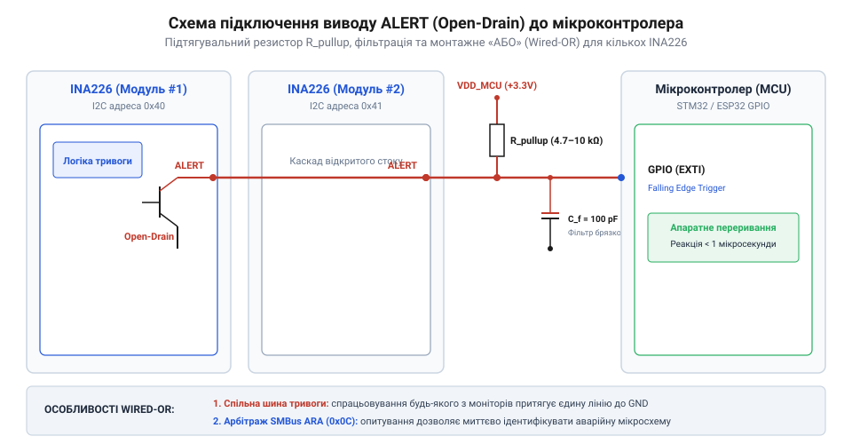
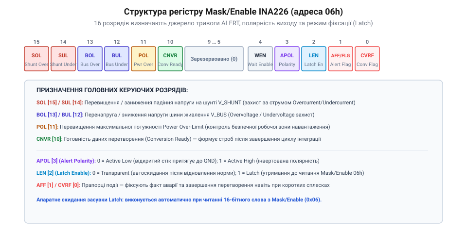
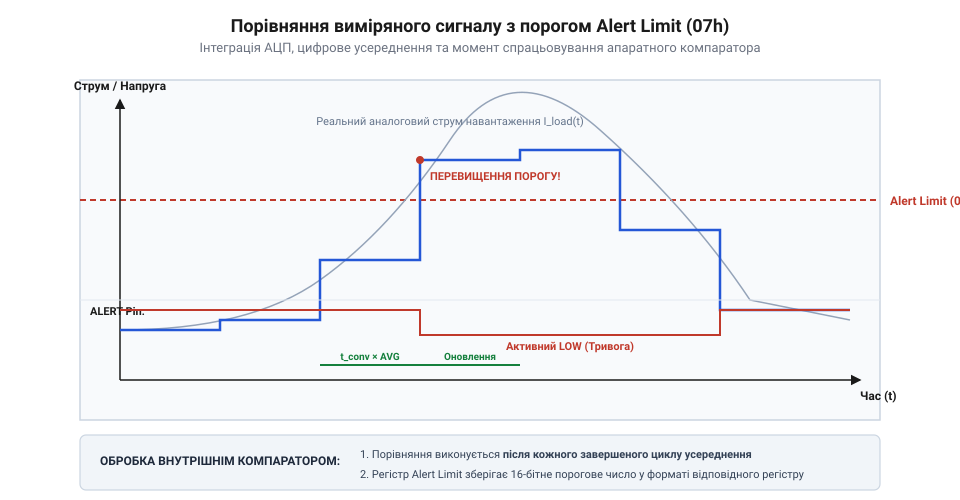
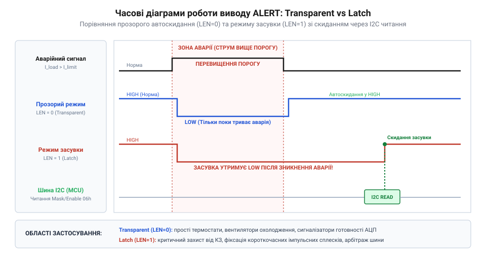
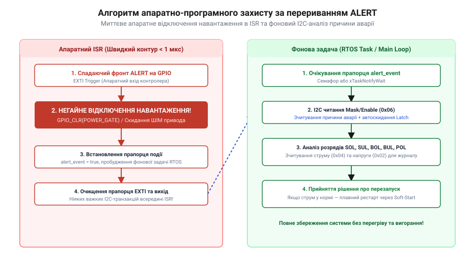

# Налаштування виводу ALERT та обробка тривожних подій в INA226

<preknowlist>
- [INA219 — монітор струму й напруги (I2C)](root:cat-hw-sensors/ina219-power-monitor) — Базові принципи вимірювання струму на шунті та обмеження першого покоління моніторів живлення без вбудованого апаратного виводу тривог.
- [Конфігурація та усереднення вимірювань INA226](root:cat-hw-sensors/ina226-config-and-averaging) — Структура регістру 0x00, вибір часу інтеграції напрямків вимірювання та режимів усереднення для оцінки швидкості оновлення прапорців тривоги.
- [Цифровий монітор живлення INA226](root:cat-hw-sensors/ina226-power-monitor) — Загальна архітектура пристрою, організація I2C-інтерфейсу, значення калібрувального регістру та розрахунок поточного струму й потужності.
- [Родина цифрових моніторів живлення INA2xx](root:cat-hw-sensors/ina2xx-digital-power-monitors-overview) — Місце INA226 серед інших прецизійних вимірювачів Texas Instruments та системна еволюція блоків виводу тривожних подій.
</preknowlist>

## Обмеження циклічного опитування та небезпека перевантаження

У високопотужних системах електроживлення, імпульсних перетворювачах напруги, сервоприводах та системах керування акумуляторними батареями катастрофічні відмови виникають за лічені мікросекунди. Коротке замикання в силовому каскаді або різкий стрибок напруги на шині живлення здатен пробити вихідні польові транзистори, розплавити мідні доріжки друкованої плати чи вивести з ладу хімічні осередки накопичувачів ще до того, як керувальна система встигне зреагувати. Традиційний підхід до вимірювання струму й напруги передбачає використання мікроконтролера, який регулярно опитує регістри цифрового давача через послідовну шину @@en|I2C@@. Проте в умовах реального часу така програмна схема циклічного опитування (@@en|polling@@) створює критичні затримки реагування та наражає обладнання на фатальні ризики.

Щоб зрозуміти джерело небезпеки, проаналізуємо повний ланцюг затримок, який виникає під час регулярного зчитування даних від [цифрового монітора INA226](root:cat-hw-sensors/ina226-power-monitor). Процес отримання інформації складається з двох послідовних часових інтервалів: часу апаратного перетворення аналого-цифрового перетворювача (АЦП) всередині мікросхеми та часу програмно-передавальної транзакції шиною @@en|I2C@@.

Перший шар затримки визначається внутрішніми налаштуваннями первинної обробки сигналу. Перспективний цифровий монітор виконує дискретизацію напруги на шунті та напруги шини живлення відповідно до обраного часу інтеграції та кількості усереднювальних вибірок. Як описується в матеріалі про [налаштування усереднення вимірювань INA226](root:cat-hw-sensors/ina226-config-and-averaging), базовий час перетворення для кожного каналу за замовчуванням становить 1.1 мс, а при активації режима усереднення, наприклад на 16 вибірок, повне оновлення регістра струму відбуватиметься лише кожні 35.2 мс. Якщо усереднення встановлено на 128 вибірок, затримка оновлення результату досягає 281.6 мс.

Другий шар затримки додає програмний цикл мікроконтролера. Обробник головної програми або періодичне завдання операційної системи реального часу (RTOS) викликає функцію опитування шини з певною періодичністю — наприклад, кожні 10 мс або 50 мс. Під час кожного звернення мікроконтролер повинен сформувати стартову умову шини @@en|I2C@@, передати 7-бітну адресу веденого пристрою з прапорцем запису, відправити вказівник на необхідний регістр (наприклад, `0x01` для шунтової напруги), сформувати повторний старт, передати адресу з прапорцем зчитування, прийняти два байти даних із підтвердженнями @@en|ACK@@ та згенерувати стопову умову. На стандартній частоті шини 100 кГц повний цикл передачі одного 16-бітного регістра займає близько 300–400 мкс. Якщо ж мікроконтролер зчитує послідовно шунтову напругу, напругу шини та розраховану потужність, сумарний час зайнятості шини перевищує 1.2 мс.

Сумарна затримка виявлення аварійного стану складається за найгіршим сценарієм:

```
t_delay = t_conversion + t_polling_interval + t_i2c_transfer
```

Якщо в силовому колі з робочою напругою 48 В та струмом 20 А виникає коротке замикання, струм через шунтовий резистор миттєво зростає до 100 А або більше. При сумарній затримці реагування `t_delay = 20 мс` теплова енергія, що виділяється на опірному елементі та силових ключах, обчислюється як:

```
E_loss = I² × R × t_delay
       = 100² × 0.01 × 0.02              [при струмі 100 А та опорі 10 мОм]
       = 10000 × 0.01 × 0.02
       = 2 Дж                            [теплова енергія за час затримки]
```

Для крихітного корпусу польового транзистора або SMD-шунту розміру 1206 виділення 2 Дж енергії за 20 мс означає миттєвий стрибок температури кристала на сотні градусів за Цельсієм, що призводить до теплового пробою напівпровідника та фізичного руйнування контактних площадок.

Окрім прямої загрози апаратній частині, безперервне циклічне опитування катастрофічно знижує енергоефективність усієї системи. Мікроконтролер змушений постійно перебувати в активному стані (@@en|active mode@@), виконувати тисячі марних циклів шини @@en|I2C@@, коли струм перебуває в нормі, та витрачати цінну енергію акумулятора на роботу системних таймерів і генераторів тактової частоти. У пристроях першого покоління, таких як [попередній датчик INA219](root:cat-hw-sensors/ina219-power-monitor), розробники були змушені йти на компроміс між швидкістю реакції на аварію та енергоспоживанням, оскільки той монітор взалі не мав фізичного виводу для сповіщення про перевантаження.

Розв'язанням цієї фундаментальної проблеми є повна передача функції порівняння виміряних величин із пороговими межами на апаратний рівень самого монітора живлення — технологія апаратного розвантаження (@@en|hardware offloading@@). У цифровому моніторі INA226 для цього інтегровано спеціалізований цифровий компаратор та логіку керування виводом ALERT.

Замість того щоб чекати запиту від мікроконтролера, INA226 самостійно аналізує кожен свіжий результат перетворення АЦП одразу після закінчення вимірювання. Якщо значення струму, напруги або потужності виходить за заздалегідь запрограмовані межі, апаратний блок монітора миттєво змінює логічний стан фізичного виводу ALERT. Цей вивід підключається безпосередньо до входу апаратного переривання (@@en|hardware interrupt@@) мікроконтролера. 

За такої архітектури мікроконтролер може перебувати в режимі глибокого сну (@@en|deep sleep mode@@) із вимкненими периферійними модулями та зупиненим тактовим генератором. Шина @@en|I2C@@ залишається повністю вільною. Отримавши апаратний імпульс переривання від виводу ALERT, мікроконтролер прокидається за частки мікросекунди, виконує обробник переривання (@@en|Interrupt Service Routine@@) та негайно вимикає силовий ключовий елемент через ШІМ-контролер або драйвер затвора. Порівняно з аналізом усього сімейства вимірювачів, який наведено у статті про [родину моніторів живлення INA2xx](root:cat-hw-sensors/ina2xx-digital-power-monitors-overview), саме наявність гнучко налаштовуваного апаратного виводу ALERT робить INA226 повноцінним пороговим контролером захисту силових кіл.

## Схемотехніка та електричні характеристики виводу ALERT

Для забезпечення надійної взаємодії з довільними сімействами мікроконтролерів та оптимізації схемотехнічного компонування друкованих плат апаратний вихід ALERT у мікросхемі INA226 виконано за схемою з відкритим стоком (@@en|open-drain output@@). Внутрішня структура цього вузла являє собою одиночний N-канальний польовий транзистор (@@en|MOSFET@@), сток якого виведено безпосередньо на зовнішній вивід мікросхеми, а витік з'єднано із загальною шиною заземлення @@en|GND@@.

Оскільки у вихідному каскаді відсутній верхній P-канальний транзистор, пристрій принципово не здатний самостійно форсувати на виході високий логічний рівень (напругу живлення). Вивід ALERT може перебувати лише в одному з двох електричних станів:
1. **Активний стан провідності (LOW):** Внутрішній ключ відчинений, створюючи низькоомний шлях між виводом ALERT та шиною @@en|GND@@. 2. **Пасивний стан високого імпедансу (Hi-Z):** Внутрішній ключ зачинений. Вивід перебуває у стані високого імпедансу (@@en|high-impedance state@@), повністю від'єднуючись від внутрішніх кіл мікросхеми.

Щоб сформувати повноцінний логічний сигнал, схемотехніка вимагає обов'язкового підключення зовнішнього підтягувального резистора (@@en|pull-up resistor@@), який з'єднує вивід ALERT із шиною живлення цифрової логіки керувального мікроконтролера `V_DD`.

Такий вибір архітектури вихідного каскаду надає дві вирішальні системні переваги:

По-перше, відкритий сток забезпечує повну електричну незалежність і пряме узгодження логічних рівнів між різними доменами живлення (@@en|level translation@@). Монітор INA226 може живитися від аналогової шини з напругою `V_VS = 5.0 В`, тоді як мікроконтролер працює від низьковольтного ядра з напругою `V_DD = 1.8 В` або `3.3 В`. Підключаючи підтягувальний резистор до шини `V_DD` мікроконтролера, амплітуда вихідного сигналу ALERT автоматично обмежується рівнем `1.8 В` або `3.3 В`, що повністю усуває ризик пошкодження вхідних буферів мікроконтролера без застосування додаткових активних перетворювачів рівнів.

По-друге, ця топологія уможливлює побудову спільної шини переривань за схемою монтажного «АБО» (@@en|wired-OR@@). Якщо у вимірювальній системі встановлено декілька моніторів INA226 або інших цифрових датчиків, їхні виводи ALERT можна об'єднати фізично в одну лінію та підключити до одного входу апаратного переривання мікроконтролера з використанням єдиного підтягувального резистора. У нормальному стані всі внутрішні транзистори зачинені, і лінія підтягнута до `V_DD`. Як тільки хоча б один із пристроїв фіксує аварійну подію, його внутрішній ключ замикається і притягує спільну лінію до землі, миттєво сповіщаючи мікроконтролер про тривогу.


*Електрична схема підключення виводу ALERT у топології з відкритим стоком: зовнішній підтягувальний резистор R_PULLUP задає рівень логічної одиниці, а фільтрувальний конденсатор пригнічує високочастотні перехідні завади.*

Правильний розрахунок номіналу підтягувального резистора `R_pullup` є критичним для забезпечення завадостійкості та необхідної швидкодії лінії переривання. Нижню межу опору `R_pullup_min` обмежують максимальним струмом протікання через відкритий транзистор `I_sink_max`, який для INA226 становить 3 мА при збереженні залишкової напруги низького рівня `V_OL ≤ 0.4 В`.

Мінімальний опір підтяжки обчислюється за формулою:

```
R_pullup_min = (V_DD - V_OL) / I_sink_max
             = (3.3 - 0.4) / 0.003            [заміна параметрів V_DD=3.3 В, V_OL=0.4 В, I_sink=3 мА]
             = 2.9 / 0.003
             = 966.7 Ом                       [найменший дозволений опір]
```

Використання резистора з опором, меншим за 1 кОм, призведе до перевантаження внутрішнього транзистора INA226, підвищення вихідного рівня `V_OL` вище порогу логічного нуля мікроконтролера та зайвого розсіювання потужності.

Верхню межу опору `R_pullup_max` обмежують струмом витоку виводу `I_leak` (не більше 1 мкА) та паразитною ємністю лінії `C_bus`, що складається з ємності друкованого провідника та вхідної ємності ніжки мікроконтролера (зазвичай `C_bus ≈ 20–50 пФ`). Час наростання фронту сигналу `t_rise` до рівня 70% від `V_DD` визначається постійною часу RC-кола:

```
t_rise ≈ 2.2 × R_pullup × C_bus
       = 2.2 × 4700 × 30 × 10⁻¹²              [розрахунок для R_pullup=4.7 кОм та C_bus=30 пФ]
       = 3.102 × 10⁻⁷ с
       = 310.2 нс                             [тривалість наростання вихідного фронту]
```

Якщо обрати занадто великий опір (наприклад, 100 кОм), тривалість наростання фронту зросте до 3.3 мкс, що зробить лінію чутливою до імпульсних завад від силових комутаторів. На практиці оптимальним компромісом для швидкісних систем захисту є номінал `R_pullup` у діапазоні від `2.2 кОм` до `10 кОм` (найчастіше застосовують `4.7 кОм`).

У промислових умовах із високим рівнем електромагнітних завад паралельно до виводу ALERT рекомендовано встановлювати керамічний конденсатор ємністю `100 пФ` – `1 нФ`. Він утворює фільтр нижніх частот, який зрізає наводки високочастотних перехідних процесів (наприклад, під час перемикання силових ключових транзисторів) і запобігає хибним спрацьовуванням апаратних переривань.

Фізична логіка роботи виводу ALERT налаштовується програмно за допомогою біта полярності тривоги APOL (@@en|Alert Polarity@@), який розташований у 16-бітному регістрі маскування та ввімкнення (@@en|Mask/Enable Register@@, адреса `0x06`, біт 1). 

Режим полярності працює так:
- **`APOL = 0` (За замовчуванням — інверсна логіка, Active Low):** У нормальному стані вихідний транзистор зачинений, і лінія ALERT перебуває під високим потенціалом `V_DD`. При виникненні аварійної події транзистор замикається на землю, вихідний рівень падає до 0 В (Active Low). Саме цей режим є стандартом для побудови шин монтажного «АБО» (@@en|wired-OR@@) та підключення до стандартних входів переривань мікроконтролерів із фіксацією спадного фронту (@@en|falling edge interrupt@@). - **`APOL = 1` (Пряма логіка, Active High):** У нормальному стані вихідний транзистор замикається на землю, утримуючи лінію на рівні 0 В. При настанні тривоги транзистор розмикається, і зовнішній підтягувальний резистор піднімає напругу лінії до `V_DD` (Active High). Цей режим застосовують, коли вхідний порт мікроконтролера налаштовано на фіксацію зростаючого фронту (@@en|rising edge interrupt@@).

Детальний опис електричної специфікації, режимів роботи та схемотехнічних рішень виводу наведено у довіднику [залізний інтерфейс ALERT](root:cat-hw-sensors/ina226-alert-pin-and-interrupts/api-ina226-alert-hardware-interface.md).

## Конфігурація регістру маскування та порогових порівнянь

Електричне підключення лінії ALERT через відкритий стік створює фізичну можливість для генерації сигналу тривоги, проте сама по собі апаратна лінія залишається пасивною без відповідної конфігурації цифрового ядра. Для того щоб монітор INA226 міг самостійно відстежувати критичні режими роботи силового кола, він оснащений внутрішньою логікою порівняння, яка керується через 16-бітний регістр маскування та ввімкнення (@@en|Mask/Enable Register@@, адреса `0x06`). Цей регістр виступає центральним мостом між аналоговими вимірюваннями та апаратним виводом тривоги, визначаючи, яка саме подія спричинить примусове зниження потенціалу на фізичному виводі.

Регістр `0x06` об'єднує конфігураційні розряди вибору режимів порівняння, системні прапорці стану, біт полярності виходу та біт режиму фіксації засувки. Структура регістру розроблена таким чином, що старші біти відповідають за активацію аналогових компараторів, а молодші біти визначають логіку поведінки виводу ALERT.


*Структурна діаграма 16-бітного регістру Mask/Enable (0x06), яка ілюструє розташування конфігураційних бітів порогових режимів SOL, SUL, BOL, BUL, POL, системного прапорця CVRF, полярності APOL та засувки LEN.*

Конфігураційні розряди маскування аналогових порогових режимів розташовані у старшому байті регістру `0x06` (біти 15–11). Одночасно активним для порівняння з пороговим значенням може бути один із п'яти основних режимів:

- **SOL (Shunt Voltage Over-Limit, біт 15):** активація перевищення шунтової напруги (@@en|Shunt Voltage Over-Limit@@). Компаратор спрацьовує, коли виміряне падіння напруги на шунті перевищує значення в регістрі межі тривоги (@@en|Alert Limit Register@@, адреса `0x07`). Цей режим застосовується для побудови швидкої [системи апаратного захисту](root:cat-hw-sensors/ina226-alert-pin-and-interrupts/proj-ina226-hardware-protection-isr.md) від струмового перевантаження або короткого замикання. - **SUL (Shunt Voltage Under-Limit, біт 14):** активація зниження шунтової напруги (@@en|Shunt Voltage Under-Limit@@). Сигнал генерується, якщо падіння напруги на шунті стає меншим за встановлений поріг, що дозволяє виявляти обрив навантаження або неприпустиме падіння споживання. - **BOL (Bus Voltage Over-Limit, біт 13):** активація перевищення напруги шини (@@en|Bus Voltage Over-Limit@@). Компаратор відстежує напругу живлення на виводі `VBUS` і фіксує перенапругу, коли значення перевищує поріг регістру `0x07`. - **BUL (Bus Voltage Under-Limit, біт 12):** активація зниження напруги шини (@@en|Bus Voltage Under-Limit@@). Використовується для виявлення просідання напруги живлення нижче безпечного рівня (@@en|brownout condition@@). - **POL (Power Over-Limit, біт 11):** активація перевищення розрахованої потужності (@@en|Power Over-Limit@@). Логіка мікросхеми порівнює вміст внутрішнього регістру потужності `0x03` із порогом, захищаючи силові ключі чи джерела живлення від виходу за межі допустимої теплової потужності.

Окрім п'яти аналогових порогових режимів, біт 3 регістру `0x06` відповідає за прапорець готовності перетворення CVRF (@@en|Conversion Ready Flag@@). На відміну від аналогових компараторів, прапорець CVRF не порівнює виміряні величини з порогом, а сповіщає про завершення повного циклу вимірювання та усереднення даних АЦП. Запис одиниці в біт CVRF примушує вивід ALERT генерувати імпульс щоразу, коли в регістрах `0x01`–`0x03` оновлюються свіжі значення. Це дає змогу повністю перевести центральний мікроконтролер у режим глибокого сну та зчитувати дані виключно за апаратним перериванням, що детально розглянуто при розробці [ультранизькоспоживаючих систем вимірювання](root:cat-hw-sensors/ina226-alert-pin-and-interrupts/proj-ina226-cvrf-low-power-logger.md).

Молодші біти регістру `0x06` керують параметрами самого апаратного сигналу:

- **AFF (Alert Function Flag, біт 4):** прапорець статусу тривоги (@@en|Alert Function Flag@@). Цей розряд працює у режимі тільки для зчитання (@@en|read-only@@) і приймає значення `1`, коли будь-яка з увімкнених тривожних умов активна. - **OVF (Math Overflow Flag, біт 2):** прапорець арифметичного переповнення (@@en|Math Overflow Flag@@). Стає в `1`, якщо в процесі обчислення потужності або струму відбулося математичне переповнення внутрішнього множника. - **APOL (Alert Polarity, біт 1):** полярність виходу ALERT (@@en|Alert Polarity@@). При значеннях `APOL = 0` (за замовчуванням) вивід працює в режимі активного низького рівня (@@en|Active Low@@), припускаючи підтяжку через резистор до шини живлення. Встановлення `APOL = 1` інвертує логіку виходу (@@en|Active High@@). Детальний аналіз узгодження електричних рівнів наведено у системі [електричних специфікацій виводу](root:cat-hw-sensors/ina226-alert-pin-and-interrupts/api-ina226-alert-hardware-interface.md). - **LEN (Latch Enable, біт 0):** режим засувки (@@en|Latch Enable@@, від англ. @@en|latch@@ — засувка, фіксатор). При `LEN = 0` вивід ALERT працює у прозорому режимі (@@en|transparent mode@@, від англ. @@en|transparent@@ — прозорий), коли сигнал тривоги знімається автоматично після повернення параметра в норму. При `LEN = 1` вмикається режим фіксації (@@en|latch mode@@): після спрацьовування компаратора вивід ALERT залишається притиснутим до землі навіть після зникнення аварійної ситуації, доки керуючий мікроконтролер не зчитає вміст регістру `0x06`.

Важливою особливістю роботи INA226 є механізм скидання прапорців. Зчитування регістру `0x06` по шині I2C виконує апаратне очищення бітів `AFF` та `CVRF`, а також знімає фіксацію з виводу ALERT (якщо активовано режим `LEN = 1` і вимірюваний параметр уже повернувся у безпечні межі). Завдяки цьому керуючий драйвер може легко скидати стан тривоги після обробки події, спираючись на специфіку роботи із [програмним інтерфейсом драйвера](root:cat-hw-sensors/ina226-alert-pin-and-interrupts/api-ina226-alert-driver-software-interface.md).

## Математика обчислення 16-бітних порогових значень

Після вибору необхідного режиму порівняння у регістрі `0x06` внутрішнє цифрове ядро INA226 вимагає запису конкретного цифрового коду в 16-бітний регістр межі тривоги (@@en|Alert Limit Register@@, адреса `0x07`). Цей регістр містить цілочисельне значення, з яким апаратний компаратор послідовно зіставляє результати поточних вимірювань. Проте фізичні величини — струм в амперах, напруга у вольтах чи потужність у ватах — не можуть бути записані у регістр безпосередньо. Їх необхідно перерахувати у цифровий код з урахуванням фіксованої або масштабованої дискретності найменшого значущого розряду (@@en|least significant bit@@ або @@en|LSB@@, від англ. @@en|least significant bit@@ — найменший значущий розряд).

Дискретність регістру `0x07` повністю залежить від того, який саме режим порівняння вибрано у регістрі маскування `0x06`. 

При роботі у режимах вимірювання шунтової напруги (SOL або SUL) компаратор порівнює вміст регістру `0x07` напряму з внутрішнім регістром напруги шунту `0x01`. Як і в [базовому моніторі живлення](root:cat-hw-sensors/ina226-power-monitor), дискретність шунтового вимірювача INA226 жорстко зафіксована на рівні `2.5 мкВ` (`0.0000025 В`) на один LSB. Вміст регістру інтерпретується як 16-бітне знакове ціле число у доповняльному коді.

Напруга на шунті визначається за законом Ома `V_shunt_limit = I_limit × R_shunt`. Код порогового регістру отримується діленням фізичної напруги шунту на дискретність `LSB_shunt`:

```
V_shunt_limit = I_limit × R_shunt
RAW_LIMIT = V_shunt_limit ÷ LSB_shunt
          = (I_limit × R_shunt) ÷ 0.0000025    [дискретність LSB_shunt = 2.5 мкВ]
```

**Обчислення порогу струму 10.0 А при опорі шунту 5 мОм:**

```
V_shunt_limit = 10.0 × 0.005
              = 0.05 В                          [50 мВ]
RAW_LIMIT = 0.05 ÷ 0.0000025
          = 20000                               [у шістнадцятковому форматі 0x4E20]
```

Якщо у регістрі `0x06` активовано режим моніторингу напруги шини (BOL або BUL), регістр `0x07` порівнюється з регістром напруги шини `0x02`. Для напруги шини у моніторі INA226 встановлено фіксовану дискретність `1.25 мВ` (`0.00125 В`) на один LSB, а значення інтерпретується як беззнакове 16-бітне ціле число.

Формула перетворення фізичної напруги шини у пороговий код має вигляд:

```
RAW_LIMIT = V_bus_limit ÷ LSB_bus
          = V_bus_limit ÷ 0.00125              [дискретність LSB_bus = 1.25 мВ]
```

**Обчислення порогу перенапруги 28.0 В:**

```
RAW_LIMIT = 28.0 ÷ 0.00125
          = 22400                               [у шістнадцятковому форматі 0x5780]
```

Найбільш складна математика виникає при налаштуванні тривоги за потужністю (режим POL). У цьому випадку значення регістру `0x07` порівнюється з внутрішнім 16-бітним регістром потужності `0x03`. Дискретність потужності `Power_LSB` не є фіксованою константою мікросхеми, а розраховується на основі обраної дискретності струму `Current_LSB`, запрограмованої під час калібрування пристрою. Згідно з архітектурою INA226, один LSB потужності точно дорівнює `25 × Current_LSB`.

Формула розрахунку 16-бітного коду для порогової потужності виводиться таким чином:

```
Power_LSB = 25 × Current_LSB
RAW_LIMIT = P_limit ÷ Power_LSB
          = P_limit ÷ (25 × Current_LSB)       [розрахунок 16-бітного коду потужності]
```

**Обчислення порогу потужності 60 Вт при розрахованій дискретності струму Current_LSB = 100 мкА (0.0001 А):**

```
Power_LSB = 25 × 0.0001
          = 0.0025 Вт/LSB                      [2.5 мВт на дискрету]
RAW_LIMIT = 60 ÷ 0.0025
          = 24000                              [у шістнадцятковому форматі 0x5DC0]
```

Повний довідковий звід виведення формул для всіх типів шунтів та калібрувань систематизовано у матеріалі з [математичним розрахунком порогових кодів](root:cat-hw-sensors/ina226-alert-pin-and-interrupts/math-ina226-alert-limit-calculations.md).

Окрім чистої математики обчислення кодів, розробник повинен враховувати часову динаміку спрацьовування компараторів. Порівняння порогового коду в INA226 відбувається не миттєво у безперервному аналоговому часі, а дискретно — після завершення кожного циклу перетворення АЦП. Загальний час реакції монітора на аварійну подію залежить від обраного часу інтеграції та [конфігурації режиму усереднення](root:cat-hw-sensors/ina226-config-and-averaging), заданих у конфігураційному регістрі `0x00`.


*Графічна характеристика часового співвідношення аналогового вимірюваного сигналу з цифровим порогом регістру Alert Limit (0x07), яка демонструє затримку спрацьовування компаратора через час інтеграції та усереднення.*

Час затримки виявлення тривоги визначається за формулою:

```
t_response = N_avg × (t_conv_shunt + t_conv_bus)
```

Де `N_avg` — кількість усереднюваних вибірок (від 1 до 1024), а `t_conv` — час перетворення АЦП для шунту та шини. Якщо систему налаштовано на глибоке усереднення (наприклад, `N_avg = 1024` при часі перетворення `1.1 мс`), затримка спрацьовування виводу ALERT складе більше 2 секунд. Це чудово фільтрує короткочасні імпульсні завади й кидки струму при пуску двигунів, запобігаючи помилковим спрацьовуванням. Однак для кіл аварійного вимкнення при короткому замиканні необхідно зменшувати коефіцієнт усереднення до `N_avg = 1` або `N_avg = 4`, забезпечуючи реакцію за частки мілісекунди.

Така гнучка апаратна фільтрація вигодно вирізняє INA226 порівняно з [попереднім датчиком INA219](root:cat-hw-sensors/ina219-power-monitor), який вимагав постійного опитування регістрів через I2C і не мав внутрішніх порогових компараторів. У рамках всієї [серії цифрових моніторів INA2xx](root:cat-hw-sensors/ina2xx-digital-power-monitors-overview) INA226 пропонує оптимальний баланс між точністю цифрової фільтрації та швидкістю апаратного реагування на аварійні події.

## Режими засувки, прозорий відгук та арбітраж SMBus

Після обчислення й запису порогових кодів у регістр межі тривоги постає фізична проблема утримання сигналу переривання на фізичному виході @@en|ALERT@@ цифрового монітора живлення @@en|INA226@@. Якщо вимірюваний струм або напруга короткочасно перетинає встановлену межу та повертається в безпечний діапазон через кілька десятків мікросекунд, керуючому мікроконтролеру необхідно знати, чи повинен вихід @@en|ALERT@@ миттєво відпускати лінію, чи залишатися утримуваним в активному стані до моменту програмного підтвердження. За цей вибір відповідає біт `LEN` (англ. @@en|Latch Enable@@) у регістрі маскування та увімкнення @@en|Mask/Enable Register@@ (`06h`).

Коли біт `LEN` дорівнює нулю, сенсор функціонує в прозорому режимі (англ. @@en|transparent mode@@, від лат. *transparens* — прозорий, той, що просвічує). У цьому стані стан виводу @@en|ALERT@@ динамічно повторює поточний результат роботи внутрішнього компаратора після кожного завершеного циклу вимірювання @@en|ADC@@. Якщо напруга на шунті або шині перевищує запрограмоване порогове значення згідно з [розрахунком порогових кодів INA226](root:cat-hw-sensors/ina226-alert-pin-and-interrupts/math-ina226-alert-limit-calculations.md), вихідний транзистор відкривається і притягує вивід @@en|ALERT@@ до землі. Як тільки наступне вимірювання показує повернення параметра в норму, компаратор автоматично вимикає транзистор, і зовнішній підтягувальний резистор @@en|pull-up resistor@@ повертає лінію до високого логічного рівня. Прозорий режим зручний для автономних силових схем, де вихід @@en|ALERT@@ безпосередньо керує ключем захисту або реле з можливістю автоматичного відновлення живлення після зникнення перевантаження. Однак якщо мікроконтролер перебуває в режимі сну або зайнятий обслуговуванням інших задач, короткочасний сплеск струму може зникнути до того, як процесор встигне зчитати прапорці тривоги.

Для надійної фіксації аварійних подій біт `LEN` встановлюють у одиницю, вмикаючи режим засувки (англ. @@en|latch mode@@, від давньоангл. *laeccan* — хапати, фіксувати). При виникненні тривожної події вивід @@en|ALERT@@ переходить в активний стан і залишається зафіксованим (притягнутим до землі) навіть після того, як вимірюваний параметр повністю повернувся в безпечні межі. Скидання засувки та повернення виводу @@en|ALERT@@ у стан високого імпедансу відбувається виключно тоді, коли керуючий мікроконтролер виконує читання регістру маскування та увімкнення @@en|Mask/Enable Register@@ (`06h`) по шині @@en|I2C@@. Якщо на момент зчитування регістру `06h` аварійна умова на аналоговому вході все ще зберігається, прапорець тривоги скидається лише на час транзакції читання, після чого внутрішній компаратор миттєво засуває вивід @@en|ALERT@@ знову під час наступного конвертування.

На початку розвитку цифрових систем моніторингу живлення перші покоління сенсорів, як-от [попередній датчик INA219](root:cat-hw-sensors/ina219-power-monitor), вимагали постійного програмного опитування по шині @@en|I2C@@. Це перевантажувало шину даних і не дозволяло мікроконтролеру переходити у низькоспоживаючі режими сну. Поява специфікації @@en|SMBus@@ 1.1 вирішила цю проблему шляхом стандартизації механізму апаратних переривань та уніфікованої адреси відповіді на тривогу @@en|SMBus Alert Response Address@@ (`0x0C`). Розробка зафіксованого та прозорого режимів спрацьовування аналогових компараторів у [родині моніторів INA2xx](root:cat-hw-sensors/ina2xx-digital-power-monitors-overview) дозволила поєднати швидкий апаратний захист із можливістю об'єднання багатьох давачів на єдиній фізичній лінії переривання.

Коли в складній системі розподілу живлення використовується кілька вимірювачів @@en|INA226@@, їхні виводи @@en|ALERT@@ з відкритим стоком @@en|open-drain output@@ об'єднують на одну спільну лінію переривання за топологією монтажного «АБО» (англ. @@en|wired-OR@@) відповідно до [залізного інтерфейсу ALERT INA226](root:cat-hw-sensors/ina226-alert-pin-and-interrupts/api-ina226-alert-hardware-interface.md). При виникненні тривоги на будь-якому із сенсорів спільна лінія притягується до землі, що викликає апаратне переривання мікроконтролера на виводі @@en|GPIO@@. Щоб уникнути послідовного опитування всіх давачів по шині @@en|I2C@@ для пошуку джерела аварії, мікроконтролер надсилає широкомовний запит читання на спеціальну резервовану адресу шини @@en|SMBus Alert Response Address@@ (`0x0C`).

Усі пристрої @@en|INA226@@ на шині, у яких на даний момент зафіксовано активний стан тривоги в режимі засувки, відповідають на цей запит, виставляючи свою власну 7-бітну адресу @@en|I2C@@ на лінію даних @@en|SDA@@. Оскільки шина працює з відкритим стоком, логічний нуль є домінуючим станом. При одночасній передачі декількох адрес перемагає пристрій із найменшим числовим значенням адреси @@en|I2C@@, оскільки його нульові біти пригнічують одиничні біти інших ведених пристроїв. Сенсори, які програють арбітраж, виявляють розбіжність між переданим бітом одиниці та реально присутнім нулем на лінії @@en|SDA@@, після чого негайно відключаються від передачі й чекають наступного виклику. Пристрій-переможець успішно завершує передачу своєї адреси мікроконтролеру, отримує підтвердження @@en|ACK@@ і в цей же момент автоматично скидає свій вихід @@en|ALERT@@ та засувку прапорця тривоги. Якщо після цього лінія переривання все ще залишається притягнутою до землі іншими сенсорами, мікроконтролер повторно надсилає запит на адресу `0x0C`, опитуючи наступні за пріоритетом пристрої.


*Часова діаграма порівнює автореверсивну поведінку виводу ALERT у прозорому режимі з фіксацією стану в режимі засувки LEN=1 та подальшим скиданням через транзакцію SMBus ARA.*

## Побудова неблокувальних обробників та діагностика завад

Підключення апаратного виводу @@en|ALERT@@ до входу переривання мікроконтролера @@en|GPIO@@ дає змогу будувати реактивні системи захисту. Проте побудова програмного забезпечення для обробки апаратних сигналів містить критичну пастку: процедура обробки переривань (англ. @@en|Interrupt Service Routine@@, від лат. *interruptus* — перерваний) має виконуватися за частки мікросекунди, тоді як транзакція шини @@en|I2C@@ вимагає сотень мікросекунд і зазвичай використовує системні драйвери з блокуючими примітивами синхронізації та контекстними перемиканнями.

Для побудови надійної [системи апаратного захисту INA226](root:cat-hw-sensors/ina226-alert-pin-and-interrupts/proj-ina226-hardware-protection-isr.md) застосовують двопакетну архітектуру обробки переривань. При виникненні апаратного сигналу аварії від перевантаження по струму (англ. @@en|overcurrent protection@@) або перевищення напруги (англ. @@en|overvoltage protection@@), обробник @@en|Interrupt Service Routine@@ виконує виключно миттєву дію апаратного рівня — наприклад, безпосередньо змінює стан цифрового виводу @@en|GPIO@@ для відключення силового ключа на польовому транзисторі @@en|MOSFET@@ або розмикання реле. Після цього @@en|Interrupt Service Routine@@ встановлює витокову прапорцеву змінну або надсилає сповіщення операційній системі реального часу й негайно завершує роботу. Зчитування регістру маскування та увімкнення @@en|Mask/Enable Register@@ (`06h`) для скидання засувки та діагностики причини аварії виконується у фоновій задачі або основному циклі програми за допомогою функцій з [програмного драйвера тривог INA226](root:cat-hw-sensors/ina226-alert-pin-and-interrupts/api-ina226-alert-driver-software-interface.md).


*Блок-схема ілюструє розділення неблокувального апаратного обробника ISR та фонової задачі I2C для безпечного скидання засувки тривоги.*

Крім аварійного захисту, вивід @@en|ALERT@@ є основним інструментом побудови [енергоефективного монітора живлення](root:cat-hw-sensors/ina226-alert-pin-and-interrupts/proj-ina226-cvrf-low-power-logger.md). У встаткуванні з акумуляторним живленням мікроконтролер більшу частину часу перебуває в режимі глибокого сну (англ. @@en|deep sleep mode@@). При активації біта готовності перетворення `CNVR` (англ. @@en|Conversion Ready@@) у регістрі `06h`, мікросхема @@en|INA226@@ генерує короткий імпульс низького рівня на виводі @@en|ALERT@@ щоразу, коли закінчується новий цикл інтегрування @@en|ADC@@. Цей імпульс будить мікроконтролер через фронт переривання, після чого процесор зчитує виміряне значення струму чи напруги, зберігає дані у буфер і знову занурюється у режим глибокого сну, мінімізуючи середнє енергоспоживання системи.

При практичному розгортанні тривожних каналів розробники часто зіштовхуються з хибними спрацьовуваннями компаратора, викликаними імпульсними завадами силових перетворювачів або наводками на високоімпедансну лінію @@en|ALERT@@. Для запобігання помилковим відключенням навантаження застосовують комбінацію апаратних та цифрових методів фільтрації:
1. Апаратне пригнічення високочастотних завад шляхом встановлення згладжувального конденсатора ємністю від 1 нФ до 10 нФ паралельно виводу @@en|ALERT@@ та коректного розрахунку підтягувального резистора @@en|pull-up resistor@@. 2. Конфігурування цифрового усереднення у вимірювальному тракті @@en|INA226@@. На відміну від [цифрового монітора живлення INA226](root:cat-hw-sensors/ina226-power-monitor), у якому аналогові сигнальні кола схильні до миттєвих сплесків, вбудований цифровий фільтр опитування регулює кількість вибірок від 1 до 1024 за допомогою [налаштування усереднення вимірювань INA226](root:cat-hw-sensors/ina226-config-and-averaging).

Збільшення кількості усереднюваних вибірок (наприклад, до 128 або 512) гарантовано відфільтровує короткочасні пікові кидки струму під час запуску електродвигунів або заряджання конденсаторів, проте пропорційно збільшує затримку генерації аварійного сигналу. Якщо один цикл вимірювання займає 1.1 мс, то при усередненні по 128 вибірках загальний час відклику компаратора зросте до значення:

        T_delay = 1.1 мс × 128
        = 140.8 мс              [множення часу перетворення на кількість вибірок]

Отже, при проектуванні систем захисту необхідно балансувати між завадостійкістю та допустимим часом реакції силових вимикачів.

Нижче наведено практичну реалізацію неблокувального обробника переривань та фонового скидання засувки тривоги для мікроконтролера.

:::tabs
:::code ina226-alert-pin-and-interrupts-d/c/esp-idf/ina226-alert-isr-handler.c
:::code ina226-alert-pin-and-interrupts-d/cpp/arduino/handleinaalert.cpp
:::