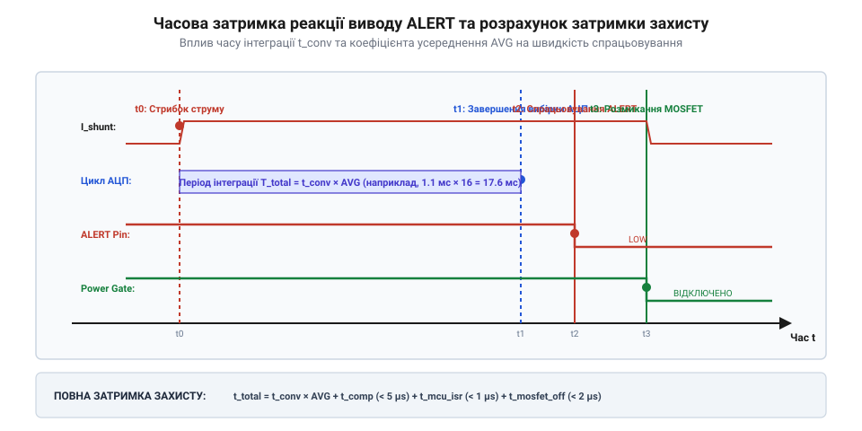

# Розрахунок порогових значень регістру Alert Limit у INA226

<preknowlist>
- [Цифровий монітор живлення INA226](root:cat-hw-sensors/ina226-power-monitor) — Призначення регістру Alert Limit та необхідність калібрування для вимірювання струму й потужності.
- [Конфігурація та усереднення вимірювань INA226](root:cat-hw-sensors/ina226-config-and-averaging) — Як час інтеграції АЦП та кількість вибірок усереднення визначають тривалість одного повного циклу перетворення.
</preknowlist>

## Чому INA226 ігнорує реальні вольти

Мікросхема INA226 вимірює аналогові величини, але оперує ними виключно як 16-бітними цілими числами. Якщо потрібно налаштувати апаратний захист від перенапруги чи перевантаження за струмом, ми записуємо порогове значення у спеціальний регістр Alert Limit (0x07). Проте якщо записати туди бажані напругу чи струм у звичному фізичному вигляді — наприклад, число 5 для 5 вольтів, — датчик спрацює хибно або взагалі не відреагує.

Проблема полягає в тому, що датчик не знає про існування вольтів чи амперів. Усі виміряні значення зберігаються в його регістрах у внутрішньому цифровому форматі, який спирається на крок квантування — найменший значущий біт (@@en|Least Significant Bit, LSB@@). Саме LSB визначає, яку фізичну величину представляє одиниця в цифровому коді. Тому для кожного параметра потрібен математичний перерахунок: ми маємо перетворити цільову фізичну величину на кількість кроків LSB, і саме це числове значення записати в регістр лімітів. Оскільки поділ цільової величини на розмір LSB часто дає дробовий результат, а 16-бітний регістр приймає виключно цілі числа, отриману кількість кроків доводиться округлювати. Це округлення означає, що реальний поріг спрацювання завжди дещо відрізнятиметься від заданого точного значення в межах одного кроку квантування.

## Перерахунок напруг шунта та шини

Мікросхема не розуміє вольтів чи амперів — вона порівнює виміряні величини із заданими 16-бітними кодами. Щоб датчик сповістив нас про критичний стан, наприклад, про перевантаження або глибокий розряд батареї, ми мусимо перекласти цільові напруги на його внутрішню мову. Для цього напругу розбивають на найменші можливі шматочки, які АЦП здатен розрізнити, — кроки квантування, або `LSB`. Для напруг ці кроки жорстко зашиті в апаратуру і ніяк не залежать ні від наших налаштувань, ні від номіналу підключеного шунта.

Почнемо з напруги на шунті, яка сигналізує про струм у колі. Тут крок квантування становить рівно 2,5 мкВ. Щоб знайти код для запису в регістр лімітів, ми беремо нашу цільову напругу і рахуємо, скільки в ній поміститься таких кроків. Розрахунок порогового коду `Limit_Vshunt` для цільової напруги шунта `V_target_shunt` має такий вигляд:

        Limit_Vshunt
        = V_target_shunt ÷ 2,5 мкВ      [ділимо бажану напругу на фіксований крок квантування]

Наприклад, якщо струм перевантаження створює на нашому шунті падіння напруги 50 мВ, ми обчислюємо цілочисельний ліміт:

**Розрахунок ліміту для напруги шунта 50 мВ:**

        Limit_Vshunt
        = 0,05 В ÷ 0,0000025 В
        = 20000

Цей код записується у 16-бітний регістр. Однак струм може текти у двох напрямках: від джерела до навантаження і навпаки. Відповідно, падіння напруги на шунті буває додатним і від'ємним. Апаратний компаратор мікросхеми порівнює значення з урахуванням знака, використовуючи стандартний для комп'ютерів формат — доповнення до двох (@@en|two's complement@@). 

Якщо поріг від'ємний, звичайного ділення недостатньо. Спершу ми знаходимо код так, ніби напруга додатна, а потім перетворюємо його на від'ємний. За правилом доповнення до двох, потрібно інвертувати всі біти отриманого числа і додати одиницю. Наприклад, ми хочемо налаштувати тривогу, коли від'ємна напруга шунта сягне -10 мВ.

**Розрахунок ліміту для від'ємної напруги шунта -10 мВ:**

        Абсолютне значення
        = 0,01 В ÷ 0,0000025 В         [знаходимо базовий код без урахування знака]
        = 4000

У двійковому поданні число 4000 виглядає як `0000 1111 1010 0000`. Тепер робимо його від'ємним:

        Інверсія бітів
        = 1111 0000 0101 1111          [змінюємо всі нулі на одиниці, а одиниці на нулі]

        Додавання одиниці
        = 1111 0000 0110 0000          [додаємо одиницю до молодшого розряду]
        = 61536                        [результат у десятковому поданні для запису як ціле число без знака]

Таким чином, якщо записати в регістр значення 61536, мікросхема сприйматиме його як -4000 кроків, тобто -10 мВ. 

Тут є строга фізична межа. Оскільки код зберігається у 16-бітному регістрі зі знаком, максимальне додатне число, яке туди поміститься, становить 32767. Якщо помножити це число на крок 2,5 мкВ, отримаємо 81,92 мВ. Це і є апаратна межа вимірювання напруги на шунті: ми фізично не можемо встановити поріг, більший за ±81,92 мВ. Якщо розрахунковий ліміт виходить за ці межі, датчик просто не зможе його відстежити, і нам доведеться зменшити опір шунта.

З напругою шини (живлення навантаження) усе простіше. Ця напруга вимірюється відносно землі, тому вона завжди додатна. Її фіксований крок квантування становить 1,25 мВ. Алгоритм розрахунку для регістра `Limit_Vbus` залишається тим самим: ми беремо напругу спрацювання і ділимо її на розмір кроку.

        Limit_Vbus
        = V_target_bus ÷ 1,25 мВ        [ділимо цільову напругу шини на її фіксований крок]

Якщо пристрій живиться від батареї і нам треба встигнути безпечно зберегти дані при її розряді, ми можемо встановити поріг на рівні 10 В. Мікросхема порівняє виміряну напругу з нашим числом і викличе переривання, щойно напруга впаде нижче цієї межі.

**Розрахунок ліміту для напруги шини 10 В:**

        Limit_Vbus
        = 10 В ÷ 0,00125 В
        = 8000

Тут ми маємо звичайне додатне ціле число `8000`, яке записується в регістр лімітів. Завдяки тому, що кроки квантування не змінюються, ми можемо розрахувати ці коди один раз на етапі написання програми і використати їх як константи, замість того, щоб змушувати мікроконтролер виконувати ділення у реальному часі.

## Розрахунок ліміту потужності через струм

На відміну від напруг, межа за потужністю обчислюється не через фіксовані константи мікросхеми, а спирається на обраний під час калібрування LSB струму (`Current_LSB`). Датчик обчислює потужність внутрішньо, множачи виміряний струм на напругу шини, і крок квантування потужності напряму пов'язаний зі струмом.

За документацією, LSB потужності (`Power_LSB`) завжди рівно у 25 разів більший за LSB струму:

        Power_LSB
        = 25 × Current_LSB              [математичний зв'язок за специфікацією INA226]

Щоб розрахувати код захисту від перевищення потужності `Limit_Power` для бажаного значення `P_target`, потрібно поділити цільову потужність на обчислений `Power_LSB`:

        Limit_Power
        = P_target ÷ Power_LSB          [переводимо вати у внутрішні одиниці датчика]
        = P_target ÷ (25 × Current_LSB) [розкриваємо значення LSB потужності]

Наприклад, якщо під час калібрування ми обрали крок струму 1 мА (0,001 А), то крок потужності становитиме 25 мВт (0,025 Вт). Для встановлення ліміту потужності у 5 Вт отримаємо:

**Розрахунок ліміту для потужності 5 Вт:**

        Limit_Power
        = 5 Вт ÷ (25 × 0,001 А)
        = 5 Вт ÷ 0,025 Вт
        = 200

## Затримка між подією та перериванням

Фізичне перевищення заданого порогу не генерує сигнал тривоги миттєво. Навіть правильно розраховані значення в регістрі лімітів не врятують систему, якщо не врахувати часові затримки перетворення. Датчик оновлює свої значення лише після завершення повного циклу вимірювання АЦП, і переривання на піні ALERT виникне тільки після цього оновлення.

*Часова шкала затримки спрацювання переривання від моменту перевищення порогу до зміни стану піна.*

Час реакції системи напряму залежить від налаштувань АЦП: часу інтеграції (@@en|Conversion Time, CT@@) та кількості вибірок усереднення (@@en|Averaging, AVG@@). Загальна тривалість одного вимірювання обчислюється як їхній добуток:

        Total_Time
        = CT × AVG                      [загальний час одного циклу вимірювання]

Якщо час інтеграції встановлено на 1,1 мс, а усереднення на 16 вибірок, датчик оновить результати лише через 17,6 мс. Це означає, що якщо струм різко зросте відразу після початку нового циклу, система дізнається про це лише через 17,6 мс. Для повільних процесів, як-от розряд акумулятора, така затримка непомітна. Проте для швидкого апаратного захисту від короткого замикання цей час може виявитися фатальним, тому для критичних до швидкодії тривог потрібно зменшувати або вимикати усереднення та мінімізувати час інтеграції.