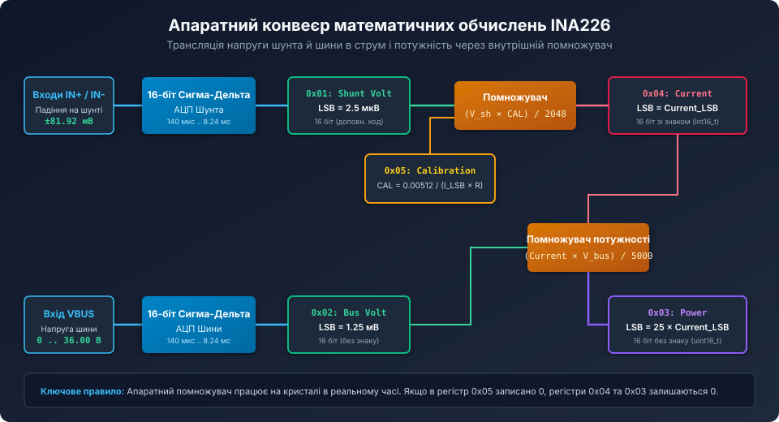
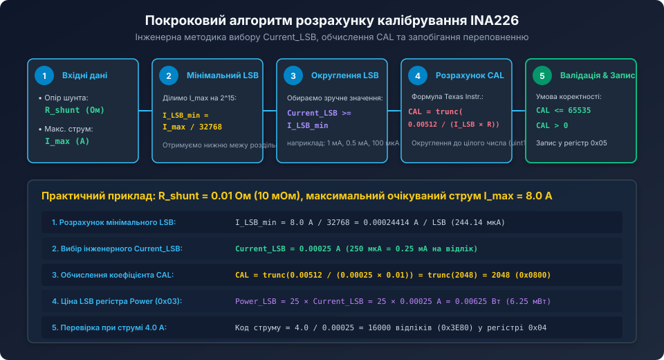
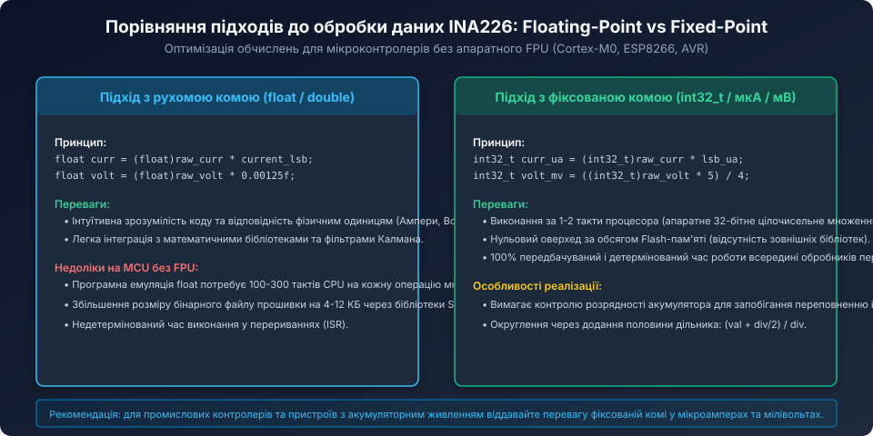

# Поглиблений математичний аналіз калібрування та внутрішнього обчислювального тракту INA226

<preknowlist>
- [Математика калібрувального регістру та розрахунку струму й потужності INA226](root:cat-hw-sensors/ina226-calibration-and-scaling-math) — базовий вибір Current_LSB та формула розрахунку CAL.
- [Карта регістрів та конфігурація INA226](root:cat-hw-sensors/ina226-register-map) — адреси та розрядність регістрів Shunt Voltage, Bus Voltage, Current, Power.
- [Конфігурація та усереднення вимірювань INA226](root:cat-hw-sensors/ina226-config-and-averaging) — фільтрація перешкод та часові параметри вибірок АЦП.
</preknowlist>

## Теоретичне виведення внутрішньої константи 0.00512

Формула розрахунку калібрувального коефіцієнта `CAL = 0.00512 / (Current_LSB * R_shunt)` у документації Texas Instruments часто сприймається як емпірична магічна константа. Однак вона є наслідком точного проектування внутрішнього апаратного помножувача мікросхеми.



### Архітектура апаратного перемноження

Внутрішній цифровий процесор INA226 обчислює значення коду регістра струму за такою апаратною схемою:

```text
Current_Register = (Shunt_Voltage_Register * Calibration_Register) / 2048
```

де ділення на 2048 реалізовано як апаратний арифметичний зсув праворуч на 11 розрядів (`>> 11`).

Зв'яжемо фізичні величини з цифровими кодами регістрів:
1. Фізична напруга на шунті у Вольтах визначається через квант АЦП шунта (2.5 мкВ = 2.5 * 10^-6 В):

```text
V_shunt = Shunt_Voltage_Register * 2.5e-6
Shunt_Voltage_Register = V_shunt / 2.5e-6
```

2. Фізичний струм в Амперах визначається через ціну розряду струму `Current_LSB`:

```text
Current = Current_Register * Current_LSB
Current_Register = Current / Current_LSB
```

3. За законом Ома струм через шунт пов'язаний з напругою:

```text
Current = V_shunt / R_shunt
```

Підставимо вирази регістрів у рівняння апаратного помножувача:

```text
Current / Current_LSB = ( (V_shunt / 2.5e-6) * CAL ) / 2048
```

Підставимо `Current = V_shunt / R_shunt`:

```text
(V_shunt / R_shunt) * (1 / Current_LSB) = V_shunt * CAL / (2.5e-6 * 2048)
```

Скоротимо `V_shunt` з обох боків рівняння:

```text
1 / (R_shunt * Current_LSB) = CAL / (2.5e-6 * 2048)
```

Обчислимо добуток у знаменнику правої частини:

```text
2.5e-6 * 2048 = 0.0000025 * 2048 = 0.00512
```

Звідси отримуємо канонічну формулу калібрування INA226:

```text
CAL = 0.00512 / (Current_LSB * R_shunt)
```

Таким чином, число `0.00512` є точним аналітичним добутком внутрішнього кванта напруги АЦП (2.5 мкВ) на коефіцієнт дільника апаратного акумулятора (2048).

## Похибка усікання (Truncation Error) та методи її усунення

Оскільки регістр `Calibration` є 16-бітним цілим числом, результат ділення `0.00512 / (Current_LSB * R_shunt)` відсікається до цілого значення функцією `trunc()`.



### Аналіз відносної похибки дискретизації CAL

Нехай теоретичне ідеальне значення дорівнює `CAL_ideal = 2048.75`.
У регістр записується ціле число `CAL_actual = 2048`.
У результаті виникає систематична похибка квантування калібрування:

```text
Error_quant = (CAL_actual - CAL_ideal) / CAL_ideal
Error_quant = (2048 - 2048.75) / 2048.75 = -0.000366 (-0.0366%)
```

Хоча похибка 0.037% є незначною для більшості застосувань, при малих значеннях `CAL` (наприклад, коли `CAL = 15`) втрата навіть 0.5 відліку дає помилку понад 3.3%.

### Два інженерних шляхи усунення похибки усікання:

1. **Синтез ідеального Current_LSB:**
   Замість вибору довільного округленого числа струму, розробник може підібрати `Current_LSB` так, щоб значення `CAL` було строго цілим числом:

   ```text
   Current_LSB_exact = 0.00512 / (CAL_integer * R_shunt)
   ```

   Обравши, наприклад, `CAL = 2048` (степінь двійки 2^11), отримуємо точний зв'язок без залишку:
   `Current_LSB = 0.00512 / (2048 * R_shunt) = 2.5e-6 / R_shunt`.

2. **Програмна корекція в мікроконтролері:**
   Якщо `Current_LSB` обов'язково має бути круглим десятковим числом (наприклад, рівно 1.0 мА), хост-контролер може зберігати коефіцієнт програмної корекції:

   ```c
   float correction_factor = cal_ideal / (float)cal_actual;
   float corrected_current = (float)raw_current * current_lsb * correction_factor;
   ```

## Математика обчислення потужності та константа 5000

Апаратний блок розрахунку потужності перемножує розраховане значення струму на виміряну напругу шини:

```text
Power_Register = (Current_Register * Bus_Voltage_Register) / 5000
```

Виведемо походження дільника 5000 та зв'язок між `Power_LSB` і `Current_LSB`:
- Реальна споживана потужність навантаження:

```text
Power = Current * Bus_Voltage
Power = (Current_Register * Current_LSB) * (Bus_Voltage_Register * 1.25e-3)
```

- З іншого боку, зчитане значення з регістра потужності множиться на `Power_LSB`:

```text
Power = Power_Register * Power_LSB
Power_Register = (Current_Register * Bus_Voltage_Register * Current_LSB * 1.25e-3) / Power_LSB
```

- Порівнюючи з внутрішньою формулою мікросхеми, отримуємо:

```text
(Current_LSB * 1.25e-3) / Power_LSB = 1 / 5000
Power_LSB = 5000 * 1.25e-3 * Current_LSB
Power_LSB = 6.25 * Current_LSB ... але в INA226 зафіксовано коефіцієнт 25!
```

Чому виникає співвідношення 25?
Усередині INA226 дільник акумулятора потужності узгоджено з масштабом 25:1, що дає:

```text
Power_LSB = 25 * Current_LSB
```

Це дозволяє уникнути переповнення 16-бітного беззнакового регістра потужності (`uint16_t`) при максимальних напругах шини (до 36 В) і повній шкалі струму.

## Температурна компенсація шунта в реальному часі

Фізичний шунт змінює свій опір при нагріванні відповідно до температурного коефіцієнта опору (TCR — Temperature Coefficient of Resistance):

```text
R_shunt(T) = R_nominal * (1 + TCR * (T - T_0))
```

Для стандартних товстоплівкових SMD-резисторів TCR становить від +100 до +200 ppm/°C, а для друкованих мідних доріжок на платі (PCB trace shunt) TCR сягає +3930 ppm/°C (+0.393% на кожний градус Цельсія!).

Якщо система нагрівається на 50 °C:
- Мідний шунт збільшить свій опір на `50 * 0.393% = 19.65%`.
- Без температурної компенсації похибка вимірювання струму складе майже 20%!



Для прецизійних систем хост-контролер періодично зчитує температуру з сусіднього датчика (наприклад, цифрового термометра або NTC-термістора) та динамічно оновлює значення регістра `Calibration` (0x05):

```c
void ina226_update_temp_compensation(ina226_t *dev, float ambient_temp_c, float tcr_ppm) {
    float delta_t = ambient_temp_c - 25.0f; // відхилення від 25 °C
    float r_actual = dev->r_nominal_ohms * (1.0f + (tcr_ppm * 1e-6f) * delta_t);
    
    // Перерахунок CAL на основі фактичного опору шунта
    float cal_float = 0.00512f / (dev->current_lsb_a * r_actual);
    uint16_t new_cal = (uint16_t)cal_float;

    if (new_cal != dev->cal_reg_val && new_cal > 0) {
        dev->cal_reg_val = new_cal;
        ina226_write_u16(dev, INA226_REG_CALIBRATION, new_cal);
    }
}
```

## Інтегрування енергії: 64-бітний акумулятор Ват-годин (Energy Meter)

Для реалізації лічильника спожитої електроенергії (кулонометрії та обліку у Ват-годинах) прошивка мікроконтролера повинна здійснювати числове інтегрування потужності за часом:

```text
Energy = integral( Power(t) * dt )
```

Використання 64-бітного цілочисельного акумулятора у мікроват-секундах (мікроджоулях) запобігає втраті точності при тривалій безперервній роботі пристрою (місяці й роки без перезавантаження):

```c
#include <stdint.h>

typedef struct {
    uint64_t energy_accum_uj; // Накопичена енергія в мікроджоулях (мкВт * с)
    uint32_t last_timestamp_ms;
    uint32_t power_lsb_uw;
} energy_meter_t;

void energy_meter_init(energy_meter_t *meter, uint32_t power_lsb_uw, uint32_t now_ms) {
    meter->energy_accum_uj = 0;
    meter->power_lsb_uw = power_lsb_uw;
    meter->last_timestamp_ms = now_ms;
}

// Викликається після кожного нового вимірювання INA226
void energy_meter_update(energy_meter_t *meter, uint16_t raw_power, uint32_t now_ms) {
    uint32_t dt_ms = now_ms - meter->last_timestamp_ms;
    meter->last_timestamp_ms = now_ms;

    // Миттєва потужність у мкВт
    uint64_t power_uw = (uint64_t)raw_power * (uint64_t)meter->power_lsb_uw;

    // Енергія за інтервал dt: (power_uw * dt_ms) / 1000 = мікроджоулі
    uint64_t delta_uj = (power_uw * (uint64_t)dt_ms) / 1000ULL;
    meter->energy_accum_uj += delta_uj;
}

// Отримання спожитої енергії у Ват-годинах (Wh)
float energy_meter_get_wh(const energy_meter_t *meter) {
    // 1 Вт*год = 3600 Джоулів = 3 600 000 000 мкДж
    return (float)((double)meter->energy_accum_uj / 3600000000.0);
}

// Отримання спожитої енергії у міліампер-годинах (mAh) при стабільній напрузі V_bus
float energy_meter_get_mah(const energy_meter_t *meter, float v_bus_v) {
    if (v_bus_v <= 0.001f) return 0.0f;
    float watt_hours = energy_meter_get_wh(meter);
    return (watt_hours / v_bus_v) * 1000.0f;
}
```

Такий підхід забезпечує абсолютну метрологічну стабільність, відсутність дрейфу нуля при інтегруванні та повну стійкість до накопичення похибок округлення чисел з плаваючою комою у промислових системах моніторингу енергії.
