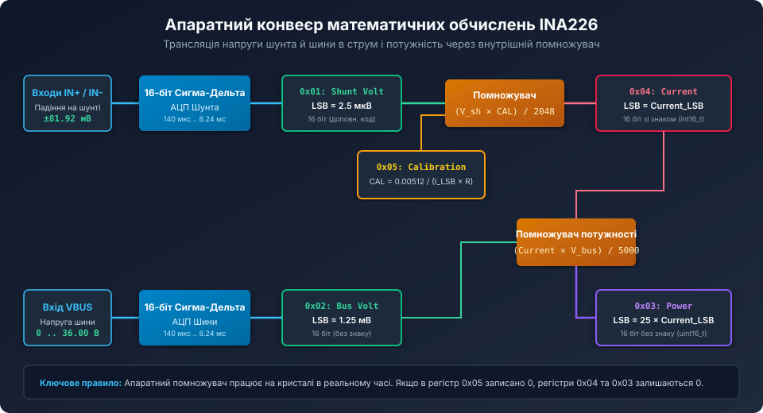
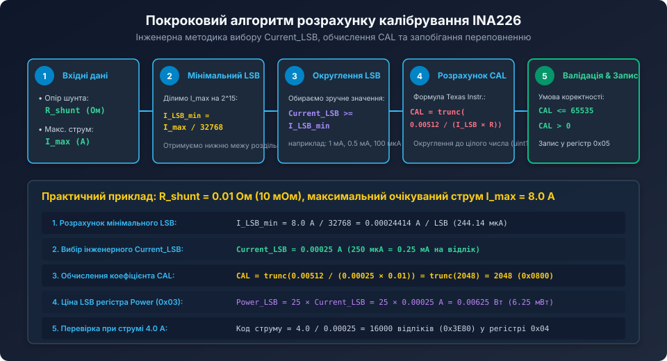
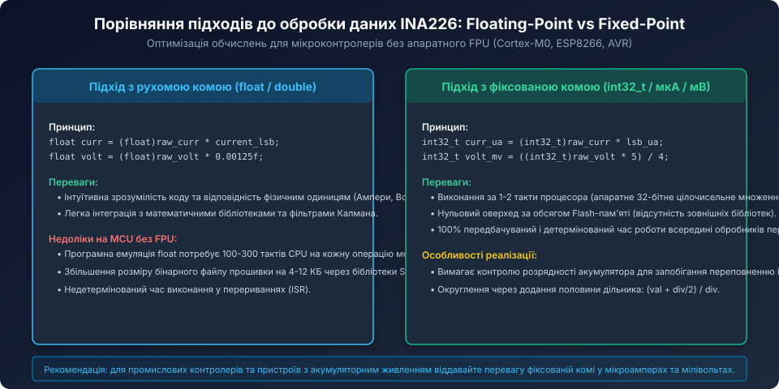

# Математика калібрувального регістру та розрахунку струму й потужності INA226

<preknowlist>
- [Цифровий монітор живлення INA226](root:cat-hw-sensors/ina226-power-monitor) — загальна схемотехніка прецизійного вимірювача живлення та аналого-цифровий тракт.
- [Карта регістрів та конфігурація INA226](root:cat-hw-sensors/ina226-register-map) — організація 16-бітних регістрів, протокол I2C та бітові поля.
- [Конфігурація та усереднення вимірювань INA226](root:cat-hw-sensors/ina226-config-and-averaging) — параметри фільтрації та час перетворення АЦП.
</preknowlist>

## Фізичні основи вимірювання та повномасштабний діапазон шунта

Цифровий монітор живлення INA226 вимірює струм непрямим методом — через реєстрацію падіння напруги на прецизійному низькоомному резисторі (шунті), підключеному послідовно в лінію навантаження між диференціальними виводами `IN+` та `IN-`.

Внутрішній сигма-дельта АЦП вимірювача напруги шунта має такі строго нормовані апаратні характеристики:
- Фіксована роздільна здатність квантування: 2.5 мкВ на відлік (LSB).
- Розрядність вихідного коду: 16 біт зі знаком у доповняльному коді (`int16_t`).
- Повний діапазон шкали (Full-Scale Range, FSR): від -81.9175 мВ до +81.9175 мВ (діапазон кодів від -32767 до +32767; код 0x8000 зарезервовано).



Для того щоб апаратний обчислювальний блок мікросхеми міг автоматично перетворювати виміряні мікровольти на ампери в регістрі струму (`Current`, 0x04) та вати в регістрі потужності (`Power`, 0x03), системний розробник повинен попередньо запрограмувати 16-бітний регістр калібрування `Calibration` (адреса 0x05).

## Вибір ціни молодшого розряду струму (Current_LSB)

Калібрування починається з аналізу двох головних параметрів апаратного тракту:
1. Номінального опору вимірювального шунта `R_shunt` (у Омах).
2. Максимального очікуваного робочого струму навантаження `I_max` (в Амперах).

Максимальний струм, який фізично здатен виміряти аналоговий каскад без насичення АЦП, обмежений порогом 81.92 мВ:

```text
I_max_hardware = 0.08192 В / R_shunt
```

Якщо робочий діапазон системи становить, наприклад, до 8 А, а опір шунта дорівнює 0.01 Ом (10 мОм), максимальне падіння напруги складе `8 А * 0.01 Ом = 80 мВ`, що ідеально вписується у повну шкалу АЦП (81.92 мВ).



### Крок 1. Розрахунок мінімального кроку квантування

Мінімально можлива ціна одного розряду струму `Current_LSB_min` розраховується шляхом ділення максимального струму на повну розрядність 15-бітної додатної шкали АЦП (32768 відліків):

```text
Current_LSB_min = I_max / 32768
```

Для струму 8.0 А:
`Current_LSB_min = 8.0 / 32768 = 0.000244140625 А/LSB (приблизно 244.14 мкА)`.

### Крок 2. Округлення до зручного інженерного значення

Використання дробового числа 244.14 мкА на відлік створює значні незручності під час перерахунку в мікроконтролері. Тому розробник округлює `Current_LSB_min` у більший бік до зручного ступеня або круглого десяткового значення:
- Приймаємо: `Current_LSB = 0.00025 А/LSB` (тобто рівно 250 мкА або 0.25 мА на один відлік).
- При цьому максимальний струм, що охоплюється повною шкалою, становитиме `32767 * 0.00025 А = 8.19175 А`, що гарантує захист від переповнення.

## Формула та обмеження коефіцієнта калібрування CAL

Значення для запису в 16-бітний регістр `Calibration` (0x05) розраховується за формулою виробника Texas Instruments:

```text
CAL = trunc( 0.00512 / (Current_LSB * R_shunt) )
```

де:
- `0.00512` — внутрішня нормуюча константа INA226 (виражається у вольт-секундах або внутрішніх масштабних одиницях помножувача);
- `Current_LSB` — обраний крок струму в Амперах;
- `R_shunt` — опір шунта в Омах;
- `trunc()` — операція відсікання дробової частини (округлення до найближчого меншого цілого числа).

### Числовий розрахунок для нашого прикладу

Підставляємо значення:
- `Current_LSB = 0.00025 А`
- `R_shunt = 0.01 Ом`

```text
Знаменник = 0.00025 * 0.01 = 0.0000025
CAL = trunc( 0.00512 / 0.0000025 ) = trunc( 2048.0 ) = 2048 (0x0800 у шістнадцятковому форматі)
```

### Граничні обмеження значення CAL

Регістр `Calibration` є беззнаковим 16-бітним полем, тому розраховане значення повинно задовольняти діапазон:

```text
1 <= CAL <= 65535 (0xFFFF)
```

Якщо опір шунта занадто малий або обрано надмірно малий `Current_LSB`, значення за формулою може перевищити 65535. У цьому разі необхідно збільшити `Current_LSB` (завантабити шкалу вимірювання) і повторити розрахунок.

Якщо ж `CAL = 0`, внутрішній помножувач струму вимикається: регістри струму та потужності постійно повертають нульове значення.

## Апаратне обчислення потужності та квант Power_LSB

INA226 містить другий апаратний помножувач, який безперервно перемножує розраховане значення струму на виміряну напругу шини `Bus Voltage` (регістр 0x02).

Результат записується у 16-бітний беззнаковий регістр `Power` (0x03). Ціна молодшого розряду потужності `Power_LSB` апаратно зафіксована у внутрішній архітектурі мікросхеми та завжди у 25 разів перевищує крок струму:

```text
Power_LSB = 25 * Current_LSB
```

Для нашого прикладу (`Current_LSB = 0.00025 А`):
`Power_LSB = 25 * 0.00025 А = 0.00625 Вт/LSB` (тобто 6.25 мВт на один відлік).

При напрузі шини 12.0 В та струмі 4.0 А споживана потужність складає `12.0 В * 4.0 А = 48.0 Вт`.
Значення в регістрі потужності становитиме:
`48.0 Вт / 0.00625 Вт = 7680 відліків (0x1E00)`.

## Цілочисельне масштабування (Fixed-Point) у прошивці мікроконтролера



Для систем на мікроконтролерах без апаратного модуля чисел з рухомою комою (ARM Cortex-M0/M0+, AVR, ESP8266) операції типу `float` виконуються програмно через емуляцію, що призводить до зайвих витрат десятків і сотень тактів процесора на кожне вимірювання.

Використання масштабованої арифметики з фіксованою комою (Fixed-Point) дозволяє отримувати точні результати в мілівольтах, мікроамперах та міліватах за допомогою швидких 32-бітних цілочисельних інструкцій процесора.

### Програмна реалізація фіксованої коми на C

```c
#include <stdint.h>

// Базові кванти у цілих числах
#define INA226_BUS_LSB_UV        1250    // 1.25 мВ = 1250 мкВ
#define INA226_SHUNT_LSB_NV      2500    // 2.5 мкВ = 2500 нВ

typedef struct {
    uint32_t current_lsb_ua; // Ціна молодшого розряду струму в мкА (наприклад, 250)
    uint32_t power_lsb_uw;   // Ціна LSB потужності в мкВт (25 * current_lsb_ua)
    uint16_t cal_val;        // Коефіцієнт для регістра 0x05
} ina226_scaling_t;

// Розрахунок параметрів калібрування в мікроамперах
void ina226_calc_scaling(ina226_scaling_t *cfg, uint32_t r_shunt_uohm, uint32_t max_current_ma) {
    // Current_LSB_min (в мкА) = (max_current_ma * 1000) / 32768
    uint32_t lsb_min_ua = (max_current_ma * 1000) / 32768;
    
    // Округлення до зручного кроку (наприклад, кратне 50 або 250 мкА)
    uint32_t current_lsb_ua = ((lsb_min_ua + 49) / 50) * 50;
    if (current_lsb_ua == 0) current_lsb_ua = 50;

    cfg->current_lsb_ua = current_lsb_ua;
    cfg->power_lsb_uw = 25 * current_lsb_ua;

    // CAL = 0.00512 / (Current_LSB * R_shunt)
    // У мікроодиницях: 0.00512 * 10^12 = 5 120 000 000
    // Знаменник: current_lsb_ua * r_shunt_uohm
    uint64_t numerator = 5120000000000ULL;
    uint64_t denominator = (uint64_t)current_lsb_ua * (uint64_t)r_shunt_uohm;
    
    cfg->cal_val = (uint16_t)(numerator / denominator);
}

// Швидке перетворення сирих кодів у фізичні одиниці (цілі числа)
void ina226_convert_raw(const ina226_scaling_t *cfg, 
                        uint16_t raw_bus, 
                        int16_t raw_curr, 
                        uint16_t raw_power,
                        int32_t *voltage_mv,
                        int32_t *current_ma,
                        int32_t *power_mw) {
    // Напруга шини: raw * 1.25 мВ = (raw * 5) / 4
    *voltage_mv = ((int32_t)raw_bus * 5) / 4;

    // Струм у мА: (raw * lsb_ua) / 1000
    *current_ma = ((int32_t)raw_curr * (int32_t)cfg->current_lsb_ua) / 1000;

    // Потужність у мВт: (raw * power_lsb_uw) / 1000
    *power_mw = ((int32_t)raw_power * (int32_t)cfg->power_lsb_uw) / 1000;
}
```

Такий підхід повністю виключає використання програмної емуляції математики з рухомою комою, зменшує розмір виконуваного коду на кілька кілобайт і гарантує миттєву обробку даних навіть на тактових частотах ядра 8..16 МГц.
