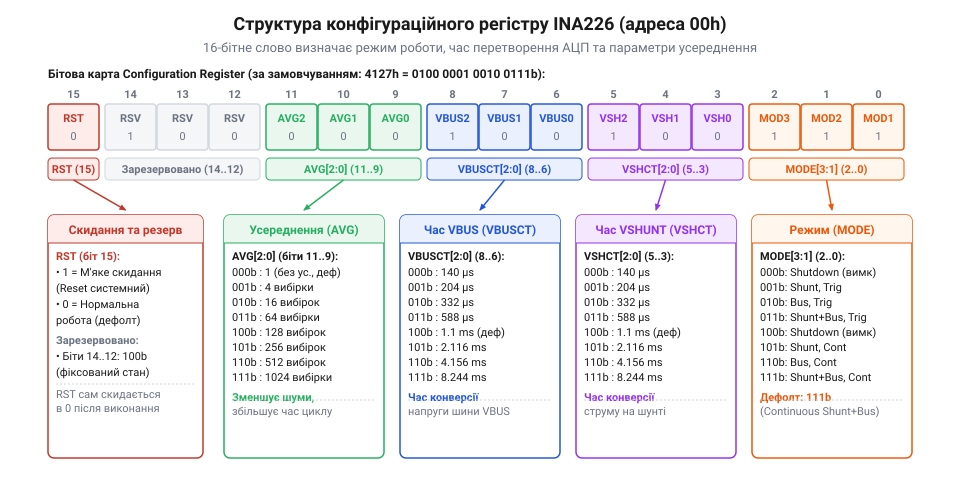
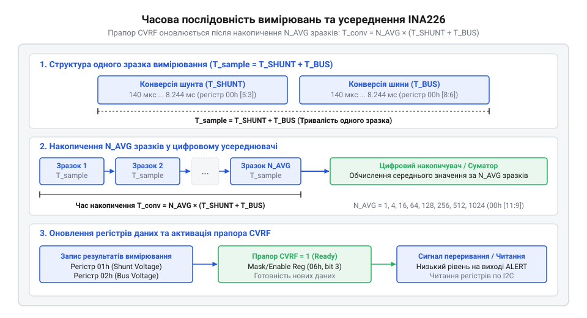

# Програмний API драйвера INA226 для керування конфігурацією та усередненням

<preknowlist>
- [Цифровий монітор живлення INA226](root:cat-hw-sensors/ina226-power-monitor) — Принцип підключення INA226 до шини I2C, призначення виводів VBUS та IN+/IN-, а також загальну карту регістрів пристрою.
</preknowlist>

## Проблема шуму та режимів вимірювання

В імпульсних джерелах живлення, силових перетворювачах та цифрових системах керування струм споживання рідко буває абсолютно стабільним. Робота силових ключів, перемикання високочастотних режимів @@en|PWM@@, спалахи активності мікроконтролерів @@en|MCU@@ та бездротових трансіверів створюють сильні високочастотні завади у колі живлення. Якщо вимірювати напругу на шунті (від англ. *shunt* — відгалуження; @@en|shunt@@) за допомогою одиночного швидкого вибіркового перетворення аналогово-цифрового перетворювача (від англ. *analog-to-digital converter*; @@en|ADC@@), зчитане значення буде випадковим зрізом миттєвої амплітуди шуму. У результаті програмне забезпечення отримує «зашумлені» дані зі значним розкидом, що спричиняє хибні спрацьовування захисту від перевантаження або нестабільну роботу алгоритмів контролю потужності.

Порівняно з [попереднім поколінням INA219](root:cat-hw-sensors/ina219-power-monitor), розширений [цифровий монітор живлення INA226](root:cat-hw-sensors/ina226-power-monitor) пропонує апаратне розв'язання цієї проблеми безпосередньо всередині кристала. Замість того щоб перекладати задачу згладжування пульсацій на центральний процесор шляхом частого читання та програмної обробки по шині @@en|I2C@@, драйвер (від англ. *driver* — керуючий елемент; @@en|driver@@) може налаштувати вбудовані апаратні фільтри пристрою. Для цього використовується конфігураційний регістр (від лат. *registrum* — внесений список; @@en|register@@) `00h`, який визначає часові характеристики та алгоритм роботи сигма-дельта @@en|ADC@@.

Усунення завад досягається поєднанням двох програмно керованих механізмів:
1. Часу конверсії (від лат. *conversio* — перетворення; @@en|conversion time@@) — тривалості інтегрування аналогового сигналу під час одного вимірювання. Чим довший час конверсії, тим ефективніше внутрішній інтегрувальний фільтр @@en|ADC@@ подавляє високочастотний шум та мережеві наведення частотою 50/60 Гц. 2. Апаратного усереднення (від англ. *averaging* — обчислення середнього; @@en|averaging@@) — накопичення серії послідовних вибірок (від 1 до 1024 зразків) у внутрішньому суматорі пристрою перед оновленням підсумкового значення у вихідних регістрах.

Крім того, вимірювальний тракт вимагає гнучкого керування сеансами вимірювань залежно від енергетичного бюджету пристрою. У багатьох автономних приладах постійне вимірювання не потрібне і лише даремно витрачає струм акумулятора. Для цього @@en|INA226@@ підтримує три базові режими роботи:
- Неперервний режим (@@en|continuous mode@@) — апаратний блок @@en|INA226@@ циклічно виконує вимірювання падіння напруги на шунті та напруги на шині @@en|VBUS@@, самостійно оновлюючи результати. - Тригерний режим (від англ. *trigger* — спусковий гачок; @@en|triggered mode@@) — мікросхема перебуває у стані очікування, виконує один повний цикл вимірювань (із врахуванням заданого усереднення) лише після отримання відповідної команди по шині @@en|I2C@@, після чого автоматично зупиняється. - Режим енергозбереження (@@en|power-down@@) — вимкнення внутрішніх вимірювальних кіл для мінімізації власного споживання струму до рівня менше ніж 2 мкА.

Усі ці параметри задаються через єдиний 16-бітовий конфігураційний регістр `00h`. Грамотне налаштування цього регістру дозволяє досягти оптимального компромісу між точністю згладжування шуму та швидкістю відгуку драйвера на динамічні зміни струму в системі.

## Бітові поля конфігураційного регістру 00h

Конфігураційний регістр `00h` є головним керівним органом @@en|INA226@@. Він має довжину 16 біт (двобайтове слово, що передається по шині @@en|I2C@@ у форматі @@en|MSB@@ — старший байт першим). Кожна група бітів відповідає за окремий параметр вимірювального тракту.


*Схема бітового поля конфігураційного регістру 00h INA226, яка демонструє розподіл 16 розрядів між керуванням скиданням, усередненням, часом конверсії каналів та режимом вимірювання.*

Розглянемо детальну бітову карту (від англ. *bitfield* — бітове поле; @@en|bitfield@@) регістру `00h`:

- **Біт 15 (`RST` — System Reset):** Біт програмного скидання (від англ. *reset* — відновлення початкового стану; @@en|reset@@). Запис одиниці в цей біт відновлює всі регістри @@en|INA226@@ до заводських значень за замовчуванням (еквівалентно подачі живлення). Після виконання скидання біт `RST` автоматично скидається в `0`. - **Біти 14–12 (Reserved):** Зарезервовані розряди. Під час запису конфігурації у ці біти завжди необхідно записувати `0`. - **Біти 11–9 (`AVG2:AVG0` — Averaging Mode):** Визначають кількість зразків, які апаратно усереднюються для одного підсумкового значення:
  - `000`: 1 зразок (усереднення вимкнено, значення за замовчуванням);
  - `001`: 4 зразки;
  - `010`: 16 зразків;
  - `011`: 64 зразки;
  - `100`: 128 зразків;
  - `101`: 256 зразків;
  - `110`: 512 зразків;
  - `111`: 1024 зразки. - **Біти 8–6 (`VBUS CT2:CT0` — Bus Voltage Conversion Time):** Встановлюють час конверсії для каналу напруги шини @@en|VBUS@@:
  - `000`: 140 мкс;
  - `001`: 204 мкс;
  - `010`: 332 мкс;
  - `011`: 588 мкс;
  - `100`: 1.1 мс (за замовчуванням);
  - `101`: 2.116 мс;
  - `110`: 4.156 мс;
  - `111`: 8.244 мс. - **Біти 5–3 (`VSH CT2:CT0` — Shunt Voltage Conversion Time):** Встановлюють час конверсії для каналу напруги шунта @@en|VSH@@:
  - `000`: 140 мкс;
  - `001`: 204 мкс;
  - `010`: 332 мкс;
  - `011`: 588 мкс;
  - `100`: 1.1 мс (за замовчуванням);
  - `101`: 2.116 мс;
  - `110`: 4.156 мс;
  - `111`: 8.244 мс. - **Біти 2–0 (`MODE3:MODE1` — Operating Mode):** Задають режим роботи вимірювального блоку:
  - `000`: Режим вимкнення (@@en|power-down@@);
  - `001`: Вимірювання напруги шунта, тригерне (@@en|triggered mode@@);
  - `010`: Вимірювання напруги шини, тригерне;
  - `011`: Вимірювання шунта та шини, тригерне;
  - `100`: Режим вимкнення (@@en|power-down@@);
  - `101`: Вимірювання напруги шунта, неперервне (@@en|continuous mode@@);
  - `110`: Вимірювання напруги шини, неперервне;
  - `111`: Вимірювання шунта та шини, неперервне (значення за замовчуванням).

За замовчуванням після включення живлення регістр `00h` містить значення `0x4127`, що відповідає неперервному вимірюванню обох каналів з часом конверсії 1.1 мс без усереднення (`AVG = 1`).

Формування підсумкового 16-бітового слова для запису в регістр виконується за допомогою бітових зсувів у мові C. Наприклад, щоб сформувати конфігурацію, де `AVG = 16` (`010b`), `VBUS CT = 1.1 ms` (`100b`), `VSH CT = 1.1 ms` (`100b`) та `MODE = Continuous All` (`111b`), застосовують побітову операцію «АБО»:

```c
uint16_t reg_val = (0x02 << 9) | (0x04 << 6) | (0x04 << 3) | 0x07;
```

Такий підхід прямо відображає апаратну структуру регістру, однак у програмному коді зручніше використовувати вищий рівень абстракції (від лат. *abstractio* — виділення суттєвого; @@en|abstraction@@).

## Оголошення типів та конфігураційної структури

Для того щоб уникнути помилок при роботі з «магічними» бітовими масками та забезпечити читабельність коду, драйвер @@en|INA226@@ має надавати чітко типізований інтерфейс @@en|API@@. Для кожного бітового поля конфігураційного регістру створюється перелічуваний тип (від англ. *enumeration*; @@en|enum@@), а загальний набір налаштувань об'єднується в конфігураційну структуру (від лат. *structura* — побудова; @@en|struct@@).

Створимо оголошення типів для режимів роботи, часу конверсії та кількості усереднень:

:::tabs
@tab C (ESP-IDF / Generic C)
:::code api-ina226-config-driver-interface/c/esp-idf/snippet-1.c
@tab C++ (Arduino / Object-Oriented)
:::code api-ina226-config-driver-interface/cpp/arduino/mode.cpp
:::

Використання таких перелічувальних типів повністю виключає можливість передачі некоректних бітових комбінацій у функцію налаштування. Програміст чітко бачитиме призначення кожного параметра при ініціалізації екземпляра конфігураційної структури `ina226_config_t`.

## Розрахунок часу оновлення та компроміси

Конфігураційні параметри безпосередньо впливають на тривалість повного циклу вимірювання та частоту оновлення даних у вихідних регістрах @@en|INA226@@. Драйвер повинен точно знати цей час, щоб правильно розраховувати інтервали опитування (від англ. *polling*; @@en|polling@@) або налаштовувати системні таймаути (від англ. *timeout*; @@en|timeout@@).

Підсумковий час конверсії та усереднення `t_total` обчислюється як добуток сумарного часу вимірювання обраних каналів на кількість зразків усереднення `n_avg`.


*Діаграма часової послідовності вимірювань, що ілюструє накопичення зразків шунта й шини та підсумковий інтервал оновлення прапора CVRF.*

Загальне математичне виведення підсумкового часу для режиму вимірювання обох каналів (шунта та шини) має такий вигляд:

```
t_conv = t_vsh + t_vbus                 [сума часів конверсії двох каналів]

t_total = t_conv * n_avg                [множення на кількість зразків усереднення]
```

Де `t_vsh` — час конверсії напруги шунта, `t_vbus` — час конверсії напруги шини, а `n_avg` — кількість накопичувальних зразків усереднення. Якщо вимірюється лише один канал (наприклад, тільки шунт), у формулі залишається лише відповідний доданок `t_vsh`.

Розглянемо практичне обчислення на прикладі типової конфігурації для вимірювання струму й напруги.

**Розрахунок інтервалу оновлення для 16 зразків при часі конверсії 1.1 мс**
```
t_conv = 1100 us + 1100 us
       = 2200 us                        [додавання часу конверсії шунта та шини]

t_total = 2200 us * 16
        = 35200 us                      [множення на кількість зразків усереднення]
        = 35.2 ms                       [переведення у мілісекунди]
```

У цьому прикладі нове значення виміряного струму та напруги з'являється у регістрах пристрою кожні 35.2 мс, що відповідає частоті оновлення приблизно 28.4 Гц.

Вибір параметрів конверсії та усереднення завжди є компромісом між двома ключовими характеристиками системи:

1. **Рівень шуму та точність вимірювання.** Ефективний рівень шуму зменшується пропорційно квадратному кореню від кількості усереднених зразків `n_avg`. Використання `n_avg = 16` зменшує вимірювальний шум у 4 рази, а `n_avg = 1024` — у 32 рази. Крім того, вибір часу конверсії 1.1 мс або більше дозволяє пригнічувати високочастотні імпульсні завади. 2. **Швидкодія та реакція на аварійні події.** У разі вибору максимальних параметрів (часу конверсії 8.244 мс для обох каналів та `n_avg = 1024`) підсумковий час оновлення становитиме:

```
t_conv = 8244 us + 8244 us
       = 16488 us                       [сумарний час одного виміру двох каналів]

t_total = 16488 us * 1024
        = 16883712 us                   [значення часу для 1024 зразків]
        = 16.88 s                       [підсумкова затримка оновлення]
```

Затримка у 16.88 секунди придатна лише для моніторингу повільного розряду великих акумуляторних батарей, але абсолютно неприпустима у системах швидкодіючого захисту від короткого замикання. Натомість для високошвидкісного моніторингу зазвичай обирають час конверсії 140 мкс без усереднення (`t_total = 280 us`), що дає змогу виявляти сплески струму менш ніж за 0.3 мс. Для налаштування апаратного захисту від перевантажень та генерації переривань при перевищенні порогів струму або напруги перегляньте матеріали про [системні тривоги та налаштування виводу ALERT мікросхеми INA226](root:cat-hw-sensors/ina226-alert-pin-and-interrupts).

## Функції ініціалізації та перевірки статусів

Після визначення конфігураційної структури та обчислення часових інтервалів необхідно реалізувати програмні функції драйвера для запису налаштувань у мікросхему по шині @@en|I2C@@ та контролю готовності нових даних.

Взаємодія драйвера з @@en|INA226@@ будується на таких базових функціях:
- `ina226_init`: перевіряє наявність пристрою на шині @@en|I2C@@ та виконує початкове скидання через біт `RST`. - `ina226_set_config`: перетворює логічну структуру `ina226_config_t` у 16-бітове значення регістру `00h` та передає його по шині. - `ina226_is_data_ready`: опитує прапор готовності конверсії `CVRF` (від англ. *Conversion Ready Flag*; @@en|Conversion Ready Flag@@), який розташований у регістрі статусів та масок `06h` (`Mask/Enable Register`, біт 3).

Прапор `CVRF` виставляється в `1` апаратурою @@en|INA226@@ щоразу, коли завершується повний цикл конверсії з урахуванням усереднення. Прапор автоматично скидається в `0` під час читання регістру статусів `06h` або після зчитування результатів з вихідних регістрів струму та напруги.

Наведемо повний приклад реалізації драйвера мовою C та C++ з урахуванням обробки помилок шини @@en|I2C@@:

:::tabs
@tab C (ESP-IDF)
:::code api-ina226-config-driver-interface/c/esp-idf/ina226-pack-config.c
@tab C++ (Arduino)
:::code api-ina226-config-driver-interface/cpp/arduino/ina226driver.cpp
:::

Під час використання тригерного режиму (@@en|triggered mode@@) алгоритм опитування драйвера виглядає наступним чином:
1. Драйвер записує конфігурацію тригерного режиму в регістр `00h`, ініціюючи вимірювання. 2. Програма входить у цикл опитування функцією `ina226_check_data_ready` або `isDataReady` з фіксованим таймаутом (@@en|timeout@@). 3. Після встановлення прапора `CVRF` у `1` драйвер виконує читання вихідних регістрів напруги та струму, що автоматично скидає прапор та готує мікросхему до наступного тригера.

Такий підхід забезпечує надійну обробку даних без ризику зчитування «застарілих» або частково оновлених значень з @@en|INA226@@. Для переведення отриманих сирих даних з вихідних регістрів у фізичні величини струму та потужності за допомогою калібрувального регістру 05h дивіться матеріал про [калібрування та переведення вимірювань INA226 у фізичні величини](root:cat-hw-sensors/ina226-power-monitor/math-ina226-calibration-math.md).