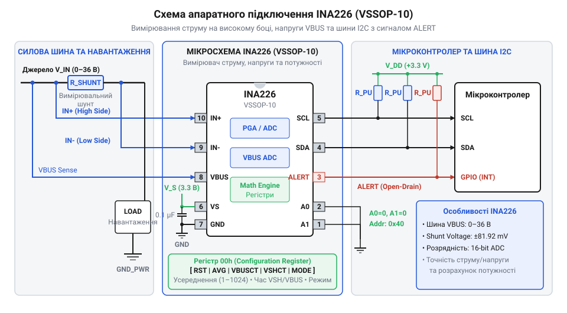
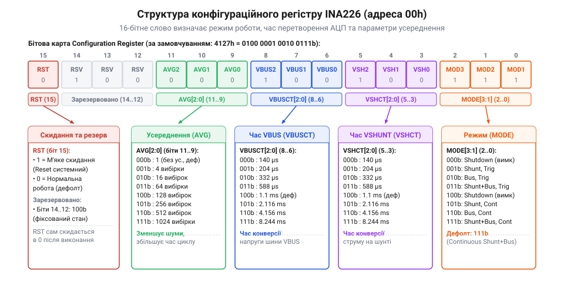

# Залізний API INA226: цокольовка, принципова схема та карта регістрів

<preknowlist>
- [Цифровий монітор живлення INA226](root:cat-hw-sensors/ina226-power-monitor) — загальне призначення мікросхеми, принцип пасивного струмовимірювального шунта та базовий діапазон напруг шини
</preknowlist>

## Проблема вимірювання струму високого боку

Контроль споживання електроенергії у складних радіоелектронних системах вимагає точного моніторингу струму та напруги на силових лініях живлення. Базовий спосіб вимірювання струму базується на законі Ома: у силову коло послідовно з навантаженням вмикають пасивний @@en|резистор-шунт@@ (від @@la|resistere@@ — чинити опір) з відомим малим опором `R_shunt` та вимірюють спад напруги `U_shunt` на його виводах (`U_shunt = I × R_shunt`). Однак точна реалізація цього принципу в реальних пристроях стикається з серйозними аналоговими обмеженнями залежно від місця включення шунта в коло.

У схемах вимірювання застосовують дві топології: низький бік (@@en|low-side sensing@@) та високий бік (@@en|high-side sensing@@). На низькому боці шунт встановлюють між навантаженням і загальною землею схеми (@@en|GND@@). Це найпростіший підхід, оскільки потенціал на шунті відносно землі є малим і його можна легко оцифрувати. Проте зсув потенціалу землі навантаження (@@en|ground bounce@@) викликає завади в цифрових інтерфейсах зв'язку та унеможливлює виявлення короткого замикання всередині навантаження на корпус.

На високому боці шунт вмикають між джерелом живлення та навантаженням. Земля навантаження залишається суцільною, а система зберігає захист від коротких замикань. Проте на обох обкладках шунта виникає високий синфазний потенціал (@@en|common-mode voltage@@), що дорівнює повній напрузі силової шині (наприклад, 12 В, 24 В або 36 В).

Використання стандартного аналогово-цифрового перетворювача (@@en|АЦП@@, від @@en|Analog-to-Digital Converter@@) у складі мікроконтролера для вимірювання струму на високому боці є неможливим через три основні причини:

1. **Обмеження вхідного діапазону:** Аналогові входи мікроконтролерів розраховані лише на напруги в межах свого живлення (від 0 В до 3.3 В або 5 В). Подача напруги силової шини 24 В безпосередньо на вхід мікроконтролера миттєво випалює вхідний каскад і руйнує кристалик. 2. **Малий диференційний сигнал:** Щоб не втрачати потужність на тепло `P = I² × R_shunt`, опір шунта обирають дуже малим (від 1 мОм до 100 мОм). При струмі 100 мА на шунті 10 мОм виникає спад напруги всього 1 мВ. Виділити сигнал амплітудою 1 мВ на тлі постійної синфазної напруги 24 В вимагає підсилювача з високим коефіцієнтом пригнічення синфазного сигналу (@@en|CMRR@@, від @@en|Common-Mode Rejection Ratio@@). Звичайний АЦП мікроконтролера позбавлений такого прецизійного диференційного каскаду. 3. **Шум і пульсації шини:** Імпульсні перехідні процеси, високі частоти перемикання DC-DC перетворювачів та наводки спотворюють миттєвий спад напруги. Без апаратної фільтрації оцифроване значення хаотично коливається.

Замість побудови складних дискретних схем на диференційних підсилювачах використовують виділені цифрові монітори живлення. На відміну від простішого [модуля INA219](root:cat-hw-sensors/ina219-power-monitor) з 12-бітною розрядністю та робочою напругою до 26 В, прецизійний [вимірювач INA226](root:cat-hw-sensors/ina226-power-monitor) має розрядність 16 біт, витримує синфазну напругу силової шині від 0 В до +36 В незалежно від власних 3.3 В живлення та передає готові очищені дані через @@en|шину I2C@@ (від @@en|Inter-Integrated Circuit@@ — міжмікросхемне з'єднання).

## Апаратне підключення та цокольовка VSSOP-10

Мікросхема @@en|INA226@@ випускається у надкомпактному пластиковому корпусі @@en|VSSOP-10@@ (від @@en|Very Thin Shrink Small Outline Package@@) з 10 виводами. Правильна інтеграція пристрою у принципову схему вимагає чіткого дотримання вимог до розведення диференційних сигнальних ліній, підтяжок цифрової шини та фільтрації живлення.

Призначення виводів корпусу @@en|VSSOP-10@@ пристрою @@en|INA226@@:

* `1 (A1)` — вивід вибору адреси @@en|I2C@@ (@@en|address input 1@@). * `2 (A0)` — вивід вибору адреси @@en|I2C@@ (@@en|address input 0@@). * `3 (ALERT)` — багатофункціональний вихід сигналізації тривоги та переривань (@@en|open-drain output@@). * `4 (SDA)` — лінія даних цифрової шини @@en|I2C@@ (@@en|serial data line@@). * `5 (SCL)` — лінія тактування цифрової шини @@en|I2C@@ (@@en|serial clock line@@). * `6 (VS)` — вхід живлення внутрішнього аналогового та цифрового ядра (від 2.7 В до 5.5 В). * `7 (GND)` — загальний провід (земля) мікросхеми (@@en|ground reference@@). * `8 (VBUS)` — вхід вимірювання напруги силової шині (діапазон від 0 В до 36 В відносно `GND`). * `9 (IN-)` — негативний диференційний вхід спаду напруги на шунті (підключається до боку навантаження). * `10 (IN+)` — позитивний диференційний вхід спаду напруги на шунті (підключається до боку живлення).


*Принципова схема апаратного підключення INA226 у корпусі VSSOP-10 до навантаження, шини I2C та мікроконтролера.*

Підключення вимірювального шунта вимагає застосування чотирипровідної схеми Кельвіна (@@en|Kelvin connection@@). Оскільки струм навантаження через силові доріжки може досягати десятків ампер, навіть мікроомний опір мідного провідника друкованої плати викликає помітне додаткове падіння напруги. Якщо підключити входи `IN+` та `IN-` до силових доріжок подалі від шунта, опір міді додасться до `R_shunt`, утворивши велику системну похибку. Для усунення цього ефекту сигнальні доріжки від входів `IN+` та `IN-` розводять окремими тонкими провідниками безпосередньо від внутрішніх контактних площадок самого шунта. Оскільки струм у вимірювальні входи @@en|INA226@@ не тече (вхідний імпеданс досягає мегаом), падіння напруги на вимірювальних доріжках дорівнює нулю.

Вивід живлення `VS` вимагає обов'язкового встановлення керамічного розв'язувального конденсатора ємністю 0.1 мкФ (100 нФ), розташованого якомога ближче до виводів 6 та 7 (`VS` і `GND`), для глушіння високочастотних завад по лінії живлення.

Цифрові лінії `SDA`, `SCL` та сигнальний вихід `ALERT` виконані за схемою з відкритим стоком (@@en|open-drain@@). Лінії `SDA` та `SCL` необхідно підтягнути резисторами опором від 2.2 кОм до 10 кОм до шини живлення мікроконтролера (наприклад, 3.3 В). Вивід `ALERT` підтягують резистором 10 кОм до лінії `VS` та підключають до входу зовнішнього переривання мікроконтролера.

Для вибору фізичної адреси пристрою на шині @@en|I2C@@ використовують виводи `A0` та `A1`. Кожен з цих двох виводів можна жорстко з'єднати з одним із чотирьох вузлів: `GND`, `VS`, `SDA` або `SCL`. Це дає 4 * 4 = 16 унікальних 7-бітних адрес у діапазоні від `0x40` до `0x4F`:

* `A1 = GND`, `A0 = GND` — адреса `0x40` (значення за замовчуванням);
* `A1 = GND`, `A0 = VS` — адреса `0x41`;
* `A1 = GND`, `A0 = SDA` — адреса `0x42`;
* `A1 = GND`, `A0 = SCL` — адреса `0x43`;
* `A1 = VS`, `A0 = GND` — адреса `0x44`;
* `A1 = VS`, `A0 = VS` — адреса `0x45`.

Можливість гнучкого вибору 16 адрес дозволяє підключати до 16 мікросхем @@en|INA226@@ до єдиної шини @@en|I2C@@ без використання додаткових мультиплексорів.

## Карта регістрів та внутрішня адресація

Внутрішня пам'ять @@en|INA226@@ організована у вигляді масиву 16-бітних регістрів. Будь-яка операція читання або запису здійснюється двома послідовними байтами даних через інтерфейс @@en|I2C@@.

Вибір цільового регістру виконується за допомогою внутрішнього 8-бітного регістру вказівника (@@en|Pointer Register@@). Під час транзакції запису майстер спочатку надсилає адресу пристрою з бітом `W = 0`, після чого передає один байт адреси регістру. Якщо виконується запис, наступними надходять старший байт (@@en|MSB@@, від @@en|Most Significant Bit@@) та молодший байт (@@en|LSB@@, від @@en|Least Significant Bit@@). При зчитуванні майстер після відправки адреси регістру формує повторний старт (@@en|RESTART@@), передає адресу пристрою з бітом `R = 1` та приймає 2 байти даних.

| Адреса (hex) | Назва регістру | Доступ | За замовчуванням | Основне призначення |
| :--- | :--- | :--- | :--- | :--- |
| `00h` | Configuration Register | R/W | `4127h` | Скидання, усереднення, час перетворення та режим |
| `01h` | Shunt Voltage Register | R | `0000h` | Виміряна диференційна напруга на шунті |
| `02h` | Bus Voltage Register | R | `0000h` | Виміряна напруга силової шині VBUS |
| `03h` | Power Register | R | `0000h` | Розраховане значення апаратної потужності |
| `04h` | Current Register | R | `0000h` | Розраховане значення апаратного струму |
| `05h` | Calibration Register | R/W | `0000h` | Калібрувальний коефіцієнт для струму та потужності |
| `06h` | Mask/Enable Register | R/W | `0000h` | Маска переривань та конфігурація виводу ALERT |
| `07h` | Alert Limit Register | R/W | `0000h` | Порогове значення для порівняння у блоці ALERT |
| `FEh` | Manufacturer ID Register | R | `5449h` | Ідентифікатор виробника Texas Instruments ("TI") |
| `FFh` | Die ID Register | R | `2260h` | Ідентифікатор кристала та ревізії (INA226) |

Особливості інтерпретації даних у регістрах:

* **Shunt Voltage Register (`01h`):** Зберігає сирий спад напруги між виводами `IN+` та `IN-` у вигляді 16-бітного цілого числа зі знаком (доповняльний код — @@en|two's complement@@). Фіксована ціна молодшого розряду LSB дорівнює 2.5 мкВ (2.5 * 10^-6 В). Повний вимірювальний діапазон становить від -81.92 мВ до +81.9175 мВ. * **Bus Voltage Register (`02h`):** Містить напругу на вході `VBUS` відносно `GND` у вигляді 16-бітного беззнакового числа. Ціна розряду LSB дорівнює 1.25 мВ (1.25 * 10^-3 В). Діапазон вимірювання — від 0 В до 40.96 В (апаратно обмежений допустимою напругою шини 36 В). * **Current Register (`04h`) та Power Register (`03h`):** Внутрішнє ядро мікросхеми розраховує струм і потужність шляхом апаратного множення. Ці регістри залишаються нульовими, доки розробник не обчислить і не запише значення у `Calibration Register (05h)`. Після записаного калібрувального коефіцієнта значення струму та потужності зчитуються напряму в амперах і ватах із заданим розрядним масштабом. * **Службові регістри (`FEh` та `FFh`):** Використовуються для програмного автовизначення мікросхеми на шині. Зчитування `5449h` з регістру `FEh` підтверджує автентичність виробника Texas Instruments, а значення `2260h` у регістрі `FFh` гарантує, що на шині знаходиться саме @@en|INA226@@.

## Налаштування режиму та часу перетворення

Конфігураційний регістр `Configuration Register (00h)` відповідає за програмний скид пристрою, вибір кількості усереднень вибірок, задання часу перетворення аналогово-цифрового перетворювача окремо для каналів шунта і шини, а також за вибір режиму роботи.


*Структура бітових полів конфігураційного регістру 00h пристрою INA226.*

Розподіл бітових полів у конфігураційній комірці `00h`:

* **Біт 15 (`RST` — @@en|Reset Bit@@):** Біт програмного скидання. Запис одиниці в цей біт скидає всі внутрішні регістри до заводських значень за замовчуванням. Після скидання біт `RST` самостійно очищається в `0`. Значення регістру за замовчуванням — `4127h`. * **Біти 14–12:** Зарезервовані видам виробника, під час запису завжди мають містити `0`. * **Біти 11–9 (`AVG[2:0]` — @@en|Averaging Mode@@):** Налаштування апаратного усереднювача вибірок. * **Біти 8–6 (`VBUSCT[2:0]` — @@en|Bus Voltage Conversion Time@@):** Вибір часу перетворення АЦП для напруги силової шині `VBUS`. * **Біти 5–3 (`VSHCT[2:0]` — @@en|Shunt Voltage Conversion Time@@):** Вибір часу перетворення АЦП для диференційної напруги шунта `VSH`. * **Біти 2–0 (`MODE[3:1]` — @@en|Operating Mode@@):** Налаштування операційного режиму АЦП та стану живлення.

Градація часу перетворення АЦП для полів `VBUSCT` та `VSHCT`:

| Значення коду | Час перетворення | Особливості та застосування |
| :--- | :--- | :--- |
| `000` | 140 мкс | Максимальна швидкість, високий рівень шуму |
| `001` | 204 мкс | Швидкий вимірювальний цикл |
| `010` | 332 мкс | Помірний час оцифровки |
| `011` | 588 мкс | Покращена фільтрація |
| `100` | 1.100 мс | **Заводське значення за замовчуванням** |
| `101` | 2.116 мс | Підвищена точність |
| `110` | 4.156 мс | Високе пригнічення завад |
| `111` | 8.244 мс | Максимальна розрядність і пригнічення мережевого шуму |

Бітове поле `MODE[3:1]` керує робочим циклом аналогової частини:

| Код `MODE` | Режим роботи | Опис функціонування |
| :--- | :--- | :--- |
| `000` | Power-Down | Аналогові блоки вимкнені, споживання менше 0.5 мкА |
| `001` | Shunt Voltage, Triggered | Однократний замір напруги шунта за тригером |
| `010` | Bus Voltage, Triggered | Однократний замір напруги шини за тригером |
| `011` | Shunt and Bus, Triggered | Однократний замір обох каналів за тригером |
| `100` | ADC Off (Shutdown) | Аналоговий блок вимкнений (аналог `000`) |
| `101` | Shunt Voltage, Continuous | Безперервний циклічний моніторинг лише шунта |
| `110` | Bus Voltage, Continuous | Безперервний циклічний моніторинг лише шини |
| `111` | Shunt and Bus, Continuous | **За замовчуванням**: безперервний вимірювальний цикл обох параметрів |

Налаштування часу перетворення визначає компроміс між швидкістю реакції системи та шумом вимірювань. Вибір короткого часу (140 мкс) необхідний для фіксації швидких імпульсних стрибків струму, однак ефективна кількість розрядів (@@en|ENOB@@, від @@en|Effective Number of Bits@@) при цьому знижується. Збільшення часу перетворення до 1.1 мс або 8.244 мс вмикає внутрішній цифровий фільтр, який інтегрує сигнал, згладжуючи високочастотні завади від перемикання силових ключів DC-DC перетворювачів. Тригерні режими (`Triggered`) дозволяють заощаджувати енергію в батарейних пристроях: мікросхема перебуває у стані сплячки і виконує замір лише після запису команди мікроконтролером.

## Усереднення сигналів та переривання ALERT

Для усунення шуму вимірювань без завантаження процесора мікроконтролера @@en|INA226@@ містить апаратний усереднювач вибірок. Налаштування поля `AVG[2:0]` у конфігураційному регістрі `00h` дозволяє накопичувати від 1 до 1024 замірів перед оновленням результату в підсумкових регістрах даних.

Кодування бітового поля `AVG[2:0]`:

| Код `AVG` | Кількість вибірок N_AVG | Зниження рівня шуму |
| :--- | :--- | :--- |
| `000` | 1 вибірка | 1x (без усереднення, за замовчуванням) |
| `001` | 4 вибірки | 2x (√4) |
| `010` | 16 вибірок | 4x (√16) |
| `011` | 64 вибірки | 8x (√64) |
| `100` | 128 вибірок | ~11.3x |
| `101` | 256 вибірок | 16x (√256) |
| `110` | 512 вибірок | ~22.6x |
| `111` | 1024 вибірки | 32x (√1024) |

Повний період оновлення регістрів даних T_total при безперервному вимірюванні обох каналів розраховується за формулою:

```
T_total = N_AVG × (T_VSHCT + T_VBUSCT)
        = 16 × (1.1 ms + 1.1 ms)    [підстановка часових інтервалів каналів]
        = 16 × 2.2 ms               [сумування часу двох перетворень]
        = 35.2 ms                   [підсумковий час циклу усереднення]
```

Перед обчисленням значення визначають складові: `N_AVG` є кількістю вибірок усереднення, `T_VSHCT` — час перетворення напруги шунта, `T_VBUSCT` — час перетворення напруги шини. Підстановка заводських параметрів (`N_AVG = 16`, `T_VSHCT = 1.1 мс`, `T_VBUSCT = 1.1 мс`) дає час оновлення даних 35.2 мс, що відповідає частоті видачі результатів близько 28.4 Гц та зниженню шуму в 4 рази.

Апаратний блок переривань використовує лінію `ALERT` та два регістри: `Mask/Enable Register (06h)` і `Alert Limit Register (07h)`. У регістр `07h` записують 16-бітне порогове число, з яким апаратний компаратор порівнює виміряне значення.

Структура регістру `Mask/Enable (06h)` дозволяє вибрати одну з умов активації сигналу `ALERT`:

* **Біт 15 (`SOL` — @@en|Shunt Voltage Over-Limit@@):** Активація `ALERT`, якщо напруга шунта перевищує поріг `07h`. * **Біт 14 (`SUL` — @@en|Shunt Voltage Under-Limit@@):** Активація `ALERT`, якщо напруга шунта нижча за поріг `07h`. * **Біт 13 (`BOL` — @@en|Bus Voltage Over-Limit@@):** Активація `ALERT`, якщо напруга шини VBUS перевищує поріг `07h`. * **Біт 12 (`BUL` — @@en|Bus Voltage Under-Limit@@):** Активація `ALERT`, якщо напруга шини VBUS нижча за поріг `07h`. * **Біт 11 (`POL` — @@en|Power Over-Limit@@):** Активація `ALERT`, якщо розрахована потужність перевищує поріг `07h`. * **Біт 10 (`CNVR` — @@en|Conversion Ready@@):** Активація `ALERT` щоразу при завершенні циклу перетворення та усереднення. * **Біт 4 (`AFF` — @@en|Alert Function Flag@@):** Прапор виникнення аварійної події (статус розшифровки). * **Біт 3 (`CVRF` — @@en|Conversion Ready Flag@@):** Прапор готовності нових даних (очищається при зчитуванні `06h` або регістру потужності `03h`). * **Біт 2 (`OVF` — @@en|Math Overflow Flag@@):** Прапор математичного переповнення при розрахунку потужності. * **Біт 1 (`APOL` — @@en|Alert Polarity@@):** Полярність виводу `ALERT`. `0` — активний низький рівень (за замовчуванням), `1` — активний високий рівень. * **Біт 0 (`LEN` — @@en|Latch Enable@@):** Режим фіксації переривання. При `LEN = 0` (прозорий режим — @@en|transparent mode@@) сигнал `ALERT` знімається автоматично після повернення параметра в норму. При `LEN = 1` (режим фіксації — @@en|latch mode@@) лінія `ALERT` залишається заблокованою в активному стані доти, доки мікроконтролер не зчитає вміст регістру `Mask/Enable (06h)`.