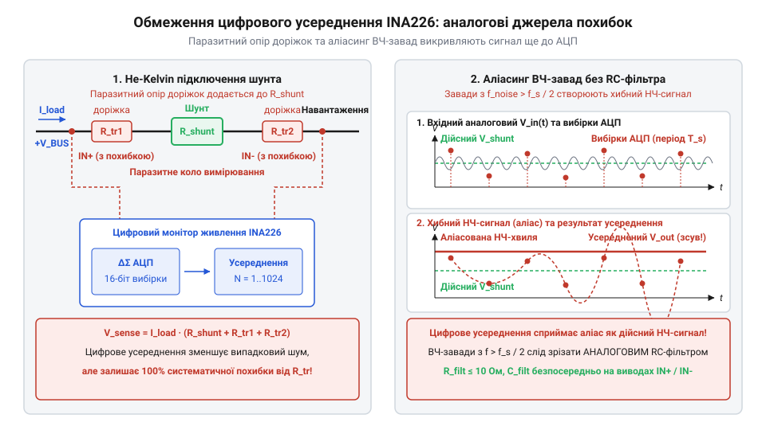
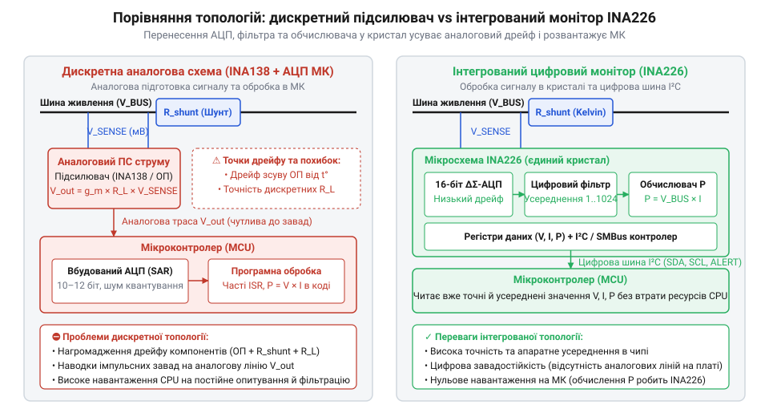
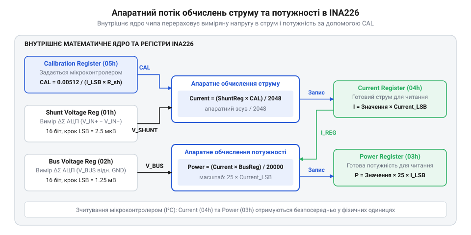

# Еволюція цифрових вимірювачів струму та напруги

<preknowlist>
- [INA219 — монітор струму й напруги (I2C)](root:cat-hw-sensors/ina219-power-monitor) — Принципи побудови цифрових вимірювачів струму першого покоління з апаратним обчисленням потужності та інтерфейсом I2C.
- [Цифровий монітор живлення INA226](root:cat-hw-sensors/ina226-power-monitor) — Специфіка конфігурації регістрів усереднення, часу перетворення та використання високовольтного дельта-сигма АЦП.
</preknowlist>

## Обмеження дискретних аналогових вимірювальних систем

Потреба постійно контролювати споживання струму та напругу на силових шинах живлення у складних електронних приладах виникла разом із появою високощільних систем @@en|telemetry@@ (грец. *tele* — далеко, *metron* — вимірювання). У перших поколіннях джерел живлення та промислової автоматики єдиним доступним способом оцінки струму навантаження було зчитування падіння напруги з низькоомного вимірювального @@en|shunt resistor@@ (англ. *shunt* — відхиляти). Струм `I`, проходячи крізь опір шунта `R_shunt`, утворює диференціальну напругу `V_shunt`.

Перед тим як виміряти сигнал, необхідно визначити залежність між струмом та утвореною диференціальною напругою на шунті:

```
V_shunt = I · R_shunt
```

Вираз показує, що для мінімізації втрат потужності `P = I² · R_shunt` опір шунта обирають дуже малим (від одиниць до десятків міліом), через що вимірювана напруга `V_shunt` становить лише кілька мілівольт.

Головна складність полягала в тому, що ця мілівольтова напруга діє на тлі високої синфазної напруги @@en|common-mode voltage@@ (англ. *common mode* — спільний режим), яка часто перевищує напругу живлення самого вимірювального мікроконтролера. Для вирішення цієї задачі компанія @@en|Burr-Brown@@ (яку у 2000 році поглинула корпорація @@en|Texas Instruments@@) розробила серію спеціалізованих аналогових підсилювачів струму, серед яких широко відомими стали мікросхеми @@en|INA138@@ та @@en|INA169@@. Ці пристрої використовували аналоговий @@en|operational amplifier@@ (англ. *operate* — діяти) зі спеціальною топологією: вони перетворювали мале диференційне падіння напруги `V_shunt` у пропорційний вихідний струм, який через зовнішній резистор задавання підсилення створював однополярну напругу для подальшого зчитування аналого-цифровим перетворювачем (@@en|ADC@@, англ. *analog-to-digital converter*).

Проте така дискретна аналогова схема мала суттєві фізичні обмеження. Коефіцієнт підсилення залежить від точного співвідношення зовнішніх резисторів та внутрішнього перетворювача провідності. Температурні коливання навколишнього середовища викликають нелінійний @@en|thermal drift@@ (англ. *thermal drift* — тепловий зсув) опору резисторів та зміщення вхідної напруги підсилювача. У результаті точність вимірювання плавала разом із температурою плати, що вимагало складного індивідуального калібрування кожного екземпляра пристрою на виробництві.

Другим джерелом грубих похибок став паразитний опір друкованого монтажу. Силові струми в кілька ампер, проходячи крізь мідні доріжки плати, створюють на них додаткове падіння напруги. Якщо вимірювальні входи підсилювача підключені без застосування чотирипровідної схеми, відомої як @@en|Kelvin connection@@ (англ. *Kelvin* — на честь лорда Кельвіна), опір ділянок доріжок `R_trace` додається безпосередньо до опору шунта.

Розглянемо вираз для вимірюваної напруги з урахуванням паразитного опору провідників:

```
V_measured = I · (R_shunt + 2 · R_trace)
           = V_shunt + 2 · I · R_trace      [врахування паразитного опору]
```

Оскільки `R_shunt` може становити лише `0.001` Ом, навіть паразитний опір доріжки `R_trace` у кілька десятих міліома створює відносну похибку вимірювання у десятки відсотків, яку неможливо усунути жодною аналоговою підстроювальною схемою.

Крім того, силові кола живлення нових пристроїв дедалі частіше будувалися на імпульсних @@en|DC-DC converters@@ (англ. *converter* — перетворювач). Високочастотні імпульсні завади від перемикання транзисторів проникали у вимірювальні лінії. Якщо цей сигнал зчитувався зовнішнім АЦП мікроконтролера без вхідного аналогового фільтра, виникав ефект складання спектрів — @@en|aliasing@@ (англ. *alias* — псевдонім). Високочастотні завади перетворювалися на хибні низькочастотні коливання виміряного струму, що повністю спотворювало показання телеметрії.


*Вплив паразитного опору друкованого монтажу без Kelvin-підключення та складання високочастотного шуму при вибірці АЦП.*

Останнім критичним вузьким місцем дискретних систем стало обчислювальне навантаження на центральний мікроконтролер. Щоб обчислити споживану потужність `P = U · I`, мікроконтролер мусив постійно опитувати два окремі канали @@en|ADC@@ (струм та напругу шини), виконувати математичне множення у програмному коді та реалізовувати ресурсомісткі алгоритми цифрової фільтрації. У багатоканальних системах це забирало левову частку процесорного часу та вимагало безупинного пересилання аналогових сигналів через усю друковану плату, що спонукало інженерів до створення принципово нової архітектури.

## Інтеграція дельта-сигма АЦП у кристал

Усвідомлення обмежень аналогового тракту спонукало розробників компаній @@en|Burr-Brown@@ та @@en|Texas Instruments@@ до радикального інженерного кроку: переносу аналого-цифрового перетворювача та цифрової обробки сигналів безпосередньо у кристал токового монітора. У 2008 році відбувся прорив — поява мікросхеми [INA219 для вимірювання струму](root:cat-hw-sensors/ina219-power-monitor), яка стала першим у галузі цифровим монітором живлення з інтегрованим 12-розрядним АЦП, апаратним множником потужності та інтерфейсом @@en|I2C@@ (англ. *Inter-Integrated Circuit*). Поліпшуючи цю архітектуру, розробники пізніше створили [цифровий монітор живлення INA226](root:cat-hw-sensors/ina226-power-monitor), у якому застосували високоточний 16-розрядний АЦП та розширений накопичувач вибірок.


*Порівняльні структури дискретного аналогового підсилювача із зовнішнім АЦП та інтегрованого цифрового монітора живлення.*

Ключовим елементом нової архітектури став інтегрований @@en|delta-sigma ADC@@ (грец. *delta* — різниця, *sigma* — сума). На відміну від класичних АЦП послідовного наближення, дельта-сигма перетворювач працює за принципом високої частоти дискретизації — @@en|oversampling@@ (англ. *oversample* — перевибірка) — у поєднанні з формуванням шуму @@en|noise shaping@@ (англ. *noise shaping* — формування шуму). Цифровий монітор оцифровує падіння напруги безпосередньо біля виводів шунта, після чого внутрішній цифровий фільтр децимації @@en|decimation filter@@ (лат. *decimatio* — зменшення десятою частиною) придушує високочастотний шум квантування та формує точне 16-розрядне значення.

Інтеграція в кристал апаратного накопичувача дозволила мікросхемам @@en|INA226@@ виконувати усереднення від `1` до `1024` послідовних вибірок без залучення зовнішнього процесора. Перед обчисленням підсумкового значення потужності арифметичний блок визначає результат за формулою:

```
P = V_bus · I
```

де `V_bus` — напруга шини живлення, а `I` — струм навантаження, обчислений усередині кристала за допомогою записаного калібрувального коефіцієнта. Мікроконтролер тепер звільняється від складних обчислень та безупинного опитування @@en|ADC@@: він лише періодично зчитує готові значення потужності та струму по шині @@en|I2C@@ або отримує переривання при перевищенні заданих меж.

Попри видатні можливості інтегрованих цифрових вимірювачів, серед розробників виникли небезпечні ілюзії щодо того, що цифрова обробка у кристалі здатна компенсувати будь-які огріхи проектування плати.

Перша поширена омана полягає у переконанні, ніби цифрове усереднення регістрів @@en|INA226@@ усуває помилки розводки силових доріжок. Якщо шунт підключений без дотримання [топології Kelvin-підключення](root:hw-sensing/kelvin-connection-pcb-layout), падіння напруги на паразитному опорі міді додається до аналогового сигналу ще до його оцифрування. Апаратний накопичувач лише високоточно усереднить хибне значення напруги, але не зможе відокремити опір шунта від опору доріжки.

Друга хибна думка — вважати, що внутрішній цифровий фільтр @@en|delta-sigma ADC@@ повністю замінює зовнішній аналоговий фільтр. Оскільки @@en|delta-sigma ADC@@ виконує дискретну вибірку аналогового сигналу з певною внутрішньою частотою, високочастотні завади від імпульсних перетворювачів із частотами, вищими за півчастоту вибірки, піддаються @@en|aliasing@@ ще на вхідному каскаді АЦП. Щоб запобігти цьому спотворенню, на вході мікросхеми обов'язково потрібен розрахований [вхідний RC-фільтр](root:hw-sensing/antialiasing-rc-filter-design), який відфільтрує високочастотний шум до його потрапляння в аналоговий модуль АЦП.

Таким чином, інтеграція АЦП у кристал перенесла обчислення та первинну фільтрацію в мікросхему, але зберегла фундаментальні вимоги до фізичного проектування аналогової частини схеми.

## Апаратне обчислення потужності у вимірювачах

Навіть після інтеграції аналого-цифрового перетворювача безпосередньо в кристал вимірювача перші цифрові монітори надавали мікроконтролеру лише сирі оцифровані значення падіння напруги на шунті `V_shunt` та напруги силової шини `V_bus`. Щоб дізнатися споживану потужність `P` та струм `I`, центральний процесор мусив постійно опитувати регістри сенсора по шині @@en|I2C@@, перераховувати напругу на шунті у струм з урахуванням опору `R_shunt`, а потім множити отримані величини у програмному коді. У багатокаскадних системах телеметрії з десятками ліній живлення таке програмне перетворення створювало високе обчислювальне навантаження на процесор та забивало безперервним трафіком шину даних, не дозволяючи мікроконтролеру переходити у енергозберігаючі режими сну.

Для усунення цього обчислювального бар'єра інженери компаній @@en|Burr-Brown@@ та @@en|Texas Instruments@@ інтегрували у кристал [цифрового вимірювача INA219](root:cat-hw-sensors/ina219-power-monitor) та пізніше удосконаленого [монітора живлення INA226](root:cat-hw-sensors/ina226-power-monitor) спеціалізований @@en|hardware multiplier@@ (англ. *multiplier* — множник) і @@en|calibration register@@ (англ. *calibration register* — регістр калібрування). 

При ініціалізації системи мікроконтролер один раз розраховує та записує у внутрішній регістр калібрування 16-розрядне значення `Cal`, яке враховує реальний опір шунта `R_shunt` та обрану дискретність струму. Перед обчисленням підсумкової потужності внутрішній арифметичний блок мікросхеми визначає струм навантаження на основі оцифрованої напруги шунта:

```
Current = (V_shunt · Cal) / 4096      [обчислення струму в кристалі]
```

де `Current` — обчислений струм навантаження, `V_shunt` — оцифрований код падіння напруги на шунті, а `Cal` — записане значення регістру калібрування. 

Після цього апаратний множник за один внутрішній такт обчислює значення споживаної потужності:

```
Power = (Current · V_bus) / 5000     [обчислення потужності в кристалі]
```

де `Power` — значення регістру потужності, `Current` — обчислений струм навантаження, а `V_bus` — оцифрована напруга силової шини живлення.


*Структурна схема апаратного множника та накопичувача вибірок у мікросхемі INA226.*

Окрім апаратного множника, архітектура мікросхеми @@en|INA226@@ отримала гнучкий @@en|averaging engine@@ (англ. *averaging engine* — модуль усереднення) та конфігурований @@en|conversion time@@ (англ. *conversion time* — час перетворення). Розробник має можливість незалежно задавати час вибірки для кожного каналу у діапазоні від `140` мкс до `8.244` мс, а також встановлювати кількість апаратно накопичуваних вибірок `N` від `1` до `1024`.

Вплив апаратного усереднення `N` послідовних вибірок на рівень випадкового шуму визначається співвідношенням:

```
Noise_avg = Noise_single / √N        [зменшення шуму при усередненні]
```

де `Noise_avg` — середньоквадратичний рівень шуму усередненого сигналу, `Noise_single` — шум поодинокої вибірки АЦП, а `N` — кількість усереднюваних вибірок.

Формула показує, що при максимальному усередненні `N = 1024` рівень випадкового шуму вимірювання знижується у `32` рази (`√1024 = 32`), що забезпечує високу точність телеметрії навіть у зашумлених силових кола.

Проте вибір параметрів усереднення завжди є інженерним компромісом між швидкодією та рівнем шумів. Встановлення максимального часу перетворення `8.244` мс із `1024` вибірками означає, що оновлення підсумкових регістрів відбуватиметься лише раз на `8.44` секунди (`1024 × 8.244` мс). Такий режим ідеально підходить для моніторингу повільних процесів (наприклад, оцінки ємності акумулятора), але не дозволяє реагувати на швидкі динамічні зміни струму. І навпаки, налаштування мінімального часу перетворення `140` мкс без усереднення (`N = 1`) забезпечує миттєву реакцію сигналу на виводі @@en|ALERT pin@@ (англ. *alert* — сигнал тривоги) для апаратного захисту силових кіл, але робить виміряні значення чутливими до імпульсних наведень.

## Міфи цифрової обробки та фізичні межі

Поява високоінтегрованих цифрових вимірювачів із вбудованими дельта-сигма АЦП та апаратними накопичувачами вибірок створила серед багатьох розробників хибне враження, ніби цифрове ядро мікросхеми здатне компенсувати будь-які помилки аналогового проектування друкованої плати. Проте цифровий модуль працює виключно з тією напругою, яка фізично приходить на вхідні виводи кристала, і не спроможний скасувати закони електродинаміки.

Перша поширена омана полягає в переконанні, що апаратне усереднення в регістрах @@en|INA226@@ здатне усунути похибки, викликані некоректним розведенням силових доріжок плати. Якщо токовимірювальний шунт підключений до вимірювача без дотримання 4-провідної [топології Kelvin-підключення](root:hw-sensing/kelvin-connection-pcb-layout), струм навантаження `I`, проходячи крізь мідні провідники плати, створює додаткове падіння напруги на їхньому паразитному опорі `R_trace`.

Записуємо сумарну падіння напруги, що надходить безпосередньо на вхід аналогового каскаду АЦП:

```
V_adc_in = I · R_shunt + 2 · I · R_trace
         = I · (R_shunt + 2 · R_trace)      [додавання паразитного падіння]
```

де `V_adc_in` — вхідна напруга на виводах АЦП, `I` — струм навантаження, `R_shunt` — опір вимірювального шунта, а `R_trace` — паразитний опір ділянки силової доріжки плати.

Вираз висвітлює фізичну межу цифрової обробки: паразитне падіння напруги `2 · I · R_trace` є детермінованою постійною похибкою, яка виникає ще до оцифрування сигналу. Апаратний накопичувач вибірок з високою точністю усереднить вхідну напругу `V_adc_in`, але він лише математично закріпить хибне значення. Цифровий фільтр не здатний відокремити падіння напруги на шунті від падіння напруги на мідних доріжках, тому єдиним засобом усунення цієї похибки залишається грамотна Kelvin-топологія друкованих провідників.

Другий небезпечний міф стверджує, що внутрішній цифровий фільтр децимації @@en|delta-sigma ADC@@ повністю замінює зовнішній аналоговий фільтр. Силові кола електронних пристроїв будуються на імпульсних @@en|DC-DC converters@@, які генерують високочастотні завади перемикання транзисторів на частотах `f_noise` від сотень кілогерц до кількох мегагерц.

Аналоговий модулятор дельта-сигма АЦП виконує вибірку вхідного сигналу з власною внутрішньою частотою модуляції `f_s`. Згідно з фундаментальною теоремою Найквіста — Шеннона (англ. *Nyquist-Shannon theorem* — теорема Найквіста — Шеннона), для відновлення сигналу без спотворень максимальна частота вхідних завад не повинна перевищувати частоту Найквіста (англ. *Nyquist* — на честь Гаррі Найквіста), яка дорівнює півчастоті вибірки `f_s / 2`.

Якщо у вхідному аналоговому сигналі присутні високочастотні пульсації з частотою `f_noise > f_s / 2`, у момент вибірки в аналоговому модуляторі виникає ефект складання спектрів — @@en|aliasing@@. Утворена хибна складова переноситься у низькочастотну область за формулою:

```
f_alias = |f_noise - k · f_s|        [перенесення спектра завади]
```

де `f_alias` — частота утвореної хибної низькочастотної завади, `f_noise` — частота високочастотної завади перетворення, `f_s` — частота вибірки модулятора АЦП, а `k` — ціле число гармоніки.

Формула розкриває механізм проникнення завад: потрапляючи у низькочастотний спектр `f_alias`, хибний сигнал опиняється всередині смуги пропускання цифрового фільтра. Вбудований накопичувач сприйме цей віддзеркалений шум як реальне коливання струму навантаження та усереднить його разом із корисним сигналом. Жодні цифрові алгоритми усередині мікросхеми чи у мікроконтролері вже не зможуть відокремити реальний струм від спотвореного шуму. Саме тому на вході вимірювача обов'язково встановлюють зовнішній диференціальний [вхідний RC-фільтр](root:hw-sensing/antialiasing-rc-filter-design) (англ. *anti-aliasing filter* — антиаліасинговий фільтр), який пригнічує високочастотні наведення до їх потрапляння в аналоговий каскад АЦП.

Таким чином, еволюція від дискретних підсилювачів INA138/INA169 до цифрових моніторів INA219 та INA226 перенесла обчислення потужності та первинне усереднення безпосередньо у кристал. Це вивільнило ресурси мікроконтролера й спростило розробку програмного забезпечення, проте точність і надійність системи телеметрії живлення, як і раніше, визначаються дотриманням фундаментальних правил аналогової схемотехніки.