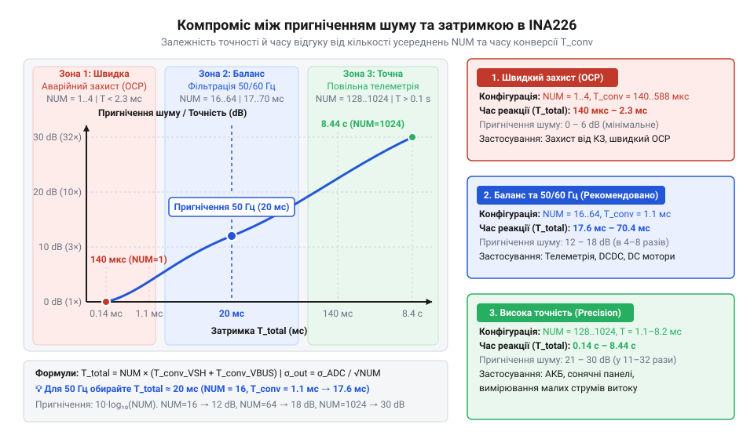
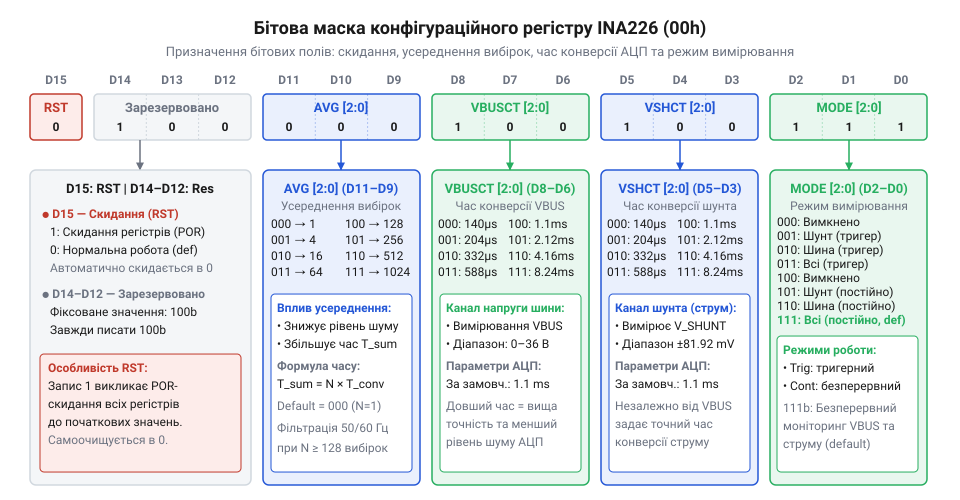
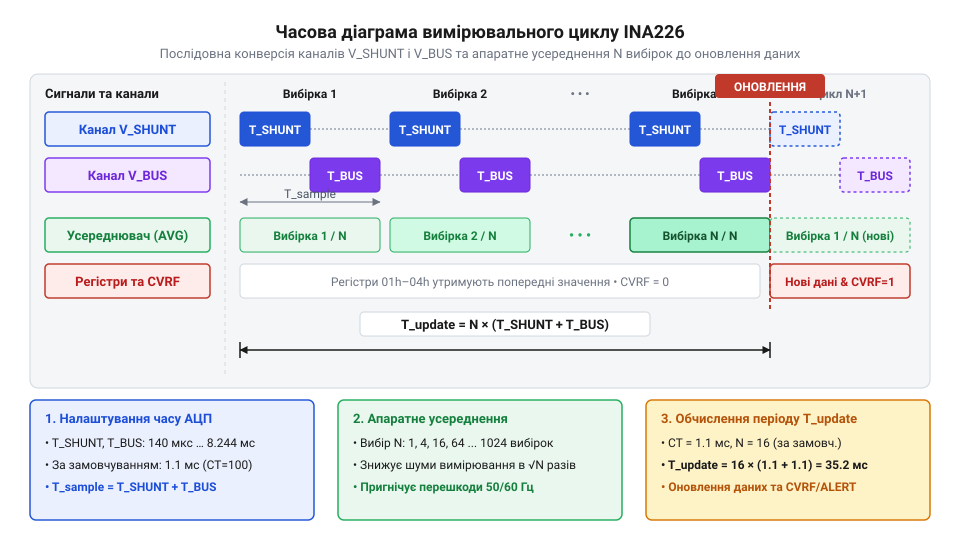

# Конфігурація та усереднення вимірювань INA226

<preknowlist>
- [Цифровий монітор живлення INA226](root:cat-hw-sensors/ina226-power-monitor) — базові принципи вимірювання напруги на шунті й шині та I2C-інтерфейс зчитування даних
- [INA219 — монітор струму й напруги (I2C)](root:cat-hw-sensors/ina219-power-monitor) — концепція цифрових моніторів живлення з вбудованим АЦП та шунтовим підсилювачем
</preknowlist>

## Шум вимірювань та хибні спрацьовування

У силових колах живлення сучасних електронних пристроїв струм рідко буває ідеально постійним. Імпульсні перетворювачі напруги (від англ. @@en|DC-DC converter@@), індуктивні навантаження, мотори та модулі бездротового зв'язку створюють у колі високочастотні пульсації (від англ. @@en|ripple@@) та короткі комутаційні сплески напруги (від англ. @@en|voltage spike@@). Коли цифровий монітор живлення @@en|INA226@@ вимірює спад напруги на вимірювальному резисторі — шунті (від англ. @@en|shunt@@), його аналогово-цифровий перетворювач (від англ. @@en|Analog-to-Digital Converter@@, @@en|ADC@@) фіксує миттєве значення сигналу у конкретний дискретний момент часу.

Якщо момент вибірки @@en|ADC@@ збігається з піком високочастотної завади від перемикання силового транзистора чи пульсацією мережі живлення 50 Гц або 60 Гц, монітор отримує спотворений результат. Наприклад, замість реального середнього струму споживання в 1.5 А чип може зчитати значення 4.0 А. Якщо до цього значення прив'язана логіка захисту від перевантаження за струмом, система згенерує хибне спрацьовування аварійного виводу @@en|ALERT@@ та вимкне живлення навантаження. Замість стабільного моніторингу розробник отримує хаотичні коливання показів і нестабільну роботу всієї системи.

Першою думкою схемотехніка нерідко стає встановлення аналогового @@en|RC-фільтра@@ на вхідних виводах вимірювання шунта. Проте зовнішня аналогова фільтрація має суттєві обмеження. Збільшення ємності конденсаторів фільтра знижує частоту зрізу, але додає фазову затримку та викривляє динаміку вимірювання. Крім того, розкид параметрів компонентів аналогового ланцюга погіршує коефіцієнт пригнічення синфазного сигналу (від англ. @@en|Common-Mode Rejection Ratio@@, @@en|CMRR@@) та призводить до зсуву нульової точки. Вимоги до кельвінівського підключення вимірювальних провідників описує окрема стаття про [схемотехніку підключення шунта](root:hw-pcb/kelvin-connection-pcb-layout).

Історично вимірювання струму пройшло тривалий шлях розвитку. Про те, як вимірювання струму в електронних системах пройшло еволюцію [від дискретних аналогових підсилювачів](root:cat-hw-sensors/ina226-config-and-averaging/hist-digital-power-monitors-evolution.md) із зовнішньою обробкою сигналів мікроконтролером до високоінтегрованих цифрових моніторів із вбудованими обчислювальними ядрами, розповсюджено йдеться у відповідній історичній довідці. Сучасні чипи, такі як @@en|INA226@@, перенесли задачу пригнічення шуму всередину самого вимірювального кристала за допомогою апаратного цифрового фільтра-усереднювача (від англ. @@en|averaging@@).

Апаратне усереднення в @@en|INA226@@ працює за принципом накопичення визначеної кількості послідовних перетворень @@en|ADC@@ з подальшим обчисленням арифметичного середнього перед записом у регістр даних. Збільшення часу конверсії одного вимірювання та кількості усереднюваних вибірок діє як цифровий фільтр низьких частот (від англ. @@en|Low-Pass Filter@@, @@en|LPF@@). Вибір часу перетворення, кратного періоду мережевих завад (20 мс для 50 Гц або 16.67 мс для 60 Гц), дозволяє практично повністю відфільтрувати синфазні мережеві пульсації.


*Компроміс між ефективністю пригнічення високочастотного шуму та затримкою оновлення даних при зміні параметрів АЦП у чипі INA226.*

Проте за чистий від шуму сигнал доводиться платити часом реакції. Якщо налаштувати @@en|INA226@@ на максимальне усереднення (1024 вибірки) із тривалістю конверсії 8.244 мс, повний цикл оновлення даних триватиме понад 8.4 секунди. У такому режимі пристрій ідеально підходить для моніторингу повільного розряду акумулятора, але абсолютно непридатний для захисту від короткого замикання. І навпаки: мінімальний час конверсії 140 мкс без усереднення дає миттєвий відгук, але робить вихідні дані чутливими до найменших імпульсних завад. Похибки вимірювання через високочастотний шум можуть викликати запізнення або хибні тривоги, правила налаштування яких розглядаються у матеріалі про [обробку тривожних подій ALERT](root:cat-hw-sensors/ina226-alert-pin-and-interrupts).

## Внутрішня структура регістру конфігурації 00h

Усі параметри роботи вимірювального ядра, час перетворення аналогових каналів та режими апаратного усереднення в мікросхемі @@en|INA226@@ задаються через єдиний 16-бітовий регістр конфігурації (від англ. @@en|Configuration Register@@), що має адресу `00h`. Після подачі живлення або програмного скидання регістр `00h` автоматично приймає замовчуване значення `0x4127` (у двійковому вигляді `0100 0001 0010 0111b`). Для повної карти розподілу пам'яті чипа можна звернутися до матеріалу про [карту регістрів INA226](root:cat-hw-sensors/ina226-config-and-averaging/api-ina226-hardware-and-registers.md).


*Функціональний розподіл бітових полів конфігураційного регістру 00h мікросхеми INA226.*

Кожна група бітів у регістрі `00h` відповідає за конкретний аспект роботи вимірювального тракту:

1. `RST` (Біт 15) — біт програмного скидання (від англ. @@en|Reset Bit@@). Запис одиниці в цей біт еквівалентний апаратному скиданню по живленню (від англ. @@en|Power-On Reset@@, @@en|POR@@). При цьому всі регістри чипа повертаються до початкових значень за замовчуванням, після чого біт `RST` самостійно скидається в `0`. 2. Біти 14–12 — зарезервовані розряди (від англ. @@en|Reserved Bits@@). Під час запису у регістр `00h` у ці біти завжди слід записувати `0`. 3. `AVG[2:0]` (Біти 11–9) — вибір кількості усереднюваних вибірок (від англ. @@en|Averaging Mode@@). Ця трибітова бітова маска (від англ. @@en|bitmask@@) визначає, скільки послідовних вимірювань @@en|ADC@@ буде усереднено перед збереженням результату у вихідні регістри:
   - `000` — 1 вибірка (усереднення вимкнено);
   - `001` — 4 вибірки;
   - `010` — 16 вибірок (значення за замовчуванням);
   - `011` — 64 вибірки;
   - `100` — 128 вибірок;
   - `101` — 256 вибірок;
   - `110` — 512 вибірок;
   - `111` — 1024 вибірки. 4. `VBUSCT[2:0]` (Біти 8–6) — час конверсії напруги шини (від англ. @@en|VBUS Conversion Time@@). Задає тривалість одного перетворення @@en|ADC@@ для каналу напруги шини живлення `VBUS`:
   - `000` — 140 мкс;
   - `001` — 204 мкс;
   - `010` — 332 мкс;
   - `011` — 588 мкс;
   - `100` — 1.1 мс (точно 1.101 мс, значення за замовчуванням);
   - `101` — 2.116 мс;
   - `110` — 4.156 мс;
   - `111` — 8.244 мс. 5. `VSHCT[2:0]` (Біти 5–3) — час конверсії напруги шунта (від англ. @@en|Shunt Voltage Conversion Time@@). Задає тривалість одного перетворення @@en|ADC@@ для каналу напруги шунта `VSHUNT`. Набори бітових комбінацій повністю ідентичні полю `VBUSCT`: від 140 мкс (`000`) до 8.244 мс (`111`), за замовчуванням встановлено 1.1 мс (`100`). 6. `MODE[2:0]` (Біти 2–0) — режим роботи вимірювального ядра (від англ. @@en|Operating Mode@@). Визначає стан активності каналів та характер запуску вимірювань:
   - `000` — вимкнено / сплячий режим (від англ. @@en|Power-Down mode@@);
   - `001` — напруга шунта, задискретизована за командою (від англ. @@en|Shunt Voltage, Triggered@@);
   - `010` — напруга шини, задискретизована за командою (від англ. @@en|Bus Voltage, Triggered@@);
   - `011` — напруга шунта та шини, задискретизовані за командою (від англ. @@en|Shunt and Bus, Triggered@@);
   - `100` — вимкнено / сплячий режим (повторний кодовий стан @@en|Power-Down mode@@);
   - `101` — напруга шунта, неперервно (від англ. @@en|Shunt Voltage, Continuous@@);
   - `110` — напруга шини, неперервно (від англ. @@en|Bus Voltage, Continuous@@);
   - `111` — напруга шунта та шини, неперервно (від англ. @@en|Shunt and Bus, Continuous@@, значення за замовчуванням).

Формування конфігураційного слова в коді прошивки виконується шляхом побітового зсуву та об'єднання відповідних констант через побітове «АБО». Базові функції та макроси реалізації містяться у довіднику на [програмний API драйвера INA226](root:cat-hw-sensors/ina226-config-and-averaging/api-ina226-config-driver-interface.md).

:::tabs
=== C
```c
// Приклад формування 16-бітового конфігураційного слова для INA226
#define INA226_RST_OFF        (0u << 15)
#define INA226_AVG_16         (0x02u << 9)   // 16 усереднень
#define INA226_VBUS_1100US    (0x04u << 6)   // Час конверсії VBUS 1.1 мс
#define INA226_VSH_1100US     (0x04u << 3)   // Час конверсії VSHUNT 1.1 мс
#define INA226_MODE_CONT_BOTH (0x07u << 0)   // Неперервне вимірювання двох каналів

uint16_t config_value = INA226_RST_OFF | INA226_AVG_16 | 
                        INA226_VBUS_1100US | INA226_VSH_1100US | 
                        INA226_MODE_CONT_BOTH;
```
=== C++
```cpp
// Обчислення конфігураційної бітової маски за допомогою C++17 constexpr
enum class Averaging : uint16_t { Avg1 = 0, Avg4 = 1, Avg16 = 2, Avg64 = 3, Avg128 = 4, Avg256 = 5, Avg512 = 6, Avg1024 = 7 };
enum class ConvTime  : uint16_t { Us140 = 0, Us204 = 1, Us332 = 2, Us588 = 3, Us1100 = 4, Ms2116 = 5, Ms4156 = 6, Ms8244 = 7 };
enum class Mode      : uint16_t { Shutdown = 0, TriggeredShunt = 1, TriggeredBus = 2, TriggeredBoth = 3, ContinuousShunt = 5, ContinuousBus = 6, ContinuousBoth = 7 };

constexpr uint16_t make_config(Averaging avg, ConvTime vbus, ConvTime vsh, Mode mode) noexcept {
    return (static_cast<uint16_t>(avg) << 9) |
           (static_cast<uint16_t>(vbus) << 6) |
           (static_cast<uint16_t>(vsh) << 3) |
           static_cast<uint16_t>(mode);
}

constexpr uint16_t config_value = make_config(Averaging::Avg16, ConvTime::Us1100, ConvTime::Us1100, Mode::ContinuousBoth);
```
:::

## Режими роботи та незалежна конверсія

Вибір режиму роботи в полі `MODE[2:0]` фундаментально змінює алгоритм опитування вхідних аналогових кіл та енергоспоживання мікросхеми @@en|INA226@@. У неперервному режимі (від англ. @@en|continuous mode@@) вимірювальне ядро після завершення поточного циклу одразу починає наступний без участі зовнішнього мікроконтролера. Це зручно для постійного моніторингу через шину @@en|I2C@@ та систем автоматичного захисту.

У разовому режимі дискретизації за командою (від англ. @@en|triggered mode@@) чип виконує один повний цикл вимірювання з урахуванням усіх усереднень, записує нові дані у регістри та автоматично переходить у сплячий режим з мінімальним споживанням струму (близько 2 мкА). Новий вимірювальний цикл розпочнеться лише після того, як керуючий контролер знову запише конфігураційний код разового режиму у регістр `00h`. Це дозволяє кардинально зберегти заряд батареї у портативних приладах.

Можливість незалежно задавати час конверсії для `VSHUNT` та `VBUS`, а також повністю вимикати один із каналів, відкриває простір для оптимізації часового балансу. У багатьох реальних системах напруга шини живлення `VBUS` є стабільною (наприклад, акумуляторний блок чи вихід лінійного стабілізатора) і змінюється повільно. Натомість струм навантаження через шунт `VSHUNT` може мати швидкі імпульсні сплески.

У такій ситуації недоцільно витрачати довгий час перетворення на канал `VBUS`. Розробник може встановити час конверсії `VSHCT = 1.1 ms` для шунта, а для шини обрати мінімальне значення `VBUSCT = 140 us`, або взагалі вимкнути канал шини (`MODE = 101b`). Це зменшує тривалість одного вимірювального кроку та прискорює загальне оновлення даних струму у кілька разів.


*Послідовність перетворень аналогово-цифрового перетворювача для каналів VSHUNT і VBUS з накопиченням у буфері усереднювача.*

Повний час оновлення даних у вихідних реєстрах залежить від суми часів конверсії обраних активних каналів та кількості усереднень. Детальний математичний апарат із прикладами розрахунку частоти оновлення наведений у матеріалі про [математичний розрахунок часу вибірки](root:cat-hw-sensors/ina226-config-and-averaging/math-ina226-timing-and-averaging-math.md).

Дістаємо загальну тривалість одного повного вимірювального циклу `T_cycle` з суми часів перетворення активних каналів та коефіцієнта усереднення `N_AVG`. Позначимо тривалість одного перетворення каналу шунта як `T_VSHUNT`, тривалість перетворення каналу шини як `T_VBUS`, а кількість усереднюваних вибірок як `N_AVG`.

```
T_single = T_VSHUNT + T_VBUS
T_cycle = T_single × N_AVG      [множення тривалості однієї вибірки обох каналів на кількість усереднень]
= (T_VSHUNT + T_VBUS) × N_AVG   [підстановка суми часів конверсії каналів]
```

Розглянемо практичний обчислювальний приклад для типового режиму за замовчуванням.

**Умова обчислення:** Налаштовано неперервний режим вимірювання обох каналів (`MODE = 111b`), час конверсії шунта `T_VSHUNT = 1.101 ms`, час конверсії шини `T_VBUS = 1.101 ms`, кількість усереднень `N_AVG = 16`.

```
T_single = 1.101 ms + 1.101 ms = 2.202 ms
T_cycle = 2.202 ms × 16          [застосування коефіцієнта усереднення 16]
= 35.232 ms                      [підсумковий час оновлення регістрів даних]
f_update = 1 ÷ 0.035232 s        [обчислення частоти оновлення даних]
≈ 28.38 Hz                       [результат частоти оновлення]
```

З цього розрахунку видно, що нове значення струму й напруги з'являтиметься у вихідних реєстрах приблизно 28 разів на секунду. Протягом усіх 35.232 мс тривання вимірювального циклу вихідні регістри `01h`–`04h` зберігають попередньо обчислене усереднене значення, запобігаючи зчитуванню незавершених або проміжних результатів.

Для динамічної зміни параметрів під час роботи прошивки (наприклад, перемикання між швидким пошуком пікових струмів і точним вимірюванням енергії) застосовують готові патерни, описані у статті про [практичну реалізацію прошивки профілів](root:cat-hw-sensors/ina226-config-and-averaging/proj-ina226-config-profile-selector.md). На основі отриманих усереднених значень напруги шунта та шини чип виконує розрахунок струму й потужності, математику якого розкрито в матеріалі про [калібрувальний регістр INA226](root:cat-hw-sensors/ina226-power-monitor/math-ina226-calibration-math.md). Такий підхід робить @@en|INA226@@ набагато гнучкішим порівняно з попередніми поколіннями цифрових моніторів, такими як [мікросхема INA219](root:cat-hw-sensors/ina19-power-monitor), та описується в загальному [огляді цифрового монітора живлення](root:cat-hw-sensors/ina226-power-monitor).

## Апаратний усереднювач та обробка вибірок

У звичайних вимірювальних системах для отримання стабільних показів струму й напруги розробникам доводиться налаштовувати переривання аналогово-цифрового перетворювача (від англ. @@en|Analog-to-Digital Converter@@, @@en|ADC@@) на кожен відлік та обчислювати ковзне середнє у пам'яті мікроконтролера. Це витрачає обчислювальні ресурси процесора та завантажує шину зв'язку. Цифровий монітор живлення @@en|INA226@@ розв'язує цю проблему апаратно: всередині чипа інтегровано цифровий суматор-усереднювач (від англ. @@en|averaging accumulator@@), який самостійно накопичує від 1 до 1024 послідовних вибірок без залучення зовнішніх компонентів чи процесорного часу.

Механізм апаратного усереднення працює безпосередньо після аналого-цифрового ядра @@en|INA226@@. Коли у конфігураційному регістрі `00h` вибрано значення поля `AVG[2:0]` більше за нуль (`001b`–`111b`), мікросхема не перезаписує вихідні регістри даних після кожної окремої конверсії. Замість цього внутрішній 24-бітовий накопичувач послідовно підсумовує результати вимірювання напруги шунта `VSHUNT` та напруги шини `VBUS`. Лише після того, як підсумовано задану кількість `N_AVG` вибірок (наприклад, 16, 64 або 1024), апаратна логіка виконує ділення суми на `N_AVG` шляхом арифметичного зсуву та здійснює атомне оновлення (від англ. @@en|atomic update@@) вихідних регістрів даних `01h`–`04h`. Протягом всього інтервалу накопичення зчитування регістрів по шині @@en|I2C@@ повертає попереднє стабільне значення, виключаючи зчитування проміжних або незавершених даних.


*Часова послідовність конверсії аналогових каналів та апаратного усереднення в чипі INA226 перед оновленням вихідних регістрів.*

Тривалість одного повного вимірювального циклу `T_cycle` залежить від вибраних часів конверсії каналу напруги шунта `T_VSHUNT`, каналу напруги шини `T_VBUS` та кількості усереднюваних вибірок `N_AVG`. У неперервному режимі вимірювання обох каналів загальний час оновлення даних обчислюється шляхом додавання тривалостей конверсії кожного каналу з подальшим множенням на коефіцієнт усереднення.

```
T_single = T_VSHUNT + T_VBUS
T_cycle = T_single × N_AVG      [множення тривалості вибірки обох каналів на коефіцієнт усереднення]
= (T_VSHUNT + T_VBUS) × N_AVG   [підстановка послідовних часів конверсії каналів]
```

Розглянемо покроковий розрахунок підсумкової частоти оновлення даних для системи зі збільшеним часом фільтрації.

**Умова обчислення:** Налаштовано неперервний режим вимірювання обох каналів (`MODE = 111b`), час конверсії шунта `T_VSHUNT = 2.116 ms`, час конверсії шини `T_VBUS = 1.101 ms`, кількість усереднень `N_AVG = 64`.

```
T_single = 2.116 ms + 1.101 ms = 3.217 ms
T_cycle = 3.217 ms × 64         [застосування коефіцієнта усереднення 64]
= 205.888 ms                    [підсумковий час оновлення регістрів даних]
f_update = 1 ÷ 0.205888 s       [обчислення частоти оновлення даних]
≈ 4.86 Hz                      [результативна частота оновлення]
```

Результат показує, що регістри даних @@en|INA226@@ оновлюватимуться приблизно 4.86 раза на секунду. Збільшення кількості усереднень суттєво покращує відношення сигнал/шум (від англ. @@en|Signal-to-Noise Ratio@@, @@en|SNR@@). Для випадкового білого шуму (гаусового некорельованого шуму) середня середньоквадратична амплітуда шуму (від англ. @@en|Root Mean Square@@, @@en|RMS@@) зменшується пропорційно квадратному кореню з кількості усереднень `√N_AVG`. При `N_AVG = 16` шум зменшується в 4 рази (на 12 дБ), а при максимальному значенні `N_AVG = 1024` — у 32 рази (на 30 дБ).

Окрім пригнічення білого шуму, апаратне усереднення діє як загороджувальний режекторний фільтр (від англ. @@en|notch filter@@) для синхронних мережевих пульсацій 50 Гц (період 20 мс) та 60 Гц (період 16.67 мс). Якщо сумарний час накопичення вибірок одного каналу `T_accum = T_conv × N_AVG` обирається кратним періоду мережевої завади, інтеграл синусоїдальної завади на інтервалі інтегрування дорівнює нулю. Наприклад, вибір `T_VSHUNT = 1.101 ms` при `N_AVG = 16` дає час накопичення 17.616 мс (близький до періоду 60 Гц), а при `N_AVG = 128` або виборі `T_VSHUNT = 2.116 ms` при `N_AVG = 16` (33.856 мс) забезпечується ефективне згладжування пульсацій випрямлячів мережі 50 Гц.

Детальний математичний апарат для розрахунку пригнічення шуму та частотних характеристик цифрового фільтра подано у [математичному обчисленні тривалості циклу](root:cat-hw-sensors/ina226-config-and-averaging/math-ina226-timing-and-averaging-math.md). Для зручного налаштування цих режимів у прошивці мікроконтролера застосовується [програмний інтерфейс драйвера INA226](root:cat-hw-sensors/ina226-config-and-averaging/api-ina226-config-driver-interface.md).

:::tabs
=== C
:::code ina226-config-and-averaging-d/c/ina226-calculate-cycle-time-us.c
=== C++
:::code ina226-config-and-averaging-d/cpp/ina226timingcalculator.cpp
:::

## Баланс швидкості реакції та точності

Під час проектування систем моніторингу живлення перед розробником неминуче постає інженерний компроміс: підвищення точності вимірювань вимагає тривалого усереднення, але це спричиняє часову затримку (від англ. @@en|latency@@) реакції системи на зміни струму. Якщо налаштувати @@en|INA226@@ на максимальну фільтрацію, чип видаватиме ідеально стабільні значення без жодного шуму, але не зможе вчасно зреагувати на коротке замикання. І навпаки, вибір мінімального часу конверсії дає миттєвий відгук, але робить показники нестабільними через шум молодшого значущого розряду (від англ. @@en|Least Significant Bit@@, @@en|LSB@@).

У режимі максимального усереднення (`N_AVG = 1024`) з часом перетворення 8.244 мс період оновлення двох каналів досягає `(8.244 + 8.244) × 1024 = 16.884` секунди. Протягом майже 17 секунд вихідні регістри утримують застарілі дані. Якщо у цей момент виникне короткий перехідний імпульсний процес (від англ. @@en|transient process@@) або різкий сплеск струму, апаратний суматор розмиє його амплітуду по всьому інтервалу накопичення. Вихідний сигнал тривоги `ALERT` спрацює із запізненням на кілька секунд, що може призвести до термічного пошкодження силових транзисторів. За потреби швидко реагувати на аварії налаштування має забезпечувати мінімальний час циклу, що описується в матеріалі про [налаштування виводу тривоги ALERT](root:cat-hw-sensors/ina226-alert-pin-and-interrupts).

Для прийняття обґрунтованого рішення конфігурацію @@en|INA226@@ розбивають на три основні прикладні профілі залежно від призначення пристрою:

1. **Профіль швидкого струмового захисту (Fast Protection Profile):**
   - **Призначення:** моніторинг силових ключів, захист від перевантаження по струму (від англ. @@en|overcurrent protection@@), відстеження коротких сплесків. - **Конфігурація:** `MODE = Continuous Shunt` (`101b`) або `Continuous Both` (`111b`), `T_VSHUNT = 140 µs` або `204 µs`, `N_AVG = 1` або `4`. - **Результат:** тривалість вимірювального циклу становить від 140 мкс до 816 мкс. Сигнал тривоги на виводі `ALERT` формується практично миттєво, дозволяючи апаратно вимкнути живлення до виникнення аварії.

2. **Профіль збалансованого системного моніторингу (Balanced System Telemetry):**
   - **Призначення:** загальна телеметрія системного живлення, моніторинг плати мікроконтролера, відображення даних на екрані. - **Конфігурація:** `MODE = Continuous Both` (`111b`), `T_VSHUNT = 1.101 ms`, `T_VBUS = 1.101 ms`, `N_AVG = 16` (значення за замовчуванням). - **Результат:** період оновлення даних становить 35.232 мс (частота ~28.4 Гц). Цього достатньо для згладжування пульсацій @@en|DC-DC converter@@ та забезпечення плавної зміни показів на дисплеї без навантаження шини @@en|I2C@@.

3. **Профіль прецизійного логування енергії (Precision Energy Logging):**
   - **Призначення:** оцінка ємності акумуляторних батарей, підрахунок кулонів (від англ. @@en|coulomb counting@@), вимірювання мікроамперних струмів у сплячих режимах. - **Конфігурація:** `MODE = Continuous Both` (`111b`), `T_VSHUNT = 8.244 ms`, `T_VBUS = 8.244 ms`, `N_AVG = 512` або `1024`. - **Результат:** вимірювальний цикл триває від 8.44 с до 16.88 с. Забезпечується максимальна ефективна розрядність (від англ. @@en|effective resolution@@) АЦП з пригніченням завад понад 30 дБ, що дозволяє фіксувати найменші зміни струму.

У складних embedded-системах не обов'язково обирати один профіль на весь час роботи. Прошивка мікроконтролера може динамічно змінювати вміст регістру `00h`. Наприклад, під час запуску двигуна чи включення потужного навантаження система перемикає @@en|INA226@@ у швидкий профіль із мінімальним усередненням для контролю пускових струмів. Після виходу на стаціонарний режим прошивка перезаписує конфігурацію на прецизійне усереднення для точного розрахунку спожитої енергії. Динамічну зміну профілів та роботу зі значеннями струму слід узгоджувати з [математикою калібрувального регістру](root:cat-hw-sensors/ina226-power-monitor/math-ina226-calibration-math.md).

Алгоритми та готові патерни реалізації селектора конфігурацій детально висвітлені у [практичній реалізації прошивки селектора](root:cat-hw-sensors/ina226-config-and-averaging/proj-ina226-config-profile-selector.md). Наведений нижче приклад коду показує базову структуру вибору профілів у прошивці.

:::tabs
=== C
:::code ina226-config-and-averaging-d/c/ina226-get-profile-config.c
=== C++
:::code ina226-config-and-averaging-d/cpp/operatingprofile.cpp
:::