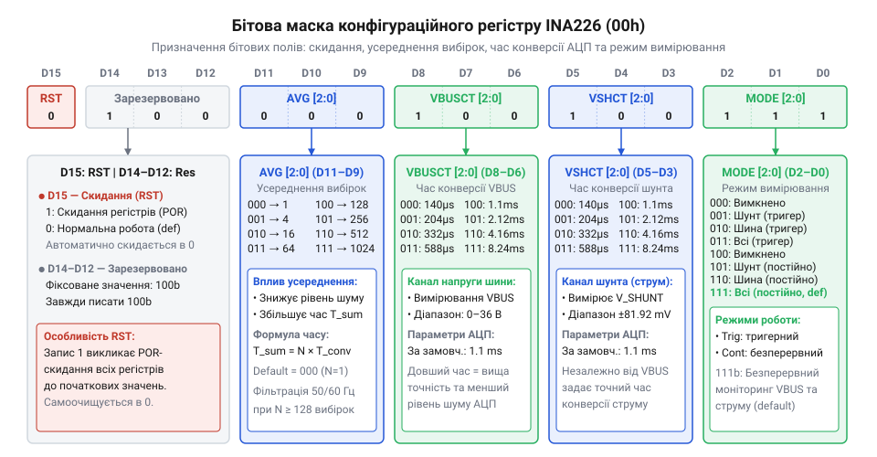
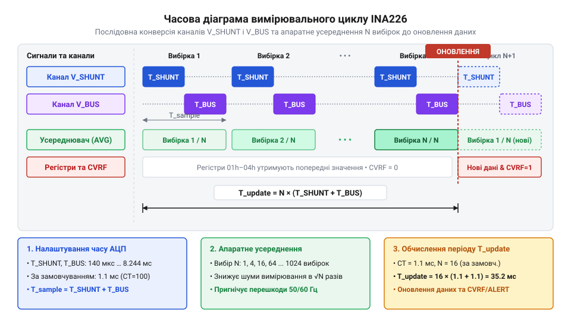
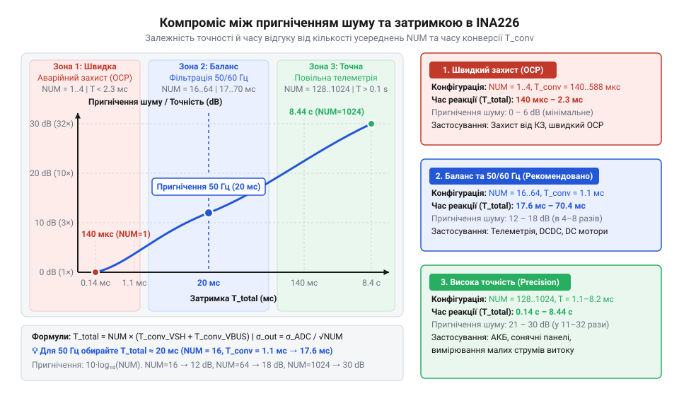

# Конфігурація та усереднення вимірювань INA226

<preknowlist>
- [Цифровий монітор живлення INA226](root:cat-hw-sensors/ina226-power-monitor) — базові принципи вимірювання напруги на шунті й шині та I2C-інтерфейс зчитування даних
- [INA219 — монітор струму й напруги (I2C)](root:cat-hw-sensors/ina219-power-monitor) — концепція цифрових моніторів живлення з вбудованим АЦП та шунтовим підсилювачем
</preknowlist>

## Шум вимірювань та хибні спрацьовування

Комутація ключів у схемах із @@en|PWM@@ (від англ. *Pulse-Width Modulation* — широтно-імпульсна модуляція) створює високочастотні струмові сплески. Якщо @@en|ADC@@ (від англ. *Analog-to-Digital Converter* — аналого-цифровий перетворювач) робить вибірку під час сплеску, отримане значення виявляється хибно завищеним, що призводить до помилкового спрацьовування захисту.

Зовнішній аналоговий @@en|RC-filter@@ (від англ. *Resistor-Capacitor Filter* — резистивно-ємнісний фільтр) вирішує це ціною нових проблем: розбаланс вхідного опору через розкид деталей погіршує @@en|CMRR@@ (від англ. *Common-Mode Rejection Ratio* — коефіцієнт пригнічення синфазного сигналу) підсилювача, через що напруга шини викривляє покази струму, а постійна часу фільтра створює фазову затримку.

Тому у [цифровому моніторі живлення INA226](root:cat-hw-sensors/ina226-power-monitor), як і у [моніторі INA219](root:cat-hw-sensors/ina219-power-monitor), цифрову фільтрацію перенесено всередину кристала. Вбудований апаратний усереднювач підсумовує серію вибірок без додавання опору та погіршення @@en|CMRR@@, забезпечуючи стабільні покази струму й напруги.

## Структура регістру конфігурації 00h

Центральним органом керування вимірювальним трактом @@en|INA226@@ є 16-бітовий конфігураційний регістр `00h`. Через його п'ять бітових полів налаштовують режим роботи внутрішнього @@en|ADC@@, час конверсії каналів та коефіцієнт апаратного усереднення.


*Бітова маска конфігураційного регістру 00h INA226: призначення керуючих полів для налаштування скидання, усереднення, часу конверсії та режиму вимірювання.*

Найстарший біт `RST` (біт 15) призначений для програмного скидання: запис `1` повертає всі регістри до заводських значень і самоскидається в `0`. Біти 14–12 зарезервовані.

Поле `AVG` (біти 11–9) задає коефіцієнт усереднення `N_AVG` від 1 (`000b`) до 1024 вибірок (`111b`) ступенями двійки.

Поля `VBUSCT` (біти 8–6) та `VSHCT` (біти 5–3) задають тривалість конверсії каналів напруги шини й шунта від 140 мкс (`000b`) до 8.244 мс (`111b`). Значення за замовчуванням — 1.1 мс (`100b`).

Поле `MODE` (біти 2–0) обирає режим: `Power-Down` (`000b`), одноразовий `Triggered` чи безперервний `Continuous` (`111b`). Сформовану 16-бітову маску (як-от `0x4127`) записують через шину @@en|I2C@@ (від англ. *Inter-Integrated Circuit* — міжмікросхемна шина).

## Апаратне усереднення та розрахунок таймінгу

Внутрішній @@en|ADC@@ послідовно зчитує сигнальні канали та підсумовує `N_AVG` вибірок у 24-бітовому накопичувачі. Усереднені значення атомарно записуються у вихідні регістри, що гарантує зчитування узгоджених даних через шину @@en|I2C@@.


*Послідовна конверсія VBUS та VSHUNT, накопичення N_AVG вибірок й атомарний запис результату.*

Тривалість вимірювального циклу `T_cycle` для обох каналів обчислюється за часів конверсії `T_VBUSCT`, `T_VSHCT` та коефіцієнта `N_AVG`:

```
T_cycle = N_AVG × (T_VBUSCT + T_VSHCT)
        = 16 × (1.1 ms + 1.1 ms)       [підстановка параметрів]
        = 16 × 2.2 ms                   [сума часів конверсії]
        = 35.2 ms                       [тривалість циклу]
```

Час 35.2 мс відповідає частоті оновлення даних 28.4 Гц. Усереднення зменшує середньоквадратичне відхилення гаусового шуму в `√N_AVG` разів: при `N_AVG = 16` шум меншає в 4 рази (на 12 дБ), що підвищує @@en|SNR@@.

Якщо час накопичення вибірок кратний періоду мережевої напруги (20 мс для 50 Гц або 16.67 мс для 60 Гц), гармонічні пульсації у вимірювальному вікні підсумовуються до нуля, утворюючи ефект режекторного фільтра.

## Баланс швидкості реакції та точності

Вибір налаштувань регістру `00h` є інженерним компромісом між фільтрацією шуму та затримкою реакції (@@en|latency@@, від англ. *latency* — затримка реакції). Збільшення `N_AVG` і часу конверсії підвищує точність, але уповільнює оновлення даних. За затримки в сотні мілісекунд при короткому замиканні силові @@en|MOSFET@@ ключі вийдуть з ладу раніше, ніж програма виявить перевантаження.


*Компроміс між точністю вимірювання та затримкою реакції INA226: вибір параметрів для захисту, телеметрії та прецизійного логування.*

Залежно від завдань обирають один із трьох профілів:
- **Швидкий струмовий захист**: `N_AVG = 1`, `T_VSHCT = 140 мкс` (цикл 280 мкс, ~3.57 кГц) — миттєво реагує на кидки струму через сигнал тривоги. - **Збалансована телеметрія**: `N_AVG = 16`, `T_VSHCT = 1.1 мс` (цикл 35.2 мс) — пригнічує пульсації при достатній швидкості оновлення. - **Прецизійний моніторинг**: `N_AVG = 128` або `1024`, `T_VSHCT = 2.116 мс` (вікно > 500 мс) — усуває шум і мережеві завади для розрахунку потужності.

Прошивка може динамічно змінювати регістр `00h`: у спокої використовувати прецизійний режим для обліку енергії, а при пуску двигуна — мінімальне усереднення для контролю пускових струмів.