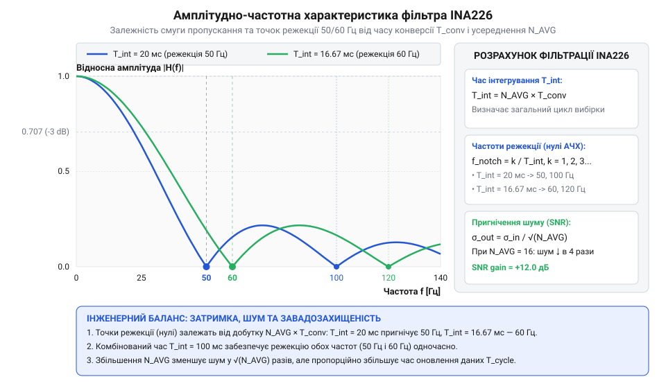

# Математичний розрахунок часу вибірки, частоти оновлення та пригнічення шуму INA226

<preknowlist>
- [Цифровий монітор живлення INA226](root:cat-hw-sensors/ina226-power-monitor) — Базові принципи вимірювання напруги шунта та напруги шини, призначення конфігураційного регістра Register 00h та загальний режим неперервного перетворення.
</preknowlist>

## Чому цифровий АЦП втрачає точність

В імпульсних джерелах живлення та сучасних системах моніторингу вимірювання струму супроводжується потужними високочастотними завадами від перемикання транзисторів та наводками мережі живлення 50 Гц або 60 Гц. Коли розробник інтегрує [цифровий монітор живлення INA226](root:cat-hw-sensors/ina226-power-monitor), він часто стикається з двома протилежними крайнощами. З одного боку, при базових налаштуваннях без усереднення відліки струму сильно «тремтять», що призводить до хибних спрацьовувань захисту від перевантаження або нестабільності цифрового контуру зворотного зв'язку. З іншого боку, намагання максимально згладити шум шляхом сліпого вибору найдовшого часу конверсії та максимальної кількості усереднень вносить величезну часову затримку (лаг). У результаті мікроконтролер реагує на стрибок струму з запізненням у сотні мілісекунд, що унеможливлює швидкий захист силового кола.

Внутрішній @@en|аналогово-цифровий перетворювач@@ (від @@en|analog-to-digital converter@@, @@en|АЦП@@) сигма-дельта архітектури вимірює @@en|напругу шунта@@ та @@en|напругу шини@@ шляхом інтегрування вхідного сигналу протягом фіксованого часового інтервалу. Вибір значень часу конверсії та коефіцієнта усереднення наосліп без математичного розрахунку перетворює систему на непередбачувану: високий рівень шуму викривляє розрядність вимірювання, а неконтрольоване збільшення вибіркового вікна порушує динаміку вимірювальної системи. Для досягнення свідомого балансу між затримкою відгуку давача, рівнем пригнічення некорельованого шуму та режекцією мережевих завад необхідно побудувати точну математичну модель часового циклу та цифрового фільтра INA226.

## Математика вимірювального циклу та частоти

Формування часового інтервалу вимірювання в INA226 визначається трьома основними параметрами конфігураційного регістра: часом конверсії напруги на шунті `T_VSHUNT`, часом конверсії напруги на шині `T_VBUS` та кількістю вибірок для апаратного усереднення `N_AVG`. У режимі неперервного вимірювання обох каналів внутрішній @@en|аналогово-цифровий перетворювач@@ почергово вимірює напругу шунта та напругу шини, повторюючи цей цикл `N_AVG` разів перед тим, як оновити підсумкові регістри струму, напруги та потужності.

Повна тривалість одного вимірювального циклу `T_cycle` обчислюється як сума часів конверсії обох каналів, помножена на коефіцієнт усереднення:

```
T_cycle
= (T_VSHUNT + T_VBUS) × N_AVG      [формула повного циклу вимірювання обох каналів]
```

Якщо мікроконтролер налаштовує [монітор живлення INA226](root:cat-hw-sensors/ina226-power-monitor) на роботу лише з одним каналом (наприклад, тільки вимірювання падіння напруги на шунті), час конверсії неактивного каналу виключається з вимірювального циклу:

```
T_cycle
= T_VSHUNT × N_AVG                  [формула циклу для вимірювання лише шунта]
```

@@en|частота оновлення@@ (від @@en|update rate@@) даних `f_update` визначає, скільки нових результатів вимірювання поступає в регістри давача за одну секунду. Вона є оберненою величиною до повної тривалості вимірювального циклу:

```
f_update
= 1 ÷ T_cycle                       [визначення частоти оновлення даних]
```

**Приклад розрахунку для швидкісного режиму:**
Нехай задано час конверсії шунта `T_VSHUNT = 140 μs` (140 × 10⁻⁶ s), час конверсії шини `T_VBUS = 140 μs` (140 × 10⁻⁶ s) та коефіцієнт усереднення `N_AVG = 4`. Обчислимо тривалість циклу та частоту оновлення даних:

```
T_cycle
= (140 × 10⁻⁶ + 140 × 10⁻⁶) × 4
= 280 × 10⁻⁶ × 4                    [додавання часів конверсії обох каналів]
= 1.12 × 10⁻³ s                     [підсумкова тривалість циклу 1.12 ms]

f_update
= 1 ÷ 0.00112                       [обчислення частоти оновлення]
≈ 892.86 Hz                         [частота оновлення регістрів даних]
```

**Приклад розрахунку для точного режиму за замовчуванням із високим усередненням:**
Нехай задано стандартний час конверсії каналів `T_VSHUNT = 1.1 ms` (1.1 × 10⁻³ s), `T_VBUS = 1.1 ms` (1.1 × 10⁻³ s) та коефіцієнт усереднення `N_AVG = 128`.

```
T_cycle
= (1.1 × 10⁻³ + 1.1 × 10⁻³) × 128
= 2.2 × 10⁻³ × 128                  [сумарна тривалість однієї вибірки обох каналів]
= 281.6 × 10⁻³ s                    [підсумкова тривалість циклу 281.6 ms]

f_update
= 1 ÷ 0.2816                        [обчислення частоти оновлення]
≈ 3.55 Hz                           [частота оновлення регістрів даних]
```

Збільшення коефіцієнта усереднення `N_AVG` або часу конверсії прямо пропорційно збільшує часову затримку оновлення даних. Розраховане значення `T_cycle` встановлює межу реакції системи на динамічні зміни струму.

## Математика апаратного усереднення та SNR

Шум вимірювального тракту в аналогових кола джерел живлення зазвичай моделюється як незалежний некорельований @@en|гаусів шум@@ (від @@en|Gaussian noise@@) із нульовим математичним сподіванням та середньоквадратичним відхиленням `σ₀` (від @@en|standard deviation@@, @@en|середньоквадратичне відхилення@@). @@en|апаратне усереднення@@ (від @@en|hardware averaging@@) полягає в підсумовуванні `N_AVG` послідовних вибірок АЦП та діленні результату на `N_AVG`.

Математичне обґрунтування зменшення шуму випливає з властивостей дисперсії суми незалежних випадкових величин. Якщо випадкові величини `x₁, x₂, ..., x_N` є некорельованими й мають однакову дисперсію `Var(x_i) = σ₀²`, то дисперсія суми `N_AVG` таких величин дорівнює сумі їхніх дисперсій: `Var(∑ x_i) = N_AVG × σ₀²`.

Дисперсія усередненої величини `Var(X_avg)` обчислюється так:

```
Var(X_avg)
= Var((1 ÷ N_AVG) × ∑ x_i)
= (1 ÷ N_AVG²) × Var(∑ x_i)        [винесення константи з-під знака дисперсії у квадраті]
= (1 ÷ N_AVG²) × (N_AVG × σ₀²)     [заміна дисперсії суми сумою дисперсій]
= σ₀² ÷ N_AVG                       [скорочення коефіцієнта N_AVG]
```

Шукане підсумкове середньоквадратичне відхилення усередненого сигналу `σ_avg` є квадратним коренем з отриманої дисперсії:

```
σ_avg
= √(σ₀² ÷ N_AVG)
= σ₀ ÷ √N_AVG                       [зменшення середньоквадратичного відхилення шуму]
```

Таким чином, @@en|апаратне усереднення@@ зменшує амплітуду середньоквадратичного шуму у `√N_AVG` разів.

Покращення @@en|співвідношення сигнал/шум@@ (від @@en|signal-to-noise ratio@@, @@en|SNR@@) виражається в децибелах як відношення початкового шуму `σ₀` до усередненого шуму `σ_avg`:

```
ΔSNR_dB
= 20 × lg(σ₀ ÷ σ_avg)               [визначення децибел для амплітудних величин]
= 20 × lg(√N_AVG)                    [підстановка значення σ_avg = σ₀ ÷ √N_AVG]
= 10 × lg(N_AVG)                    [перетворення степеня під логарифмом]
```

Отримане покращення SNR безпосередньо підвищує @@en|ефективна розрядність@@ (від @@en|effective number of bits@@, @@en|ENOB@@) вимірювання. Оскільки 1 біт ефективної розрядності відповідає приблизно `6.02 dB` співвідношення сигнал/шум, виграш в ефективних бітах `ΔENOB` обчислюється за формулою:

```
ΔENOB
= ΔSNR_dB ÷ 6.02                     [відношення покращення SNR до ціни 1 біта]
= (10 × lg(N_AVG)) ÷ 6.02
= 0.5 × log₂(N_AVG)                 [формула виграшу ефективних біт через логарифм за основою 2]
```

**Розрахунок виграшу точності для стандартних значень N_AVG:**
- Для `N_AVG = 4`: `√4 = 2`, `ΔSNR_dB = 10 × lg(4) ≈ 6.02 dB`, що дає виграш `ΔENOB = +1 bit`. - Для `N_AVG = 16`: `√16 = 4`, `ΔSNR_dB = 10 × lg(16) ≈ 12.04 dB`, що дає виграш `ΔENOB = +2 bits`. - Для `N_AVG = 64`: `√64 = 8`, `ΔSNR_dB = 10 × lg(64) ≈ 18.06 dB`, що дає виграш `ΔENOB = +3 bits`. - Для `N_AVG = 256`: `√256 = 16`, `ΔSNR_dB = 10 × lg(256) ≈ 24.08 dB`, що дає виграш `ΔENOB = +4 bits`. - Для `N_AVG = 1024`: `√1024 = 32`, `ΔSNR_dB = 10 × lg(1024) ≈ 30.10 dB`, що дає виграш `ΔENOB = +5 bits`.

Математично усереднення дозволяє подавити випадковий гаусів шум, але воно не враховує частотну вибірковість фільтрації при наявності періодичних завад від мережі живлення.

## Амплітудно-частотна характеристика гребінчастого фільтра

На відміну від білого гаусового шуму, мережеві завади частотою 50 Гц та 60 Гц є гармонічними сигналами з фіксованими частотами. Режим апаратного усереднення `N_AVG` вибірок у часовій області відповідає цифровому фільтру ковзного середнього (скользячому усереднювачу). У частотній області такий цифровий фільтр описується як @@en|гребінчастий фільтр@@ (від @@en|comb filter@@), передавальна функція якого має характерну форму з періодичними нулями згасання.

Модуль передавальної функції, тобто @@en|амплітудно-частотна характеристика@@ (від @@en|amplitude-frequency response@@, @@en|АЧХ@@) гребінчастого фільтра для одного каналу з вибірковим вікном `T_window = N_AVG × T_conv` описується виразом:

```
|H(f)|
= | sin(π × f × N_AVG × T_conv) ÷ (N_AVG × sin(π × f × T_conv)) |  [передавальна функція дискретного усереднювача]
```

Для аналізу низькочастотної області (коли частота завади значно менша за частоту дискретизації modulators) вираз АЧХ наближається до неперервної нормованої функції `sinc`:

```
|H(f)|
≈ | sin(π × f × T_window) ÷ (π × f × T_window) |                    [наближення неперервним інтегратором]
```

@@en|частота режекції@@ (від @@en|notch frequency@@) `f_k` — це частоти, на яких модуль передавальної функції `|H(f)|` дорівнює нулю, що забезпечує теоретично нескінченне пригнічення завади. Нулі АЧХ виникають у точках, де чисельник `sin(π × f × T_window) = 0` при ненульовому знаменнику. Формула точок режекції має вигляд:

```
f_k
= k ÷ T_window                      [умова рівності нулю чисельника sin(π f T_window)]
= k ÷ (N_AVG × T_conv)             [де k = 1, 2, 3, ...]
```


*Амплітудно-частотна характеристика апаратного гребінчастого фільтра INA226 і нулі згасання на частотах режекції.*

Аналіз частот режекції показує, що для повного пригнічення мережевої завади 50 Гц перша частота режекції `f₁ = 1 / T_window` має дорівнювати 50 Гц (або 50 Гц має бути кратним гармонікам `f_k`). Для цього сумарне вибіркове вікно одного каналу `T_window` має бути кратним періоду мережевої напруги:

```
T_window_50Hz
= 1 ÷ 50 Hz
= 0.02 s                            [20 ms або 20000 μs]

T_window_60Hz
= 1 ÷ 60 Hz
≈ 0.01667 s                         [16.67 ms або 16667 μs]
```

Якщо підставити часове вікно `T_window = 100 ms` (0.1 s), частоти режекції описуватимуться як `f_k = k ÷ 0.1 s = 10 × k Hz`. При цьому нулі згасання потрапляють на 10 Гц, 20 Гц, 30 Гц, 40 Гц, 50 Гц (при `k = 5`) та 60 Гц (при `k = 6`). Це забезпечує одночасну глибоку режекцію як європейського стандарту мережі 50 Гц, так і американського 60 Гц.

## Оптимізація таймінгів та пригнічення завад

Налаштування [цифрового монітора живлення INA226](root:cat-hw-sensors/ina226-power-monitor) здійснюється через регістр конфігурації `Register 00h`. Розрядність регістра дозволяє незалежно вибирати час конверсії для кожного каналу з восьми дискретних значень (`140 μs`, `204 μs`, `332 μs`, `588 μs`, `1.1 ms`, `2.116 ms`, `4.156 ms`, `8.244 ms`) та коефіцієнт усереднення з восьми ступенів (`1`, `4`, `16`, `64`, `128`, `256`, `512`, `1024`). Для детального ознайомлення з розрядами конфігураційного регістра та структурою пам'яті давача дивіться статтю про [карту регістрів та конфігурацію INA226](root:cat-hw-sensors/ina226-config-and-averaging/api-ina226-hardware-and-registers.md).

Оптимізація таймінгів вимагає дотримання алгоритму вибору конфігурації під конкретні вимоги застосування:

1. **Режим максимальної швидкодії (контроль швидких транзієнтів та захист від КЗ):**
   Призначений для контурів керування, де затримка вимірювання має бути мінімальною. - Налаштування: `T_VSHUNT = 140 μs`, `T_VBUS = 140 μs`, `N_AVG = 1`. - `T_cycle = (140 + 140) × 1 = 280 μs` (`0.28 ms`). - `f_update ≈ 3571 Hz`. - Перевага: мінімальний лаг відгуку; недолік: відсутнє пригнічення 50/60 Гц завад, підвищений гаусів шум.

2. **Режим глибокої режекції мережевих завад (50 Гц та 60 Гц):**
   Призначений для промислових вимірювальних систем DC з високим рівнем мережевих наводок. - Мета: сформувати вибіркове вікно одного каналу `T_window = N_AVG × T_conv`, близьке до `20 ms` (для 50 Гц) або `100 ms` (для 50/60 Гц). - Варіант налаштування A: `T_VSHUNT = 1.1 ms`, `N_AVG = 16`. ```
     T_window
     = 1.1 × 10⁻³ × 16
     = 17.6 × 10⁻³ s                     [17.6 ms — близьке значення до періоду 60 Гц (16.67 ms)]
     ```
   - Варіант налаштування B: `T_VSHUNT = 2.116 ms`, `N_AVG = 16`. ```
     T_window
     = 2.116 × 10⁻³ × 16
     = 33.856 × 10⁻³ s                   [33.856 ms]
     ```
   - Варіант налаштування C (для 50 Гц): `T_VSHUNT = 588 μs`, `N_AVG = 64`. ```
     T_window
     = 588 × 10⁻⁶ × 64
     = 37.632 × 10⁻³ s                   [37.632 ms]
     ```
   - Варіант налаштування D (максимальне згасання 50 Гц / 60 Гц): `T_VSHUNT = 1.1 ms`, `N_AVG = 128`. ```
     T_window
     = 1.1 × 10⁻³ × 128
     = 140.8 × 10⁻³ s                    [140.8 ms]
     ```
     При `T_window = 140.8 ms` частоти режекції виникають через кожні `f₁ = 1 / 0.1408 ≈ 7.1 Hz`. Оскільки 50 Гц розділити на 7.102 Гц дорівнює `7.04` (що надзвичайно близько до цілочисельної гармоніки `k = 7`), згасання на 50 Гц становить понад 40 дБ, а виграш SNR складає `10 × lg(128) ≈ 21.07 dB` (+3.5 біта ENOB).

3. **Режим прецизійного вимірювання постійного струму та енергії:**
   Призначений для підрахунку ампер-годин акумуляторів або вимірювання струмів витоку. - Налаштування: `T_VSHUNT = 2.116 ms`, `T_VBUS = 2.116 ms`, `N_AVG = 256`. - `T_cycle = (2.116 + 2.116) × 10⁻³ × 256 = 1.0833 s`. - `f_update ≈ 0.923 Hz` (близько 1 вимірювання на секунду). - Покращення SNR: `10 × lg(256) = 24.08 dB`, що еквівалентно розширенню розрядності на `+4 біти ENOB`.

Порівняно з [попереднім давачем INA219](root:cat-hw-sensors/ina219-power-monitor), давач INA226 надає значно ширший діапазон часів конверсії та вищий максимальний коефіцієнт усереднення (до 1024 проти 128 у INA219). Розрахунок параметрів вимірювального циклу дозволяє розробнику точно підібрати значення регістра конфігурації під фізичні обмеження динаміки та вимоги до завадозахищеності системи.