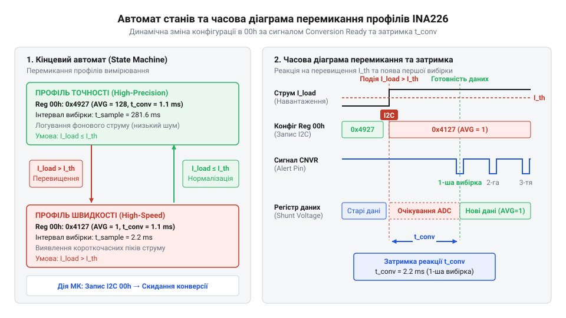

# Практична реалізація прошивки для динамічного вибору конфігураційного профілю INA226

<preknowlist>
- [Цифровий монітор живлення INA226](root:cat-hw-sensors/ina226-power-monitor) — Принцип роботи INA226, призначення регістру 00h (Configuration Register) та апаратне призначення виводу ALERT/Conversion Ready.
</preknowlist>

## Дилема стаціонарної конфігурації сенсора струму

Системи з динамічним навантаженням споживають енергію нерівномірно. Під час режиму очікування струм тримається на низькому рівні, тоді як в активному стані виникають різкі, короткочасні сплески. Фіксована конфігурація [цифрового монітора живлення INA226](root:cat-hw-sensors/ina226-power-monitor) змушує інженера шукати компроміс між швидкістю та чистотою даних.

Якщо налаштувати давач на тривале усереднення для максимальної точності й мінімального шуму, система не встигне зафіксувати мілісекундні піки споживання — вони зникнуть за математичним згладжуванням. І навпаки, якщо обрати високошвидкісні поодинокі вибірки, короткочасні імпульси будуть виявлені, але у фазі спокою вимірювання міститимуть занадто високий рівень шуму. Може здатися, що компромісом є постійне високошвидкісне зчитування з подальшим програмним усередненням силами мікроконтролера. Проте такий підхід перевантажує шину I2C постійним опитуванням і змушує ядро витрачати процесорний час на математичні операції та безперервну обробку даних, що неефективно і збільшує енергоспоживання. Натомість використання вбудованого математичного апарату INA226 дозволяє розвантажити мікроконтролер, оскільки давач самостійно виконує накопичення вибірок, віддаючи вже готовий відфільтрований результат. У результаті стає очевидною потреба адаптивної зміни конфігурації саме на апаратному рівні: давач має працювати швидко під час активних дій і переходити в режим глибокого усереднення у спокої.

## Структура регістру та профілі вимірювання

За час перетворення та кількість вибірок у мікросхемі INA226 відповідає @@en|Configuration Register@@ (адреса `00h`). Керування тривалістю вимірювального циклу спирається на три параметри: `AVG` (усереднення), `VBUSCT` (час конверсії напруги шини) та `VSHCT` (час конверсії напруги шунта).

Щоб керувати цим з коду, ми визначаємо набір констант для профілів. Наприклад, швидкісний профіль вимагає мінімального часу (140 мкс) і відсутності усереднення, а високоточний — максимального усереднення. Усі ці константи та структури зручно винести у заголовні файли.

Механізм формування масок базується на побітовому зсуві відповідних значень. У регістрі `00h` параметри розташовані так: `AVG` займає біти [11:9], `VBUSCT` — [8:6], `VSHCT` — [5:3], а `MODE` — [2:0]. Для запису профілю ми зсуваємо значення на потрібну кількість бітів і застосовуємо маску, наприклад: `(profile->avg << 9) & (0x07 << 9)`. Потім усі параметри об'єднуються через логічне АБО (`|`) в одне 16-бітне конфігураційне слово.

Маючи такі структури, можна на льоту розраховувати час вимірювання та формувати маски для запису в конфігураційний регістр. Розрахунок підсумкового часу одного циклу вимірювання залежить від обраного режиму (`MODE`). Якщо вимірюється лише напруга шунта або лише шини, береться відповідний час (`VSHCT` або `VBUSCT`). Якщо вимірюються обидва параметри, їхні часові інтервали додаються. Підсумковий час циклу отримується множенням сумарного часу перетворення на кількість усереднень (`AVG`). Це дозволяє динамічно налаштовувати таймаути для системи в залежності від обраного профілю.

## Синхронізація перемикання через Conversion Ready

Динамічна зміна параметрів вимірювання створює небезпеку зчитування некоректних даних. Якщо мікроконтролер запише нову конфігурацію посеред поточного циклу перетворення, давач може повернути хибний результат або порушити розрахунки усереднення.

Щоб запобігти цьому, перемикання профілів синхронізується через апаратний прапорець `CVRF` (@@en|Conversion Ready@@). Він піднімається лише після повного завершення поточного вимірювального циклу. 



Для надійності сигнал готовності також виводиться на фізичний пін `ALERT`. Це [генерує переривання в INA226](root:cat-hw-sensors/ina226-alert-pin-and-interrupts) і повідомляє мікроконтролер. У цей момент безпечно прочитати накопичені дані та відправити команду на зміну профілю.

## Алгоритм автоматичного вибору профілю прошивки

Кінцевий автомат мікроконтролера керує всім процесом вимірювання, спираючись на поточне значення струму. Коли значення перевищує заданий поріг, система миттєво перезаписує конфігураційний регістр, переводячи INA226 у високошвидкісний режим без усереднення. Щойно струм падає, автомат повертає давач до точного режиму з тривалим усередненням.

Програмна реалізація драйвера та менеджера профілів включає повноцінний кінцевий автомат, що обробляє події переривань та оновлює конфігурацію без блокування основного потоку виконання.

:::tabs
```c|stm32
:::code proj-ina226-config-profile-selector/c/include/i2c_driver.h
:::code proj-ina226-config-profile-selector/c/include/ina226.h
:::code proj-ina226-config-profile-selector/c/src/i2c_driver.c
:::code proj-ina226-config-profile-selector/c/src/ina226.c
:::code proj-ina226-config-profile-selector/c/src/main.c
```
```cpp|generic
:::code proj-ina226-config-profile-selector/cpp/include/ina226_profile_manager.hpp
:::code proj-ina226-config-profile-selector/cpp/include/ina226_types.hpp
:::code proj-ina226-config-profile-selector/cpp/src/ina226_profile_manager.cpp
:::code proj-ina226-config-profile-selector/cpp/src/main.cpp
```
:::

## Оцінка шуму та затримки реакції

Компроміс між часом відгуку та точністю можна оцінити кількісно. При максимальному усередненні рівень флуктуацій зменшується пропорційно квадратному кореню з кількості вибірок. Це робить шунт дуже чутливим до найменших коливань фонового струму, але затримує оновлення даних. 

Швидкісний профіль дозволяє виявити навіть мікросекундні імпульси струму. Затримка реакції при цьому визначається виключно часом перетворення, що дозволяє автомату прошивки миттєво відреагувати на ввімкнення потужного навантаження і запустити захисні механізми системи або профілювати його енергоспоживання.