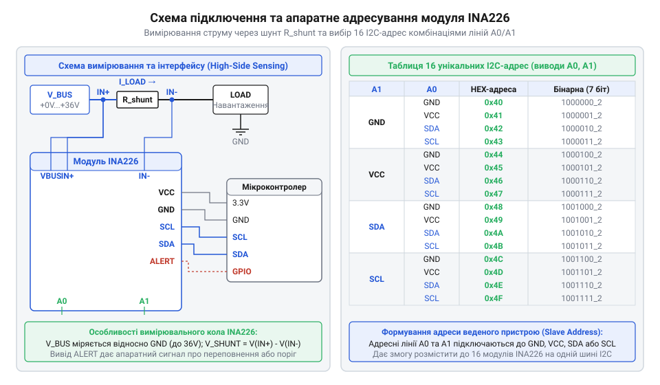
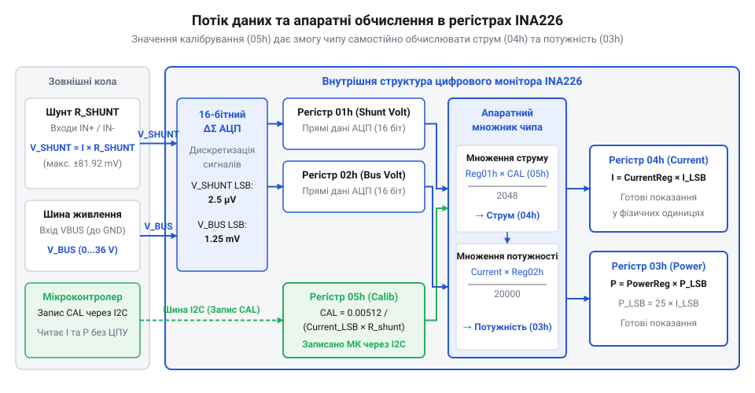

# Модуль цифрового монітора живлення INA226 (I2C/SMBus)

<preknowlist>
- [GY-серія (брейкаут-модулі)](root:cat-hw-sensors/gy-series) — Загальні принципи організації брейкаут-модулів GY-серії та особливості підключення виводів шини I2C.
</preknowlist>

## Контроль живлення без втрати точності

При вимірюванні струму й напруги в силових колах за допомогою звичайного @@en|АЦП@@ (аналого-цифровий перетворювач) мікроконтролера виникає суттєва похибка. Класичне підключення дискретного струмознімального резистора — @@en|шунта@@ (від @@en|shunt@@ — відхиляти) — у нижнє плече живлення створює зсув потенціалу землі для навантаження. Спроба виміряти падіння напруги в верхньому плечі безпосередньо АЦП обмежується максимально припустимою вхідною напругою виводів мікроконтролера. Спеціалізований цифровий монітор живлення @@en|INA226@@ усуває ці обмеження, виконуючи прецизійні дифвимірювання малого падіння напруги на шунті незалежно від напруги живлення шини (до 36 V).

Модуль @@en|INA226@@ реалізовано у вигляді компактної плати, що розширює стандартні [брейкаут-модулі GY-серії](root:cat-hw-sensors/gy-series). Для взаємодії з вимірювальним колом та мікроконтролером використовується група силових і сигнальних виводів:
- `@@en|IN+@@` — позитивний вхід вимірювання напруги на шунті (підключається до сторони джерела живлення);
- `@@en|IN-@@` — негативний вхід вимірювання напруги на шунті (підключається до сторони навантаження);
- `@@en|VBUS@@` — вхід вимірювання напруги шини живлення відносно `@@en|GND@@` (підключається до лінії живлення навантаження, зазвичай до `@@en|IN-@@` або `@@en|IN+@@`);
- `@@en|VCC@@` — живлення власної цифрової та аналогової частини мікросхеми (від 2.7 V до 5.5 V);
- `@@en|GND@@` — спільна земля вимірювальної системи.


*Принципова схема фізичного підключення модуля INA226 до кола живлення навантаження та сигнальних ліній мікроконтролера.*

Шунт підключається послідовно в розрив силової лінії. Диференціальні входи `@@en|IN+@@` та `@@en|IN-@@` зчитують спад напруги `V_shunt` безпосередньо на виводах резистора, мінімізуючи вплив опору підвідних провідників. Вхід `@@en|VBUS@@` зчитує абсолютну напругу шини `V_bus` відносно `@@en|GND@@`, що дозволяє чипу одночасно обчислювати струм і споживану потужність.

Важливою особливістю вимірювальних входів `@@en|IN+@@`, `@@en|IN-@@` та `@@en|VBUS@@` є їхня повна незалежність від напруги живлення `@@en|VCC@@` (2.7–5.5 V): вони розраховані на синфазну напругу вимірювальної шини відносно `@@en|GND@@` в діапазоні від 0 V до 36 V. Це дозволяє живити модуль від низьковольтного джерела 3.3 V або 5 V мікроконтролера і водночас безпосередньо контролювати високовольтові силові кола без додаткових узгоджувальних дільників. Для завершення сигнального інтерфейсу на плату модуля також виведено цифрові піни: сигнальні лінії `@@en|SDA@@` та `@@en|SCL@@` для передачі даних шиною I2C, адресні входи `@@en|A0@@` та `@@en|A1@@` для фізичного задання адреси пристрою, а також вивід `@@en|ALERT@@` для видачі апаратних сигналів тривоги мікроконтролеру.

## Фізичне підключення та вибір адреси

При побудові систем моніторингу кількох каналів живлення виникає потреба підключення кількох давачів до однієї шини `@@en|I2C@@` (від @@en|Inter-Integrated Circuit@@) або `@@en|SMBus@@`. Щоб уникнути апаратних конфліктів системних адрес, мікросхема @@en|INA226@@ оснащена двома адресними входами `@@en|A0@@` та `@@en|A1@@`.

Кожен із виводів `@@en|A0@@` та `@@en|A1@@` можна фізично підключити до одного з чотирьох сигналів: `@@en|GND@@`, `@@en|VCC@@`, `@@en|SDA@@` або `@@en|SCL@@`. Комбінація чотирьох станів двох входів дає `4 × 4 = 16` унікальних 7-бітних адрес у діапазоні від `40h` до `4Fh`. Зсув базового коду адреси визначається станом виводів за такою кодовою таблицею:

| Вхід A1 | Вхід A0 | `@@en|I2C@@`-адреса (Hex) |
| :--- | :--- | :--- |
| `@@en|GND@@` | `@@en|GND@@` | `40h` |
| `@@en|GND@@` | `@@en|VCC@@` | `41h` |
| `@@en|GND@@` | `@@en|SDA@@` | `42h` |
| `@@en|GND@@` | `@@en|SCL@@` | `43h` |
| `@@en|VCC@@` | `@@en|GND@@` | `44h` |
| `@@en|VCC@@` | `@@en|VCC@@` | `45h` |
| `@@en|VCC@@` | `@@en|SDA@@` | `46h` |
| `@@en|VCC@@` | `@@en|SCL@@` | `47h` |
| `@@en|SDA@@` | `@@en|GND@@` | `48h` |
| `@@en|SDA@@` | `@@en|VCC@@` | `49h` |
| `@@en|SDA@@` | `@@en|SDA@@` | `4Ah` |
| `@@en|SDA@@` | `@@en|SCL@@` | `4Bh` |
| `@@en|SCL@@` | `@@en|GND@@` | `4Ch` |
| `@@en|SCL@@` | `@@en|VCC@@` | `4Dh` |
| `@@en|SCL@@` | `@@en|SDA@@` | `4Eh` |
| `@@en|SCL@@` | `@@en|SCL@@` | `4Fh` |

Схема комунікації з мікроконтролером вимагає підключення сигнальних ліній `@@en|SDA@@` (дані) та `@@en|SCL@@` (тактування) до відповідних шинних портів з обов'язковим установленням зовнішніх підтягувальних резисторів (зазвичай 4.7 kΩ) до лінії `@@en|VCC@@`. Вивід апаратного сповіщення `@@en|ALERT@@` виконано за схемою з @@en|відкритим стоком@@ (від @@en|open-drain@@), тому він також потребує зовнішньої підтяжки до `@@en|VCC@@` для подачі апаратного переривання на мікроконтролер.

## Конфігурація та зчитування напруг шини

Взаємодія з внутрішньою логікою @@en|INA226@@ здійснюється через систему 16-бітних @@en|регістрів@@ (від @@la|registrum@@ — внесений список). Для первинної перевірки наявності чипа на шині `@@en|I2C@@` виконується опитування двох ідентифікаційних регістрів:
- `FEh` (Manufacturer ID) — повертає константу `5449h` (ASCII-код літер «TI»);
- `FFh` (Device ID / Revision) — повертає константу `2260h`, яка підтверджує тип мікросхеми та ревізію кремнію.

Налаштування режимів роботи давача здійснюється записом у конфігураційний регістр `00h` (за замовчуванням `4127h`). Його бітова структура визначає швидкість вимірювань і фільтрацію завад:
- Біт `15` (`RST`) — програмне скидання всіх регістрів у початковий стан при записі `1`;
- Біти `11–9` (`AVG`) — кількість усереднень вибірок (від `000` — 1 вибірка, до `111` — 1024 вибірки);
- Біти `8–6` (`VBUS CT`) — час конверсії напруги шини (від `000` — 140 µs, до `111` — 8.244 ms, за замовчуванням `100` — 1.1 ms);
- Біти `5–3` (`VSH CT`) — час конверсії напруги шунта (ідентична шкала часу, за замовчуванням `100` — 1.1 ms);
- Біти `2–0` (`MODE`) — режим вимірювання (наприклад, `111` — безперервне вимірювання шунта й шини, `000` — вимкнено).

Повний період оновлення даних `t_update` у вихідних регістрах дорівнює добутку кількості усереднень `AVG` на суму часів конверсії активного каналу напруги шунта `t_VSH` та каналу напруги шини `t_VBUS`:

```
t_update = AVG × (t_VSH + t_VBUS)       [множення кількості усереднень на суму часів конверсії]
```

Для замовчуваних налаштувань (`AVG` = 1, `t_VSH` = 1.1 ms, `t_VBUS` = 1.1 ms) обчислення часу оновлення виконується так:

```
t_update = 1 × (1.1 ms + 1.1 ms)
= 2.2 ms                                [сума часів конверсії обох каналів]
```

Збільшення кількості усереднень `AVG` до 16 при збереженні часів конверсії змінює тривалість вимірювального циклу:

```
t_update = 16 × (1.1 ms + 1.1 ms)
= 16 × 2.2 ms                           [сума часів конверсії двох каналів]
= 35.2 ms                               [добуток кількості усереднень на тривалість вибірки]
```

Високі значення `AVG` ефективно пригнічують високочастотні шуми на силовій лінії, але підвищують затримку оновлення даних і уповільнюють реакцію на зміни струму.

При зміні напрямку протікання струму від виводу `IN-` до `IN+` потенціал `IN+` стає нижчим за `IN-`, а напруга на шунті набуває від'ємного значення. Внутрішній АЦП зберігає від'ємні вимірювання напруги шунта у регістрі `01h` у 16-бітному `@@en|доповняльному коді@@` (від `@@en|two's complement@@` — доповнення числових значень до повного діапазону), де біт `15` є знаковим. Значення `FFFFh` відповідає `-1` молодшому значущому біту (`@@en|LSB@@`, від `@@en|Least Significant Bit@@` — найменш значущий розряд), що становить `-2.5 µV`, а `8000h` визначає нижню межу `-81.92 mV`. Зчитане з шини `@@en|I2C@@` сире 16-бітне значення у беззнакову змінну `uint16_t` інтерпретує `FFFFh` як число `65535`. Множення такого числа на дискретність `2.5 µV` дає помилкову позитивну напругу `+163.8375 mV`. Для коректної обробки від'ємних значень беззнакове значення `uint16_t` приводять до знакового 16-бітного типу `int16_t`. Приведення до `int16_t` зберігає від'ємний знак числа у `@@en|доповняльному коді@@`, завдяки чому підсумкове множення на `2.5 µV` повертає правильне від'ємне значення.

Після завершення аналого-цифрового перетворення сирі дані зчитуються з вихідних регістрів напруги:
1. Регістр напруги шунта `01h` (Shunt Voltage) містить 16-бітне знакове значення у доповняльному коді. Фіксована дискретність становить `2.5 µV` на один молодший значущий біт (@@en|LSB@@, від @@en|Least Significant Bit@@). Повний діапазон вимірювання дорівнює `±81.92 mV`. Розрахунок фізичної напруги шунта `V_shunt`:

```
V_shunt = Register_01h × 2.5 µV      [множення значення регістра 01h на дискретність 2.5 µV]
```

2. Регістр напруги шини `02h` (Bus Voltage) містить 16-бітне беззнакове значення з фіксованою дискретністю `1.25 mV/LSB`. Шкала охоплює напругу від `0 V` до `36 V`. Розрахунок напруги шини `V_bus`:

```
V_bus = Register_02h × 1.25 mV       [множення значення регістра 02h на дискретність 1.25 mV]
```

## Калібрування струму та автоматичне обчислення

Обчислення струму та потужності на стороні мікроконтролера вимагає постійного виконання арифметичних операцій з плаваючою комою, що перевантажує процесор. Мікросхема @@en|INA226@@ має внутрішній апаратний арифметичний блок, який самостійно розраховує струм і потужність на основі запрограмованого значення в калібрувальному регістрі `05h` (Calibration Register).


*Схема потоку даних усередині INA226 від виміряних напруг через калібрувальний регістр 05h до регістрів струму 04h і потужності 03h.*

Алгоритм калібрування вимірювального тракту складається з трьох послідовних кроків:

1. Визначення дискретності струму `Current_LSB` на основі максимально очікуваного струму системи `I_max`:

```
Current_LSB = I_max / 32768          [ділення максимального струму на роздільну здатність 15 біт]
```

Отримане значення округлюють у більший бік до зручної цілої величини (наприклад, `100 µA/LSB` або `250 µA/LSB`), щоб забезпечити максимум точності без ризику переповнення 16-бітного регістра струму.

2. Розрахунок 16-бітного значення калібрувального коефіцієнта `CAL` для регістра `05h`:

```
CAL = trunc(0.00512 / (Current_LSB × R_shunt))    [цілочисельна частка від ділення внутрішньої константи 0.00512 на добуток LSB струму та опору шунта]
```

де `0.00512` — фіксована внутрішня масштабувальна константа чипа (отримана як `2048 × 2.5 µV`), `Current_LSB` задано в амперах (`A`), а `R_shunt` — опір шунта в омах (`Ω`).

3. Запис обчисленого `CAL` у регістр `05h`. Після цього апаратний множник @@en|INA226@@ у кожному циклі вимірювання автоматично обчислює значення прямих регістрів:
- Регістр струму `04h` (Current Register):

```
Current_Register = trunc((Shunt_Voltage_Register × CAL) / 2048)    [внутрішнє множення регістра напруги шунта на CAL з нормуванням на 2048]
```

Фізичний струм визначається простим множенням вмісту регістра `04h` на `Current_LSB`:

```
I = Register_04h × Current_LSB      [переведення значення регістра 04h у фізичний струм]
```

- Регістр потужності `03h` (Power Register):

```
Power_Register = trunc((Current_Register × Bus_Voltage_Register) / 20000)   [внутрішнє множення регістра струму на регістр напруги шини]
```

Дискретність потужності `Power_LSB` жорстко прив'язана до `Current_LSB`:

```
Power_LSB = 25 × Current_LSB        [масштабування дискретності потужності від дискретності струму]
```

Фізична потужність обчислюється як:

```
P = Register_03h × Power_LSB        [переведення значення регістра 03h у фізичну потужність]
```

**Обчислення калібрування для шунта 0.01 Ω та струму до 8 A:**

```
Current_LSB = 8 / 32768
            = 0.00024414 A/LSB      [визначення мінімального LSB]
            ≈ 0.00025 A/LSB         [округлення до зручного значення 250 µA/LSB]

CAL = trunc(0.00512 / (0.00025 × 0.01))
    = trunc(0.00512 / 0.0000025)     [знаменник дорівнює 2.5 µV × 100]
    = 2048                           [запис значення 0800h у регістр 05h]

Power_LSB = 25 × 0.00025
          = 0.00625 W/LSB            [дискретність потужності дорівнює 6.25 mW/LSB]
```

## Апаратні тривоги та крайові стани

Для звільнення мікроконтролера від безперервного опитування шини `@@en|I2C@@` мікросхема @@en|INA226@@ підтримує апаратні сповіщення через вивід `@@en|ALERT@@`. Генерація сигналу керується регістром маскування й увімкнення тривог `06h` (Mask/Enable Register) та регістром порогового значення `07h` (Alert Limit Register).

Регістр `07h` містить 16-бітне порівняльне значення в кодах відповідно до обраної функції. Конфігураційний регістр `06h` визначає, яка саме подія активує вивід `@@en|ALERT@@`:
- Біт `15` (`SOL`) — тривога перевищення верхнього порогу напруги шунта (Shunt Over-Voltage);
- Біт `14` (`SUL`) — тривога падіння нижче порогу напруги шунта (Shunt Under-Voltage);
- Біт `13` (`BOL`) — тривога перевищення верхнього порогу напруги шини (Bus Over-Voltage);
- Біт `12` (`BUL`) — тривога падіння нижче порогу напруги шини (Bus Under-Voltage);
- Біт `11` (`POL`) — тривога перевищення порогу потужності (Power Over-Limit);
- Біт `10` (`CNVR`) — сповіщення про завершення циклу конверсії даних (Conversion Ready).

Режим роботи виводу `@@en|ALERT@@` налаштовується молодшими бітами регістра `06h`: біт `1` (`APOL`) задає полярність (0 — активний низький рівень, 1 — активний високий), а біт `0` (`LEN`) вмикає режим засувки (Latch Mode). У режимі засувки сигнал тривоги утримується до моменту зчитування регістра `06h` мікроконтролером.

Під час роботи вимірювального тракту можливі крайові стани, які вимагають обробки в програмному забезпеченні:

1. **Математичне переповнення (Math Overflow):** Прапорець `OVF` (біт `2` регістра `06h`) встановлюється в `1`, якщо в результаті множення вираховане значення струму або потужності перевищує розрядність вихідних 16-бітних регістрів `04h` або `03h`. Це свідчити про занадто мале значення обраного `Current_LSB` для поточного струму. Для усунення переповнення необхідно збільшити `Current_LSB` та перекалібрувати регістр `05h`.

2. **Вихід вимірювань за припустимі межі:** При перевищенні максимальної напруги на шунті (`±81.92 mV`) або шині (`36 V`) аналогово-цифровий перетворювач насичується. Встановлення відповідних бітів маски (`SOL`, `BOL`) у регістрі `06h` дозволяє апаратно перервати роботу мікроконтролера та знеструмити силову схему через вивід `@@en|ALERT@@` до настання аварійної ситуації.
