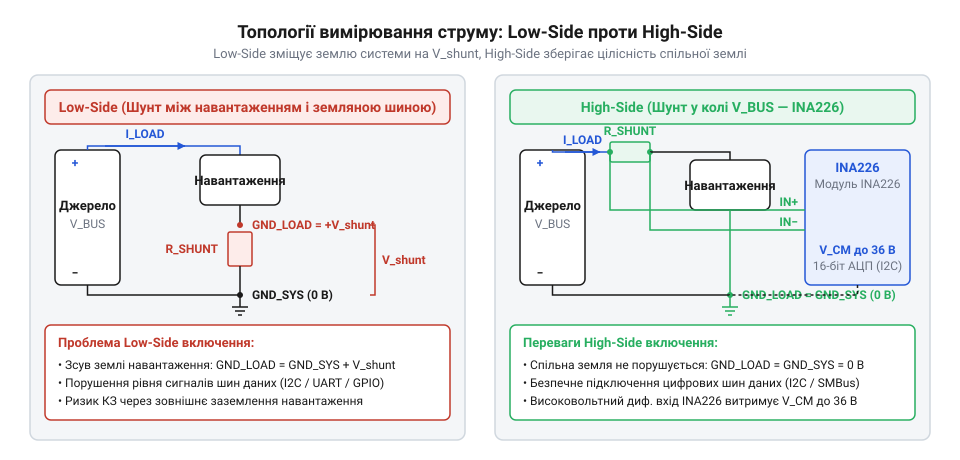
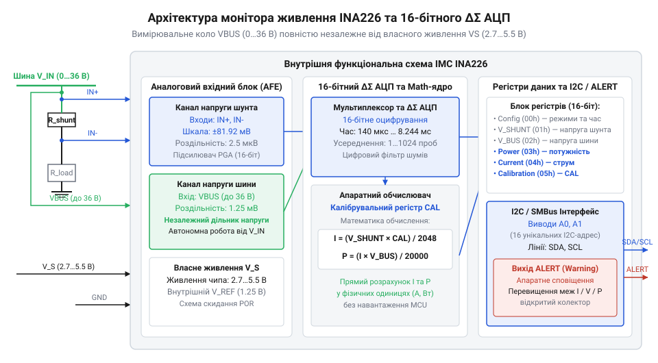
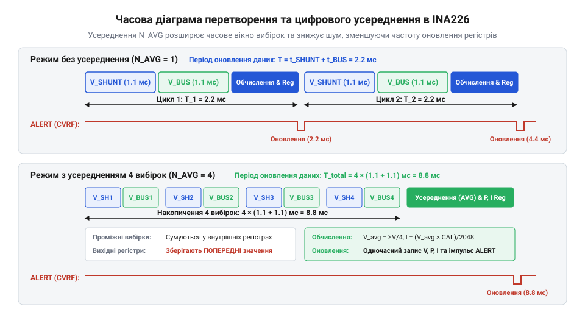
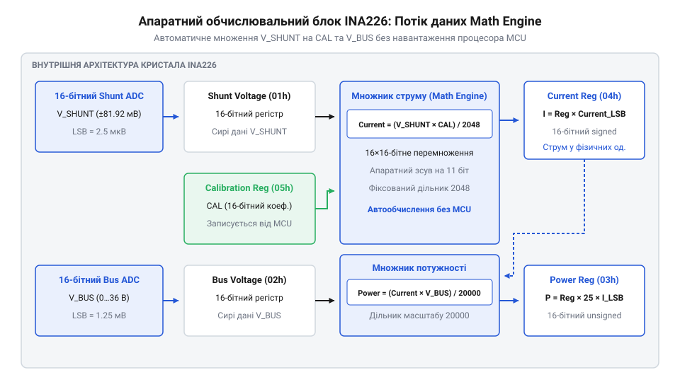
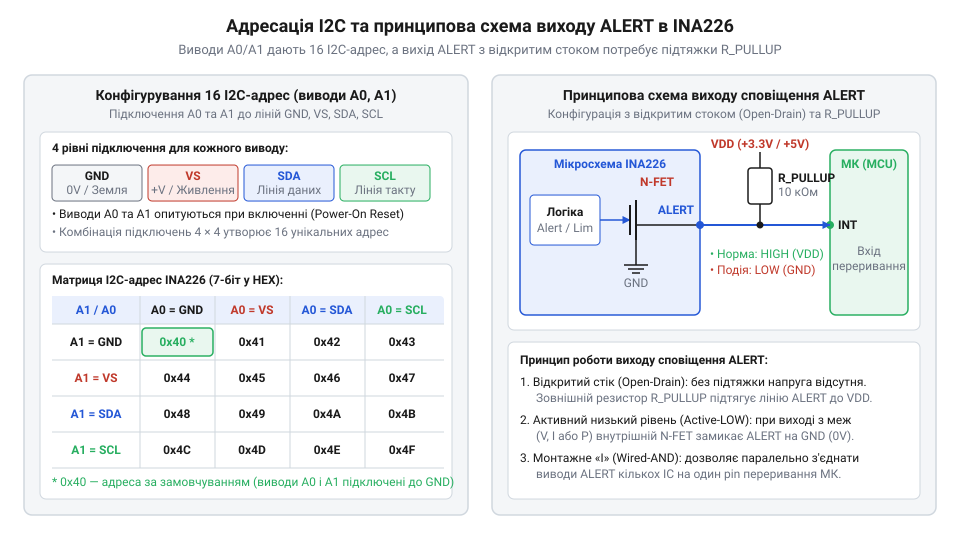

# Модуль цифрового монітора живлення INA226 (I2C/SMBus)

<preknowlist>
- [GY-серія (брейкаут-модулі)](root:cat-hw-sensors/gy-series) — Принципи побудови брейкаут-модулів, підтягування ліній шини I2C та розведення живлення на платах-носіях.
</preknowlist>

## Проблема вимірювання струму силових кіл

Моніторинг електричного живлення в мікроконтролерних системах вимагає одночасного вимірювання двох фізичних величин: струму, що протікає крізь навантаження, та напруги на комутованій шині. Проте пряме зняття цих параметрів за допомогою стандартного аналого-цифрового перетворювача (від англ. @@en|ADC@@ — *Analog-to-Digital Converter*, укр. @@en|АЦП@@) створює принциповий технічний конфлікт. За своєю природою @@en|АЦП@@ здатний вимірювати лише напругу відносно спільної точки схеми. Для вимірювання струму в коло навантаження послідовно вмикають низькоомний вимірювальний резистор (від англ. @@en|shunt@@ — *відхиляти, пускати в обхід*, укр. @@en|шунт@@), падіння напруги `V_shunt` на якому пропорційне протікаючому струму `I_load` за законом Ома:

```
V_shunt = I_load × R_shunt
```

де `I_load` — струм навантаження в амперах, `R_shunt` — опір вимірювального резистора в омах, а `V_shunt` — отримане падіння напруги у вольтах.

Якщо розмістити @@en|шунт@@ у негативній лінії живлення — між мінусовим виводом навантаження та землею джерела (топологія @@en|Low-Side@@, від англ. *low side* — нижнє плече), отриманий сигнал `V_shunt` стає прив'язаним до землі системи і його легко зчитати звичайним входом @@en|АЦП@@. Однак струм навантаження створює на @@en|шунті@@ спад напруги, який піднімає потенціал «землі» самого навантаження вище рівня землі джерела живлення. Коли таке навантаження обмінюється даними з іншими вузлами через інтерфейси @@en|UART@@ або @@en|SPI@@, різниця потенціалів між землями викликає помилки зчитування цифрових рівнів або створює вирівнювальні струми, які здатні вивести з ладу виходи мікроконтролера.

Спроба перенести @@en|шунт@@ у позитивну лінію живлення (топологія @@en|High-Side@@, від англ. *high side* — верхнє плече) повністю усуває зміщення спільної землі. Проте потенціал на виводах @@en|шунта@@ у цьому разі дорівнює повній напрузі шини живлення — наприклад, 12 В, 24 В або 36 В. Підключення таких напруг безпосередньо до вхідних виводів мікроконтролера, розрахованих на напругу живлення 3.3 В або 5 В, призводить до пробою захисних діодів і незворотного руйнування кристала. шунт@@ у позитивну лінію живлення | Докладне порівняння схемотехнічних відмінностей, переваг та обмежень обох варіантів включення наведено у матеріалі про [топології вимірювання струму](root:hw-sensing/current-sensing-topologies).


*Схема показує різницю між вставкою шунта в розрив землі та розрив лінії живлення: у Low-Side виникає зсув опорного потенціалу навантаження, тоді як High-Side зберігає спільну землю.*

Другий бар'єр пов'язаний із роздільною здатністю та втратою точності на малих струмах. Щоб мінімізувати теплові втрати на @@en|шунті@@, його опір обирають якомога меншим (наприклад, 10 мОм). При струмі 10 мА падіння напруги становить лише 100 мкВ. Вбудований 12-бітний @@en|АЦП@@ мікроконтролера з опорною напругою 3.3 В має крок квантування `3.3 V ÷ 4096 ≈ 0.8 mV` (800 мкВ). Сигнал у 100 мкВ просто губиться в молодшому розряді перетворювача, роблячи вимірювання малих струмів неможливим.

Нарешті, навіть за наявності зовнішніх операційних підсилювачів обчислення миттєвої потужності `P = V × I` та накопичення енергії вимагає від процесора постійного виконання опитань каналів @@en|АЦП@@ та операцій множення у перериваннях. У багатогодинних автономних системах це створює невиправдане обчислювальне навантаження на процесорне ядро.

Історично для вирішення цієї проблеми інженери компанії @@en|Texas Instruments@@ розробляли аналогові підсилювачі струму, які переносили диференціальний сигнал із високовольтної шини на низьковольтний вихід відносно землі. Зі зростанням вимог до точності на зміну аналоговим схемам прийшли інтегральні монітори живлення першого покоління, такі як @@en|INA219@@, що об'єднали підсилювач, 12-бітний перетворювач та апаратний обчислювач потужності на одному силіцієвому кристалі. Проте розширення сфери застосування у серверних джерелах живлення та сонячній енергетиці вимагало ще вищої точності на мікроамперних струмах і ширшого діапазону вимірювальної напруги шини. Це призвело до створення 16-бітного монітора @@en|INA226@@, у якому поєднано два незалежні вхідні канали та програмоване калібрування для розвантаження центрального процесора.

Таким чином, спеціалізований цифровий монітор живлення мусить поєднувати прецизійний диференціальний вхід із високим приглушенням синфазної напруги для роботи в @@en|High-Side@@ схемі, окремий високовольтний вхід вимірювання напруги шини та апаратний математичний блок. Для зручності інтеграції в макети такі чіпи монтують у форматі [плат-носіїв серії GY](root:cat-hw-sensors/gy-series) з цифровими шинами керування.

## Архітектура двоканального шістнадцятибітного АЦП INA226

Спеціалізована мікросхема @@en|INA226@@ вирішує обмеження класичних вимірювальних кіл завдяки вбудованому одноканальному 16-бітному перетворювачу на основі архітектури @@en|дельта-сигма@@ (від грец. *дельта* — різниця, *сигма* — сума, англ. @@en|delta-sigma@@). Внутрішній аналоговий тракт чипа містить два фізично відокремлені вимірювальні канали: перший вимірює малу диференціальну напругу безпосередньо між вхідними виводами `IN+` та `IN-`, а другий вимірює абсолютну напругу шини живлення між виводом `VBUS` та виводом землі `GND`.


*Блок-схема ілюструє роздільні входи для вимірювання падіння напруги на шунті та абсолютного потенціалу шини живлення відносно землі.*

Перший канал призначений для роботи з диференціальним сигналом @@en|шунта@@ `V_SHUNT`. Його вхідний підсилювач розрахований на повну шкалу вимірювання `±81.92 мВ`. Використання 16-бітного знакового представлення даних (15 бітів амплітуди та 1 біт знака, тобто 32768 рівнів для кожної полярності) забезпечує сталу дискрету вимірювання напруги шунта `LSB_SHUNT` (від англ. @@en|LSB@@ — *Least Significant Bit*, найменш значущий розряд):

```
LSB_SHUNT = 81.92 mV ÷ 32768
          = 0.08192 V ÷ 32768            [переведення мілівольтів у вольти]
          = 0.0000025 V                  [обчислення значення молодшого розряду]
          = 2.5 µV                       [запис у мікровольтах]
```

де `81.92 mV` — максимальне диференціальне значення шкали в мілівольтах, `32768` — кількість дискрет половини 16-бітного діапазону, а `LSB_SHUNT` — вага одного молодшого розряду у вольтах.

Завдяки роздільності `2.5 мкВ` на один крок @@en|АЦП@@ мікросхема здатна впевнено фіксувати мікроамперні струми навіть на шунтах опором `10 мОм` (де 1 крок відповідає струму `2.5 µV ÷ 0.01 Ω = 250 µA`). Знаковий біт дозволяє @@en|INA226@@ вимірювати струм в обох напрямках — наприклад, під час заряджання та розряджання акумулятора. Якщо напруга на @@en|шунті@@ перевищує межу `+81.92 мВ`, регістр вимірювання насичується у значенні `0x7FFF` (`+32767`), що означає вихід за межі лінійного діапазону.

Другий канал @@en|АЦП@@ вимірює абсолютну напругу шини `V_BUS` відносно спільної землі модуля. На відміну від диференціального входу, цей канал має вбудований високовольтний дільник, що дозволяє подавати на вивід `VBUS` напругу від 0 В до 36 В (максимальна зчитувана шкала становить `40.96 В`). Оскільки напруга шини завжди додатна, усі 15 бітів використовуються для представлення величини, що визначає вагу молодшого розряду напруги шини `LSB_BUS`:

```
LSB_BUS = 40.96 V ÷ 32768
        = 0.00125 V                      [обчислення значення молодшого розряду]
        = 1.25 mV                        [запис у мілівольтах]
```

де `40.96 V` — повна внутрішня шкала перетворювача у вольтах, а `LSB_BUS` — фіксована роздільність каналу напруги шини.

Ключовою перевагою архітектури @@en|INA226@@ є повна незалежність вхідного допустимого потенціалу шини від напруги власного живлення чипа. Модуль живиться від низьковольтної лінії `VS` напругою від 2.7 В до 5.5 В (зазвичай 3.3 В від мікроконтролера). При цьому вхідні виводи `IN+`, `IN-` та `VBUS` витримують синфазну напругу до 36 В відносно землі завдяки високовольтній ізоляції входів на кристалі. Це дозволяє безпечно вимірювати параметри високопотужних кіл 12 В, 24 В або 36 В без застосування зовнішніх оптичних чи гальванічних розв'язок.

Отримані сирі 16-бітні коди зберігаються у внутрішніх регістрах напруги шунта та напруги шини. Щоб детально вивчити призначення виводів та призначення внутрішніх комірок пам'яті, відкрийте [карту регістрів пристрою](root:cat-hw-sensors/ina226-power-monitor-module/api-ina226-registers-and-pinout.md).

## Цифрова фільтрація та часові режими АЦП

Реальні кола живлення силового обладнання та імпульсних перетворювачів насичені високочастотними завадами, пульсаціями перемикання ключових транзисторів та наводками мережі змінного струму. Точкові миттєві вимірювання напруги й струму за допомогою аналого-цифрового перетворювача (від англ. @@en|ADC@@ — *Analog-to-Digital Converter*, укр. @@en|АЦП@@) у таких умовах призводять до значного хаотичного розкиду значень. Для усунення цього шуму мікросхема @@en|INA226@@ використовує не зовнішні аналогові фільтри, які могли б внести додатковий пасивний опір у вимірювальний тракт, а вбудований апаратний @@en|цифровий фільтр@@ (від англ. @@en|digital filter@@ — *цифровий фільтр*, від лат. *filtrum* — повсть для цідження) з можливістю програмування часу накопичення сигналу та алгоритму @@en|усереднення@@ (від англ. @@en|averaging@@ — *усереднення*). Математичні основи обробки сигналів та алгоритми приглушення високочастотних завад деталізовано у матеріалі про [цифрову фільтрацію в моніторах живлення](root:hw-sensing/digital-filtering-in-power-monitors).

Внутрішній таймінг дискретизації визначається двома незалежними параметрами: часом перетворення одного сигналу та кількістю вибірок для накопичення. Для кожного з двох вхідних каналів — падіння напруги на @@en|шунті@@ `V_SHUNT` та напруги шини `V_BUS` — можна встановити власний @@en|час перетворення@@ (від англ. @@en|conversion time@@ — *час перетворення*, від лат. *conversio* — обертання, зміна) `t_CT`. Чип пропонує вісім фіксованих значень: 140 мкс, 204 мкс, 332 мкс, 588 мкс, 1.1 мс, 2.116 мс, 4.156 мс та 8.244 мс. Збільшення часу перетворення розширює часове вікно інтегрування аналогового сигналу всередині перетворювача, що природно приглушує високочастотні імпульсні завади ще на етапі оцифрування.

Після отримання кожної вибірки блок цифрової обробки накопичує задану кількість значень `N_AVG` (програмується як 1, 4, 16, 64, 128, 256, 512 або 1024) та обчислює їхнє середнє арифметичне. Математично усереднення `N_AVG` вибірок зменшує середньоквадратичне відхилення випадкового шуму в `√N_AVG` разів. Наприклад, накопичення 16 вибірок знижує амплітуду шуму в 4 рази (на 12 дБ), не вимагаючи жодних обчислювальних ресурсів від зовнішнього мікроконтролера.


*Часова діаграма показує послідовність накопичення вибірок напруги шунта та шини у безперервному режимі.*

Особливе значення вибір часових параметрів має для приглушення мережевих завад частотою 50 Гц (період 20 мс) та 60 Гц (період 16.67 мс). Якщо сумарний час накопичення вибірок кратний періоду мережевої напруги, гармоніки змінної напруги взаємно компенсуються під час підсумовування.

Для обчислення повного часу оновлення вихідних регістрів у безперервному режимі сумують часи перетворення обох каналів та множать на кількість усереднюваних вибірок. Введемо позначення: `t_SHUNT` — час перетворення каналу шунта в мілісекундах, `t_BUS` — час перетворення каналу напруги шини в мілісекундах, `N_AVG` — кількість усереднюваних вибірок, `T_total` — підсумковий період оновлення даних у мілісекундах:

```
T_total = (t_SHUNT + t_BUS) × N_AVG
        = (1.1 ms + 1.1 ms) × 16              [підстановка часу перетворення та кількості вибірок]
        = 2.2 ms × 16                         [додавання часів перетворення двох каналів]
        = 35.2 ms                             [перемножування на кількість вибірок]
```

Отримане значення `35.2 мс` означає, що вихідні регістри струму й напруги оновлюються приблизно 28 разів на секунду. Це забезпечує ідеальний баланс між високою точністю та гладкістю показчиків без візуального запізнення.

Вибір конфігурації завжди є компромісом між завадостійкістю та швидкістю реакції на зміну навантаження. У швидкодіючих системах захисту від перевантаження обирають мінімальний час перетворення 140 мкс без усереднення (`T_total = 280 мкс`), що дозволяє миттєво зафіксувати стрибок струму. Натомість для прецизійних лабораторних вимірювань у стаціонарному режимі обирають `t_CT = 8.244 мс` та `N_AVG = 128` або `1024`. Для гнучкого керування цими параметрами біти налаштування заносяться у [карту двохбайтних регістрів](root:cat-hw-sensors/ina226-power-monitor-module/api-ina226-registers-and-pinout.md) пристрою перед початком вимірювального циклу. Конструктивно інтегрований у [плати розширення серії](root:cat-hw-sensors/gy-series) модуль зберігає обрані налаштування протягом усього часу подачі живлення.

## Математика калібрування та апаратного обчислення

Визначення реального струму й потужності за допомогою зовнішніх обчислень вимагає від мікроконтролера постійного зчитування напруги та виконання операцій ділення і множення з плаваючою комою. У масштабних системах моніторингу це невиправдано завантажує обчислювальне ядро та шину передачі даних. Мікросхема @@en|INA226@@ повністю вирішує цю проблему за допомогою вбудованого апаратного арифметичного блоку, який самостійно розраховує струм і потужність після кожного циклу перетворення @@en|АЦП@@.

Ключовим елементом цього механізму є @@en|калібрувальний регістр@@ (від фр. *calibre* — вимір, англ. @@en|calibration register@@ — *калібрувальний регістр*) `CAL`. Замість того, щоб зберігати фізичний опір @@en|шунта@@ у фіксованому вигляді, чип надає користувачу можливість самостійно обрати бажану квантову дискрету струму `Current_LSB` (від англ. @@en|LSB@@ — *Least Significant Bit*, найменш значущий розряд) в амперах на молодший розряд.


*Схема потоку даних апаратного обчислювача демонструє обробку сирих кодів АЦП і запис результатів у вихідні регістри.*

Внутрішня арифметична логіка пристрою обчислює значення струму шляхом перемноження сирого коду напруги шунта `V_SHUNT` на вміст калібрувального регістра `CAL` із подальшим діленням на фіксований константний дільник 2048. Щоб молодший розряд вихідного регістра `Current` дорівнював обраному значенню `Current_LSB`, коефіцієнт `CAL` обчислюють за формулою.

Введемо позначення змінних: `CAL` — цілочисельний калібрувальний коефіцієнт, `Current_LSB` — обрана вага молодшого розряду струму в амперах на дискрету, `R_shunt` — опір вимірювального резистора в омах, `0.00512` — внутрішній масштабувальний коефіціент мікросхеми у вольт-амперах, `trunc` — функція відкидання дробової частини числа:

```
CAL = trunc(0.00512 ÷ (Current_LSB × R_shunt))
    = trunc(0.00512 ÷ (0.0002 × 0.01))             [підстановка дискрета струму та опору]
    = trunc(0.00512 ÷ 0.000002)                    [перемноження опору на дискрет струму]
    = 2560                                         [ділення та відкидання дробової частини]
```

Отримане значення `2560` (або `0x0A00` у шістнадцятковому коді) записується у 16-бітний регістр `CAL` під час ініціалізації мікросхеми. Після цього чип автоматично множить отримане падіння напруги на цей коефіцієнт, записуючи у регістр `Current` готову кількість дискрет струму.

На наступній стадії обчислювальний блок розраховує потужність шляхом апаратного множення вмісту регістра струму `Current` на вміст регістра напруги шини `V_BUS` з внутрішнім діленням на 20000. Внаслідок цього дискрета регістра потужності `Power_LSB` автоматично прив'язується до обраного дискрета струму через фіксований множник 25.

Введемо позначення змінних: `Power_LSB` — вага молодшого розряду потужності у ватах на дискрету, `Current_LSB` — обрана вага молодшого розряду струму в амперах на дискрету, `25` — фіксований внутрішній коефіцієнт масштабування потужності:

```
Power_LSB = 25 × Current_LSB
          = 25 × 0.0002 A/LSB                      [підстановка обраного дискрета струму]
          = 0.005 W/LSB                            [обчислення дискрета потужності]
          = 5 mW/LSB                               [переведення значення у мілівати]
```

Завдяки цьому центральний процесор мікроконтролера звільняється від виконання математичних операцій. Для отримання фізичних величин струму й потужності йому достатньо прочитати 16-бітні коди з відповідних регістрів і помножити їх на відомі константи `Current_LSB` та `Power_LSB`. Якщо зчитуваний код регістра струму дорівнює `5000` (`0x1388`), а регістра потужності — `10000` (`0x2710`), то реальний струм становить `5000 × 0.0002 А = 1.0 А`, а споживана потужність — `10000 × 0.005 Вт = 50.0 Вт`.

Детальний алгоритм розрахунку та розширені формули для [обчислення вимірювального шунта](root:cat-hw-sensors/ina226-power-monitor-module/math-ina226-shunt-and-calibration-math.md) дозволяють точно підібрати коефіцієнти під будь-який діапазон вимірювання. Готовий приклад програмного заповнення регістра `CAL` описує [проєкт лабораторного ватметра](root:cat-hw-sensors/ina226-power-monitor-module/proj-ina226-power-monitor-stm32.md) на базі мікроконтролера.

## Апаратне сповіщення та налаштування I2C-адреси

Постійне опитування цифрового монітора через шину `@@en|I2C@@` (англ. *Inter-Integrated Circuit* — міжінтегральна схема) змушує управляючий мікроконтролер витрачати процесорний час у нескінченних циклах та створює затримки при виявленні критичних режимів. Коли виникає коротке замикання або перевантаження за струмом, затримка в кілька мілісекунд на передачу команд шиною може призвести до виходу силових ключів з ладу. Цифровий монітор `@@en|INA226@@` усуває цю проблему за допомогою внутрішнього компаратора та апаратного виводу `@@en|ALERT@@` (від англ. *alert* — тривога, сповіщення).

Усередині мікросхеми виміряні значення напруги на шунті, напруги шини чи обчисленої потужності безперервно порівнюються з пороговим значенням, що записане у 16-бітному регістрі `@@en|Alert Limit@@` (англ. *alert limit* — межа сповіщення). Умови активації сигналу задає регістр `@@en|Mask/Enable@@` (англ. *mask/enable* — маска та дозвіл). Усі доступні прапорці аварійних подій та їхні маски детально деталізує [карта вимірювальних регістрів](root:cat-hw-sensors/ina226-power-monitor-module/api-ina226-registers-and-pinout.md), яка описує біти конфігурації чипа. Як тільки виміряний параметр перетинає встановлену межу (наприклад, перевищення струму `@@en|Shunt Voltage Over-Limit@@` або падіння напруги `@@en|Bus Voltage Under-Limit@@`), чип негайно змінює стан виходу `@@en|ALERT@@`.

Вихід `@@en|ALERT@@` виконано за схемою з `@@en|відкритим стоком@@` (англ. *open drain*). Це означає, що у нормальному стані внутрішній транзистор закритий, а лінія перебуває у високоімпедансному стані. Для формування логічної одиниці потрібен зовнішній `@@en|підтягувальний резистор@@` (англ. *pull-up resistor*), підключений до лінії живлення мікроконтролера. На більшості [готових вимірювальних платах](root:cat-hw-sensors/gy-series) підтягувальні резистори шини вже розведені безпосередньо біля мікросхеми. Схема з `@@en|відкритим стоком@@` дає змогу об'єднувати виводи `@@en|ALERT@@` від кількох датчиків у єдину лінію переривання за логікою «АБО» (Wire-OR), а також працювати з мікроконтролерами з різними логічними рівнями.


*Схема 4-рівневого підключення адресових виводів A0 та A1 до ліній GND, VVS, SDA, SCL для вибору 16 адрес, а також принципова схема виходу ALERT з відкритим стоком.*

Режим роботи виходу `@@en|ALERT@@` конфігурується як прозорий (англ. *transparent mode*) або з фіксацією (англ. *latch mode*). У прозорому режимі сигнал вимикається самостійно, щойно виміряний параметр повертається в норму. У режимі з фіксацією вихід `@@en|ALERT@@` залишається активним доти, доки мікроконтролер не зчитає регістр `@@en|Mask/Enable@@` або не надішле спеціальний запит. Для цього чип підтримує [стандартний протокол сповіщень](root:com-devices/smbus-alert-protocol), де мікроконтролер надсилає розсипний запит на загальну адресу відгуку `@@en|Alert Response Address@@` (англ. *Alert Response Address*, `@@en|ARA@@`), дістаючи у відповідь адресу саме того модуля, який викликав тривогу.

Під час побудови розгалужених систем живлення виникає потреба опитувати кілька модулів `@@en|INA226@@` на одній шині `@@en|I2C@@`. Традиційні двопозиційні адресні виводи дозволяють сформувати лише чотири унікальні адреси за допомогою підключення до землі чи живлення. В `@@en|INA226@@` застосовано чотирирівневу логіку детектування на виводах `@@en|A0@@` та `@@en|A1@@`. Під час подачі живлення внутрішня схема чипа визначає, до чого підключено кожен вивід: до землі (`@@en|GND@@`), лінії живлення `@@en|VVS@@`, лінії даних `@@en|SDA@@` чи лінії тактування `@@en|SCL@@`. Комбінація з чотирьох можливих станів на двох виводах дає 4 × 4 = 16 унікальних 7-бітних адрес у діапазоні від `0x40` до `0x4F` (у 8-бітному форматі з урахуванням біта читання/запису — від `0x80` до `0x9E`). Це дозволяє масштабувати вимірювальну мережу до 16 пристроїв без використання додаткових мультиплексорів шини.

## Розрахунок шунта та безпечна інтеграція

Помилковий вибір опору вимірювального шунта або недбале розведення друкованої плати можуть знівелювати високу 16-бітну точність `@@en|INA226@@` або навіть знищити модуль при високому навантаженні. Щоб отримати максимальну точність вимірювання струму, опір шунта необхідно розраховувати так, щоб при максимальному робочому струмі падіння напруги на ньому наближалося до межі повної шкали АЦП `V_SHUNT_MAX = ±81.92 мВ` (або `0.08192 В`), але ніколи не перевищувало її.

Обчислимо максимально допустимий опір вимірювального шунта `R_shunt_max` для цільового струму навантаження `I_max = 10 А`, виходячи з межі диференціальної напруги АЦП `V_SHUNT_MAX = 81.92 мВ`.

```
R_shunt_max = V_SHUNT_MAX ÷ I_max
            = 0.08192 В ÷ 10 А      [підстановка межі напруги та цільового струму]
            = 0.008192 Ом           [обчислення максимального опору в омах]
            = 8.192 мОм             [переведення значення в міліоми]
```

Розрахунок показує, що для струму `10 А` опір шунта не повинен перевищувати `8.192 мОм`. Найближчий менший стандартний номінал резистора становить `8 мОм`. При проходженні струму `10 А` на таком шунті впаде `80 мВ`, що становить `97.6%` від шкали АЦП і забезпечує оптимальне використання динамічного діапазону. Подальший обчислювальний алгоритм описує [математика калібрування чипа](root:cat-hw-sensors/ina226-power-monitor-module/math-ina226-shunt-and-calibration-math.md), яка пов'язує значення шунта з дискретою струму.

Окрім опору, критичним параметром є тепловий режим вимірювального елемента. Перетворення електричної енергії в тепло на шунті підпорядковується закону Джоуля — Ленца. Визначимо пікову теплову потужність `P_shunt`, яка розсіюватиметься на шунті `R_shunt = 8 мОм` при тривалому струмі `I_max = 10 А`.

```
P_shunt = I_max² × R_shunt
        = (10 А)² × 0.008 Ом        [підстановка значення струму та опору]
        = 100 А² × 0.008 Ом          [піднесення струму до квадрата]
        = 0.8 Вт                    [обчислення розсіюваної потужності]
```

Визначена потужність `0.8 Вт` вимагає ретельного добору компонента. При нагріванні опір резистора змінюється відповідно до його `@@en|температурного коефіцієнта опору@@` (англ. *Temperature Coefficient of Resistance*, `@@en|TCR@@`), що призводить до температурного дрейфу вимірювань. Для стабільної роботи номінальна потужність вимірювального резистора повинна перевищувати розраховане значення принаймні у 2–2.5 раза. Для нашого прикладу слід обирати резистор з номінальною потужністю не менше `2 Вт` у масивному SMD-корпусі (наприклад, 2512) або спеціалізований металоплівковий шунт.

Навіть ідеально розрахований шунт даватиме хибні свідчення, якщо сигнальні доріжки АЦП підключені некоректно. Опір друкованого провідника товщиною 35 мкм і шириною 1 мм може становити кілька міліом, що зіставно з опором самого шунта `8 мОм`. Якщо зчитувати напругу з силових провідників, падіння напруги на міді додасться до падіння на шунті. Щоб уникнути цього, застосовують [чотирипровідне підключення Кельвіна](root:hw-sensing/kelvin-connection) (від імені фізика Лорда Кельвіна, англ. *Kelvin connection*).

При `@@en|підключенні Кельвіна@@` силовий струм протікає через два зовнішні контактні майданчики шунта. Сигнальні доріжки до входів `IN+` та `IN-` мікросхеми `@@en|INA226@@` підключаються безпосередньо до внутрішніх країв контактних майданчиків резистора окремою диференціальною парою. Оскільки вхідний струм АЦП не перевищує 10 мкА, падінням напруги на сигнальних доріжках можна знехтувати, і чип вимірює чисте падіння напруги безпосередньо на резистивному тілі шунта.

Завершальним етапом є безпечна інтеграція модуля в силову коло DC. Лінія живлення мікросхеми `VVS` (2.7…5.5 В) повинна мати шунтувальний керамічний конденсатор ємністю `0.1 мкФ`, встановлений максимально близько до виводу чипа. Лінія вимірювання напруги шини `VBUS` підключається до позитивного провідника навантаження (до `36 В`). При вимірюванні у схемах `@@en|High-Side@@` (англ. *high-side* — верхнє плече) `IN+` та `VBUS` підключаються до позитивного джерела, а `IN-` — до навантаження. Для захисту входів АЦП від індуктивних сплесків при комутації двигунів чи реле у коло вхідних ліній додають [напівпровідникові захисні діоди](root:hw-components/tvs-diode) (англ. *Transient Voltage Suppressor*, `@@en|TVS-діод@@`), які зрізають імпульсні сплески понад 36 В. Приклад побудови готового приладу висвітлює [проєкт цифрового ватметра](root:cat-hw-sensors/ina226-power-monitor-module/proj-ina226-power-monitor-stm32.md) з виводом виміряних значень на дисплей.
