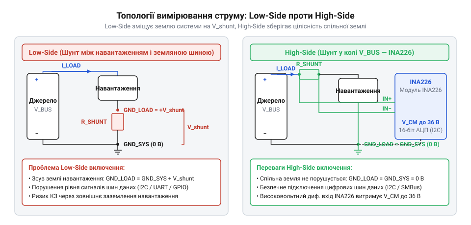
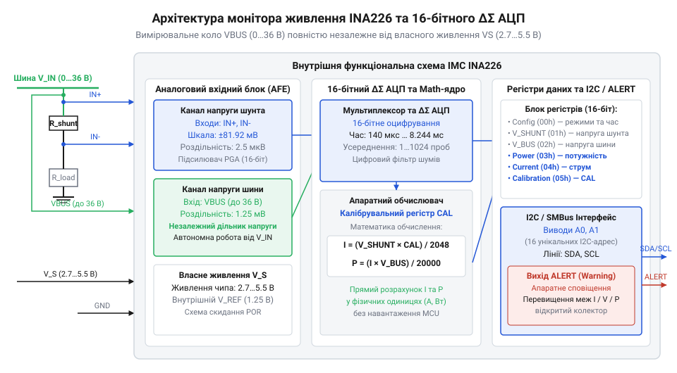

# Модуль цифрового монітора живлення INA226 (I2C/SMBus)

<preknowlist>
- [GY-серія (брейкаут-модулі)](root:cat-hw-sensors/gy-series) — принципи побудови брейкаут-модулів, підтягування ліній шини I2C та розведення живлення на платах-носіях
</preknowlist>

## Проблема вимірювання струму силових кіл

Вимірювання струму за падінням напруги на вимірювальному опорі ускладнюється вибором точки його включення в коло. Схема вимірювання в розриві заземлення (англ. @@en|Low-Side sensing@@) розміщує @@en|шунт@@ (від англ. @@en|shunt@@ — відгалуження) між мінусом джерела живлення та землею навантаження. Таке включення створює додатковий опір у заземлювальному провіднику, через що потенціал «мінуса» навантаження плаває залежно від струму. Це викликає помилки зчитування цифрових інтерфейсів та порушує роботу чутливих аналогових вузлів.


*Порівняння топологій Low-Side та High-Side вимірювання струму.*

Підключення в розриві позитивної лінії (англ. @@en|High-Side sensing@@) зберігає цілісність спільної землі, але створює високу @@en|синфазну напругу@@ (від англ. @@en|common-mode voltage@@) на вимірювальних входах. Звичайний аналогово-цифровий перетворювач мікроконтролера не здатний вимірювати мале падіння напруги на фоні високого потенціалу шини, що перевищує його напругу живлення. Для безпечного моніторингу силових кіл необхідний спеціалізований цифровий монітор живлення із захищеним диференціальним входом. Для побудови зручних вузлів живлення застосовують готові [брейкаут-модулі GY-серії](root:cat-hw-sensors/gy-series).

## Архітектура шістнадцятибітного АЦП та фільтрація

Мікросхема INA226 містить двоканальний 16-бітний @@en|дельта-сигма АЦП@@ (від англ. @@en|delta-sigma ADC@@) із роздільними вхідними трактами для вимірювання диференціальної напруги на шунті та напруги шини живлення. Висока роздільна здатність у 2.5 мкВ на @@en|найменший значущий розряд@@ (англ. @@en|LSB, Least Significant Bit@@) дозволяє фіксувати мікроамперні струми на вимірювальному опорі малого номіналу без значного падіння напруги у силовому колі. Вхідний каскад витримує синфазну напругу шини до 36 В незалежно від власної напруги живлення чипа від 2.7 В до 5.5 В.


*Структурна схема АЦП та обробки сигналів INA226.*

Для приглушення високочастотних завад та імпульсних кидків струму в чип вбудовано апаратний цифровий фільтр з можливістю налаштування часу перетворення та режиму усереднення від 1 до 1024 відліків. Апаратна фільтрація обробляє вибірки всередині мікросхеми, видаючи мікроконтролеру очищені від шумів значення без додаткового навантаження на обчислювальне ядро процесора.

## Апаратні обчислення та сповіщення ALERT

Внутрішнє математичне ядро INA226 самостійно множить виміряну напругу шунта на вміст розрахункового калібрувального регістра, записуючи готове значення струму безпосередньо в регістр струму. Повторне множення струму на напругу шини дає значення споживаної потужності. Це усуває потребу в постійному виконанні плаваючих обчислень на боці мікроконтролера.

Для миттєвої реакції на критичні події передбачено апаратний вивід `ALERT` з конфігурацією @@en|відкритий стік@@ (від англ. @@en|open-drain@@). Мікросхема автоматично формує сигнал переривання при перевищенні заданих порогів струму, напруги або потужності. Для підключення багатьох моніторів до однієї шини I2C входи A0 та A1 підтримують чотири рівні потенціалу (GND, VS, SDA, SCL), що забезпечує вибір 16 унікальних I2C-адрес.

## Розрахунок шунта та підключення Кельвіна

Вибір опору шунта визначається компромісом між точністю вимірювання та виділенням тепла. Для максимального струму 10 А та діапазону АЦП 81.92 мВ опір обчислюється за законом Ома:

```
R_shunt
= 81.92 mV ÷ 10 A      [закон Ома]
= 8.192 mOhm           [розрахунок опору]
```

Обирають найближчий стандартний номінал 10 мОм. Розсіювана потужність на шунті становить:

```
P_shunt
= (10 A)² × 0.01 Ohm   [формула потужності]
= 1 W                  [розрахунок потужності]
```

Для усунення похибки від опору з'єднувальних доріжок плати застосовують чотирипровідне @@en|підключення Кельвіна@@ (від англ. @@en|Kelvin connection@@), де вимірювальні провідники підключаються безпосередньо до контактних майданчиків шунта в обхід силового струмового шляху. У силових колах із високим рівнем завад вхідні лінії захищають за допомогою @@en|TVS-діодів@@ (від англ. @@en|Transient Voltage Suppressor@@ — пригнічувач тимчасових перенапруг).
