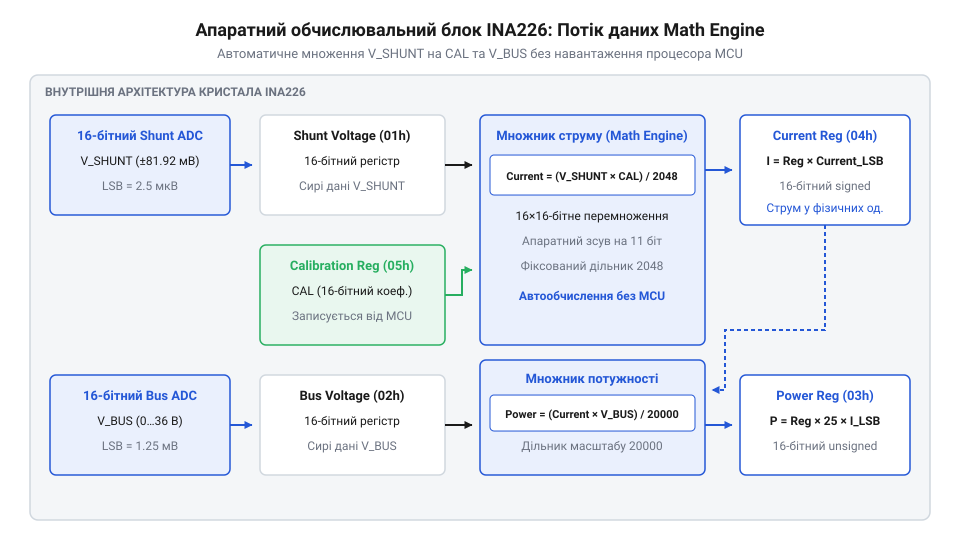

# Модуль цифрового монітора живлення INA226 (I2C/SMBus)

## Проблема вимірювання струму та потужності

Пряме вимірювання високих струмів споживання цифровими вимірювальними системами спирається на падіння напруги на вимірювальному резисторі — вимірювальному шунті (від англ. shunt — відгалужувати) @@en|shunt resistor@@. Проте безпосередній ввід такої напруги на штатний аналогово-цифровий перетворювач (від грец. analogos — відповідний та араб. ṣifr — нуль) @@en|analog-to-digital converter@@ мікроконтролера створює схемотехнічне розгалуження. Якщо падіння напруги на шунті мале (одиниці або десятки мілівольт), роздільна здатність штатного 10- або 12-бітного АЦП виявляється недостатньою, і корисний сигнал повністю втрачається в шумах квантування @@en|quantization error@@. Якщо ж збільшити опір шунта для отримання ширшого діапазону напруг, на резисторі виникають значні теплові втрати (від лат. dissipatio — розсіювання) @@en|power dissipation@@, а напруга живлення самого навантаження істотно просідає.

Для вирішення цього компромісу застосовують спеціалізовані монітори живлення, такі як мікросхема @@en|INA226@@. Пристрій інтегрує два окремі канали 16-розрядного дельта-сигма АЦП для одночасного моніторингу напруги й струму. Перший канал вимірює малу диференціальну напругу шунта @@en|shunt voltage@@, а другий фіксує напругу шини @@en|bus voltage@@ у діапазоні до 36 В без зовнішніх дільників. Синхронне знімання даних з обох каналів подає узгоджені значення на вбудований апаратний цифровий множник @@en|digital multiplier@@. Завдяки власному обчислювальному блоку мікросхема самостійно обраховує струм і споживану потужність у реальному часі, звільняючи центральний процесор від постійних розрахунків. Проте для отримання правильних фізичних значень струму в амперах і потужності у ватах системний програміст повинен виконати попередній математичний розрахунок і записати у мікросхему константу калібрувального регістра (від араб. qālib — форма) @@en|calibration register@@. Помилка в цьому розрахунку призводить до систематичного спотворення вимірювань або переповнення (від англ. overflow — переповнення) @@en|overflow@@ внутрішніх 16-бітних регістрів пристрою.

## Вибір опору шунта та теплообмеження

Розрахунок вимірювального вузла починається з визначення опору вимірювального шунта @@en|shunt resistor@@ `R_shunt`. Вхідний каскад АЦП @@en|INA226@@ призначений для вимірювання диференціальної напруги шунта `V_shunt` у строго фіксованому діапазоні від `-81.92` мВ до `+81.92` мВ. АЦП має 16-розрядну шкалу зі знаком, де найстарший знаковий розряд визначає напрямок протікання струму: додатне значення `V_shunt` відповідає прямому струму від входу `IN+` до `IN-` (наприклад, під час розряджання акумулятора), а від'ємне — зворотному від `IN-` до `IN+` (під час заряджання). Це забезпечує двонапрямний контроль без зміни фізичної комутації кола. Ціна молодшого розряду (від англ. least significant bit — найменш значущий розряд) @@en|least significant bit@@ `V_shunt_LSB` дорівнює `2.5` мкВ (`0.0000025` В), а гранична величина вимірюваної напруги `V_shunt_max` становить `81.92` мВ, що відповідає максимальному позитивному значенню в регістрі `32767`. Зменшення номіналу `R_shunt` пропорційно знижує теплове розсіювання та втрати напруги на шунті, однак вимагає компромісу з використанням динамічного діапазону @@en|dynamic range@@ АЦП. Якщо вибрати опір занадто малим, навіть максимальний струм навантаження створюватиме падіння напруги, значно менше за `81.92` мВ, через що значна частина 15-бітної шкали залишиться невикористаною. Це зменшує кількість відліків АЦП на ампер вимірюваного струму, збільшує відносну похибку квантування й знижує фактичну роздільну здатність вимірювального вузла.

Обчислення максимального опору шунта `R_shunt_max` виконують діленням граничної напруги АЦП `V_shunt_max` на заданий максимальний струм навантаження `I_max`.

```
R_shunt_max = V_shunt_max ÷ I_max
            = 0.08192 ÷ I_max            [підстановка граничної напруги АЦП 81.92 мВ]
```

Отриманий вираз показує верхню межу опору, за якої АЦП не входить у насичення при пікових струмах. Для прикладу, якщо максимальний вимірюваний струм кола `I_max` становить `10` А, граничний опір шунта `R_shunt_max` дорівнює `0.08192 ÷ 10 = 0.008192` Ом (`8.192` мОм). На практиці вибирають найближчий менший стандартний номінал резистора, наприклад `0.002` Ом (`2` мОм) або `0.005` Ом (`5` мОм), щоб створити технологічний запас за струмом.

Потужність теплових втрат `P_shunt` обчислюють множенням квадрата максимального струму `I_max` на вибраний опір шунта `R_shunt`.

```
P_shunt = I_max² × R_shunt               [визначення теплової потужності за законом Джоуля-Ленца]
```

Цей вираз визначає мінімально припустиму паспортну потужність вимірювального резистора для відведення тепла. Нагрівання шунта викликає температурний дрейф (від англ. thermal drift — температурне відхилення) @@en|thermal drift@@ опору, що знижує точність вимірювання. Для струму `10` А та шунта `0.005` Ом розрахована потужність становить `10² × 0.005 = 0.5` Вт, тому вибирають резистор із номінальною потужністю `1` Вт або вище.

## Розрахунок дискрети струму та калібрування

Після вибору фізичного опору шунта @@en|shunt resistor@@ `R_shunt` необхідно розрахувати дискрету струму `Current_LSB` — вагу одного молодшого розряду в регістрі струму @@en|current register@@.

Мінімальне теоретичне значення дискрети струму `Current_LSB_min` обчислюють діленням максимального струму `I_max` на максимальну кількість розрядів позитивного діапазону регістра.

```
Current_LSB_min = I_max ÷ 32768           [ділення струму на розрядність 15-бітної шкали]
```

Отримане значення показує найвищу можливу роздільну здатність вимірювання струму для даної конфігурації. На практиці `Current_LSB_min` округлюють у більший бік до найближчого зручного значення `Current_LSB` (наприклад, `0.001` А/LSB або `0.0005` А/LSB). Округлення у менший бік заборонене, оскільки це призведе до переповнення @@en|overflow@@ 16-бітного регістра струму при досягненні струму `I_max`.

Практичний алгоритм вибору нормованої дискрети струму @@en|Current_LSB@@ полягає в округленні теоретичного мінімуму `Current_LSB_min = I_max ÷ 32768` у більший бік до найближчого зручного числа з ряду `1 × 10ⁿ`, `2 × 10ⁿ` або `5 × 10ⁿ` А/LSB (наприклад, `0.0004` А/LSB чи `0.001` А/LSB). Округлення вгору гарантує виконання умови `Current_LSB ≥ Current_LSB_min`, що упереджує апаратне переповнення @@en|overflow@@ 16-бітного регістра струму при досягненні струму `I_max`, а вибір мантиси з ряду 1, 2 або 5 спрощує перетворення цілочисельного коду регістра у фізичні ампери чи міліампери на мікроконтролері без обчислень із плаваючою комою. Після вибору робочої дискрети струму та опору шунта @@en|shunt resistor@@ `R_shunt` обчислюють константу калібрувального регістра @@en|calibration register@@ `CAL` діленням системного коефіцієнта `0.00512` на добуток `Current_LSB × R_shunt`. Цей вираз виводиться зі співвідношення між фізичним струмом за законом Ома `I = V_shunt ÷ R_shunt` та вбудованою арифметикою цифрового множника @@en|digital multiplier@@ мікросхеми, який обчислює значення регістра струму за формулою `Current = (ShuntVoltage × CAL) ÷ 2048`. Оскільки напруга шунта `V_shunt` визначається через код АЦП `ShuntVoltage` та ціну молодшого розряду `V_shunt_LSB = 2.5` мкВ (`0.0000025` В), підстановка фізичного струму `I = Current × Current_LSB` у рівняння мікросхеми дає покрокове математичне виведення:

```
CAL
= (2048 × V_shunt_LSB) ÷ (Current_LSB × R_shunt)
= (2048 × 0.0000025) ÷ (Current_LSB × R_shunt)     [підстановка ціни розряду напруги шунта 2.5 мкВ]
= 0.00512 ÷ (Current_LSB × R_shunt)                [добруток масштабувального коефіцієнта 2048 та 2.5 мкВ]
```

Системний коефіцієнт `0.00512` є точним добутком внутрішнього масштабувального коефіцієнта `2048` на дискрету напруги шунта `2.5` мкВ (`2048 × 0.0000025 В = 0.00512 В`), а підсумкове ціле число для запису в регістр `CAL` отримують відкиданням дробової частини `CAL = trunc(0.00512 ÷ (Current_LSB × R_shunt))`.

```
CAL = trunc(0.00512 ÷ (Current_LSB × R_shunt))  [цілочисельне відкидання дробової частини]
```

Вираз формує цілочисельний коефіцієнт, який вбудований цифровий множник @@en|digital multiplier@@ мікросхеми використовує для перерахунку вхідної напруги у регістр струму. Системний коефіцієнт `0.00512` є добутком ціни розряду напруги шунта `V_shunt_LSB = 2.5` мкВ на внутрішній арифметичний масштабувальний коефіцієнт `2048`.


*Послідовність розрахунку регістрів струму та потужності в мікросхемі INA226 на основі вхідних напруг і константи калібрування.*

## Внутрішні обчислення регістрів і похибки

Після запису константи `CAL` у регістр `05h` мікросхема @@en|INA226@@ починає автоматично перераховувати виміряну напругу шунта у значення регістра струму. Повний опис карти регістрів, режимів усереднення АЦП та налаштування масок переривань викладено у матеріалі про [карту регістрів та конфігурацію INA226](root:cat-hw-sensors/ina226-config-and-averaging).

Значення регістра струму `Current_Register` обчислюють множенням виміряної цифрової напруги шунта `V_shunt_Register` на записану калібрувальну константу `CAL` з наступним діленням на внутрішній дільник `2048`.

```
Current_Register = trunc((V_shunt_Register × CAL) ÷ 2048)  [внутрішнє цілочисельне множення та зсув]
```

Сформоване ціле число в регістрі струму при множенні на обраний `Current_LSB` дає точний струм навантаження в амперах. Паралельно з цим мікросхема обчислює значення регістра потужності. Дискрета потужності `Power_LSB` у мікросхемі @@en|INA226@@ жорстко прив'язана до дискрети струму співвідношенням `Power_LSB = 25 × Current_LSB`.

Значення регістра потужності `Power_Register` обчислюють множенням вмісту регістра струму `Current_Register` на вміст регістра шинної напруги `Bus_Voltage_Register` із діленням на константу `20000`. Вбудований апаратний множник мікросхеми @@en|INA226@@ виконує цей розрахунок у цілочисельній арифметиці з фіксованою комою @@en|fixed-point arithmetic@@ (англ. *fixed point* — фіксована кома, *arithmetic* — обчислення). Оскільки фізична потужність навантаження є добутком струму та шинної напруги `P = (Current_Register × Current_LSB) × (Bus_Voltage_Register × 0.00125 В)`, а значення регістра потужності, помножене на `Power_LSB = 25 × Current_LSB`, має дорівнювати цій самій потужності, покрокове обчислення значення регістра потужності `Power_Register` з рівняння балансу потужності має такий вигляд:

```
Power_Register
= trunc((Current_Register × Current_LSB × Bus_Voltage_Register × 0.00125) ÷ (25 × Current_LSB))  [підстановка фізичних співвідношень струму та напруги]
= trunc((Current_Register × Bus_Voltage_Register × 0.00125) ÷ 25)                                [скорочення спільника Current_LSB]
= trunc((Current_Register × Bus_Voltage_Register) ÷ 20000)                                        [заміна множення на 0.00125 ÷ 25 діленням на 20000]
```

З виведеного виразу видно, що константа `20000` виникає внаслідок ділення коефіцієнта масштабування потужності `25` на ціну розряду шинної напруги @@en|bus voltage@@ `1.25` мВ (`0.00125` В), оскільки `25 ÷ 0.00125 = 20000`. Апаратний множник спочатку формує 32-бітний проміжний добуток двох 16-бітних регістрів, а потім ділить його на `20000` із відкиданням залишку (`trunc`), записуючи підсумковий результат у 16-бітний `Power_Register`.

Відкидання дробової частини під час обчислення константи калібрування створює похибку обтинання @@en|truncation error@@ (англ. *truncation* — обтинання, зрізання) `Err_cal`, яку оцінюють порівнянням точного й цілочисельного значень.

**Обчислення похибки калібрування на прикладі вимірювального кола з опором шунта R_shunt = 0.1 Ом та обраною дискретою струму Current_LSB = 30 мкА/LSB (0.00003 А/LSB):**

```
CAL_exact
= 0.00512 ÷ (0.00003 × 0.1)      [підстановка дискрети струму 30 мкА/LSB та опору шунта 0.1 Ом]
= 0.00512 ÷ 0.000003             [обчислення знаменника в вольтах]
≈ 1706.6667                      [розрахунок точного дробового значення константи калібрування]

CAL = trunc(1706.6667) = 1706    [відкидання дробової частини для запису в 16-бітний регістр]

Err_cal
= ((1706.6667 - 1706) ÷ 1706.6667) × 100%  [підстановка точного та округленого значень у формулу похибки]
= (0.6667 ÷ 1706.6667) × 100%               [обчислення абсолютного відхилення дробової частини]
≈ 0.0391%                                   [розрахунок відносної похибки округлення]
```

Розраховане відносне відхилення `Err_cal ≈ 0.0391%` становить менше ніж `1%`, що підтверджує допустимість округлення та забезпечує необхідну точність вимірювання без додаткової програмної корекції.

```
Power_Register = trunc((Current_Register × Bus_Voltage_Register) ÷ 20000)  [внутрішнє обчислення потужності]
```

Результат у регістрі потужності при множенні на `Power_LSB` дорівнює споживаній потужності навантаження у ватах. Константа `20000` виникає з того, що ціна розряду шинної напруги @@en|bus voltage@@ `V_bus_LSB` становить `1.25` мВ, а співвідношення `0.00125 В ÷ 25` дорівнює `1 ÷ 20000`.

Відносну похибку калібрування `Err_cal` обчислюють як різницю між точним дробовим значенням `CAL_exact` і округленим цілим `CAL`, віднесену до точного значення.

```
Err_cal = ((CAL_exact - CAL) ÷ CAL_exact) × 100%  [оцінка відносної похибки округлення]
```

Якщо відносна похибка відкидання дробової частини перевищує `1` %, необхідно відкоригувати вибір `Current_LSB` або скористатися програмною компенсацією у мікроконтролері.
