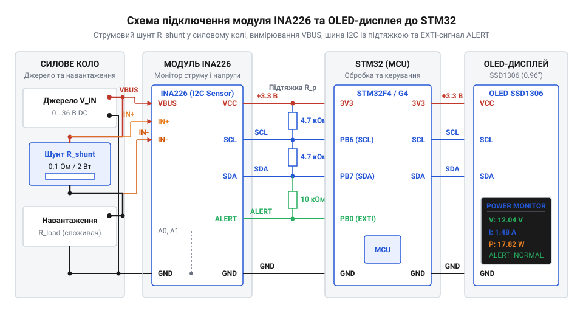
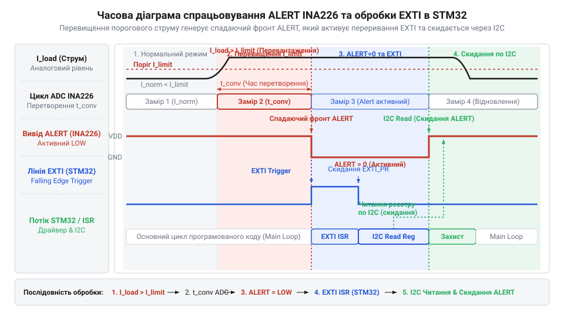

# Проєкт цифрового ватметра на INA226 та STM32

<preknowlist>
- [GY-серія (брейкаут-модулі)](root:cat-hw-sensors/gy-series) — особливості підключення брейкаут-модулів датчиків та призначення виводів вимірювальних кіл
</preknowlist>

## Чому звичайний АЦП псує вимірювання

Конструювання цифрового лабораторного джерела живлення вимагає безперервного моніторингу струму та напруги силової шини. Пряме підключення вимірювального кола до вбудованого в мікроконтролер @@en|ADC@@ (від @@lat|analogus@@ та @@lat|digitalis@@ — аналого-цифровий перетворювач) наражається на фізичні обмеження напівпровідникової периферії. Вхідні виводи мікроконтролера STM32 розраховані на напругу від 0 до 3.3 В. Спроба виміряти струм на верхньому плечі силової шини напругою 12 В або 24 В створює високу @@en|common-mode voltage@@ (від @@en|common mode@@ — синфазна напруга), яка негайно виведе з ладу захисні діоди та сам аналоговий вхід.

Використання резистивного дільника напруги для узгодження рівнів не вирішує проблему, а створює катастрофічну похибку. Навіть при застосуванні прецизійних резисторів з допуском 0.1% розбаланс плечей дільника спричиняє похибку синфазного сигналу, що повністю перекриває корисне падіння напруги на @@en|high-side shunt@@ (від @@en|shunt@@ — відхилення, вимірювальний шунт). Спроба перенести шунт у нижнє плече (між навантаженням та спільним проводом) викликає @@en|ground bounce@@ (зсув потенціалу землі). Потенціал землі навантаження починає плавати відносно землі мікроконтролера залежно від струму, руйнуючи цифровий обмін по інтерфейсах I2C та UART.

Додатковим бар'єром стає власна роздільна здатність та рівень шумів. Вбудований 12-бітний АЦП мікроконтролера в реальних умовах має ефективну розрядність біля 10 біт через цифрові завади ядра та пульсації живлення. При вимірювальній шкалі 3.3 В ціна молодшого розряду становить близько 0.8 мВ. Для падіння напруги на шунті в діапазоні 10–50 мВ такий перетворювач забезпечить лише 12–60 дискретних відліків, що призводить до високої похибки вимірювання струму та сильного @@en|zero-offset drift@@ (дрейф зсуву нуля).

Розв'язанням цієї проблеми є застосування спеціалізованого цифрового вимірювача живлення INA226. Він містить вбудований @@en|differential amplifier@@ (диференційний підсилювач) із допустимою синфазною напругою шини до 36 В, прецизійний 16-бітний дельта-сигма АЦП та цифровий фільтр. Для швидкого підключення таких датчиків до розробки часто застосовують [брейкаут-модулі вимірювачів](root:cat-hw-sensors/gy-series), які вже містять необхідні фільтруючі ємності та розмічені виводи. Детальний огляд внутрішньої архітектури, тригерів та регістрів чипа викладено у матеріалі про [цифровий монітор живлення INA226](root:cat-hw-sensors/ina226-power-monitor).

## Математика та розрахунок регістру калібрування

Мікросхема INA226 інтегрує два незалежні канали вимірювання: дифвхід напруги шунта V_shunt та вхід напруги шини V_bus. АЦП мікросхеми перетворює падіння напруги на шунті із фіксованим квантом LSB_Vshunt = 2.5 мкВ у 16-бітному доповняльному коді. Напруга шини вимірюється з квантом LSB_Vbus = 1.25 мВ. Щоб позбавити мікроконтролер необхідності виконувати ресурсомісткі обчислення з плаваючою комою при кожному вимірюванні, INA226 містить апаратний арифметичний блок та внутрішній `CALIBRATION` (від @@fr|calibre@@ — калібрування) регістр `0x05`.

Вибір опору шунта R_shunt визначається максимальним струмом навантаження I_max. Максимальне падіння напруги на шунті не повинно перевищувати межу шкали АЦП 81.92 мВ. Для струму I_max = 8 А обираємо шунт R_shunt = 10 мОм = 0.01 Ом. При максимальному струмі падіння напруги становитиме:

```
V_shunt = I_max · R_shunt
        = 8 · 0.01                [підстановка струму та опору]
        = 0.08 В = 80 мВ          [результат в межах 81.92 мВ]
```

Визначимо ціну молодшого розряду струму `Current_LSB` (від @@en|Least Significant Bit@@ — квант струму). Для 15 біт беззнакової шкали струму мінімальний квант обчислюється діленням I_max / 32768. Для I_max = 8 А значення становить близько 244 мкА/дискрет. Обираємо округлене зручне значення `Current_LSB = 100 мкА/дискрет = 0.0001 А`.

Значення калібрувального регістру `CAL` розраховується за фіксованою формулою виробника Texas Instruments:

```
CAL = trunc(0.00512 / (Current_LSB · R_shunt))
    = trunc(0.00512 / (0.0001 · 0.01))             [підстановка LSB та опору]
    = trunc(0.00512 / 0.000001)                    [знаменник дорівнює 10⁻⁶]
    = 5120                                         [значення регістру 0x05]
```

Для цілочисельної арифметики мікроконтролера формула записується через міліоми та мікроампери: `CAL = 5120000 / (Current_LSB_uA · R_shunt_mOhm)`. При Current_LSB_uA = 100 та R_shunt_mOhm = 10 отримуємо CAL = 5120 (`0x1400`).

Після запису значення CAL у регістр `0x05` апаратний блок INA226 перераховує падіння напруги шунта у значення струму за формулою Current = (ShuntVoltage · CAL) / 2048 і записує результат у регістр `0x04`. Обчислення потужності виконується за формулою Power = (Current · BusVoltage) / 20000 із записом у регістр `0x03` із квантом Power_LSB = 25 · Current_LSB = 2.5 мВт.

Нижче наведено програмний розрахунок калібрування в драйвері INA226:

:::tabs
@tab C
:::code proj-ina226-power-monitor-stm32/c/ina226.c 24-34
@tab C++
:::code proj-ina226-power-monitor-stm32/cpp/Ina226.cpp 70-79
:::

## Апаратне з'єднання INA226 з STM32

Фізична інтеграція цифрового монітора живлення в систему охоплює з'єднання силового кола, цифрової шини I2C та лінії переривань. Вимірювальний шунт вмикається в розрив позитивного провідника силової шини. Виводи IN+ та IN- модуля INA226 приєднуються безпосередньо до контактних площадок шунта за схемою Кельвіна для виключення опору підвідних провідників. Вивід VBUS підключається до точки IN+ для моніторингу напруги шини.

Цифровий обмін з мікроконтролером STM32 та графічним дисплеєм відображення реалізовано по шині I2C. Виводи SCL та SDA обох пристроїв об'єднуються паралельно та підтягуються до лінії живлення 3.3 В за допомогою зовнішніх @@en|pull-up resistors@@ (підтягувальні резистори) номіналом 4.7 кОм. Вивід ALERT давача має конфігурацію @@en|open-collector@@ (відкритий колектор) і підключається до GPIO виводу STM32, налаштованого на вхід зовнішнього переривання @@en|EXTI@@ (від @@en|external interrupt@@ — зовнішнє переривання).


*Принципова схема з'єднання вимірювальних та цифрових кіл INA226 з STM32 та OLED-дисплеєм по шині I2C з лінією апаратного сповіщення ALERT.*

Для захисту лабораторного блоку живлення від перевантаження INA226 конфігурують на контроль порогового значення потужності або струму. При перевищенні ліміту у регістрі `ALERT_LIMIT` `0x07` пристрій переводить лінію ALERT у низький логічний рівень.


*Часова діаграма формування сигналу переривання EXTI при виникненні апаратної тривоги ALERT та його скидання після зчитання статусного регістра.*

Спадний фронт на виводі ALERT викликає негайне апаратне переривання в мікроконтролері. В обробнику переривання @@en|ISR@@ (від @@en|interrupt service routine@@ — служба обробки переривання) встановлюється прапор атомарного статусу. Головний цикл зчитує регістр `Mask/Enable` `0x06`, що автоматично скидає зафіксований стан лінії ALERT та виводить апаратне попередження на екран.

Код налаштування порогу спрацьовування ALERT та обробка переривання реалізовані наступним чином:

:::tabs
@tab C
:::code proj-ina226-power-monitor-stm32/c/main.c 40-44
@tab C++
:::code proj-ina226-power-monitor-stm32/cpp/main.cpp 95-99
:::

## Конфігурація регістрів та переривання EXTI

Безперервне опитування шини @@en|I2C@@ монітора живлення марнує ресурси процесора та створює непотрібний трафік. Щоб мікроконтролер дізнавався про нові виміри чи аварійні події миттєво, сенсор @@en|INA226@@ налаштовують на автономний контроль із генерацією апаратного сигналу @@en|ALERT@@.

Після подачі живлення або м'якого скидання через біт `RST` у регістрі @@en|CONFIG@@ (`0x00`) задають режим роботи АЦП. Поля `AVG` визначають кількість вибірок для усереднення (від 1 до 1024), а `VBUSCT` та `VSHCT` — час перетворення напруги шини й шунта (від 140 мкс до 8.244 мс). Усереднення зменшує шум у високочастотних колах живлення, але збільшує інтервал оновлення даних. Записом обчисленого значення `CAL` у регістр `0x05` активують внутрішні математичні розрахунки струму й потужності.

:::tabs
@c
:::code proj-ina226-power-monitor-stm32/c/ina226.c 52-76
@cpp
:::code proj-ina226-power-monitor-stm32/cpp/Ina226.cpp 7-30
:::

Для автоматичного захисту навантаження у регістр @@en|ALERT LIMIT@@ (`0x07`) записують порогову величину у дискретах. Для вибору події спрацьовування та поведінки виходу використовують регістр @@en|MASK/ENABLE@@ (`0x06`). Поставивши біт `POL` (від англ. *Power Over-Limit* — перевищення потужності) або `SOL` (перевищення напруги шунта), сенсор починає порівнювати щойно виміряне значення із порогом.

Шоб визначити значення для запису у регістр @@en|ALERT LIMIT@@ при пороговій потужності 15 Вт (15000 мВт) та кванті потужності 2.5 мВт, ділимо фізичний поріг на квант потужності.

```
Raw_Limit = P_limit / Power_LSB
= 15000 / 2.5            [підстановка P_limit = 15000 мВт та Power_LSB = 2.5 мВт]
= 6000                   [ділення цілих чисел]
```

Отримане значення `6000` записується в регістр `0x07`, після чого пристрій порівнюватиме з ним поточний вміст регістру потужності при кожному вимірюванні. Біт `LEN` вмикає зафіксований режим (англ. *latched mode*), коли лінія тривоги утримується у низькому стані до моменту зчитування регістра статусів.

:::tabs
@c
:::code proj-ina226-power-monitor-stm32/c/ina226.c 130-134
@cpp
:::code proj-ina226-power-monitor-stm32/cpp/Ina226.cpp 82-127
:::

Вивід @@en|ALERT@@ працює за принципом відкритого колектора (від англ. *open-collector output*), тому його з'єднують із лінією підтягувального резистора (від англ. *pull-up resistor*). Зауважимо, що готові [модулі GY-серії](root:cat-hw-sensors/gy-series) вже мають вбудовану резистивну підтяжку до шини `VCC`. На стороні STM32 цей вивід підключають до пина з підтримкою зовнішнього переривання @@en|EXTI@@ (від англ. *external interrupt*). При спрацьовуванні лінія спадає в `0`, викликаючи обробник переривання @@en|ISR@@ (від англ. *interrupt service routine*), який виставляє легкий прапорець для головного циклу.


*Фігура 1: Апаратне переривання EXTI фіксує спад рівня на лінії ALERT та ініціює зчитування статусів I2C.*

:::tabs
@c
:::code proj-ina226-power-monitor-stm32/c/main.c 41-44
:::code proj-ina226-power-monitor-stm32/c/main.c 195-208
@cpp
:::code proj-ina226-power-monitor-stm32/cpp/main.cpp 95-99
:::code proj-ina226-power-monitor-stm32/cpp/main.cpp 160-186
:::

Зчитування регістра @@en|MASK/ENABLE@@ у головному циклі очищує прапор @@en|AFF@@ (від англ. *Alert Function Flag*) та повертає вивід @@en|ALERT@@ у високий стан.

## Вивід даних та випробування захисту

Отримавши виміряні значення струму, напруги та потужності, їх необхідно форматувати та відобразити у зручному для користувача вигляді. Для компактних лабораторних джерел живлення застосовують [дисплеї на SSD1306](root:cat-hw-actuators/oled-ssd1306), обмін із якими також здійснюється по шині @@en|I2C@@.

Оскільки всі обчислення всередині драйвера @@en|INA226@@ виконуються у цілочисельних одиницях (мВ, мкВ, мА, мВт), перед відображенням здійснюють перетворення у дрібний формат для людей. Цільовий кадровий буфер @@en|framebuffer@@ (від англ. *frame buffer*) формується в оперативній пам'яті STM32 і відправляється на дисплей єдиним пакетом.

:::tabs
@c
:::code proj-ina226-power-monitor-stm32/c/oled_display.c 219-259
@cpp
:::code proj-ina226-power-monitor-stm32/cpp/OledDisplay.cpp 164-191
:::

Для перевірки апаратного захисту імітують стрибок навантаження або коротке замикання. Коли струм навантаження перевищує допустиму межу, напруга на шунті різко зростає, і обчислена сенсором потужність виходить за порогове значення `Raw_Limit = 6000`. Сенсор миттєво притягує лінію @@en|ALERT@@ до землі, мікроконтролер фіксує переривання @@en|EXTI@@, перериває звичайне опитування та виводить повідомлення про аварію на екран. Після зниження струму до норми та прочитання статусів система повертається у штатний режим моніторингу.
