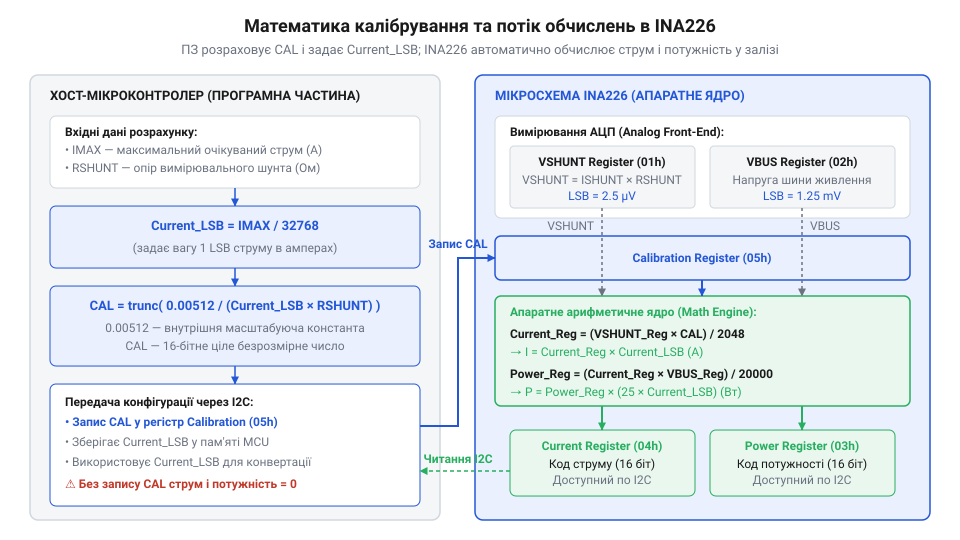
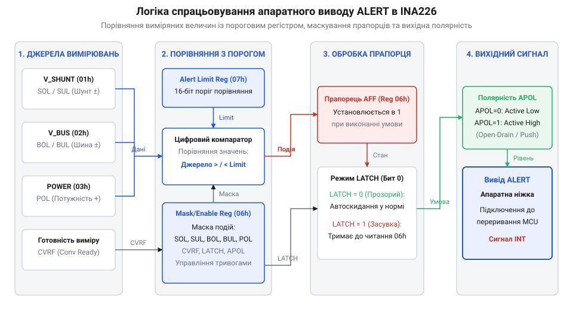

# Програмний драйвер та низькорівневий API для INA226

<preknowlist>
- [INA219 — монітор струму й напруги (I2C)](root:cat-hw-sensors/ina219-power-monitor) — Принципи організації обміну по шині I2C та базовий розрахунок струму/потужності для порівняння архітектури моніторів Texas Instruments.
- [Конфігурація та усереднення вимірювань INA226](root:cat-hw-sensors/ina226-config-and-averaging) — Вплив вибору часу перетворення та коефіцієнтів усереднення на рівень шумів і частоту оновлення регістрів INA226.
</preknowlist>

## Проблема прямих I2C-запитів без драйвера

Пряме вичитування регістрів вимірювальних мікросхем через шину @@en|I2C@@ (англ. *Inter-Integrated Circuit* — міжмікросхемний зв'язок) без проміжного шару абстракції здається найкоротшим шляхом під час першого знайомства з компонентом. Розробники просто надсилають адресу пристрою, номер регістру й одразу зчитують старший та молодший байти у звичайній функції опитування. Однак у системі моніторингу живлення @@en|INA226@@ такий хаотичний підхід швидко призводить до прихованих обчислювальних помилок та блокування всієї мікроконтролерної периферії.

На відміну від простішого [монітора струму INA219](root:cat-hw-sensors/ina219-power-monitor), розрядність та внутрішня математика @@en|INA226@@ вимагають суворого узгодження апаратних прапорців та масштабувальних коефіцієнтів. Коли прямі побайтові запити розкидані по основному циклу програми, виникають три критичні проблеми:

1. **Неузгодженість вибірок даних.** Якщо мікроконтролер перериває I2C-транзакцію посеред вичитання двобайтового регістру або зчитує напругу шунта й напругу шини в довільні моменти часу, дані належать до різних циклів перетворення. Результатом стають фантомні сплески струму й потужності у розрахунках. 2. **Ігнорування готовності кадру.** Без перевірки прапорця готовності @@en|Conversion Ready@@ програма або багаторазово зчитує той самий застарілий результат, або звертається до регістру під час його оновлення цифровим ядром чипа. 3. **Зависання шини при апаратних збоях.** Простий виклик низькорівневого `i2c_read()` без обробки таймаутів при тимчасовому осіданні живлення або заваді на лінії SCL призводить до безкінечного очікування відповіді й зупинки всього мікроконтролера.

Для усунення цих ризиків потрібен структурований програмний драйвер. Він відокремлює низькорівневий апаратний транспорт @@en|HAL@@ (від англ. *Hardware Abstraction Layer* — шар абстракції апаратури) від логіки обробки вимірювань. Драйвер атомарно виконує вичитання регістрів, зберігає внутрішній стан калібрування, контролює готовність даних та забезпечує м'яке відновлення шини при помилках зв'язку.

## Конфігурація регістру режимів та усереднення

Після створення транспорту першим завданням драйвера є початкова ініціалізація @@en|INA226@@. Усі параметри роботи чипа зосереджені в 16-бітному регістрі конфігурації @@en|Configuration Register@@ з адресою `0x00`. За замовчуванням після подачі живлення або програмного скидання регістр містить значення `0x4127`, що відповідає безперервному вимірюванню напруги шунта та шини з часом перетворення 1.1 мс і без усереднення.

Для адаптації монітора під вимоги конкретної системи драйвер має сформувати 16-бітну маску, яка визначає три ключові характеристики: коефіцієнт усереднення @@en|AVG@@, час перетворення напруги шини @@en|VBUS CT@@ та напруги шунта @@en|VSH CT@@, а також режим вимірювання @@en|MODE@@.

Розподіл бітів у регістрі конфігурації:

- Біт 15 @@en|RST@@: встановлення в `1` виконує м'яке скидання @@en|Soft Reset@@ усіх регістрів до значень за замовчуванням. - Біти 11–9 @@en|AVG@@: вибір кількості усереднюваних вибірок (від 1 до 1024). Значення `000` задає 1 вибірку, `011` — 64 вибірки, а `111` — 1024 вибірки. - Біти 8–6 @@en|VBUS CT@@ та біти 5–3 @@en|VSH CT@@: час інтегрування сигналу АЦП. Доступні 8 значень: від 140 мкс (`000`) до 8.244 мс (`111`). Значення за замовчуванням `100` відповідає 1.1 мс. - Біти 2–0 @@en|MODE@@: режим роботи мікросхеми.

Детальний аналіз того, як обрані [коефіцієнти усереднення вимірювань](root:cat-hw-sensors/ina226-config-and-averaging) впливають на рівень шуму та частоту оновлення регістрів, дозволяє знайти баланс між точністю й реактивністю системи. Драйвер надає можливість обрати один із трьох режимів роботи @@en|MODE@@:

1. **Безперервний режим (Continuous):** АЦП постійно виконує цикл перетворень. Використовується для постійного моніторингу телеметрії. 2. **За тригером (Triggered):** АЦП виконує один цикл вимірювання за командою з контролера і переходить у стан очікування. Це оптимізує споживання в періодичних вимірювальних системах. 3. **Знижене енергоспоживання (Power-Down):** Внутрішня аналогова частина вимикається, споживання струму знижується до менше ніж 1 мкА.

Наведемо реалізацію конфігурації драйвера двома мовами.

:::tabs
:::code api-ina226-firmware-driver/c/esp-idf/ina226-configure.c
:::code api-ina226-firmware-driver/cpp/arduino/ina226driver.cpp
:::

## Розрахунок калібрування та масштабування даних

Фізичне вимірювання струму в @@en|INA226@@ відбувається шляхом зчитування падіння напруги на вимірювальному шунті `R_shunt`. Однак для того, щоб внутрішнє цифрове ядро чипа самостійно розраховувало струм у регістрі `Current` (`0x04`) та потужність у регістрі `Power` (`0x03`), у регістр калібрування @@en|Calibration Register@@ (`0x05`) необхідно записати цілочисельний коефіцієнт `CAL`.

Процес розрахунку цього коефіцієнта починається з вибору мінімальної дискретизації струму @@en|Current LSB@@ (англ. *Current Least Significant Bit* — значення одного молодшого розряду струму). Спочатку розраховують теоретичне мінімальне значення `Current_LSB` на основі максимально очікуваного струму в системі `I_max`:

```
Current_LSB = I_max ÷ 32768
```

Отримане значення заокруглюють до зручного цілого числа (наприклад, 100 мкА/LSB або 1 мА/LSB). Після вибору `Current_LSB` та знаючи точний опір шунта `R_shunt` у омах, розраховують коефіцієнт калібрування `CAL` за фіксованою формулою @@en|INA226@@:

```
CAL = trunc(0.00512 ÷ (Current_LSB × R_shunt))      [формула калібрування INA226]
```

Число `0.00512` є внутрішньою масштабувальною константою цифрового ядра чипа. Після записання значення `CAL` у регістр `0x05`, апаратний перемножувач @@en|INA226@@ виконує розрахунок струму при кожному перетворенні за внутрішнім алгоритмом:

```
Current_raw = (ShuntVoltage_raw × CAL) ÷ 2048
```

Наочна схема математичного потоку даних наведена на малюнку нижче.


*Схема обчислення Current_LSB, розрахунку значення CAL та його завантаження в регістр Calibration з наступним автоматичним розрахунком Current і Power всередині INA226.*

Для конвертації сирих 16-бітних значень із регістрів у фізичні величини драйвер застосовує такі масштабувальні множники:

- **Напруга шини (Bus Voltage, `0x02`):** кожен крок дорівнює 1.25 мВ (`0.00125` В). - **Напруга шунта (Shunt Voltage, `0x01`):** кожен крок дорівнює 2.5 мкВ (`0.0000025` В). - **Струм (Current, `0x04`):** значення дорівнює `Current_raw × Current_LSB`. - **Потужність (Power, `0x03`):** фіксований внутрішній масштаб становить `25 × Current_LSB`.

Код-блок переведення сирих даних у фізичні одиниці:

```
V_bus = BusVoltage_raw × 0.00125                     [значення в вольтах]
V_shunt = ShuntVoltage_raw × 0.0000025               [значення в вольтах]
I = Current_raw × Current_LSB                        [значення в амперах]
P = Power_raw × (25 × Current_LSB)                   [значення у ватах]
```

## Зчитування вимірювань та перевірка готовності

Отримання актуальних вимірювань вимагає синхронізації опитування з внутрішнім циклом АЦП @@en|INA226@@. Якщо зчитувати регістри результатів у довільний момент, існує ризик отримати дані з попереднього кадру або прочитати значення в момент їх оновлення.

Для неблокуючої синхронізації драйвер перевіряє прапорець готовності перетворення `CVRF` (англ. *Conversion Ready Flag*), який знаходиться у біті 3 регістру керування масками й перериваннями @@en|Mask/Enable Register@@ (`0x06`). Прапорець встановлюється в `1` кожного разу, коли всі заплановані вимірювання та усереднення завершені.

Важливо враховувати інваріант обнулення прапорця: зчитування регістру `Mask/Enable` або регістру потужності `Power` (`0x03`) автоматично скидає біт `CVRF` в `0`.

Для стабільного збору телеметрії драйвер надає неблокуючий API. Нижче наведено приклад реалізації циклу зчитування вимірювань.

:::tabs
:::code api-ina226-firmware-driver/c/esp-idf/ina226-is-data-ready.c
:::code api-ina226-firmware-driver/cpp/arduino/ina226measurement.cpp
:::

## Налаштування переривань та порогів ALERT

Періодичне опитування регістрів телеметрії в неблокуючому циклі не підходить для ситуацій, коли система має негайно зреагувати на аварійну подію — наприклад, перевантаження по струму або критичне зниження напруги живлення. Для асинхронного сповіщення мікроконтролера @@en|INA226@@ оснащено апаратним виводом @@en|ALERT@@.

Поведінка виводу `ALERT` програмується через регістр конфігурації переривань @@en|Mask/Enable Register@@ (`0x06`) та пороговий регістр @@en|Alert Limit Register@@ (`0x07`). У регістр `Alert Limit` записується сире 16-бітне значення порогової величини, з якою цифровий компаратор чипа порівнює обраний параметр.

У регістрі `Mask/Enable` можна ввімкнути один із п'яти апаратних режимів порівняння:

- **SOL (Shunt Over-Voltage, біт 15):** перевищення напруги на шунті (перевантаження по струму). - **SUL (Shunt Under-Voltage, біт 14):** падіння напруги на шунті нижче порога. - **BOL (Bus Over-Voltage, біт 13):** перевищення напруги шини живлення. - **BUL (Bus Under-Voltage, біт 12):** осідання напруги шини живлення нижче безпечного рівня. - **POL (Power Over-Limit, біт 11):** перевищення граничної потужності.

Окрім порогових режимів, біт `CNVR` (біт 10) дозволяє перевести вивід `ALERT` у режим сигналізації готовності даних, замінюючи очікування прапорця `CVRF` апаратним перериванням мікроконтролера.

Схему функціонування компаратора та формування сигналу переривання показано нижче.


*Схема логіки порівняння виміряних значень із пороговим регістром Alert Limit та формування сигналу на виводі ALERT.*

Режим фіксації сигналу регулюється бітом `LEN` (англ. *Latch Enable*, біт 0): у прозорому режимі (`LEN = 0`) сигнал `ALERT` деактивується, як тільки параметр повертається в норму. У зафіксованому режимі (`LEN = 1`) вивід тримає активний стан доти, доки драйвер не прочитає регістр `Mask/Enable`. Полярність сигналу задається бітом `APOL` (біт 1).

## Обробка переповнення регістрів та таймаутів

У реальних умовах експлуатації вбудована система стикається з аномальними станами — апаратними перешкодами на шині, механічним розривом кіл або виходом струму за межі розрахованого діапазону. Надійний драйвер @@en|INA226@@ має передбачати механізми діагностики та автоматичного відновлення.

Першою поширеною обчислювальною аномалією є переповнення математичного ядра чипа. Якщо фактичний струм через шунт перевищує розраховане значення `I_max` або у регістр `Calibration` було записано некоректне значення, результат множення в регістрі струму або потужності може вийти за межі 16-бітного діапазону. При цьому @@en|INA226@@ встановлює прапорець математичного переповнення @@en|Math Overflow Flag@@ `OVF` (біт 2 у регістрі `Mask/Enable` `0x06`). При виявленні `OVF = 1` драйвер має позначити поточні вимірювання струму й потужності як недійсні та ініціювати перекалібрування або аварійний захист.

Другою критичною проблемою є збої I2C-зв'язку та очікування відповіді (таймаути). При виникненні завад лінія SDA може виявитися притиснутою до землі веденим пристроєм. Драйвер повинен обгортати кожну I2C-операцію часовим обмеженням (наприклад, 10–50 мс). Якщо транзакція не завершується вчасно, драйвер повертає код помилки та запускає процедуру відновлення: Детальний алгоритм генерації тактових імпульсів SCL та виведення шини зі стану заклинювання описано у матеріалі про [відновлення шини I2C та розблокування ліній SDA/SCL](root:com-devices/i2c-bus-recovery).

1. Генерація 9 тактових імпульсів на лінії SCL для вивільнення заблокованої лінії SDA. 2. Програмне скидання чипа @@en|Soft Reset@@ шляхом запису біта `RST = 1` у регістр конфігурації `0x00`. 3. Повторне завантаження конфігурації режимів та калібрувального значення `CAL`.

Завдяки такій трирівневій архітектурі — діагностика `OVF`, таймаути транспорту та відновлення після `Soft Reset` — драйвер забезпечує безперебійну роботу вимірювального вузла в промислових та автомобільних застосуваннях.