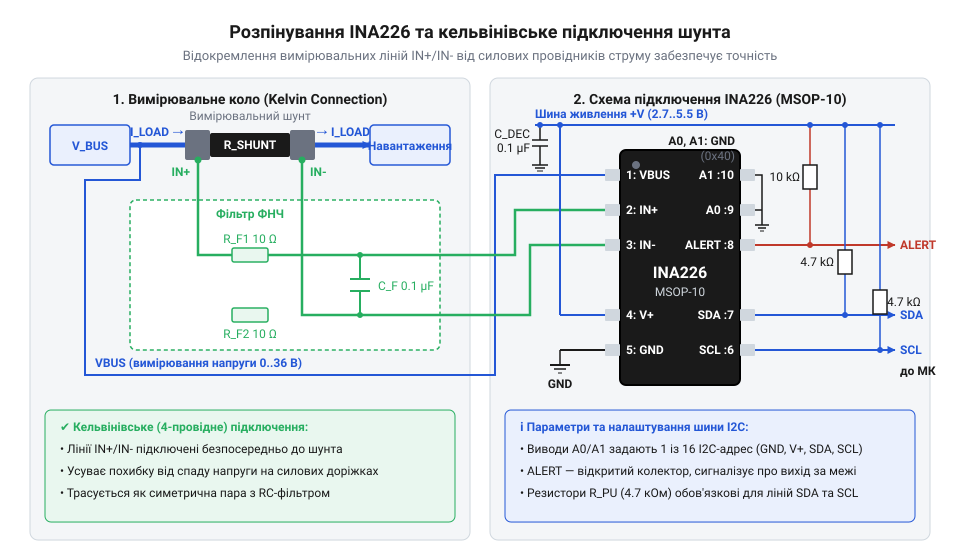
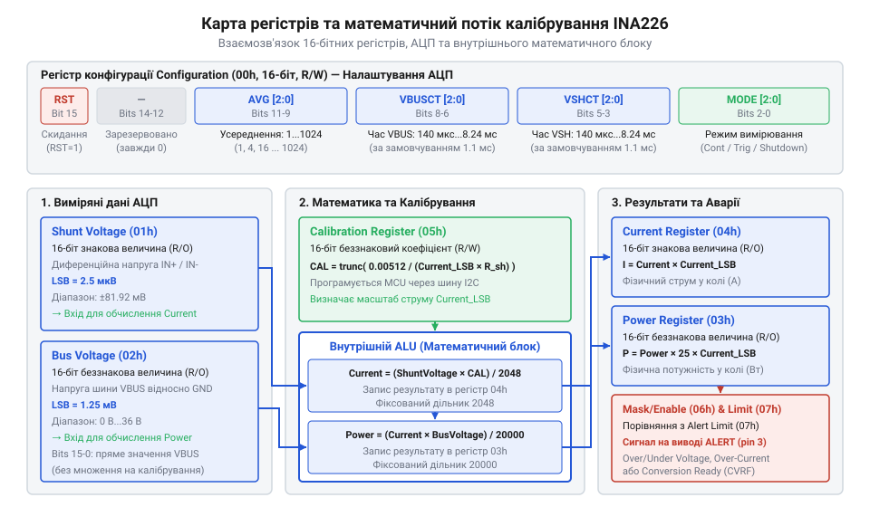

# Апаратний інтерфейс, цокольовка та карта регістрів INA226

<preknowlist>
- [INA219 — монітор струму й напруги (I2C)](root:cat-hw-sensors/ina219-power-monitor) — базові принципи цифрового вимірювання струму та напруги за допомогою вимірювального шунта та шини I2C
- [Конфігурація та усереднення вимірювань INA226](root:cat-hw-sensors/ina226-config-and-averaging) — поняття часу конверсії АЦП, режимів безперервного та тригерного вимірювання й методів цифрового усереднення вибірок
</preknowlist>

## Чому аналогове вимірювання струму дає похибку

Прямолінійне вимірювання струму споживання через аналогово-цифровий перетворювач (@@en|АЦП@@) мікроконтролера дає похибки у десятки відсотків. Причина — паразитні опори мідних трас друкованої плати. У двопровідній схемі через вимірювальні ділянки протікає силовий струм навантаження `I_load`. Навіть декілька міліметрів доріжки додають паразитний опір `R_trace`, через що замість падіння напруги лише на @@en|шунті@@ (від англ. @@en|shunt@@, відхилятися) `U_shunt = I_load × R_shunt` прилад фіксує `U_measured = I_load × (R_shunt + 2 × R_trace)`. А оскільки опір міді зростає на 0.393% на кожний градус Цельсія, нагрівання плати створює непередбачуваний температурний дрейф нуля та масштабу.

Друга перешкода — обмеження вбудованого @@en|АЦП@@. Зазвичай 10- чи 12-бітний перетворювач вимірює напругу відносно спільної землі (`GND`). При вимірюванні у верхньому плечі живлення (high-side) напруга 12–36 В спалить вхід мікроконтролера без зовнішніх операційних підсилювачів. У нижньому ж плечі (low-side) при падінні на @@en|шунті@@ 0–50 мВ 12-бітний @@en|АЦП@@ із опорною напругою 3.3 В дає лише 62 відліки шкали, що унеможливлює точний моніторинг.

Порівняно з пристроями [попереднього покоління давачів](root:cat-hw-sensors/ina19-power-monitor), ці апаратні обмеження долає цифровий монітор живлення @@en|INA226@@. Він містить 16-бітний дельта-сигма @@en|АЦП@@ з вимірюванням на тлі синфазної напруги від 0 В до +36 В та підтримує чотирипровідне @@en|Кельвінівське підключення@@ (англ. @@en|Kelvin connection@@, від імені лорда Кельвіна). Це відокремлює силове коло від сигнального й виключає опір провідників із результату вимірювання.

## Цокольовка INA226 та правила Кельвінівського трасування

Пристрій @@en|INA226@@ випускається у компактних 10-вивідних корпусах @@en|VSSOP-10@@ та @@en|MSOP-10@@. Для проектування схемотехніки та друкованої плати необхідно чітко розуміти функціональне призначення кожного виводу.

Виводи мікросхеми розподілені за двома основними групами: цифрова шина й управління та аналоговий вимірювальний інтерфейс:
1. `A1` — перший вивід вибору цифрової адреси @@en|I2C@@. 2. `A0` — нульовий вивід вибору цифрової адреси @@en|I2C@@. 3. `ALERT` — вихід апаратного переривання з відкритим стоком (англ. @@en|open-drain@@, вихід без активного верхнього транзистора). 4. `SDA` — лінія даних двопровідної шини @@en|I2C@@. 5. `SCL` — лінія синхронізації двопровідної шини @@en|I2C@@. 6. `VS` — вивід живлення внутрішньої цифрової та аналогової схемотехніки (від +2.7 В до +5.5 В). 7. `GND` — спільна шина живлення та земляний потенціал мікросхеми. 8. `VBUS` — аналоговий вхід вимірювання напруги шини живлення (від 0 В до +36 В відносно `GND`). 9. `IN-` — інвертувальний вхід диференціального підсилювача вимірювання падіння напруги на @@en|шунті@@. 10. `IN+` — неінвертувальний вхід диференціального підсилювача вимірювання падіння напруги на @@en|шунті@@.


*Апаратне розпінування INA226 у корпусі VSSOP-10 та чотирипровідна схема Кельвінівського трасування диференціальної пари ліній вимірювання.*

Для досягнення заявленої 16-бітної точності ключове значення має топологія розводки друкованої плати. Вимірювальні лінії `IN+` та `IN-` повинні трасуватися за правилами @@en|Кельвінівського трасування@@. Силовий струм навантаження підводиться до зовнішніх країв контактних майданчиків вимірювального @@en|шунта@@ через широкі мідні полігони. Сигнальні провідники `IN+` та `IN-` підключаються строго до внутрішніх точок контактних майданчиків @@en|шунта@@ безпосередньо під тілом резистора за допомогою окремих вузьких доріжок. Завдяки високому вхідному опору вхідних каскадів @@en|INA226@@ струм через лінії `IN+` та `IN-` практично дорівнює нулю, тому падіння напруги на цих сигнальних доріжках відсутнє.

Лінії `IN+` та `IN-` мають трасуватися як щільна @@en|диференціальна пара@@ (від лат. @@la|differentia@@, різниця) з однаковою довжиною та мінімальним зазором між собою. Їх слід оточувати земляним полігоном і розміщувати якомога далі від імпульсних силових вузлів і високочастотних цифрових ліній `SDA` та `SCL`, щоб запобігти наведенню електромагнітних завад. У середовищах із підвищеним рівнем завад безпосередньо біля виводів `IN+` та `IN-` мікросхеми встановлюють симетричний RC-фільтр низьких частот: два послідовних резистори номіналом 10 Ом та один керамічний диференціальний конденсатор 0.1 мкФ між ними.

Вивід живлення `VS` потребує обов'язкового розв'язувального керамічного конденсатора ємністю 0.1 мкФ, розміщеного на відстані не більше 2 мм від ніжок `VS` та `GND`. Вивід вимірювання напруги `VBUS` підключається до тієї сторони @@en|шунта@@, яка з'єднана з джерелом живлення (при вимірюванні у верхньому плечі це вивід `IN+`).

Цифрові лінії `SDA` та `SCL` потребують @@en|підтягувальних резисторів@@ `R_pullup` до лінії живлення цифрової частини. Мінімальне значення @@en|підтягувального резистора@@ обмежується максимально допустимим струмом виходу @@en|відкритий стік@@ `I_OL = 3 mA`:

```
R_pullup_min = (V_VS - V_OL) / I_OL
             = (3.3 - 0.4) / 0.003       [підстановка напруги живлення 3.3 В]
             = 966 Ом                    [найближчий стандартний номінал 1 кОм]
```

Максимальне значення резистора обмежується паразитною ємністю шини `C_bus` та вимогами до часу наростання фронту сигналу `t_r` (для режиму 400 кГц `t_r ≤ 300 нс`):

```
R_pullup_max = t_r / (0.8473 × C_bus)
             = 300⁻⁹ / (0.8473 × 100⁻¹²)  [при ємності шини 100 пФ]
             = 3540 Ом                   [верхня межа підтяжки]
```

Для більшості практичних застосувань із напругою живлення 3.3 В або 5 В обирають @@en|підтягувальні резистори@@ номіналом від 2.2 кОм до 4.7 кОм.

## Конфігурація I2C адреси виводами A0 A1

При побудові багатоканальних систем моніторингу живлення виникає потреба підключати кілька моніторів струму до однієї шини @@en|I2C@@. Мікросхема @@en|INA226@@ вирішує це завдання без використання зовнішніх апаратних мультиплексорів за допомогою гнучкої системи адресації.

На відміну від простих давачів, де адресні виводи мають лише два стани (з'єднання з `GND` або `VS`), в @@en|INA226@@ адресні виводи `A0` та `A1` підтримують чотирирівневе декодування станів. Кожен із двох виводів може бути підключений до однієї з чотирьох точок схеми:
- Земляний потенціал (`GND`);
- Напруга живлення мікросхеми (`VS`);
- Лінія даних шини @@en|I2C@@ (`SDA`);
- Лінія синхронізації шини @@en|I2C@@ (`SCL`).

Комбінація чотирьох станів виводу `A1` та чотирьох станів виводу `A0` утворює 16 унікальних 7-бітних адреси у неперервному діапазоні від `0x40` (0b1000000) до `0x4F` (0b1001111). Перелік усіх доступних комбінацій наведено нижче:

| Вивід A1 | Вивід A0 | 7-бітна I2C адреса (Hex) | Двійкове значення адреси |
|---|---|---|---|
| GND | GND | 0x40 | 0b1000000 |
| GND | VS | 0x41 | 0b1000001 |
| GND | SDA | 0x42 | 0b1000010 |
| GND | SCL | 0x43 | 0b1000011 |
| VS | GND | 0x44 | 0b1000100 |
| VS | VS | 0x45 | 0b1000101 |
| VS | SDA | 0x46 | 0b1000110 |
| VS | SCL | 0x47 | 0b1000111 |
| SDA | GND | 0x48 | 0b10001000 |
| SDA | VS | 0x49 | 0b10001001 |
| SDA | SDA | 0x4A | 0b10001010 |
| SDA | SCL | 0x4B | 0b10001011 |
| SCL | GND | 0x4C | 0b10001100 |
| SCL | VS | 0x4D | 0b10001101 |
| SCL | SDA | 0x4E | 0b10001110 |
| SCL | SCL | 0x4F | 0b10001111 |

Механізм розпізнавання станів виводів `A0` та `A1`, з'єднаних із лініями `SDA` чи `SCL`, працює під час подачі живлення або при генерації стартової умови шини @@en|I2C@@. Внутрішня схема адресації короткочасно опитує стан виводів за допомогою високоомних вимірювальних струмів. Оскільки опір декодера дуже високий, підключення виводів `A0`/`A1` до ліній `SDA`/`SCL` не чинить відчутного впливу на передачу даних по шині @@en|I2C@@ і не спотворює фронти цифрових сигналів.

Завдяки такій схемі інженер може розмістити до 16 незалежних моніторів @@en|INA226@@ на одній фізичній шині @@en|I2C@@ мікроконтролера, з'єднавши адресні виводи зручним чином прямо на друкованій платі під час трасування.

## Карта регістрів та розрахунок калібрувального коефіцієнта

Взаємодія хост-мікроконтролера з @@en|INA226@@ здійснюється через внутрішню карту 16-бітних @@en|регістрів@@ (від лат. @@la|registrum@@, список). Кожна адреса оперує двобайтними словами (MSB передається першим).

Карта містить 8 доступних регістрів:
- `0x00`: @@en|Configuration Register@@ — конфігурація режимів роботи, часу конверсії та усереднення. - `0x01`: @@en|Shunt Voltage Register@@ — сире падіння напруги на @@en|шунті@@ (знакове 16-бітне число в доповняльному коді). - `0x02`: @@en|Bus Voltage Register@@ — напруга шини живлення (беззнакове 16-бітне число). - `0x03`: @@en|Power Register@@ — обчислена внутрішнім математичним блоком потужність (беззнакове 16-бітне число). - `0x04`: @@en|Current Register@@ — обчислений внутрішнім математичним блоком струм (знакове 16-бітне число). - `0x05`: @@en|Calibration Register@@ — масштабувальний калібрувальний коефіцієнт `CAL`. - `0x06`: @@en|Mask/Enable Register@@ — селектор джерел апаратного переривання та прапорці стану. - `0x07`: @@en|Alert Limit Register@@ — порогове значення для порівняння з вибраним параметром.


*Карта 16-бітних регістрів INA226 та схема математичного потоку даних при обчисленні струму й потужності.*

Розберемо детально структуру конфігураційного регістру `0x00` (за замовчуванням `0x4127`):
- Біт 15 `RST`: програмне скидання. Запис одиниці повертає всі регістри до початкових значень. - Біти 14–12: зарезервовані, завжди мають значення `0`. - Біти 11–9 `AVG`: кількість вибірок для [усереднення вимірювань INA226](root:cat-hw-sensors/ina226-config-and-averaging). `000` = 1 вибірка, `001` = 4, `010` = 16, `011` = 64, `100` = 128, `101` = 256, `110` = 512, `111` = 1024. - Біти 8–6 `VBUSCT`: час конверсії @@en|АЦП@@ для напруги шини (`000` = 140 мкс, `001` = 204 мкс, `010` = 332 мкс, `011` = 588 мкс, `100` = 1.1 мс (за замовчуванням), `101` = 2.116 мс, `110` = 4.156 мс, `111` = 8.244 мс). - Біти 5–3 `VSHCT`: час конверсії @@en|АЦП@@ для напруги @@en|шунта@@ (градації ідентичні `VBUSCT`). - Біти 2–0 `MODE`: режим вимірювання (`000` — вимкнено, `001` — тригерне вимірювання шунта, `010` — тригерне вимірювання шини, `011` — тригерне вимірювання обох, `100` — режим сну, `101` — неперервне вимірювання шунта, `110` — неперервне вимірювання шини, `111` — неперервне вимірювання шунта й шини).

Для того, щоб регістри `Current` (0x04) та `Power` (0x03) повертали прямі фізичні значення в Амперах та Ватах, розробник має обчислити та записати ціле число в @@en|Calibration Register@@ через процедуру @@en|калібрування@@ (від араб. @@ar|qalib@@, форма).

Апаратний математичний блок @@en|INA226@@ використовує фіксовану внутрішню константу 0.00512. Розрахунок виконується у три кроки.

Крок 1. Визначення цільової дискретності струму `Current_LSB`. Для цього очікуваний максимальний струм системи `I_max` ділиться на повну 15-бітну шкалу @@en|АЦП@@ (32768):

```
Current_LSB = I_max / 32768
```

Отримане значення округлюють до зручного більшого круглого числа (наприклад, 100 мкА/LSB, 500 мкА/LSB або 1 мА/LSB), щоб спростити подальше декодування на боці мікроконтролера.

Крок 2. Розрахунок значення `CAL` для регістру `0x05`:

```
CAL = 0.00512 / (Current_LSB × R_shunt)
```

де `R_shunt` — опір @@en|шунта@@ в Омах, а `Current_LSB` — дискретність у А/LSB.

Крок 3. Внутрішній обчислювальний конвеєр мікросхеми розраховує струм і потужність за апаратними формулами:

```
Current_Register = (Shunt_Voltage_Register × CAL) / 2048
Power_Register   = (Current_Register × Bus_Voltage_Register) / 20000
```

При цьому дискретність вихідних регістрів визначається так:
- `Shunt Voltage`: 1 LSB = 2.5 мкВ (фіксовано апаратно);
- `Bus Voltage`: 1 LSB = 1.25 мВ (фіксовано апаратно);
- `Current`: 1 LSB = `Current_LSB` (встановив розробник);
- `Power`: 1 LSB = `25 × Current_LSB` (фіксована апаратна залежність).

Розглянемо покроковий розрахунок на конкретному схемотехнічному прикладі.

**Умова:** Опір шунта `R_shunt = 0.01 Ом` (10 мОм), максимальний очікуваний струм навантаження `I_max = 10 А`.

```
Current_LSB_ideal = I_max / 32768
                  = 10 / 32768            [розрахунок ідеальної дискретності]
                  = 0.000305175 А/LSB     [початкове значення]

Current_LSB       = 0.0003 А/LSB          [округлення до 300 мкА/LSB]

CAL               = 0.00512 / (Current_LSB × R_shunt)
                  = 0.00512 / (0.0003 × 0.01) [підстановка номіналів]
                  = 0.00512 / 0.000003
                  = 1706.66               [математичний результат]
                  = 1707                  [округлення до цілого 0x06AB]
```

**Перевірка обчислень:** Нехай струм навантаження становить 1.0 А. При `R_shunt = 0.01 Ом` падіння напруги на @@en|шунті@@ дорівнює 10 мВ (10000 мкВ). У регістрі `Shunt Voltage` (0x01) це сформує значення: `10000 / 2.5 = 4000 LSB`.

Обчислення значення в регістрі `Current` внутрішнім блоком @@en|INA226@@:

```
Current_Register = (4000 × 1707) / 2048
                 = 6828000 / 2048         [перемноження на CAL та зсув]
                 = 3333.98                [результат 3334 LSB]

I_measured       = Current_Register × Current_LSB
                 = 3334 × 0.0003          [переведення у фізичні величини]
                 = 1.0002 А               [похибка менше 0.02%]
```

Дискретність регістру потужності для даного налаштування становитиме `Power_LSB = 25 × 0.0003 = 0.0075 Вт/LSB` (7.5 мВт на один відлік).

## Програмування виводу ALERT та обробка переривань

Вивід `ALERT` призначений для апаратного сповіщення хост-мікроконтролера про позаштатні режими роботи системи живлення (коротке замикання, перевантаження за струмом, просідання чи перевищення напруги) або про готовність чергової порції вимірювальних даних.

Апаратно вивід `ALERT` виконаний за схемою з @@en|відкритим стоком@@ (англ. @@en|open-drain@@). У нормальному стані вихід перебуває у високоімпедансному стані. Для створення логічного рівня вивід підтягують зовнішнім @@en|підтягувальним резистором@@ 10 кОм до шини живлення мікроконтролера. При спрацьовуванні переривання внутрішній N-канальний транзистор відкривається і притягує лінію `ALERT` до землі (активний низький рівень `Active LOW`).

Конфігурування умов спрацьовування здійснюється через `Mask/Enable Register` (`0x06`):
- Біт 15 `SOL` (Shunt Voltage Over-Limit): генерація переривання при перевищенні напруги @@en|шунта@@ порогового значення. - Біт 14 `SUL` (Shunt Voltage Under-Limit): переривання при просіданні напруги @@en|шунта@@ нижче порогу. - Біт 13 `BOL` (Bus Voltage Over-Limit): переривання при перевищенні напруги шини. - Біт 12 `BUL` (Bus Voltage Under-Limit): переривання при просіданні напруги шини нижче порогу. - Біт 11 `POL` (Power Over-Limit): переривання при перевищенні порогової потужності. - Біт 10 `CNVR` (Conversion Ready): генерація імпульсу переривання після завершення кожного циклу вимірювання та усереднення @@en|АЦП@@. - Біт 4 `AFF` (Alert Function Flag): прапорець виникнення події переривання (читається мікроконтролером). - Біт 3 `CVRF` (Conversion Ready Flag): прапорець готовності вимірювальних даних. - Біт 2 `OVF` (Math Overflow Flag): прапорець математичного переповнення внутрішнього розрахункового блоку. - Біт 1 `APOL` (Alert Polarity): налаштування полярності сигналу `ALERT` (`0` — `Active LOW`, `1` — `Active HIGH`). - Біт 0 `LEN` (Latch Enable): режим утримання сигналу переривання (`0` — прозорий режим `Transparent`, `1` — защеплений режим `Latch`).

Поріг спрацьовування задається у регістрі `Alert Limit Register` (`0x07`). Формат значення в цьому регістрі повинен чітко відповідати вибраній функції в регістрі `Mask/Enable`:
- Якщо активовано прапорці `SOL` або `SUL`, значення в `0x07` записується у форматі регістру `Shunt Voltage` (1 LSB = 2.5 мкВ);
- Якщо активовано `BOL` або `BUL`, значення записується у форматі регістру `Bus Voltage` (1 LSB = 1.25 мВ);
- Якщо активовано `POL`, значення записується у форматі регістру `Power` (1 LSB = `25 × Current_LSB`).

Важливою апаратною особливістю є режим утримання сигналу `LEN`. У прозорому режимі (`LEN = 0`) сигнал `ALERT` самостійно знімається, як тільки виміряний параметр повертається в норму. Проте для систем апаратного захисту це небезпечно: короткий сплеск струму може зникнути до того, як мікроконтролер встигне відреагувати.

У защепленому режимі (англ. @@en|Latch@@, засувка) `LEN = 1`, коли виміряний параметр перетинає задану межу, вивід `ALERT` переходить в активний стан і залишається в ньому навіть після того, як струм чи напруга повернулися до безпечного рівня. Лінія `ALERT` скидається у вихідний стан лише після того, як хост-мікроконтролер прочитає вміст регістру `Mask/Enable` (0x06) по шині @@en|I2C@@. Це гарантує, що жодна аварійна подія не буде втрачена.

Прапорець математичного переповнення `OVF` (біт 2 регістру `0x06`) сигналізує про ситуацію, коли в результаті перемноження сирих даних на коефіцієнт `CAL` обчислене значення струму або потужності перевищило розрядність 16-бітного регістру (понад 65535 LSB). Якщо прапорець `OVF` встановився в `1`, дані в регістрах `Current` та `Power` є недовірчивими, а розробнику необхідно переглянути вибір значення `Current_LSB` та коефіцієнта `CAL`.